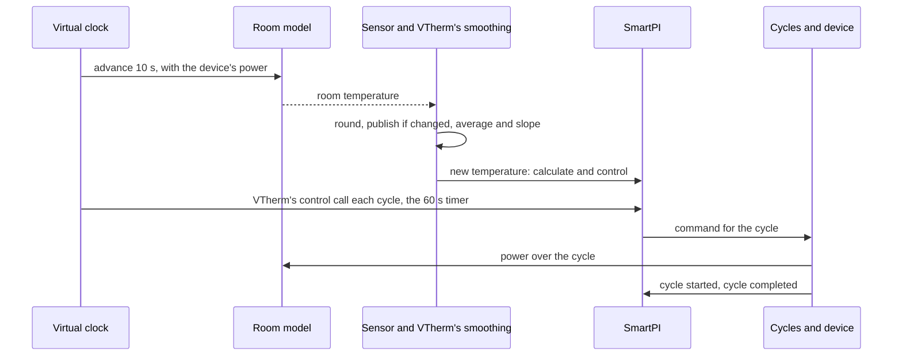

# Tests

This document brings all the tests of this fork together: how to run them, the simulator that
most of them use, each simulation scenario and what it must show, the other tests, sorted by
feature, and the QAS tests on a real Home Assistant. The features themselves are described in the [technical documentation](technical_doc.md),
[Zone dependencies and a second heat source](zone_dependencies.md) and
[Water input](water_input.md). The author's own tests are unchanged and run together with these.

## Contents

1. [Running the tests](#1-running-the-tests)
2. [The simulator](#2-the-simulator)
3. [Simulation scenarios](#3-simulation-scenarios)
4. [Tests by feature](#4-tests-by-feature)
5. [Limits](#5-limits)
6. [QAS on a real Home Assistant](#6-qas-on-a-real-home-assistant)

## 1. Running the tests

Run the tests from the repository folder, with a copy of Versatile Thermostat (VTherm) on the
Python path. This is the same set-up as the author's continuous integration (CI, the tests that
GitHub runs automatically):

    PYTHONPATH=<versatile_thermostat copy>:$PWD python -m pytest tests/ -q

There are two sets of tests:

| Set | What it holds | Where it runs |
|---|---|---|
| Short | the unit tests (small tests of one part of the code) and the simulations that take only seconds | every pull request (workflow "Tests"), and locally by default |
| Long | the short set, plus the long simulations and the comparisons with VTherm's own code | locally with `SMARTPI_SIM_LOCAL=1`; on GitHub in the workflow "Full tests", on each push to the `qas` branch and on demand |

The long simulations depend on `SMARTPI_SIM_LOCAL`. Without it, they are shown as skipped.

## 2. The simulator

### 2.1 Why

- **A house is slow and never repeats itself.** SmartPI learns over several days. In a real house,
  each question about the extensions (a door, a slower floor, a boiler that waits for more demand)
  would take weeks. And the next try would never have the same weather.
- **The truth is known.** In the simulator, the test sets the room's heating power `a`, its heat
  loss `b`, the delays and the heat exchanges. So what SmartPI learns can be checked against these
  true values. In a house, only the room temperature can be judged.
- **The real code runs.** The simulator runs SmartPI's real handler and algorithm. Only the work
  that Versatile Thermostat and Home Assistant do around them is copied.
- **Comparisons are made while the test runs.** A scenario runs twice, for example with and without
  a feature, and the two runs are compared. Results saved in advance are not used: they would stop
  matching after each change to the author's algorithm.

### 2.2 What it models

| Part | File | What it does |
|---|---|---|
| Rooms | `tests/sim/plant.py` | A simple heat model in SmartPI's own units. How fast a heater warms the room is SmartPI's `a` (°C/min at full power). A link to the outdoors is SmartPI's `b` (1/min). A heater has a delay. A slow heat emitter, such as a heated floor, passes its heat through a lag: its heat output follows the device slowly, not at once. A "two-stage" emitter passes it through two shorter lags in a row, like a floor slab warming through its thickness. Two rooms can be linked all the time, or by a door that opens on a schedule. The model is calculated in time steps of 10 s or less. |
| Sensors and VTherm's smoothing | `tests/sim/sensors.py` | A sensor is read every 10 s and rounded (to 0.1 °C by default). Its value is published only when the rounded value changes. VTherm's moving average and slope (rate of change) are copied: the average has a half-life of 300 s, and the slope is in °C/h. |
| Heating cycles | `tests/sim/scheduler.py` | A copy of VTherm's cycle scheduler (the part that turns a command into the device's cycles) for one device: on/off cycles, minimum on and off times, valves. VTherm's own scheduler is not imported: it is internal to VTherm and changes with VTherm's main branch. There is one difference on purpose: an error in a cycle stops the simulation, instead of only being logged. |
| Time | `tests/sim/clock.py` | A virtual clock replaces SmartPI's clock, so a simulated week takes only seconds. It also runs the timers: VTherm's control call at every cycle, SmartPI's recalculation every 60 s, and the cycles. |
| Boiler and Smart Boiler | `tests/sim/boiler.py` | The water reaching a circuit: at a fixed temperature, or on a heating curve (a water temperature set from the outdoor temperature). It can add burner cycling, hot-water priority (the boiler heats the hot-water tank first), and a boiler that starts only when a zone asks for heat. A stand-in for Smart Boiler gives SmartPI the water data. |
| Weather | `tests/sim/weather.py` | The outdoor temperature: constant, a daily swing, or a sudden step. |
| Scenario set-up | `tests/sim/runner.py` | One zone (its `a`, `b`, delay, setpoint, cycle, valve or on/off device, sensor, neighbours, presets, boiler), a second thermostat in the zone (its power, delay and lag), and several zones in one shared world. |
| Measurements | `tests/sim/metrics.py` | What SmartPI learned compared with the true values, when its learning phase ended, and the room's error. |

### 2.3 One simulation step

## 3. Simulation scenarios

Unless a row says otherwise, the room has `a` 0.03 °C/min, `b` 0.001 /min, a 10 min delay, an
on/off device with a 10 min cycle, a 0.1 °C sensor and a setpoint of 20 °C. The outdoor
temperature is 3 °C, with a daily swing of ±3 °C. "Error" is the average gap between the room
temperature and its setpoint. "±x %" means within x % of the true value. A range without a unit,
such as 0.5–1.2, is the learned value divided by the true value.

### 3.1 Neighbouring zones — `test_smartpi_sim_neighbours.py` (short)

A room with a 0.01 °C sensor, next to a hall. The heat exchange with the hall, `k`, is 0.002. The
door is open 7:00–9:00, 12:00–13:30 and 18:00–22:00.

| Label | Scenario | What it must show |
|---|---|---|
| N1 | the hall is listed but switched off (mode `none`) | exactly the same run as without it |
| N2 | the hall behind a door, 3 days | `k` ±20 %; `a` and `b` ±5 %; no delay learned while the door is open |
| N3 | the hall always open, at 20 °C; its temperature jumps +4 °C at 30 h and −4 °C at 66 h | nothing published at 42 h; at 66 h, `k` ±10 % and the loss without the hall ±10 %; after the second jump, a smaller error than without the feature |
| N3 coarse | the same with a 0.1 °C sensor and one jump | either nothing published (the hall shown as "cannot be told apart", and SmartPI's own `b` used), or `k` ±20 % |
| N4 | the hall unavailable | exactly the same run as without it |
| N5 | cooling, the hall at 28 °C behind a door | `k` ±25 %; error below 0.3 °C from 60 h |
| N6 | the hall's window open for an hour while the door is open, once for each reaction | no `k` learned during that time; the reaction applied (nothing, off, frost 7 °C, eco 17 °C); the device runs or stops to match; afterwards the room does not rise more than 0.6 °C above its setpoint (overshoot) |
| N7 | a room between two always-open neighbours, the temperature of each jumping once | for each: `k` within ±35 %, or shown as "cannot be told apart" |

### 3.2 A zone with two heat sources — `test_smartpi_sim_second_source.py`

The main source is the room's radiator. In most scenarios the additional source is a water floor:
same power as the radiator, a 30 min delay, a 180 min lag, and the split rule (how the heat is
shared between the two sources) `lead_band` at 20 %.

| Label | Scenario | Set | What it must show |
|---|---|---|---|
| Z1, Z3 | the floor from the start, 40 h | short | the floor works in blocks while SmartPI learns, then follows the rule; the zone's model is published before 30 h, with `a`, `b` and the floor's power ±20 %; SmartPI uses that model; from 30 h the floor gives more than 20 % of the heat and the error is below 0.08 °C |
| — | the floor's own SmartPI while it works as the additional source | short | it learns nothing and changes nothing; it follows the main source's command; it regulates again once the main source is removed |
| Z6 | the main source stops responding | short | after 15 min the additional source regulates on its own; the room stays above 19.3 °C; when the main source is back, the additional source follows it again |
| — | the main source switched off, with a 20 min cycle | short | the additional source stays off and does not take over the zone |
| — | the floor on water from Smart Boiler | short | the floor turns the main source's power into its own command, using its own water data |
| — | power shedding (VTherm switching devices off when the house uses too much power) | short | a main source that is shed still sends its command; an additional source that is shed stays off |
| — | a restart of Home Assistant after 36 h | short | the zone's model is kept; error below 0.15 °C afterwards |
| Z7 | cooling with two sources | short | a separate cooling model, ±25 %; error below 0.15 °C |
| — | a valve as the additional source, which VTherm also recalculates | short | the valve follows the main source |
| Z1 compared | compared with two SmartPI working independently, 0.01 and 0.1 °C sensors, 96 h | long | error no more than 0.03 °C above the independent pair; the floor gives more than 35 % of the heat |
| Z1 nights | three nights with the setpoint lowered to 17 °C | long | overshoot no more than 0.1 °C above the independent pair; the last night's overshoot no more than 0.15 °C above the largest of the earlier nights (it does not grow night after night); the floor gives less than 90 % of the heat |
| Z2 | rule `source_first` at 50 % | long | the main source settles on the rule's curve (±0.15) |
| — | rule `together` at 200 % | long | the same |
| Z4 | a second radiator as the additional source | long | each gives half the heat (±0.15); error no more than 0.03 °C above the independent pair |
| Z5 | a main source too weak for the cold (`a` 0.015, outdoor −5 °C) | long | the floor keeps the room above 18.5 °C while SmartPI learns; once the weather is milder, SmartPI finishes learning |

### 3.3 Twelve rooms and four installations — `test_smartpi_sim_zone_set.py` (long)

Six rooms (from slow to fast heat loss, from slow to fast radiators) run in mild (3 °C) and cold
(−8 °C) weather. Each has a water floor of the same power. Each runs 96 h, then three nights with
the setpoint lowered to 17 °C (for 6, 8 and 10 h). Each is compared with two independent SmartPI. For every room:

- the zone's model is published by 30 h, with `a`, `b` and the floor's power ±15 %;
- the error from 48 h to 96 h is no more than 0.02 °C above the independent pair;
- the worst overshoot after a night is no more than 0.1 °C above the independent pair;
- every morning the room reaches its setpoint minus 0.2 °C, on average no more than 1 h later
  than the independent pair.

The same checks run for a floor behind a valve, a slab warming through its thickness, and water on
heating curves. Two zones side by side (always open, or with a door open 6:00–23:00) must each keep
an error no more than 0.02 °C above the independent pair. The results are in
[Zone dependencies, §5.8](zone_dependencies.md#58-results-and-limits-simulation).

### 3.4 Water — `test_smartpi_sim_water.py` (short)

A radiator (`a` 0.06 at 60 °C water) on a boiler with a heating curve.

| Scenario | What it must show |
|---|---|
| with and without Smart Boiler's water data, 48 h | without the data, SmartPI learns less than half of `a`; with the data, between 0.5 and 1.2 of `a`, and more than 1.5 times the value learned without them |
| hot water twice a day, burner cycling | while the boiler heats hot water, the integral (the part of the command that builds up over time) and the command do not move; error below 0.3 °C |
| the water data missing for 2 h, then for good | a short gap keeps the water factor (the heat the water gives compared with the reference water); a lasting gap sets the factor to 1 and offers the reset once |
| a boiler that starts only when the zone asks for heat | the room stays above 19 °C; SmartPI finishes learning and learns `a` within 0.5–1.2 |

### 3.5 A boiler that is not called — `test_smartpi_sim_boiler_call.py` (short)

A 2000 W radiator behind a valve, with a 0.01 °C sensor. The boiler starts only at a demand of
2500 W or more, so this room alone can never start it. Other zones (3000 W) start it, except during
one period of the day.

| Label | Scenario | What it must show |
|---|---|---|
| B1 | VTherm's central boiler, no water data, no boiler 2:00–8:00 | SmartPI not told that the boiler is not called: `a` below half; told: `a` within 0.85–1.2, `b` within 0.95–1.05, no `a` learned while the boiler is not called, the delay 9–13 min |
| B2 | Smart Boiler's call with water data, no boiler 10:00–16:00 | `b` within 0.95–1.05, `a` within 0.9–1.15, no `a` learned while the boiler is not called |

The results are in [Water input, §4.4](water_input.md#44-results-simulation).

### 3.6 SmartPI alone, two thermostats, and the simulator itself

| File | Set | What it checks |
|---|---|---|
| `test_smartpi_sim_baseline.py` | short and long | SmartPI alone learns a known room. With a 0.01 °C sensor: `a` and `b` ±5 % and the delay within 4 min, all within 12 h (a grid of 12 rooms in the long set). With a 0.1 °C sensor it still finishes learning, with `a` and `b` within 0.4–1.6 |
| `test_smartpi_sim_two_thermostats.py` | short and long | the floor's delay and lag in the room model; two thermostats, each with its own SmartPI, heating one room (today's behaviour, the baseline for Z1 and Z4) |
| `test_smartpi_regression_no_dependencies.py` | short | features configured but not active: exactly the same run and saved state as without the feature |
| `test_smartpi_sim_harness.py` | short | the clock, the timers, on/off cycles, minimum on and off times, valves, VTherm's control call at each cycle; the same run done twice gives the same result |
| `test_smartpi_sim_scheduler_parity.py` | long | the copied cycle scheduler and slope give the same events as VTherm's own code, over thousands of random commands and readings |

## 4. Tests by feature

### 4.1 AutoCalib events

| File | What it checks |
|---|---|
| `test_smartpi_autocalib_events.py` | every AutoCalib event carries the thermostat's real `entity_id` and its name in `name` |

### 4.2 Known inputs (the base of the extensions)

| File | What it checks |
|---|---|
| `test_smartpi_effective_model.py` | how known inputs (heat exchanged with neighbouring zones, heat from a second source) are combined into `b_eff` and `T_ref`, the loss and the reference temperature that the control uses; nothing changes without them |
| `test_smartpi_learning_window_known_inputs.py` | learning windows subtract the heat of known inputs |
| `test_smartpi_dependencies_algo.py` | the algorithm uses `b_eff` and `T_ref` everywhere in its control, keeps the raw values for learning, pauses learning while a learning gate is set (a condition such as a neighbour's open door), and saves and loads its state |
| `test_smartpi_dependencies.py`, `test_smartpi_dependency_inputs.py` | the configured items, how they are checked, the readings used in one calculation |
| `test_config_flow.py`, `test_config_flow_dependencies.py` | the options menu of a thermostat entry and the list of dependencies |

### 4.3 Neighbouring zones

| File | What it checks |
|---|---|
| `test_smartpi_coupling_estimator.py` | learning `k` for a neighbour behind a door, for several doors at once, and for an always-open neighbour |
| `test_smartpi_dependency_model.py` | learning gates, reactions to a neighbour's window, presets in cooling, an always-open neighbour entering the model without a jump |
| `test_smartpi_dependencies_handler.py` | the readings from Home Assistant |
| `test_config_flow_neighbours.py` | the neighbour forms: suggestions, errors, warnings, editing, the reset step |

### 4.4 A zone with two heat sources

| File | What it checks |
|---|---|
| `test_smartpi_zone_fit.py` | the zone's joint model (one model fitted for both sources together) finds the main source's delay, the floor's time scale, `a`, `b`, the floor's power and a neighbour's `k` |
| `test_smartpi_source_model.py`, `test_smartpi_source_candidates.py` | the floor's heat worked out from its cycles; the candidate time scales |
| `test_smartpi_split.py` | the split rules and the allocation loop |
| `test_smartpi_source_link.py` | the link between the two thermostats: commands, cycles, a main source that stops responding, the power limit |
| `test_smartpi_dependency_model_source.py` | learning blocks, the learning clock and its timeout, the brake, the faster recovery after a night, a restart, cooling |
| `test_smartpi_dependencies_handler.py` | heating types read from both entries, the reset requested from a form, a changed master thermostat (its devices compared by unique ID, also at a reload of the entry, when the thermostat has no entity ID yet) |
| `test_config_flow_zone.py` | the zone form: the master thermostat and its checks, the recommendation, moving the main source, the other thermostat's entry, a custom delay and lag, removal, the reset step |

### 4.5 Water

| File | What it checks |
|---|---|
| `test_smartpi_water_input.py` | the water factor, its averages, hot water, short and lasting gaps, saving and loading the state |
| `test_smartpi_water_algo.py` | command = power / factor, learning = command × factor, the power limit, the holds during hot water and with cold water |
| `test_smartpi_water_handler.py` | reading Smart Boiler, `water_factor` published, the reset offered when the data appear or disappear |
| `test_config_flow_heating_type.py` | the heating type in the settings; the step of the repair (Home Assistant's repair notice) |

### 4.6 A boiler that is not called

| File | What it checks |
|---|---|
| `test_smartpi_boiler_call.py` | the modes: a boiler that responds within 15 min changes nothing; for a call with no response, first the emitter cools, then the hold, then the emitter warms after the boiler starts; on/off devices and their cycle; a lost reading; Smart Boiler's reasons |
| `test_smartpi_boiler_algo.py` | learning sees no heat while held and waits around that period; the delay is not learned from the boiler's start; the feed-forward trim is frozen; a calibration is cancelled |
| `test_smartpi_boiler_handler.py` | Smart Boiler's fields and VTherm's central boiler, with each kind of wrong or missing value |

## 5. Limits

- **The simulator is kinder than a house.** It has no sensor noise except rounding; no sun, people
  or cooking; and one temperature per room unless the slab model is chosen. The results in the
  other documents are what SmartPI achieves under these conditions.
- **The weather** is a constant, a daily swing or a sudden step; there is no forecast.
- **A boiler's own control** (modulation, that is, changing the flame's power, and minimum burn
  time) is not modelled beyond what the scenarios above need.
- **VTherm is copied, not run,** in the simulator. The long set checks the copy against VTherm's
  own code, because VTherm's main branch may change. The QAS tests (section 6) run the real VTherm.

## 6. QAS on a real Home Assistant

The tests above run SmartPI inside the test process, on a copy of Versatile Thermostat's
scheduler. They check the physics, the learning and the split rules, but not what only a real
Home Assistant shows. The QAS tests (QAS: quality assurance, the branch `qas` they test) do that,
on a test bench of eight Home Assistant instances (the separate project `ha-testbed`):

- the real Versatile Thermostat 10.5.1, with its central boiler, power manager and window
  detection, two thermostats linked through Home Assistant and an over_climate master;
- the forms in Home Assistant, the entity registry and its areas;
- the saved state in `.storage` across real restarts;
- the recorder, the logbook and the repair notices.

The QAS tests are run by the bench's testing session, never by the session that writes the code,
and always on one commit of the `qas` branch. This repository holds the test pack: the
simulator, the helpers, the configurations, the setup scripts, the runner and this catalogue.

### 6.1 The test pack

Everything is under `tests/qas/`. No file there is named `test_*.py`, so CI's `pytest tests/`
does not run it: the runner needs the bench's `lib/`.

| Path | What it is |
|---|---|
| `custom_components/smartpi_room_sim/` | the room simulator as a Home Assistant integration: rooms, heaters, valves, a boiler, doors, windows and the outdoors. Its physics (`physics.py`) is the same file the in-process simulator uses: `tests/sim/plant.py` loads it |
| `custom_components/smartpi_qas_helpers/` | test-only helpers that reach into the running SmartPI: fire an AutoCalib event, silence a zone's main source, load a learned state, list the events fired |
| `roles.py` | the eight roles in one place: rooms, thermostats, SmartPI entries and base options |
| `config/<role>.yaml` | each role's `configuration.yaml`, written by `config/build.py` from `roles.py` |
| `setup/setup_role.py` | sets an instance up through the API, in stages (`setup/stages.py`), then restarts it |
| `run.py`, `scenarios/` | the runner and the scenarios, on the bench's `lib/harness.py` |
| `compare.py` | compares what two instances measured (QB1, QE5) |
| `README.md` | how to run it, in short |

**The simulator.** A room has a loss to the outdoors `b` and a capacity. A heater has a gain
`a`, a delay and an emitter lag (one stage, or two for a slab). Rooms are linked always or through
a door, and a window links a room to the outdoors. A water emitter heats only with the boiler's
water: it warms towards 60 °C while the boiler's switch is on and cools to 12 °C (below the rooms)
while it is off. Temperature sensors round to 0.1 or 0.01 °C and are written only when their
reading changes. Services set or ramp a room, move the outdoor mean, open or close a door or a
window, make a device stop responding (it keeps its state, and may also go unavailable), and reset
the inputs. All entity ids start with `smartpi_room_sim_`: nothing comes from a real house.

### 6.2 The roles of the instances

| Inst. | Role | What it holds |
|---|---|---|
| 1 | `base` | the living room: VTherm over_switch with SmartPI, no extension; an unheated attic (a sensor for QB3) |
| 2 | `neighbours` | the kitchen (SmartPI) with the hall behind a door (TPI, with a window sensor) and the dining room always open (TPI) as neighbours |
| 3 | `zone` | the lounge: a radiator (main source) and a floor (additional source) under the master `Lounge` (over_climate, self-regulation off); spare thermostats for QE1 |
| 4 | `zone-ref` | the same lounge with two independent SmartPI (the comparison for QE5) |
| 5 | `zone-valve` | the study: the floor is a valve (over_valve); VTherm's power manager |
| 6 | `central-boiler` | VTherm's central boiler (power threshold 2500 W): the bedroom (2000 W) cannot start it alone, the office (3000 W) can |
| 7 | `ref-0.4.0` | the twin of instance 1 on the author's 0.4.0, later upgraded to `qas` and back |
| 8 | `electric` | electric heating types (an electric heating mat, a fast electric heater); re-runs |

Each VTherm has a safety delay of 1440 min: a sensor that writes only on change keeps one value for
longer than VTherm's default of 60 min, and VTherm would take it for a dead sensor.

### 6.3 Deploying and running

The bench's testing session follows its own `docs/workflow.md`. For this pack:

1. **Stage** this repository at the commit of `qas` under test, and Versatile Thermostat at the
   tag of its latest release (10.5.1 on 2026-10-14).
2. **Deploy** each instance with its role:

       bin/deploy.sh --instance N --stage stage/vtherm_smartpi \
           --components stage/vtherm_smartpi/tests/qas/custom_components \
           --components stage/versatile_thermostat/custom_components \
           --config stage/vtherm_smartpi/tests/qas/config/<role>.yaml

3. **Set it up** through the API (VTherm's entries, areas, the boiler's thresholds and the maximum
   power, SmartPI's entries, the base options), then restart it:

       HA_INSTANCE=N python stage/vtherm_smartpi/tests/qas/setup/setup_role.py

   The stages, in order: `vtherm` (VTherm's central configuration, SmartPI's defaults entry, the
   thermostats, then the masters), `areas`, `inputs`, `smartpi` (one entry per SmartPI
   thermostat) and `options`. Each stage skips what already exists; `--stage` runs one.
4. **Run** scenarios, or `M` for the role's minimum set:

       HA_INSTANCE=N python stage/vtherm_smartpi/tests/qas/run.py M
       HA_INSTANCE=N python stage/vtherm_smartpi/tests/qas/run.py QD5      # detached: 72 h

   `run.py --list` shows the scenarios. Each one runs only from its role's base (its SmartPI entries
   and their options; the neighbours and the zone are compared by what they mean, not by the ids
   the forms give). Between scenarios, the simulator's inputs and the thermostats go back to the
   base.
5. **Compare** the pairs: `python stage/vtherm_smartpi/tests/qas/compare.py qb1` (instances 1 and
   7) and `compare.py qe5` (instances 3 and 4), from the bench's directory.

**Instance 7** goes from 0.4.0 to `qas` and back. The bench deploys the fork at 0.4.0 (51db763)
with `--ref`, and the test pack's components from a checkout of `qas`:

    QB1 / QB1s  →  QB2a (or QB2l after QB1)  →  deploy qas  →  QB2  →  QB3a  →  deploy 0.4.0  →  QB3

### 6.4 Timing

A scenario waits for what SmartPI does after its own delays, plus a margin of two calculations. The
runner reads the delays from the staged plugin (`smartpi/const.py` and `smartpi/source_model.py`):

| What | Time |
|---|---|
| a calculation | 60 s |
| VTherm's cycle | 10 min |
| after a door closes, learning waits | 10 min |
| the boiler's grace | 15 min, plus the cycle for an on/off device |
| an emitter's settling (delay and three lags) | radiator 65 min, floor on water 570 min |
| a silent main source | 15 min |
| VTherm's window detection | 30 s |

The simulator moves on every 7 s and the outdoor temperature wiggles over 2838 s: no period of the
simulator is a multiple of SmartPI's 60 s or of the cycle. Room temperatures change in ramps.

### 6.5 The catalogue

"Detached": longer than two hours, so the bench runs it in the background. "Minimum": in the
minimum set, run after any change. The set "with Smart Boiler" is planned: how to test with Smart
Boiler (the real plugin at a named version, or a test-only stand-in for its interface) is still
to be decided, and none of it is built.

| ID | What it checks | Instance and role | Time | Detached | In-process twin | Minimum | Set |
|---|---|---|---|---|---|---|---|
| QA1 | After the setup's restart every SmartPI and VTherm entry is loaded, neither logs a warning or an error, each SmartPI thermostat has its diagnostics, and nothing of Smart Boiler is there. | 1 `base`, 8 `electric` | 15 min | no | test_factory.py | yes | without Smart Boiler |
| QA2 | Saving a thermostat entry's settings unchanged goes through the options menu without a reset step, keeps the stored options, and reloads the entry once without a loop. | 1 `base` | 15 min | no | test_config_flow_dependencies.py | yes | without Smart Boiler |
| QA3 | SmartPI's four services work on VTherm 10.5.1, and a paused learning stays paused across a restart. | 1 `base` | 30 min | no | test_services.py | no | without Smart Boiler |
| QA4 | AutoCalib events carry the thermostat's climate entity in entity_id and its name in name, and neither the recorder nor the logbook logs an invalid entity id. | 1 `base` | 60 min | no | test_smartpi_autocalib_events.py | yes | without Smart Boiler |
| QA5 | Two restarts keep the learned state (the model, its counts and the applied reset token), and a reset token is not applied again. | 1 `base` | 20 min | no | test_algo_persistence.py | yes | without Smart Boiler |
| QA6 | A water heating type shows the water block with source none and factor 1 and no boiler block without VTherm's central boiler, an electric type shows neither, and nothing is logged at each control call. | 1 `base`, 8 `electric` | 20 min | no | test_smartpi_water_handler.py, test_smartpi_boiler_handler.py | yes | without Smart Boiler |
| QB1 | Over 48 h the twin room learns and regulates; the instance keeps a, b and its mean error from 24 to 48 h, and compare.py qb1 passes when the qas instance's a and b are within ±10 % of 0.4.0's and its mean error is no more than 0.03 °C above. | 1 `base`, 7 `ref-0.4.0` | 48 h | yes | test_smartpi_regression_no_dependencies.py, test_smartpi_sim_baseline.py | no | without Smart Boiler |
| QB1s | For 45 minutes the twin room regulates and nothing logs an error, and the instance keeps what compare.py qb1s reads (both instances regulating, phases named). Short variant of QB1. | 1 `base`, 7 `ref-0.4.0` | 45 min | no | test_smartpi_sim_baseline.py | yes | without Smart Boiler |
| QB2a | On 0.4.0, before the upgrade: SmartPI's state is the learned fixture, saved by 0.4.0 itself with learning paused, and its model is kept for QB2. | 7 `ref-0.4.0` | 10 min | no | test_algo_persistence.py | yes | without Smart Boiler |
| QB2 | After the upgrade from 0.4.0 to qas, the state 0.4.0 saved is loaded unchanged, no warning about its format is logged, nothing is reset, and the old entry's options menu works. | 7 `ref-0.4.0` | 30 min | no | test_algo_persistence.py | yes | without Smart Boiler |
| QB3a | On qas, before going back to 0.4.0: a neighbour (the attic's sensor) is added to the entry, learning is paused and the model is kept for QB3; this is left in place on purpose. | 7 `ref-0.4.0` | 10 min | no | — | no | without Smart Boiler |
| QB3 | Back on 0.4.0 with a neighbour configured, the entry loads without errors and the state too; saving the options in 0.4.0 drops the fork's keys, as known. | 7 `ref-0.4.0` | 30 min | no | — | no | without Smart Boiler |
| QB2l | On 0.4.0 after QB1, before the upgrade: the model 0.4.0 learned itself is kept for QB2 with learning paused, without seeding. | 7 `ref-0.4.0` | 5 min | no | test_algo_persistence.py | no | without Smart Boiler |
| QC1 | For a thermostat VTherm's central boiler serves, the boiler block reads source vtherm_central_boiler, and its called follows the central boiler's binary sensor. | 6 `central-boiler` | 30 min | no | test_smartpi_boiler_handler.py | yes | without Smart Boiler |
| QC2 | The small zone calling alone below the thresholds goes emitter_cooling after the grace, held after its emitter's settling time without learning a, emitter_warming once the big zone starts the boiler, and back to normal learning one settling time later. | 6 `central-boiler` | 2.5 h | yes | test_smartpi_boiler_call.py, test_smartpi_boiler_algo.py | no | without Smart Boiler |
| QC2s | The small zone calling alone below the thresholds goes emitter_cooling after the grace and held after its emitter's settling time without learning a, then emitter_warming once the big zone starts the boiler. Short variant of QC2, QC4. | 6 `central-boiler` | 95 min | no | test_smartpi_boiler_call.py, test_smartpi_boiler_algo.py | yes | without Smart Boiler |
| QC3 | With the central boiler's binary sensor gone (disabled), SmartPI reads no boiler's call and learns as before, logging no error; the sensor comes back afterwards. | 6 `central-boiler` | 20 min | no | test_smartpi_boiler_handler.py | yes | without Smart Boiler |
| QC4 | Every day from 2:00 to 8:00 the big zone stays off, so the small zone calls without the boiler; after 48 h its learned a is within 0.85–1.2 of its radiator's true a. | 6 `central-boiler` | 48 h | yes | B1 (test_smartpi_sim_boiler_call.py) | no | without Smart Boiler |
| QD1 | The neighbour forms show each error and warning, suggest the door sensor of the two zones' areas, edit and remove with their reset step, and stop with neighbour_missing, dependencies_unchanged and zone_changed. | 2 `neighbours` | 45 min | no | test_config_flow_neighbours.py | yes | without Smart Boiler |
| QD2 | A reset chosen in a neighbour form resets the kitchen's model once, and the next restart does not reset it again. | 2 `neighbours` | 20 min | no | test_smartpi_dependencies_handler.py | yes | without Smart Boiler |
| QD3 | A neighbour that is unavailable, or in mode none, takes no part: its connection is inactive and the kitchen's model has no known input from it. | 2 `neighbours` | 30 min | no | N1, N4 | yes | without Smart Boiler |
| QD4 | With the door open, the hall's open window makes the kitchen react as its setting says (nothing, off, frost, eco) without learning any k meanwhile, and the kitchen is back to normal once the window and the door close. | 2 `neighbours` | 60 min | no | N6 | yes | without Smart Boiler |
| QD5 | With the door open every day 7–9, 12–13:30 and 18–22 for 72 h, the kitchen learns the hall's k within ±25 % of the true exchange and no dead time while the door is open. | 2 `neighbours` | 72 h | yes | N2, N5 | no | without Smart Boiler |
| QD5s | Opened twice for 8 minutes, the door pauses the kitchen's learning (door_open, then door_settling) and no dead time is learned while it is open. Short variant of QD5. | 2 `neighbours` | 40 min | no | N2 | yes | without Smart Boiler |
| QD6 | With the dining room always open and its temperature stepping on its own for 72 h, the kitchen learns its k within ±20 % of the true exchange, or flags it indistinguishable. | 2 `neighbours` | 72 h | yes | N3 | no | without Smart Boiler |
| QD6s | When the always-open dining room's temperature steps, the kitchen keeps it connected without pausing its learning, and logs no error. Short variant of QD6. | 2 `neighbours` | 30 min | no | N3 | yes | without Smart Boiler |
| QE1 | The zone form refuses each wrong master, creates the missing entry of a device restarting only that thermostat, moves a zone set up from the additional source to the main one, stops with zone_changed, and removes the zone. | 3 `zone` | 60 min | no | test_config_flow_zone.py | yes | without Smart Boiler |
| QE2 | In the running zone the additional source learns nothing and applies the main source's command, and changing its heating type restarts the main source. | 3 `zone` | 60 min | no | test_smartpi_sim_second_source.py | yes | without Smart Boiler |
| QE3 | When the main source goes silent, the additional source regulates the zone alone after 15 minutes with the room above 19.3 °C, and follows the main source again once it is back. | 3 `zone` | 60 min | no | Z6 | yes | without Smart Boiler |
| QE4 | When the master's devices change in VTherm, SmartPI logs a warning at start and the zone keeps running. | 3 `zone` | 15 min | no | test_smartpi_dependencies_handler.py | yes | without Smart Boiler |
| QE5 | Over 48 h the zone publishes its model before about 30 h, regulates no more than 0.05 °C worse than the independent pair, the floor gives over 20 % of the heat, and a restart at 36 h keeps the model; compare.py qe5 judges it. | 3 `zone`, 4 `zone-ref` | 48 h | yes | Z1 compared | no | without Smart Boiler |
| QE5s | For 45 minutes the zone (or the independent pair) regulates and nothing logs an error, the floor following the radiator in the zone. Short variant of QE5. | 3 `zone`, 4 `zone-ref` | 45 min | no | Z1 compared | yes | without Smart Boiler |
| QE6 | When VTherm's power manager sheds the zone's devices, a shed main source still sends its command and a shed additional source stays off. | 5 `zone-valve` | 60 min | no | power shedding | no | without Smart Boiler |
| QE7 | Over 2 h the valve, as the additional source, follows the main source's command. | 5 `zone-valve` | 2 h | no | valve as additional source | no | without Smart Boiler |
| QZ1 | SmartPI logs no error and each of its warnings is listed, the recorder refuses none of the diagnostics' attributes, the forms read in Polish show text and not keys, and after three reloads of an entry its thermostat does not calculate twice and no zone's master is reported as changed. | all | 25 min | no | — | yes | without Smart Boiler |
| QW1 | Water data present for 48 h: source live, a within 0.5–1.2 of the truth and over 1.5 times the value learned without the data (planned, not built) | — | — | — | water with and without data | — | with Smart Boiler |
| QW2 | Hot water with priority (dhw_active): φ = 0, command and integral held (planned, not built) | — | — | — | hot water | — | with Smart Boiler |
| QW3 | Data missing for 2 h, then for good: the long average kept, then φ = 1 and the repair water_data_gone once; its fix resets the model (planned, not built) | — | — | — | gaps; test_config_flow_heating_type.py | — | with Smart Boiler |
| QW4 | Data appear after learning: the repair water_data_appeared once (planned, not built) | — | — | — | test_smartpi_water_handler.py | — | with Smart Boiler |
| QW5 | Smart Boiler's call (below_threshold, no_demand, activation_delay, boiler_fault): source smart_boiler, the hold as in QC2, the demand fields (planned, not built) | — | — | — | B2; test_smartpi_boiler_handler.py | — | with Smart Boiler |
| QW6 | A zone's floor on water from Smart Boiler: the additional source turns the main source's power into its own command with its own water data (planned, not built) | — | — | — | floor on water | — | with Smart Boiler |
| QW7 | Thermostat not mapped, or Smart Boiler removed: lasting, φ = 1 (planned, not built) | — | — | — | test_smartpi_water_input.py | — | with Smart Boiler |
| QW8 | Electric heating type with Smart Boiler present: never reads Smart Boiler (planned, not built) | — | — | — | test_smartpi_water_handler.py | — | with Smart Boiler |

The minimum set takes, per instance, from about 1 h (instances 4, 5 and 8) to about 4.5 h
(instance 3); all instances run in parallel. The long scenarios (QB1, QC2, QC4, QD5, QD6, QE5)
run detached; together they take about three days.

**In every run** QZ1 checks: no error from SmartPI, each of its warnings listed, no attribute of
the diagnostics refused by the recorder, the forms in Polish showing text and not raw keys, no
thermostat calculating twice after several reloads of its entry, and no warning then that a zone's
master no longer has its two devices.

### 6.6 Checked without the bench

| File | What it checks | Where it runs |
|---|---|---|
| `test_qas_room_sim.py` | the simulator's physics against the first-order model and the in-process network, its doors, windows, boiler, devices and reset; its entities and services in Home Assistant | CI |
| `test_qas_pack.py` | no file of the pack collected by pytest; the role files up to date and valid; the pack compiles and imports without the bench; every scenario of the plan registered with a one-sentence expectation and in this catalogue; the runner's base; `compare.py`; the seeded state loads | CI |
| `test_qas_setup_flows.py` | every role's setup through the real forms of Versatile Thermostat 10.5.1 and SmartPI, with no error logged, and again with no change; the zone roles with each SmartPI entry reloaded, with no warning that the zone's master changed; the form paths of QD1, QE1, QE2 and QE4 | locally, with `SMARTPI_QAS_LOCAL=1` |

### 6.7 Known points

- **A duplicate diagnostic sensor while the entries are created.** Creating a thermostat's own
  SmartPI entry, or saving its options, makes the defaults entry add again the diagnostic sensor
  of another SmartPI thermostat that has no entry of its own yet. Home Assistant refuses the
  duplicate and logs an error. This is the author's code (`sensor.py`, unchanged since 0.4.0).
  Once every thermostat has its entry, it does not happen; the setup restarts the instance at the
  end, so the scenarios read a log without it.
- **Back to 0.4.0.** Saving the options in 0.4.0 drops the fork's keys (neighbours, zone, heating
  type). QB3 shows it.
- **The learned state** that QB2a and QD2 load (`smartpi_qas_helpers/fixtures/learned_room.json`)
  comes from the in-process simulator (a = 0.035, b = 0.0012, after it left the learning phase);
  SmartPI 0.4.0 loads it unchanged.
