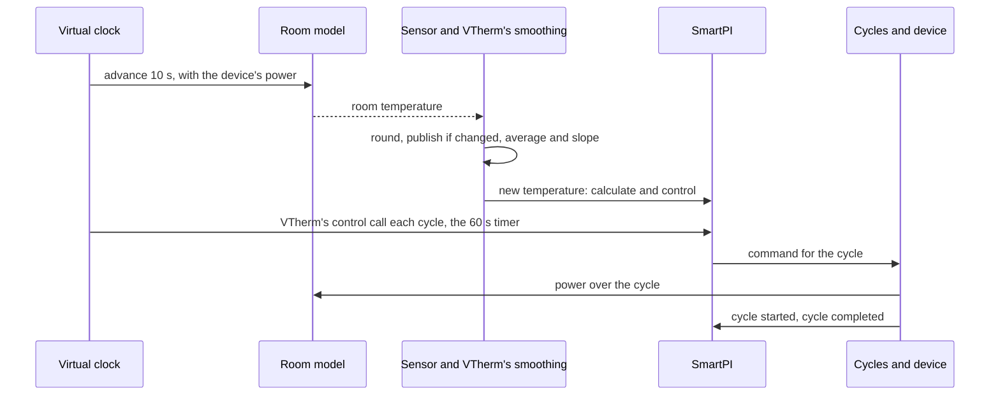

# Tests

This document brings all the tests of this fork together: how to run them, the simulator that
most of them use, each simulation scenario and what it must show, and the other tests, sorted by
feature. The features themselves are described in the [technical documentation](technical_doc.md),
[Zone dependencies and a second heat source](zone_dependencies.md) and
[Water input](water_input.md). The author's own tests are unchanged and run together with these.

## Contents

1. [Running the tests](#1-running-the-tests)
2. [The simulator](#2-the-simulator)
3. [Simulation scenarios](#3-simulation-scenarios)
4. [Tests by feature](#4-tests-by-feature)
5. [Limits](#5-limits)

## 1. Running the tests

Run the tests from the repository folder, with a copy of Versatile Thermostat (VTherm) on the
Python path. This is the same set-up as the author's continuous integration (CI, the tests that
GitHub runs automatically):

    PYTHONPATH=<versatile_thermostat copy>:$PWD python -m pytest tests/ -q

There are two sets of tests:

| Set | What it holds | Where it runs |
|---|---|---|
| Short | the unit tests (small tests of one part of the code) and the simulations that take only seconds | every pull request (workflow "Tests"), and locally by default |
| Long | the short set, plus the long simulations and the comparisons with VTherm's own code | locally with `SMARTPI_SIM_LOCAL=1`; on GitHub in the workflow "Full tests", on each push to the `qas` branch and on demand |

The long simulations depend on `SMARTPI_SIM_LOCAL`. Without it, they are shown as skipped.

## 2. The simulator

### 2.1 Why

- **A house is slow and never repeats itself.** SmartPI learns over several days. In a real house,
  each question about the extensions (a door, a slower floor, a boiler that waits for more demand)
  would take weeks. And the next try would never have the same weather.
- **The truth is known.** In the simulator, the test sets the room's heating power `a`, its heat
  loss `b`, the delays and the heat exchanges. So what SmartPI learns can be checked against these
  true values. In a house, only the room temperature can be judged.
- **The real code runs.** The simulator runs SmartPI's real handler and algorithm. Only the work
  that Versatile Thermostat and Home Assistant do around them is copied.
- **Comparisons are made while the test runs.** A scenario runs twice, for example with and without
  a feature, and the two runs are compared. Results saved in advance are not used: they would stop
  matching after each change to the author's algorithm.

### 2.2 What it models

| Part | File | What it does |
|---|---|---|
| Rooms | `tests/sim/plant.py` | A simple heat model in SmartPI's own units. How fast a heater warms the room is SmartPI's `a` (°C/min at full power). A link to the outdoors is SmartPI's `b` (1/min). A heater has a delay. A slow heat emitter, such as a heated floor, passes its heat through a lag: its heat output follows the device slowly, not at once. A "two-stage" emitter passes it through two shorter lags in a row, like a floor slab warming through its thickness. Two rooms can be linked all the time, or by a door that opens on a schedule. The model is calculated in time steps of 10 s or less. |
| Sensors and VTherm's smoothing | `tests/sim/sensors.py` | A sensor is read every 10 s and rounded (to 0.1 °C by default). Its value is published only when the rounded value changes. VTherm's moving average and slope (rate of change) are copied: the average has a half-life of 300 s, and the slope is in °C/h. |
| Heating cycles | `tests/sim/scheduler.py` | A copy of VTherm's cycle scheduler (the part that turns a command into the device's cycles) for one device: on/off cycles, minimum on and off times, valves. VTherm's own scheduler is not imported: it is internal to VTherm and changes with VTherm's main branch. There is one difference on purpose: an error in a cycle stops the simulation, instead of only being logged. |
| Time | `tests/sim/clock.py` | A virtual clock replaces SmartPI's clock, so a simulated week takes only seconds. It also runs the timers: VTherm's control call at every cycle, SmartPI's recalculation every 60 s, and the cycles. |
| Boiler and Smart Boiler | `tests/sim/boiler.py` | The water reaching a circuit: at a fixed temperature, or on a heating curve (a water temperature set from the outdoor temperature). It can add burner cycling, hot-water priority (the boiler heats the hot-water tank first), and a boiler that starts only when a zone asks for heat. A stand-in for Smart Boiler gives SmartPI the water data. |
| Weather | `tests/sim/weather.py` | The outdoor temperature: constant, a daily swing, or a sudden step. |
| Scenario set-up | `tests/sim/runner.py` | One zone (its `a`, `b`, delay, setpoint, cycle, valve or on/off device, sensor, neighbours, presets, boiler), a second thermostat in the zone (its power, delay and lag), and several zones in one shared world. |
| Measurements | `tests/sim/metrics.py` | What SmartPI learned compared with the true values, when its learning phase ended, and the room's error. |

### 2.3 One simulation step

## 3. Simulation scenarios

Unless a row says otherwise, the room has `a` 0.03 °C/min, `b` 0.001 /min, a 10 min delay, an
on/off device with a 10 min cycle, a 0.1 °C sensor and a setpoint of 20 °C. The outdoor
temperature is 3 °C, with a daily swing of ±3 °C. "Error" is the average gap between the room
temperature and its setpoint. "±x %" means within x % of the true value. A range without a unit,
such as 0.5–1.2, is the learned value divided by the true value.

### 3.1 Neighbouring zones — `test_smartpi_sim_neighbours.py` (short)

A room with a 0.01 °C sensor, next to a hall. The heat exchange with the hall, `k`, is 0.002. The
door is open 7:00–9:00, 12:00–13:30 and 18:00–22:00.

| Label | Scenario | What it must show |
|---|---|---|
| N1 | the hall is listed but switched off (mode `none`) | exactly the same run as without it |
| N2 | the hall behind a door, 3 days | `k` ±20 %; `a` and `b` ±5 %; no delay learned while the door is open |
| N3 | the hall always open, at 20 °C; its temperature jumps +4 °C at 30 h and −4 °C at 66 h | nothing published at 42 h; at 66 h, `k` ±10 % and the loss without the hall ±10 %; after the second jump, a smaller error than without the feature |
| N3 coarse | the same with a 0.1 °C sensor and one jump | either nothing published (the hall shown as "cannot be told apart", and SmartPI's own `b` used), or `k` ±20 % |
| N4 | the hall unavailable | exactly the same run as without it |
| N5 | cooling, the hall at 28 °C behind a door | `k` ±25 %; error below 0.3 °C from 60 h |
| N6 | the hall's window open for an hour while the door is open, once for each reaction | no `k` learned during that time; the reaction applied (nothing, off, frost 7 °C, eco 17 °C); the device runs or stops to match; afterwards the room does not rise more than 0.6 °C above its setpoint (overshoot) |
| N7 | a room between two always-open neighbours, the temperature of each jumping once | for each: `k` within ±35 %, or shown as "cannot be told apart" |

### 3.2 A zone with two heat sources — `test_smartpi_sim_second_source.py`

The main source is the room's radiator. In most scenarios the additional source is a water floor:
same power as the radiator, a 30 min delay, a 180 min lag, and the split rule (how the heat is
shared between the two sources) `lead_band` at 20 %.

| Label | Scenario | Set | What it must show |
|---|---|---|---|
| Z1, Z3 | the floor from the start, 40 h | short | the floor works in blocks while SmartPI learns, then follows the rule; the zone's model is published before 30 h, with `a`, `b` and the floor's power ±20 %; SmartPI uses that model; from 30 h the floor gives more than 20 % of the heat and the error is below 0.08 °C |
| — | the floor's own SmartPI while it works as the additional source | short | it learns nothing and changes nothing; it follows the main source's command; it regulates again once the main source is removed |
| Z6 | the main source stops responding | short | after 15 min the additional source regulates on its own; the room stays above 19.3 °C; when the main source is back, the additional source follows it again |
| — | the main source switched off, with a 20 min cycle | short | the additional source stays off and does not take over the zone |
| — | the floor on water from Smart Boiler | short | the floor turns the main source's power into its own command, using its own water data |
| — | power shedding (VTherm switching devices off when the house uses too much power) | short | a main source that is shed still sends its command; an additional source that is shed stays off |
| — | a restart of Home Assistant after 36 h | short | the zone's model is kept; error below 0.15 °C afterwards |
| Z7 | cooling with two sources | short | a separate cooling model, ±25 %; error below 0.15 °C |
| — | a valve as the additional source, which VTherm also recalculates | short | the valve follows the main source |
| Z1 compared | compared with two SmartPI working independently, 0.01 and 0.1 °C sensors, 96 h | long | error no more than 0.03 °C above the independent pair; the floor gives more than 35 % of the heat |
| Z1 nights | three nights with the setpoint lowered to 17 °C | long | overshoot no more than 0.1 °C above the independent pair; the last night's overshoot no more than 0.15 °C above the largest of the earlier nights (it does not grow night after night); the floor gives less than 90 % of the heat |
| Z2 | rule `source_first` at 50 % | long | the main source settles on the rule's curve (±0.15) |
| — | rule `together` at 200 % | long | the same |
| Z4 | a second radiator as the additional source | long | each gives half the heat (±0.15); error no more than 0.03 °C above the independent pair |
| Z5 | a main source too weak for the cold (`a` 0.015, outdoor −5 °C) | long | the floor keeps the room above 18.5 °C while SmartPI learns; once the weather is milder, SmartPI finishes learning |

### 3.3 Twelve rooms and four installations — `test_smartpi_sim_zone_set.py` (long)

Six rooms (from slow to fast heat loss, from slow to fast radiators) run in mild (3 °C) and cold
(−8 °C) weather. Each has a water floor of the same power. Each runs 96 h, then three nights with
the setpoint lowered to 17 °C (for 6, 8 and 10 h). Each is compared with two independent SmartPI. For every room:

- the zone's model is published by 30 h, with `a`, `b` and the floor's power ±15 %;
- the error from 48 h to 96 h is no more than 0.02 °C above the independent pair;
- the worst overshoot after a night is no more than 0.1 °C above the independent pair;
- every morning the room reaches its setpoint minus 0.2 °C, on average no more than 1 h later
  than the independent pair.

The same checks run for a floor behind a valve, a slab warming through its thickness, and water on
heating curves. Two zones side by side (always open, or with a door open 6:00–23:00) must each keep
an error no more than 0.02 °C above the independent pair. The results are in
[Zone dependencies, §5.8](zone_dependencies.md#58-results-and-limits-simulation).

### 3.4 Water — `test_smartpi_sim_water.py` (short)

A radiator (`a` 0.06 at 60 °C water) on a boiler with a heating curve.

| Scenario | What it must show |
|---|---|
| with and without Smart Boiler's water data, 48 h | without the data, SmartPI learns less than half of `a`; with the data, between 0.5 and 1.2 of `a`, and more than 1.5 times the value learned without them |
| hot water twice a day, burner cycling | while the boiler heats hot water, the integral (the part of the command that builds up over time) and the command do not move; error below 0.3 °C |
| the water data missing for 2 h, then for good | a short gap keeps the water factor (the heat the water gives compared with the reference water); a lasting gap sets the factor to 1 and offers the reset once |
| a boiler that starts only when the zone asks for heat | the room stays above 19 °C; SmartPI finishes learning and learns `a` within 0.5–1.2 |

### 3.5 A boiler that is not called — `test_smartpi_sim_boiler_call.py` (short)

A 2000 W radiator behind a valve, with a 0.01 °C sensor. The boiler starts only at a demand of
2500 W or more, so this room alone can never start it. Other zones (3000 W) start it, except during
one period of the day.

| Label | Scenario | What it must show |
|---|---|---|
| B1 | VTherm's central boiler, no water data, no boiler 2:00–8:00 | SmartPI not told that the boiler is not called: `a` below half; told: `a` within 0.85–1.2, `b` within 0.95–1.05, no `a` learned while the boiler is not called, the delay 9–13 min |
| B2 | Smart Boiler's call with water data, no boiler 10:00–16:00 | `b` within 0.95–1.05, `a` within 0.9–1.15, no `a` learned while the boiler is not called |

The results are in [Water input, §4.4](water_input.md#44-results-simulation).

### 3.6 SmartPI alone, two thermostats, and the simulator itself

| File | Set | What it checks |
|---|---|---|
| `test_smartpi_sim_baseline.py` | short and long | SmartPI alone learns a known room. With a 0.01 °C sensor: `a` and `b` ±5 % and the delay within 4 min, all within 12 h (a grid of 12 rooms in the long set). With a 0.1 °C sensor it still finishes learning, with `a` and `b` within 0.4–1.6 |
| `test_smartpi_sim_two_thermostats.py` | short and long | the floor's delay and lag in the room model; two thermostats, each with its own SmartPI, heating one room (today's behaviour, the baseline for Z1 and Z4) |
| `test_smartpi_regression_no_dependencies.py` | short | features configured but not active: exactly the same run and saved state as without the feature |
| `test_smartpi_sim_harness.py` | short | the clock, the timers, on/off cycles, minimum on and off times, valves, VTherm's control call at each cycle; the same run done twice gives the same result |
| `test_smartpi_sim_scheduler_parity.py` | long | the copied cycle scheduler and slope give the same events as VTherm's own code, over thousands of random commands and readings |

## 4. Tests by feature

### 4.1 AutoCalib events

| File | What it checks |
|---|---|
| `test_smartpi_autocalib_events.py` | every AutoCalib event carries the thermostat's real `entity_id` and its name in `name` |

### 4.2 Known inputs (the base of the extensions)

| File | What it checks |
|---|---|
| `test_smartpi_effective_model.py` | how known inputs (heat exchanged with neighbouring zones, heat from a second source) are combined into `b_eff` and `T_ref`, the loss and the reference temperature that the control uses; nothing changes without them |
| `test_smartpi_learning_window_known_inputs.py` | learning windows subtract the heat of known inputs |
| `test_smartpi_dependencies_algo.py` | the algorithm uses `b_eff` and `T_ref` everywhere in its control, keeps the raw values for learning, pauses learning while a learning gate is set (a condition such as a neighbour's open door), and saves and loads its state |
| `test_smartpi_dependencies.py`, `test_smartpi_dependency_inputs.py` | the configured items, how they are checked, the readings used in one calculation |
| `test_config_flow.py`, `test_config_flow_dependencies.py` | the options menu of a thermostat entry and the list of dependencies |

### 4.3 Neighbouring zones

| File | What it checks |
|---|---|
| `test_smartpi_coupling_estimator.py` | learning `k` for a neighbour behind a door, for several doors at once, and for an always-open neighbour |
| `test_smartpi_dependency_model.py` | learning gates, reactions to a neighbour's window, presets in cooling, an always-open neighbour entering the model without a jump |
| `test_smartpi_dependencies_handler.py` | the readings from Home Assistant |
| `test_config_flow_neighbours.py` | the neighbour forms: suggestions, errors, warnings, editing, the reset step |

### 4.4 A zone with two heat sources

| File | What it checks |
|---|---|
| `test_smartpi_zone_fit.py` | the zone's joint model (one model fitted for both sources together) finds the main source's delay, the floor's time scale, `a`, `b`, the floor's power and a neighbour's `k` |
| `test_smartpi_source_model.py`, `test_smartpi_source_candidates.py` | the floor's heat worked out from its cycles; the candidate time scales |
| `test_smartpi_split.py` | the split rules and the allocation loop |
| `test_smartpi_source_link.py` | the link between the two thermostats: commands, cycles, a main source that stops responding, the power limit |
| `test_smartpi_dependency_model_source.py` | learning blocks, the learning clock and its timeout, the brake, the faster recovery after a night, a restart, cooling |
| `test_smartpi_dependencies_handler.py` | heating types read from both entries, the reset requested from a form, a changed master thermostat |
| `test_config_flow_zone.py` | the zone form: the master thermostat and its checks, the recommendation, moving the main source, the other thermostat's entry, a custom delay and lag, removal, the reset step |

### 4.5 Water

| File | What it checks |
|---|---|
| `test_smartpi_water_input.py` | the water factor, its averages, hot water, short and lasting gaps, saving and loading the state |
| `test_smartpi_water_algo.py` | command = power / factor, learning = command × factor, the power limit, the holds during hot water and with cold water |
| `test_smartpi_water_handler.py` | reading Smart Boiler, `water_factor` published, the reset offered when the data appear or disappear |
| `test_config_flow_heating_type.py` | the heating type in the settings; the step of the repair (Home Assistant's repair notice) |

### 4.6 A boiler that is not called

| File | What it checks |
|---|---|
| `test_smartpi_boiler_call.py` | the modes: a boiler that responds within 15 min changes nothing; for a call with no response, first the emitter cools, then the hold, then the emitter warms after the boiler starts; on/off devices and their cycle; a lost reading; Smart Boiler's reasons |
| `test_smartpi_boiler_algo.py` | learning sees no heat while held and waits around that period; the delay is not learned from the boiler's start; the feed-forward trim is frozen; a calibration is cancelled |
| `test_smartpi_boiler_handler.py` | Smart Boiler's fields and VTherm's central boiler, with each kind of wrong or missing value |

## 5. Limits

- **The simulator is kinder than a house.** It has no sensor noise except rounding; no sun, people
  or cooking; and one temperature per room unless the slab model is chosen. The results in the
  other documents are what SmartPI achieves under these conditions.
- **The weather** is a constant, a daily swing or a sudden step; there is no forecast.
- **A boiler's own control** (modulation, that is, changing the flame's power, and minimum burn
  time) is not modelled beyond what the scenarios above need.
- **VTherm is copied, not run,** in the simulator. The long set checks the copy against VTherm's
  own code, because VTherm's main branch may change.
