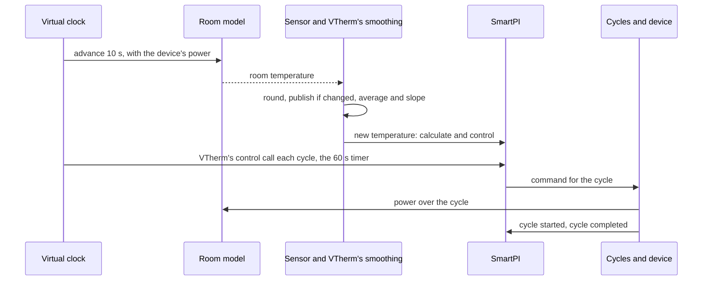

# Tests

This document brings all the tests of this fork together: how to run them, the simulator that
most of them use, each simulation scenario and what it must show, the other tests, sorted by
feature, and the QAS tests on a real Home Assistant. The features themselves are described in the [technical documentation](technical_doc.md),
[Zone dependencies and a second heat source](zone_dependencies.md) and
[Water and boiler inputs](water_input.md). The author's own tests run together with these. Two of them
follow behaviour the fork changes: `test_config_flow.py` (the forms) and
`test_smartpi_valve_runtime_sync.py`, whose thermostat now holds its SmartPI settings in its own
SmartPI entry, as SmartPI reads them, not in Versatile Thermostat's (`smartpi_options` of the test
stand-in `fakes/fake_thermostat_runtime.py`). Section 7 gives the code coverage.

## Contents

1. [Running the tests](#1-running-the-tests)
2. [The simulator](#2-the-simulator)
3. [Simulation scenarios](#3-simulation-scenarios)
4. [Tests by feature](#4-tests-by-feature)
5. [Limits](#5-limits)
6. [QAS on a real Home Assistant](#6-qas-on-a-real-home-assistant)
7. [Coverage](#7-coverage)

## 1. Running the tests

Run the tests from the repository folder, with a copy of Versatile Thermostat (VTherm) on the
Python path. This is the same set-up as the author's continuous integration (CI, the tests that
GitHub runs automatically):

    PYTHONPATH=<versatile_thermostat copy>:$PWD python -m pytest tests/ -q

There are two sets of tests:

| Set | What it holds | Where it runs |
|---|---|---|
| Short | the unit tests (small tests of one part of the code) and the simulations that take only seconds | every pull request (workflow "Tests"), and locally by default |
| Long | the short set, plus the long simulations and the comparisons with VTherm's own code | locally with `SMARTPI_SIM_LOCAL=1`; on GitHub in the workflow "Full tests", on each push to the `qas` branch and on demand |

The long simulations depend on `SMARTPI_SIM_LOCAL`. Without it, they are shown as skipped.

## 2. The simulator

### 2.1 Why

- **A house is slow and never repeats itself.** SmartPI learns over several days. In a real house,
  each question about the extensions (a door, a slower floor, a boiler that waits for more demand)
  would take weeks. And the next try would never have the same weather.
- **The truth is known.** In the simulator, the test sets the room's heating power `a`, its heat
  loss `b`, the delays and the heat exchanges. So what SmartPI learns can be checked against these
  true values. In a house, only the room temperature can be judged.
- **The real code runs.** The simulator runs SmartPI's real handler and algorithm. Only the work
  that Versatile Thermostat and Home Assistant do around them is copied.
- **Comparisons are made while the test runs.** A scenario runs twice, for example with and without
  a feature, and the two runs are compared. Results saved in advance are not used: they would stop
  matching after each change to the author's algorithm.

### 2.2 What it models

| Part | File | What it does |
|---|---|---|
| Rooms | `tests/sim/plant.py` | A simple heat model in SmartPI's own units. How fast a heater warms the room is SmartPI's `a` (°C/min at full power). A link to the outdoors is SmartPI's `b` (1/min). A heater has a delay. A slow heat emitter, such as a heated floor, passes its heat through a lag: its heat output follows the device slowly, not at once. A "two-stage" emitter passes it through two shorter lags in a row, like a floor slab warming through its thickness. Two rooms can be linked all the time, or by a door that opens on a schedule. The model is calculated in time steps of 10 s or less. |
| Sensors and VTherm's smoothing | `tests/sim/sensors.py` | A sensor is read every 10 s and rounded (to 0.1 °C by default). Its value is published only when the rounded value changes. VTherm's moving average and slope (rate of change) are copied: the average has a half-life of 300 s, and the slope is in °C/h. |
| Heating cycles | `tests/sim/scheduler.py` | A copy of VTherm's cycle scheduler (the part that turns a command into the device's cycles) for one device: on/off cycles, minimum on and off times, valves. VTherm's own scheduler is not imported: it is internal to VTherm and changes with VTherm's main branch. There is one difference on purpose: an error in a cycle stops the simulation, instead of only being logged. |
| Time | `tests/sim/clock.py` | A virtual clock replaces SmartPI's clock, so a simulated week takes only seconds. It also runs the timers: VTherm's control call at every cycle, SmartPI's recalculation every 60 s, and the cycles. |
| Boiler and water data sources | `tests/sim/boiler.py` | The water reaching a circuit: at a fixed temperature, or on a heating curve (a water temperature set from the outdoor temperature). It can add burner cycling, hot-water priority (the boiler heats the hot-water tank first), and a boiler that starts only when a zone asks for heat. Its water reaches SmartPI from either source a user can choose: a test provider of SmartPI's contract (`SimHeatingProvider`, registered as an integration would), or entities (a supply sensor per circuit and the boiler's hot-water and heat signals, in a stand-in for Home Assistant's states). A test can force a reason of a gap for a time window: the provider gives it, the supply sensor goes unavailable. |
| Weather | `tests/sim/weather.py` | The outdoor temperature: constant, a daily swing, or a sudden step. |
| Scenario set-up | `tests/sim/runner.py` | One zone (its `a`, `b`, delay, setpoint, cycle, valve or on/off device, sensor, neighbours, presets, boiler and the source of its water data: `water_data`, none, `provider` or `entities`), a second thermostat in the zone (its power, delay and lag), and several zones in one shared world. |
| Measurements | `tests/sim/metrics.py` | What SmartPI learned compared with the true values, when its learning phase ended, and the room's error. |

### 2.3 One simulation step

## 3. Simulation scenarios

Unless a row says otherwise, the room has `a` 0.03 °C/min, `b` 0.001 /min, a 10 min delay, an
on/off device with a 10 min cycle, a 0.1 °C sensor and a setpoint of 20 °C. The outdoor
temperature is 3 °C, with a daily swing of ±3 °C. "Error" is the average gap between the room
temperature and its setpoint. "±x %" means within x % of the true value. A range without a unit,
such as 0.5–1.2, is the learned value divided by the true value.

### 3.1 Neighbouring zones — `test_smartpi_sim_neighbours.py` (short)

A room with a 0.01 °C sensor, next to a hall. The heat exchange with the hall, `k`, is 0.002. The
door is open 7:00–9:00, 12:00–13:30 and 18:00–22:00.

| Label | Scenario | What it must show |
|---|---|---|
| N1 | the hall is listed but switched off (mode `none`) | exactly the same run as without it |
| N2 | the hall behind a door, 3 days | `k` ±20 %; `a` and `b` ±5 %; no delay learned while the door is open |
| N3 | the hall always open, at 20 °C; its temperature jumps +4 °C at 30 h and −4 °C at 66 h | nothing published at 42 h; at 66 h, `k` ±10 % and the loss without the hall ±10 %; after the second jump, a smaller error than without the feature |
| N3 coarse | the same with a 0.1 °C sensor and one jump | either nothing published (the hall shown as "cannot be told apart", and SmartPI's own `b` used), or `k` ±20 % |
| N4 | the hall unavailable | exactly the same run as without it |
| N5 | cooling, the hall at 28 °C behind a door | `k` ±25 %; error below 0.3 °C from 60 h |
| N6 | the hall's window open for an hour while the door is open, once for each reaction | no `k` learned during that time; the reaction applied (nothing, off, frost 7 °C, eco 17 °C); the device runs or stops to match; afterwards the room does not rise more than 0.6 °C above its setpoint (overshoot) |
| N7 | a room between two always-open neighbours, the temperature of each jumping once | for each: `k` within ±35 %, or shown as "cannot be told apart" |

### 3.2 A zone with two heat sources — `test_smartpi_sim_second_source.py`

The main source is the room's radiator. In most scenarios the additional source is a water floor:
same power as the radiator, a 30 min delay, a 180 min lag, and the split rule (how the heat is
shared between the two sources) `lead_band` at 20 %.

| Label | Scenario | Set | What it must show |
|---|---|---|---|
| Z1, Z3 | the floor from the start, 40 h | short | the floor works in blocks while SmartPI learns, then follows the rule; the zone's model is published before 30 h, with `a`, `b` and the floor's power ±20 %; SmartPI uses that model; from 30 h the floor gives more than 20 % of the heat and the error is below 0.08 °C |
| — | the floor's own SmartPI while it works as the additional source | short | it learns nothing and changes nothing; it follows the main source's command; it regulates again once the main source is removed |
| Z6 | the main source stops responding | short | after 15 min the additional source regulates on its own; the room stays above 19.3 °C; when the main source is back, the additional source follows it again |
| — | the main source switched off, with a 20 min cycle | short | the additional source stays off and does not take over the zone |
| — | the floor on water, its water data from a provider | short | the floor turns the main source's power into its own command, using its own water data |
| — | power shedding (VTherm switching devices off when the house uses too much power) | short | a main source that is shed still sends its command; an additional source that is shed stays off |
| — | a restart of Home Assistant after 36 h | short | the zone's model is kept; error below 0.15 °C afterwards |
| Z7 | cooling with two sources | short | a separate cooling model, ±25 %; error below 0.15 °C |
| — | a valve as the additional source, which VTherm also recalculates | short | the valve follows the main source |
| Z1 compared | compared with two SmartPI working independently, 0.01 and 0.1 °C sensors, 96 h | long | error no more than 0.03 °C above the independent pair; the floor gives more than 35 % of the heat |
| Z1 nights | three nights with the setpoint lowered to 17 °C | long | overshoot no more than 0.1 °C above the independent pair; the last night's overshoot no more than 0.15 °C above the largest of the earlier nights (it does not grow night after night); the floor gives less than 90 % of the heat |
| Z2 | rule `source_first` at 50 % | long | the main source settles on the rule's curve (±0.15) |
| — | rule `together` at 200 % | long | the same |
| Z4 | a second radiator as the additional source | long | each gives half the heat (±0.15); error no more than 0.03 °C above the independent pair |
| Z5 | a main source too weak for the cold (`a` 0.015, outdoor −5 °C) | long | the floor keeps the room above 18.5 °C while SmartPI learns; once the weather is milder, SmartPI finishes learning |

### 3.3 Twelve rooms and four installations — `test_smartpi_sim_zone_set.py` (long)

Six rooms (from slow to fast heat loss, from slow to fast radiators) run in mild (3 °C) and cold
(−8 °C) weather. Each has a water floor of the same power. Each runs 96 h, then three nights with
the setpoint lowered to 17 °C (for 6, 8 and 10 h). Each is compared with two independent SmartPI. For every room:

- the zone's model is published by 30 h, with `a`, `b` and the floor's power ±15 %;
- the error from 48 h to 96 h is no more than 0.02 °C above the independent pair;
- the worst overshoot after a night is no more than 0.1 °C above the independent pair;
- every morning the room reaches its setpoint minus 0.2 °C, on average no more than 1 h later
  than the independent pair.

The same checks run for a floor behind a valve, a slab warming through its thickness, and water on
heating curves (water data from entities). Two zones side by side (always open, or with a door open 6:00–23:00) must each keep
an error no more than 0.02 °C above the independent pair. The results are in
[Zone dependencies, §5.8](zone_dependencies.md#58-results-and-limits-simulation).

### 3.4 Water — `test_smartpi_sim_water.py` (short)

A radiator (`a` 0.06 at 60 °C water) on a boiler with a heating curve. The water data come from a
provider or from entities; the scenarios marked "both" run with each.

| Label | Scenario | What it must show |
|---|---|---|
| W1 | without water data, and with them from a provider and from entities, 48 h | without the data, SmartPI learns less than half of `a`; with the data from either source, between 0.5 and 1.2 of `a`, and more than 1.5 times the value learned without them |
| — | hot water twice a day, burner cycling (both) | while the boiler heats hot water, the integral (the part of the command that builds up over time) and the command do not move; error below 0.3 °C |
| — | the provider's data missing for 2 h, then for good (`not_mapped`) | a short gap keeps the water factor (the heat the water gives compared with the reference water); a lasting gap sets the factor to 1 and offers the reset once |
| — | the supply sensor unavailable from 24 h (entities) | for 24 h it keeps the factor (reason `unavailable`) and offers nothing; then the gap counts as lasting: factor 1 and the reset offered once |
| — | a boiler that starts only when the zone asks for heat (both) | the room stays above 19 °C; SmartPI finishes learning and learns `a` within 0.5–1.2 |

### 3.5 A boiler that is not called — `test_smartpi_sim_boiler_call.py` (short)

A 2000 W radiator behind a valve, with a 0.01 °C sensor. The boiler starts only at a demand of
2500 W or more, so this room alone can never start it. Other zones (3000 W) start it, except during
one period of the day.

| Label | Scenario | What it must show |
|---|---|---|
| B1 | the call from VTherm's central boiler (its live entities), no water data, no boiler 2:00–8:00 | SmartPI not told that the boiler is not called: `a` below half; told: `a` within 0.85–1.2, `b` within 0.95–1.05, no `a` learned while the boiler is not called, the delay 9–13 min; VTherm's reason `below_threshold` (and, for a moment at a switch, `activation_delay`) |
| B1 entity | the same, the call from a binary sensor (entities) | the same; the reason `not_called` (no reason entity) |
| B2 | a provider's call, the water from the provider or from entities, no boiler 10:00–16:00 | `b` within 0.95–1.05, `a` within 0.9–1.15, no `a` learned while the boiler is not called; the provider's reason `below_threshold` |

The results are in [Water and boiler inputs, §4.4](water_input.md#44-results-simulation).

### 3.6 SmartPI alone, two thermostats, and the simulator itself

| File | Set | What it checks |
|---|---|---|
| `test_smartpi_sim_baseline.py` | short and long | SmartPI alone learns a known room. With a 0.01 °C sensor: `a` and `b` ±5 % and the delay within 4 min, all within 12 h (a grid of 12 rooms in the long set). With a 0.1 °C sensor it still finishes learning, with `a` and `b` within 0.4–1.6 |
| `test_smartpi_sim_two_thermostats.py` | short and long | the floor's delay and lag in the room model; two thermostats, each with its own SmartPI, heating one room (today's behaviour, the baseline for Z1 and Z4) |
| `test_smartpi_regression_no_dependencies.py` | short | features configured but not active: exactly the same run and saved state as without the feature |
| `test_smartpi_sim_harness.py` | short | the clock, the timers, on/off cycles, minimum on and off times, valves, VTherm's control call at each cycle; the same run done twice gives the same result |
| `test_smartpi_sim_scheduler_parity.py` | long | the copied cycle scheduler and slope give the same events as VTherm's own code, over thousands of random commands and readings |

## 4. Tests by feature

### 4.1 AutoCalib events

| File | What it checks |
|---|---|
| `test_smartpi_autocalib_events.py` | every AutoCalib event carries the thermostat's real `entity_id` and its name in `name` |

### 4.2 Known inputs (the base of the extensions)

| File | What it checks |
|---|---|
| `test_smartpi_effective_model.py` | how known inputs (heat exchanged with neighbouring zones, heat from a second source) are combined into `b_eff` and `T_ref`, the loss and the reference temperature that the control uses; nothing changes without them |
| `test_smartpi_effective_model_edges.py` | edge cases found by the code coverage (section 7): a heat input at zero or not a number is left out |
| `test_smartpi_learning_window_known_inputs.py` | learning windows subtract the heat of known inputs |
| `test_smartpi_dependencies_algo.py` | the algorithm uses `b_eff` and `T_ref` everywhere in its control, keeps the raw values for learning, pauses learning while a learning gate is set (a condition such as a neighbour's open door), and saves and loads its state; a neighbour's window preset without a target, a source command outside the source role, a joint fit published after the learning phase (a and b kept) |
| `test_smartpi_dependencies.py`, `test_smartpi_dependency_inputs.py` | the configured items, how they are checked, the readings used in one calculation |
| `test_config_flow.py`, `test_config_flow_dependencies.py` | the options menu of a thermostat entry (with Water and boiler for a water heating type, Save and finish last) and of the defaults entry; creating an entry through the menu; the list of dependencies (each step back in the menu, a removal with nothing chosen back in the menu with a note, an item to go back) |

### 4.3 Neighbouring zones

| File | What it checks |
|---|---|
| `test_smartpi_coupling_estimator.py` | learning `k` for a neighbour behind a door, for several doors at once, and for an always-open neighbour |
| `test_smartpi_dependency_model.py` | learning gates, reactions to a neighbour's window, presets in cooling, an always-open neighbour entering the model without a jump |
| `test_smartpi_dependencies_handler.py` | the readings from Home Assistant |
| `test_config_flow_neighbours.py` | the neighbour forms: suggestions, errors, warnings, editing, a neighbour that is gone refused on the form, each step back in the menu (nothing written before Save and finish), the reset question at save |
| `test_smartpi_coupling_estimator_edges.py`, `test_smartpi_dependencies_edges.py` | edge cases found by the code coverage (section 7): fits with a negative coefficient or one beyond its bound, doors whose exchanges cancel, a source that never ran during the door windows, a history whose values disagree, saved rows of another shape, an empty cycle report, forgetting removed items; stored items that are not mappings, one door sensor stored as text, a lead band out of range |

### 4.4 A zone with two heat sources

| File | What it checks |
|---|---|
| `test_smartpi_zone_fit.py` | the zone's joint model (one model fitted for both sources together) finds the main source's delay, the floor's time scale, `a`, `b`, the floor's power and a neighbour's `k` |
| `test_smartpi_source_model.py`, `test_smartpi_source_candidates.py` | the floor's heat worked out from its cycles; the candidate time scales |
| `test_smartpi_split.py` | the split rules and the allocation loop |
| `test_smartpi_source_link.py` | the link between the two thermostats: commands, cycles, a main source that stops responding, the power limit |
| `test_smartpi_dependency_model_source.py` | learning blocks, the learning clock and its timeout, the brake, the faster recovery after a night, a restart, cooling |
| `test_smartpi_dependencies_handler.py` | heating types read from both entries, the reset requested from a form, a changed master thermostat (its devices compared by unique ID, also at a reload of the entry, when the thermostat has no entity ID yet); a second source turned off turns its device off, a thermostat range that is not a range, a source that cannot be resolved, a zone whose master thermostat was deleted |
| `test_config_flow_zone.py` | the zone form: the master thermostat and its checks (none: back to the menu, which says why), a source without a heating type asked for it, the recommendation, moving the main source (the neighbours merged; refused on the parameter step when they cannot be), the other thermostat's entry created at save (its options open a menu of their own), a custom delay and lag, removal, the reset question at save, a zone set up while creating an entry, two windows open at once; a zone moved to the other thermostat and brought back in one window (only this entry holds it; refused, with nothing changed, when its neighbours would clash) |
| `test_smartpi_zone_fit_edges.py`, `test_smartpi_dependency_model_edges.py`, `test_smartpi_source_candidates_edges.py`, `test_smartpi_split_edges.py` | edge cases found by the code coverage (section 7): a source that never ran, a noisy sensor, samples that are not numbers, saved states that cannot be read; the same source configured again, a coefficient learned in cooling across a restart, no outdoor temperature, no lead demand, no target, a coefficient published during a recovery, saved fits and responses that cannot be read; a loop without a lead demand yet |

### 4.5 Water

| File | What it checks |
|---|---|
| `test_smartpi_water_input.py` | the water factor, its averages, hot water, short and lasting gaps, saving and loading the state (with the inputs it belongs to), forgetting the data |
| `test_smartpi_water_algo.py` | command = power / factor, learning = command × factor, the power limit, the holds during hot water and with cold water; the valve's activation floor with water data |
| `test_smartpi_heating_inputs.py` | the sources, read on their own: entities (numbers, °F and K, unavailable, unknown or text, a missing entity, the heat, hot-water and fault combinations, the reason entity, an entity kept by its registry id across a rename); the providers' registry (register, unregister, two providers, odd names), a provider read defensively (not registered, `None`, a wrong version, an exception, not a mapping, a mapping that fails, no method, wrong types, numbers too large, reasons SmartPI does not know, the demand fields) and reported once when missing for long; VTherm's central boiler from its live entities (called, the three derived reasons, powers in W and kW, missing entities, a thermostat it does not count); the options read: defaults or own signals, entries without the keys, unknown sources |
| `test_smartpi_water_handler.py` | the handler reads the chosen source (a test provider, or entities with the thermostat's own or the defaults' signals), publishes `water_factor`, offers the reset when the data appear or go, not for the inputs the options kept the model for; other inputs chosen in the options drop the old inputs' water state (a lasting state, a long-term average) and an open repair, the same inputs keep theirs across a restart, and an entry from before the sources keeps today's gap rules without data; a chosen provider missing for 10 minutes is warned about once; an electric or no heating type reads nothing; a Home Assistant stand-in without registries reads stored entities as they are |
| `test_config_flow_heating_inputs.py` | the forms: the defaults' menu and Boiler signals (stored by registry id, an empty field removed); Water and boiler: the lists built from the registered providers, VTherm's central boiler offered (and the default) only where it serves the thermostat, a provider no longer registered shown as not available, the supply sensor, defaults or own signals (prefilled from the defaults; an own signal left empty stays empty), the reset question at save only on a change of the water source or of its sensor (reset, or the model kept), entries without the keys; each step back in the menu; an electric type without the item; a zone's additional source choosing its water only; the zone form's new entry without the defaults' signals |
| `test_config_flow_heating_type.py` | the heating type first in a thermostat's settings, "Not set" (stored as no key), not in the defaults' form; the step of the repair (Home Assistant's repair notice) |

### 4.6 A boiler that is not called

| File | What it checks |
|---|---|
| `test_smartpi_boiler_call.py` | the modes: a boiler that responds within 15 min changes nothing; for a call with no response, first the emitter cools, then the hold, then the emitter warms after the boiler starts; on/off devices and their cycle; a lost reading; the providers' reasons; the diagnostics with the chosen source and its inputs, also without a reading |
| `test_smartpi_boiler_algo.py` | learning sees no heat while held and waits around that period; the delay is not learned from the boiler's start; the feed-forward trim is frozen; a calibration is cancelled |
| `test_smartpi_boiler_handler.py` | the handler reads the chosen call source: a provider (its reasons and demand; no other source when it says nothing), entities (the thermostat's own or the defaults' signals), VTherm's central boiler (the default where it serves the thermostat, its reason and demand), none; the `boiler` block shown for a chosen source without data; an electric or no heating type reads nothing |

### 4.7 The diagnostic sensor

| File | What it checks |
|---|---|
| `test_sensor_own_entry.py` | the defaults entry shows the diagnostic sensor of a thermostat without an entry of its own; when the thermostat gets its own entry, that entry takes the sensor over: Home Assistant refuses no duplicate unique ID when the entry is created, reloaded or its options saved, and the sensor stays live when the defaults entry is reloaded; an own entry that uses the defaults records full diagnostics as the defaults say, and a change in the defaults makes its sensor again; a sensor removed after another took its thermostat leaves that one live |

### 4.8 Settings, the options' save and the migration

| File | What it checks |
|---|---|
| `test_smartpi_settings.py` | the settings read per key: without an entry of its own a thermostat takes the shared settings from the defaults and no "thermostat only" setting (not from the defaults, not VTherm's TPI delays); an entry that uses the defaults adds its own "thermostat only" settings; an entry with its own values wins; an entry of the release 0.4.0 keeps its full copy, without a heating type; a shared setting missing from an entry is logged once and takes the defaults' or the form's value; saved options replace the first data as a whole; the handler: not set means not used (no water data, no delays, no PWM restart, no valve curve), set means used, a valve curve on without its points is reported and off, full diagnostics from the defaults; a save of the defaults reloads the thermostats that use them |
| `test_config_flow_settings.py` | a thermostat's settings: the heating type first, then the "thermostat only" settings and "Use the SmartPI defaults"; "Not set" stored as no key; switched on, the entry holds no shared setting; switched off, the own values start as the defaults' (`settings_own`); the valve curve after its switch and as a menu item; the defaults' regulator item with the shared settings only; a new entry created through the menu (nothing of its own; the reset question when its heating type is set); a thermostat that already has an entry, an entity without a unique ID |
| `test_config_flow_save.py` | the pattern of the options: nothing written before Save and finish; closing the window writes nothing and creates no other entry; the menu names the unsaved sections with the labels of the interface's language; a change undone is no change; the menu follows the draft (Water and boiler, the valve curve); one reset question with all its reasons, none without a reason; dependencies changed in another window stop the save; one reload per entry when the zone moves to the other thermostat's entry, and an old save mark is not used |
| `test_config_migration.py` | minor version 1 → 2 (the major version stays 1, so 0.4.0 still loads the entries): a thermostat's entry keeps its values and does not use the defaults; the defaults entry gets every shared setting and loses the others; only the "thermostat only" settings that are set wait to move; after the start, each thermostat on SmartPI without an entry gets one with them and a repair notice lists them; nothing set creates nothing; removing the temporary key reloads nothing; a newer major version is refused; an entry already migrated is left as it is; another integration's climate entity and an import that creates no entry are not named in the notice; a removed defaults entry moves nothing |
| `test_config_flow_paths.py` | the forms in the cases only some setups reach: an entity without a unique ID refused, a neighbour whose entry lists this zone back, a door that is also the window sensor, the split recommended for devices of similar speed, an entry whose thermostat was deleted, a change made in another window (or in VTherm's options) while a window is open (the save ends the window and writes nothing), a zone member's entry that cannot be created |
| `test_init_lifecycle.py` | from the author's newer code: the algorithm and the four services are registered when the integration starts and stay registered; unloading an entry reloads nothing; removing an entry reloads its thermostat (or those using the defaults) after it has left the list of entries; an options change reloads its thermostat once; no reload while Home Assistant starts |
| `test_init_lifecycle_zones.py` | the same with the fork's parts: a thermostat's save reloads it and its zone's main source; a defaults save reloads the entries that use the defaults (each thermostat once) and the thermostats without an entry; a new entry reloads only its thermostat; a removed entry reloads its thermostat and its zone's main source; a removed defaults entry reloads their users; unloading reloads nothing |
| `test_services_routing.py` | the four services reach the thermostats a call names (in its target or its data, one or a list; the method on the thermostat or on its handler), each once, and skip the others (another algorithm, an entity that is not there, a thermostat without the method, which is warned about); they are registered with the integration and never removed |

## 5. Limits

- **The simulator is kinder than a house.** It has no sensor noise except rounding; no sun, people
  or cooking; and one temperature per room unless the slab model is chosen. The results in the
  other documents are what SmartPI achieves under these conditions.
- **The weather** is a constant, a daily swing or a sudden step; there is no forecast.
- **A boiler's own control** (modulation, that is, changing the flame's power, and minimum burn
  time) is not modelled beyond what the scenarios above need.
- **VTherm is copied, not run,** in the simulator. The long set checks the copy against VTherm's
  own code, because VTherm's main branch may change. The QAS tests (section 6) run the real VTherm.

## 6. QAS on a real Home Assistant

The tests above run SmartPI inside the test process, on a copy of Versatile Thermostat's
scheduler. They check the physics, the learning and the split rules, but not what only a real
Home Assistant shows. The QAS tests (QAS: quality assurance, the branch `qas` they test) do that,
on a test bench of Home Assistant instances (the separate project `ha-testbed`; eight instances on
2026-10-14, for nine roles):

- the real Versatile Thermostat 10.5.1, with its central boiler, power manager and window
  detection, two thermostats linked through Home Assistant and an over_climate master;
- the forms in Home Assistant, the entity registry and its areas;
- the saved state in `.storage` across real restarts;
- the recorder, the logbook and the repair notices.

The QAS tests are run by the bench's testing session, never by the session that writes the code,
and always on one commit of the `qas` branch. This repository holds the test pack: the
simulator, the helpers, the configurations, the setup scripts, the runner and this catalogue.

### 6.1 The test pack

Everything is under `tests/qas/`. No file there is named `test_*.py`, so CI's `pytest tests/`
does not run it: the runner needs the bench's `lib/`.

| Path | What it is |
|---|---|
| `custom_components/smartpi_room_sim/` | the room simulator as a Home Assistant integration: rooms, heaters, valves, a boiler, doors, windows and the outdoors. Its physics (`physics.py`) is the same file the in-process simulator uses: `tests/sim/plant.py` loads it |
| `custom_components/smartpi_qas_helpers/` | test-only helpers that reach into the running SmartPI: fire an AutoCalib event, silence a zone's main source, load a learned state, list the events fired, count how many times a SmartPI entry was set up (`entry_setups`, for QA7); and a heating provider of SmartPI's contract, fed by the simulator, that a scenario can unregister or make give a reason (the boiler not called, the water not mapped) |
| `roles.py` | the nine roles in one place: rooms, thermostats, SmartPI entries and base options (with the water and boiler sources) |
| `config/<role>.yaml` | each role's `configuration.yaml`, written by `config/build.py` from `roles.py` |
| `setup/setup_role.py` | sets an instance up as a role, through the API, in stages (`setup/stages.py`), then restarts it |
| `run.py`, `scenarios/` | the runner and the scenarios, on the bench's `lib/harness.py` |
| `compare.py` | compares what two instances measured (QB1, QE5), from the two results files it is given |
| `README.md` | how to run it, in short |

**The simulator.** A room has a loss to the outdoors `b` and a capacity. A heater has a gain
`a`, a delay and an emitter lag (one stage, or two for a slab). Rooms are linked always or through
a door, and a window links a room to the outdoors. A water emitter heats only with the boiler's
water: it warms towards its firing temperature (60 °C, 40 °C in the role `water`) while the
boiler's switch is on and cools to 12 °C (below the rooms) while it is off. The boiler can be
switched off or put into a fault (it then does not fire), and domestic hot water can have priority
for a time (the circuits get no heat, and the boiler's flow shows the water to the tank). Each water
emitter has a sensor on its supply pipe (`sensor.smartpi_room_sim_<heater>_supply`), and the boiler
has three signals: it can heat, hot water has priority, a fault (binary sensors). Temperature
sensors round to 0.1 or 0.01 °C and are written only when their reading changes. Services set or
ramp a room, move the outdoor mean, open or close a door or a window, make a device stop responding
(it keeps its state, and may also go unavailable), set the boiler's state, start hot water, and
reset the inputs. All entity ids start with `smartpi_room_sim_`: nothing comes from a real house.

**The heating provider.** In the roles `water` and `electric`, the helpers register a provider of
SmartPI's contract (v1) named `qas`. It serves the role's SmartPI thermostats: for each, the
simulated boiler's water, whether it can heat (and why not: hot water, off, fault, burner off),
whether the boiler is called, and a demand. A scenario can unregister it, force a supply reason
(`flow_stale`, `not_mapped`, …) or say the boiler is not called for a reason (the simulated boiler
then stops firing); `provider_status` tells how often SmartPI asked it, by thermostat.

### 6.2 The roles

Which instance runs which role, and when, is the bench's testing session's choice: a role names no
instance, and the setup and the runner take the role from `--role`.

| Role | What it holds |
|---|---|
| `base` | the living room: VTherm over_switch with SmartPI, no extension; an unheated attic (a sensor for QB3) |
| `neighbours` | the kitchen (SmartPI) with the hall behind a door (TPI, with a window sensor) and the dining room always open (TPI) as neighbours |
| `zone` | the lounge: a radiator (main source) and a floor (additional source) under the master `Lounge` (over_climate, self-regulation off); spare thermostats for QE1 |
| `zone-ref` | the same lounge with two independent SmartPI (the comparison for QE5) |
| `zone-valve` | the study: the floor is a valve (over_valve); VTherm's power manager |
| `central-boiler` | VTherm's central boiler (power threshold 2500 W): the bedroom (2000 W) cannot start it alone, the office (3000 W) can |
| `ref-0.4.0` | the twin of `base` on the author's 0.4.0, later upgraded to `qas` and back |
| `electric` | electric heating types (an electric heating mat, a fast electric heater), with the helpers' heating provider registered (QW8); re-runs |
| `water` | the boiler fires from the start at 40 °C; the studio's radiator reads its water from entities (its supply sensor, the boiler's signals in "SmartPI defaults") and the boiler's call from the helpers' provider; the nursery's floor (a valve) reads its water from the provider; the lounge is a zone (a radiator and a floor) whose two thermostats read their water from the provider |

Each VTherm has a safety delay of 1440 min: a sensor that writes only on change keeps one value for
longer than VTherm's default of 60 min, and VTherm would take it for a dead sensor.

### 6.3 Deploying and running

The bench's testing session follows its own `docs/workflow.md`. For this pack:

1. **Stage** this repository at the commit of `qas` under test, and Versatile Thermostat at the
   tag of its latest release (10.5.1 on 2026-10-14).
2. **Deploy** each instance with its role:

       bin/deploy.sh --instance N --stage stage/vtherm_smartpi \
           --components stage/vtherm_smartpi/tests/qas/custom_components \
           --components stage/versatile_thermostat/custom_components \
           --config stage/vtherm_smartpi/tests/qas/config/<role>.yaml

3. **Set it up** as its role through the API (VTherm's entries, areas, the boiler's thresholds and
   the maximum power, SmartPI's entries, the base options), then restart it:

       HA_INSTANCE=N python stage/vtherm_smartpi/tests/qas/setup/setup_role.py --role ROLE

   The stages, in order: `vtherm` (VTherm's central configuration, SmartPI's defaults entry, the
   thermostats, then the masters), `areas`, `inputs`, `smartpi` (one entry per SmartPI
   thermostat) and `options` (the settings saved once, the neighbours, the zone, the boiler's
   signals in the defaults entry and each thermostat's water and boiler sources, the model kept).
   Each stage skips what already exists; `--stage` runs one.
4. **Run** scenarios, or `M` for the role's minimum set:

       HA_INSTANCE=N python stage/vtherm_smartpi/tests/qas/run.py --role ROLE M
       HA_INSTANCE=N python stage/vtherm_smartpi/tests/qas/run.py --role neighbours QD5   # detached: 72 h

   `run.py --list` shows the scenarios. Each one runs only from its role's base (its SmartPI entries
   and their options; the neighbours and the zone are compared by what they mean, not by the ids
   the forms give; the water and boiler sources, and the entities they read by their entity id).
   Between scenarios, the simulator's inputs (the boiler's state and hot water too), the helpers'
   provider and the thermostats go back to the base.
5. **Compare** the pairs, from the bench's directory, naming the two instances that ran them (or
   their two results files): `python stage/vtherm_smartpi/tests/qas/compare.py qb1 NEW REF` (NEW
   ran `base`, REF `ref-0.4.0`) and `compare.py qe5 NEW REF` (NEW ran `zone`, REF `zone-ref`).

**The instance that runs `ref-0.4.0`** goes from 0.4.0 to `qas` and back. The bench deploys the
fork at 0.4.0 (51db763) with `--ref`, and the test pack's components from a checkout of `qas`:

    QB1 / QB1s  →  QB2a (or QB2l after QB1)  →  deploy qas  →  QB2  →  QB3a  →  deploy 0.4.0  →  QB3

### 6.4 Timing

A scenario waits for what SmartPI does after its own delays, plus a margin of two calculations. The
runner reads the delays from the staged plugin (`smartpi/const.py` and `smartpi/source_model.py`):

| What | Time |
|---|---|
| a calculation | 60 s |
| VTherm's cycle | 10 min |
| after a door closes, learning waits | 10 min |
| the boiler's grace | 15 min, plus the cycle for an on/off device |
| an emitter's settling (delay and three lags) | radiator 65 min, floor on water 570 min |
| a chosen provider missing before SmartPI warns | 10 min |
| a silent main source | 15 min |
| VTherm's window detection | 30 s |

The simulator moves on every 7 s and the outdoor temperature wiggles over 2838 s: no period of the
simulator is a multiple of SmartPI's 60 s or of the cycle. Room temperatures change in ramps.

### 6.5 The catalogue

"Detached": longer than two hours, so the bench runs it in the background. "Minimum": in the
minimum set, run after any change. "Set": the scenarios "with water data" use the role `water` (or
the helpers' provider in the role `electric`); the others need no water data.

| ID | What it checks | Role | Time | Detached | In-process twin | Minimum | Set |
|---|---|---|---|---|---|---|---|
| QA1 | After the setup's restart every SmartPI and VTherm entry is loaded, neither logs a warning or an error, each SmartPI thermostat has its diagnostics, no heating provider is registered but the helpers' where the role has it, and no entry chooses a water or a boiler's call source. | `base`, `electric` | 15 min | no | test_factory.py | yes | without water data |
| QA2 | Saving a thermostat entry's settings unchanged goes through the options menu and "Save and finish" without the reset question, keeps the stored options, and reloads the entry once without a loop. | `base` | 15 min | no | test_config_flow_dependencies.py | yes | without water data |
| QA3 | SmartPI's four services work on VTherm 10.5.1, and a paused learning stays paused across a restart. | `base` | 30 min | no | test_services.py | no | without water data |
| QA4 | AutoCalib events carry the thermostat's climate entity in entity_id and its name in name, and neither the recorder nor the logbook logs an invalid entity id. | `base` | 60 min | no | test_smartpi_autocalib_events.py | yes | without water data |
| QA5 | Two restarts keep the learned state (the model, its counts and the applied reset token), and a reset token is not applied again. | `base` | 20 min | no | test_algo_persistence.py | yes | without water data |
| QA6 | A water heating type without a water data source shows the water block with source none, factor 1 and its inputs from no source, and no boiler block without a call source, an electric type shows neither, and nothing is logged at each control call. | `base`, `electric` | 20 min | no | test_smartpi_water_handler.py, test_smartpi_boiler_handler.py | yes | without water data |
| QA7 | A change made in the options and the window closed stores nothing and reloads nothing; the menu names the change in the instance's language (English where SmartPI has no text of its own); the same change saved is stored and reloads the entry once. | `base` | 15 min | no | test_config_flow_save.py | yes | without water data |
| QB1 | Over 48 h the twin room learns and regulates; the instance keeps a, b and its mean error from 24 to 48 h, and compare.py qb1 passes when the qas instance's a and b are within ±10 % of 0.4.0's and its mean error is no more than 0.03 °C above. | `base`, `ref-0.4.0` | 48 h | yes | test_smartpi_regression_no_dependencies.py, test_smartpi_sim_baseline.py | no | without water data |
| QB1s | For 45 minutes the twin room regulates and nothing logs an error, and the instance keeps what compare.py qb1s reads (both instances regulating, phases named). Short variant of QB1. | `base`, `ref-0.4.0` | 45 min | no | test_smartpi_sim_baseline.py | yes | without water data |
| QB2a | On 0.4.0, before the upgrade: SmartPI's state is the learned fixture, saved by 0.4.0 itself with learning paused, and its model is kept for QB2. | `ref-0.4.0` | 10 min | no | test_algo_persistence.py | yes | without water data |
| QB2 | After the upgrade from 0.4.0 to qas, the state 0.4.0 saved is loaded unchanged, no warning about its format is logged, nothing is reset, and the old entry's options menu works. | `ref-0.4.0` | 30 min | no | test_algo_persistence.py | yes | without water data |
| QB3a | On qas, before going back to 0.4.0: a neighbour (the attic's sensor) is added to the entry, learning is paused and the model is kept for QB3; this is left in place on purpose. | `ref-0.4.0` | 10 min | no | — | no | without water data |
| QB3 | Back on 0.4.0 with a neighbour configured, the entries migrated to version 1.2 load without errors (their major version is still 1) and the state too; saving the options in 0.4.0 drops the fork's keys, as known. | `ref-0.4.0` | 30 min | no | — | no | without water data |
| QB2l | On 0.4.0 after QB1, before the upgrade: the model 0.4.0 learned itself is kept for QB2 with learning paused, without seeding. | `ref-0.4.0` | 5 min | no | test_algo_persistence.py | no | without water data |
| QC1 | For a thermostat VTherm's central boiler serves, the boiler block reads source vtherm_central_boiler, its called follows the central boiler's binary sensor, and with the boiler off its reason and demand come from VTherm's live entities (nothing calling: no_demand, the power threshold 2.5 kW). | `central-boiler` | 30 min | no | test_smartpi_boiler_handler.py | yes | without water data |
| QC2 | The small zone calling alone below the thresholds goes emitter_cooling after the grace, held after its emitter's settling time (VTherm's reason below_threshold) without learning a, emitter_warming once the big zone starts the boiler, and back to normal learning one settling time later. | `central-boiler` | 2.5 h | yes | test_smartpi_boiler_call.py, test_smartpi_boiler_algo.py | no | without water data |
| QC2s | The small zone calling alone below the thresholds goes emitter_cooling after the grace and held after its emitter's settling time (VTherm's reason below_threshold) without learning a, then emitter_warming once the big zone starts the boiler. Short variant of QC2, QC4. | `central-boiler` | 95 min | no | test_smartpi_boiler_call.py, test_smartpi_boiler_algo.py | yes | without water data |
| QC3 | With the central boiler's binary sensor gone (disabled), SmartPI reads no boiler's call (its source shown without data) and learns as before, logging no error; the sensor comes back afterwards. | `central-boiler` | 20 min | no | test_smartpi_boiler_handler.py | yes | without water data |
| QC4 | Every day from 2:00 to 8:00 the big zone stays off, so the small zone calls without the boiler; after 48 h its learned a is within 0.85–1.2 of its radiator's true a. | `central-boiler` | 48 h | yes | B1 (test_smartpi_sim_boiler_call.py) | no | without water data |
| QD1 | The neighbour forms show each error and warning, suggest the door sensor of the two zones' areas, edit and remove with the reset question at save, refuse a neighbour that is gone on the form, go back to the menu when nothing is chosen to remove, and stop the save with zone_changed. | `neighbours` | 45 min | no | test_config_flow_neighbours.py | yes | without water data |
| QD2 | A reset chosen in a neighbour form resets the kitchen's model once, and the next restart does not reset it again. | `neighbours` | 20 min | no | test_smartpi_dependencies_handler.py | yes | without water data |
| QD3 | A neighbour that is unavailable, or in mode none, takes no part: its connection is inactive and the kitchen's model has no known input from it. | `neighbours` | 30 min | no | N1, N4 | yes | without water data |
| QD4 | With the door open, the hall's open window makes the kitchen react as its setting says (nothing, off, frost, eco) without learning any k meanwhile, and the kitchen is back to normal once the window and the door close. | `neighbours` | 60 min | no | N6 | yes | without water data |
| QD5 | With the door open every day 7–9, 12–13:30 and 18–22 for 72 h, the kitchen learns the hall's k within ±25 % of the true exchange and no dead time while the door is open. | `neighbours` | 72 h | yes | N2, N5 | no | without water data |
| QD5s | Opened twice for 8 minutes, the door pauses the kitchen's learning (door_open, then door_settling) and no dead time is learned while it is open. Short variant of QD5. | `neighbours` | 40 min | no | N2 | yes | without water data |
| QD6 | With the dining room always open and its temperature stepping on its own for 72 h, the kitchen learns its k within ±20 % of the true exchange, or flags it indistinguishable. | `neighbours` | 72 h | yes | N3 | no | without water data |
| QD6s | When the always-open dining room's temperature steps, the kitchen keeps it connected without pausing its learning, and logs no error. Short variant of QD6. | `neighbours` | 30 min | no | N3 | yes | without water data |
| QE1 | The zone form refuses each wrong master, creates at save the missing entry of a device restarting only that thermostat, moves a zone set up from the additional source to the main one, stops the save with zone_changed, and removes the zone. | `zone` | 60 min | no | test_config_flow_zone.py | yes | without water data |
| QE2 | In the running zone the additional source learns nothing and applies the main source's command, and changing its heating type restarts the main source. | `zone` | 60 min | no | test_smartpi_sim_second_source.py | yes | without water data |
| QE3 | When the main source goes silent, the additional source regulates the zone alone after 15 minutes with the room above 19.3 °C, and follows the main source again once it is back. | `zone` | 60 min | no | Z6 | yes | without water data |
| QE4 | When the master's devices change in VTherm, SmartPI logs a warning at start and the zone keeps running. | `zone` | 15 min | no | test_smartpi_dependencies_handler.py | yes | without water data |
| QE5 | Over 48 h the zone publishes its model before about 30 h, regulates no more than 0.05 °C worse than the independent pair, the floor gives over 20 % of the heat, and a restart at 36 h keeps the model; compare.py qe5 judges it. | `zone`, `zone-ref` | 48 h | yes | Z1 compared | no | without water data |
| QE5s | For 45 minutes the zone (or the independent pair) regulates and nothing logs an error, the floor following the radiator in the zone. Short variant of QE5. | `zone`, `zone-ref` | 45 min | no | Z1 compared | yes | without water data |
| QE6 | When VTherm's power manager sheds the zone's devices, a shed main source still sends its command and a shed additional source stays off. | `zone-valve` | 60 min | no | power shedding | no | without water data |
| QE7 | Over 2 h the valve, as the additional source, follows the main source's command. | `zone-valve` | 2 h | no | valve as additional source | no | without water data |
| QW1 | With water data for 48 h (the studio from entities, the nursery from the provider), both water blocks read source live with the factor of the boiler's 40 °C water, and each learned a is within 0.5–1.2 of its emitter's true a at the reference water. | `water` | 48 h | yes | W1 (test_smartpi_sim_water.py) | no | with water data |
| QW1s | For 45 minutes both water blocks read source live from their sources with data, with the factor of the boiler's 40 °C water, water_factor is published on each thermostat and nothing logs an error. Short variant of QW1. | `water` | 45 min | no | W1 (test_smartpi_sim_water.py) | yes | with water data |
| QW2 | Domestic hot water for 20 minutes: the studio's water block reads source dhw, factor 0 and no_heat, its command stays as it was (and its integral, once SmartPI regulates), its hot-water input shows it; afterwards the source is live again. | `water` | 30 min | no | hot water (test_smartpi_sim_water.py) | yes | with water data |
| QW3 | With a learned model, the provider's data missing (flow_stale) keep the nursery's long-term average; lasting (not_mapped) give the factor 1 and the repair water_data_gone once; its fix resets the model. | `water` | 50 min | no | gaps (test_smartpi_sim_water.py); test_smartpi_water_handler.py | yes | with water data |
| QW4 | With a learned model, the nursery's data lost for good and back: the repair water_data_gone, then water_data_appeared once; kept through its fix, the model stays. | `water` | 40 min | no | test_smartpi_water_handler.py | yes | with water data |
| QW5 | The provider says the boiler is not called (below_threshold) while the studio calls: its boiler block reads source provider:qas, called false, the reason and the provider's demand, emitter_cooling after the grace, held after the settling time without learning a; the other reasons show; called again, emitter_warming. | `water` | 95 min | no | B2 (test_smartpi_sim_boiler_call.py); test_smartpi_boiler_handler.py | yes | with water data |
| QW6 | In the lounge zone the floor (the additional source, water from the provider) applies the main source's power with its own water factor: its water block is live with the floor's factor, and its command is the main source's power over that factor (at most 100 %). | `water` | 60 min | no | test_smartpi_sim_second_source.py | yes | with water data |
| QW7 | The provider reports the nursery's circuit not mapped: its water is lasting at once with the factor 1 and the provider's reason; mapped again, it is live. | `water` | 15 min | no | test_smartpi_water_input.py | yes | with water data |
| QW8 | With the helpers' heating provider registered, the electric types never read it: it is asked nothing for their thermostats, and their diagnostics have no water and no boiler block. | `electric` | 15 min | no | test_smartpi_water_handler.py | yes | with water data |
| QW9 | The studio's water source changed in the options: to none, the reset is asked (kept), the factor is 1 at once and no repair comes; back to entities, asked again (kept), the data start live without a repair. | `water` | 25 min | no | test_config_flow_heating_inputs.py, test_smartpi_water_handler.py | yes | with water data |
| QW10 | The provider unregistered: the nursery's inputs show it not available, its long-term average stays in use, and SmartPI warns once per thermostat after 10 minutes; registered again, the data are live. | `water` | 25 min | no | test_smartpi_water_handler.py, test_smartpi_heating_inputs.py | yes | with water data |
| QZ1 | SmartPI logs no error and each of its warnings is listed, the recorder refuses none of the diagnostics' attributes, the forms read in Polish show text and not keys, and after three reloads of an entry its thermostat does not calculate twice, no zone's master is reported as changed and no diagnostic sensor is refused as a duplicate. | all | 25 min | no | — | yes | without water data |

The minimum set takes, per role, from about 25 min (`zone-valve`) to about 6.5 h (`water`); the
instances run in parallel. The long scenarios (QB1, QC2, QC4, QD5, QD6, QE5, QW1) run detached,
from 2.5 h to 72 h each.

**In every run** QZ1 checks: no error from SmartPI, each of its warnings listed, no attribute of
the diagnostics refused by the recorder, the forms in Polish showing text and not raw keys, no
thermostat calculating twice after several reloads of its entry, no warning then that a zone's
master no longer has its two devices, and no diagnostic sensor refused as a duplicate.

### 6.6 Checked without the bench

| File | What it checks | Where it runs |
|---|---|---|
| `test_qas_room_sim.py` | the simulator's physics against the first-order model and the in-process network, its doors, windows, boiler (off, fault, hot water), devices and reset; its entities (the supply sensors and the boiler's signals too) and services in Home Assistant; the helpers' heating provider read by SmartPI's own reader as its contract says, its answers to the boiler's state, and its services | CI |
| `test_qas_pack.py` | no file of the pack collected by pytest; the role files up to date and valid, no role naming an instance; the pack compiles and imports without the bench; every scenario of the plan registered with a one-sentence expectation and in this catalogue; the runner's base (the role `water`'s sources and entities too) and the role required to run; `compare.py` with the two results files it is given; the seeded state loads | CI |
| `test_qas_setup_flows.py` | every role's setup through the real forms of Versatile Thermostat 10.5.1 and SmartPI, with no error logged, and again with no change; the zone roles with each SmartPI entry reloaded, with no warning that the zone's master changed; a thermostat's own entry taking its diagnostic sensor over from the defaults entry (the entry created, reloaded, its options saved, the zone form, the defaults entry reloaded) with no duplicate unique ID; the role `water`'s sources and the defaults' boiler signals as the role says; every window through its menu and "Save and finish"; the form paths of QD1, QE1, QE2, QE4 and QW9 | locally, with `SMARTPI_QAS_LOCAL=1` |

### 6.7 Known points

- **Back to 0.4.0.** The entries migrated to version 1.2 keep major version 1, so 0.4.0 loads
  them. 0.4.0 ignores "Use the SmartPI defaults": a thermostat's entry with the switch on holds no
  shared setting, so 0.4.0 runs that thermostat with its code's values for them. Saving the
  options in 0.4.0 drops the fork's keys (neighbours, zone, heating type). QB3 shows it.
- **The heating provider of the QAS set "with water data"** is the helpers' test stand-in, fed by
  the simulator: it shows that SmartPI reads any provider of its contract, not that a particular
  integration gives the right values.
- **The learned state** that QB2a, QD2, QW3 and QW4 load (`smartpi_qas_helpers/fixtures/learned_room.json`)
  comes from the in-process simulator (a = 0.035, b = 0.0012, after it left the learning phase);
  SmartPI 0.4.0 loads it unchanged.

## 7. Coverage

How much of the plugin's code the tests run, measured with coverage.py on the full local suite
(the long set of section 1 with the QAS checks that run without the bench, section 6.6): the
lines, and the branches (each way an `if` or a loop can go).

    COVERAGE_FILE=<scratch>/.coverage SMARTPI_SIM_LOCAL=1 SMARTPI_QAS_LOCAL=1 \
      PYTHONPATH=<versatile_thermostat copy>:$PWD python -m pytest tests/ -q -p no:cacheprovider -n 4 \
      --cov=custom_components/vtherm_smartpi --cov-branch --cov-report=json:<scratch>/cov.json

The baseline is `dev` at 112e9e5, measured on 2026-10-14, before the inputs from the heating
system. "Combined" is coverage.py's own figure, lines and branches together. All 1397 tests pass.

### 7.1 The whole plugin

Every file keeps or raises its coverage.

| File | Lines (baseline → now) | Branches (baseline → now) | Combined (baseline → now) |
|---|---:|---:|---:|
| `__init__.py` | 77.5 % → 274/282 (97.2 %) | 54.2 % → 118/128 (92.2 %) | 71.0 % → 95.6 % |
| `algo.py` | 92.4 % → 1840/1988 (92.6 %) | 81.8 % → 401/484 (82.9 %) | 90.4 % → 90.7 % |
| `commons.py` | 100.0 % → 4/4 (100.0 %) | — → — | 100.0 % → 100.0 % |
| `config_flow.py` | 95.6 % → 1037/1060 (97.8 %) | 89.8 % → 365/378 (96.6 %) | 94.1 % → 97.5 % |
| `const.py` | 100.0 % → 75/75 (100.0 %) | — → — | 100.0 % → 100.0 % |
| `cycle_utils.py` | 100.0 % → 5/5 (100.0 %) | — → — | 100.0 % → 100.0 % |
| `factory.py` | 100.0 % → 10/10 (100.0 %) | — → — | 100.0 % → 100.0 % |
| `handler.py` | 92.0 % → 629/673 (93.5 %) | 84.6 % → 170/198 (85.9 %) | 90.3 % → 91.7 % |
| `heating_inputs.py` | new → 353/353 (100.0 %) | new → 106/106 (100.0 %) | new → 100.0 % |
| `hvac_mode.py` | 70.8 % → 46/65 (70.8 %) | 21.4 % → 3/14 (21.4 %) | 62.0 % → 62.0 % |
| `repairs.py` | 100.0 % → 22/22 (100.0 %) | 100.0 % → 4/4 (100.0 %) | 100.0 % → 100.0 % |
| `sensor.py` | 96.0 % → 184/190 (96.8 %) | 83.3 % → 57/64 (89.1 %) | 92.7 % → 94.9 % |
| `settings.py` | new → 49/49 (100.0 %) | new → 10/10 (100.0 %) | new → 100.0 % |
| `smartpi/__init__.py` | 100.0 % → 7/7 (100.0 %) | — → — | 100.0 % → 100.0 % |
| `smartpi/ab_aggregator.py` | 96.3 % → 26/27 (96.3 %) | 90.0 % → 9/10 (90.0 %) | 94.6 % → 94.6 % |
| `smartpi/ab_drift.py` | 87.5 % → 119/136 (87.5 %) | 69.4 % → 25/36 (69.4 %) | 83.7 % → 83.7 % |
| `smartpi/ab_estimator.py` | 90.9 % → 378/416 (90.9 %) | 82.4 % → 89/108 (82.4 %) | 89.1 % → 89.1 % |
| `smartpi/autocalib.py` | 88.8 % → 253/285 (88.8 %) | 71.8 % → 56/78 (71.8 %) | 85.1 % → 85.1 % |
| `smartpi/boiler_call.py` | 100.0 % → 69/69 (100.0 %) | 100.0 % → 18/18 (100.0 %) | 100.0 % → 100.0 % |
| `smartpi/calibration.py` | 88.6 % → 147/166 (88.6 %) | 76.3 % → 29/38 (76.3 %) | 86.3 % → 86.3 % |
| `smartpi/command_ownership.py` | 98.8 % → 164/166 (98.8 %) | 93.8 % → 30/32 (93.8 %) | 98.0 % → 98.0 % |
| `smartpi/const.py` | 100.0 % → 320/320 (100.0 %) | 100.0 % → 4/4 (100.0 %) | 100.0 % → 100.0 % |
| `smartpi/controller.py` | 94.7 % → 232/245 (94.7 %) | 80.3 % → 61/76 (80.3 %) | 91.3 % → 91.3 % |
| `smartpi/coupling_estimator.py` | 95.9 % → 407/415 (98.1 %) | 87.6 % → 161/170 (94.7 %) | 93.5 % → 97.1 % |
| `smartpi/deadband.py` | 95.1 % → 154/162 (95.1 %) | 88.9 % → 32/36 (88.9 %) | 93.9 % → 93.9 % |
| `smartpi/deadband_output.py` | 100.0 % → 16/16 (100.0 %) | 100.0 % → 4/4 (100.0 %) | 100.0 % → 100.0 % |
| `smartpi/deadtime_estimator.py` | 91.9 % → 203/221 (91.9 %) | 81.1 % → 60/74 (81.1 %) | 89.2 % → 89.2 % |
| `smartpi/dependencies.py` | 98.4 % → 193/193 (100.0 %) | 95.7 % → 70/70 (100.0 %) | 97.7 % → 100.0 % |
| `smartpi/dependency_inputs.py` | 100.0 % → 78/78 (100.0 %) | 100.0 % → 12/12 (100.0 %) | 100.0 % → 100.0 % |
| `smartpi/dependency_model.py` | 98.1 % → 576/576 (100.0 %) | 95.6 % → 228/228 (100.0 %) | 97.4 % → 100.0 % |
| `smartpi/device_link.py` | 98.3 % → 59/60 (98.3 %) | 96.4 % → 27/28 (96.4 %) | 97.7 % → 97.7 % |
| `smartpi/diagnostic_history.py` | 100.0 % → 11/11 (100.0 %) | — → — | 100.0 % → 100.0 % |
| `smartpi/diagnostics.py` | 92.1 % → 105/114 (92.1 %) | 78.6 % → 33/42 (78.6 %) | 88.5 % → 88.5 % |
| `smartpi/effective_model.py` | 97.9 % → 94/96 (97.9 %) | 90.0 % → 28/30 (93.3 %) | 96.0 % → 96.8 % |
| `smartpi/feedforward.py` | 100.0 % → 38/38 (100.0 %) | 100.0 % → 4/4 (100.0 %) | 100.0 % → 100.0 % |
| `smartpi/ff3.py` | 90.2 % → 110/122 (90.2 %) | 80.0 % → 48/60 (80.0 %) | 86.8 % → 86.8 % |
| `smartpi/ff3_eligibility.py` | 96.8 % → 92/95 (96.8 %) | 97.5 % → 39/40 (97.5 %) | 97.0 % → 97.0 % |
| `smartpi/ff3_predictor.py` | 93.9 % → 62/66 (93.9 %) | 75.0 % → 12/16 (75.0 %) | 90.2 % → 90.2 % |
| `smartpi/ff_ab_confidence.py` | 100.0 % → 32/32 (100.0 %) | 100.0 % → 12/12 (100.0 %) | 100.0 % → 100.0 % |
| `smartpi/ff_trim.py` | 93.2 % → 836/897 (93.2 %) | 81.2 % → 242/298 (81.2 %) | 90.2 % → 90.2 % |
| `smartpi/ff_trim_periodic.py` | 93.2 % → 177/190 (93.2 %) | 87.5 % → 56/64 (87.5 %) | 91.7 % → 91.7 % |
| `smartpi/gains.py` | 96.9 % → 126/130 (96.9 %) | 91.7 % → 22/24 (91.7 %) | 96.1 % → 96.1 % |
| `smartpi/governance.py` | 97.3 % → 71/73 (97.3 %) | 92.3 % → 24/26 (92.3 %) | 96.0 % → 96.0 % |
| `smartpi/guards.py` | 97.4 % → 76/78 (97.4 %) | 94.4 % → 17/18 (94.4 %) | 96.9 % → 96.9 % |
| `smartpi/integral_guard.py` | 94.3 % → 99/105 (94.3 %) | 94.1 % → 32/34 (94.1 %) | 94.2 % → 94.2 % |
| `smartpi/learning_window.py` | 92.4 % → 304/329 (92.4 %) | 91.8 % → 101/110 (91.8 %) | 92.3 % → 92.3 % |
| `smartpi/setpoint.py` | 94.3 % → 526/558 (94.3 %) | 85.6 % → 137/160 (85.6 %) | 92.3 % → 92.3 % |
| `smartpi/source_candidates.py` | 95.7 % → 47/47 (100.0 %) | 100.0 % → 18/18 (100.0 %) | 96.9 % → 100.0 % |
| `smartpi/source_link.py` | 100.0 % → 94/94 (100.0 %) | 100.0 % → 30/30 (100.0 %) | 100.0 % → 100.0 % |
| `smartpi/source_model.py` | 99.1 % → 109/109 (100.0 %) | 100.0 % → 32/32 (100.0 %) | 99.3 % → 100.0 % |
| `smartpi/source_settings.py` | 100.0 % → 35/35 (100.0 %) | 100.0 % → 4/4 (100.0 %) | 100.0 % → 100.0 % |
| `smartpi/split.py` | 98.9 % → 95/95 (100.0 %) | 95.5 % → 22/22 (100.0 %) | 98.3 % → 100.0 % |
| `smartpi/thermal_twin_1r1c.py` | 82.4 % → 324/393 (82.4 %) | 66.4 % → 85/128 (66.4 %) | 78.5 % → 78.5 % |
| `smartpi/timestamp_utils.py` | 78.1 % → 25/32 (78.1 %) | 71.4 % → 10/14 (71.4 %) | 76.1 % → 76.1 % |
| `smartpi/tint_filter.py` | 95.7 % → 90/94 (95.7 %) | 87.5 % → 21/24 (87.5 %) | 94.1 % → 94.1 % |
| `smartpi/trajectory.py` | 93.9 % → 93/99 (93.9 %) | 82.4 % → 28/34 (82.4 %) | 91.0 % → 91.0 % |
| `smartpi/valve_curve.py` | 95.7 % → 66/69 (95.7 %) | 90.0 % → 18/20 (90.0 %) | 94.4 % → 94.4 % |
| `smartpi/water_input.py` | 100.0 % → 166/166 (100.0 %) | 97.6 % → 44/44 (100.0 %) | 99.5 % → 100.0 % |
| `smartpi/zone_fit.py` | 92.3 % → 202/208 (97.1 %) | 82.1 % → 72/78 (92.3 %) | 89.5 % → 95.8 % |
| **Total** | 93.5 % → 12034/12709 (94.7 %) | 84.6 % → 3340/3794 (88.0 %) | 91.5 % → 93.2 % |

### 7.2 The fork's own lines

The lines the fork added or changed (`git diff -U0 6a131df HEAD -- custom_components/vtherm_smartpi`,
the `+` lines; 6a131df is the author's code the fork started from). A branch counts as the fork's
when its line does. Targets: 95 % of the lines and 90 % of the branches. Now 99.2 % of the lines
and 98.0 % of the branches (97.7 % and 93.1 % at the baseline).

| File | Lines | Branches | Uncovered |
|---|---:|---:|---|
| `algo.py` | 315/315 (100.0 %) | 99/100 (99.0 %) | 1052→1063 |
| `config_flow.py` | 951/964 (98.7 %) | 343/352 (97.4 %) | 469, 470, 594, 630, 1190, 1837, 1843, 1853, 1854, 1855, 1856, 1857, 1928, 1099→1098 |
| `handler.py` | 350/356 (98.3 %) | 104/108 (96.3 %) | 365, 366, 396, 397, 1187, 1188, 297→exit, 457→459, 465→468, 485→491 |
| `smartpi/coupling_estimator.py` | 407/415 (98.1 %) | 161/170 (94.7 %) | 105, 167, 227, 231, 238, 253, 528, 670, 180→198 |
| `smartpi/effective_model.py` | 94/96 (97.9 %) | 28/30 (93.3 %) | 34, 169 |
| `smartpi/zone_fit.py` | 202/208 (97.1 %) | 72/78 (92.3 %) | 94, 104, 108, 167, 202, 255 |
| **Total** | 4469/4504 (99.2 %) | 1487/1518 (98.0 %) | |

The other files of the fork are at 100 %: `__init__.py`, `const.py`, `heating_inputs.py`, `repairs.py`, `sensor.py`, `settings.py`, `smartpi/boiler_call.py`, `smartpi/calibration.py`, `smartpi/const.py`, `smartpi/dependencies.py`, `smartpi/dependency_inputs.py`, `smartpi/dependency_model.py`, `smartpi/diagnostics.py`, `smartpi/learning_window.py`, `smartpi/source_candidates.py`, `smartpi/source_link.py`, `smartpi/source_model.py`, `smartpi/source_settings.py`, `smartpi/split.py`, `smartpi/water_input.py`.

**What is left uncovered.** None of it needs a real Home Assistant: each is a guard that no
real input reaches.

- `algo.py` 1052→1063: a cycle that ends without its nominal duration records no power for the
  neighbours' learning; VTherm's scheduler always gives the duration.
- `config_flow.py` 469–470: a zone item whose emitter response cannot be read; the zone form only
  stores readable ones (only an entry edited by hand has one).
- `config_flow.py` 594: a thermostat without a unique ID; every caller passes the unique ID of an
  entity in the registry.
- `config_flow.py` 630: the name of a main source without a SmartPI entry; a window only learns of
  a main source from a stored entry, whose title it finds first.
- `config_flow.py` 1099→1098: a problem on another item of the list than the new one; each form
  keeps the stored list valid, so only the new item can fail.
- `config_flow.py` 1190: a climate entity whose config entry is gone; Home Assistant removes the
  entities with their entry.
- `config_flow.py` 1837–1857: the lists checked again at save; each section checks what it
  changes, and a change made in another window stops the save before (`zone_changed`), so only a
  list edited by hand gets there.
- `config_flow.py` 1928: the base of the two flows, which each of them replaces.
- `handler.py` 365–366, 396–397, 1187–1188: an exception from Home Assistant's entity or issue
  registry, caught so that the regulation goes on; Home Assistant does not raise there.
- `handler.py` 297→exit: a saved state loaded while the thermostat has no algorithm; VTherm builds
  the algorithm before it restores the state.
- `handler.py` 457→459, 465→468, 485→491: a thermostat working as a second source with another
  algorithm than SmartPI; the handler only serves thermostats on SmartPI.
- `smartpi/coupling_estimator.py` 105: samples without a spread in time; their times only increase.
- `smartpi/coupling_estimator.py` 167, 238, 253, 670, 180→198: numerical safety nets of the linear
  solver; the callers first check that the matrix is well conditioned, the inverse of a matrix
  just solved cannot fail, and the solver converges long before its limit.
- `smartpi/coupling_estimator.py` 227, 231: the joint fit runs only with at least 24 rows and once
  its columns can be told apart.
- `smartpi/coupling_estimator.py` 528: no time between two samples; consecutive times only increase.
- `smartpi/effective_model.py` 34: a time before the trajectory's first point; the trajectory starts
  at 0 and earlier times return before.
- `smartpi/effective_model.py` 169: a loss below its lower bound; the learned `b` is held at that
  bound.
- `smartpi/zone_fit.py` 94, 104, 108, 255: numerical safety nets on matrices the solver has already
  solved.
- `smartpi/zone_fit.py` 167: a sample with values for other candidates than the fit's; its only
  caller passes one value per candidate.
- `smartpi/zone_fit.py` 202: a power that is not a finite number; the inputs are checked on entry.

The coverage also showed code that nothing used; it was removed: the second source's `response`
property and two methods of the forms.

### 7.3 Features, variants and use cases

One row per variant or use case: where it is tested in-process (`file::test`), in the simulation
(section 3) and on the bench (section 6), and its status. "Covered": tested where it matters;
the last column says what is left untested and why.

**Known inputs** (the base of the extensions)

| Variant / use case | In-process test | Simulation | QAS | Status | Action |
|---|---|---|---|---|---|
| Composition: `b_eff`, `T_ref`, the shift bound | `test_smartpi_effective_model.py::test_one_exchange_shifts_the_reference_towards_the_other_temperature`, `::test_reference_lies_between_outdoor_and_neighbour`, `::test_known_heat_is_bounded_when_losses_are_small` | N2, N3 | QD5 | covered | — |
| The substitution point (every control component uses `b_eff`, `T_ref`) | `test_smartpi_dependencies_algo.py::test_substitution_reaches_every_control_component` | N3, N7 | QD6 | covered | — |
| The learning correction (raw values for learning, known heat subtracted) | `test_smartpi_dependencies_algo.py::test_known_exchange_corrects_the_learning`, `test_smartpi_learning_window_known_inputs.py` | N2 | QD5 | covered | — |
| The gates (`door_open`, `door_settling`, `neighbour_window`; dead times paused) | `test_smartpi_dependency_model.py::test_open_door_gates_learning_then_the_door_settles`, `test_smartpi_dependencies_algo.py::test_learning_gate_pauses_learning_and_dead_times` | N6 | QD4, QD5s | covered | — |
| Heating and cooling | `test_smartpi_dependency_model.py::test_preset_outside_the_thermostat_range_falls_back_to_turning_off`, `test_smartpi_dependency_model_source.py::test_in_cooling_the_source_has_its_own_coefficient_and_a_negative_effect` | N5, Z7 | — | covered | cooling is not on the bench (heating only in the house of the tests) |
| The fade-in of a newly known coefficient | `test_smartpi_dependency_model_source.py::test_a_newly_known_coefficient_enters_gradually`, `test_smartpi_dependencies_algo.py::test_the_fitted_loss_in_the_gains_fades_in_with_its_exchange` | N3 | — | covered | — |
| Nothing changes without dependencies | `test_smartpi_regression_no_dependencies.py::test_inactive_dependencies_change_nothing`, `test_smartpi_effective_model.py::test_without_inputs_the_raw_values_pass_through_unchanged` | §3.6 baseline | QB1 | covered | — |

**Neighbouring zones**

| Variant / use case | In-process test | Simulation | QAS | Status | Action |
|---|---|---|---|---|---|
| Mode `door` | `test_smartpi_coupling_estimator.py::test_door_neighbour_k_is_learned` | N2 | QD5 | covered | — |
| Mode `always` | `test_smartpi_coupling_estimator.py::test_always_neighbour_is_fitted_with_b_when_separable` | N3, N7 | QD6 | covered | — |
| Mode `none` | `test_smartpi_dependency_model.py::test_without_readings_there_are_no_inputs` | N1 | QD3 | covered | — |
| Door sensors: one, several, shared, unknown or unavailable (closed) | `test_smartpi_coupling_estimator.py::test_two_door_neighbours_open_together_are_separated`, `test_smartpi_dependencies.py`, `test_smartpi_dependency_inputs.py` | N2 | QD5s | covered | — |
| Window reactions `nothing`, `turn_off`, `frost`, `eco`, without a preset | `test_smartpi_dependency_model.py::test_window_reaction_follows_the_chosen_action`, `::test_missing_preset_falls_back_to_turning_off`, `::test_most_protective_reaction_wins` | N6 | QD4 | covered | — |
| `k` learning: door, always, indistinguishable | `test_smartpi_coupling_estimator.py::test_door_neighbours_that_cannot_be_told_apart_share_one_coefficient`, `::test_always_neighbour_that_cannot_be_separated_is_not_published` | N3 coarse | QD6 | covered | — |
| A neighbour unavailable, in safety mode, without a temperature | `test_smartpi_dependencies_handler.py::test_unknown_registry_id_has_no_influence`, `::test_neighbour_appearing_later_becomes_available`, `test_smartpi_dependency_inputs.py` | N4 | QD3 | covered | — |
| A VTherm or a sensor neighbour | `test_config_flow_neighbours.py::test_sensor_neighbour_has_no_window_reaction`, `test_smartpi_dependency_model.py::test_sensor_neighbour_has_no_window` | N2, N3 | QD1 | covered | — |
| Forms: every error, warning, suggestion, the gone neighbour, the reset question | `test_config_flow_neighbours.py` (all) | — | QD1 | covered | — |
| Restart: the learned exchanges kept, unreadable state dropped | `test_smartpi_dependency_model.py::test_state_survives_a_restart`, `::test_unreadable_saved_state_is_dropped` | — | QD2 | covered | — |

**A zone with two heat sources**

| Variant / use case | In-process test | Simulation | QAS | Status | Action |
|---|---|---|---|---|---|
| Rules `lead_band`, `source_first`, `together` and their parameters | `test_smartpi_split.py::test_rule_curves`, `::test_invalid_rules_are_rejected` | Z1, Z2 | QE5 | covered | — |
| Emitter types and the recommendation | `test_smartpi_split.py::test_recommendation_by_emitter`, `test_smartpi_source_model.py::test_emitter_types_give_starting_values` | Z4 | — | covered | — |
| Custom response | `test_config_flow_zone.py::test_a_custom_response_is_set_for_the_additional_source_only`, `test_smartpi_dependencies_handler.py::test_the_zone_reads_both_heating_types_from_the_entries` | — | — | covered | — |
| The joint fit: published, timed out, both HVAC modes | `test_smartpi_zone_fit.py` (all), `test_smartpi_dependency_model_source.py::test_a_fit_late_beyond_its_timeout_lets_smartpi_learn_on_its_own` | Z1, Z7 | QE5 | covered | — |
| Learning blocks and the learning clock | `test_smartpi_dependency_model_source.py::test_while_smartpi_learns_the_source_works_in_blocks`, `::test_the_learning_clock_counts_the_source_at_work_per_hvac_mode` | Z1 | QE5 | covered | — |
| The allocation loop | `test_smartpi_split.py::test_the_loop_settles_on_the_rule_without_pulling`, `test_smartpi_dependency_model_source.py::test_after_learning_the_allocation_loop_drives_the_source` | Z1 | QE5 | covered | — |
| The predictive brake | `test_smartpi_dependency_model_source.py::test_the_brake_eases_the_source_off_before_the_setpoint` and the brake tests | Z1 nights | — | covered | — |
| The recovery boost | `test_smartpi_dependency_model_source.py::test_the_boost_ends_before_the_lead_s_heat_on_the_way_overshoots` | Z1 nights | — | covered | — |
| The executive path: switch, valve, water | `test_smartpi_sim_second_source.py::test_a_valve_source_follows_its_lead_even_when_vtherm_recalculates_it`, `::test_an_executive_source_applies_the_lead_s_power_with_its_own_water` | §3.2 valve source, floor on water | QE2, QE7, QW6 | covered | — |
| A silent main source | `test_smartpi_source_link.py::test_a_lead_that_publishes_nothing_for_a_while_is_silent` | Z6 | QE3 | covered | — |
| A removed main source, the zone removed | `test_config_flow_zone.py::test_removing_the_zone_lets_both_regulate_alone` | — | QE1 | covered | — |
| Power shedding of each source | `test_smartpi_source_link.py::test_the_source_s_power_cap_is_kept_while_it_is_attached` | §3.2 power shedding | QE6 | covered | — |
| The master's devices changed | `test_smartpi_dependencies_handler.py::test_a_master_with_another_device_is_reported_at_a_reload` and the master tests | — | QE4 | covered | — |
| Forms: every error, the entry created at save, the zone moved, `zone_changed`, removal, a member without a heating type, a zone set up while creating an entry, a zone moved and brought back in one window | `test_config_flow_zone.py` (all) | — | QE1 | covered | — |
| Restart | `test_smartpi_dependency_model_source.py::test_the_fit_its_response_and_the_learning_clock_survive_a_restart` | §3.2 restart | QE5 | covered | — |

**Inputs from the heating system**

| Variant / use case | In-process test | Simulation | QAS | Status | Action |
|---|---|---|---|---|---|
| Water from entities: data, unavailable, wrong type, missing entity | `test_smartpi_heating_inputs.py::test_the_supply_sensor`, `::test_a_missing_supply_entity_gives_no_data` | W1 | QW1, QW9 | covered | — |
| Water from a provider: data, `None`, wrong version, an exception, wrong types, missing provider | `test_smartpi_heating_inputs.py::test_a_provider_is_read_defensively`, `::test_badly_typed_water_fields_are_no_data`, `test_smartpi_water_handler.py::test_any_failure_means_no_data` | W1, §3.4 data missing | QW1, QW7, QW10 | covered | — |
| The boiler's call: entities, provider, VTherm's central boiler, none | `test_smartpi_boiler_handler.py` (all), `test_smartpi_heating_inputs.py::test_vt_s_central_boiler_called` | B1, B2 | QC1, QW5 | covered | — |
| Boiler signals `defaults` / `own` | `test_smartpi_heating_inputs.py::test_the_boiler_signals_come_from_the_defaults_unless_the_thermostat_sets_its_own`, `test_config_flow_heating_inputs.py::test_the_thermostat_s_own_signals_are_prefilled_from_the_defaults` | — | QW1 | covered | — |
| VTherm's derived reasons and demand | `test_smartpi_heating_inputs.py::test_vt_s_reasons_follow_its_own_rule`, `::test_vt_s_powers_are_compared_in_one_unit` | — | QC2 | covered | — |
| The water factor's states `live`, `none`, `average`, `lasting`, `dhw`, `unused` | `test_smartpi_water_input.py` (all) | W1, §3.4 | QW1–QW4 | covered | — |
| The holds `no_heat`, `low_heat` | `test_smartpi_water_algo.py::test_hot_water_holds_the_command_and_the_integral`, `::test_cold_water_from_an_idle_boiler_still_calls_for_heat` | §3.4 hot water | QW2 | covered | — |
| The repair: appear, gone, fixed, settled by the options | `test_smartpi_water_handler.py::test_water_appearing_offers_the_model_reset_once_learned`, `::test_water_going_for_good_offers_the_model_reset`, `test_config_flow_heating_type.py::test_the_repair_resets_the_model_only_when_checked` | §3.4 data missing, sensor unavailable | QW3, QW4, QW9 | covered | — |
| No heating type, electric types | `test_smartpi_water_handler.py::test_an_electric_or_no_type_neither_reads_nor_publishes`, `test_smartpi_boiler_handler.py::test_an_electric_or_no_heating_type_does_not_read_the_boiler` | — | QA6, QW8 | covered | — |

**The boiler's call**

| Variant / use case | In-process test | Simulation | QAS | Status | Action |
|---|---|---|---|---|---|
| Modes: grace, `emitter_cooling`, `held`, `emitter_warming` | `test_smartpi_boiler_call.py::test_a_call_left_unanswered_holds_the_zone_until_the_boiler_starts_and_the_emitter_warms` | B1 | QC2, QC4 | covered | — |
| Switch and valve | `test_smartpi_boiler_call.py::test_a_switched_device_off_within_its_cycle_is_no_hold`, `test_smartpi_boiler_algo.py::test_a_switched_device_gets_its_cycle_added_to_the_grace` | B1 | QC2 | covered | — |
| A stop while warming | `test_smartpi_boiler_call.py::test_stopping_again_while_the_emitter_warms_cools_it_at_once` | — | — | covered | — |
| Learning toggled while held | `test_smartpi_boiler_algo.py::test_pausing_learning_while_held_restarts_the_dead_time_estimator_from_its_input` | — | — | covered | — |
| Calibration while held | `test_smartpi_boiler_algo.py::test_a_calibration_is_cancelled_while_the_boiler_is_not_called` | — | — | covered | — |
| The additional source | `test_smartpi_boiler_algo.py::test_working_as_another_thermostat_s_source_clears_the_boiler_s_mode` | B2 | QW6 | covered | — |
| Each source and reason | `test_smartpi_boiler_handler.py::test_a_provider_says_why_it_does_not_call_the_boiler`, `test_smartpi_heating_inputs.py::test_a_provider_says_why_it_does_not_call_the_boiler` | B2 | QC2, QW5 | covered | — |

**The plugin around them**

| Variant / use case | In-process test | Simulation | QAS | Status | Action |
|---|---|---|---|---|---|
| The options: menu, sections, one save, closing discards, the reset question once, a change made in another window meanwhile | `test_config_flow_save.py` (all), `test_config_flow_paths.py` (all), `test_config_flow.py`, `test_config_flow_dependencies.py` | — | QA2, QA7 | covered | — |
| The settings: shared and "this thermostat only", "Use the SmartPI defaults", read per key | `test_config_flow_settings.py` (all), `test_smartpi_settings.py` (all) | — | QA6, QB2 | covered | — |
| The migration to version 1.2 and back to 0.4.0 | `test_config_migration.py` (all) | — | QB2, QB3 | covered | — |
| Services: all four, how a call names its thermostats | `test_services_routing.py` (all), `test_services.py`, `test_handler_attributes.py::test_set_learning_service_publishes_and_persists` | — | QA3 | covered | — |
| Saved state: the fork's keys, 0.4.0 payloads, the reset token | `test_smartpi_dependencies_algo.py::test_dependency_state_persists_only_when_present`, `test_smartpi_dependencies_handler.py::test_the_reset_token_survives_a_restart`, `test_algo_persistence.py` | — | QA5, QB2 | covered | — |
| Diagnostics blocks and their absence | `test_smartpi_dependencies_algo.py::test_diagnostics_show_dependencies_only_when_configured`, `test_smartpi_boiler_call.py::test_the_diagnostics_show_the_chosen_source_and_its_inputs_without_a_reading`, `test_smartpi_water_algo.py::test_diagnostics_and_persistence_of_a_water_type` | — | QA6, QC1 | covered | — |
| The diagnostic sensor: own entry, defaults, full diagnostics | `test_sensor_own_entry.py` (all), `test_sensor.py` | — | QZ1 | covered | — |
| AutoCalib events | `test_smartpi_autocalib_events.py` (all) | — | QA4 | covered | — |
| Heating types, water and electric | `test_config_flow_heating_type.py`, `test_smartpi_water_input.py::test_electric_and_unset_types_ignore_the_water` | — | QA6 | covered | — |
