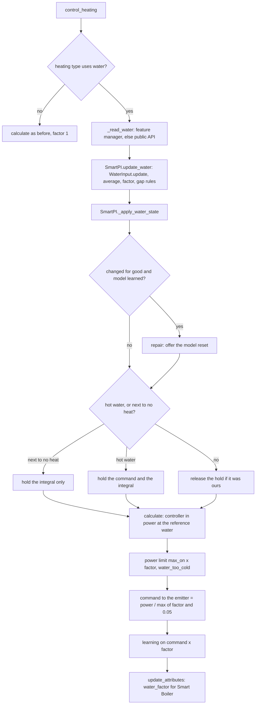
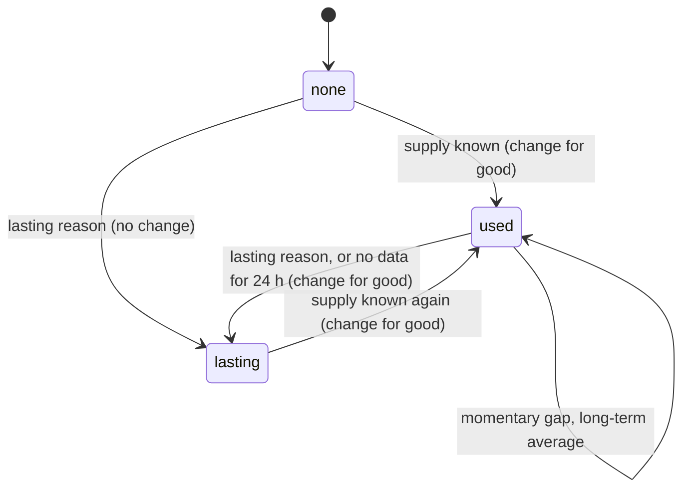
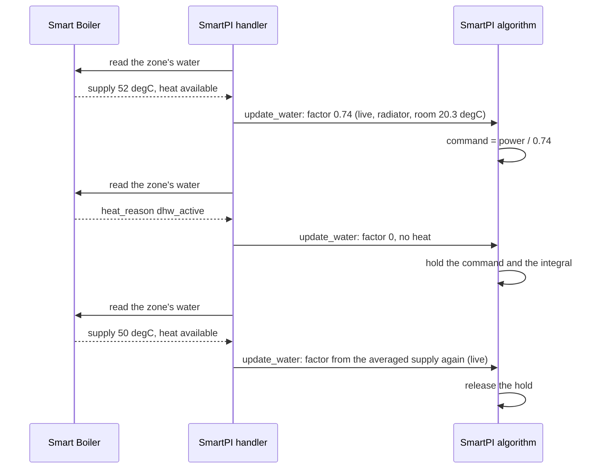
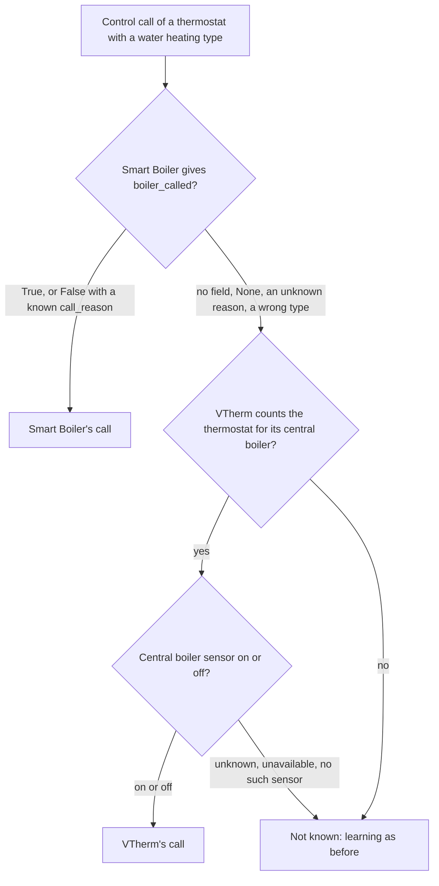
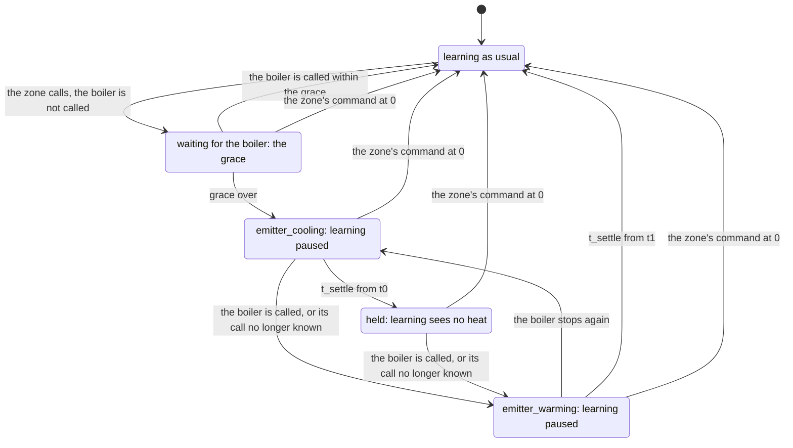

# Water input — the supply water temperature from Smart Boiler

This document describes how SmartPI uses the temperature of the water reaching a
thermostat's emitters. It is in two parts: the consumer specification (what SmartPI reads,
how it turns it into a factor and what it does with it; sections 2–3) and the technical
description (components, one calculation, lifecycle, persistence, diagnostics, tests;
sections 4–10). Section 11 covers a boiler that is not called while the zone calls for heat. The
PI controller, its feed-forward and its own learning are described in
the [technical documentation](technical_doc.md).

The data come from the Smart Boiler plugin, whose
[water interface specification](https://github.com/Shadow-230/vtherm-smart-boiler/blob/dev/documentation/en/water-interface.md)
is binding for the names, types and values read here. Without Smart Boiler, or without
water data for a thermostat, SmartPI behaves exactly as before. Whether the boiler is called comes
from Smart Boiler or, where Versatile Thermostat's own central boiler drives it, from VTherm
(section 11).

Abbreviations: Home Assistant (HA), Versatile Thermostat (VTherm), domestic hot water (DHW).

## Contents

1. [Overview](#1-overview)
2. [Settings](#2-settings)
3. [Consumer specification](#3-consumer-specification)
4. [Components](#4-components)
5. [One calculation](#5-one-calculation)
6. [Lifecycle](#6-lifecycle)
7. [Persistent state](#7-persistent-state)
8. [Diagnostics](#8-diagnostics)
9. [Testing](#9-testing)
10. [Constants, limits and open points](#10-constants-limits-and-open-points)
11. [A boiler that is not called](#11-a-boiler-that-is-not-called)

## 1. Overview

SmartPI's room model `dT/dt = a·u − b·(T − T_ext)` assumes that a unit of command `u` always
brings the same heat. With water heating that is false:

- a weather-compensated boiler or a mixer lowers the water when it is mild outside, so the
  same valve opening or duty cycle gives less heat;
- the burner cycles, so the water swings by several degrees within minutes;
- hot water with priority takes the boiler's heat away from the heating circuit for tens of
  minutes.

SmartPI then learns an `a` that mixes the room and the water, and its outdoor feed-forward
counts the weather twice (once through the curve, once through its own model).

The **emitter power factor** `φ` removes this. It says how much power a unit of command gives
at the water reaching the emitter, relative to a reference water. SmartPI works in power at
the reference water: its controller, its model and its learning see that power; the emitter
gets `power / φ`. The learned coefficients stay physical, and a change of water no longer
looks like a change of the room.

Principles (agreed with the owner on 2026-10-12):

- **Optional.** No water data: `φ = 1`, the behaviour of SmartPI without this feature.
- **One source.** All boiler-side data come from Smart Boiler, which hosts every water,
  burner and hot-water sensor. SmartPI has no water sensor settings of its own.
- **One heat source per VTherm thermostat.** Each thermostat has its own circuit and its own
  water: radiators on the boiler's flow, a floor loop on the sensor after its mixer.
- **SmartPI computes the factor.** Smart Boiler knows the water, not the emitters; SmartPI
  knows its heating type and the room.
- **SmartPI only reads the water.** It never asks for a water temperature.

## 2. Settings

**Heating type** — in the regulator settings of the global entry (default) and of each
thermostat entry (`smart_pi_heating_type`). Default: water radiator.

| Value | Heating type | Exponent `n` | Reference water `T_ref` | Uses the water data |
|---|---|---|---|---|
| `radiator` | Water radiator | 1.3 | 60 °C | yes |
| `floor_water` | Water underfloor heating | 1.1 | 45 °C | yes |
| `floor_electric` | Electric heating mat | — | — | no |
| `electric_fast` | Fast electric heater | — | — | no |

The exponents and reference waters are provisional, to be checked against field data. An
electric type never reads Smart Boiler.

## 3. Consumer specification

### 3.1 Reading the data

At each control call (`SmartPIHandler._update_water`, called from `control_heating` and, for a
zone's additional source, from `_control_as_source`), for its VTherm climate `entity_id`, the
handler reads the first available of:

1. `thermostat.get_feature_manager("vtherm_smart_boiler")` — VTherm 10.5.0.beta1 and later,
   once the thermostat has the manager — and its properties;
2. `hass.data["vtherm_smart_boiler_api"].zone_water(entity_id)` — any VTherm version, also
   before VTherm's reload.

| Rule | |
|---|---|
| Nothing imported | SmartPI imports nothing of Smart Boiler; it checks that the method, key and function exist. |
| Failures | Any exception, a missing key or function, or a `None` mapping means "no data now". |
| Types | A value of the wrong type (a text temperature, a non-boolean `heat_available`, an empty reason) is taken as missing. |
| Freshness | SmartPI trusts `None` and its reason; it applies no age limit of its own to `supply_measured_at`. |
| Unknown reasons | An unknown `supply_reason` value is "no data for that moment" (interface specification, section 8). |

Fields read: `supply_temperature`, `supply_reason`, `heat_available`, `heat_reason`.
`heat_available` changes with every burner cycle: it is no learning gate (section 3.4); it only
decides when the long-term average of `φ` is fed (section 3.3).

### 3.2 The factor

    φ = min( (max(T_s − T_room, 0) / (T_ref − 20)) ** n , 1 )

- **`T_s`** is `supply_temperature` averaged over `WATER_AVERAGE_S` (15 min, exponential
  average in time): burner cycling makes the raw value jump. After a long gap the average
  follows the first new value.
- **`T_room`** is the thermostat's room temperature (VTherm's `current_temperature`).
- **Reference.** At the reference water and a room at 20 °C, `φ = 1`; half the drive gives
  `0.5 ** n`.
- **Water hotter than the reference** is taken as the reference (`φ ≤ 1`): the controller's
  power range is 0..1, so a higher factor would only cap the command; the emitter then gives
  at least the heat it gives without this feature. On such days the emitter gives more than
  the factor says, and the learned power leans upwards, as it does without water data.
- **Unknown room temperature** with a known supply: the factor in use is kept (no gap).
- **Hot water with priority.** While `heat_reason` is `dhw_active`, `φ = 0`: the boiler's
  flow then shows the water heating the tank, not this circuit's. These readings feed no
  average.

### 3.3 Missing data

| Situation | Kind | `φ` used | Source shown |
|---|---|---|---|
| `supply_temperature` known | — | from the averaged supply | `live` |
| `heat_reason == dhw_active`, with a known supply or after data were seen | — | 0 | `dhw` |
| `flow_unknown`, `flow_stale`, after data were seen | momentary | the long-term average of `φ` (`WATER_LONG_AVERAGE_S`, 3 days), so the learned model keeps its units; 1 if none exists yet | `average` |
| an unknown reason, or no data at all, after data were seen | momentary for `WATER_NO_DATA_LASTING_S` (24 h), then lasting | as momentary, then as lasting | `average`, then `lasting` |
| `not_mapped`, `circuit_not_measured`, `several_circuits` | lasting | 1, as without the interface | `lasting` |
| no data since the start (any reason but a lasting one) | — | 1 | `none` |
| after a lasting reason, until a supply is known again | — | 1 | `lasting` |
| electric heating type | — | 1 | — (no `water` block) |

The long-term average follows `φ` only while the boiler heats (`heat_available` true; without
that signal, while `φ ≥ WATER_NO_HEAT`): days of an idle boiler do not drag it down. No data
at all for a day after data were seen (Smart Boiler removed, the thermostat no longer one of
its zones) counts as lasting.

### 3.4 Use in SmartPI

1. **Command.** The controller's output is power at the reference water. The command sent to
   the emitter is `power / max(φ, WATER_NO_HEAT)`, at most 1, before the valve curve
   (`SmartPI._to_actuator_power`). The floor `WATER_NO_HEAT` (0.05) matters when the water is
   about the room's temperature — typically a boiler that fires only on demand and is idle:
   the zone must still be able to call for heat, so its command can reach 1 and fire the
   boiler.
2. **Learning.** The power SmartPI learns from is the applied command × `φ`
   (`SmartPI._to_linear_power`: the committed command, also in the learning phase's on/off
   regulation, the realized cycle power, the anti-windup tracking and the feed-forward trim's
   power record). A new factor immediately updates the committed power. There is no learning
   gate of SmartPI's own: an input of zero (burner off, hot water, closed valve) teaches the
   losses. Pauses come only from Smart Boiler, through `vtherm_smartpi.set_smartpi_learning`,
   as before. The dead-time estimator, which times the response to switching the emitter on
   or off and accepts only strong steps, gets the command itself (0 during hot water).
3. **Power limit and timing.** With `φ < 1` the output is limited to
   `max(φ, WATER_NO_HEAT)` × `max_on_percent` (`_apply_soft_constraints`): what a full command
   gives, the floor `WATER_NO_HEAT` letting the command still reach `max_on_percent` when the water
   brings next to no heat. The anti-windup tracking, which compares the model with the realized
   power, sees that limit. A demand above it is shown as `water_too_cold`. The
   minimal activation delay and the valve's activation floor are checked on the command, not
   on the power.
4. **Hot water and cold water.** While hot water has priority (`dhw_active`), the emitter's
   command is held at its last value (a demand of zero still gives zero) and the integral is
   held (`integral_hold_mode = "no_heat"`): no chasing a fully open valve while no heat can
   come. While the water brings next to no heat without hot water (`φ < WATER_NO_HEAT`, e.g. an
   idle boiler), only the integral is held; the command follows the controller. Both are
   re-asserted at each calculation; another hold already running is left as it is.
5. **Key for Smart Boiler.** While water data are behind the factor (`live`, `average`,
   `dhw`), SmartPI writes `water_factor` into the thermostat's `specific_states`: the factor
   applied, rounded to 0.001. Otherwise (`none`, `lasting`, electric type) the key is absent:
   its presence tells Smart Boiler that this thermostat uses the water data, and Smart Boiler
   then skips its learning pause on large water swings.
6. **Data appearing or going for good.** When the water data start being used (first data, or a
   known supply after a lasting gap) or stop for good (a lasting reason, or no data for 24 h), the
   learned power changes units. If SmartPI has a learned model (it is past its learning phase), it
   raises a Home Assistant repair, "Water temperature data are now available" or "… are no longer
   available". Its one step has **Reset the learned model**, checked by default; confirming calls
   `vtherm_smartpi.reset_smartpi_learning` for the thermostat. Nothing is rescaled. A momentary gap
   never raises it. A change of the heating type drops what the water input knew (section 7), so a
   change to a water type offers the reset at the first data, if SmartPI has a learned model; a
   change to an electric type offers nothing.
7. **Power in the diagnostics.** With water data the values of the `power` block (`pi_percent`,
   `ff_percent`, `command_percent`, `limited_percent`, `applied_percent`, the `linear_*` values)
   and the history series `power.command_percent` and `power.applied_percent` are power at the
   reference water; `current_cycle_percent` and `next_cycle_percent` are the command sent to the
   emitter.

## 4. Components

| Component | File | Responsibility |
|---|---|---|
| `WaterInput` | `smartpi/water_input.py` | Pure logic, no HA: the factor, the 15-min supply average, the long-term average of `φ`, the gap rules, the availability (`none`, `used`, `lasting`) and its changes for good; persistence. |
| `WaterReading`, `WaterState` | `smartpi/water_input.py` | What Smart Boiler gave; the factor in use, its source, the averaged supply, the reasons, `no_heat`, `changed_for_good`. |
| `SmartPIHandler._read_water` | `handler.py` | Reads the manager or the public API, checks types; any failure gives `None`. |
| `SmartPIHandler._update_water` | `handler.py` | Before each calculation of a water type (from `control_heating`, and from `_control_as_source` for a zone's additional source): `algo.update_water(...)`; on a change for good, `_offer_model_reset`. |
| `SmartPIHandler.update_attributes` | `handler.py` | Writes or removes `water_factor` in `specific_states`. |
| `SmartPI.update_water`, `_apply_water_state` | `algo.py` | Applies the factor; starts and ends the no-heat hold; refreshes the committed power. |
| `SmartPI._to_actuator_power`, `_water_command`, `_to_linear_power` | `algo.py` | Command = power / `max(φ, WATER_NO_HEAT)` (or the held command); power = command × `φ`. With water data the committed command is the reference and its power follows the factor. |
| `SmartPI._deadtime_power` | `algo.py` | The command step for the dead-time estimator (0 during hot water). |
| `SmartPI._apply_soft_constraints` | `algo.py` | Power limit `max_on_percent × max(φ, WATER_NO_HEAT)`; `water_too_cold`. |
| `WaterModelResetFlow` | `repairs.py` | The repair's step: reset the learned model (checked by default). |
| Heating type | `config_flow.py`, `const.py` | The `smart_pi_heating_type` selector in the regulator settings. |
| `BoilerCall`, `BoilerReading` | `smartpi/boiler_call.py` | Pure logic: the boiler's call, the learning mode (`emitter_cooling`, `held`, `emitter_warming`), the grace and the settling time from the heating type, the `boiler` diagnostics (section 11). |
| `SmartPIHandler._read_boiler`, `vtherm_central_boiler_on` | `handler.py` | Smart Boiler's `boiler_called`, `call_reason` and demand fields, else VTherm's central boiler for a thermostat it serves; for a water heating type only. |
| `SmartPI.update_boiler`, `_read_known_inputs`, `_learning_power`, `_deadtime_input` | `algo.py` | The learning mode at each calculation: learning with the power 0 while held, the `boiler_settling` gate while the emitter cools or warms, the dead-time estimator's input and steps, the feed-forward trim frozen, the dependency layer told (`heat_withheld`), a cycle's realized power recorded as 0. |

## 5. One calculation

## 6. Lifecycle

The availability of the water data decides the factor's source and when the reset is
offered.

During one burner and hot-water sequence:

## 7. Persistent state

`SmartPI.save_state()` gains a `water` key once the water input has seen data or a lasting
reason (so a thermostat without water data keeps the previous format):

| Field | Meaning |
|---|---|
| `heating_type` | The heating type the state belongs to; a state of another type is ignored. |
| `availability` | `none`, `used` or `lasting`: after a restart, a first reading is not taken as a change for good. |
| `long_average` | Long-term average of `φ`, used across a restart for momentary gaps. |
| `no_data_s` | How long a gap without any data has lasted: it goes on after a restart, so the 24 h rule holds with frequent restarts. |

The 15-min supply average is not saved: it restarts from the first reading. A change of the
heating type drops the averages. The learning reset (`reset_learning`) keeps them: they
describe the water, not the room.

## 8. Diagnostics

For a water type, the published diagnostics (`live`) gain a `water` block:

| Field | Meaning |
|---|---|
| `heating_type` | The thermostat's heating type. |
| `factor` | `φ` applied now. |
| `source` | `live`, `average`, `dhw`, `lasting` or `none` (section 3.3). |
| `supply_avg_c` | The averaged supply, °C. |
| `supply_reason`, `heat_reason` | The last reasons Smart Boiler gave. |
| `no_heat` | Hot water: the command and the integral are held. |
| `low_heat` | The water brings next to no heat: the integral is held. |
| `water_too_cold` | The demand exceeded what the water gives at full command. |

Where the boiler's call is known (section 11), `live` also gains a `boiler` block:

| Field | Meaning |
|---|---|
| `source` | `smart_boiler` or `vtherm_central_boiler`. |
| `called` | Whether the boiler is called for heating now. |
| `reason` | Why it is not: Smart Boiler's `call_reason`, or `not_called` for VTherm's central boiler. |
| `learning` | `emitter_cooling`, `held`, `emitter_warming` or `null` (section 11.2). |
| `demand` | From Smart Boiler, the demand against its thresholds it gave: `demand_count`, `count_threshold`, `count_by`, `demand_power_kw`, `power_threshold_kw`, `demand_opening`, `opening_threshold`. |

## 9. Testing

| Test file | What it checks |
|---|---|
| `tests/test_smartpi_water_input.py` | The factor law; electric and unset types; the 15-min average and burner cycling; hot water (`φ = 0`, averages untouched); no heat near the room; momentary gaps (known, unknown reason, no data) use the long-term average, no data for a day counts as lasting; lasting gaps give 1 and are changes for good; first data are a change for good; the long-term average follows the water while heating only; water above the reference counts as the reference; persistence (also loaded before the heating type is set) and a state of another type. |
| `tests/test_smartpi_water_algo.py` | No change without data; command = power / `φ`, learning = command × `φ`; the committed power follows a new factor; the power limit and `water_too_cold`; the hold of the command and the integral during hot water (the integral mode is the water's hold; a zero demand still gives zero), re-asserted, and not releasing another hold; cold water from an idle boiler holds the integral only and the command reaches 1; the learning phase commits the power and gives the dead-time estimator the command; the activation delay on the command; the feed-forward trim records the power; electric type; diagnostics and persistence; the learning reset keeps the averages. |
| `tests/test_smartpi_water_handler.py` | The public API by `entity_id`; the feature manager first; the API when the thermostat has no manager; every failure is no data; badly typed fields; `water_factor` published while water data are used (also the average during a momentary gap) and absent otherwise; the reset offered when data appear or go for good with a learned model only, never on a momentary gap. |
| `tests/test_config_flow_heating_type.py` | The heating type in the regulator settings (default, options), stored by the options flow; the repair step resets the model only when checked; the English texts. |
| `tests/test_smartpi_boiler_call.py` | The modes: a call answered within the grace changes nothing, a short stop of a working boiler neither; an unanswered call cools the emitter, then holds; the start after a hold warms it; the zone's command off ends them; a call not known; Smart Boiler's `below_threshold` and `no_demand`; outside heating; the settling time by heating type; the diagnostics with the demand. |
| `tests/test_smartpi_boiler_algo.py` | Learning gets the power 0 while held and waits while the emitter cools or warms; the dead-time estimator gets 0 and does not time the boiler's start; the feed-forward trim frozen and released; a cycle's realized power recorded as 0; the dependency layer told; nothing changes without a reading. |
| `tests/test_smartpi_boiler_handler.py` | Each of Smart Boiler's reasons from the API and the manager; its demand fields, badly typed ones left out; VTherm's central boiler when Smart Boiler says nothing (no fields, `None` with `not_controlling` or `waiting_data`, an unknown reason, a wrong type), only for a thermostat it serves; its binary sensor read in Home Assistant; an electric heating type reads nothing. |
| `tests/test_smartpi_sim_boiler_call.py` | A zone under a 2500 W start threshold, fired by the other zones outside a window of the day, with VTherm's central boiler and with Smart Boiler's call over its water data (section 11.4). |
| `tests/test_smartpi_sim_water.py` | Simulated rooms heated by water (`tests/sim/boiler.py`: heating curve, burner cycling, hot-water priority, and a stand-in of Smart Boiler's public API): with the water data SmartPI learns the radiator's power at the reference water (without them it learns a weaker radiator); during hot water the integral and the command stay still; a momentary gap keeps the units, a lasting one gives 1 and offers the reset once; a boiler that fires only on demand (cold water between calls) does not lock the zone. |

In the simulator a boiler (`SimBoiler`) feeds the zone's emitter: the plant's heater gives
`a · u · φ_plant(t)` with the same emitter law, the water following a heating curve with an optional burner
saw-tooth, hot-water windows, and an on-demand mode in which the water is at the boiler room's
temperature unless the zone called for heat in the last 20 minutes; `SimSmartBoiler` answers
`zone_water` with the boiler's flow rounded to 0.1 °C, `dhw_active` during hot water, and reasons a
test forces for a time window.

## 10. Constants, limits and open points

| Constant (`smartpi/const.py`) | Value |
|---|---|
| `WATER_EMITTERS` | radiator (1.3, 60 °C), floor_water (1.1, 45 °C) |
| `WATER_AVERAGE_S` | 15 min |
| `WATER_LONG_AVERAGE_S` | 3 days |
| `WATER_NO_HEAT` | 0.05 |
| `WATER_FACTOR_MAX` | 1.0 |
| `WATER_NO_DATA_LASTING_S` | 24 h |

- **Provisional exponents and reference waters**, to be checked against field data.
- **The zone with two heat sources** (a radiator and a floor loop in one room) uses each source's
  own factor: the main source's command is power at the reference water, the additional source
  turns it into its own command with its factor and reports its cycles, switched ones at their
  factor, and its power cap to the main source. See
  [Zone dependencies and a second heat source, §6.2 and §6.7](zone_dependencies.md#6-a-second-heat-source).
- **A boiler start threshold** (Versatile Thermostat's central boiler, or Smart Boiler, set to fire
  only above a total power or a valve opening, with the zone count off): a zone whose demand stays
  below it calls for heat that does not come. Its command is counted as power from the device's
  power in Versatile Thermostat (2000 W at 20 % is 400 W, under a 600 W threshold). Told that the
  boiler is not called, SmartPI no longer learns from it once the call has gone unanswered for
  longer than the grace (section 11); its regulation is unchanged:
  - Not told, without water data, SmartPI takes its command for heat. Told or not, the integral
    rises until the command crosses the threshold; the boiler then fires in short bursts. In a trial simulation outside the
    test suite (one zone needing a 20 % opening) a 35 % threshold gave about 5 starts per hour and
    twice the integral, and with 70 % the zone stayed 0.2 to 0.7 degC below its setpoint for 30 h.
  - With water data the cooling water lowers `φ` within the 15-min average, so learning stops
    counting the missing heat; but the command `power / φ` then rises above the threshold and falls
    back once the water is warm: about 10 starts per hour with 2-min burns at a 35 % threshold.
  - `heat_available` false (`flame_off`) cannot tell this apart from an ordinary burner pause: the
    boiler's call (section 11) can. A start hysteresis on the boiler's side removed the cycling in
    the same simulation (0.7 starts per hour, 68-min burns); low-load firing on Smart Boiler's
    side, with SmartPI holding its integral and keeping its command while the boiler is not called,
    is open, to be decided together with Smart Boiler.
  - With a single active zone enough to fire the boiler (the default count of 1), none of this
    happens.
- **Dead time with an on-demand boiler**: an "on" step made with cold water includes the
  boiler's warm-up in the dead time SmartPI measures.
- **The model reset is offered as a Home Assistant repair**: a change of the water data
  happens at run time, outside any options flow, and a repair is how an integration offers a
  step to the user then.
- **Smart Boiler's side** (the manager's properties, the public API, reading `water_factor`)
  is implemented in the Smart Boiler plugin; without Smart Boiler, or with a version without
  it, SmartPI simply finds no data.

## 11. A boiler that is not called

A boiler may fire only once the zones' demand meets its start criteria — a number of calling
devices or zones, their total power, the widest valve opening — and after an activation delay. A
zone under them calls for heat that does not come. Taking its command for heat, SmartPI learns a
weaker emitter (`a`), a wrong dead time and a bias of its feed-forward trim: in a simulation of a
zone calling through a night without the boiler, its learned `a` fell to 1 % of the truth
(section 11.4). Smart Boiler's `heat_available` cannot tell this case apart: `flame_off` also comes
with every ordinary burner pause while the boiler is called.

### 11.1 Where the boiler's call comes from

| Source | When | Values |
|---|---|---|
| Smart Boiler: `boiler_called`, `call_reason` of its water interface (the feature manager or `zone_water`) | Smart Boiler controls the boiler | `True`; `False` with `below_threshold` (zones call under the count, power and opening criteria), `no_demand` (no zone calls), `activation_delay` or `boiler_fault` |
| Versatile Thermostat's central boiler: its binary sensor (unique ID `central_boiler_state`) | Smart Boiler says nothing (`None` with `not_controlling` or `waiting_data`, an older version without the fields, an unknown reason, a wrong type), and VTherm counts the thermostat for its central boiler (`is_used_by_central_boiler`) | on, or off (`not_called`) |
| none | otherwise, and for an electric heating type | SmartPI learns as before (after a hold, once the emitter has warmed) |

- Smart Boiler and VTherm's central boiler do not control the boiler together: Smart Boiler
  keeps its own control off while VTherm's central boiler is set up. With Smart Boiler in control
  the fallback finds no VTherm boiler, and SmartPI learns as before until Smart Boiler publishes
  its fields.
- `True` means the boiler is commanded to heat; a burner pause or hot water with priority stays in
  `heat_available` and `heat_reason` (section 3).
- VTherm's sensor follows VTherm's decision after its activation delay: the device count and power
  thresholds, and every other zone calling.
- Smart Boiler's fields were agreed with the Smart Boiler project on 2026-10-14 and are read
  defensively until it publishes them. Its demand fields (`demand_count`, `count_threshold`,
  `count_by`, `demand_power_kw`, `power_threshold_kw`, `demand_opening`, `opening_threshold`) go to
  the diagnostics only.

### 11.2 Learning around a hold

With `u` the command of the zone's device, `called` the boiler's call, `t0` the start of the
zone's call left unanswered and `t1` the boiler's start after a hold:

    calling     = heating  and  u > 0
    grace       = BOILER_CALL_GRACE_S (15 min), plus the cycle for a switched device
    t_settle    = L + 3·tau of the heating type's emitter (radiator 65 min, water floor 570 min)

    emitter_cooling   calling, not called since t0, t0 + grace <= t < t0 + t_settle
                      (or at once when the boiler stops again while the emitter warms)
    held              calling, not called since t0, t >= t0 + t_settle
    emitter_warming   calling, called again (or the call no longer known) at t1 after
                      emitter_cooling or held, t < t1 + t_settle

- **A boiler answering the zone's call within the grace** — an on-demand boiler, VTherm's
  activation delay of at most 10 min — changes nothing: the zone's own step, with the boiler's
  reaction in it, is learned as before. So does a boiler already at work, or one cycling with
  stops shorter than the grace: its water stays warm. A switched device is counted for the boiler
  only while it is on, so the off part of its cycle is no stop of the boiler's answer: its cycle is
  added to the grace.
- **Emitter cooling.** The boiler has stopped under a calling zone (or never answered): the
  circuit's pump stops a few minutes later and the emitter gives only the heat it holds, which
  fades with its lag. Learning waits; after three lags less than 5 % is left.
- **Held.** No heat comes. Learning sees the power 0 (with water data the power is already the
  command times a factor near 0, and stays as it is): windows of the zone cooling teach `b`, and no
  sample of `a` is taken.
- **Emitter warming.** The boiler has started after a hold: its water has to reach the emitter and
  warm it, while the valve has been open all along — no step of the zone's command that SmartPI's
  learning would wait for. Learning waits again. The boiler's start is not timed as a dead time
  either: its delay is the water's, not the valve's, and SmartPI's dead time is the valve's (in
  the simulation the start's response came in 2 to 5 min, the valve's in 11).

| | Grace, learning as usual | `emitter_cooling` | `held` | `emitter_warming` |
|---|---|---|---|---|
| `a`, `b` | learned | paused (gate `boiler_settling`) | learned with the power 0: only how the zone cools | paused (gate `boiler_settling`) |
| Dead-time estimator | as usual | paused (gate) | input 0, no step | paused (gate); then the command again, with no step |
| Feed-forward trim | runs | frozen (`boiler_not_heating`) | frozen | frozen |
| Exchanges with neighbours, the zone's fit | learned | paused | paused | paused |
| A cycle's realized power recorded for them | the cycle's | 0 | 0 | the cycle's |

- Each change of mode discards the open learning window and the dead-time estimator's step in
  progress (a call that got no heat, or the boiler's start); so does pausing or resuming learning
  while the zone is held, from the input the estimator gets.
- A calibration in progress is cancelled once the zone is cooling or held: it would time the
  response to heat that does not come.
- A thermostat working as another's additional source follows that thermostat's command, not its
  own: its mode is cleared.
- **A boiler cycling under the zone's own threshold** with stops shorter than the grace (the
  bursts of section 10) is not held: learning takes the command for heat there, as before.
- **Regulation is unchanged.** The controller still counts its command: the proportional part and
  the integral rise until the zone's demand meets the boiler's criteria, or the other zones have it
  called. A zone that needs less than the threshold still makes the boiler cycle, and may stay
  below its setpoint (section 10): with the boiler's call given, the simulation of a zone needing
  20 % under a 70 % threshold still sat 0.2 to 0.7 degC low for 30 h. That is the open regulation
  point, not a learning one.
- After a change of the heating type, the settling time follows the new emitter.

### 11.3 Diagnostics and state

The `boiler` block of section 8 shows the source, the call, its reason, the learning mode and,
from Smart Boiler, the demand against the thresholds. Nothing is saved: after a restart the first
reading starts the modes again.

### 11.4 Results (simulation)

`tests/test_smartpi_sim_boiler_call.py`: a radiator of 2000 W behind a valve, a start threshold of
2500 W reached only with the other zones (3000 W), which do not call in a window of the day; the
boiler's water warms with a 4-min lag when it fires and otherwise cools below the room; 0.01 °C
sensor, 96 h, outdoor 3 °C ± 2 °C.

| Case | Not told | Told |
|---|---|---|
| VTherm's central boiler, no water data, no boiler 2:00–8:00 | `a` 0.01 of the truth, `b` 0.98 | `a` 1.06, `b` 0.98 |
| Smart Boiler with water data, no boiler 10:00–16:00 | `a` 1.05, `b` 0.99 (a trial run; the water data already show the missing heat) | `a` 1.04, `b` 0.98 |

The tests assert the told runs, and that no sample of `a` is learned while the boiler is not
called; for VTherm's case also that the dead time stays the valve's (11.3 min, against 11.2 min
and `a` 0.99, `b` 0.98 with the boiler always called). The zone that fires the boiler itself (in SmartPI's learning
phase, with its command at 100 %) still learns its dead time and leaves the learning phase: its
call is answered within the grace. With a 0.1 °C sensor SmartPI's own estimator is about 20 % off
the truth even with the boiler always called, which hides the differences.
