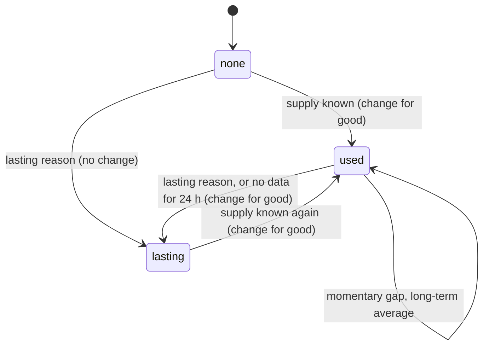
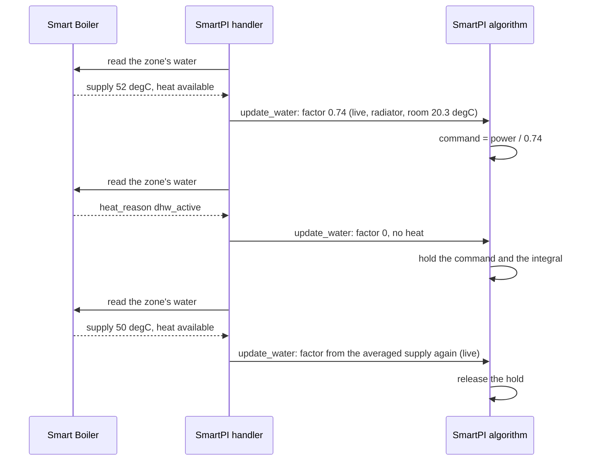
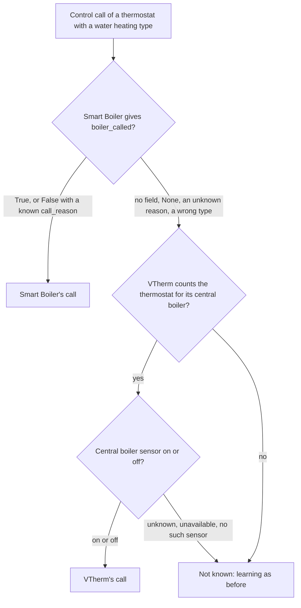
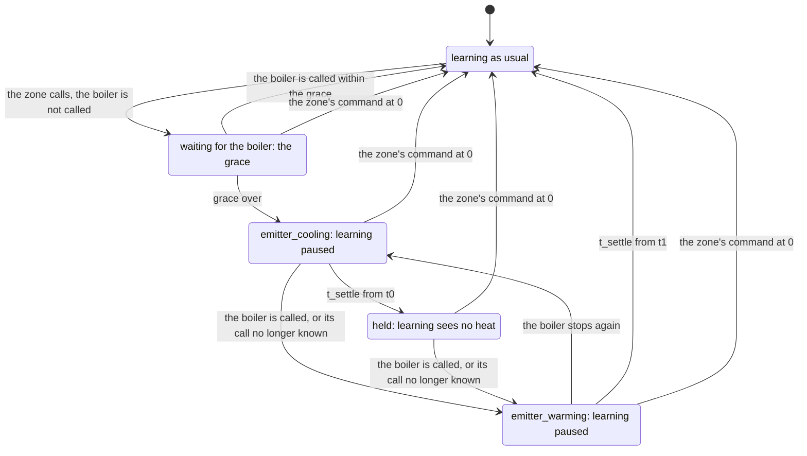
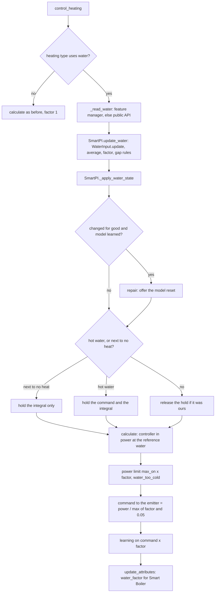

# Water input — the supply water temperature from Smart Boiler

This document describes two things. Section 3 explains how SmartPI uses the temperature of the
water that reaches a thermostat's emitters (the radiators, floor loops or other devices that give
the heat to the room). Section 4 explains what SmartPI does while the zone calls for heat that the
boiler does not give. For both, the document covers the reasons, the configuration, the logic and
its decisions, the components and interfaces, the saved state (persistence), the diagnostics, the
constants and the limits. The [technical documentation](technical_doc.md) describes the PI
controller, its feed-forward (the part of the command computed from the room model, the setpoint and the outdoor temperature) and its own
learning, and the changes this feature brings to them. [Tests](testing.md) describes the tests.

The data come from the Smart Boiler plugin. The names, types and values that SmartPI reads here
must match Smart Boiler's
[water interface specification](https://github.com/Shadow-230/vtherm-smart-boiler/blob/dev/documentation/en/water-interface.md).
Without Smart Boiler, or without water data for a thermostat, SmartPI's command and the way it
learns the emitter's power stay as before (as without this feature). A water heating type also uses
one more piece of data: whether the boiler is called. This comes from Smart Boiler, or from VTherm
where Versatile Thermostat's own central boiler drives the boiler (section 4).

Abbreviations: Home Assistant (HA), Versatile Thermostat (VTherm), domestic hot water (DHW).

## Contents

1. [Overview](#1-overview)
2. [Configuration](#2-configuration)
3. [Water data](#3-water-data)
4. [A boiler that is not called](#4-a-boiler-that-is-not-called)
5. [Components and interfaces](#5-components-and-interfaces)
6. [One calculation](#6-one-calculation)
7. [Persistent state](#7-persistent-state)
8. [Diagnostics](#8-diagnostics)
9. [Testing](#9-testing)
10. [Constants, limits and open points](#10-constants-limits-and-open-points)

## 1. Overview

SmartPI uses a room model: `dT/dt = a·u − b·(T − T_ext)`. Here `T` is the room temperature,
`T_ext` the outdoor temperature, `u` the command, `a` how much the emitter warms the room per unit
of command, and `b` how fast the room loses heat to the outside. The model assumes that a unit of
command `u` always brings the same heat. With water heating, this is not true:

- a boiler with a weather curve (weather compensation), or a mixing valve, lowers the water
  temperature when it is mild outside. The same valve opening or duty cycle (the share of time a
  switched device is on) then gives less heat;
- the burner switches on and off, so the water temperature swings by several degrees within
  minutes;
- when domestic hot water has priority, it takes the boiler's heat away from the heating circuit
  for tens of minutes.

SmartPI then learns a value of `a` that mixes the room with the water. Its outdoor feed-forward
also counts the weather twice: once through the boiler's curve and once through its own model.

The **emitter power factor** `φ` fixes this. It tells how much power a unit of command gives with
the water that reaches the emitter, compared with a reference water temperature (the "reference
water"). SmartPI works in power at the reference water. Its controller, its model and its learning
all see this power. The emitter gets `power / φ`. The learned coefficients then keep their physical
meaning, and a change of the water no longer looks like a change of the room.

Principles (agreed with the owner on 2026-10-12):

- **Optional.** Without water data, `φ = 1`: SmartPI behaves as it does without this feature.
- **One source.** All data about the boiler come from Smart Boiler. Smart Boiler holds every
  water, burner and hot-water sensor. SmartPI has no water sensor settings of its own. (The owner
  extended this on 2026-10-14: where Smart Boiler does not control the boiler, whether the boiler
  is called also comes from VTherm's central boiler, section 4.)
- **One heat source per VTherm thermostat.** Each thermostat has its own circuit and its own
  water. Radiators get the boiler's flow water; a floor loop gets the water measured by the sensor
  after its mixing valve.
- **SmartPI computes the factor.** Smart Boiler knows the water but not the emitters. SmartPI
  knows its heating type and the room.
- **SmartPI only reads the water.** It never asks for a water temperature. That would need a large
  rebuild of Smart Boiler, and the water temperature usually cannot be set for each zone separately
  (Smart Boiler's interface, section 9).

## 2. Configuration

**Heating type** (`smart_pi_heating_type`) — set in the regulator settings of the global entry
(as the default) and of each thermostat entry. Default: water radiator.

| Value | Heating type | Exponent `n` | Reference water `T_wref` | Uses the water data |
|---|---|---|---|---|
| `radiator` | Water radiator | 1.3 | 60 °C | yes |
| `floor_water` | Water underfloor heating | 1.1 | 45 °C | yes |
| `floor_electric` | Electric heating mat | — | — | no |
| `electric_fast` | Fast electric heater | — | — | no |

The exponents and reference waters are provisional. They still need to be checked against data
from real installations. An electric heating type never reads Smart Boiler.

**To use the water data:**

- Smart Boiler links the thermostat to its circuit and to the circuit's supply temperature sensor
  (see Smart Boiler's documentation). SmartPI needs no other setting than the heating type.
- The `water` block of the diagnostics shows whether SmartPI uses the data: then `source` is
  `live`.
- An entry without its own heating type takes the global default, which is a water radiator. For
  an electric emitter, set an electric type, so that it reads neither Smart Boiler nor the boiler's
  call.

## 3. Water data

### 3.1 Reading the data

At each control call, the handler reads the water data for its VTherm climate `entity_id`. This
happens in `SmartPIHandler._update_water`, which is called from `control_heating` and, for a
zone's additional source, from `_control_as_source`. The handler uses the first of these that is
available:

1. `thermostat.get_feature_manager("vtherm_smart_boiler")` and its properties — on VTherm
   10.5.0.beta1 and later, once the thermostat has the manager;
2. `hass.data["vtherm_smart_boiler_api"].zone_water(entity_id)` — on any VTherm version, also
   before VTherm's reload.

| Rule | |
|---|---|
| Nothing imported | SmartPI imports no Smart Boiler code. It checks that the method, key and function exist. |
| Failures | Any exception, a missing key or function, or a `None` mapping means "no data now". |
| Types | A value of the wrong type counts as missing: for example a temperature given as text, a `heat_available` that is not true or false, or an empty reason. |
| Freshness | SmartPI trusts `None` and its reason. It sets no age limit of its own on `supply_measured_at`. |
| Unknown reasons | An unknown `supply_reason` value means "no data for that moment" (interface specification, section 8). |

Fields read: `supply_temperature`, `supply_reason`, `heat_available`, `heat_reason`.
`heat_available` changes with every burner cycle. So it is not used as a learning gate (a
condition that pauses learning, section 3.4). It only decides when new values go into the
long-term average of `φ` (section 3.3).

### 3.2 The factor

    φ = min( (max(T_s − T_room, 0) / (T_wref − 20)) ** n , 1 )

- **`T_s`** is `supply_temperature` averaged over `WATER_AVERAGE_S` (15 min, an exponential
  average over time). The average is needed because the burner switching on and off makes the raw
  value jump. After a long gap, the average takes on the first new value.
- **`T_room`** is the thermostat's room temperature (VTherm's `current_temperature`).
- **Reference.** With the reference water and a room at 20 °C, `φ = 1`. Half the drive (the
  difference between the water and the room temperature) gives `0.5 ** n`.
- **Water hotter than the reference** counts as the reference (`φ ≤ 1`). The controller's power
  range is 0..1, so a higher factor would only cap the command. This way, the emitter gives at
  least the heat it gives without this feature. On such days, the emitter gives more than the
  factor says, and the learned power drifts upwards, as it does without water data.
- **Unknown room temperature** with a known supply: SmartPI keeps the factor in use (this is not
  a gap).
- **Hot water with priority.** While `heat_reason` is `dhw_active`, `φ = 0`. The boiler's flow
  then shows the water that heats the hot-water tank, not this circuit's water. These readings do
  not go into any average.

### 3.3 Missing data

| Situation | Kind | `φ` used | Source shown |
|---|---|---|---|
| `supply_temperature` known | — | from the averaged supply | `live` |
| `heat_reason == dhw_active`, with a known supply or after data were seen | — | 0 | `dhw` |
| `flow_unknown`, `flow_stale`, after data were seen | momentary | the long-term average of `φ` (`WATER_LONG_AVERAGE_S`, 3 days), so that the learned model keeps its units; 1 if there is no average yet | `average` |
| an unknown reason, or no data at all, after data were seen | momentary for `WATER_NO_DATA_LASTING_S` (24 h), then lasting | as momentary, then as lasting | `average`, then `lasting` |
| `not_mapped`, `circuit_not_measured`, `several_circuits` | lasting | 1, as without the interface | `lasting` |
| no data since the start (any reason but a lasting one) | — | 1 | `none` |
| after a lasting reason, until a supply is known again | — | 1 | `lasting` |
| electric heating type | — | 1 | — (no `water` block) |

The long-term average follows `φ` only while the boiler heats: while `heat_available` is true,
or, without that signal, while `φ ≥ WATER_NO_HEAT`. So days when the boiler is idle do not pull
the average down. A full day with no data at all, after data were seen, counts as lasting. This
happens, for example, when Smart Boiler is removed or when the thermostat is no longer one of its
zones.

### 3.4 Use in SmartPI

1. **Command.** The controller's output is power at the reference water. The command sent to
   the emitter is `power / max(φ, WATER_NO_HEAT)`, at most 1. This is computed before the valve
   curve is applied (`SmartPI._to_actuator_power`). The floor (lower limit) `WATER_NO_HEAT` (0.05)
   matters when the water is at about the room's temperature. This is typical of an idle boiler
   that fires only on demand. The zone must still be able to call for heat, so its command can
   reach 1 and fire the boiler.
2. **Learning.** The power that SmartPI learns from is the applied command × `φ`
   (`SmartPI._to_linear_power`). This applies to the committed command (also in the on/off
   regulation of the learning phase), the realized power of a cycle, the anti-windup tracking (it
   stops the integral part of the controller from growing too much while the output is limited)
   and the power record of the feed-forward trim (a learned correction of the feed-forward). A new
   factor updates the committed power at once. The water input adds no learning gate of its own.
   An input of zero (burner off, hot water, closed valve) teaches SmartPI the heat losses.
   Learning pauses still come from Smart Boiler through `vtherm_smartpi.set_smartpi_learning`, as
   before. They also come from the boiler's call, while the emitter cools down or warms up again around a
   hold (section 4). The dead-time
   estimator measures the delay before the room responds when the emitter switches on or off. It
   accepts only strong steps. It gets the command itself (0 during hot water).
3. **Power limit and timing.** With `φ < 1`, the output is limited to
   `max(φ, WATER_NO_HEAT)` × `max_on_percent` (`_apply_soft_constraints`). This is what a full
   command gives. The floor `WATER_NO_HEAT` lets the command still reach `max_on_percent` when the
   water brings next to no heat. The anti-windup tracking compares the model with the realized
   power, and it sees this limit. A demand above the limit is shown as `water_too_cold`. The
   minimal activation delay and the valve's activation floor are checked on the command, not on
   the power.
4. **Hot water and cold water.** While hot water has priority (`dhw_active`), the emitter's
   command is held at its last value (a demand of zero still gives zero). The integral is held
   too (`integral_hold_mode = "no_heat"`). This way, SmartPI does not drive the valve towards fully
   open while no heat can come. When the water brings next to no heat and hot water is not the
   reason (`φ < WATER_NO_HEAT`, for example an idle boiler), only the integral is held, and the
   command follows the controller. Both holds are applied again at each calculation. If another
   hold is already running, SmartPI leaves it as it is.
5. **Key for Smart Boiler.** While the factor comes from water data (`live`, `average`, `dhw`),
   SmartPI writes `water_factor` into the thermostat's `specific_states`. Its value is the factor
   applied, rounded to 0.001. Otherwise (`none`, `lasting`, electric type), the key is absent.
   When the key is present, Smart Boiler knows that this thermostat uses the water data. Smart
   Boiler then skips its learning pause on large water swings.
6. **Data appearing or going for good.** The water data can start being used (first data, or a
   known supply after a lasting gap). They can also stop for good (a lasting reason, or no data for
   24 h). In both cases, the learned power changes units. If SmartPI has a learned model (it is
   past its learning phase), it raises a Home Assistant repair: "Water temperature data are now
   available" or "… are no longer available". The repair has one step, with the option **Reset
   the learned model**, checked by default. Confirming it calls
   `vtherm_smartpi.reset_smartpi_learning` for the thermostat. SmartPI does not rescale the learned
   model to the new units (owner's decision of 2026-10-12); it offers the reset instead. A
   momentary gap never raises the repair. The repair's issue is
   `water_data_changed_<thermostat unique id>`. It is created as persistent: it stays until the
   user answers it, and SmartPI does not remove it. Its one field is `reset_model`. A change of the
   heating type drops what the water input knew (section 7). So after a change to a water type,
   SmartPI offers the reset at the first data, if it has a learned model. A change to an electric
   type offers nothing.
7. **Power in the diagnostics.** With water data, the values of the `power` block (`pi_percent`,
   `ff_percent`, `command_percent`, `limited_percent`, `applied_percent`, the `linear_*` values)
   and the history series `power.command_percent` and `power.applied_percent` are power at the
   reference water. `current_cycle_percent` and `next_cycle_percent` are the command sent to the
   emitter.

### 3.5 Lifecycle of the data

Whether the water data are available decides where the factor comes from and when the reset is
offered.

During one sequence of burner heating and hot water:

### 3.6 Results (simulation)

Setup: a radiator on a boiler with a heating curve, outdoor 3 °C ± 3 °C, 48 h
([Tests, §3.4](testing.md#34-water--test_smartpi_sim_waterpy-short)). Without the water data,
SmartPI learns less than half of the radiator's power at the reference water: the cooler water from
the curve looks like a weaker radiator. With the water data, it learns between 0.5 and 1.2 of that
power, and more than 1.5 times the value it learns without them.

## 4. A boiler that is not called

A boiler may fire only when the zones' demand meets its start criteria, and only after an
activation delay. These criteria are about the number of calling devices or zones, their total
power and the widest valve opening. A zone below them calls for heat that does not come. SmartPI
treats the zone's command as if the heat had come. It then learns an emitter that is too weak (`a`), a
wrong dead time (the delay before the room responds) and a bias in its feed-forward trim. In a
simulation of a zone calling all night without the boiler, its learned `a` fell to 1 % of the true
value (section 4.4). Smart Boiler's `heat_available` cannot tell this case apart: `flame_off` also
comes with every ordinary burner pause while the boiler is called.

### 4.1 Where the boiler's call comes from

| Source | When | Values |
|---|---|---|
| Smart Boiler: `boiler_called`, `call_reason` of its water interface (the feature manager or `zone_water`) | Smart Boiler controls the boiler | `True`; `False` with `below_threshold` (zones call, but below the count, power and opening criteria), `no_demand` (no zone calls), `activation_delay` or `boiler_fault` |
| Versatile Thermostat's central boiler: its binary sensor (unique ID `central_boiler_state`) | Smart Boiler says nothing (`None` with `not_controlling` or `waiting_data`, an older version without the fields, an unknown reason, a wrong type), and VTherm counts the thermostat for its central boiler (`is_used_by_central_boiler`) | on, or off (`not_called`) |
| none | otherwise, and for an electric heating type | SmartPI learns as before (after a hold, once the emitter has warmed) |

- Smart Boiler and VTherm's central boiler never control the boiler at the same time. Smart Boiler
  keeps its own control off while VTherm's central boiler is set up. When Smart Boiler is in
  control, there is no VTherm central boiler to fall back on. SmartPI then learns as before until Smart Boiler
  publishes its fields.
- `True` means the boiler is told to heat. A burner pause, or hot water with priority, is shown
  only in `heat_available` and `heat_reason` (section 3).
- VTherm's sensor follows VTherm's decision, after VTherm's activation delay. This decision takes
  into account the device count and power thresholds, and every other calling zone.
- Smart Boiler's fields were agreed with the Smart Boiler project on 2026-10-14. Until Smart
  Boiler publishes them, SmartPI reads them defensively, with checks for missing or wrong values.
  Smart Boiler adds no learning pause of its own for this case, because a second pause would end at
  the wrong moment.
- Smart Boiler's demand fields are used only in the diagnostics: `demand_count` and
  `count_threshold` (counted by `count_by`: `devices`, VTherm's heads, or `zones`),
  `demand_power_kw` and `power_threshold_kw` (kW), `demand_opening` and `opening_threshold` (0 to
  1). SmartPI keeps only the values with the right type; for a count, a whole number given as a
  float counts as the right type. It keeps the counts as whole numbers and rounds the kW and
  opening values to 3 decimals.

### 4.2 Learning around a hold

In the rules below, `u` is the command of the zone's device, `called` is the boiler's call, `t0`
is the start of the zone's call that got no answer, and `t1` is the boiler's start after a hold.
`L` is the emitter's delay and `tau` its lag (time constant). The grace is the time the boiler has
to answer the zone's call.

    calling     = heating  and  u > 0
    grace       = BOILER_CALL_GRACE_S (15 min), plus the cycle for a switched device
    t_settle    = L + 3·tau of the heating type's emitter (radiator 65 min, water floor 570 min)

    emitter_cooling   calling, not called since t0, t0 + grace <= t < t0 + t_settle
                      (or at once when the boiler stops again while the emitter warms)
    held              calling, not called since t0, t >= t0 + t_settle
    emitter_warming   calling, called again (or the call no longer known) at t1 after
                      emitter_cooling or held, t < t1 + t_settle

- **A boiler answering the zone's call within the grace** changes nothing. Examples are an
  on-demand boiler, or VTherm's activation delay of at most 10 min. SmartPI learns the zone's own
  step as before, with the boiler's reaction inside it. The same holds for a boiler already at
  work, or one cycling with stops shorter than the grace: its water stays warm. A switched (on/off)
  device counts for the boiler only while it is on. So the off part of its cycle is not a stop of
  the boiler's answer, and its cycle is added to the grace.
- **Emitter cooling.** The boiler has stopped while the zone calls (or it never answered). The
  circuit's pump stops a few minutes later. The emitter then gives only the heat it still holds,
  and this heat fades with the emitter's lag. Learning waits. After three lags, less than 5 % is
  left.
- **Held.** No heat comes. Learning sees a power of 0. (With water data, the power is already the
  command times a factor near 0, and it stays as it is.) Learning windows in which the zone cools
  teach `b`, and no sample of `a` is taken.
- **Emitter warming.** The boiler has started after a hold. Its water has to reach the emitter and
  warm it. But the valve has been open all along, so there is no step of the zone's command that
  SmartPI's learning would wait for. Learning waits again. SmartPI does not time the boiler's start
  as a dead time either. That delay comes from the water, not from the valve, and SmartPI's dead
  time is the valve's. (In the simulation, the response to the boiler's start came in 2 to 5 min,
  and the response to the valve in 11 min.)

| | Grace, learning as usual | `emitter_cooling` | `held` | `emitter_warming` |
|---|---|---|---|---|
| `a`, `b` | learned | paused (gate `boiler_settling`) | learned with the power 0: only how the zone cools | paused (gate `boiler_settling`) |
| Dead-time estimator | as usual | paused (gate) | input 0, no step | paused (gate); then the command again, with no step |
| Feed-forward trim | runs | frozen (`boiler_not_heating`) | frozen | frozen |
| Exchanges with neighbours, the zone's fit | learned | paused | paused | paused |
| A cycle's realized power recorded for them | the cycle's | 0 | 0 | the cycle's |

- Each change of mode discards the open learning window and the dead-time estimator's step in
  progress (a call that got no heat, or the boiler's start). Pausing or resuming learning while
  the zone is held does the same, and the estimator restarts from the input it gets.
- A calibration in progress is cancelled once the zone is cooling or held. Otherwise it would time
  the response to heat that does not come.
- A thermostat that works as another thermostat's additional source follows that thermostat's
  command, not its own. So its mode is cleared.
- **A boiler cycling under the zone's own threshold**, with stops shorter than the grace (the
  bursts of section 10), is not held. There, learning takes the command as heat, as before.
- **"Calling" means SmartPI's own command is above 0.** VTherm and Smart Boiler decide that a zone
  is calling from VTherm's `is_device_active`. For a valve on VTherm 10.5, this means a command
  above the valve's floor. So a zone with a command below that floor is calling for SmartPI but
  not for the boiler, and it can be held.
- **In a zone with two heat sources**, the main source's own call decides. The main source may be
  at 0 % while the additional source heats and the boiler is not called. The additional source's
  cycles then still count as heat in the zone's fit (at level 1 without water data).
- **Regulation is unchanged.** The controller does not change its command because the boiler is
  not called. The proportional part and
  the integral rise until the zone's demand meets the boiler's criteria, or until the other zones
  get the boiler called. A zone that needs less than the threshold still makes the boiler cycle,
  and it may stay below its setpoint (section 10). Even when SmartPI knows the boiler's call, in
  the simulation a zone needing 20 % under a 70 % threshold still stayed 0.2 to 0.7 degC low for
  30 h. This is the open point about regulation, not about learning.
- After a change of the heating type, the settling time follows the new emitter.

### 4.3 Diagnostics and state

The `boiler` block of section 8 shows the source, the call, its reason and the learning mode. With
Smart Boiler, it also shows the demand against the thresholds. Nothing is saved. After a restart,
the modes start again from the first reading.

### 4.4 Results (simulation)

`tests/test_smartpi_sim_boiler_call.py` simulates a radiator of 2000 W behind a valve. The boiler's
start threshold is 2500 W. It is reached only together with the other zones (3000 W), and these do
not call during one window of the day. When the boiler fires, its water warms with a 4-min lag;
otherwise the water cools below the room temperature. The sensor has a 0.01 °C step, the run lasts
96 h, and the outdoor temperature is 3 °C ± 2 °C. "Told" means that SmartPI knows the boiler's
call; "not told" means that it does not.

| Case | Not told | Told |
|---|---|---|
| VTherm's central boiler, no water data, no boiler 2:00–8:00 | `a` 0.01 of the truth, `b` 0.98 | `a` 1.06, `b` 0.98 |
| Smart Boiler with water data, no boiler 10:00–16:00 | `a` 1.05, `b` 0.99 (a trial run; the water data already show the missing heat) | `a` 1.04, `b` 0.98 |

The tests check the results of the told runs. They also check that no sample of `a` is learned
while the boiler is not called. For VTherm's case, they also check that the dead time stays the
valve's: 11.3 min, against 11.2 min (with `a` 0.99 and `b` 0.98) when the boiler is always called.
The zone that fires the boiler by itself (in SmartPI's learning phase, with its command at 100 %)
still learns its dead time and leaves the learning phase, because its call is answered within the
grace. With a 0.1 °C sensor, SmartPI's own estimator is about 20 % off the true value even when
the boiler is always called. This hides the differences.

## 5. Components and interfaces

| Component | File | Responsibility |
|---|---|---|
| `WaterInput` | `smartpi/water_input.py` | Pure logic without HA code: the factor, the 15-min supply average, the long-term average of `φ`, the gap rules, the availability (`none`, `used`, `lasting`) and its changes for good; persistence. |
| `WaterReading`, `WaterState` | `smartpi/water_input.py` | What Smart Boiler gave; the factor in use, its source, the averaged supply, the reasons, `no_heat`, `changed_for_good`. |
| `SmartPIHandler._read_water` | `handler.py` | Reads the manager or the public API and checks the types. Any failure gives `None`. |
| `SmartPIHandler._update_water` | `handler.py` | Before each calculation of a water type (from `control_heating`, and from `_control_as_source` for a zone's additional source): `algo.update_water(...)`; on a change for good, `_offer_model_reset`. |
| `SmartPIHandler.update_attributes` | `handler.py` | Writes or removes `water_factor` in `specific_states`. |
| `SmartPI.update_water`, `_apply_water_state` | `algo.py` | Applies the factor; starts and ends the no-heat hold; refreshes the committed power. |
| `SmartPI._to_actuator_power`, `_water_command`, `_to_linear_power` | `algo.py` | Command = power / `max(φ, WATER_NO_HEAT)` (or the held command); power = command × `φ`. With water data the committed command is the reference and its power follows the factor. |
| `SmartPI._deadtime_power` | `algo.py` | The command step for the dead-time estimator (0 during hot water). |
| `SmartPI._apply_soft_constraints` | `algo.py` | Power limit `max_on_percent × max(φ, WATER_NO_HEAT)`; `water_too_cold`. |
| `WaterModelResetFlow` | `repairs.py` | The repair's step: reset the learned model (checked by default). |
| Heating type | `config_flow.py`, `const.py` | The `smart_pi_heating_type` selector in the regulator settings. |
| `BoilerCall`, `BoilerReading` | `smartpi/boiler_call.py` | Pure logic: the boiler's call, the learning mode (`emitter_cooling`, `held`, `emitter_warming`), the grace and the settling time from the heating type, the `boiler` diagnostics (section 4). |
| `SmartPIHandler._read_boiler`, `vtherm_central_boiler_on` | `handler.py` | Smart Boiler's `boiler_called`, `call_reason` and demand fields, else VTherm's central boiler for a thermostat it serves; for a water heating type only. |
| `SmartPI.update_boiler`, `_read_known_inputs`, `_learning_power`, `_deadtime_input` | `algo.py` | The learning mode at each calculation: learning with the power 0 while held, the `boiler_settling` gate while the emitter cools or warms, the dead-time estimator's input and steps, the feed-forward trim frozen, the dependency layer informed (`heat_withheld`), a cycle's realized power recorded as 0. |

## 6. One calculation

## 7. Persistent state

`SmartPI.save_state()` adds a `water` key once the water input has seen data or a lasting reason.
So a thermostat without water data keeps the previous format. The key holds these fields:

| Field | Meaning |
|---|---|
| `heating_type` | The heating type the state belongs to. A state of another type is ignored. |
| `availability` | `none`, `used` or `lasting`. With it, the first reading after a restart is not taken as a change for good. |
| `long_average` | Long-term average of `φ`. It is kept across a restart and used for momentary gaps. |
| `no_data_s` | How long a gap without any data has lasted. The count goes on after a restart, so the 24 h rule still works with frequent restarts. |

The 15-min supply average is not saved. It restarts from the first reading. A change of the
heating type drops the averages. The learning reset (`reset_learning`) keeps them, because they
describe the water, not the room.

## 8. Diagnostics

For a water heating type, the published diagnostics (`live`) get a `water` block:

| Field | Meaning |
|---|---|
| `heating_type` | The thermostat's heating type. |
| `factor` | `φ` applied now. |
| `source` | `live`, `average`, `dhw`, `lasting` or `none` (section 3.3). |
| `supply_avg_c` | The averaged supply, °C. |
| `supply_reason`, `heat_reason` | The last reasons Smart Boiler gave. |
| `no_heat` | Hot water: the command and the integral are held. |
| `low_heat` | The water brings next to no heat: the integral is held. |
| `water_too_cold` | The demand exceeded what the water gives at full command. |

Where the boiler's call is known (section 4), `live` also gets a `boiler` block:

| Field | Meaning |
|---|---|
| `source` | `smart_boiler` or `vtherm_central_boiler`. |
| `called` | Whether the boiler is called for heating now. |
| `reason` | Why it is not: Smart Boiler's `call_reason`, or `not_called` for VTherm's central boiler. |
| `learning` | `emitter_cooling`, `held`, `emitter_warming` or `null` (section 4.2). |
| `demand` | The demand against its thresholds, as given by Smart Boiler: `demand_count`, `count_threshold`, `count_by`, `demand_power_kw`, `power_threshold_kw`, `demand_opening`, `opening_threshold`. |

## 9. Testing

[Tests](testing.md) describes the tests of the water input and of the boiler's call: unit,
algorithm, handler, form and simulation tests, with the scenarios and their criteria. The results
of section 4.4 come from these tests.

## 10. Constants, limits and open points

| Constant (`smartpi/const.py`) | Value |
|---|---|
| `WATER_EMITTERS` | radiator (1.3, 60 °C), floor_water (1.1, 45 °C) |
| `WATER_AVERAGE_S` | 15 min |
| `WATER_LONG_AVERAGE_S` | 3 days |
| `WATER_NO_HEAT` | 0.05 |
| `WATER_FACTOR_MAX` | 1.0 |
| `WATER_NO_DATA_LASTING_S` | 24 h |
| `WATER_ROOM_REFERENCE_C` | 20 °C (the room of the reference water in the factor) |
| `BOILER_CALL_GRACE_S` | 15 min (section 4) |

- **Provisional exponents and reference waters**: they still need to be checked against data from
  real installations.
- **The zone with two heat sources** (a radiator and a floor loop in one room) uses each source's
  own factor. The main source's command is power at the reference water. The additional source
  turns it into its own command with its own factor. It reports to the main source its cycles
  (switched ones at their factor) and its power cap. See
  [Zone dependencies and a second heat source, §5.2 and §5.7](zone_dependencies.md#5-a-second-heat-source).
- **A boiler start threshold**: Versatile Thermostat's central boiler, or Smart Boiler, can be set
  to fire only above a total power or a valve opening, with the zone count off. A zone whose demand
  stays below the threshold calls for heat that does not come. Its command is turned into power
  from the device's power set in Versatile Thermostat (2000 W at 20 % is 400 W, under a 600 W
  threshold). When SmartPI is told that the boiler is not called, it no longer learns from this
  command once the call has gone unanswered for longer than the grace (section 4). Its regulation
  is unchanged:
  - When SmartPI is not told and has no water data, it takes its command as heat. Told or not, the
    integral rises until the command crosses the threshold. The boiler then fires in short bursts.
    A trial simulation outside the test suite used one zone needing a 20 % opening. There, a 35 %
    threshold gave about 5 starts per hour and twice the integral. With 70 %, the zone stayed 0.2
    to 0.7 degC below its setpoint for 30 h.
  - With water data, the cooling water lowers `φ` within the 15-min average, so learning stops
    counting the missing heat. But the command `power / φ` then rises above the threshold, and
    falls back once the water is warm. At a 35 % threshold, this gave about 10 starts per hour with
    2-min burns.
  - `heat_available` false (`flame_off`) cannot tell this case apart from an ordinary burner
    pause. The boiler's call (section 4) can. In the same simulation, a start hysteresis on the
    boiler's side (the boiler starts at a higher demand than the one at which it stops) removed the
    cycling: 0.7 starts per hour, 68-min burns. Still open, and to be decided together with Smart
    Boiler: low-load firing on Smart Boiler's side, with SmartPI holding its integral and keeping
    its command while the boiler is not called.
  - None of this happens when a single active zone is enough to fire the boiler (the default
    count of 1).
- **Dead time with an on-demand boiler**: when an "on" step starts with cold water, the dead time
  that SmartPI measures includes the boiler's warm-up.
- **The model reset is offered as a Home Assistant repair**: the water data change while SmartPI
  runs, outside any options flow. At such a time, a repair is how an integration offers a step to
  the user.
- **Smart Boiler's side** (the manager's properties, the public API, reading `water_factor`) is
  implemented in the Smart Boiler plugin. Without Smart Boiler, or with a Smart Boiler version
  that does not have it, SmartPI simply finds no data.

