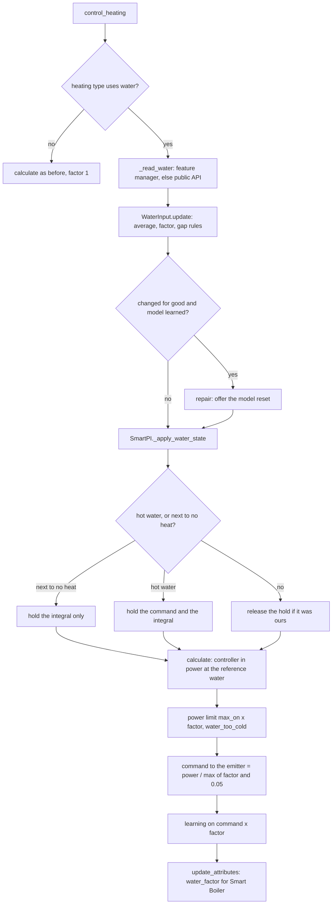
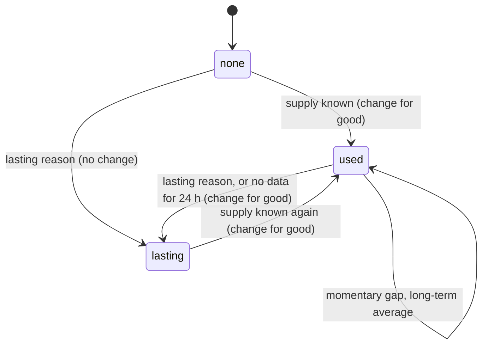
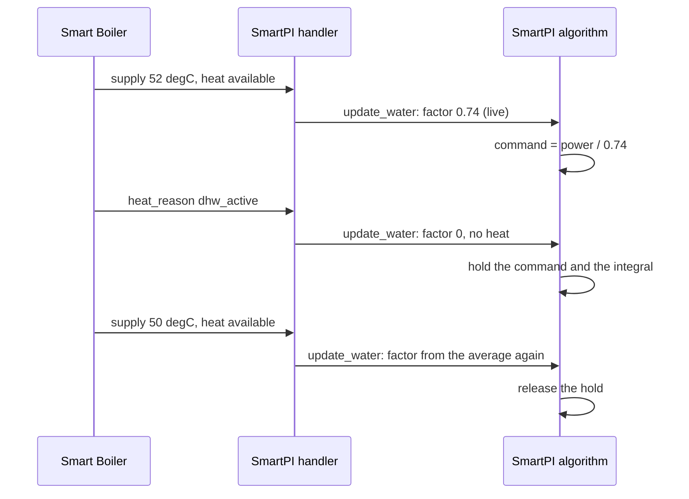

# Water input — the supply water temperature from Smart Boiler

This document describes how SmartPI uses the temperature of the water reaching a
thermostat's emitters. It is in two parts: the consumer specification (what SmartPI reads,
how it turns it into a factor and what it does with it; sections 2–3) and the technical
description (components, one calculation, lifecycle, persistence, diagnostics, tests;
sections 4–10). The PI controller, its feed-forward and its own learning are described in
the [technical documentation](technical_doc.md).

The data come from the Smart Boiler plugin, whose
[water interface specification](https://github.com/Shadow-230/vtherm-smart-boiler/blob/dev/documentation/en/water-interface.md)
is binding for the names, types and values read here. Without Smart Boiler, or without
water data for a thermostat, SmartPI behaves exactly as before.

Abbreviations: Home Assistant (HA), Versatile Thermostat (VTherm), domestic hot water (DHW).

## Contents

1. [Overview](#1-overview)
2. [Settings](#2-settings)
3. [Consumer specification](#3-consumer-specification)
4. [Components](#4-components)
5. [One calculation](#5-one-calculation)
6. [Lifecycle](#6-lifecycle)
7. [Persistent state](#7-persistent-state)
8. [Diagnostics](#8-diagnostics)
9. [Testing](#9-testing)
10. [Constants, limits and open points](#10-constants-limits-and-open-points)

## 1. Overview

SmartPI's room model `dT/dt = a·u − b·(T − T_ext)` assumes that a unit of command `u` always
brings the same heat. With water heating that is false:

- a weather-compensated boiler or a mixer lowers the water when it is mild outside, so the
  same valve opening or duty cycle gives less heat;
- the burner cycles, so the water swings by several degrees within minutes;
- hot water with priority takes the boiler's heat away from the heating circuit for tens of
  minutes.

SmartPI then learns an `a` that mixes the room and the water, and its outdoor feed-forward
counts the weather twice (once through the curve, once through its own model).

The **emitter power factor** `φ` removes this. It says how much power a unit of command gives
at the water reaching the emitter, relative to a reference water. SmartPI works in power at
the reference water: its controller, its model and its learning see that power; the emitter
gets `power / φ`. The learned coefficients stay physical, and a change of water no longer
looks like a change of the room.

Principles (agreed with the owner on 2026-10-12):

- **Optional.** No water data: `φ = 1`, the behaviour of SmartPI without this feature.
- **One source.** All boiler-side data come from Smart Boiler, which hosts every water,
  burner and hot-water sensor. SmartPI has no water sensor settings of its own.
- **One heat source per VTherm thermostat.** Each thermostat has its own circuit and its own
  water: radiators on the boiler's flow, a floor loop on the sensor after its mixer.
- **SmartPI computes the factor.** Smart Boiler knows the water, not the emitters; SmartPI
  knows its heating type and the room.
- **SmartPI only reads the water.** It never asks for a water temperature.

## 2. Settings

**Heating type** — in the regulator settings of the global entry (default) and of each
thermostat entry (`smart_pi_heating_type`). Default: water radiator.

| Value | Heating type | Exponent `n` | Reference water `T_ref` | Uses the water data |
|---|---|---|---|---|
| `radiator` | Water radiator | 1.3 | 60 °C | yes |
| `floor_water` | Water underfloor heating | 1.1 | 45 °C | yes |
| `floor_electric` | Electric heating mat | — | — | no |
| `electric_fast` | Fast electric heater | — | — | no |

The exponents and reference waters are provisional, to be checked against field data. An
electric type never reads Smart Boiler.

## 3. Consumer specification

### 3.1 Reading the data

At each control call (`SmartPIHandler.control_heating`), for its VTherm climate `entity_id`,
the handler reads the first available of:

1. `thermostat.get_feature_manager("vtherm_smart_boiler")` — VTherm 10.5.0.beta1 and later,
   once the thermostat has the manager — and its properties;
2. `hass.data["vtherm_smart_boiler_api"].zone_water(entity_id)` — any VTherm version, also
   before VTherm's reload.

| Rule | |
|---|---|
| Nothing imported | SmartPI imports nothing of Smart Boiler; it checks that the method, key and function exist. |
| Failures | Any exception, a missing key or function, or a `None` mapping means "no data now". |
| Types | A value of the wrong type (a text temperature, a non-boolean `heat_available`, an empty reason) is taken as missing. |
| Freshness | SmartPI trusts `None` and its reason; it applies no age limit of its own to `supply_measured_at`. |
| Unknown reasons | An unknown `supply_reason` value is "no data for that moment" (interface specification, section 8). |

Fields read: `supply_temperature`, `supply_reason`, `heat_available`, `heat_reason`.
`heat_available` changes with every burner cycle: it is no learning gate (section 3.4); it only
decides when the long-term average of `φ` is fed (section 3.3).

### 3.2 The factor

    φ = min( (max(T_s − T_room, 0) / (T_ref − 20)) ** n , 1 )

- **`T_s`** is `supply_temperature` averaged over `WATER_AVERAGE_S` (15 min, exponential
  average in time): burner cycling makes the raw value jump. After a long gap the average
  follows the first new value.
- **`T_room`** is the thermostat's room temperature (VTherm's `current_temperature`).
- **Reference.** At the reference water `φ = 1`; half the drive gives `0.5 ** n`.
- **Water hotter than the reference** is taken as the reference (`φ ≤ 1`): the controller's
  power range is 0..1, so a higher factor would only cap the command; the emitter then gives
  at least the heat it gives without this feature. On such days the emitter gives more than
  the factor says, and the learned power leans upwards, as it does without water data.
- **Unknown room temperature** with a known supply: the factor in use is kept (no gap).
- **Hot water with priority.** While `heat_reason` is `dhw_active`, `φ = 0`: the boiler's
  flow then shows the water heating the tank, not this circuit's. These readings feed no
  average.

### 3.3 Missing data

| Situation | Kind | `φ` used | Source shown |
|---|---|---|---|
| `supply_temperature` known | — | from the averaged supply | `live` |
| `heat_reason == dhw_active` | — | 0 | `dhw` |
| `flow_unknown`, `flow_stale` | momentary | the long-term average of `φ` (`WATER_LONG_AVERAGE_S`, 3 days), so the learned model keeps its units; 1 if none exists yet | `average` |
| an unknown reason, or no data at all, after data were seen | momentary for `WATER_NO_DATA_LASTING_S` (24 h), then lasting | as momentary, then as lasting | `average`, then `lasting` |
| `not_mapped`, `circuit_not_measured`, `several_circuits` | lasting | 1, as without the interface | `lasting` |
| no data since the start | — | 1 | `none` |
| electric heating type | — | 1 | `unused` |

The long-term average follows `φ` only while the boiler heats (`heat_available` true; without
that signal, while `φ ≥ WATER_NO_HEAT`): days of an idle boiler do not drag it down. No data
at all for a day after data were seen (Smart Boiler removed, the thermostat no longer one of
its zones) counts as lasting.

### 3.4 Use in SmartPI

1. **Command.** The controller's output is power at the reference water. The command sent to
   the emitter is `power / max(φ, WATER_NO_HEAT)`, at most 1, before the valve curve
   (`SmartPI._to_actuator_power`). The floor `WATER_NO_HEAT` (0.05) matters when the water is
   about the room's temperature — typically a boiler that fires only on demand and is idle:
   the zone must still be able to call for heat, so its command can reach 1 and fire the
   boiler.
2. **Learning.** The power SmartPI learns from is the applied command × `φ`
   (`SmartPI._to_linear_power`: the committed command, also in the learning phase's on/off
   regulation, the realized cycle power, the anti-windup tracking and the feed-forward trim's
   power record). A new factor immediately updates the committed power. There is no learning
   gate of SmartPI's own: an input of zero (burner off, hot water, closed valve) teaches the
   losses. Pauses come only from Smart Boiler, through `vtherm_smartpi.set_smartpi_learning`,
   as before. The dead-time estimator, which times the response to switching the emitter on
   or off and accepts only strong steps, gets the command itself (0 during hot water).
3. **Power limit and timing.** With `φ < 1` the most the emitter can give at full command is
   `max(φ, WATER_NO_HEAT)` × `max_on_percent`: the output is limited to it
   (`_apply_soft_constraints`), and the anti-windup tracking, which compares the model with
   the realized power, sees that limit. A demand above it is shown as `water_too_cold`. The
   minimal activation delay and the valve's activation floor are checked on the command, not
   on the power.
4. **Hot water and cold water.** While hot water has priority (`dhw_active`), the emitter's
   command is held at its last value (a demand of zero still gives zero) and the integral is
   held (`integral_hold_mode = "no_heat"`): no chasing a fully open valve while no heat can
   come. While the water brings next to no heat without hot water (`φ < WATER_NO_HEAT`, e.g. an
   idle boiler), only the integral is held; the command follows the controller. Both are
   re-asserted at each calculation; another hold already running is left as it is.
5. **Key for Smart Boiler.** While water data are behind the factor (`live`, `average`,
   `dhw`), SmartPI writes `water_factor` into the thermostat's `specific_states`: the factor
   applied, rounded to 0.001. Otherwise (`none`, `lasting`, electric type) the key is absent:
   its presence tells Smart Boiler that this thermostat uses the water data, and Smart Boiler
   then skips its learning pause on large water swings.
6. **Data appearing or going for good.** When the water data start being used (first data, or
   a lasting reason ending) or stop for good (a lasting reason), the learned power changes
   units. If SmartPI has a learned model (it is past its learning phase), it raises a Home
   Assistant repair, "Water temperature data are now available" or "… are no longer
   available". Its one step has **Reset the learned model**, checked by default; confirming
   calls `vtherm_smartpi.reset_smartpi_learning` for the thermostat. Nothing is rescaled. A
   momentary gap never raises it.

## 4. Components

| Component | File | Responsibility |
|---|---|---|
| `WaterInput` | `smartpi/water_input.py` | Pure logic, no HA: the factor, the 15-min supply average, the long-term average of `φ`, the gap rules, the availability (`none`, `used`, `lasting`) and its changes for good; persistence. |
| `WaterReading`, `WaterState` | `smartpi/water_input.py` | What Smart Boiler gave; the factor in use, its source, the averaged supply, the reasons, `no_heat`, `changed_for_good`. |
| `SmartPIHandler._read_water` | `handler.py` | Reads the manager or the public API, checks types; any failure gives `None`. |
| `SmartPIHandler.control_heating` | `handler.py` | Before each calculation of a water type: `algo.update_water(...)`; on a change for good, `_offer_model_reset`. |
| `SmartPIHandler.update_attributes` | `handler.py` | Writes or removes `water_factor` in `specific_states`. |
| `SmartPI.update_water`, `_apply_water_state` | `algo.py` | Applies the factor; starts and ends the no-heat hold; refreshes the committed power. |
| `SmartPI._to_actuator_power`, `_water_command`, `_to_linear_power` | `algo.py` | Command = power / `max(φ, WATER_NO_HEAT)` (or the held command); power = command × `φ`. With water data the committed command is the reference and its power follows the factor. |
| `SmartPI._deadtime_power` | `algo.py` | The command step for the dead-time estimator (0 during hot water). |
| `SmartPI._apply_soft_constraints` | `algo.py` | Power limit `max_on_percent × max(φ, WATER_NO_HEAT)`; `water_too_cold`. |
| `WaterModelResetFlow` | `repairs.py` | The repair's step: reset the learned model (checked by default). |
| Heating type | `config_flow.py`, `const.py` | The `smart_pi_heating_type` selector in the regulator settings. |

## 5. One calculation

## 6. Lifecycle

The availability of the water data decides the factor's source and when the reset is
offered.

During one burner and hot-water sequence:

## 7. Persistent state

`SmartPI.save_state()` gains a `water` key once the water input has seen data (so a
thermostat without water data keeps the previous format):

| Field | Meaning |
|---|---|
| `heating_type` | The heating type the state belongs to; a state of another type is ignored. |
| `availability` | `none`, `used` or `lasting`: after a restart, a first reading is not taken as a change for good. |
| `long_average` | Long-term average of `φ`, used across a restart for momentary gaps. |
| `no_data_s` | How long a gap without any data has lasted: it goes on after a restart, so the 24 h rule holds with frequent restarts. |

The 15-min supply average is not saved: it restarts from the first reading. A change of the
heating type drops the averages. The learning reset (`reset_learning`) keeps them: they
describe the water, not the room.

## 8. Diagnostics

For a water type, the published diagnostics (`live`) gain a `water` block:

| Field | Meaning |
|---|---|
| `heating_type` | The thermostat's heating type. |
| `factor` | `φ` applied now. |
| `source` | `live`, `average`, `dhw`, `lasting` or `none` (section 3.3). |
| `supply_avg_c` | The averaged supply, °C. |
| `supply_reason`, `heat_reason` | The last reasons Smart Boiler gave. |
| `no_heat` | Hot water: the command and the integral are held. |
| `low_heat` | The water brings next to no heat: the integral is held. |
| `water_too_cold` | The demand exceeded what the water gives at full command. |

## 9. Testing

| Test file | What it checks |
|---|---|
| `tests/test_smartpi_water_input.py` | The factor law; electric and unset types; the 15-min average and burner cycling; hot water (`φ = 0`, averages untouched); no heat near the room; momentary gaps (known, unknown reason, no data) use the long-term average, no data for a day counts as lasting; lasting gaps give 1 and are changes for good; first data are a change for good; the long-term average follows the water while heating only; water above the reference counts as the reference; persistence (also loaded before the heating type is set) and a state of another type. |
| `tests/test_smartpi_water_algo.py` | No change without data; command = power / `φ`, learning = command × `φ`; the committed power follows a new factor; the power limit and `water_too_cold`; the hold of the command and the integral during hot water (the integral mode is the water's hold; a zero demand still gives zero), re-asserted, and not releasing another hold; cold water from an idle boiler holds the integral only and the command reaches 1; the learning phase commits the power and gives the dead-time estimator the command; the activation delay on the command; the feed-forward trim records the power; electric type; diagnostics and persistence; the learning reset keeps the averages. |
| `tests/test_smartpi_water_handler.py` | The public API by `entity_id`; the feature manager first; the API when the thermostat has no manager; every failure is no data; badly typed fields; `water_factor` published while water data are used (also the average during a momentary gap) and absent otherwise; the reset offered when data appear or go for good with a learned model only, never on a momentary gap. |
| `tests/test_config_flow_heating_type.py` | The heating type in the regulator settings (default, options), stored by the options flow; the repair step resets the model only when checked; the English texts. |
| `tests/test_smartpi_sim_water.py` | Simulated rooms heated by water (`tests/sim/boiler.py`: heating curve, burner cycling, hot-water priority, and a stand-in of Smart Boiler's public API): with the water data SmartPI learns the radiator's power at the reference water (without them it learns a weaker radiator); during hot water the integral and the command stay still; a momentary gap keeps the units, a lasting one gives 1 and offers the reset once; a boiler that fires only on demand (cold water between calls) does not lock the zone. |

In the simulator a boiler (`SimBoiler`) feeds the zone's emitter: the plant's heater gives
`a · u · φ_plant(t)` with the same emitter law, the water following a heating curve with an
optional burner saw-tooth, hot-water windows, and an on-demand mode in which the water is at
the boiler room's temperature unless the zone called for heat in the last 20 minutes; `SimSmartBoiler` answers `zone_water` with
the boiler's flow rounded to 0.1 °C, `dhw_active` during hot water, and reasons a test forces
for a time window.

## 10. Constants, limits and open points

| Constant (`smartpi/const.py`) | Value |
|---|---|
| `WATER_EMITTERS` | radiator (1.3, 60 °C), floor_water (1.1, 45 °C) |
| `WATER_AVERAGE_S` | 15 min |
| `WATER_LONG_AVERAGE_S` | 3 days |
| `WATER_NO_HEAT` | 0.05 |
| `WATER_FACTOR_MAX` | 1.0 |
| `WATER_NO_DATA_LASTING_S` | 24 h |

- **Provisional exponents and reference waters**, to be checked against field data.
- **The zone with two heat sources** (a radiator and a floor loop in one room, see
  [Zone dependencies and a second heat source](zone_dependencies.md)) will use each source's
  own factor in its joint model; this comes with that work.
- **Short cycling with an on-demand boiler** (to watch in the field): with cold water a small
  demand gives a large command; once the water is warm the command shrinks to `power / φ`. If
  Smart Boiler only fires above a valve-opening threshold, the boiler could stop and start
  again. The simulator's boiler fires on any demand and cannot show it.
- **Dead time with an on-demand boiler**: an "on" step made with cold water includes the
  boiler's warm-up in the dead time SmartPI measures.
- **The model reset is offered as a Home Assistant repair**: a change of the water data
  happens at run time, outside any options flow, and a repair is how an integration offers a
  step to the user then.
- **Smart Boiler's side** (the manager's properties, the public API, reading `water_factor`)
  is built in the Smart Boiler plugin; until then SmartPI simply finds no data.
