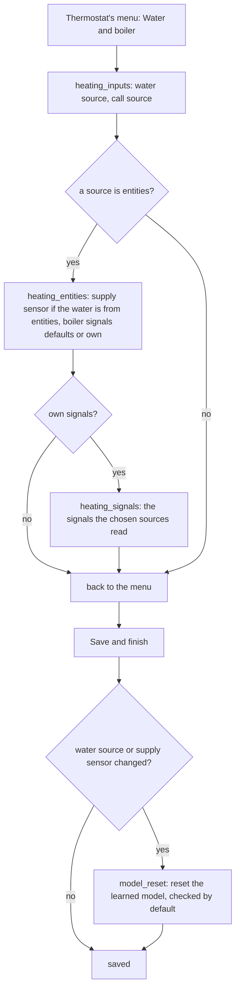
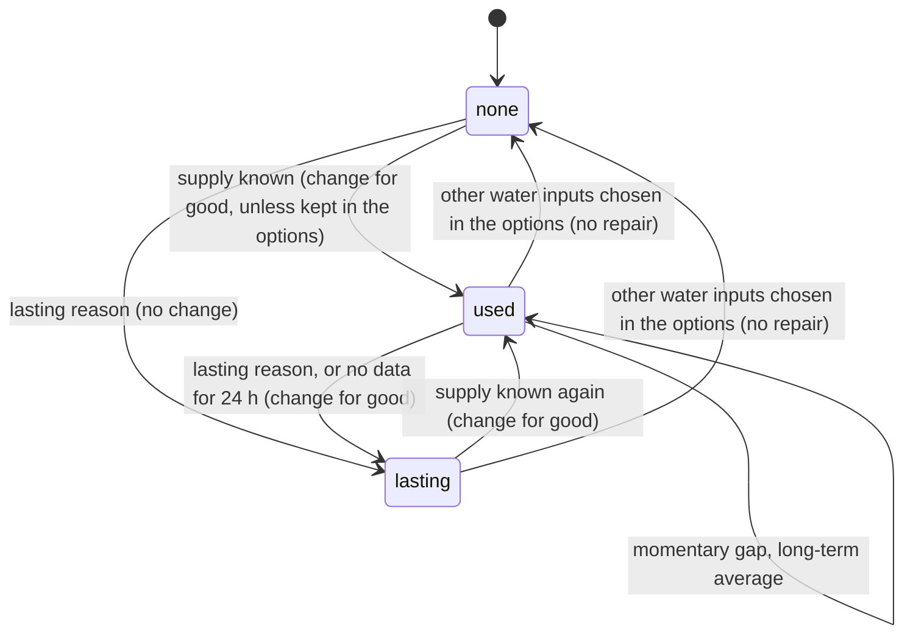
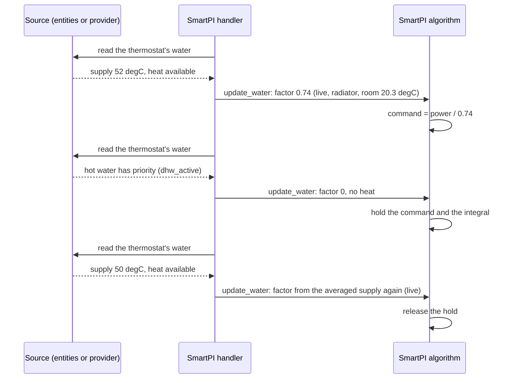
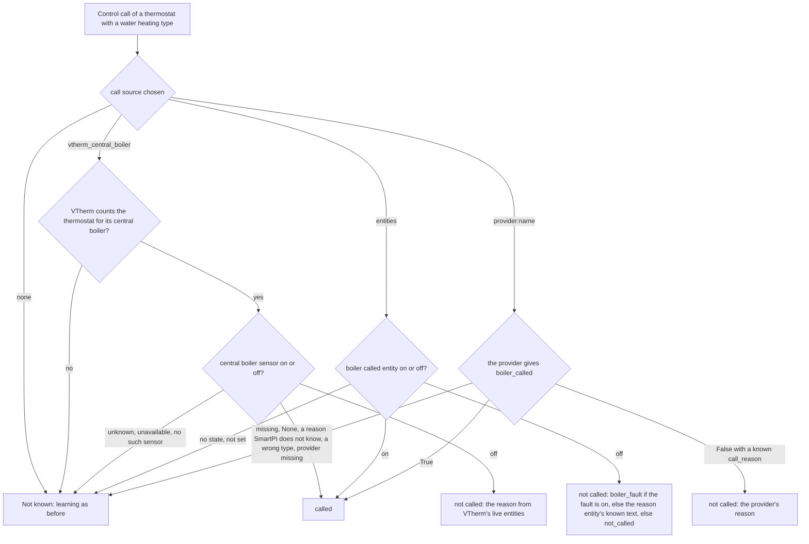
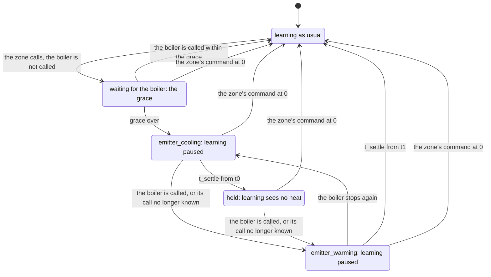
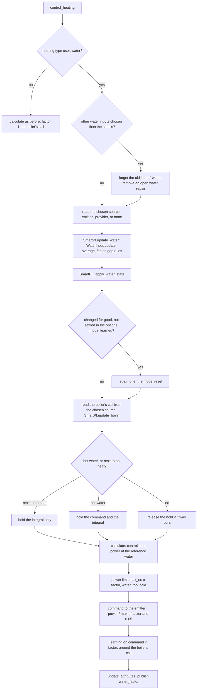

# Water and boiler inputs

SmartPI can read two inputs from the heating system. Each comes from a source you choose in the
thermostat's options:

- **Water data**: the temperature of the water that reaches the thermostat's emitters (the
  radiators, floor loops or other devices that give the heat to the room), and whether the boiler
  can heat now. Section 3 explains how SmartPI uses them.
- **The boiler's call**: whether the boiler is told to heat. Section 4 explains what SmartPI does
  while the zone calls for heat that the boiler does not give.

The sources are `none`, `entities` (Home Assistant entities of any integration, or a plain sensor
on a pipe) and a **provider** (an integration that implements SmartPI's contract, section 5.2).
For the boiler's call, Versatile Thermostat's central boiler is a source too. For both inputs, this
document covers the reasons, the configuration, the logic and its decisions, the components and
interfaces, the saved state (persistence), the diagnostics, the constants and the limits. The
[technical documentation](technical_doc.md) describes the PI controller, its feed-forward (the part
of the command computed from the room model, the setpoint and the outdoor temperature) and its own
learning, and the changes these inputs bring to them. [Tests](testing.md) describes the tests.

Without a source, or without data from it, SmartPI's command and the way it learns the emitter's
power stay as before (as without these inputs).

Abbreviations: Home Assistant (HA), Versatile Thermostat (VTherm), domestic hot water (DHW).

## Contents

1. [Overview](#1-overview)
2. [Configuration](#2-configuration)
3. [Water data](#3-water-data)
4. [A boiler that is not called](#4-a-boiler-that-is-not-called)
5. [Components and interfaces](#5-components-and-interfaces)
6. [One calculation](#6-one-calculation)
7. [Persistent state](#7-persistent-state)
8. [Diagnostics](#8-diagnostics)
9. [Testing](#9-testing)
10. [Constants, limits and open points](#10-constants-limits-and-open-points)

## 1. Overview

SmartPI uses a room model: `dT/dt = a·u − b·(T − T_ext)`. Here `T` is the room temperature,
`T_ext` the outdoor temperature, `u` the command, `a` how much the emitter warms the room per unit
of command, and `b` how fast the room loses heat to the outside. The model assumes that a unit of
command `u` always brings the same heat. With water heating, this is not true:

- a boiler with a weather curve (weather compensation), or a mixing valve, lowers the water
  temperature when it is mild outside. The same valve opening or duty cycle (the share of time a
  switched device is on) then gives less heat;
- the burner switches on and off, so the water temperature swings by several degrees within
  minutes;
- when domestic hot water has priority, it takes the boiler's heat away from the heating circuit
  for tens of minutes;
- a boiler may not fire at all while the zone calls: its start criteria are not met yet (section
  4).

SmartPI then learns a value of `a` that mixes the room with the water. Its outdoor feed-forward
also counts the weather twice: once through the boiler's curve and once through its own model.

The **emitter power factor** `φ` fixes this. It tells how much power a unit of command gives with
the water that reaches the emitter, compared with a reference water temperature (the "reference
water"). SmartPI works in power at the reference water. Its controller, its model and its learning
all see this power. The emitter gets `power / φ`. The learned coefficients then keep their physical
meaning, and a change of the water no longer looks like a change of the room. The boiler's call
tells SmartPI when no heat comes at all, so that it does not learn from it.

| Input | Signals | Sources |
|---|---|---|
| Water data | the supply water temperature of the thermostat's circuit; the boiler can heat; domestic hot water has priority; a boiler fault | `none` (default), `entities`, `provider:<name>` |
| The boiler's call | the boiler is called; why not; the demand against the boiler's start criteria (diagnostics only) | `none`, `vtherm_central_boiler` (offered, and the default, when VTherm's central boiler serves the thermostat), `entities`, `provider:<name>` |

Decisions and reasons:

- **Optional.** Without water data, `φ = 1`: SmartPI behaves as it does without these inputs.
  Without the boiler's call, SmartPI takes every command as heat, as before.
- **An explicit choice.** You choose the source of each input in the options, as you choose
  VTherm's algorithm (TPI, SmartPI, …). The list is built when the form opens: the fixed sources
  and the providers registered at that moment. SmartPI never picks a source by itself: there is no
  "automatic" choice, so a source that appears or goes never changes what SmartPI reads.
- **Entities for any installation.** Any integration that shows the water temperature, or a plain
  temperature sensor on the supply pipe, can feed SmartPI. The signals of the whole boiler (it can
  heat, hot water, a fault, its call) are set once, in the "SmartPI defaults" entry. A thermostat
  takes them from there or sets its own. The supply sensor is always the thermostat's own, because
  each thermostat has its own circuit: radiators get the boiler's flow water, a floor loop gets the
  water after its mixing valve.
- **A contract for integrations that know more.** An integration that knows the circuits, the
  reasons and the boiler's start criteria can register as a provider (section 5.2). It gives
  everything in one call, and SmartPI imports nothing of it.
- **SmartPI computes the factor.** The source knows the water but not the emitters. SmartPI knows
  its heating type and the room.
- **SmartPI only reads.** It never asks for a water temperature: the water temperature usually
  cannot be set for each zone separately. SmartPI's only output for other integrations is the
  factor it applies (`water_factor`, section 3.4).

## 2. Configuration

**Heating type** (`smart_pi_heating_type`) — the first of a thermostat's settings, set in its own
entry only (not in the "SmartPI defaults" entry). Default: not set. Only a water type reads the
water data and the boiler's call.

| Value | Heating type | Exponent `n` | Reference water `T_wref` | Uses the inputs |
|---|---|---|---|---|
| `radiator` | Water radiator | 1.3 | 60 °C | yes |
| `floor_water` | Water underfloor heating | 1.1 | 45 °C | yes |
| `floor_electric` | Electric heating mat | — | — | no |
| `electric_fast` | Fast electric heater | — | — | no |

The exponents and reference waters are provisional. They still need to be checked against data
from real installations.

**"SmartPI defaults" entry.** Its options open a menu: **Regulator settings** (the shared
settings), **Boiler signals** and **Save and finish**. Boiler signals are entities, all optional:
leave a field empty if you have no such entity. Every thermostat that reads entities uses them,
unless it sets its own.

**A thermostat's entry.** For a water heating type (set in the window, even before it is saved),
its menu has **Water and boiler**, next to the heating type and regulation, the zone and the
neighbours. A thermostat that works as a zone's additional source opens a menu of its own: its
settings, and **Water and boiler** with the water data only (its learning is paused while it
follows the main source, so its boiler's call is not read). Like every section, Water and boiler
ends back in the menu; the choices are written at **Save and finish**, and closing the window
discards them ([Zone dependencies, §2.1](zone_dependencies.md#21-options-and-forms)).



| Field (key) | Type, entity domain | Default | Shown |
|---|---|---|---|
| Water data (`smart_pi_water_source`) | select: `none`, `entities`, `provider:<name>` | `none` | Water and boiler |
| Boiler's call (`smart_pi_boiler_call_source`) | select: `none`, `vtherm_central_boiler`, `entities`, `provider:<name>` | `vtherm_central_boiler` when VTherm's central boiler serves the thermostat, else `none` | Water and boiler; not for a zone's additional source |
| Supply water temperature (`smart_pi_supply_entity`) | `sensor`, device class temperature | — (required) | water from entities |
| Boiler signals (`smart_pi_boiler_signals`) | select: `defaults` (as in SmartPI defaults), `own` | `defaults` | a source is entities |
| Boiler can heat (`smart_pi_heat_available_entity`) | `binary_sensor`: on while the boiler can heat the circuits | — | Boiler signals; own signals for the water |
| Hot water has priority (`smart_pi_dhw_entity`) | `binary_sensor`: on while the boiler heats the domestic hot water | — | Boiler signals; own signals for the water |
| Boiler fault (`smart_pi_fault_entity`) | `binary_sensor`: on while the boiler reports a fault | — | Boiler signals; own signals for either input |
| Boiler is called for heat (`smart_pi_boiler_called_entity`) | `binary_sensor`: on while the boiler is told to heat | — | Boiler signals; own signals for the call |
| Why the boiler is not called (`smart_pi_boiler_reason_entity`) | `sensor` with a text: `below_threshold`, `no_demand`, `activation_delay` or `boiler_fault` | — | Boiler signals; own signals for the call |

- A provider is listed by its name. A provider that is chosen but no longer registered stays
  chosen and is shown as "`<name>` (not available)". SmartPI reads no data from it meanwhile.
- An entity that has a registry entry is stored by its registry id, so it still works after a
  rename. An entity without one (for example a YAML sensor without a unique ID) is stored by its
  entity id.
- **The reset question.** When the water source or the supply sensor changes, the learned power
  changes units: with water data it is measured at the reference water. So **Save and finish**
  asks whether to reset SmartPI's learned model of this thermostat (checked by default; one
  question for all the reasons of the save). If you keep the model, SmartPI
  remembers it (`smart_pi_model_kept_for_water`) and does not ask again when the data of these
  inputs start (section 3.4). A change of the boiler's call or of the signals does not change units
  and asks nothing.
- An entry without these keys (an entry from before them) works as before: no water data, and the
  boiler's call from VTherm's central boiler where it serves the thermostat. A water state it saved
  earlier is kept, as a gap without data: the long-term average for 24 h, then lasting
  (section 3.3).

**To use the water data with entities:**

- Set the boiler's signals in "SmartPI defaults" → Boiler signals (the ones you have).
- In the thermostat's Water and boiler: water data `entities`, then its supply sensor, and the
  boiler signals "As in SmartPI defaults".
- The `water` block of the diagnostics shows the data in use: `source` is `live`, and `inputs`
  shows each entity.

**To use the water data with a provider:**

- Install the integration that implements SmartPI's contract and link the thermostat to its
  circuit there (see that integration's documentation).
- In the thermostat's Water and boiler: water data `provider:<name>` (and the boiler's call, if the
  provider gives it).
- In the diagnostics, `water.source` is `live` and `inputs.*.source` is `provider:<name>`.

A thermostat without a heating type (no entry of its own, or "Not set") reads neither the water
nor the boiler's call, as in the release 0.4.0: set a water type to use them. For an electric
emitter, set an electric type: it reads neither either.

## 3. Water data

### 3.1 Where the data come from

At each control call, the handler reads the water data from the source chosen for the thermostat.
This happens in `SmartPIHandler._update_water`, which is called from `control_heating` and, for a
zone's additional source, from `_control_as_source`. The source gives a `WaterReading`:

| `WaterReading` | From entities | From a provider |
|---|---|---|
| `supply_c` | the supply sensor's state as a number; °F and K converted to °C (no unit: °C) | `supply_temperature`, a finite number |
| `supply_reason` | `unavailable` when the sensor has no number (unavailable, unknown, text) | `supply_reason` (text); when the provider gives nothing: `provider_missing`, `not_served` or `provider_error` |
| `heat_available`, `heat_reason` | hot water on: false, `dhw_active`; else the fault on: false, `fault`; else "can heat" off: false, `no_heat`; on: true; no state: not known | `heat_available` (true or false), `heat_reason` (text) |

| Rule | |
|---|---|
| Nothing imported | SmartPI imports no code of a provider. It reads the registry in `hass.data` and checks that the method exists. |
| Provider failures | Not registered: `provider_missing`. It returns `None` (it does not serve this thermostat): `not_served`. An unknown version, an exception, an answer that is not a mapping, no method: `provider_error`. These are logged at debug level only, so a control call never fills the log. A chosen provider missing for 10 minutes is reported once with a warning (it may register after SmartPI at a start). |
| Types | A value of the wrong type counts as missing: for example a temperature given as text, a `heat_available` that is not true or false, or an empty reason. |
| Freshness | No age limit: a sensor that writes only on change may hold one right value for hours. A lasting loss is covered by the 24-h rule (section 3.3). |
| Reasons SmartPI does not know | They mean "no data for that moment": a momentary gap, lasting after 24 h (section 3.3). |

`heat_available` can change with every burner cycle. So it is not used as a learning gate (a
condition that pauses learning, section 3.4). It only decides when new values go into the
long-term average of `φ` (section 3.3).

### 3.2 The factor

    φ = min( (max(T_s − T_room, 0) / (T_wref − 20)) ** n , 1 )

- **`T_s`** is `supply_temperature` averaged over `WATER_AVERAGE_S` (15 min, an exponential
  average over time). The average is needed because the burner switching on and off makes the raw
  value jump. After a long gap, the average takes on the first new value.
- **`T_room`** is the thermostat's room temperature (VTherm's `current_temperature`).
- **Reference.** With the reference water and a room at 20 °C, `φ = 1`. Half the drive (the
  difference between the water and the room temperature) gives `0.5 ** n`.
- **Water hotter than the reference** counts as the reference (`φ ≤ 1`). The controller's power
  range is 0..1, so a higher factor would only cap the command. This way, the emitter gives at
  least the heat it gives without the water data. On such days, the emitter gives more than the
  factor says, and the learned power drifts upwards, as it does without water data.
- **Unknown room temperature** with a known supply: SmartPI keeps the factor in use (this is not
  a gap).
- **Hot water with priority.** While `heat_reason` is `dhw_active`, `φ = 0`. The boiler's flow
  then shows the water that heats the hot-water tank, not this circuit's water. These readings do
  not go into any average.

### 3.3 Missing data

| Situation | Kind | `φ` used | Source shown |
|---|---|---|---|
| `supply_temperature` known | — | from the averaged supply | `live` |
| `heat_reason == dhw_active`, with a known supply or after data were seen | — | 0 | `dhw` |
| `flow_unknown`, `flow_stale`, after data were seen | momentary | the long-term average of `φ` (`WATER_LONG_AVERAGE_S`, 3 days), so that the learned model keeps its units; 1 if there is no average yet | `average` |
| a reason SmartPI does not know (among them `unavailable`, `provider_missing`, `not_served`, `provider_error`), or no data at all, after data were seen | momentary for `WATER_NO_DATA_LASTING_S` (24 h), then lasting | as momentary, then as lasting | `average`, then `lasting` |
| `not_mapped`, `circuit_not_measured`, `several_circuits` | lasting | 1, as without water data | `lasting` |
| no data since the start (any reason but a lasting one) | — | 1 | `none` |
| after a lasting reason, until a supply is known again | — | 1 | `lasting` |
| other water inputs chosen in the options (another source, another supply sensor, or none) | — | 1 until the new inputs give data; what was learned of the old inputs' water goes at once | `none` |
| electric heating type | — | 1 | — (no `water` block) |

The long-term average follows `φ` only while the boiler heats: while `heat_available` is true,
or, without that signal, while `φ ≥ WATER_NO_HEAT`. So days when the boiler is idle do not pull
the average down. A full day with no data at all, after data were seen, counts as lasting. This
happens, for example, when the provider is removed, when it no longer serves the thermostat, or
when the supply sensor is gone.

### 3.4 Use in SmartPI

1. **Command.** The controller's output is power at the reference water. The command sent to
   the emitter is `power / max(φ, WATER_NO_HEAT)`, at most 1. This is computed before the valve
   curve is applied (`SmartPI._to_actuator_power`). The floor (lower limit) `WATER_NO_HEAT` (0.05)
   matters when the water is at about the room's temperature. This is typical of an idle boiler
   that fires only on demand. The zone must still be able to call for heat, so its command can
   reach 1 and fire the boiler.
2. **Learning.** The power that SmartPI learns from is the applied command × `φ`
   (`SmartPI._to_linear_power`). This applies to the committed command (also in the on/off
   regulation of the learning phase), the realized power of a cycle, the anti-windup tracking (it
   stops the integral part of the controller from growing too much while the output is limited)
   and the power record of the feed-forward trim (a learned correction of the feed-forward). A new
   factor updates the committed power at once. The water data add no learning gate of their own.
   An input of zero (burner off, hot water, closed valve) teaches SmartPI the heat losses.
   Any integration may pause SmartPI's learning with `vtherm_smartpi.set_smartpi_learning`, as
   before. The boiler's call pauses it too, while the emitter cools down or warms up again around
   a hold (section 4). The dead-time estimator measures the delay before the room responds when
   the emitter switches on or off. It accepts only strong steps. It gets the command itself (0
   during hot water).
3. **Power limit and timing.** With `φ < 1`, the output is limited to
   `max(φ, WATER_NO_HEAT)` × `max_on_percent` (`_apply_soft_constraints`). This is what a full
   command gives. The floor `WATER_NO_HEAT` lets the command still reach `max_on_percent` when the
   water brings next to no heat. The anti-windup tracking compares the model with the realized
   power, and it sees this limit. A demand above the limit is shown as `water_too_cold`. The
   minimal activation delay and the valve's activation floor are checked on the command, not on
   the power.
4. **Hot water and cold water.** While hot water has priority (`dhw_active`), the emitter's
   command is held at its last value (a demand of zero still gives zero). The integral is held
   too (`integral_hold_mode = "no_heat"`). This way, SmartPI does not drive the valve towards fully
   open while no heat can come. When the water brings next to no heat and hot water is not the
   reason (`φ < WATER_NO_HEAT`, for example an idle boiler), only the integral is held, and the
   command follows the controller. Both holds are applied again at each calculation. If another
   hold is already running, SmartPI leaves it as it is.
5. **`water_factor`, SmartPI's output.** While the factor comes from water data (`live`,
   `average`, `dhw`), SmartPI writes `water_factor` into the thermostat's `specific_states`. Its
   value is the factor applied, rounded to 0.001. Otherwise (`none`, `lasting`, electric type), the
   key is absent. Any integration may read it. When the key is present, it knows that this
   thermostat's algorithm uses the water data: a provider may then skip a learning pause of its
   own on large water swings.
6. **Data appearing or going for good.** The water data can start being used (first data, or a
   known supply after a lasting gap). They can also stop for good (a lasting reason, or no data for
   24 h). In both cases, the learned power changes units. If SmartPI has a learned model (it is
   past its learning phase), it raises a Home Assistant repair: "Water temperature data are now
   available" or "… are no longer available". The repair has one step, with the option **Reset
   the learned model**, checked by default. Confirming it calls
   `vtherm_smartpi.reset_smartpi_learning` for the thermostat. SmartPI does not rescale the learned
   model to the new units (owner's decision of 2026-10-12); it offers the reset instead. The rules:
   - a momentary gap never raises the repair;
   - **a change made in the options is settled there.** The reset question of the options'
     save already asked (section 2). Other water inputs drop what was learned of the old ones' water at once (their
     availability and averages, so the new inputs start as if new), and a water repair still open is
     removed. Kept, the first data of the new inputs raise no repair. Reset, SmartPI learns again
     and asks nothing while it learns;
   - the repair is for the changes the options did not see: the data lost for 24 h or reported as
     lasting, the data back after that, or the data starting only after SmartPI has finished
     learning again;
   - the repair's issue is `water_data_changed_<thermostat unique id>`. It is created as
     persistent: it stays until the user answers it, and SmartPI does not remove it. Its one field
     is `reset_model`;
   - a change of the heating type drops what the water input knew (section 7). So after a change to
     a water type, SmartPI offers the reset at the first data, if it has a learned model. A change
     to an electric type offers nothing.
7. **Power in the diagnostics.** With water data, the values of the `power` block (`pi_percent`,
   `ff_percent`, `command_percent`, `limited_percent`, `applied_percent`, the `linear_*` values)
   and the history series `power.command_percent`, `power.applied_percent`,
   `power.governor_cap_percent` and `power.before_governor_cap_percent` are power at the
   reference water. `current_cycle_percent` and `next_cycle_percent` are the command sent to the
   emitter.
8. **Reference governor.** Near the end of a setpoint change, the reference governor
   ([Technical documentation, §4.4](technical_doc.md#44-setpoint-management)) may cap the power so
   that the heat already given is not too much. It predicts with the model at the reference water,
   and it does not know the water limit of point 3. This needs no change: when cool water limits
   the command, the cap does not bind (it would only cut a power the water already cuts). The
   governor then promises nothing that a later measurement could prove wrong, so it does not
   retire its episode as a failed prediction. In short: under a water limit, the governor does not
   brake (section 3.6).

### 3.5 Lifecycle of the data

Whether the water data are available decides where the factor comes from and when the reset is
offered.



During one sequence of burner heating and hot water:



### 3.6 Results (simulation)

Setup: a radiator on a boiler with a heating curve, outdoor 3 °C ± 3 °C, 48 h
([Tests, §3.4](testing.md#34-water--test_smartpi_sim_waterpy-short)). Without water data, SmartPI
learns less than half of the radiator's power at the reference water: the cooler water from the
curve looks like a weaker radiator. With water data, from entities or from a provider, it learns
between 0.5 and 1.2 of that power, and more than 1.5 times the value it learns without them.

**Reference governor with water** (measured on 2026-10-17; script
`analysis/spinew/measure_governor_water.py` on the analysis branch). A radiator room (`a` 0.06,
`b` 0.001, 10 min delay, 0.1 °C sensor), 48 h at 20 °C, then four days with 17 °C from 22:00 and
21 °C from 6:00; three control phases, so twelve morning approaches per case. Compared with the
setpoint filter before the governor:

| Water | Time to 20.9 °C | Minutes with a binding cap | Episodes retired |
|---|---|---|---|
| no water data | 2.1 h (before: 2.2 h) | 0.3 (before: 37) | 0 |
| 60 °C, with data | 2.2 h (before: 2.1 h) | 0 (before: 40) | 0 |
| 45 °C, with data | 4.5 h (before: 4.5 h) | 0 (before: 27) | 0 |
| 40 °C, with data | 7.9 h (before: 7.9 h) | 0 (before: 20) | 0 |
| 45 °C, no data | 4.7 h (before: 4.7 h) | 0 (before: 16) | 0 |

Cooler water makes the approach longer in both versions; that is the radiator's physics, not the
regulation. With 40 °C water, one approach out of twelve did not reach 20.9 °C within 8 h. The
test `test_smartpi_governor_water.py` checks a shorter version (45 °C, three control phases)
([Tests, §4.9](testing.md#49-changes-taken-from-the-authors-new-code)).

## 4. A boiler that is not called

A boiler may fire only when the zones' demand meets its start criteria, and only after an
activation delay. These criteria are about the number of calling devices or zones, their total
power and the widest valve opening. A zone below them calls for heat that does not come. SmartPI
treats the zone's command as if the heat had come. It then learns an emitter that is too weak (`a`), a
wrong dead time (the delay before the room responds) and a bias in its feed-forward trim. In a
simulation of a zone calling all night without the boiler, its learned `a` fell to 1 % of the true
value (section 4.4). A "the boiler can heat" signal cannot tell this case apart: the burner also
pauses while the boiler is called.

### 4.1 Where the boiler's call comes from

The source is chosen in the thermostat's options (section 2). SmartPI reads only that source:
when it gives nothing, the call is not known, and SmartPI learns as before.



| Source | What is read | Offered | Reasons when not called |
|---|---|---|---|
| `none` | nothing | always | — |
| `vtherm_central_boiler` | the binary sensor with unique ID `central_boiler_state`, and VTherm's live entities (below) | when VTherm counts the thermostat for its central boiler (`used_by_controls_central_boiler`); it is then the default | `activation_delay`, `no_demand`, `below_threshold`; `not_called` when the demand entities are missing |
| `entities` | the boiler signals: called (on/off), why not (text), fault (on/off); from the defaults or the thermostat's own | always | `boiler_fault` (fault on); the reason entity's text when it is one SmartPI knows; else `not_called` |
| `provider:<name>` | `boiler_called`, `call_reason` and `demand` (section 5.2) | when registered | `below_threshold` (zones call, but below the criteria), `no_demand` (no zone calls), `activation_delay`, `boiler_fault` |

**VTherm's reasons and demand.** VTherm's central boiler decides from a count of active devices
and their total power, against two thresholds (a threshold of 0 turns its criterion off). SmartPI
reads the four live entities, by their unique ID: the sensors `nb_device_active_boiler` and
`total_power_active_boiler`, and the numbers `boiler_activation_threshold` and
`boiler_power_activation_threshold`. It applies VTherm's own rule
(`feature_central_boiler_manager.py`): a criterion is met when its threshold is above 0 and the
value reaches it. While the boiler is off:

- a criterion met → `activation_delay` (VTherm waits for its activation delay before it switches
  the boiler on);
- nothing active (no device and no power) → `no_demand`;
- otherwise → `below_threshold`.

SmartPI does not read the attribute `central_boiler_manager` of VTherm's binary sensor: in VTherm
10.5.1 it is written only when the boiler switches on or off, so its counts would be stale
(owner's decision of 2026-10-14). VTherm counts a power in kW as kW and anything else as W;
SmartPI does the same before it compares the two powers.

Other rules:

- `True`, or "on", means the boiler is told to heat. A burner pause, or hot water with priority, is
  shown only in the water data (section 3).
- VTherm's sensor follows VTherm's decision, after VTherm's activation delay. This decision takes
  into account the device count and power thresholds, and every other calling zone.
- **The demand** is used only in the diagnostics. From VTherm: `demand_count` and `count_threshold`
  (`count_by` `devices`), `demand_power_kw` and `power_threshold_kw` (kW). From a provider: the
  fields of its `demand` mapping, among `demand_count`, `count_threshold`, `count_by` (`devices` or
  `zones`), `demand_power_kw`, `power_threshold_kw` (kW), `demand_opening` and
  `opening_threshold` (0 to 1). SmartPI keeps only the values with the right type; for a count, a
  whole number given as a float counts as the right type. It keeps the counts as whole numbers and
  rounds the kW and opening values to 3 decimals.
- A provider should not add a learning pause of its own for this case: SmartPI handles it itself,
  and a second pause would end at the wrong moment.

### 4.2 Learning around a hold

In the rules below, `u` is the command of the zone's device, `called` is the boiler's call, `t0`
is the start of the zone's call that got no answer, and `t1` is the boiler's start after a hold.
`L` is the emitter's delay and `tau` its lag (time constant). The grace is the time the boiler has
to answer the zone's call.

    calling     = heating  and  u > 0
    grace       = BOILER_CALL_GRACE_S (15 min), plus the cycle for a switched device
    t_settle    = L + 3·tau of the heating type's emitter (radiator 65 min, water floor 570 min)

    emitter_cooling   calling, not called since t0, t0 + grace <= t < t0 + t_settle
                      (or at once when the boiler stops again while the emitter warms)
    held              calling, not called since t0, t >= t0 + t_settle
    emitter_warming   calling, called again (or the call no longer known) at t1 after
                      emitter_cooling or held, t < t1 + t_settle

- **A boiler answering the zone's call within the grace** changes nothing. Examples are an
  on-demand boiler, or VTherm's activation delay of at most 10 min. SmartPI learns the zone's own
  step as before, with the boiler's reaction inside it. The same holds for a boiler already at
  work, or one cycling with stops shorter than the grace: its water stays warm. A switched (on/off)
  device counts for the boiler only while it is on. So the off part of its cycle is not a stop of
  the boiler's answer, and its cycle is added to the grace.
- **Emitter cooling.** The boiler has stopped while the zone calls (or it never answered). The
  circuit's pump stops a few minutes later. The emitter then gives only the heat it still holds,
  and this heat fades with the emitter's lag. Learning waits. After three lags, less than 5 % is
  left.
- **Held.** No heat comes. Learning sees a power of 0. (With water data, the power is already the
  command times a factor near 0, and it stays as it is.) Learning windows in which the zone cools
  teach `b`, and no sample of `a` is taken.
- **Emitter warming.** The boiler has started after a hold. Its water has to reach the emitter and
  warm it. But the valve has been open all along, so there is no step of the zone's command that
  SmartPI's learning would wait for. Learning waits again. SmartPI does not time the boiler's start
  as a dead time either. That delay comes from the water, not from the valve, and SmartPI's dead
  time is the valve's. (In the simulation, the response to the boiler's start came in 2 to 5 min,
  and the response to the valve in 11 min.)



| | Grace, learning as usual | `emitter_cooling` | `held` | `emitter_warming` |
|---|---|---|---|---|
| `a`, `b` | learned | paused (gate `boiler_settling`) | learned with the power 0: only how the zone cools | paused (gate `boiler_settling`) |
| Dead-time estimator | as usual | paused (gate) | input 0, no step | paused (gate); then the command again, with no step |
| Feed-forward trim | runs | frozen (`boiler_not_heating`) | frozen | frozen |
| Exchanges with neighbours, the zone's fit | learned | paused | paused | paused |
| A cycle's realized power recorded for them | the cycle's | 0 | 0 | the cycle's |

- Each change of mode discards the open learning window and the dead-time estimator's step in
  progress (a call that got no heat, or the boiler's start). Pausing or resuming learning while
  the zone is held does the same, and the estimator restarts from the input it gets.
- A calibration in progress is cancelled once the zone is cooling or held. Otherwise it would time
  the response to heat that does not come.
- A thermostat that works as another thermostat's additional source follows that thermostat's
  command, not its own. So its mode is cleared.
- **A boiler cycling under the zone's own threshold**, with stops shorter than the grace (the
  bursts of section 10), is not held. There, learning takes the command as heat, as before.
- **"Calling" means SmartPI's own command is above 0.** VTherm and providers decide that a zone is
  calling from VTherm's `is_device_active`. For a valve on VTherm 10.5, this means a command above
  the valve's floor. So a zone with a command below that floor is calling for SmartPI but not for
  the boiler, and it can be held.
- **In a zone with two heat sources**, the main source's own call decides. The main source may be
  at 0 % while the additional source heats and the boiler is not called. The additional source's
  cycles then still count as heat in the zone's fit (at level 1 without water data).
- **Regulation is unchanged.** The controller does not change its command because the boiler is
  not called. The proportional part and
  the integral rise until the zone's demand meets the boiler's criteria, or until the other zones
  get the boiler called. A zone that needs less than the threshold still makes the boiler cycle,
  and it may stay below its setpoint (section 10). Even when SmartPI knows the boiler's call, in
  the simulation a zone needing 20 % under a 70 % threshold still stayed 0.2 to 0.7 degC low for
  30 h. This is the open point about regulation, not about learning.
- After a change of the heating type, the settling time follows the new emitter.

### 4.3 Diagnostics and state

The `boiler` block of section 8 shows the source, the call, its reason, the learning mode and
where each signal comes from. It also shows the demand against the thresholds, where the source
gives it: VTherm's live entities, or the provider's `demand`. Nothing is saved. After a restart,
the modes start again from the first reading.

### 4.4 Results (simulation)

`tests/test_smartpi_sim_boiler_call.py` simulates a radiator of 2000 W behind a valve. The boiler's
start threshold is 2500 W. It is reached only together with the other zones (3000 W), and these do
not call during one window of the day. When the boiler fires, its water warms with a 4-min lag;
otherwise the water cools below the room temperature. The sensor has a 0.01 °C step, the run lasts
96 h, and the outdoor temperature is 3 °C ± 2 °C. "Told" means that SmartPI knows the boiler's
call; "not told" means that it does not.

| Case | Not told | Told |
|---|---|---|
| B1: the call from VTherm's central boiler, no water data, no boiler 2:00–8:00 | `a` 0.01 of the truth, `b` 0.98 | `a` 1.06, `b` 0.98 |
| B1: the same, the call from a binary sensor (entities) | — | `a` 1.06, `b` 0.98 |
| B2: the call from a provider, the water from the provider, no boiler 10:00–16:00 | — | `a` 1.04, `b` 0.98 |
| B2: the call from a provider, the water from entities | `a` 1.05, `b` 0.98 (a trial run; the water data already show the missing heat) | `a` 1.04, `b` 0.98 |

The tests check the results of the told runs. They also check that no sample of `a` is learned
while the boiler is not called, and the reasons given: VTherm's `below_threshold` (with, for a
moment at each switch, `activation_delay`: the simulated boiler switches at its next step), the
binary sensor's `not_called` (no reason entity), the provider's `below_threshold`. For the B1
cases, they also check that the dead time stays the valve's: 11.3 min, against 11.2 min (with `a`
0.99 and `b` 0.98) when the boiler is always called. The zone that fires the boiler by itself (in
SmartPI's learning phase, with its command at 100 %) still learns its dead time and leaves the
learning phase, because its call is answered within the grace. With a 0.1 °C sensor, SmartPI's own
estimator is about 20 % off the true value even when the boiler is always called. This hides the
differences.

## 5. Components and interfaces

### 5.1 Components

| Component | File | Responsibility |
|---|---|---|
| `HeatingInputsConfig`, `BoilerSignals`, `config_from_options` | `heating_inputs.py` | The sources chosen in the options and the entities they read; the boiler's signals from the defaults entry, unless the thermostat sets its own; the defaults of an entry without these keys. |
| `water_from_entities`, `boiler_from_entities` | `heating_inputs.py` | The water data and the boiler's call from entities (section 3.1, section 4.1), with where each signal comes from for the diagnostics. Entities kept by registry id are resolved to their entity id. |
| `ask_provider`, `water_from_provider`, `boiler_from_provider`, `ProviderWatch` | `heating_inputs.py` | The provider's answer read defensively (section 5.2); a chosen provider missing for long reported once. |
| `boiler_from_vtherm`, `vtherm_demand`, `vtherm_reason` | `heating_inputs.py` | VTherm's central boiler: its call, its demand from its live entities and the reason by VTherm's rule. |
| `WaterInput` | `smartpi/water_input.py` | Pure logic without HA code: the factor, the 15-min supply average, the long-term average of `φ`, the gap rules, the availability (`none`, `used`, `lasting`) and its changes for good; `inputs`, the water inputs the state belongs to, and `forget_data` when other inputs are chosen; persistence. |
| `WaterReading`, `WaterState` | `smartpi/water_input.py` | What the source gave; the factor in use, its source, the averaged supply, the reasons, `no_heat`, `changed_for_good`. |
| `SmartPIHandler._heating_inputs`, `_read_water`, `_update_water`, `_water_change_settled`, `_withdraw_model_reset` | `handler.py` | Before each calculation of a water type (from `control_heating`, and from `_control_as_source` for a zone's additional source): for other water inputs than the state's, `algo.forget_water_data()` and the open water repair removed; read the chosen source, `algo.update_water(...)` with the inputs; on a change for good that the options did not settle, `_offer_model_reset`. |
| `SmartPIHandler._read_boiler`, `_update_boiler`, `_ask_provider` | `handler.py` | The boiler's call from the chosen source, for a water heating type only; the warning for a provider missing for long. |
| `SmartPIHandler.update_attributes` | `handler.py` | Writes or removes `water_factor` in `specific_states`. |
| `SmartPI.update_water`, `forget_water_data`, `_apply_water_state` | `algo.py` | Applies the factor; starts and ends the no-heat hold; refreshes the committed power; keeps the inputs for the diagnostics. |
| `SmartPI._to_actuator_power`, `_water_command`, `_to_linear_power` | `algo.py` | Command = power / `max(φ, WATER_NO_HEAT)` (or the held command); power = command × `φ`. With water data the committed command is the reference and its power follows the factor. |
| `SmartPI._deadtime_power` | `algo.py` | The command step for the dead-time estimator (0 during hot water). |
| `SmartPI._apply_soft_constraints` | `algo.py` | Power limit `max_on_percent × max(φ, WATER_NO_HEAT)`; `water_too_cold`. |
| `BoilerCall`, `BoilerReading` | `smartpi/boiler_call.py` | Pure logic: the boiler's call, the learning mode (`emitter_cooling`, `held`, `emitter_warming`), the grace and the settling time from the heating type, the `boiler` diagnostics with the chosen source and its inputs (section 4). |
| `SmartPI.update_boiler`, `_read_known_inputs`, `_learning_power`, `_deadtime_input` | `algo.py` | The learning mode at each calculation: learning with the power 0 while held, the `boiler_settling` gate while the emitter cools or warms, the dead-time estimator's input and steps, the feed-forward trim frozen, the dependency layer informed (`heat_withheld`), a cycle's realized power recorded as 0. |
| Options: `async_step_boiler_signals`, `async_step_heating_inputs`, `heating_entities`, `heating_signals`, `source_menu`, and the reset question of `async_step_save` (`model_reset`) | `config_flow.py` | The forms of section 2; the lists of sources built from the registered providers. |
| `WaterModelResetFlow` | `repairs.py` | The repair's step: reset the learned model (checked by default). |
| Heating type | `config_flow.py`, `const.py` | The `smart_pi_heating_type` selector in the regulator settings. |

### 5.2 The provider contract (v1)

A provider is an integration that gives SmartPI the water data and the boiler's call for the
thermostats it serves. SmartPI imports nothing of it, and it imports nothing of SmartPI. SmartPI
may be loaded before or after it.

- **Registry.** `hass.data["vtherm_smartpi_heating_providers"]` is a dict, name → provider. A
  provider adds itself when it starts and removes itself when it unloads. The name is what the
  options show (`provider:<name>`); keep it stable, since entries store it.
- **The provider object** has:
  - `name` (str);
  - `version` (int): `1` for this contract;
  - `heating_inputs(entity_id: str) -> Mapping | None`: the data for that VTherm climate entity,
    or `None` when the provider does not serve it.
- **When it is called.** From Home Assistant's event loop, at each calculation of each thermostat
  that chose the provider (about once a minute per thermostat), once for the water and once for the
  call. It must be fast and do no I/O: return values the provider already holds.
- **Fields** (each may be missing or `None`):

  | Field | Type | Meaning |
  |---|---|---|
  | `supply_temperature` | float, °C | the water reaching the thermostat's circuit |
  | `supply_reason` | str | why there is no supply temperature: `flow_unknown`, `flow_stale` (momentary); `not_mapped`, `circuit_not_measured`, `several_circuits` (lasting); any other text is momentary, lasting after 24 h |
  | `heat_available` | bool | the boiler can heat the circuit now |
  | `heat_reason` | str | why not: `dhw_active` (hot water has priority: `φ = 0`), or a text shown in the diagnostics (`flame_off`, `boiler_off`, `fault`, …) |
  | `boiler_called` | bool | the boiler is told to heat (`None`: the provider does not decide it now) |
  | `call_reason` | str | why not, with `boiler_called` false: `below_threshold`, `no_demand`, `activation_delay`, `boiler_fault` |
  | `demand` | mapping | for the diagnostics: `demand_count` and `count_threshold` (int), `count_by` (str), `demand_power_kw` and `power_threshold_kw` (float, kW), `demand_opening` and `opening_threshold` (float, 0 to 1) |

- **Versions.** A provider with another `version` is not read (no data from it). A later version
  of the contract may add fields; SmartPI ignores the fields it does not know.
- **Errors.** An exception, an answer that is not a mapping, a wrong type, or a `call_reason`
  SmartPI does not know mean "no data from this source now" (sections 3.1 and 4.1). Nothing is
  logged above debug level, except a chosen provider missing for 10 minutes (one warning).
- **What SmartPI gives back:** `water_factor` in the thermostat's `specific_states` (section 3.4).

A minimal provider:

```python
PROVIDERS_KEY = "vtherm_smartpi_heating_providers"


class BoilerProvider:
    """Gives SmartPI the water of each circuit and whether the boiler is called."""

    name = "my_boiler"
    version = 1

    def __init__(self, circuits):
        self.circuits = circuits  # climate entity id -> your circuit object
        self.called = False

    def heating_inputs(self, entity_id):
        circuit = self.circuits.get(entity_id)
        if circuit is None:
            return None  # this thermostat is not served
        return {
            "supply_temperature": circuit.supply_c,
            "heat_available": not circuit.hot_water,
            "heat_reason": "dhw_active" if circuit.hot_water else None,
            "boiler_called": self.called,
            "call_reason": None if self.called else "no_demand",
        }


async def async_setup_entry(hass, entry):
    provider = BoilerProvider(circuits={})
    hass.data.setdefault(PROVIDERS_KEY, {})[provider.name] = provider
    entry.async_on_unload(lambda: hass.data[PROVIDERS_KEY].pop(provider.name, None))
    return True
```

## 6. One calculation



## 7. Persistent state

**The options.** The sources and their entities are stored in the entries' options:

| Key | Entry | Meaning |
|---|---|---|
| `smart_pi_water_source`, `smart_pi_boiler_call_source` | thermostat | the chosen sources |
| `smart_pi_supply_entity` | thermostat | the supply sensor (registry id, or entity id) |
| `smart_pi_boiler_signals` | thermostat | `defaults` or `own` |
| `smart_pi_heat_available_entity`, `smart_pi_dhw_entity`, `smart_pi_fault_entity`, `smart_pi_boiler_called_entity`, `smart_pi_boiler_reason_entity` | "SmartPI defaults"; a thermostat with `own` | the boiler's signals |
| `smart_pi_model_kept_for_water` | thermostat | the water inputs (source and supply sensor) for which the user kept the learned model at the reset question |
| `smart_pi_reset_token` | thermostat | set by the save when the user chose the reset, to reset the learned model once (as for the neighbours and the zone) |

An entry without these keys works as before (section 2). An entry that SmartPI creates itself
(for a zone's member, or at the migration of the "SmartPI defaults" entry) holds only the
settings of that one thermostat: it takes the shared settings and the boiler's signals from the
defaults. Where each other setting is read from is in
[SmartPI, "Configuration"](vtherm_smartpi.md#configuration).

**The algorithm's state.** `SmartPI.save_state()` adds a `water` key once the water input has seen
data or a lasting reason. So a thermostat without water data keeps the previous format. The key
holds these fields:

| Field | Meaning |
|---|---|
| `heating_type` | The heating type the state belongs to. A state of another type is ignored. |
| `availability` | `none`, `used` or `lasting`. With it, the first reading after a restart is not taken as a change for good. |
| `long_average` | Long-term average of `φ`. It is kept across a restart and used for momentary gaps. |
| `no_data_s` | How long a gap without any data has lasted. The count goes on after a restart, so the 24 h rule still works with frequent restarts. |
| `inputs` | The water inputs (source and supply sensor, as `smart_pi_model_kept_for_water` writes them) the state belongs to. Other inputs chosen in the options drop the state. A state saved before this field is kept until the options choose a source. |

The key is also written while a water source is chosen without data yet, so that a restart keeps
the inputs. The 15-min supply average is not saved. It restarts from the first reading. A change
of the heating type drops the averages, and so do other water inputs. The learning reset
(`reset_learning`) keeps them, because they describe the water, not the room.

## 8. Diagnostics

For a water heating type, the published diagnostics (`live`) get a `water` block:

| Field | Meaning |
|---|---|
| `heating_type` | The thermostat's heating type. |
| `factor` | `φ` applied now. |
| `source` | `live`, `average`, `dhw`, `lasting` or `none` (section 3.3). |
| `supply_avg_c` | The averaged supply, °C. |
| `supply_reason`, `heat_reason` | The last reasons the source gave (section 3.1). |
| `no_heat` | Hot water: the command and the integral are held. |
| `low_heat` | The water brings next to no heat: the integral is held. |
| `water_too_cold` | The demand exceeded what the water gives at full command. |
| `inputs` | For each signal (`supply`, `heat`, `dhw`, `fault`): its `source` (`entity`, `provider:<name>`, `none`), the `entity` where it is one, `available` for a provider (false: not registered), and `data` (it gives data now). |

When a call source is chosen (section 4), `live` also gets a `boiler` block, even while the source
gives no data:

| Field | Meaning |
|---|---|
| `source` | `entities`, `provider:<name>` or `vtherm_central_boiler`. |
| `called` | Whether the boiler is called for heating now (`null`: not known). |
| `reason` | Why it is not (section 4.1). |
| `learning` | `emitter_cooling`, `held`, `emitter_warming` or `null` (section 4.2). |
| `demand` | The demand against the start criteria, where the source gives it (section 4.1). |
| `inputs` | For each signal (`called`, `reason`, and `fault` for entities): its `source`, the `entity` where it is one, `available` for a provider, and `data`. |

## 9. Testing

[Tests](testing.md) describes the tests of the water data, of the boiler's call and of their
sources: unit, algorithm, handler, form and simulation tests, and the QAS scenarios on a real Home
Assistant, with their criteria. The results of section 4.4 come from these tests.

## 10. Constants, limits and open points

| Constant | Value |
|---|---|
| `WATER_EMITTERS` (`smartpi/const.py`) | radiator (1.3, 60 °C), floor_water (1.1, 45 °C) |
| `WATER_AVERAGE_S` | 15 min |
| `WATER_LONG_AVERAGE_S` | 3 days |
| `WATER_NO_HEAT` | 0.05 |
| `WATER_FACTOR_MAX` | 1.0 |
| `WATER_NO_DATA_LASTING_S` | 24 h |
| `WATER_ROOM_REFERENCE_C` | 20 °C (the room of the reference water in the factor) |
| `BOILER_CALL_GRACE_S` | 15 min (section 4) |
| `CONTRACT_VERSION` (`heating_inputs.py`) | 1 (section 5.2) |
| `PROVIDER_MISSING_WARNING_S` (`heating_inputs.py`) | 10 min: a chosen provider missing this long is reported once |

- **Provisional exponents and reference waters**: they still need to be checked against data from
  real installations.
- **Without a hot-water entity**, hot water with priority shows only as cooler water (from
  entities): the factor falls with the averaged supply instead of going to 0, and the command is
  not held.
- **The reasons of a boiler other than VTherm's** come only from a reason entity or a provider.
  With only a "boiler called" entity, a boiler that is not called gives `not_called`.
- **The zone with two heat sources** (a radiator and a floor loop in one room) uses each source's
  own factor. The main source's command is power at the reference water. The additional source
  turns it into its own command with its own factor (its own water source). It reports to the main
  source its cycles (switched ones at their factor) and its power cap. See
  [Zone dependencies and a second heat source, §5.2 and §5.7](zone_dependencies.md#5-a-second-heat-source).
- **A boiler start threshold**: Versatile Thermostat's central boiler, or another controller, can be
  set to fire only above a total power or a valve opening, with the zone count off. A zone whose
  demand stays below the threshold calls for heat that does not come. Its command is turned into
  power from the device's power set in Versatile Thermostat (2000 W at 20 % is 400 W, under a 600 W
  threshold). When SmartPI is told that the boiler is not called, it no longer learns from this
  command once the call has gone unanswered for longer than the grace (section 4). Its regulation
  is unchanged:
  - When SmartPI is not told and has no water data, it takes its command as heat. Told or not, the
    integral rises until the command crosses the threshold. The boiler then fires in short bursts.
    A trial simulation outside the test suite used one zone needing a 20 % opening. There, a 35 %
    threshold gave about 5 starts per hour and twice the integral. With 70 %, the zone stayed 0.2
    to 0.7 degC below its setpoint for 30 h.
  - With water data, the cooling water lowers `φ` within the 15-min average, so learning stops
    counting the missing heat. But the command `power / φ` then rises above the threshold, and
    falls back once the water is warm. At a 35 % threshold, this gave about 10 starts per hour with
    2-min burns.
  - "The boiler can heat" being false cannot tell this case apart from an ordinary burner pause.
    The boiler's call (section 4) can. In the same simulation, a start hysteresis on the boiler's
    side (the boiler starts at a higher demand than the one at which it stops) removed the cycling:
    0.7 starts per hour, 68-min burns. Still open: low-load firing on the boiler's side, with
    SmartPI holding its integral and keeping its command while the boiler is not called.
  - None of this happens when a single active zone is enough to fire the boiler (the default
    count of 1).
- **Dead time with an on-demand boiler**: when an "on" step starts with cold water, the dead time
  that SmartPI measures includes the boiler's warm-up.
- **The model reset is offered as a Home Assistant repair** for the changes the options did not
  see: the water data change while SmartPI runs, outside any options flow. At such a time, a repair
  is how an integration offers a step to the user.
