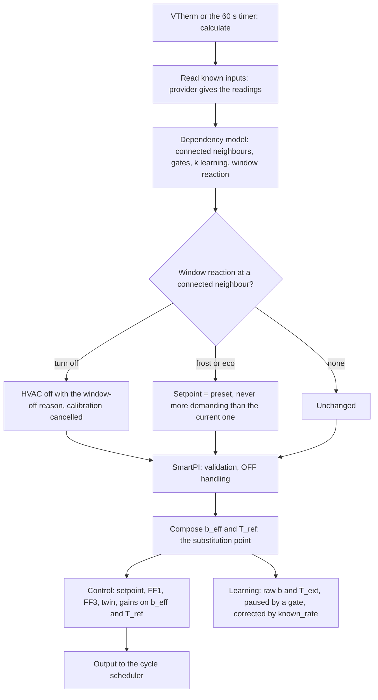
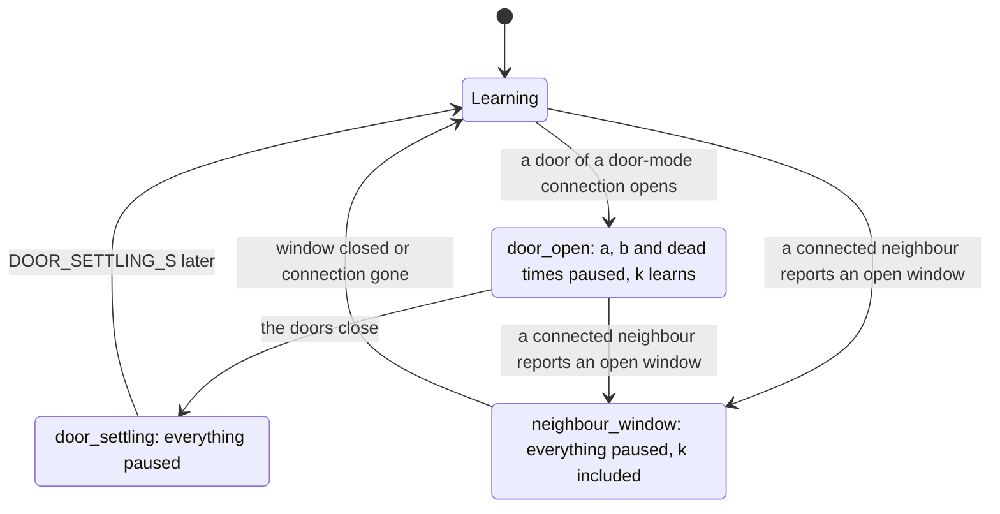
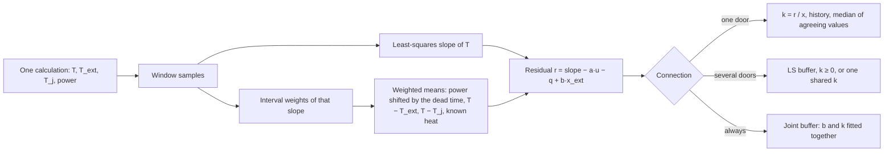
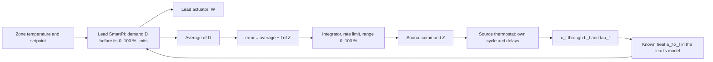
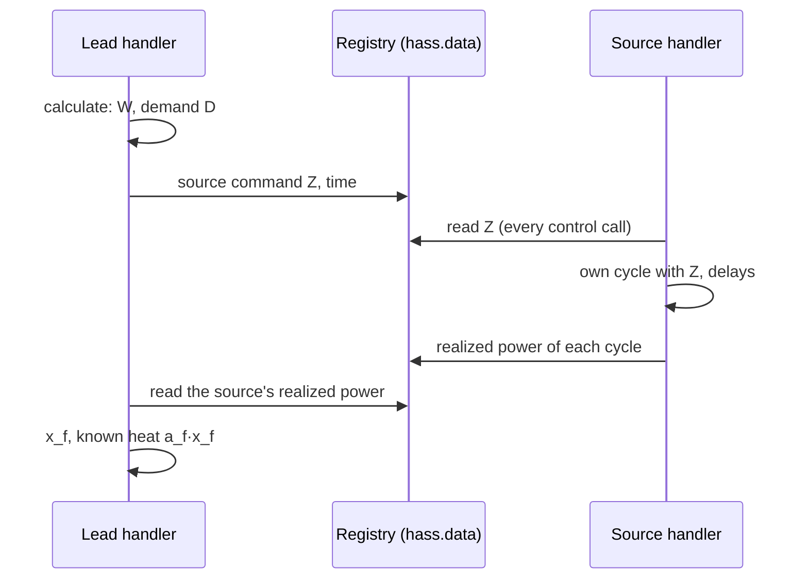
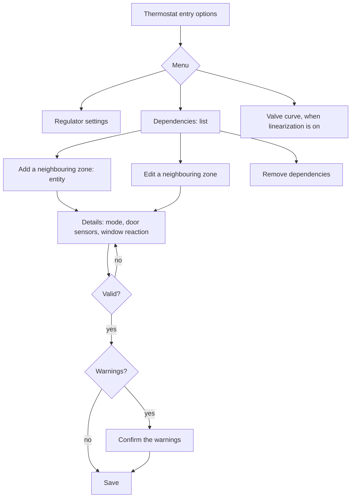

# Zone dependencies and a second heat source — technical documentation

> **In development.** Neighbouring zones work. The second heat source is being built:
> its model, split rules and allocation loop exist as modules; the lead and source
> thermostats do not use them yet (see the status in each section).

This document describes how SmartPI takes into account what happens around a zone: the
heat it exchanges with neighbouring zones, and a second device heating the same zone. It
covers the model, the learning, the decisions taken and the reasons for them, the
persistence, the diagnostics and the tests. The PI controller, its feed-forward and its own
learning are described in the [technical documentation](technical_doc.md).

Abbreviations: Home Assistant (HA), Versatile Thermostat (VTherm), feed-forward (FF),
least squares (LS).

## Contents

1. [Overview](#1-overview)
2. [The model with known inputs](#2-the-model-with-known-inputs)
3. [Components](#3-components)
4. [One calculation](#4-one-calculation)
5. [Neighbouring zones](#5-neighbouring-zones)
6. [A second heat source](#6-a-second-heat-source)
7. [Resetting the learned model](#7-resetting-the-learned-model)
8. [Persistent state](#8-persistent-state)
9. [Diagnostics](#9-diagnostics)
10. [Options](#10-options)
11. [Testing](#11-testing)
12. [Constants](#12-constants)

## 1. Overview

SmartPI models a zone as one thermal mass heated by its own actuator and losing heat to the
outdoors (`dT/dt = a·u − b·(T − T_ext)`). Two common situations break that picture:

- **A neighbouring zone** at another temperature exchanges heat with the zone, through an
  open door or permanently (an open-plan space). Today SmartPI absorbs that exchange into
  `b`, which then changes with the neighbour's temperature and the doors.
- **A second device** heats the same zone, for example a heated floor next to a radiator.
  Today each device runs its own SmartPI, and each sees the other one's heat as a
  disturbance.

The extension keeps SmartPI's control law and learning as they are and adds **known
inputs** to its model: heat exchanged with other temperatures, and heat added directly.
They are composed back into the two values the control law already uses, at a single
substitution point. Without any configured dependency nothing changes, and a test checks
it bit for bit.

| Stage | Content | Status |
|---|---|---|
| Foundation | known inputs, composition, substitution point, learning correction and gates, persistence, diagnostics, options menu | in use |
| Neighbouring zones | three connection modes, learned exchange, reaction to a neighbour's open window, options forms | in use |
| Second heat source | emitter types, the source's heat model, split rules, allocation loop | modules and tests; integration in progress |

## 2. The model with known inputs

### 2.1 Zone model

    dT/dt = a·u − b·(T − T_ext) + Σ_i g_i·(T_i − T) + Σ_j q_j

- `u` is the lead thermostat's applied command (0..1), `a` its effect and `b` the loss to
  the outdoors, as SmartPI learns them.
- An **exchange input** `i` couples the zone to a temperature `T_i` through a conductance
  `g_i` (1/min). A neighbour connected to the zone is one, with `g = k`, the learned
  exchange coefficient.
- A **heat input** `j` adds `q_j` (degC/min, either sign) directly. The second source's heat
  `a_f·x_f` is one (section 6).

### 2.2 Composition

The known inputs are folded into the two values the control law already takes, its loss
coefficient and its outdoor temperature:

    b_eff = b + Σ_i g_i
    T_ref = (b·T_ext + Σ_i g_i·T_i) / b_eff + Σ_j q_j / b_eff

- The heat term is a shift of `T_ref`, bounded by `KNOWN_HEAT_MAX_SHIFT_C`, so that a weak
  loss estimate cannot amplify it.
- With an always-connected neighbour whose exchange SmartPI's `b` has absorbed, the loss
  term uses the coefficient fitted without it (section 5.4).
- Every input has a value now and may carry a trajectory over a horizon; without one it
  stays constant.
- Without inputs, or without an outdoor temperature, the composition returns `b` and `T_ext`
  unchanged.

### 2.3 Where the model is used

| Part of SmartPI | Uses |
|---|---|
| FF1 (`k_ff = b/a`), FF3, setpoint trajectory, thermal twin, near band, FF trim windows | `b_eff`, `T_ref` |
| Integral time of the gains | `Ti = 1 / (b + Σ g)`, with the fitted loss for always-connected neighbours |
| Learning of `a`, `b` and dead times, governance, safety | raw `b` and `T_ext`; each learning window is corrected by the rate the known inputs add (`known_rate`) |

Learning on raw data keeps SmartPI's own parameters meaning what they meant before; the
correction removes the part of the measured slope that known inputs explain.

## 3. Components

All modules below are pure Python, testable without HA.

| Module | Responsibility |
|---|---|
| `smartpi/dependencies.py` | Configuration items (`kind`, `mode`, door sensors, window reaction), parsing, validation, learned state per item (`DependencyState`) |
| `smartpi/dependency_inputs.py` | Readings for one calculation: neighbour temperature, availability, safety mode, window state; door sensors; zone presets and temperature range |
| `smartpi/effective_model.py` | Known inputs (`ExchangeInput`, `HeatInput`, `KnownInputs`) and their composition (`compose`) |
| `smartpi/coupling_estimator.py` | Learning of the exchange coefficients `k` from measurement windows |
| `smartpi/dependency_model.py` | Inside the algorithm: readings to known inputs, learning gates, the reaction to a neighbour's window, diagnostics |
| `smartpi/source_model.py` | Second source: emitter types, delay and lag, the heat `x_f` now and ahead |
| `smartpi/split.py` | Second source: split rules, allocation loop, recommendation by emitter type |

In the existing files:

- **`algo.py`** reads the known inputs at each calculation (`_read_known_inputs`), applies a
  neighbour's window reaction, composes the effective model at the single substitution point
  (`_compose_effective_model`) and passes the learning gate and correction to the learning
  window. It also records the power each completed cycle realized.
- **`handler.py`** registers the readings provider when dependencies are configured
  (`_read_dependencies`), resolving entities through their registry identifier, and drops the
  learned state of items removed from the configuration at startup.
- **`config_flow.py`** gives the thermostat entry an options menu with the dependency list
  and the neighbour forms (section 10).

## 4. One calculation



- **A failing provider** leaves the learned model unchanged and the calculation goes on
  without known inputs: a dependency problem never stops regulation.
- **An edge of the learning gate** discards the open learning window and the dead-time
  observation in progress, which would mix two regimes. The dead-time markers of the control
  law are left untouched.
- **A change of the active inputs** (their signature) invalidates the open FF trim windows,
  whose evidence assumed the previous model.

## 5. Neighbouring zones

### 5.1 Configuration

A neighbour is a VTherm climate entity or a temperature sensor, stored by its registry
identifier, so that renaming an entity keeps the link.

| Mode | The connection is active | Typical use |
|---|---|---|
| `none` | never: the item stays on the list as a switch, without deleting what was learned | trying without a neighbour |
| `door` | while any of the door sensors is open (unknown or unavailable counts as closed) | a room behind a door |
| `always` | always | an open-plan space |

- Door sensors are binary sensors of class `door`, `opening` or `garage_door`. Window
  sensors are refused: an outdoor window stays in VTherm's window detection.
- One door sensor may serve several entries, but not two neighbours of the same zone.
- For a VTherm neighbour, the **window reaction** says what to do while the connection is
  active and the neighbour reports an open window: `nothing`, `turn_off`, `frost`, `eco`.
- A connection is ignored while the neighbour is unavailable, in safety mode, or without a
  finite temperature.

### 5.2 Learning gates

The gate decides whether SmartPI's own learning (`a`, `b`, dead times) may run.



- Priority when several apply: `neighbour_window` over `door_open` over `door_settling`.
- An always-connected neighbour does not gate learning: SmartPI's `b` absorbs its exchange,
  and the joint fit (section 5.4) separates it.
- `k` learns only when SmartPI itself could learn: learning enabled and not paused, the
  zone heating or cooling, no power shedding, guard cut or calibration, SmartPI out of its
  learning phase, a reliable dead time, no neighbour window, and not within
  `DOOR_SETTLING_S` after any door change.

### 5.3 Measurement windows

`k` is learned from windows of fixed length `COUPLING_WINDOW_S` (30 min), longer than
SmartPI's own because a 0.1 degC sensor needs time to show a slope.



- **Slope.** A plain least-squares slope: a steady temperature carries information too,
  since the power then balances the losses.
- **Consistent weights.** The least-squares slope is a weighted mean of the temperature
  derivative, heavier in the middle of the window. The power, the temperature differences
  and the known heat are averaged with the same weights, so the window model holds when the
  temperature curves, for example with the ripple of on/off cycles. With uniform averages
  instead, a steady ripple biased `k` by about 6 % in the tests.
- **Realized power.** The power acting on the zone is the applied power shifted by the dead
  time. It is the power each completed cycle realized, as VTherm reports it, delivered from
  the start of the cycle by a switched actuator; the commanded power covers only the cycle
  still running. VTherm often cuts a cycle, which starts with its on-time, so the commanded
  average was lower than what the zone received.
- A window counts only when some `|T − T_j| ≥ COUPLING_K_MIN_DT`.

### 5.4 Learning the exchange

**One door.** `k = r / x`, with `x = −(T − T_j)` averaged over the window. Values outside
`(0, COUPLING_K_MAX]` and outliers of the history are rejected; `k` is published as the
median of the history once it holds `COUPLING_MIN_SAMPLES` values that agree (MAD over
median at most `COUPLING_MAX_DISPERSION`). SmartPI's `b` is clean here, since it learns only
while the doors are closed.

**Several doors open together.** Windows feed a buffer of `COUPLING_LS_WINDOW` rows solved by
least squares with `k ≥ 0`. When the regressors cannot be told apart (condition number of the
normalized Gram matrix above `COUPLING_LS_COND_MAX`), the connections get one common
coefficient, which keeps their total exchange, and are flagged `indistinguishable`.

**Always connected.** SmartPI's `b` has absorbed the exchange, so `b` is fitted together with
`k`:

    slope − a·u − q = b·x_ext + Σ_j k_j·x_j,   x_ext = −(T − T_ext)

Written as `r = (b + Σ k_j)·x_ext + Σ k_j·(T_j − T_ext)`, each `k` is told apart only by the
neighbour's own temperature moving independently of the outdoor one and of the zone. A fit of
the buffer (`COUPLING_JOINT_WINDOW` windows) counts only when:

- the buffer holds at least `COUPLING_JOINT_MIN_ROWS` windows — a few hours of rows share the
  same errors of SmartPI's `a` and dead time and would agree on a wrong `k`;
- the centered columns `x_ext` and `T_j − T_ext` each vary by at least `COUPLING_K_MIN_DT`
  and are not collinear (condition number at most `COUPLING_LS_COND_MAX`). A constant offset
  between them alone would let a constant error, such as unmodelled gains, decide the split;
- every coefficient is positive with a standard error of at most `COUPLING_JOINT_MAX_REL_SE`
  of its value. Unlike a condition number, the standard error falls as windows accumulate.

A separable fit adds `k` and its `b` to a history at most every `COUPLING_JOINT_FIT_SPACING`
new windows, so that agreeing fits do not merely repeat the same data. The history is
published like a door's. The control law then uses the fitted `b` as its loss term,
including in the integral time. Until then nothing is published and the zone runs as without
the neighbour.

### 5.5 A window at a connected neighbour

| Reaction | Effect while the connection is active and the window open |
|---|---|
| `nothing` | learning pauses, control unchanged |
| `turn_off` | the zone goes off through SmartPI's window-off path, with its protected resume |
| `frost`, `eco` | the zone's preset for the current HVAC mode, never more demanding than the current setpoint (heating: lower of the two, cooling: higher) |

- A preset that is not configured (VTherm reports 0) or outside the thermostat's range turns
  the zone off.
- Several neighbours with open windows: the most protective reaction wins
  (`turn_off` > `frost` > `eco`).
- A calibration in progress is cancelled; it ends as cancelled instead of stalling.

### 5.6 Results and limits (simulation)

- Fed with the true `a` and dead time, the estimator reproduces `k` within 2 %.
- The remaining error comes from SmartPI's learned model, since `k` is a small residual of a
  large balance:
  - door, 0.01 degC sensor: `k` within 1 %, `a` and `b` stay clean;
  - door, 0.1 degC sensor: `k` can be tens of percent off when SmartPI's `a` is a few
    percent off;
  - always connected, 0.01 degC sensor, neighbour temperature steps: `k` +5.5 %, fitted `b`
    −1 %, published about a day after the first step and never before;
  - always connected, 0.1 degC sensor: nothing is published, the neighbour is flagged
    `indistinguishable` and the zone runs as today.
- Separating `b` from an always-connected neighbour needs the neighbour's temperature to move
  on its own.
- A zone where SmartPI never reaches a reliable time constant gets no feed-forward benefit,
  because SmartPI keeps its feed-forward off in that case.

## 6. A second heat source

### 6.1 Roles and the main decision

The zone thermostat is the **lead**; it names a second VTherm with SmartPI, the **source**,
which then works for it (one source per zone, no chains).

**Decision: the lead's command stays exactly what SmartPI computes.** The source is moved by
a slow allocation loop towards the split the rule chooses, and its heat reaches the lead's
model as a known input. The alternative, mapping one demand to two commands with fixed curves,
was rejected:

- the lead would receive another command than its controller computed. SmartPI would read
  it as a limited actuator: its anti-windup would drain the integral every cycle, the command
  ownership and FF trim would reject their windows, and the learning phase would see the
  wrong power;
- the source's heat would be counted twice, once in the map and once as a known input;
- with a slow source, half of the lead's command would show its effect hours later, which
  makes the lead overshoot and swing.

| | Fixed maps (rejected) | Allocation loop (chosen) |
|---|---|---|
| SmartPI's controller, learning and safeguards | must be reworked | unchanged |
| Slow source (heated floor) | swings | stable by design |
| Reaction of the source | immediate | follows the rule over minutes (fast source) to hours (floor) |
| Split | exact at every instant | exact in steady state |

### 6.2 Emitter types and the source's heat

The source's applied command `u_f` reaches the zone after a transport delay `L_f` and a
first-order lag `tau_f`, the thermal mass of its emitter:

    x_f(t + dt) = u_d + (x_f(t) − u_d)·exp(−dt / tau_f),   u_d = u_f(t − L_f)

`x_f` is in 0..1 of the source's full power and its heat is `a_f·x_f`. The commands already
sent make `x_f` known now and predictable over a horizon: they keep arriving for `L_f`, and
the last one is assumed to hold after that.

The user chooses the type of both devices; the type gives the starting values:

| Emitter type | `L_f` (min) | `tau_f` (min) |
|---|---|---|
| `electric_fast` (convector, fan coil, air conditioner) | 2 | 3 |
| `radiator` (water) | 5 | 20 |
| `floor_electric` (heating mat) | 10 | 90 |
| `floor_water` | 30 | 180 |
| `custom` | user | user |

These are orders of magnitude to be refined with field data; learning them is planned later.

### 6.3 Split rules

`W` is the lead's command, `Z` the source's. Each rule is a curve of steady states from
`(0, 0)` to `(100 %, 100 %)` and gives the lead's target average `f(Z)`:

| Rule | Curve | Parameter (default) | Examples |
|---|---|---|---|
| `together` | `Z = p·W`; once one is at 100 %, the other rises alone | `p` (100 %), any value | `p` = 200 %: W 20 %, Z 40 % |
| `source_first` | the source alone up to θ; above it both rise and reach 100 % together: `W = (Z − θ)/(100 − θ)` | θ (50 %) | θ = 50 %: Z 30/W 0, Z 70/W 40, both 100; θ = 100 % strictly one after the other; θ = 0 like `together` at 100 % |
| `lead_band` | the source settles so that the lead's average stays in the band | band (20 %) | the lead always keeps a margin for quick corrections |

The defaults overlap: both devices work together over part of the range.

**Recommendation by emitter type** (the form's default, with its reason):

| Lead + source | Default | Reason |
|---|---|---|
| radiator + heated floor | `lead_band`, 20 % | the floor carries the base load; the radiator adds and corrects quickly (sun, cooking, an open door) |
| devices of similar speed | `together`, 100 % | a common percentage |
| a source to use first (e.g. cheaper energy) | `source_first`, chosen by the user | priority of the source |
| a lead clearly slower than its source | warning | the quick corrections belong to the faster device: swap the roles |

`source_first` is not the default next to a floor: with a low demand the radiator would stand
at 0 % and the floor alone would regulate, overheating after any gain because it takes hours
to slow down.

### 6.4 Allocation loop



- A lead working more than the curve asks moves the source up, a lead working less moves it
  down.
- The lead's demand is taken **before its 0..100 % limits**. Above 100 % the lead alone cannot
  keep up and the source rises as a reserve; below 0 the zone is warmer than the lead can
  correct by stopping, and the source comes down. Without it, a source left above its share
  with the lead at 0 % would overheat the zone unseen.
- **Speed.** An error held for `SPLIT_SETTLE_FACTOR` source settle times (`L_f + tau_f`),
  never less than `SPLIT_MIN_TIME_S`, moves the source by 100 %. It is slowed in proportion
  for a source stronger than the lead. The demand is averaged over `SPLIT_AVERAGE_FRACTION`
  of that time, never less than `SPLIT_AVERAGE_MIN_S`. The source never covers its range
  faster than it settles, nor faster than `SPLIT_MIN_FULL_RANGE_S`.
- **How the speed was chosen.** On an ideal lead with fast and slow, weak and strong sources
  and every rule (15 cases), these values keep the source's overshoot within 3 % (26 % with
  the first trial values), with no swinging. A fast source settles in about 3 h, a water
  floor in about a day; the lead holds the zone temperature meanwhile.

### 6.5 Still to come (planned design)

- **Lead side.** The source's heat as a known input, now and over the horizon. `a_f` is
  learned with the measurement windows of section 5.3, generalized from neighbours to known
  inputs. SmartPI's own learning of `a` and `b` is gated while the source's heat is present
  and `a_f` is not yet reliable.
- **Learning phase.** The zone learns both devices from the start. A plan interleaves
  episodes: both off (for `b`), the lead alone (for `a`), the source alone (for `a_f`). The
  phase ends when all three have their samples, and the diagnostics show the progress of each.
- **Executive path of the source.** The source's handler applies the lead's command with its
  own cycle and delays. It applies 0 when the lead is off, in safety mode, unavailable, in
  another HVAC mode, or when its command is stale. The source's own learning is put to sleep
  and restored when the role ends.



- **Options.** A source form with the emitter types, the rule and its parameter, validation
  (the source runs SmartPI, no chains, one source per zone), the automatically created entry
  of the source showing only its delays and PWM restart, and a reload of the two affected
  thermostats only.

## 7. Resetting the learned model

A configuration change that affects what the zone has learned shows a step with the option
"Reset the zone's learned model", checked by default:

| Change | Shows the reset step |
|---|---|
| a source added or removed, its emitter type or response changed | yes |
| a neighbour added or removed, its mode or door sensors changed | yes |
| the split rule or its parameter, a window reaction, delays | no |

Today a neighbour whose mode or door sensors change is stored under a new identifier, so its
learned `k` starts again; the reset step is planned with the source form.

## 8. Persistent state

The dependency state is saved with SmartPI's state under the key `dependencies`, only when
there is something to save:

```text
dependencies
├── version                     format version (1)
├── items
│   └── <item id>
│       └── k_history           accepted single-window values of k
└── shared
    └── coupling
        ├── ls_rows             buffer of door connections open together
        ├── joint_rows          buffer of the joint fit of always-connected neighbours
        ├── joint_k             history of separable fits, per neighbour
        └── joint_b             loss coefficients fitted with them
```

- An old saved state without the key loads as before.
- At startup, the state of items no longer configured is dropped.
- A saved state that cannot be read is ignored, rows that cannot be used are skipped, and the
  exchanges are learned again.
- `reset_learning` clears the dependency state with the rest.

## 9. Diagnostics

The published diagnostics gain a `dependencies` block only when dependencies are configured:

| Field | Meaning |
|---|---|
| `b_eff`, `t_ref` | the composed model |
| `inputs_active` | whether known inputs are active |
| `learning_gate` | `door_open`, `door_settling`, `neighbour_window` or none |
| `neighbour_window_action` | the window reaction applied |
| `items[]` | per neighbour: `id`, `kind`, `entity`, `mode`, `available`, `active`, `t_neighbour`, `neighbour_window`, `k`, `k_reliable`, `k_samples`, `indistinguishable`, `share_of_losses` |

The second source will add a `second_source` block (rule, command, `x_f`, `a_f` and its
samples, `L_f`, `tau_f`, the lead's average) and, on the source thermostat, its role.

## 10. Options



- **Errors** keep the form open: an entity without a unique ID, the zone itself, a duplicate
  neighbour, door mode without a sensor, a window sensor, a door sensor of another neighbour.
- **Warnings** ask for confirmation: the neighbour's own entry does not list this zone, a door
  sensor that is also this thermostat's window sensor, and automatic window detection, which
  may react to the open door.
- **Suggestions.** Door sensors in the areas of the two zones, not used by another neighbour,
  are listed in the form, not preselected: one of them may be an exterior door.

## 11. Testing

- **Unit tests** for every module: configuration and validation, readings, composition,
  learning of `k`, the dependency model, the source's heat, the split rules and the allocation
  loop (including a closed loop with an ideal lead).
- **Algorithm and handler tests**: the substitution reaches every control component, learning
  stays on raw data, gates, persistence, diagnostics, a failing provider.
- **Options forms** with `pytest-homeassistant-custom-component`.
- **Simulator** (`tests/sim/`): the real `SmartPIHandler` in virtual time against a thermal
  model, with VTherm's cycle scheduler, moving average and slope reproduced. A zone may have a
  second thermostat whose emitter has a delay and a lag.
- **Differential test**: a run with inactive dependencies equals, bit for bit, a run with the
  substitution switched off.
- **Scenarios**: neighbours N1–N7; second source Z1–Z7 as the integration lands. Today's
  baseline, two independent SmartPI on one zone, is measured for comparison.
- **Two levels of runs.** Pull requests run the short suite ("Tests"). The long scenarios and
  the comparisons with VTherm's own classes run with `SMARTPI_SIM_LOCAL=1`, locally and in the
  "Full tests" workflow on the `qas` branch.

## 12. Constants

| Constant | Value | Role |
|---|---|---|
| `KNOWN_INPUTS_B_EFF_MIN` | 1e-5 /min | smallest composed loss |
| `KNOWN_HEAT_MAX_SHIFT_C` | 15 degC | bound of the heat shift of `T_ref` |
| `COUPLING_WINDOW_S` | 30 min | measurement window |
| `COUPLING_K_MIN_DT` | 0.5 degC | smallest informative temperature difference and variation |
| `COUPLING_K_MAX` | 0.02 /min | largest credible `k` |
| `COUPLING_MIN_SAMPLES` | 8 | values before publishing |
| `COUPLING_MAX_DISPERSION` | 0.35 | agreement (MAD over median) |
| `COUPLING_HISTORY_SIZE` | 31 | history length |
| `COUPLING_LS_WINDOW` | 31 windows | buffer of door connections open together |
| `COUPLING_LS_COND_MAX` | 30 | separability (normalized Gram matrix) |
| `COUPLING_JOINT_WINDOW` | 96 windows | buffer of the joint fit |
| `COUPLING_JOINT_MIN_ROWS` | 24 windows | windows before a joint fit |
| `COUPLING_JOINT_FIT_SPACING` | 4 windows | new windows between two kept fits |
| `COUPLING_JOINT_MAX_REL_SE` | 0.15 | largest relative standard error of a kept fit |
| `DOOR_SETTLING_S` | 10 min | pause after a door change |
| `SPLIT_DEFAULT_RATIO`, `SPLIT_DEFAULT_ALONE`, `SPLIT_DEFAULT_BAND` | 100 %, 50 %, 20 % | rule defaults |
| `SPLIT_SETTLE_FACTOR` | 4 | allocation integration time in source settle times |
| `SPLIT_MIN_TIME_S` | 60 min | shortest allocation integration time |
| `SPLIT_AVERAGE_FRACTION`, `SPLIT_AVERAGE_MIN_S` | 0.1, 15 min | average of the lead's demand |
| `SPLIT_MIN_FULL_RANGE_S` | 10 min | fastest full range of the source |
| `SPLIT_DEMAND_MIN`, `SPLIT_DEMAND_MAX` | −1, 2 | range of the demand fed to the loop |
| `SPLIT_SLOW_SOURCE_S` | 60 min | a source settling this slowly is slow |
| `SPLIT_ROLES_REVERSED_FACTOR` | 1.5 | a lead this much slower than its source is flagged |
