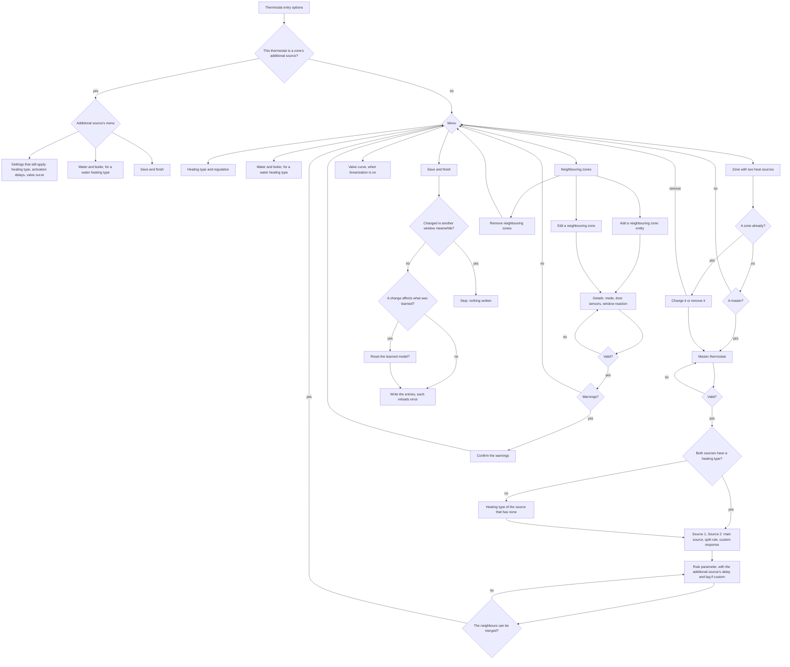
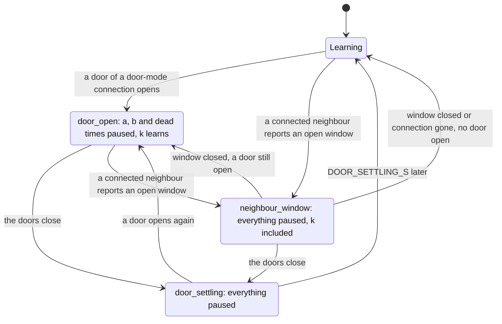
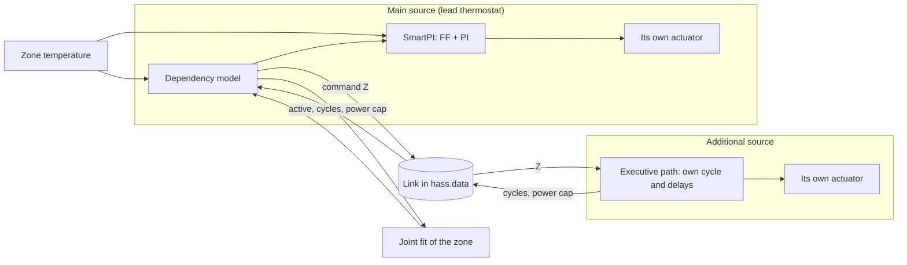
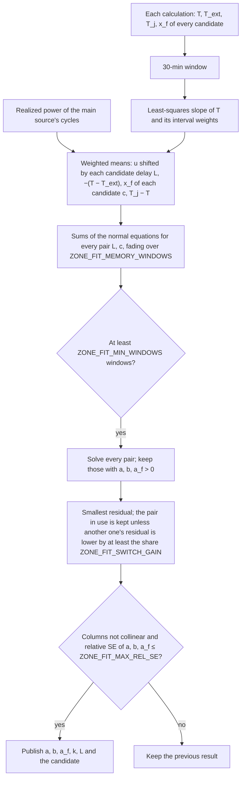
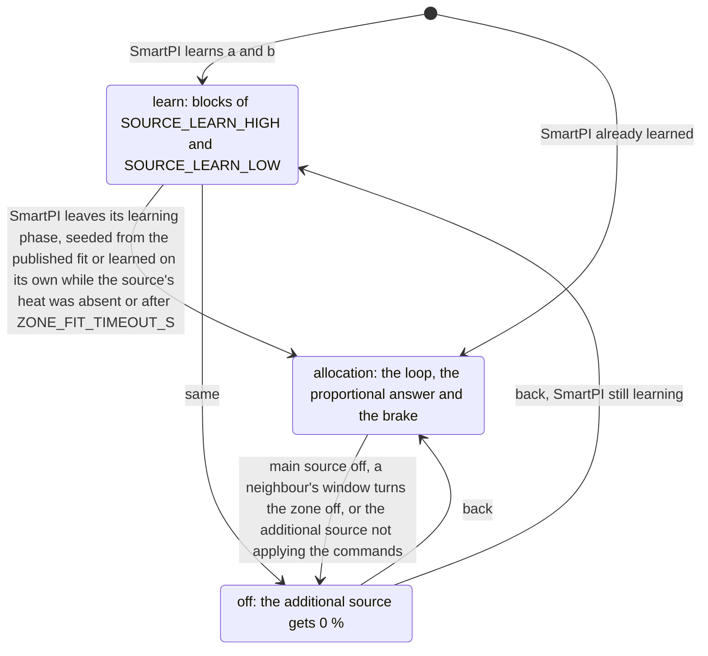
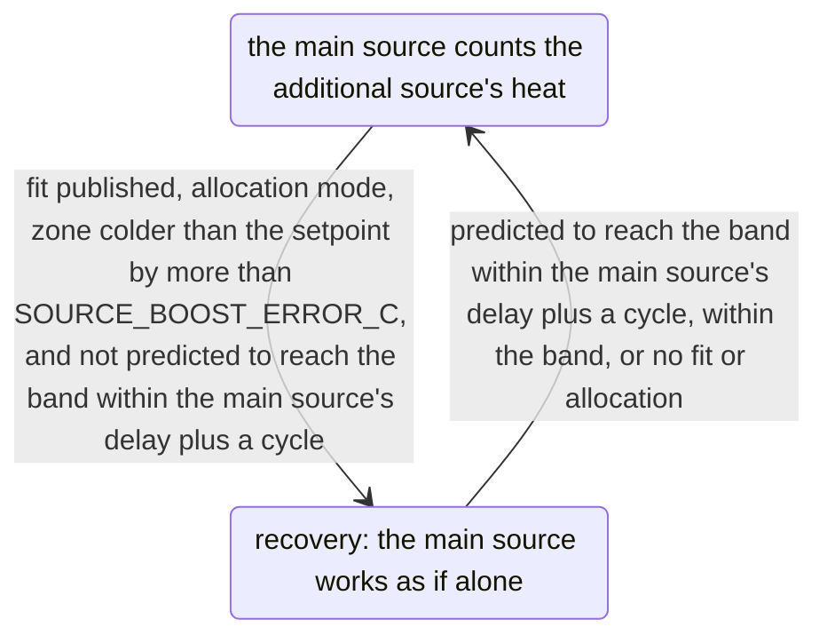
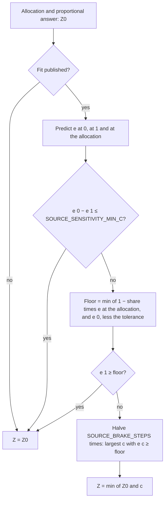
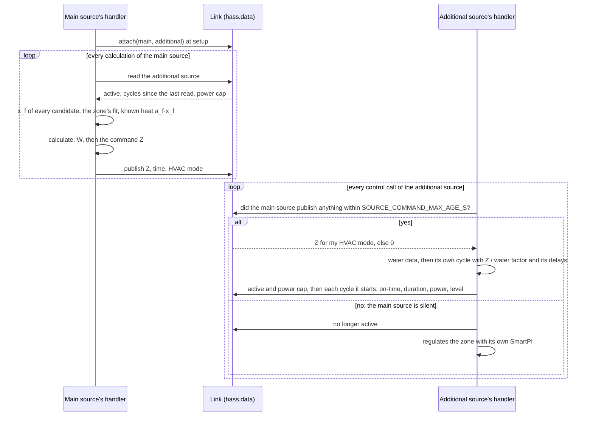
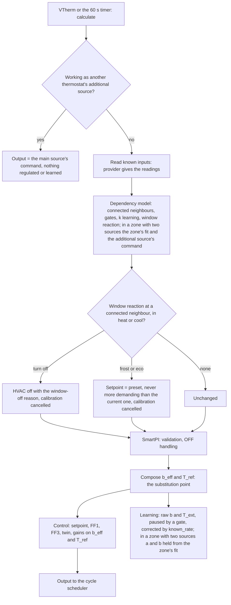

# Zone dependencies and a second heat source — technical documentation

> **In use** in the fork's `dev` branch: neighbouring zones and the zone with two heat sources,
> each with its own options form. [Tests](testing.md) describes the tests and the simulator
> that produced the results.

This document describes how SmartPI takes into account what happens around a zone: the heat
the zone exchanges with neighbouring zones, and a second device that heats the same zone. It
covers the model, the learning, the decisions and the reasons for them, the state saved across
restarts, the diagnostics and the tests. The [technical documentation](technical_doc.md)
describes the PI controller, its feed-forward and its own learning.

Abbreviations: Home Assistant (HA), Versatile Thermostat (VTherm), feed-forward (FF: the part
of the command that follows from the model of the zone), least squares (LS: the usual way to
fit a model to measured data).

## Contents

1. [Overview](#1-overview)
2. [Configuration](#2-configuration)
3. [The model with known inputs](#3-the-model-with-known-inputs)
4. [Neighbouring zones](#4-neighbouring-zones)
5. [A second heat source](#5-a-second-heat-source)
6. [Components and interfaces](#6-components-and-interfaces)
7. [One calculation](#7-one-calculation)
8. [Persistent state](#8-persistent-state)
9. [Diagnostics](#9-diagnostics)
10. [Testing](#10-testing)
11. [Constants](#11-constants)

## 1. Overview

SmartPI models a zone as one thermal mass (one block that stores heat). Its own actuator heats
it, and it loses heat to the outdoors (`dT/dt = a·u − b·(T − T_ext)`). Two common situations do
not fit that picture:

- **A neighbouring zone** at another temperature exchanges heat with the zone. This happens
  through an open door, or all the time (an open-plan space). Today that exchange ends up in
  SmartPI's `b`, so `b` then changes with the neighbour's temperature and with the doors.
- **A second device** heats the same zone, for example a heated floor next to a radiator.
  Today each device runs its own SmartPI, and each one sees the other one's heat as a
  disturbance (an outside effect that it cannot explain).

The extension keeps SmartPI's control law (the rule that computes the command) and its learning
as they are. It adds **known inputs** to the model: heat exchanged with other temperatures, and
heat added directly. These inputs are combined into the two values that the control law already
uses. This happens at one place in the code, the substitution point. Without any configured
dependency, nothing changes. A test checks, bit for bit, that inactive dependencies give the
same run as with the substitution switched off.

**Why a general list of known inputs.** The first two uses (a neighbour's exchange, a second
source's heat) are not the last ones. A weather forecast and weather factors are planned for the
same list. So the list takes two kinds of input: an exchange with another temperature, and heat
added directly. Each input has a value now and a trajectory, that is, its expected values over a
period ahead, the horizon (`SOURCE_TRAJECTORY_MIN`). The control law reads the inputs at one
place in `algo.py`. A new input changes neither that place nor SmartPI's control components.
**Why the comparison runs during the test.** The differential test runs the same scenario twice, once with the
substitution on and once with it off. It does not compare with reference runs saved in advance,
because those would break with every change to the author's algorithm.

| Stage | Content | Status |
|---|---|---|
| Foundation | known inputs, composition, substitution point, learning correction and gates, saved state, diagnostics, options menu | in use |
| Neighbouring zones | three connection modes, learned exchange, reaction to a neighbour's open window, options forms | in use |
| Second heat source | emitter types, the additional source's heat and time scale, the zone's joint fit, learning blocks, split rules, allocation loop and predictive brake, the executive role with water data and a fallback, the zone form from the master thermostat | in use |

## 2. Configuration

This section covers what the user sets for a zone and its neighbours, in the options of a
thermostat entry.

### 2.1 Options and forms

The options of a thermostat entry work like Versatile Thermostat's. Each section is reached from a
menu and comes back to it. The changes stay in the open window (the "draft") until the last item,
**Save and finish**, writes them. Closing the window discards them. The menu says which sections
have unsaved changes. A new thermostat entry is made with the same menu: nothing is created before
**Save and finish**.



**Zone with two heat sources.**

- **Master thermostat.** The form lists the Versatile Thermostats over climate that have this
  thermostat among their devices. (A VTherm over climate controls other thermostats, its devices.)
  If there is none, the section goes back to the menu, which explains what to create. The master must have self-regulation off, because
  SmartPI regulates in its devices. It must have exactly two devices. Both must be Versatile
  Thermostats that run SmartPI and measure the zone with the same temperature sensor. Neither may
  already belong to another zone.
- **Heating types.** The zone needs the heating type of both devices. A device whose own entry sets
  none is asked for it in a step before the sources. The type is written to that device's entry at
  **Save and finish** (an entry is created for it if it has none).
- **Sources.** Source 1 and Source 2 are the master's devices. The form shows each one with the
  heating type from its own entry. In the same step, the user chooses the
  **main source**: the one whose SmartPI regulates and corrects quickly. The faster device is the
  default. The user also chooses the split rule, and the form proposes the rule recommended for the
  two heating types (section 5.3). Last, the user says whether to set the additional source's delay
  and lag instead of starting from its heating type. The form does not ask for the main source's
  delay, because the zone's fit learns it (section 5.4). A zone saved by an earlier version may
  hold the main source's own delay and lag. It keeps them, but they are not used.
- **Parameter.** This step shows the rule's parameter and what it means for these two thermostats
  (`together` 10 to 1000 %, `source_first` and `lead_band` 0 to 100 %). It warns when the main
  source's heating type responds more slowly than the other one's. If the user asked for them, it
  also asks for the additional source's delay and lag (0 to 600 min).
- **Where it is saved.** The zone is saved in the main source's entry, as its `source` item, which
  also names the master (`zone_master`). The zone's neighbours and doors are in the same entry.
  The other thermostat's entry stores nothing about the zone. That thermostat finds its role in the
  main source's entry. A thermostat without a SmartPI entry gets one at **Save and finish**. It
  uses the defaults' shared settings and holds its heating type. Creating it restarts only that
  thermostat.
- **A main source other than the thermostat whose options are open.** This happens when the zone
  is set up from the thermostat that becomes the additional source, or when the main source is
  changed. The form then moves the zone, with this entry's neighbours, to the main source's entry,
  and empties this entry's list. A former main source then works as the additional one. A neighbour
  that is now part of the zone is dropped. If a moved neighbour clashes with one of the new main
  source's own neighbours (the same neighbour or door sensor), the moved one wins. If the list still
  does not pass validation, the parameter step shows the error `zone_move_conflict`. The moved
  neighbours learn their exchange again in the new main source. Both entries are written at
  **Save and finish**.
- **One window at a time.** At **Save and finish**, the form checks again that the master and the
  entries of both thermostats are still as they were when it read them, and that this entry's list
  of dependencies did not change in another window. If not, it stops (`zone_changed`), writes
  nothing and asks the user to open it again. This way, two windows open at the same time cannot
  leave each thermostat naming the other.
- **Neighbours of a zone.** The zone's additional source and its master cannot be added as
  neighbours of the zone, because they heat or measure the same zone.
- **When the window stops.** Only **Save and finish** may end the window without writing: when the
  zone changed while it was open (`zone_changed`), or when the entry of the zone's other
  thermostat cannot be created (`main_entry_missing`). Inside a section, a problem is an error on its form, or the
  section goes back to the menu with a note.
- **The additional source's options** open a menu of their own, which shows which entry holds the
  zone. Its first item has the settings that still apply while it follows the main source: its
  heating type, its activation delays and, for a valve, its curve. Its other regulator settings keep their values. They apply only while it
  regulates on its own because the main source has gone silent, that is, sends no commands
  (section 5.7).
- **Heating types at start.** Each time the main source starts, the handler reads the heating types
  of both thermostats from their entries. Saving the additional source's entry also restarts the
  main source. So a changed heating type takes effect at once. A custom response set in the zone
  form is kept. A heating type changed this way does not count as a change of the zone: if the user
  then edits only the rule, the form does not offer a reset.
- **A changed master.** At start, and when its entry is reloaded, the main source checks that the
  master still has exactly these two thermostats as its devices. It compares them by unique ID (the
  ID that never changes; at a reload the thermostat does not have its entity ID yet). If they
  differ, it logs a warning. The zone keeps running as configured until the form is opened again.
- **Removing the zone** gives each thermostat its own regulation back. The former additional source
  regulates with the model it had before it took the role. An entry that the form created for it
  stays.
- **Recommended on the master** (based on Versatile Thermostat's code): a long safety delay,
  because its safety mode switches both devices off; and a small step for its regulation
  threshold, because it rounds the setpoint it passes on to that step.

**Neighbours.**

- **Errors** keep the form open: an entity without a unique ID, the zone itself, a duplicate
  neighbour, door mode without a sensor, a window sensor, a door sensor of another neighbour.
- **Warnings** ask for confirmation: the neighbour's own entry does not list this zone; a door
  sensor is also this thermostat's window sensor; automatic window detection is configured, and it
  may react to the open door.
- **Suggestions.** The form lists the door sensors that are in the areas of the two zones and not
  used by another neighbour. It does not preselect them, because one of them may be an exterior
  door.
- **A neighbour shown `indistinguishable`** could not be told apart from the outdoors or from
  another neighbour. Nothing is published for it, and the zone runs as if it were not there.
- **Each step ends in the menu.** Editing a neighbour whose entity no longer exists is an error on
  the form (`neighbour_missing`). Removing with nothing selected goes back to the menu, which says
  so. Saving after the list changed in another window stops the window (`zone_changed`). The
  neighbours' menu, like the zone's, has an item to go back to the main menu.

**Stored configuration.** The items are stored in the entry's options under
`smart_pi_dependencies`. A neighbour item holds `id`, `kind` (`neighbour`), `entity` (registry
identifier), `mode`, `door_sensors` and `neighbour_window_action`. The zone's source item holds
`id`, `kind` (`source`), `entity`, `zone_master`, and `split_rule` with its parameter
(`split_ratio`, `source_alone_percent` or `lead_band_percent`). It also holds `lead_emitter` (the
main entry's heating type) and `source_emitter` (the additional entry's heating type, read again
at start, or `custom`). For a custom response, it holds `source_lag_min` and `source_tau_min`. A
zone saved by an earlier version may also hold `lead_lag_min` and `lead_tau_min`, which nothing
uses.

### 2.2 Resetting the learned model

A change that affects what was learned is a reason for one question at **Save and finish**: a
step "Reset the learned model" (`model_reset`), checked by default, that names the sections it
comes from. It is asked once, even when several sections changed, and not at all without a
reason:

| Change | A reason for the reset question |
|---|---|
| a zone set up or removed, its additional source swapped, the main source changed, the additional source's custom response changed | yes |
| a neighbour added or removed, its mode or door sensors changed | yes |
| the heating type, the water data source or its supply sensor ([Water and boiler inputs, §2](water_input.md#2-configuration)) | yes |
| the split rule or its parameter, a window reaction, the activation delays and other regulator settings | no |

- **How it is applied.** If the user chooses the reset, the save stores a new random token
  (`smart_pi_reset_token`) in each entry concerned: this thermostat's, and for a zone the main
  source's (where the zone is). When the thermostat starts with that entry,
  SmartPI resets its whole learned model once: `a`, `b`, dead times (the delays before the zone
  reacts to a command), the zone's fit and the exchanges, as the service `reset_smartpi_learning`
  does. It keeps the token in its saved state (`dependency_reset_token`), so a later restart does
  not reset the model again.
- When a neighbour's mode or door sensors change, the neighbour is stored under a new identifier.
  So its learned `k` starts again, whatever the user chooses.
- When the additional source's heating type changes, the response that its candidate time scales
  are built on changes too. The zone's fit is then dropped at the next start (section 8) and
  learned again.

## 3. The model with known inputs

### 3.1 Zone model

    dT/dt = a·u − b·(T − T_ext) + Σ_i g_i·(T_i − T) + Σ_j q_j

- `u` is the command (0..1) applied by the lead thermostat, the one whose SmartPI regulates the
  zone. `a` is its effect and `b` the loss to the outdoors, as SmartPI learns them.
- An **exchange input** `i` links the zone to a temperature `T_i` through a conductance `g_i`
  (1/min), that is, how easily heat flows between them. A neighbour connected to the zone is an
  exchange input, with `g = k`, the learned exchange coefficient.
- A **heat input** `j` adds `q_j` (degC/min, positive or negative) directly. The additional
  source's heat `a_f·x_f` is a heat input (section 5).

### 3.2 Composition

The known inputs are combined into the two values that the control law already uses: its loss
coefficient and its outdoor temperature:

    b_eff = b + Σ_i g_i
    T_ref = (b·T_ext + Σ_i g_i·T_i) / b_eff + Σ_j q_j / b_eff

- The heat term shifts `T_ref`. The shift is limited to `KNOWN_HEAT_MAX_SHIFT_C`, so that a loss
  estimate that is too low cannot make it too large. The limit must be larger than the largest difference between
  the setpoint and the outdoors. The reason: in the feed-forward, `b` cancels out
  (`b/a · q/b = q/a`). A limit below the shift that a floor needs in cold weather made SmartPI
  count less floor heat than there was (section 5.8).
- With always-connected neighbours, SmartPI's `b` already includes their exchanges. In that case
  the loss term moves to the coefficient `b_fit`, which is fitted without them (section 4.4). It
  moves at the same pace as their exchanges enter the model:

        loss = b + w·(b_fit − b),   w = Σ_i w_i·k_i / Σ_i k_i

  Here `w_i` is the share of each always-connected exchange that is already in the model
  (section 3.3). With `b = b_fit + Σ k_i`, `b_eff = loss + Σ w_i·k_i` stays equal to `b` while
  the exchanges fade in (enter step by step).
- Every input has a value now and may have a trajectory over a horizon. The control law uses only
  the value now. In a zone with two sources, the predictive brake makes its own prediction of the
  additional source's heat (section 5.6).
- The composition returns `b` and `T_ext` unchanged in these cases: there are no inputs, there is
  no outdoor temperature, `b` is not a finite number, or the composed loss is below
  `KNOWN_INPUTS_B_EFF_MIN`.

### 3.3 Where the model is used

| Part of SmartPI | Uses |
|---|---|
| FF1 (`k_ff = b/a`), FF3, setpoint trajectory, thermal twin, near band, FF trim windows | `b_eff`, `T_ref` |
| Integral time of the gains | `Ti = 1 / (loss + Σ g)`, with `loss` as in section 3.2 (`1/tau` without always-connected neighbours) |
| Learning of `a`, `b` and dead times, governance, safety | raw `b` and `T_ext`; each learning window is corrected by the rate the known inputs add (`known_rate`) |

The correction is the rate of temperature change that the active inputs add at the zone's
temperature:

    known_rate = Σ_i g_i·(T_i − T) + Σ_j q_j

It is summed (integrated) over the learning window and removed from the measured change. This
also holds when the start of the window slides. Because learning uses raw data, SmartPI's own
parameters keep the meaning they had before. There is one exception. Once the `k` of
always-connected neighbours are in the model, the correction removes their exchange from
SmartPI's windows. So SmartPI's own `b` (the `model.b` of the diagnostics) moves, over the
following windows, from `b_fit + Σk` towards `b_fit`. This does not affect the control law,
because its loss term is then `b_fit` (section 3.2).

**A coefficient that becomes known enters gradually.** Before a neighbour's `k` or the
source's `a_f` is published, its effect acts on the zone as an unknown disturbance. The
controller's integral (the part of the command that builds up from past errors) has already
absorbed it. Adding it to the model all at once would make the feed-forward jump. The zone would
then dip or overshoot while the integral adjusts back. So the coefficient enters over
`KNOWN_INPUT_FADE_S`. Always-connected neighbours are different, because SmartPI's `b` already
holds their exchanges. They enter together, once each of them is known. The fitted loss replaces
SmartPI's `b` at the same pace (section 3.2), so `b_eff` does not drop and then climb back. In a
zone with two sources, the fit's `b` replaces SmartPI's `b` at once, and it does not include
these exchanges. So their `k` from the fit enters the model at once. A coefficient that was
already known before a restart is fully in the model at once. This covers a neighbour's own `k`,
the `k` from the zone's fit for the HVAC mode in use, and the source's `a_f` for either HVAC
mode.

## 4. Neighbouring zones

### 4.1 Configuration

A neighbour is a VTherm climate entity or a temperature sensor. It is stored by its registry
identifier, so renaming the entity keeps the link.

| Mode | The connection is active | Typical use |
|---|---|---|
| `none` | never: the neighbour stays on the list but is ignored. Switching an existing neighbour to `none`, or back, starts its `k` again (section 2.2) | trying without a neighbour |
| `door` | while any of the door sensors is open (unknown or unavailable counts as closed) | a room behind a door |
| `always` | always | an open-plan space |

- Door sensors are binary sensors of class `door`, `opening` or `garage_door`. Window
  sensors are refused, because VTherm's window detection handles an outdoor window.
- One door sensor may serve several entries, but not two neighbours of the same zone.
- **`k` is only learned.** There is no way to enter it by hand in this version. One can be added
  if learning fails somewhere in practice.
- **A door without a sensor is not supported** (owner's decision of 2026-10-12). There is no mode
  for a door that is "usually closed", and openings are not detected from the data.
- **Set a neighbour up in the entries of both zones**, each one listing the other. The exchange
  works both ways, and the form warns when the neighbour's own entry does not list this zone.
- The neighbour forms end back in the options menu; the neighbour is written at **Save and
  finish** (section 2.1).
- For a VTherm neighbour, the **window reaction** says what to do while the connection is
  active and the neighbour reports an open window: `nothing`, `turn_off`, `frost`, `eco`.
- A connection is ignored while the neighbour is unavailable, is in safety mode, or has no valid
  (finite) temperature.

### 4.2 Learning gates

The learning gate decides whether SmartPI's own learning (`a`, `b`, dead times) may run.



- When several gates apply, the priority is: `neighbour_window` first, then `door_open`, then
  `source_heat`, then `door_settling`. The `source_heat` gate belongs to the second source
  (section 5.5). Below all of them, `boiler_settling` pauses learning while the emitter cools down
  because the boiler is not called, and while it warms up again once the boiler starts
  ([Water and boiler inputs, §4](water_input.md#4-a-boiler-that-is-not-called)).
- An always-connected neighbour does not pause learning. SmartPI's `b` includes its exchange, and
  the joint fit (section 4.4) separates it out. The first plan had a gate on the temperature
  difference to the neighbour (`coupling_gradient`). It was dropped: with a neighbour that is
  colder all the time, it paused SmartPI's learning most of the time, and it still gave no correct
  `k`.
- `k` is learned only when SmartPI itself could learn. This needs: learning enabled and not
  paused; the zone heating or cooling; no power shedding or calibration; SmartPI past its learning
  phase; a reliable dead time; no neighbour window; and no door change within the last
  `DOOR_SETTLING_S`. A guard cut does not stop it: the zone then gets no heat, which is a known
  power. Since SmartPI learns its slopes from the raw reading, guard cuts come often enough that
  stopping for them kept an always-connected neighbour from ever being learned in the tests.

### 4.3 Measurement windows

`k` is learned from measurement windows of fixed length `COUPLING_WINDOW_S` (30 min). They are
longer than SmartPI's own windows, because a 0.1 degC sensor (one that reports in 0.1 degC
steps) needs time to show a slope.


- **Slope.** The slope is a plain least-squares slope (the best straight line through the
  samples). A steady temperature carries information too, because the power then balances the
  losses.
- **Consistent weights.** The least-squares slope is a weighted mean of the rate of temperature
  change, with more weight in the middle of the window. The power, the temperature differences
  and the known heat are averaged with the same weights. So the window model still holds when the
  temperature curve bends, for example with the ripple of on/off cycles. With plain (equal-weight)
  averages instead, a steady ripple gave `k` a systematic error of about 6 % in the tests.
- **Realized power.** The power acting on the zone is the applied power, shifted by the dead time.
  It is the power that each completed cycle actually delivered, as VTherm reports it. For a
  switched actuator, this power counts from the start of the cycle and, with water data, at the
  actuator's water factor (section 5.2). The commanded power is used only for the cycle still
  running. VTherm often
  cuts a cycle short, and a cycle starts with its on-time. So the average of the commanded power
  was lower than what the zone received.
- A window counts only when `|T − T_j| ≥ COUPLING_K_MIN_DT` for at least one neighbour, and the
  window holds at least `MIN_WINDOW_SAMPLES` calculations. A window starts again whenever the set
  of connected neighbours or the set of the source's heat columns changes, or when learning is not
  allowed.

### 4.4 Learning the exchange

**One door.** `k = r / x`, with `x = −(T − T_j)` averaged over the window. Two kinds of values
are rejected: values outside `(0, COUPLING_K_MAX]`, and outliers of the history. Once the history
holds `OUTLIER_MIN_HISTORY` values, an outlier is a value beyond `OUTLIER_MAD_FACTOR` scaled MADs.
(The MAD, median absolute deviation, measures how spread out the values are.) `k` is published
as the median of the history once the history holds `COUPLING_MIN_SAMPLES` values that agree,
that is, with MAD over median at most `COUPLING_MAX_DISPERSION`. SmartPI's `b` is clean here,
because SmartPI learns it only while the doors are closed.

**Several doors open together.** Windows feed a buffer of `COUPLING_LS_WINDOW` rows. Once the
buffer holds `COUPLING_MIN_SAMPLES` rows, it is solved by least squares with `k ≥ 0`. The
solution is published directly, without a history. Sometimes the regressors (the input columns
of the fit) cannot be told apart: the condition number of the normalized Gram matrix is above
`COUPLING_LS_COND_MAX`. (A high condition number means that the columns move together too much
to be separated.) The connections then get one common coefficient, which keeps their total
exchange, and they are flagged `indistinguishable`.

**Always connected.** SmartPI's `b` already includes the exchange, so `b` is fitted together
with `k`:

    slope − a·u − q = b·x_ext + Σ_j k_j·x_j,   x_ext = −(T − T_ext)

Written as `r = (b + Σ k_j)·x_ext + Σ k_j·(T_j − T_ext)`, this shows that each `k` can be told
apart only when the neighbour's own temperature moves independently of the outdoor temperature
and of the zone. A fit of the buffer (`COUPLING_JOINT_WINDOW` windows) counts only when:

- the buffer holds at least `COUPLING_JOINT_MIN_ROWS` windows. Rows from only a few hours share
  the same errors in SmartPI's `a` and dead time, so they would agree on a wrong `k`;
- the centered columns `x_ext` and `T_j − T_ext` (each minus its mean) each vary by at least
  `COUPLING_K_MIN_DT`, and they are not collinear, that is, one is not simply proportional to the
  other (condition number at most `COUPLING_LS_COND_MAX`). If they differed only by a constant offset,
  a constant error, such as heat gains missing from the model, would decide the split;
- every coefficient is positive, with a standard error (the uncertainty of the fitted value) of
  at most `COUPLING_JOINT_MAX_REL_SE` of its value. Unlike the condition number, the standard
  error falls as more windows come in.

A fit that separates the coefficients adds `k` and its `b` to a history, at most once every
`COUPLING_JOINT_FIT_SPACING` new windows. This way, fits that agree do not merely repeat the same
data. The history is published like a door's history. Once every connected always-neighbour has
its `k`, the control law moves its loss term to the fitted `b` as the exchanges fade in
(section 3.2). This includes the integral time. Until then none of them enters, and the zone runs
as if they were not there.

### 4.5 A window at a connected neighbour

| Reaction | Effect while the connection is active and the window open |
|---|---|
| `nothing` | learning pauses, control unchanged |
| `turn_off` | the zone turns off through the path SmartPI uses for an open window (window-off), with its protected resume |
| `frost`, `eco` | the zone uses its preset for the current HVAC mode, but never one more demanding than the current setpoint (heating: the lower of the two, cooling: the higher). In cooling only `eco` has a preset (`eco_cool_temp`), so `frost` turns the zone off |

- If the preset is not configured (VTherm reports 0) or is outside the thermostat's range, the
  zone turns off.
- If several neighbours have open windows, the most protective reaction wins
  (`turn_off` > `frost` > `eco`).
- A calibration in progress is cancelled. It ends as cancelled instead of getting stuck.
- The reaction applies only while the zone heats or cools.
- The reaction also applies to an additional source (section 5.6). `turn_off` gives it 0 %.
  `frost` and `eco` make its allocation loop follow the same, less demanding setpoint.
- **SmartPI applies the reaction, not VTherm.** The plugin interface does not let SmartPI change
  VTherm's window state, HVAC mode or preset. So the zone's VTherm still shows its own state. The
  diagnostics show the reaction in force (`dependencies.neighbour_window_action`).

### 4.6 Results and limits (simulation)

- Given the true `a` and dead time, the estimator finds `k` within 2 %.
- The remaining error comes from SmartPI's learned model, because `k` is a small remainder of a
  large balance:
  - door, 0.01 degC sensor: `k` within 1 %, `a` and `b` stay clean;
  - door, 0.1 degC sensor: `k` can be tens of percent off when SmartPI's `a` is a few
    percent off;
  - always connected, 0.01 degC sensor, steps in the neighbour's temperature: `k` +5.5 %,
    fitted `b` −1 %, published about a day after the first step and never before;
  - always connected, 0.1 degC sensor: nothing is published, the neighbour is flagged
    `indistinguishable` and the zone runs as today.
- Separating `b` from an always-connected neighbour needs the neighbour's temperature to move
  on its own.
- A zone where SmartPI never reaches a reliable time constant gets no feed-forward benefit,
  because SmartPI keeps its feed-forward off in that case.

## 5. A second heat source

### 5.1 Roles and the main decision

A zone may have two heat sources, each a VTherm with SmartPI, for example a radiator and a heated
floor. The **main source** is the zone thermostat whose SmartPI regulates the zone. In the code and
in the link between the two sources (section 5.7) it is called the **lead**. It names the other thermostat as its **additional source** (in
the code, the **source**). The additional source then works for it. There is one additional source
per zone, and no chains.

The zone is set up from its **master thermostat** (section 2.1). This is a Versatile Thermostat over
climate whose two devices are the two SmartPI thermostats. A Versatile Thermostat gives the same
power to all its devices and has only one type of device. So two sources with different powers are
always two thermostats. The master holds the zone's setpoint, presets, schedule, mode and windows,
and passes the same setpoint to both. It has no power algorithm of its own: the zone's SmartPI runs
in its devices.

**Decision: the main source's command stays exactly what SmartPI computes.** A slow allocation loop
moves the additional source towards the split that the rule chooses. The additional source's heat
enters the main source's model as a known input. The alternative was a fixed map: fixed curves
that turn one demand into two commands. It was rejected:

- the main source would get a different command from the one its controller computed. SmartPI
  would see this as a limited actuator. Its anti-windup (the guard that stops the integral from
  growing while the output is limited) would drain the integral every cycle. The command ownership
  and the FF trim would reject their windows. The learning phase would see the wrong power;
- the additional source's heat would be counted twice, once in the map and once as a known input;
- with a slow source, half of the main source's command would show its effect hours later. This
  makes the zone overshoot and swing.

| | Fixed maps (rejected) | Allocation loop (chosen) |
|---|---|---|
| SmartPI's controller, learning and safeguards | must be reworked | unchanged |
| Slow source (heated floor) | swings | stable by design |
| Reaction of the additional source | immediate | follows the rule over minutes (fast source) to hours (floor), plus a proportional answer to the zone's error |
| Split | exact at every instant | exact in steady state |

**Decision: one model of the zone for both sources.** The zone's model is learned once, with both
sources working, by a joint fit of the zone (one fit of all the values together, section 5.4). The
fit gives the losses `b`, the main source's `a` and delay, the additional source's `a_f` and time
scale, and the neighbours' `k`. SmartPI starts from that model and keeps it. The first design
learned each source on its own, one after the other. It was dropped (section 5.8). With 0.1 degC
sensors, SmartPI's own windows then measured a slow cooling as about half as fast as it really is,
because they read the filtered temperature. Every value learned on top of SmartPI's model took on
its errors. SmartPI now computes its learning slopes on the raw reading
([technical documentation, §3.3](technical_doc.md#33-robust-slope-estimation)), which removes most
of that error; the joint fit stays, because it also separates the two sources and the neighbours.



### 5.2 Emitter types and the additional source's heat

The command `u_f` applied by the additional source reaches the zone after a delay `L_f` (a
transport delay). It is also smoothed by a lag `tau_f` (a first-order lag), which stands for the
thermal mass of its emitter:

    x_f(t + dt) = u_d + (x_f(t) − u_d)·exp(−dt / tau_f),   u_d = u_f(t − L_f)

`x_f` is a share (0..1) of the source's full power, and its heat is `a_f·x_f`. Because of the
commands already sent, `x_f` is known now and can be predicted over a horizon. These commands keep
arriving for `L_f`, and the last one is assumed to hold after that.

- **Cycles.** The source reports each cycle it starts. A switched (on/off) actuator heats first,
  at its **level**, for its on-time. A valve keeps its power for the whole cycle. The level is 1
  without water data. With water data it is the source's water factor (its power compared with its
  power at the reference water, see the [water and boiler inputs](water_input.md)). This is because a floor
  whose water is at 30 degC gives about 37 % of its power at 45 degC while it is switched on (room
  at 20 degC). The main source's own cycles are recorded the same way.
- **Each device's type is the heating type of its own SmartPI entry.** The zone form can instead
  set a custom delay and lag for the additional source. The type gives the starting values below.
  At run time only the additional source's response is used, as the starting point of its
  candidates. The main source's delay comes from the zone's fit (section 5.4). Its type is used for
  the form's recommendation and the diagnostics (`lead_emitter`).

| Emitter type | `L_f` (min) | `tau_f` (min) |
|---|---|---|
| `electric_fast` (convector, fan coil, air conditioner) | 2 | 3 |
| `radiator` (water) | 5 | 20 |
| `floor_electric` (heating mat) | 10 | 90 |
| `floor_water` | 30 | 180 |
| `custom` | user | user |

- **The real time scale is learned.** The delay and the lag of a floor depend on the screed, the
  pipes and the water. In the 30-min measurement windows of the zone's fit, the delay and the lag
  cannot be told apart, but their common time scale can. The candidates stretch the type's response
  by `SOURCE_SCALE_MULTIPLIERS` (0.4 to 2.5 times). A source without delay and lag gets lags of
  `SOURCE_FAST_TAU_MIN` instead. Each candidate rebuilds `x_f` from the same cycles. The zone's fit
  chooses the candidate that explains the zone best (section 5.4), separately for heating and
  cooling. The candidate in use gives `x_f`, its prediction, the speed of the allocation loop and
  the horizon of the brake.

### 5.3 Split rules

`W` is the main source's command and `Z` is the additional source's command. Each rule gives the
main source's target average `f(Z)`. `together` and `source_first` are curves of steady states
from `(0, 0)` to `(100 %, 100 %)`. `lead_band` keeps `W` at the band:

| Rule | Curve | Parameter (default) | Examples |
|---|---|---|---|
| `together` | `Z = p·W`; once one is at 100 %, the other rises alone | `p` (100 %), 10 to 1000 % | `p` = 200 %: W 20 %, Z 40 % |
| `source_first` | the additional source alone up to θ; above it both rise and reach 100 % together: `W = 100 %·(Z − θ)/(100 % − θ)` | θ (50 %), 0 to 100 % | θ = 50 %: Z 30/W 0, Z 70/W 40, both 100; θ = 100 % strictly one after the other; θ = 0 like `together` at 100 % |
| `lead_band` | the additional source settles so that the main source's average stays in the band | band (20 %), 0 to 100 % | the main source always keeps a margin for quick corrections |

The defaults overlap: both devices work together over part of the range.

**Recommendation by emitter type** (the form's default, with its reason):

| Main + additional source | Default | Reason |
|---|---|---|
| radiator + heated floor | `lead_band`, 20 % | the floor carries the base load; the radiator adds and corrects quickly (sun, cooking, an open door) |
| devices of similar speed | `together`, 100 % | a common percentage |
| an additional source to use first (e.g. cheaper energy) | `source_first`, chosen by the user | priority of the additional source |
| a main source clearly slower than the additional one | warning | the quick corrections belong to the faster device: swap the roles |

`source_first` is not the default with a floor. With a low demand, the radiator stays at 0 % and
the floor regulates alone. The predictive brake (section 5.6) keeps the floor from overheating the
zone, but a floor alone reacts to a heat gain (sun, cooking) hours late.

### 5.4 The zone's joint fit

The zone follows this model:

    dT/dt = a·u(t − L) − b·(T − T_ext) + a_f·x_f + Σ_j k_j·(T_j − T)

Here `u` is the realized power of the main source, `L` its delay, `x_f` the additional source's
heat, and `T_j` the temperatures of the connected neighbours (their term is zero while a door is
closed). With water data, both powers are powers at the reference water.



- **Windows.** Each measurement window of `COUPLING_WINDOW_S` (30 min) gives one row. The row is
  built like the neighbours' windows (section 4.3): the plain least-squares slope of `T` and, with
  the same weights, the means of the regressors. A window starts again in these cases: after a
  calibration of the main source's dead times, a door change or a neighbour's open window; while the
  additional source does not apply the main source's commands; while the zone is off; without a
  zone or outdoor temperature; and after a gap between calculations longer than
  `ZONE_FIT_MAX_GAP_S`. So no window spans a pause. The windows do not stop for SmartPI's own
  learning pause (`set_smartpi_learning`, which other integrations may use too), for power
  shedding or for the guard cut. The realized power of the cycles still describes what the zone
  got. SmartPI keeps holding the fit's `a` and `b` (section 5.5) while its learning is paused,
  because this applies a model and learns nothing.
- **The main source's delay from a grid** (a fixed list of values). The power column is built for
  each delay in `ZONE_FIT_LEAD_DELAYS_MIN` (0 to 60 min). SmartPI's own dead time is not used. With
  slow rises and a 0.1 degC sensor, it comes out two to six times too long. This shifted the power
  in the windows and kept the fit from publishing (21 to 62 min instead of 10 in the trials;
  section 5.8).
- **The additional source's time scale from its candidates** (section 5.2). Each pair of a delay
  and a candidate is solved by least squares. The pair with the smallest residual (the error that
  is left over) wins.
- **Nothing is taken from SmartPI's model.** So the fit works while SmartPI is still learning, and
  SmartPI's errors do not get into it.
- **Publication.** The fit is published when three conditions hold. There are at least
  `ZONE_FIT_MIN_WINDOWS` windows (counted with the fading, so at the earliest 39 windows, 19.5 h).
  The matrix is well conditioned (condition number of the normalized matrix at most
  `10·COUPLING_LS_COND_MAX`). The relative standard error of `a`, `b` and `a_f` is at most
  `ZONE_FIT_MAX_REL_SE`. The sums fade over `ZONE_FIT_MEMORY_WINDOWS` (6 days): older windows count
  less and less, so the fit follows slow changes.
- **Heating and cooling apart.** There is one fit for each HVAC mode. In cooling, the columns of both
  sources change sign, so the fitted strengths stay positive. A cooling fit is never used in
  heating, and a heating fit is never used in cooling.
- **Neighbours.** A neighbour connected to the zone gets a column. A neighbour that was never
  connected is left out. Once the fit is published, its `k` replaces the one learned in the
  neighbour's own windows (section 4.4), in the control law, the gains and the brake. This happens
  only when the fit's `k` lies in `(0, COUPLING_K_MAX]` with a relative standard error of at most
  `ZONE_FIT_MAX_REL_SE`, because a door that is seldom open is fitted from few windows. The
  neighbour's own windows still treat the additional source's heat as an unknown column, so that
  this heat does not get into their `k`. A change of the configured neighbours restarts the fit's
  sums. The published result is kept until a new one comes.

### 5.5 Learning



- **Both sources work from the first day.** While SmartPI learns, the additional source works in
  blocks that switch between `SOURCE_LEARN_HIGH` and `SOURCE_LEARN_LOW`. Each block is
  `max(SOURCE_LEARN_BLOCK_MIN_S, 2 × L_f + 2 × tau_f)` long. This way the fit sees the source's heat
  change while the main source regulates. A zone colder than its setpoint by `SOURCE_LEARN_COLD_C`
  gets the additional source at full power. A zone warmer than its setpoint by `SOURCE_LEARN_WARM_C`
  gets none.
- **The learning clock.** Each HVAC mode has its own clock. It measures how long the mode's fit has
  been awaited while the additional source was working. It counts only while the source applies the
  main source's commands and the mode's fit is not published. It does not count across gaps between
  calculations longer than `ZONE_FIT_MAX_GAP_S`. The blocks follow this clock, and so does the
  timeout below.
- **A main source that has already learned on its own** (the additional source is added later) gets
  no blocks. The allocation loop runs at once, without the brake until the fit is published. The
  `source_heat` gate pauses SmartPI's learning until the fit comes or the mode's clock reaches the
  timeout. In the simulations, the allocation and the daily swing were enough for the fit to publish
  after 19.5 h. After a change of HVAC mode, SmartPI learns again. If that mode's fit is published,
  SmartPI takes its starting values from it (it is seeded from the fit). Otherwise the blocks run on
  that mode's clock.
- **SmartPI waits for the fit.** While the additional source's heat is present and the fit is not
  published, the `source_heat` gate pauses SmartPI's own learning of `a`, `b` and dead times.
  Otherwise SmartPI would take the floor's heat for its own. The gate has a hysteresis (different
  thresholds for on and off). It turns on once `x_f` reaches `SOURCE_X_MIN`. It turns off when
  `x_f` falls below `SOURCE_X_OFF` or once the fit is published. While the gate is off, SmartPI
  learns, also in the low blocks. So with a fast additional source (a radiator), SmartPI may end its
  learning phase before the fit comes. Each time a gate turns on or off, SmartPI's open learning
  window is discarded. With a single threshold, a source running near it would discard these
  windows over and over.
- **SmartPI starts from the fit.** SmartPI may be learning while the current mode's fit is
  published: the fit has just come, or a change of HVAC mode made SmartPI learn again. Then
  SmartPI's `a` and `b`, and the histories that end its learning phase, are set from the fit. From
  then on, SmartPI holds the fit's `a` and `b`, with the sign for the HVAC mode, at every
  calculation. It sets them again right after its own learning step. This way, a window of its own
  that closes during a calculation does not move them for one cycle.
- **The fit's windows stand for SmartPI's own.** SmartPI judges its model by its own counts of
  learned samples and by the spread of its own `b`. Its feed-forward warms up with
  `learn_ok_count`. Its time constant needs values of `b` that agree. Its near band follows the
  model after ten `a` samples. With the fit in use, these checks see the fit instead. The fit's `b`
  gives the time constant, and the counts are at least what the checks ask for
  (`AB_CONFIDENCE_MIN_SAMPLES_A`, `AB_CONFIDENCE_MIN_SAMPLES_B`, `ZONE_FIT_MODEL_SAMPLES_A`, the
  feed-forward's warm-up count). Without this, SmartPI kept its feed-forward at about a sixth of its
  value, because it rarely learns at a steady setpoint. The integral carried the load, and the zone
  settled away from its setpoint (section 5.8).
- **A fit that does not come.** If the mode's clock reaches `ZONE_FIT_TIMEOUT_S` (48 h) without a
  published fit, the `source_heat` gate opens for good in that mode: it no longer pauses learning.
  SmartPI then learns on its own, as today, and the diagnostics show `timed_out`. The clocks are
  kept across a restart. The fit keeps collecting windows. If it is published later, it still takes
  over, and SmartPI then holds the fit's `a` and `b` (and its counts) as above. The same holds for a
  main source that had learned before the additional source was added.
- **Then a known input.** Once the fit is published, the additional source's heat `a_f·x_f`, now
  and predicted over the horizon, becomes a known input of the main source. It fades in as
  described in section 3.3.

### 5.6 Allocation loop and predictive brake

```mermaid
flowchart LR
    S[Zone temperature and setpoint] --> L[Main source's SmartPI]
    L --> W[Main source's actuator: its own command W]
    L --> D[Steady demand: feed-forward plus integral]
    D --> LIM{Main source stuck at a limit?}
    LIM -- "0 %, zone too warm" --> MIN[demand = minimum]
    LIM -- "100 %, zone too cold for longer than the source settles" --> MAX[demand = maximum]
    LIM -- no --> AV[Average of the demand]
    MIN --> AV
    MAX --> AV
    AV --> E[error = average − f of the applied Z]
    E --> I[Integrator, rate limit, holds]
    I --> P[+ proportional answer to the zone's error]
    P --> BR[Predictive brake: at most the largest Z that keeps the predicted zone at its setpoint]
    BR --> Z[Additional source's command Z]
    Z --> SRC[Additional source: own cycle and delays]
    SRC --> X[x_f through L_f and tau_f]
    X --> K[Known heat a_f·x_f in the main source's model]
    K --> L
```



- **What the loop follows.** The loop follows the main source's **steady** demand: its
  feed-forward plus its integral, before its 0..100 % limits. The proportional part is left out. It
  answers the current error, for example after a setpoint change, and would make the additional
  source chase short-lived changes.
- **On the applied command.** The loop's error compares the main source's average with the rule's
  curve at the command that the additional source actually got, after the brake. It does not use the
  loop's own value. While the brake holds the source below the loop's value, the loop does not wind
  up further.
- **Pauses.** The loop does not run while the zone or the additional source is off, during a
  calibration, while SmartPI is learning, or when there is no steady demand. It then keeps its
  command and its average. When it runs again, it does not integrate over the pause. A change
  between heating and cooling restarts it from 0, because each mode has its own split. When it
  starts after the learning blocks, it starts from the heat the source gives at that moment (`x_f`),
  so the heat does not jump.
- **A main source stuck at a limit.** If the main source is at 0 % and the zone is warmer than its
  setpoint by `SPLIT_LIMIT_ERROR_C`, the loop gets the lowest demand. The main source may also be at
  the most it can give: 100 % of VTherm's maximum on-percent, of the top of the valve curve, of its
  water. If the zone is then that much colder for longer than the additional source takes to
  settle, the loop gets the highest demand, and the source rises as a reserve. For a slow source (a
  floor), the zone stays cold for a shorter time after a morning setpoint rise, so the rise does not
  move the loop.
- **Holds.** The loop does not move the source up while the zone is warmer than its setpoint by more
  than `SPLIT_HOLD_ERROR_C`, nor down while it is that much colder.
- **Proportional answer.** On top of the allocation, the additional source reacts to the zone's
  error with `SPLIT_ERROR_GAIN` of command per degree. This is divided by the fitted `a_f/a` when
  the additional source is the stronger one (by 1 otherwise, and before the fit). The answer goes to
  zero with the error, so the rule still sets the split.
- **The loop.** `D` is the main source's steady demand, clamped to `[SPLIT_DEMAND_MIN,
  SPLIT_DEMAND_MAX]`. `Z` is the additional source's command and `f` the rule:

        avg(D) ← avg(D) + (1 − exp(−dt / T_avg))·(D − avg(D))
        dZ/dt = clamp((avg(D) − f(Z_applied)) / T_I, ±1 / max(SPLIT_MIN_FULL_RANGE_S, L_f + tau_f))
        T_I = max(SPLIT_MIN_TIME_S, SPLIT_SETTLE_FACTOR·(L_f + tau_f))·r
        T_avg = max(SPLIT_AVERAGE_MIN_S, SPLIT_AVERAGE_FRACTION·T_I)
        Z = clamp(min(Z_loop + SPLIT_ERROR_GAIN·e / r, Z_brake), 0, 1)

  Here `e` is the zone's error, `Z_brake` the brake's cap (see below), and `r = max(1, a_f/a)` from
  the fit (1 before the fit; `r` follows the fit with a 20 % hysteresis). The loop does not move up
  while the zone is warm or the brake holds (`hold_up`). It does not move down while the zone is
  cold (`hold_down`).
- **Speed.** An error held for `SPLIT_SETTLE_FACTOR` settle times (`L_f + tau_f`), and never less
  than `SPLIT_MIN_TIME_S`, moves the source by 100 %. For a source stronger than the main one, this
  time grows in proportion. This time and its growth follow the candidate time scale in use and
  the fitted `a_f/a`. The
  demand is averaged over `SPLIT_AVERAGE_FRACTION` of that time, and never over less than
  `SPLIT_AVERAGE_MIN_S`. The loop never covers the full range faster than the source settles, nor
  faster than `SPLIT_MIN_FULL_RANGE_S`. The proportional answer and the brake act at once.
- **A neighbour's open window.** The zone's reaction (section 4.5) also applies to the additional
  source. With `turn_off` it gets 0 %. With `frost` or `eco`, the loop, the learning blocks, the
  proportional answer and the brake use the preset's setpoint instead of the zone's current one,
  but never a more demanding one.
- **Calibration.** While SmartPI calibrates the main source's dead times, it drives the main source
  to 100 % and 0 % on purpose. The additional source keeps its command, and the loop pauses.

**Recovery.** After a night setback (a lower setpoint at night), the zone needs more than its
steady load. The main source's feed-forward counts the additional source's known heat. As a result,
when a floor at full power warms up, the main source hands over its share while the zone is still
a degree or two cold. Only its proportional part then drives the rest of the recovery, and SmartPI
keeps that part gentle (its integral is held after a setpoint change). Two independent SmartPI
recover faster, because each one counts the whole load. So while the zone is colder than its
setpoint by more than `SOURCE_BOOST_ERROR_C`, the main source's known inputs leave out the
additional source's heat. This applies to the feed-forward, `T_ref` and the learning correction
alike. The main source then works as if it were alone (`recovery_boost` in the diagnostics). The
boost needs a published fit and the allocation mode; without them it is off. The boost ends early
once the fitted model says that the zone will reach that band within the main source's fitted
delay plus one of its cycles, at the present powers. The heat that the main source has already
sent then brings the zone into the band instead of overshooting it. Without the early end, fast
rooms overshot by up to 0.66 degC (section 5.8).



**Predictive brake.** A floor reacts hours late: the heat already on its way keeps coming after the
zone has reached its setpoint. The brake limits the command to what the fitted model says the zone
can take:

    e(c) = setpoint − T(now + H),   H = max(L_f + tau_f, SOURCE_PREDICTION_MIN_S)

`T` is computed step by step (integrated), in steps of `SOURCE_PREDICTION_STEP_S`. The prediction
uses the fitted `a`, `b`, `a_f` and `k`, and keeps the outdoor and neighbour temperatures as they
are. It puts the additional source at command `c` (at most its power cap, section 5.7) after the
commands already on their way. The main source starts at its steady demand and **hands over its
load**. Its feed-forward takes off `a_f/a` for each unit of `x_f` that the additional source's
known heat adds (as far as that heat is already in its control law), down to 0 %. In the other
direction, it takes the load back up to the most it can give (its water factor and maximum
on-percent). During a recovery, the main source's demand includes none of the source's heat. The
prediction lets the main source count all of that heat again from now on, because the recovery
ends before the source's heat arrives. So the brake does not treat the boost as permanent.

- The cap is the largest `c` with `e(c) ≥ (1 − SPLIT_PREDICTED_SHARE)·e(allocation)`. With the
  share at 1, this means the predicted zone is at its setpoint. `e` falls as `c` rises. It is flat
  while the main source still hands over its load, and steeper once the main source is down to 0.
  So the cap is found by `SOURCE_BRAKE_STEPS` halvings (cutting the search range in half each
  time).
- A zone may be too warm whatever the additional source does, because of the main source's own
  heat. The source is then only asked not to add to it: the cap is the largest `c` with
  `e(c) ≥ e(0)`.
- Both conditions have a tolerance of `SOURCE_SENSITIVITY_MIN_C`. A source that moves the
  predicted zone by less than that is not braked, and there is no brake without a published fit.



### 5.7 Executive path



- **The link** lives in `hass.data["vtherm_smartpi"]["source_link"]`. It is kept in memory only
  and is built again at each setup. Its keys are the thermostats' unique ids. It is internal to
  SmartPI, not an interface for other integrations. An additional source follows one main source
  only. If a second main source names it, that main source gets a warning and no source. A reported
  cycle holds `start_s`, `on_s`, `duration_s`, `power`, `switched` and `level`.
- **The command** is applied with the additional source's own cycle and delays. It is 0 in these
  cases: the command was given for another HVAC mode (for example, the main source is off); the
  additional source's own thermostat is off; or the power manager sheds the additional source's own
  load. Its own window detection and safety still work as usual. Each thermostat sheds its own load,
  so a main source that is shed still gives a command.
- **A silent main source.** The main source may publish nothing at all, for any HVAC mode, for
  `SOURCE_COMMAND_MAX_AGE_S`, because its integration stopped or it is not ready. The additional
  source then regulates the zone with its own SmartPI and its own model, and writes a warning in the
  log, until the commands come back. Meanwhile it still reports its cycles, so that the main source
  knows the heat on its way when it is back. A main source that is switched off (by the user or by
  its window detection) is not silent. It publishes its 0 every `SMARTPI_RECALC_INTERVAL_SEC`,
  because VTherm may call it only every `cycle_min`. The time counts from the attachment until the
  first command, so a main source that has just started is not silent either. Without this
  fallback, the zone fell from 20 to 16.2 degC in 12 h after a failure of the main source. With it,
  the zone stayed within 19.4 to 20.6 degC. A main source removed from Home Assistant (or reloaded)
  detaches the link at once. The additional source then regulates on its own right away, with an
  information message in the log, until it is attached again.
- **Water.** The main source's command is a power at the reference water. The additional source
  reads its own water data at each control call and gives its emitter `power / factor` (at most 1),
  as its own SmartPI would. It publishes its **power cap**: the most power that a full command gives
  now. This is its water factor, at least `WATER_NO_HEAT`, or 1 without water data. The main
  source's brake uses it in its prediction.
- **The main source gives nothing when it cannot decide.** If it cannot read its dependency inputs
  at a calculation, it publishes 0 instead of its last command.
- **Is the additional source there?** At each control call, the additional source tells the link
  that it applies the commands. The main source counts it as active, and its heat as present, only
  while that message is newer than `SOURCE_COMMAND_MAX_AGE_S`. A source that stops without notice
  stops counting after that time. A removed source stops counting at once. When a source stops
  counting, its heat leaves the model at once, and its commands count as 0 from then on.
- **Cycles.** The additional source reports each cycle it starts (section 5.2). When a new cycle
  starts before the previous one ends, the new cycle replaces the rest of the previous one. A valve reports each new opening when it happens.
- **The additional source's own SmartPI stands still.** Versatile Thermostat keeps calling its
  algorithm on each measurement. Between control calls, it also recalculates a valve directly from
  the algorithm's output. While the role lasts, each of these calculations returns the main source's
  command at once. Nothing is regulated, nothing is learned, and the learned model stays as it was
  when the role began. Its state is saved as usual, and SmartPI's services act on that real state. A
  forced calibration asked for while the role lasts waits until the role ends, because nothing is
  calculated. When the role ends, its SmartPI starts a fresh cycle from its own model.
- **Diagnostics of the additional source.** Its `dependencies` block shows only its role, the main
  source and the command it applies (section 9).

### 5.8 Results and limits (simulation)

The suite `tests/test_smartpi_sim_zone_set.py` (run with `SMARTPI_SIM_LOCAL=1`) compares the zone
with its two sources against today's setup: two SmartPI that regulate the zone independently. In
these tests, a radiator is the main source and a water floor (30 min delay, 180 min lag,
`a_f = a`) the additional one. The rule is `lead_band` at 20 %, the sensors are 0.1 degC sensors,
and the outdoor temperature is 3 degC (mild) or −8 degC (cold), with a daily swing of ±3 degC.
Day 1 starts 1 degC below the setpoint. The steady error is
the mean over days 3–4. Then come three nights with the setpoint lowered to 17 degC (for 6, 8 and 10 h).

**Twelve rooms** (`b` 0.0005 to 0.002 /min, `a` 0.015 to 0.06 degC/min):

| Measure | Zone with two sources | Two independent SmartPI |
|---|---|---|
| Steady error, mean of the 12 rooms | 0.030 degC | 0.065 degC |
| Steady error, range | 0.018–0.052 degC | 0.032–0.113 degC |
| Overshoot after the night, worst room / mean | 0.30 / 0.13 degC | 0.53 / 0.40 degC |
| Time to reach 0.2 degC below the setpoint after the night, mean | 2.94 h | 2.86 h |
| Same, slowest room (`b` 0.0005, `a` 0.015, cold) | 4.8 h | 4.1 h |
| Day 1 error, mean | 0.43 degC | 0.33 degC |
| Fit published | after 19.5 h in every room | — |
| Fitted `a`, `b`, `a_f` against the truth | 0.99–1.03, one `a_f` 1.10 | SmartPI's own, one thermostat: `a` 0.55–1.34, `b` 0.53–1.16 |
| Main source's delay | 10 min, the truth, in every room | — |

**Installations** (room `b` 0.001, `a` 0.03, mild):

| Case | Zone | Independent | Fit |
|---|---|---|---|
| floor behind a valve | 0.020 degC | 0.050 degC | 1.03/1.02/1.03 |
| slab warming through its depth (two lags in series) | 0.035 degC | 0.056 degC | `a` 0.95, `b` 1.06, `a_f` 1.18 |
| water on heating curves, water data from entities (recovery 6.7 h against 5.9 h) | 0.053 degC | 0.094 degC | 0.99/0.97/0.94 |
| two zones, door open 6–23 h | 0.034 / 0.029 degC | 0.072 / 0.055 degC | `k` 0.89 / 0.94 |
| two zones, always open | 0.021 / 0.018 degC | 0.055 / 0.042 degC | `k` 1.04 / 0.96 |

Scenarios of `tests/test_smartpi_sim_second_source.py`: with a second radiator as the additional
source (Z4), 0.037 degC against 0.053; cooling with two sources, 0.024 degC; the curves of
`source_first` and `together` are reached.

**Decisions taken on these results:**

- **Learning blocks 100 % / 0 %.** Blocks of 70 % / 30 % make day 1 milder (mean 0.39 against
  0.43 degC) for almost the same steady error (0.030 against 0.029 degC in that comparison, which was
  run before the recovery boost). But the smaller contrast leaves the fit further off, even after a
  week: one room 8 % off (`a_f` 0.92) and one `a_f` at 1.12. With blocks of 100 % / 0 %, every value is
  within 3 %, except one `a_f` at 1.10. The fit gives SmartPI its model for good, while day 1 happens only once.
- **Recovery with the main source working as if alone** (section 5.6). Without it, the morning
  recovery took 3.55 h on average against 2.86 h, 8.9 h against 4.1 h in the slowest room, and
  12.4 h against 5.9 h with water. Other options tried along the way:
  - leaving out only the part of the source's heat above its allocation: 3.21 h on average, 6.1 h in
    the slowest room, and almost no gain with water, where the floor's heat stays below its
    allocation;
  - leaving out all of it, with the brake treating the boost as permanent: the brake cut the floor,
    3.35 h;
  - leaving out all of it until 0.2 degC below the setpoint: 2.92 h, but up to 0.66 degC of
    overshoot in fast rooms, from the heat the radiator had already sent. This is why the boost
    ends early;
  - a smooth fade between 0.5 and 0.1 degC instead of a threshold: no faster, and a zone on water
    settled 0.15 degC low.
- **What did not work, and why the design is what it is:**
  - *Learning the additional source on top of SmartPI's model* (the first design): `a_f` came out
    0.61–1.64 times the truth with 0.1 degC sensors, or was never published.
  - *SmartPI's dead time in the fit*: two to six times too long with slow rises. So 2 of 12 rooms
    never published, and in another room SmartPI waited 57 h for the fit (that trial was run before
    the 48 h timeout existed). The delay grid finds the true delay.
  - *The brake with the main source held at its demand*: the main source never handed over its load.
    So the split stayed where it was when the loop started (rule `source_first`: main source at 21 %
    where the curve asks for 0 %).
  - *The handover with a straight-line cap*: because `e` is flat during the handover, the cap fell to
    0 and the floor switched between 0 and 100 %.
  - *Cutting the source whenever the zone is predicted too warm*: a zone that was warm from the main
    source's own heat lost its additional source (two radiators: 0.072 against 0.053 degC). The brake
    now only keeps the source from adding to it.
  - *An allocation loop integrating over pauses*: after hours off or a calibration, its first step
    covered the whole pause and jumped to 0 or 100 %. The loop now pauses.
  - *SmartPI's own reliability counts after the fit*: the feed-forward stayed at a sixth of its value
    (5 of 30 learned samples). The integral, frozen in the deadband (the small error range where the
    controller does not react), carried the load. With this fix and the brake's fixes above, the
    steady error of the base room went from 0.058 to 0.022 degC.
  - *The limit on the known heat's shift at 15 degC*: in cold weather, a floor that carries most of
    the load shifts `T_ref` by more than that. The feed-forward counted less floor heat than there
    was, and the zone settled 0.07 degC warm. The limit is now `KNOWN_HEAT_MAX_SHIFT_C`
    (section 3.2).
  - *Switched cycles at full power with water*: a floor that is switched on gives its water factor,
    not 1. The fit found `a_f` at 0.30 of the truth.
  - *The neighbours' own `k` in a zone with two sources*: behind a door it was never published. The
    zone missed the exchange and settled 0.14 degC low while the door was open (0.125 against
    0.055 degC). The fit's `k` fixed it.

**Limits:**

- **Morning recovery after a night setback** is on average as fast as with two independent SmartPI.
  It is faster in 4 of 12 rooms and up to 0.9 h slower in the others: 4.8 h against 4.1 h in the
  slowest room, 6.0 h against 5.1 h in another slow room in cold weather, and 6.7 h against 5.9 h
  with water. The remaining gap comes from the night: the zone's floor stays almost idle until the
  setpoint rises (its heat is 0.11 in the morning, against 0.36 with two independent SmartPI). Only
  an early start before a known schedule would close this gap.
- **Day 1** is worse than with two independent SmartPI (0.43 against 0.33 degC): the learning blocks
  make the zone swing until the fit is published.
- **A slab warming through its depth** does not match the shape of any candidate. Its fit has errors
  of up to 18 % (`a_f`), but regulation is still better than with two independent SmartPI.
- Each thermostat still runs its own on/off cycles; the split does not reduce switching.

## 6. Components and interfaces

All modules below are plain Python and can be tested without a running HA.

| Module | Responsibility |
|---|---|
| `smartpi/dependencies.py` | Configuration items (`kind`, `mode`, door sensors, window reaction), parsing, validation, learned state per item (`DependencyState`) |
| `smartpi/dependency_inputs.py` | Readings for one calculation: neighbour temperature, availability, safety mode, window state; door sensors; zone presets and temperature range |
| `smartpi/effective_model.py` | Known inputs (`ExchangeInput`, `HeatInput`, `KnownInputs`) and their composition (`compose`) |
| `smartpi/coupling_estimator.py` | Learning of the exchange coefficients `k` from measurement windows |
| `smartpi/dependency_model.py` | Inside the algorithm: readings to known inputs, learning gates, the reaction to a neighbour's window, diagnostics; for a zone with two sources also the zone's fit, the seed of SmartPI's model, the learning blocks and clock, the allocation loop, the predictive brake and the recovery boost |
| `smartpi/source_model.py` | Second source: emitter types, delay and lag, the heat `x_f` now and ahead |
| `smartpi/source_candidates.py` | Second source: the candidate time scales and the heat under each |
| `smartpi/zone_fit.py` | Second source: the zone's joint fit (losses, both sources, the main source's delay, the time scale, neighbours) |
| `smartpi/split.py` | Second source: split rules, allocation loop, recommendation by emitter type |
| `smartpi/source_settings.py` | Second source: its rule and emitters, read from the configured item |
| `smartpi/source_link.py` | Second source: the link between the main and the additional source in one Home Assistant (commands one way, cycles and the power cap the other) |
| `smartpi/water_input.py`, `repairs.py` | The water factor of each source and the reset offered when water data appear or go; see [Water and boiler inputs](water_input.md) |

In the existing files:

- **`algo.py`** reads the known inputs at each calculation (`_read_known_inputs`). It applies a
  neighbour's window reaction, composes the effective model at the single substitution point
  (`_compose_effective_model`), and passes the learning gate and correction to the learning
  window. It also records the power that each completed cycle actually delivered. In a zone with
  two sources, it starts from the zone's fit and holds that model (`_apply_zone_fit`,
  section 5.5).
- **`handler.py`** registers the readings provider when dependencies are configured
  (`_read_dependencies`). It finds entities through their registry identifier. At startup, it
  drops the learned state of items removed from the configuration. A main source attaches its
  additional source on the link and publishes its command after each calculation. A thermostat
  named as an additional source runs the executive path instead of its own controller. While the
  main source is silent, it runs its own controller (section 5.7).
- **`config_flow.py`** gives the thermostat entry an options menu with the zone form, the
  dependency list and the neighbour forms; one mixin (`SmartPIFlowSections`) holds every section
  for the options and for a new entry. Each section works on the draft and ends in the menu;
  `async_step_save` checks again, asks the reset question once and writes. A thermostat working
  as an additional source gets a menu of its own instead. The import step creates, at save, the
  entry of a zone member that has none (section 2.1).
- **`__init__.py`** reloads the zone's main source when the entry of its additional source is
  saved, unless the same save wrote the main source's entry too (that one reloads by itself:
  each entry reloads once). When the zone form creates an entry, it reloads only the target
  thermostat.

**Data read from Versatile Thermostat.** The readings come from the state attributes that VTherm
publishes. These attributes may change with VTherm's `master` branch:

| Whose | Attributes |
|---|---|
| A neighbour (VTherm) | `current_temperature`; `safety_manager.safety_state`; `window_manager.window_state` and `window_auto_state` |
| A neighbour (sensor) | its state, as a temperature |
| The zone itself | `preset_temperatures` (`frost_temp`, `eco_temp`, `eco_cool_temp`), `min_temp`, `max_temp`; for the form's warnings `window_manager.window_sensor_entity_id` and `is_window_auto_configured` |
| The zone's master (form) | its type over climate, its devices, its self-regulation and temperature sensor, from its config entry |

## 7. One calculation



- **A failing provider** leaves the learned model unchanged, and the calculation goes on
  without known inputs. A dependency problem never stops regulation.
- **An edge of the learning gate** (the moment it turns on or off) discards the open learning
  window and the dead-time measurement in progress, because they would mix two different
  situations. The dead-time markers of the control law are left untouched.
- **A change of the active inputs** (their signature) cancels the open FF trim windows, because
  the data in them assumed the previous model.

## 8. Persistent state

The dependency state is saved with SmartPI's state under the key `dependencies`, but only when
there is something to save:

```text
dependencies
├── version                     format version (1)
├── items
│   └── <item id>
│       └── k_history           accepted single-window values of k
└── shared
    └── coupling
        ├── ls_rows             buffer of door connections open together
        ├── joint_rows          buffer of the joint fit of always-connected neighbours
        ├── joint_k             history of separable fits, per neighbour
        └── joint_b             loss coefficients fitted with them
```

In the main source's state, the zone's source item keeps:

| Key | Content |
|---|---|
| `zone_fit`, `zone_fit_cool` | the zone's joint fit per HVAC mode: its sums (10 significant digits), the pair in use and the published result (`a`, `b`, `a_f`, `k`, the standard errors of `a_f` and `k`, the main source's delay, the candidate); null before its first window |
| `response_start` | the emitter response that the fits were learned with. If the response is different at startup, the fits, the learning clocks and the time scale in use are dropped |
| `response` | the candidate time scale in use (`lag_s`, `tau_s`) |
| `allocation`, `x_f` | the allocation loop's command and the source's heat |
| `learn_elapsed_s` | the learning clock of each HVAC mode (`heat`, `cool`; section 5.5) |
| `k_history`, `cool` | the estimate of the source's heat made in the neighbours' own windows; it is used only to keep that heat out of their `k` |

After a restart, the zone continues from where it was. A fit published before the restart is fully in
the control law at once: the source's `a_f` for either HVAC mode, and the neighbours' `k` from the
fit of the HVAC mode in use (section 3.3). The fit's sums are saved from its first window, whether
the fit is published or not. They take about 16 KB of SmartPI's saved state per HVAC mode, 26 KB
with one neighbour and 38 KB with two.

- SmartPI's saved state also keeps the last reset token it applied (`dependency_reset_token`,
  section 2.2).
- The zone and the neighbours are stored in the entries' options (`smart_pi_dependencies`). The
  entry the zone form creates for a member that has none uses the defaults' shared settings
  (`smart_pi_use_defaults` on) and holds the member's heating type and, when the zone moves
  there, the zone's items.
- An old saved state without the key loads as before.
- At startup, the state of items no longer configured is dropped.
- A saved state that cannot be read is ignored, rows that cannot be used are skipped, and the
  exchanges are learned again.
- `reset_learning` clears the dependency state together with the rest.

## 9. Diagnostics

The published diagnostics get a `dependencies` block only when dependencies are configured: a
neighbour, or the main source of a zone with two sources (its `items` may then be empty). The
block is missing at a calculation where the readings could not be obtained:

| Field | Meaning |
|---|---|
| `b_eff`, `t_ref` | the composed model |
| `inputs_active` | whether known inputs are active |
| `learning_gate` | `neighbour_window`, `door_open`, `source_heat`, `door_settling`, `boiler_settling` or none |
| `neighbour_window_action` | the window reaction applied |
| `items[]` | per neighbour: `id`, `kind` (`neighbour`), `entity`, `mode`, `available`, `active`, `t_neighbour`, `neighbour_window`, `k`, `k_reliable`, `k_from_zone_fit`, `k_samples`, `indistinguishable`, `share_of_losses`; `available` is false also in safety mode or without a finite temperature |

With a second source, the block also has `second_source`:

| Field | Meaning |
|---|---|
| `id`, `entity`, `rule` | the additional source's item and its rule |
| `active` | the additional source applies the main source's commands |
| `mode` | `learn`, `allocation` or `off` (section 5.5) |
| `command`, `x_f` | the command given and the source's heat now (0..1) |
| `power_cap` | the most power a full command gives now (its water factor, at least `WATER_NO_HEAT`; 1 without water data or while the source is not observed) |
| `recovery_boost` | the zone recovers: the main source's known inputs leave the source's heat out (section 5.6) |
| `a_f`, `a_f_reliable` | the fitted effect for the current HVAC mode |
| `lead_emitter`, `source_emitter`, `lag_min`, `tau_min` | the emitters and the time scale in use |
| `lead_demand_avg` | the main source's average steady demand followed by the loop |
| `zone_fit` | `published`, `windows` (counted with the fading), `a`, `b`, `a_f`, `lead_delay_min`, `k`, `timed_out` (section 5.4) |

`share_of_losses` is the neighbour's current share of the zone's losses, computed with SmartPI's
own `b`: `k·(T − T_j) / (b·(T − T_ext) + k·(T − T_j))`.

A thermostat working as another thermostat's additional source publishes these fields instead:
`role` (`second_source`), `lead` (the main source's unique id) and `command` (the command it
applies).

## 10. Testing

[Tests](testing.md) describes the tests of the known inputs, the neighbouring zones and the zone
with two heat sources. This covers the unit, algorithm, handler, form and simulation tests, the
simulator itself, and the scenarios N1–N7 and Z1–Z7 with their criteria. The results in sections
4.6 and 5.8 come from these tests.

## 11. Constants

| Constant | Value | Role |
|---|---|---|
| `KNOWN_INPUTS_B_EFF_MIN` | 1e-5 /min | smallest composed loss; below it the inputs are not composed |
| `KNOWN_HEAT_MAX_SHIFT_C` | 40 degC | limit on the heat shift of `T_ref` |
| `COUPLING_WINDOW_S` | 30 min | measurement window |
| `MIN_WINDOW_SAMPLES` (`coupling_estimator.py`) | 10 | calculations a window needs, also in the zone's fit |
| `OUTLIER_MIN_HISTORY`, `OUTLIER_MAD_FACTOR` (`coupling_estimator.py`) | 5, 3 | outliers of a door's history: from this many values, beyond this many scaled MADs (`AB_MAD_K`) |
| `COUPLING_K_MIN_DT` | 0.5 degC | smallest temperature difference and variation that carry useful information |
| `COUPLING_K_MAX` | 0.02 /min | largest realistic `k` |
| `COUPLING_MIN_SAMPLES` | 8 | values before publishing |
| `COUPLING_MAX_DISPERSION` | 0.35 | agreement needed (MAD over median) |
| `COUPLING_HISTORY_SIZE` | 31 | history length |
| `COUPLING_LS_WINDOW` | 31 windows | buffer of door connections open together |
| `COUPLING_LS_COND_MAX` | 30 | limit for telling the inputs apart (condition number of the normalized Gram matrix); ten times this for the zone's fit |
| `COUPLING_JOINT_WINDOW` | 96 windows | buffer of the joint fit |
| `COUPLING_JOINT_MIN_ROWS` | 24 windows | windows before a joint fit |
| `COUPLING_JOINT_FIT_SPACING` | 4 windows | new windows between two kept fits |
| `COUPLING_JOINT_MAX_REL_SE` | 0.15 | largest relative standard error of a kept fit |
| `DOOR_SETTLING_S` | 10 min | pause after a door change |
| `SPLIT_DEFAULT_RATIO`, `SPLIT_DEFAULT_ALONE`, `SPLIT_DEFAULT_BAND` | 100 %, 50 %, 20 % | rule defaults |
| `SPLIT_SETTLE_FACTOR` | 4 | allocation integration time in source settle times |
| `SPLIT_MIN_TIME_S` | 60 min | shortest allocation integration time |
| `SPLIT_AVERAGE_FRACTION`, `SPLIT_AVERAGE_MIN_S` | 0.1, 15 min | average of the lead's demand |
| `SPLIT_MIN_FULL_RANGE_S` | 10 min | shortest time for the source to cover its full range |
| `SPLIT_DEMAND_MIN`, `SPLIT_DEMAND_MAX` | −1, 2 | range of the demand fed to the loop |
| `SPLIT_SLOW_SOURCE_S` | 60 min | a source that takes this long to settle counts as slow |
| `SPLIT_ROLES_REVERSED_FACTOR` | 1.5 | a main source that settles this many times slower than its additional source gets a warning in the form (section 5.3) |
| `SPLIT_LIMIT_ERROR_C`, `SPLIT_LEAD_STOPPED`, `SPLIT_LEAD_FULL` | 0.2 degC, 1 %, 99 % | a lead stuck at a limit |
| `SPLIT_HOLD_ERROR_C` | 0.05 degC | holds of the source against the zone's error |
| `SPLIT_ERROR_GAIN` | 2 per degC | the source's proportional answer to the error |
| `SOURCE_X_OFF` | 0.05 | below it the source's heat counts as absent and the `source_heat` gate lets learning resume |
| `SOURCE_X_MIN` | 0.2 | from this `x_f` on, the `source_heat` gate pauses learning; a neighbour's measurement window counts for the source's column only once its weighted `x_f` reaches this value |
| `SOURCE_A_F_MAX`, `SOURCE_X_MIN_STD` | 0.5 degC/min, 0.1 | the source's column in the neighbours' own windows: largest realistic value, variation needed |
| `KNOWN_INPUT_FADE_S` | 60 min | time over which a newly known coefficient enters the model |
| `SOURCE_COMMAND_MAX_AGE_S` | 15 min | a main source that publishes nothing for this long is treated as stopped; a source's message that it applies the commands stays valid this long |
| `SOURCE_TRAJECTORY_MIN` | 15, 30, 60, 120 min | horizon points of the source's predicted heat carried by its known input (not used by the control law, section 3.2) |
| `SOURCE_LEARN_HIGH`, `SOURCE_LEARN_LOW` | 100 %, 0 % | the additional source's learning blocks |
| `SOURCE_LEARN_BLOCK_MIN_S` | 2 h | shortest block; a block lasts `max(SOURCE_LEARN_BLOCK_MIN_S, 2 × L_f + 2 × tau_f)` (section 5.5) |
| `SOURCE_LEARN_COLD_C`, `SOURCE_LEARN_WARM_C` | 0.5 degC, 0.3 degC | a zone this cold gets the source at full power, this warm none |
| `ZONE_FIT_MIN_WINDOWS` | 36 windows, counted with the fading (at the earliest 39 windows, 19.5 h) | windows before the fit may be published |
| `ZONE_FIT_MEMORY_WINDOWS` | 288 windows (6 days) | fading memory of the fit |
| `ZONE_FIT_MAX_REL_SE` | 0.2 | largest relative standard error of `a`, `b`, `a_f` |
| `ZONE_FIT_SWITCH_GAIN` | 0.2 | another pair replaces the pair in use only if its residual is lower by at least this share (20 %) |
| `ZONE_FIT_LEAD_DELAYS_MIN` | 0, 3, 6, 10, 15, 20, 30, 45, 60 min | the main source's candidate delays |
| `SOURCE_SCALE_MULTIPLIERS` | 0.4 to 2.5 (ten values) | candidate time scales of a source with a delay or a lag |
| `SOURCE_FAST_TAU_MIN` | 0 to 60 min (ten values) | candidate lags of a source without them |
| `ZONE_FIT_TIMEOUT_S` | 48 h | without a published fit, SmartPI learns on its own |
| `ZONE_FIT_MAX_GAP_S` | 15 min | a longer gap between calculations breaks a window of the fit and does not count on the learning clock |
| `ZONE_FIT_MODEL_SAMPLES_A` | 10 | SmartPI's count of `a` samples while it holds the fit (its near band follows the model) |
| `SOURCE_PREDICTION_STEP_S`, `SOURCE_PREDICTION_MIN_S` | 60 s, 30 min | the brake's prediction: step, shortest horizon |
| `SOURCE_SENSITIVITY_MIN_C` | 0.01 degC | a source moving the prediction less is not braked; the brake's tolerance |
| `SPLIT_PREDICTED_SHARE` | 1 | share of the predicted error the source may correct |
| `SOURCE_BRAKE_STEPS` | 8 | halvings that find the brake's cap |
| `SOURCE_BOOST_ERROR_C` | 0.2 degC | a zone colder than this recovers with the main source working as if alone |
| `WATER_NO_HEAT` | 0.05 | lowest power cap of a source on water ([Water and boiler inputs, §10](water_input.md#10-constants-limits-and-open-points)) |
