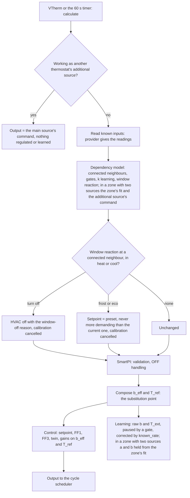
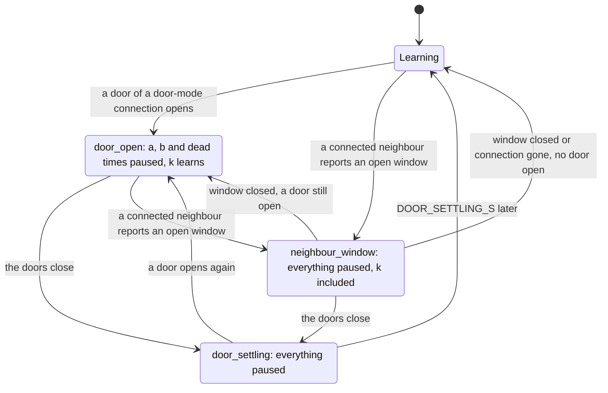
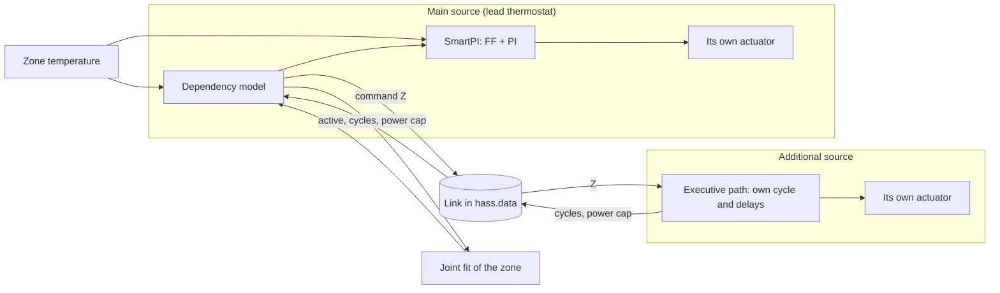
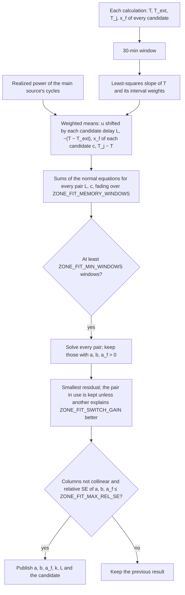
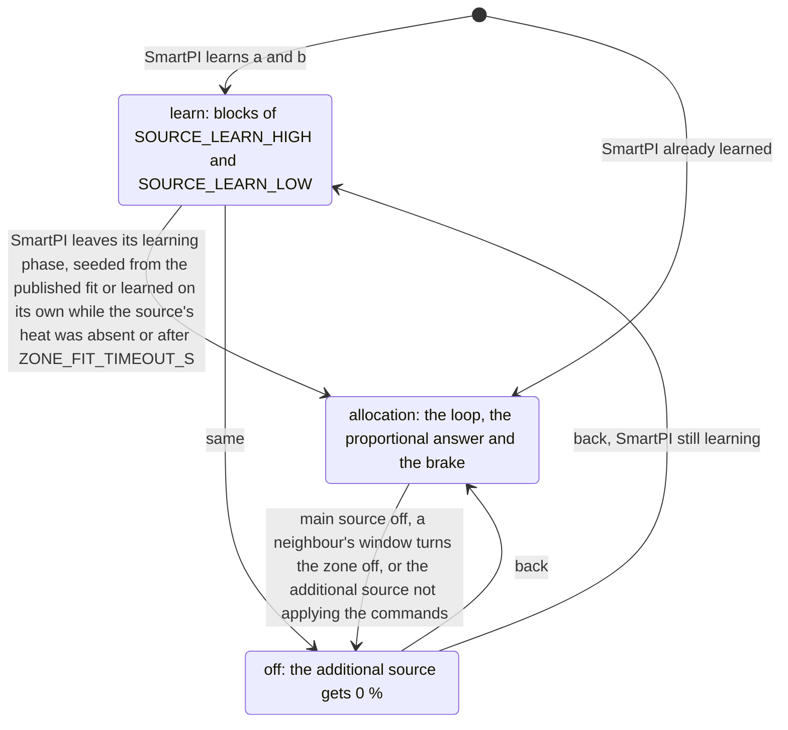
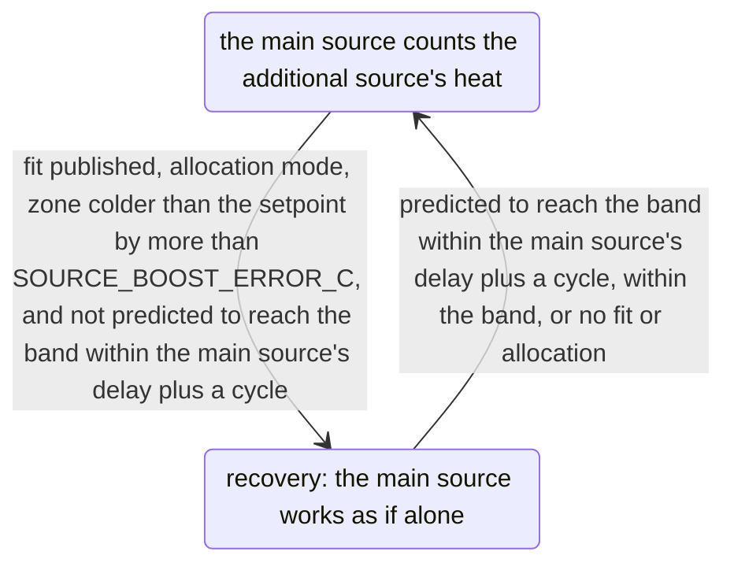
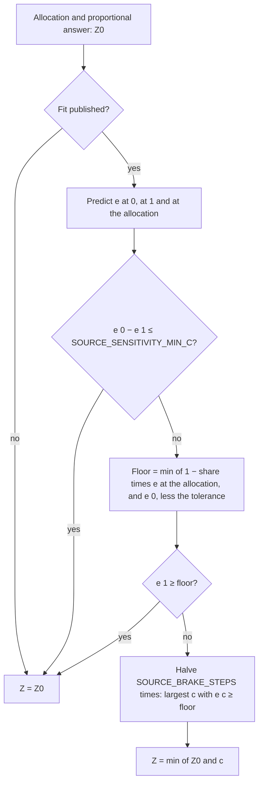
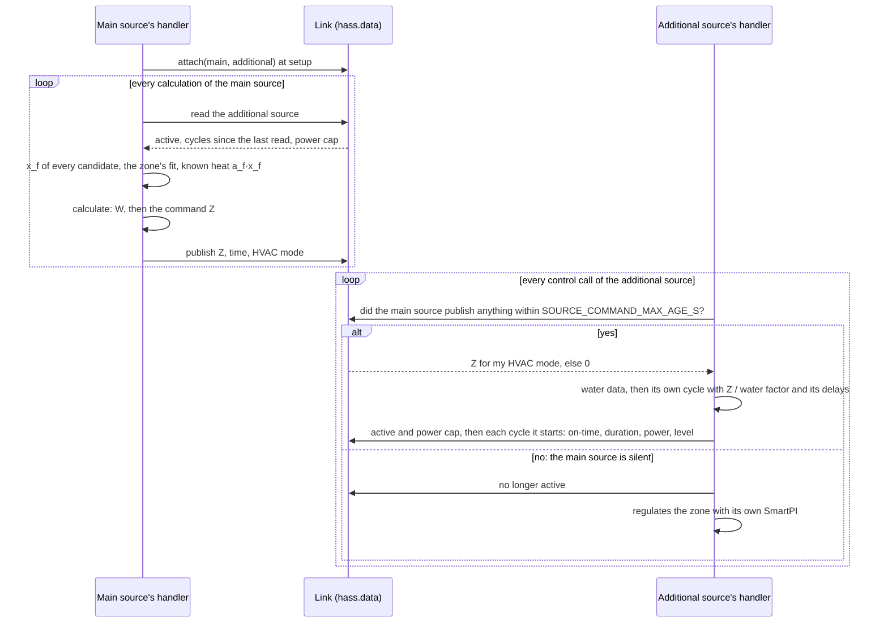
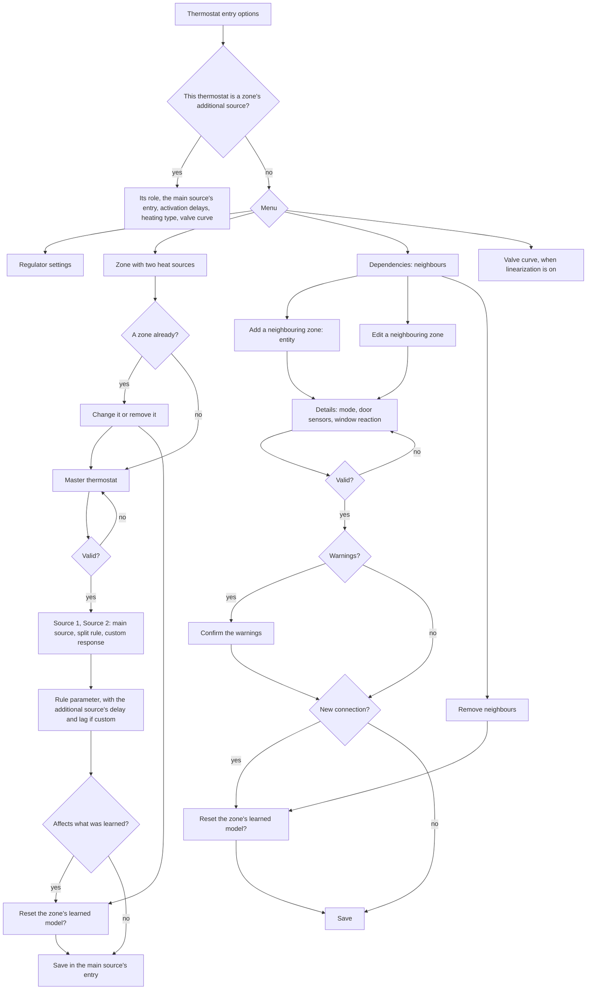

```mermaid
flowchart LR
    S[Zone temperature and setpoint] --> L[Main source's SmartPI]
    L --> W[Main source's actuator: its own command W]
    L --> D[Steady demand: feed-forward plus integral]
    D --> LIM{Main source stuck at a limit?}
    LIM -- "0 %, zone too warm" --> MIN[demand = minimum]
    LIM -- "100 %, zone too cold for longer than the source settles" --> MAX[demand = maximum]
    LIM -- no --> AV[Average of the demand]
    MIN --> AV
    MAX --> AV
    AV --> E[error = average − f of the applied Z]
    E --> I[Integrator, rate limit, holds]
    I --> P[+ proportional answer to the zone's error]
    P --> BR[Predictive brake: at most the largest Z that keeps the predicted zone at its setpoint]
    BR --> Z[Additional source's command Z]
    Z --> SRC[Additional source: own cycle and delays]
    SRC --> X[x_f through L_f and tau_f]
    X --> K[Known heat a_f·x_f in the main source's model]
    K --> L
```

# Zone dependencies and a second heat source — technical documentation

> **In development.** Neighbouring zones and the zone with two heat sources work, each with
> its options form (see the status in each section).

This document describes how SmartPI takes into account what happens around a zone: the
heat it exchanges with neighbouring zones, and a second device heating the same zone. It
covers the model, the learning, the decisions taken and the reasons for them, the
persistence, the diagnostics and the tests. The PI controller, its feed-forward and its own
learning are described in the [technical documentation](technical_doc.md).

Abbreviations: Home Assistant (HA), Versatile Thermostat (VTherm), feed-forward (FF),
least squares (LS).

## Contents

1. [Overview](#1-overview)
2. [The model with known inputs](#2-the-model-with-known-inputs)
3. [Components](#3-components)
4. [One calculation](#4-one-calculation)
5. [Neighbouring zones](#5-neighbouring-zones)
6. [A second heat source](#6-a-second-heat-source)
7. [Resetting the learned model](#7-resetting-the-learned-model)
8. [Persistent state](#8-persistent-state)
9. [Diagnostics](#9-diagnostics)
10. [Options](#10-options)
11. [Testing](#11-testing)
12. [Constants](#12-constants)

## 1. Overview

SmartPI models a zone as one thermal mass heated by its own actuator and losing heat to the
outdoors (`dT/dt = a·u − b·(T − T_ext)`). Two common situations break that picture:

- **A neighbouring zone** at another temperature exchanges heat with the zone, through an
  open door or permanently (an open-plan space). Today SmartPI absorbs that exchange into
  `b`, which then changes with the neighbour's temperature and the doors.
- **A second device** heats the same zone, for example a heated floor next to a radiator.
  Today each device runs its own SmartPI, and each sees the other one's heat as a
  disturbance.

The extension keeps SmartPI's control law and learning as they are and adds **known
inputs** to its model: heat exchanged with other temperatures, and heat added directly.
They are composed back into the two values the control law already uses, at a single
substitution point. Without any configured dependency nothing changes; a test checks bit for
bit that inactive dependencies give the same run as the substitution switched off.

| Stage | Content | Status |
|---|---|---|
| Foundation | known inputs, composition, substitution point, learning correction and gates, persistence, diagnostics, options menu | in use |
| Neighbouring zones | three connection modes, learned exchange, reaction to a neighbour's open window, options forms | in use |
| Second heat source | emitter types, the additional source's heat and time scale, the zone's joint fit, learning blocks, split rules, allocation loop and predictive brake, the executive role with water data and a fallback, the zone form from the master thermostat | in use |

## 2. The model with known inputs

### 2.1 Zone model

    dT/dt = a·u − b·(T − T_ext) + Σ_i g_i·(T_i − T) + Σ_j q_j

- `u` is the lead thermostat's applied command (0..1), `a` its effect and `b` the loss to
  the outdoors, as SmartPI learns them.
- An **exchange input** `i` couples the zone to a temperature `T_i` through a conductance
  `g_i` (1/min). A neighbour connected to the zone is one, with `g = k`, the learned
  exchange coefficient.
- A **heat input** `j` adds `q_j` (degC/min, either sign) directly. The additional source's heat
  `a_f·x_f` is one (section 6).

### 2.2 Composition

The known inputs are folded into the two values the control law already takes, its loss
coefficient and its outdoor temperature:

    b_eff = b + Σ_i g_i
    T_ref = (b·T_ext + Σ_i g_i·T_i) / b_eff + Σ_j q_j / b_eff

- The heat term is a shift of `T_ref`, bounded by `KNOWN_HEAT_MAX_SHIFT_C`, so that a weak
  loss estimate cannot amplify it. The bound must exceed the largest difference between the
  setpoint and the outdoors: in the feed-forward `b` cancels out (`b/a · q/b = q/a`), and a bound
  below the shift a floor needs in cold weather counted less floor heat than there was
  (section 6.8).
- With always-connected neighbours, whose exchanges SmartPI's `b` has absorbed, the loss term
  moves to the coefficient `b_fit` fitted without them (section 5.4) at the pace their exchanges
  enter the model:

        loss = b + w·(b_fit − b),   w = Σ_i w_i·k_i / Σ_i k_i

  where `w_i` is the share of each always-connected exchange already in the model (section 2.3).
  With `b = b_fit + Σ k_i`, `b_eff = loss + Σ w_i·k_i` stays equal to `b` while they fade in.
- Every input has a value now and may carry a trajectory over a horizon; the control law
  composes only the value now. The predictive brake of a zone with two sources predicts the
  additional source's heat itself (section 6.6).
- Without inputs, without an outdoor temperature, with a non-finite `b`, or with a composed
  loss below `KNOWN_INPUTS_B_EFF_MIN`, the composition returns `b` and `T_ext` unchanged.

### 2.3 Where the model is used

| Part of SmartPI | Uses |
|---|---|
| FF1 (`k_ff = b/a`), FF3, setpoint trajectory, thermal twin, near band, FF trim windows | `b_eff`, `T_ref` |
| Integral time of the gains | `Ti = 1 / (loss + Σ g)`, with `loss` as in section 2.2 (`1/tau` without always-connected neighbours) |
| Learning of `a`, `b` and dead times, governance, safety | raw `b` and `T_ext`; each learning window is corrected by the rate the known inputs add (`known_rate`) |

Learning on raw data keeps SmartPI's own parameters meaning what they meant before; the
correction removes the part of the measured slope that known inputs explain.

**A coefficient that becomes known enters gradually.** Before a neighbour's `k` or the
source's `a_f` is published, its effect acts on the zone as an unknown disturbance, which the
controller's integral has absorbed. Folding it into the model at once would step the
feed-forward and make the zone dip or overshoot while the integral unwinds. It therefore
enters over `KNOWN_INPUT_FADE_S`. Always-connected neighbours are different, since SmartPI's `b`
holds their exchanges: they enter together, once each of them is known, and the fitted loss
replaces SmartPI's `b` at the same pace (section 2.2), so `b_eff` does not step down and climb
back. In a zone with two sources the fit's `b`, which replaces SmartPI's at once, leaves them
out, so their `k` from the fit is in the model at once. A coefficient already known before a
restart is fully in the model at once: a neighbour's own `k`, the `k` the zone's fit of the
HVAC mode in use gives, and the source's `a_f` of either HVAC mode.

## 3. Components

All modules below are plain Python, testable without a running HA.

| Module | Responsibility |
|---|---|
| `smartpi/dependencies.py` | Configuration items (`kind`, `mode`, door sensors, window reaction), parsing, validation, learned state per item (`DependencyState`) |
| `smartpi/dependency_inputs.py` | Readings for one calculation: neighbour temperature, availability, safety mode, window state; door sensors; zone presets and temperature range |
| `smartpi/effective_model.py` | Known inputs (`ExchangeInput`, `HeatInput`, `KnownInputs`) and their composition (`compose`) |
| `smartpi/coupling_estimator.py` | Learning of the exchange coefficients `k` from measurement windows |
| `smartpi/dependency_model.py` | Inside the algorithm: readings to known inputs, learning gates, the reaction to a neighbour's window, diagnostics; for a zone with two sources also the zone's fit, the seed of SmartPI's model, the learning blocks and clock, the allocation loop, the predictive brake and the recovery boost |
| `smartpi/source_model.py` | Second source: emitter types, delay and lag, the heat `x_f` now and ahead |
| `smartpi/source_candidates.py` | Second source: the candidate time scales and the heat under each |
| `smartpi/zone_fit.py` | Second source: the zone's joint fit (losses, both sources, the main source's delay, the time scale, neighbours) |
| `smartpi/split.py` | Second source: split rules, allocation loop, recommendation by emitter type |
| `smartpi/source_settings.py` | Second source: its rule and emitters, read from the configured item |
| `smartpi/source_link.py` | Second source: the link between the main and the additional source in one Home Assistant (commands one way, cycles and the power cap the other) |
| `smartpi/water_input.py`, `repairs.py` | The water factor of each source and the reset offered when water data appear or go; see [Water input](water_input.md) |

In the existing files:

- **`algo.py`** reads the known inputs at each calculation (`_read_known_inputs`), applies a
  neighbour's window reaction, composes the effective model at the single substitution point
  (`_compose_effective_model`) and passes the learning gate and correction to the learning
  window. It also records the power each completed cycle realized. In a zone with two sources it
  starts from the zone's fit and keeps its model (`_apply_zone_fit`, section 6.5).
- **`handler.py`** registers the readings provider when dependencies are configured
  (`_read_dependencies`), resolving entities through their registry identifier, and drops the
  learned state of items removed from the configuration at startup. A main source attaches its
  additional source on the link and publishes its command after each calculation; a thermostat
  named as an additional source runs the executive path instead of its own controller, or its own
  controller while the main source is silent (section 6.7).
- **`config_flow.py`** gives the thermostat entry an options menu with the zone form, the
  dependency list and the neighbour forms; a thermostat working as an additional source gets
  its role form instead; the import step creates the entry of a zone member that has none
  (section 10).
- **`__init__.py`** reloads the zone's main source when its additional source's entry is
  saved, and reloads only the target thermostat when the zone form creates an entry.

## 4. One calculation



- **A failing provider** leaves the learned model unchanged and the calculation goes on
  without known inputs: a dependency problem never stops regulation.
- **An edge of the learning gate** discards the open learning window and the dead-time
  observation in progress, which would mix two regimes. The dead-time markers of the control
  law are left untouched.
- **A change of the active inputs** (their signature) invalidates the open FF trim windows,
  whose evidence assumed the previous model.

## 5. Neighbouring zones

### 5.1 Configuration

A neighbour is a VTherm climate entity or a temperature sensor, stored by its registry
identifier, so that renaming an entity keeps the link.

| Mode | The connection is active | Typical use |
|---|---|---|
| `none` | never: the neighbour stays on the list but is ignored; switching an existing neighbour to `none`, or back, starts its `k` again (section 7) | trying without a neighbour |
| `door` | while any of the door sensors is open (unknown or unavailable counts as closed) | a room behind a door |
| `always` | always | an open-plan space |

- Door sensors are binary sensors of class `door`, `opening` or `garage_door`. Window
  sensors are refused: an outdoor window stays in VTherm's window detection.
- One door sensor may serve several entries, but not two neighbours of the same zone.
- For a VTherm neighbour, the **window reaction** says what to do while the connection is
  active and the neighbour reports an open window: `nothing`, `turn_off`, `frost`, `eco`.
- A connection is ignored while the neighbour is unavailable, in safety mode, or without a
  finite temperature.

### 5.2 Learning gates

The gate decides whether SmartPI's own learning (`a`, `b`, dead times) may run.



- Priority when several apply: `neighbour_window` over `door_open` over `source_heat` over
  `door_settling`. The `source_heat` gate belongs to the second source (section 6.5).
- An always-connected neighbour does not gate learning: SmartPI's `b` absorbs its exchange,
  and the joint fit (section 5.4) separates it.
- `k` learns only when SmartPI itself could learn: learning enabled and not paused, the
  zone heating or cooling, no power shedding, guard cut or calibration, SmartPI out of its
  learning phase, a reliable dead time, no neighbour window, and not within
  `DOOR_SETTLING_S` after any door change.

### 5.3 Measurement windows

`k` is learned from windows of fixed length `COUPLING_WINDOW_S` (30 min), longer than
SmartPI's own because a 0.1 degC sensor needs time to show a slope.


- **Slope.** A plain least-squares slope: a steady temperature carries information too,
  since the power then balances the losses.
- **Consistent weights.** The least-squares slope is a weighted mean of the temperature
  derivative, heavier in the middle of the window. The power, the temperature differences
  and the known heat are averaged with the same weights, so the window model holds when the
  temperature curves, for example with the ripple of on/off cycles. With uniform averages
  instead, a steady ripple biased `k` by about 6 % in the tests.
- **Realized power.** The power acting on the zone is the applied power shifted by the dead time. It
  is the power each completed cycle realized, as VTherm reports it, delivered from the start of the
  cycle by a switched actuator, at its water factor with water data (section 6.2); the commanded
  power covers only the cycle still running. VTherm often cuts a cycle, which starts with its
  on-time, so the commanded average was lower than what the zone received.
- A window counts only when some `|T − T_j| ≥ COUPLING_K_MIN_DT` and it holds at least
  `MIN_WINDOW_SAMPLES` calculations. It starts again whenever the set of connected neighbours
  or of the source's heat columns changes, or learning is not allowed.

### 5.4 Learning the exchange

**One door.** `k = r / x`, with `x = −(T − T_j)` averaged over the window. Values outside
`(0, COUPLING_K_MAX]` and outliers of the history (beyond `OUTLIER_MAD_FACTOR` scaled MADs
once it holds `OUTLIER_MIN_HISTORY` values) are rejected; `k` is published as the
median of the history once it holds `COUPLING_MIN_SAMPLES` values that agree (MAD over
median at most `COUPLING_MAX_DISPERSION`). SmartPI's `b` is clean here, since it learns only
while the doors are closed.

**Several doors open together.** Windows feed a buffer of `COUPLING_LS_WINDOW` rows solved by
least squares with `k ≥ 0` once it holds `COUPLING_MIN_SAMPLES` rows; the solution is
published directly, without a history. When the regressors cannot be told apart (condition number of the
normalized Gram matrix above `COUPLING_LS_COND_MAX`), the connections get one common
coefficient, which keeps their total exchange, and are flagged `indistinguishable`.

**Always connected.** SmartPI's `b` has absorbed the exchange, so `b` is fitted together with
`k`:

    slope − a·u − q = b·x_ext + Σ_j k_j·x_j,   x_ext = −(T − T_ext)

Written as `r = (b + Σ k_j)·x_ext + Σ k_j·(T_j − T_ext)`, each `k` is told apart only by the
neighbour's own temperature moving independently of the outdoor one and of the zone. A fit of
the buffer (`COUPLING_JOINT_WINDOW` windows) counts only when:

- the buffer holds at least `COUPLING_JOINT_MIN_ROWS` windows — a few hours of rows share the
  same errors of SmartPI's `a` and dead time and would agree on a wrong `k`;
- the centered columns `x_ext` and `T_j − T_ext` each vary by at least `COUPLING_K_MIN_DT`
  and are not collinear (condition number at most `COUPLING_LS_COND_MAX`). A constant offset
  between them alone would let a constant error, such as unmodelled gains, decide the split;
- every coefficient is positive with a standard error of at most `COUPLING_JOINT_MAX_REL_SE`
  of its value. Unlike a condition number, the standard error falls as windows accumulate.

A separable fit adds `k` and its `b` to a history at most every `COUPLING_JOINT_FIT_SPACING`
new windows, so that agreeing fits do not merely repeat the same data. The history is
published like a door's. Once every connected always-neighbour has its `k`, the control law
moves its loss term to the fitted `b` as the exchanges fade in (section 2.2), including in the
integral time. Until then none of them enters and the zone runs as without them.

### 5.5 A window at a connected neighbour

| Reaction | Effect while the connection is active and the window open |
|---|---|
| `nothing` | learning pauses, control unchanged |
| `turn_off` | the zone goes off through SmartPI's window-off path, with its protected resume |
| `frost`, `eco` | the zone's preset for the current HVAC mode, never more demanding than the current setpoint (heating: lower of the two, cooling: higher); in cooling only `eco` has a preset (`eco_cool_temp`), so `frost` turns the zone off |

- A preset that is not configured (VTherm reports 0) or outside the thermostat's range turns
  the zone off.
- Several neighbours with open windows: the most protective reaction wins
  (`turn_off` > `frost` > `eco`).
- A calibration in progress is cancelled; it ends as cancelled instead of stalling.
- The reaction applies only while the zone heats or cools.
- The reaction applies to an additional source as well (section 6.6): `turn_off` gives it 0 %,
  `frost` and `eco` make its allocation loop follow the same, less demanding setpoint.

### 5.6 Results and limits (simulation)

- Fed with the true `a` and dead time, the estimator reproduces `k` within 2 %.
- The remaining error comes from SmartPI's learned model, since `k` is a small residual of a
  large balance:
  - door, 0.01 degC sensor: `k` within 1 %, `a` and `b` stay clean;
  - door, 0.1 degC sensor: `k` can be tens of percent off when SmartPI's `a` is a few
    percent off;
  - always connected, 0.01 degC sensor, neighbour temperature steps: `k` +5.5 %, fitted `b`
    −1 %, published about a day after the first step and never before;
  - always connected, 0.1 degC sensor: nothing is published, the neighbour is flagged
    `indistinguishable` and the zone runs as today.
- Separating `b` from an always-connected neighbour needs the neighbour's temperature to move
  on its own.
- A zone where SmartPI never reaches a reliable time constant gets no feed-forward benefit,
  because SmartPI keeps its feed-forward off in that case.

## 6. A second heat source

### 6.1 Roles and the main decision

A zone may have two heat sources, each a VTherm with SmartPI, for example a radiator and a heated
floor. The **main source** is the zone thermostat whose SmartPI regulates the zone; in the code and
the link it is the **lead**. It names the other thermostat as its **additional source** (in the code,
the **source**), which then works for it: one additional source per zone, no chains.

The zone is set up from its **master thermostat** (section 10): a Versatile Thermostat over climate
whose two devices are the two SmartPI thermostats. A Versatile Thermostat gives one power to all its
devices and has one type of device, so two sources with different powers are always two
thermostats; the master holds the zone's setpoint, presets, schedule, mode and windows and passes
the same setpoint to both. It has no power algorithm of its own: the zone's SmartPI runs in its
devices.

**Decision: the main source's command stays exactly what SmartPI computes.** The additional source is
moved by a slow allocation loop towards the split the rule chooses, and its heat reaches the main
source's model as a known input. The alternative, mapping one demand to two commands with fixed curves,
was rejected:

- the main source would receive another command than its controller computed. SmartPI would read it
  as a limited actuator: its anti-windup would drain the integral every cycle, the command ownership
  and FF trim would reject their windows, and the learning phase would see the wrong power;
- the additional source's heat would be counted twice, once in the map and once as a known input;
- with a slow source, half of the main source's command would show its effect hours later, which
  makes the zone overshoot and swing.

| | Fixed maps (rejected) | Allocation loop (chosen) |
|---|---|---|
| SmartPI's controller, learning and safeguards | must be reworked | unchanged |
| Slow source (heated floor) | swings | stable by design |
| Reaction of the additional source | immediate | follows the rule over minutes (fast source) to hours (floor), plus a proportional answer to the zone's error |
| Split | exact at every instant | exact in steady state |

**Decision: one model of the zone for both sources.** The zone's model is learned once, with both
sources at work, by a joint fit of the zone (section 6.4): the losses `b`, the main source's `a` and
delay, the additional source's `a_f` and time scale, and the neighbours' `k`. SmartPI starts from that
model and keeps it. Learning each source on its own, one after the other, was the first design and was
dropped (section 6.8): SmartPI's own windows, at 0.1 degC, measure a slow cooling about half as fast as
it is, and every value learned on top of SmartPI's model inherited its errors.



### 6.2 Emitter types and the additional source's heat

The additional source's applied command `u_f` reaches the zone after a transport delay `L_f` and a
first-order lag `tau_f`, the thermal mass of its emitter:

    x_f(t + dt) = u_d + (x_f(t) − u_d)·exp(−dt / tau_f),   u_d = u_f(t − L_f)

`x_f` is in 0..1 of the source's full power and its heat is `a_f·x_f`. The commands already sent make
`x_f` known now and predictable over a horizon: they keep arriving for `L_f`, and the last one is
assumed to hold after that.

- **Cycles.** The source reports each cycle it starts. A switched actuator heats first, at its
  **level** for its on-time; a valve holds its power for the whole cycle. The level is 1 without
  water data; with them it is the source's water factor (its power at the reference water, see the
  [water input](water_input.md)), since a floor whose water is at 30 degC gives about 37 % of its
  power at 45 degC while switched on (room at 20 degC). The main source's own cycles are recorded
  the same way.
- **Each device's type is the heating type of its own SmartPI entry**; the zone form can set a
  custom delay and lag for the additional source instead. The type gives the starting values below;
  at run time only the additional source's response is used, as the start of its candidates. The
  main source's delay comes from the zone's fit (section 6.4), and its type serves the form's
  recommendation and the diagnostics (`lead_emitter`).

| Emitter type | `L_f` (min) | `tau_f` (min) |
|---|---|---|
| `electric_fast` (convector, fan coil, air conditioner) | 2 | 3 |
| `radiator` (water) | 5 | 20 |
| `floor_electric` (heating mat) | 10 | 90 |
| `floor_water` | 30 | 180 |
| `custom` | user | user |

- **The real time scale is learned.** The delay and the lag of a floor depend on the screed, the pipes
  and the water. Within the 30-min measurement windows of the zone's fit the delay and the lag cannot
  be told apart, but their common time scale can. The candidates stretch the type's response by
  `SOURCE_SCALE_MULTIPLIERS` (0.4 to 2.5 times); a source without delay and lag gets lags of
  `SOURCE_FAST_TAU_MIN` instead. Each candidate rebuilds `x_f` from the same cycles, and the zone's fit
  chooses the one that explains the zone best (section 6.4), apart for heating and cooling. The
  candidate in use gives `x_f`, its prediction, the allocation loop's speed and the brake's horizon.

### 6.3 Split rules

`W` is the main source's command, `Z` the additional source's. Each rule gives the main source's
target average `f(Z)`; `together` and `source_first` are curves of steady states from `(0, 0)` to
`(100 %, 100 %)`, and `lead_band` keeps `W` at the band:

| Rule | Curve | Parameter (default) | Examples |
|---|---|---|---|
| `together` | `Z = p·W`; once one is at 100 %, the other rises alone | `p` (100 %), 10 to 1000 % | `p` = 200 %: W 20 %, Z 40 % |
| `source_first` | the additional source alone up to θ; above it both rise and reach 100 % together: `W = 100 %·(Z − θ)/(100 % − θ)` | θ (50 %), 0 to 100 % | θ = 50 %: Z 30/W 0, Z 70/W 40, both 100; θ = 100 % strictly one after the other; θ = 0 like `together` at 100 % |
| `lead_band` | the additional source settles so that the main source's average stays in the band | band (20 %), 0 to 100 % | the main source always keeps a margin for quick corrections |

The defaults overlap: both devices work together over part of the range.

**Recommendation by emitter type** (the form's default, with its reason):

| Main + additional source | Default | Reason |
|---|---|---|
| radiator + heated floor | `lead_band`, 20 % | the floor carries the base load; the radiator adds and corrects quickly (sun, cooking, an open door) |
| devices of similar speed | `together`, 100 % | a common percentage |
| an additional source to use first (e.g. cheaper energy) | `source_first`, chosen by the user | priority of the additional source |
| a main source clearly slower than the additional one | warning | the quick corrections belong to the faster device: swap the roles |

`source_first` is not the default next to a floor: with a low demand the radiator stands at 0 % and the
floor alone regulates. The predictive brake (section 6.6) keeps it from overheating, but a floor alone
answers a gain (sun, cooking) hours late.

### 6.4 The zone's joint fit

The zone follows

    dT/dt = a·u(t − L) − b·(T − T_ext) + a_f·x_f + Σ_j k_j·(T_j − T)

with `u` the main source's realized power, `L` its delay, `x_f` the additional source's heat and `T_j`
the connected neighbours' temperatures (zero while a door is closed). With water data both powers are
powers at the reference water.



- **Windows.** Each measurement window of `COUPLING_WINDOW_S` (30 min) gives one row, built like the
  neighbours' windows (section 5.3): the plain least-squares slope of `T` and, with the same weights,
  the means of the regressors. A window starts again after a calibration of the main source's dead
  times, a door change or a neighbour's open window, while the additional source does not apply the
  main one's commands, while the zone is off, without a zone or outdoor temperature, and after a gap
  between calculations longer than `ZONE_FIT_MAX_GAP_S`: no window spans a pause.
- **The main source's delay from a grid.** The power column is built for each delay of
  `ZONE_FIT_LEAD_DELAYS_MIN` (0 to 60 min). SmartPI's own dead time is not used: with slow rises and a
  0.1 degC sensor it comes out two to six times too long, which shifted the power in the windows and
  kept the fit from publishing (21 to 62 min instead of 10 in the trials; section 6.8).
- **The additional source's time scale from its candidates** (section 6.2). Every pair of a delay and
  a candidate is solved by least squares; the pair with the smallest residual wins.
- **Nothing is taken from SmartPI's model**, so the fit works while SmartPI still learns, and
  SmartPI's errors do not leak in.
- **Publication.** At least `ZONE_FIT_MIN_WINDOWS` windows (counted with the fading, so at the
  earliest 39 windows, 19.5 h), a
  well-conditioned matrix
  (condition number of the normalized matrix at most `10·COUPLING_LS_COND_MAX`), and a relative
  standard error of `a`, `b` and `a_f` of at most `ZONE_FIT_MAX_REL_SE`. The sums fade over
  `ZONE_FIT_MEMORY_WINDOWS` (6 days), so the fit follows slow changes.
- **Heating and cooling apart.** A fit is kept per HVAC mode. In cooling both sources' columns change
  sign, so the fitted strengths stay positive; a cooling fit is never used in heating and the reverse.
- **Neighbours.** A neighbour connected to the zone gets a column; one never connected is left out.
  Once the fit is published, its `k` replaces the one learned in the neighbour's own windows
  (section 5.4) — in the control law, the gains and the brake — when it lies in
  `(0, COUPLING_K_MAX]` with a relative standard error of at most `ZONE_FIT_MAX_REL_SE`: a door
  seldom open is fitted from few windows. The neighbour's own windows still treat the additional
  source's heat as an unknown column, so that it does not leak into their `k`. A change of the
  configured neighbours restarts the fit's sums; the published result is kept until a new one
  comes.

### 6.5 Learning



- **Both sources work from the first day.** While SmartPI learns, the additional source works in
  blocks alternating between `SOURCE_LEARN_HIGH` and `SOURCE_LEARN_LOW`, each
  `max(SOURCE_LEARN_BLOCK_MIN_S, 2 × L_f + 2 × tau_f)` long, so that the fit sees its heat change while
  the main source regulates. A zone colder than its setpoint by `SOURCE_LEARN_COLD_C` gets it at full
  power, a zone warmer by `SOURCE_LEARN_WARM_C` gets none.
- **The learning clock.** Each HVAC mode has its own clock: the time its fit has been awaited with
  the additional source at work. It counts only while the source applies the main one's commands and
  the mode's fit is not published, and not across gaps between calculations longer than
  `ZONE_FIT_MAX_GAP_S`. The blocks follow it, and so does the timeout below.
- **A main source that has already learned on its own** (the additional source is added later) gets
  no blocks: the allocation loop runs at once, without the brake until the fit is published, and the
  `source_heat` gate pauses SmartPI's learning until the fit comes or the mode's clock reaches the
  timeout. In the simulations the allocation and the daily swing were enough for the fit to publish
  after 19.5 h. After an HVAC mode change SmartPI learns again: it is seeded from that mode's fit if
  it is published, otherwise the blocks run on that mode's clock.
- **SmartPI waits for the fit.** While the additional source's heat is present and the fit is not
  published, the `source_heat` gate pauses SmartPI's own learning of `a`, `b` and dead times: it would
  take the floor's heat for its own. The gate has a hysteresis: on once `x_f` reaches `SOURCE_X_MIN`,
  off when `x_f` falls below `SOURCE_X_OFF` or once the fit is published. While it is off SmartPI
  learns, also in the low blocks: with a fast additional source (a radiator) SmartPI may end its
  learning phase before the fit comes. Each edge of a gate discards
  SmartPI's open learning window, and a source running near a single threshold would discard them over
  and over.
- **SmartPI starts from the fit.** Whenever SmartPI learns while the current mode's fit is published
  — the fit has just come, or a change of HVAC mode made SmartPI learn again — SmartPI's `a` and `b`
  and the histories that end its learning phase are set from it. From then on SmartPI keeps the fit's
  `a` and `b`, signed for the HVAC mode, at every calculation, and again right after its own learning
  step, so that a window of its own closing in a calculation does not move them for one cycle.
- **The fit's windows stand for SmartPI's own.** SmartPI judges its model by its own counts of learned
  samples and the spread of its own `b`: its feed-forward warms up with `learn_ok_count`, its time
  constant needs agreeing values of `b`, its near band follows the model after ten `a` samples. With the
  fit in use these see the fit: its `b` gives the time constant, and the counts are at least what the
  checks ask for (`AB_CONFIDENCE_MIN_SAMPLES_A`, `AB_CONFIDENCE_MIN_SAMPLES_B`,
  `ZONE_FIT_MODEL_SAMPLES_A`, the feed-forward's warm-up count). Without that, SmartPI, which rarely
  learns at a steady setpoint, kept its feed-forward at about a sixth of its value, the integral carried
  the load and the zone settled off its setpoint (section 6.8).
- **A fit that does not come.** If the mode's clock reaches `ZONE_FIT_TIMEOUT_S` (48 h) without a
  published fit, the `source_heat` gate opens for good in that mode and SmartPI learns on its own, as
  today; the diagnostics show `timed_out`. The clocks survive a restart. The fit keeps collecting
  windows: published later, it still takes over, and SmartPI then keeps the fit's `a` and `b` (and
  its counts) as above. The same holds for a main source that had learned before the additional
  source was added.
- **Then a known input.** With the fit published, the additional source's heat `a_f·x_f`, now and
  predicted over the horizon, is a known input of the main source, fading in as described in
  section 2.3.

### 6.6 Allocation loop and predictive brake



- **What the loop follows.** The main source's **steady** demand: its feed-forward plus its integral,
  before its 0..100 % limits. The proportional part answers the current error, for example a setpoint
  change, and would make the additional source chase transients.
- **On the applied command.** The loop's error compares the main source's average with the rule's
  curve at the command the additional source actually got, after the brake, not at the loop's own
  value; while the brake holds the source below the loop, the loop does not wind further up.
- **Pauses.** Whenever the loop does not run — the zone or the additional source off, a calibration,
  SmartPI learning, no steady demand — it keeps its command and average, and does not integrate over
  the pause once it runs again. A change between heating and cooling starts it again from 0, since
  each mode has its own split. Out of the learning blocks it starts from the heat the source gives at
  that moment (`x_f`), so the heat does not step.
- **A main source stuck at a limit.** At 0 % with the zone warmer than its setpoint by
  `SPLIT_LIMIT_ERROR_C`, the loop gets the lowest demand. At the most it can give — 100 % of VTherm's
  maximum on-percent, of the valve curve's top, of its water — with the zone that much colder for
  longer than the additional source takes to settle, it gets the highest demand: the source rises as a
  reserve. For a slow source (a floor), a morning setpoint rise is shorter than that and does not
  move the loop.
- **Holds.** The loop does not move the source up while the zone is warmer than its setpoint by more
  than `SPLIT_HOLD_ERROR_C`, nor down while it is that much colder.
- **Proportional answer.** Besides the allocation, the additional source answers the zone's error with
  `SPLIT_ERROR_GAIN` command per degree, divided by the fitted `a_f/a` when the additional source is
  the stronger one (1 otherwise and before the fit). The answer vanishes with the error, so the rule
  still sets the split.
- **Speed.** An error held for `SPLIT_SETTLE_FACTOR` settle times (`L_f + tau_f`), never less than
  `SPLIT_MIN_TIME_S`, moves the source by 100 %; the time grows in proportion for a source stronger
  than the main one. Both follow the candidate time scale in use and the fitted `a_f/a`. The demand
  is averaged over `SPLIT_AVERAGE_FRACTION` of that time, never less than `SPLIT_AVERAGE_MIN_S`. The
  loop never covers the range faster than the source settles, nor faster than
  `SPLIT_MIN_FULL_RANGE_S`; the proportional answer and the brake act at once.
- **A neighbour's open window.** The zone's reaction (section 5.5) reaches the additional source: with
  `turn_off` it gets 0 %; with `frost` or `eco` the loop, the learning blocks, the proportional answer
  and the brake work against the preset's setpoint instead of the zone's current one, never a more
  demanding one.
- **Calibration.** While SmartPI calibrates the main source's dead times, it drives it to 100 % and 0 %
  on purpose. The additional source keeps its command and the loop pauses.

**Recovery.** After a night setback the zone needs more than its steady load. The main source's
feed-forward counts the additional source's known heat: as a floor at full power warms up, the main
source hands its share over while the zone is still a degree or two cold, and only its proportional
part drives the rest of the recovery, which SmartPI keeps gentle (its integral is held after a
setpoint change). Two independent SmartPI recover faster because each counts the whole load. So
while the zone is colder than its setpoint by more than `SOURCE_BOOST_ERROR_C`, the main source's
known inputs leave the additional source's heat out — in the feed-forward, `T_ref` and the learning
correction alike — and the main source works as if alone (`recovery_boost` in the diagnostics). The
boost needs a published fit and the allocation mode; without them it is off. The boost ends early,
once the fitted model says the zone reaches that band within the main source's fitted delay plus one
of its cycles at the present powers: the heat the main source has already sent then lands the zone
instead of overshooting it. Without the early end, fast rooms overshot by up to 0.66 degC
(section 6.8).



**Predictive brake.** A floor answers hours late: the heat already on its way keeps coming after the
zone has reached its setpoint. The brake caps the command at what the fitted model says the zone can
take:

    e(c) = setpoint − T(now + H),   H = max(L_f + tau_f, SOURCE_PREDICTION_MIN_S)

`T` is integrated in steps of `SOURCE_PREDICTION_STEP_S` with the fitted `a`, `b`, `a_f` and `k`, the
outdoor and neighbour temperatures held, and the additional source at command `c` (at most its power
cap, section 6.7) after the commands already on their way. The main source starts at its steady
demand and **hands over its load**: its feed-forward takes off `a_f/a` per unit of `x_f` that the
additional source's known heat adds (as far as that heat is already in its control law), down to 0 %,
and takes it back up to the most it can give (its water factor and maximum on-percent). During a
recovery its demand holds none of the source's heat, and the prediction lets it count all of it again
from now on: the recovery ends before the source's heat arrives, so the brake does not take the boost
for good.

- The cap is the largest `c` with `e(c) ≥ (1 − SPLIT_PREDICTED_SHARE)·e(allocation)` — with the share
  at 1, the predicted zone at its setpoint. `e` falls as `c` rises, flat while the main source still
  hands over its load and steeper once it is down to 0, so the cap is found by `SOURCE_BRAKE_STEPS`
  halvings.
- A zone too warm whatever the additional source does — the main source's own heat — only asks the
  source not to add to it: the cap is then the largest `c` with `e(c) ≥ e(0)`.
- Both conditions have a tolerance of `SOURCE_SENSITIVITY_MIN_C`. A source that moves the predicted zone
  by less than that is not braked, and there is no brake without a published fit.



### 6.7 Executive path



- **The link** lives in `hass.data`, keyed by the thermostats' unique ids. An additional source follows
  one main source only; a second one naming it gets a warning and no source.
- **The command** is applied with the additional source's own cycle and delays. It is 0 when the
  command was given for another HVAC mode (the main source is off, for example), the additional
  source's own thermostat is off, or its own load is shed by the power manager; its own window
  detection and safety still act as usual. Each thermostat sheds its own load: a main source that is
  shed still gives a command.
- **A silent main source.** When the main source has published nothing at all, for any HVAC mode, for
  `SOURCE_COMMAND_MAX_AGE_S` — its integration stopped or it is not ready — the
  additional source regulates the zone with its own SmartPI and its own model, with a warning in the
  log, until the commands come back. Meanwhile it still reports its cycles, so the main source knows
  the heat on its way when it is back. A main source that is switched off (by the user or by its
  window detection) publishes its 0 every `SMARTPI_RECALC_INTERVAL_SEC`, since VTherm may call it only
  every `cycle_min`, and is not silent. The time counts from the attachment until the first command,
  so a main source that has just started is not silent either. Without this the zone fell from 20 to
  16.2 degC in 12 h after a failure of the main source; with it, it stayed within 19.4 to 20.6 degC.
  A main source removed from Home Assistant (or reloaded) detaches the link at once: the additional
  source then regulates on its own right away, with an information in the log, until it is attached
  again.
- **Water.** The main source's command is power at the reference water. The additional source reads
  its own water data at each control call and gives its emitter `power / factor` (at most 1), as its
  own SmartPI would. It publishes its **power cap**, the most power a full command gives now: its water
  factor, at least `WATER_NO_HEAT`, 1 without water data. The main source's brake predicts with it.
- **The main source gives nothing when it cannot decide.** When its dependency inputs cannot be read
  at a calculation, it publishes 0 rather than its last command.
- **Is the additional source there?** At each control call the additional source tells the link that
  it applies the commands. The main source counts it as active, and its heat as present, only while
  that is fresher than `SOURCE_COMMAND_MAX_AGE_S`. A source stopped without a word stops counting
  after that time, and a removed one at once: its heat leaves the model at once, and its commands
  count as 0 from then on.
- **Cycles.** The additional source reports each cycle it starts (section 6.2); a cycle cut short is
  replaced by the next one. A valve's new opening is reported as it comes.
- **The additional source's own SmartPI stands still.** Versatile Thermostat keeps calling its
  algorithm on each measurement, and recalculates a valve straight from its output between control
  calls. While the role lasts, each of these calculations returns the main source's command at once:
  nothing is regulated, nothing is learned, and the learned model stays as it was when the role began.
  Its state is saved as usual, and SmartPI's services act on that real state. When the role ends, its
  SmartPI starts a fresh cycle from its own model.
- **Diagnostics of the additional source.** Its `dependencies` block shows only its role, the main
  source and the command it applies (section 9).

### 6.8 Results and limits (simulation)

The suite `tests/test_smartpi_sim_zone_set.py` (run with `SMARTPI_SIM_LOCAL=1`) compares the zone with
its two sources against today's setup, two SmartPI regulating the zone independently. A radiator is
the main source and a water floor (30 min delay, 180 min lag, `a_f = a`) the additional one, rule
`lead_band` at 20 %, 0.1 degC sensors, outdoor 3 degC (mild) or −8 degC (cold) with a daily swing of
±3 degC. Day 1 starts 1 degC below the setpoint; the steady error is the mean over days 3–4; then
three nights at 17 degC (6, 8 and 10 h).

**Twelve rooms** (`b` 0.0005 to 0.002 /min, `a` 0.015 to 0.06 degC/min):

| Measure | Zone with two sources | Two independent SmartPI |
|---|---|---|
| Steady error, mean of the 12 rooms | 0.030 degC | 0.065 degC |
| Steady error, range | 0.018–0.052 degC | 0.032–0.113 degC |
| Overshoot after the night, worst room / mean | 0.30 / 0.13 degC | 0.53 / 0.40 degC |
| Time to reach 0.2 degC below the setpoint after the night, mean | 2.94 h | 2.86 h |
| Same, slowest room (`b` 0.0005, `a` 0.015, cold) | 4.8 h | 4.1 h |
| Day 1 error, mean | 0.43 degC | 0.33 degC |
| Fit published | after 19.5 h in every room | — |
| Fitted `a`, `b`, `a_f` against the truth | 0.99–1.03, one `a_f` 1.10 | SmartPI's own, one thermostat: `a` 0.55–1.34, `b` 0.53–1.16 |
| Main source's delay | 10 min, the truth, in every room | — |

**Installations** (room `b` 0.001, `a` 0.03, mild):

| Case | Zone | Independent | Fit |
|---|---|---|---|
| floor behind a valve | 0.020 degC | 0.050 degC | 1.03/1.02/1.03 |
| slab warming through its depth (two lags in series) | 0.035 degC | 0.056 degC | `a` 0.95, `b` 1.06, `a_f` 1.18 |
| water on heating curves, Smart Boiler's data (recovery 6.7 h against 5.9 h) | 0.053 degC | 0.094 degC | 0.99/0.97/0.94 |
| two zones, door open 6–23 h | 0.034 / 0.029 degC | 0.072 / 0.055 degC | `k` 0.89 / 0.94 |
| two zones, always open | 0.021 / 0.018 degC | 0.055 / 0.042 degC | `k` 1.04 / 0.96 |

Scenarios of `tests/test_smartpi_sim_second_source.py`: a second radiator as the additional source
(Z4) 0.037 degC against 0.053; cooling with two sources 0.024 degC; the curves of `source_first` and
`together` reached.

**Decisions taken on these results:**

- **Learning blocks 100 % / 0 %.** Blocks of 70 % / 30 % make day 1 milder (mean 0.39 against
  0.43 degC) for practically the same steady error (0.030 against 0.029 degC in that comparison, run
  before the recovery boost), but the smaller contrast leaves the
  fit further off even after a week: one room 8 % off (`a_f` 0.92) and one `a_f` at 1.12, against
  every value within 3 % and one `a_f` at 1.10. The fit gives SmartPI its model for good; day 1
  happens once.
- **Recovery with the main source working as if alone** (section 6.6). Without it the morning
  recovery took 3.55 h on average against 2.86 h, 8.9 h against 4.1 h in the slowest room and 12.4 h
  against 5.9 h with water. Tried on the way:
  - leaving out only the source's heat above its allocation: 3.21 h on average, 6.1 h in the slowest
    room, almost nothing with water, where the floor's heat stays below its allocation;
  - leaving out all of it with the brake taking the boost for good: the brake cut the floor, 3.35 h;
  - leaving out all of it until 0.2 degC below the setpoint: 2.92 h, but up to 0.66 degC of overshoot
    in fast rooms from the heat the radiator had already sent; hence the early end;
  - a smooth fade between 0.5 and 0.1 degC instead of a threshold: no faster, and a zone on water
    settled 0.15 degC low.
- **What did not work, and why the design is what it is:**
  - *Learning the additional source on top of SmartPI's model* (the first design): `a_f` came out
    0.61–1.64 times the truth with 0.1 degC sensors, or was never published.
  - *SmartPI's dead time in the fit*: two to six times too long with slow rises, so 2 of 12 rooms never
    published and SmartPI waited 57 h for the fit in another (that trial predates the 48 h timeout).
    The delay grid finds the truth.
  - *The brake with the main source held at its demand*: the main source never handed its load over, so
    the split stayed where it was when the loop started (rule `source_first`: main source at 21 % where
    the curve asks 0 %).
  - *The handover with a straight-line cap*: with `e` flat over the handover the cap fell to 0 and the
    floor switched between 0 and 100 %.
  - *Cutting the source whenever the zone is predicted too warm*: a zone warm from the main source's own
    heat lost its additional source (two radiators: 0.072 against 0.053 degC). The brake now only keeps
    the source from adding to it.
  - *An allocation loop integrating over pauses*: after hours off or a calibration its first step
    covered the whole pause and jumped to 0 or 100 %; it now pauses.
  - *SmartPI's own reliability counts after the fit*: the feed-forward stayed at a sixth of its value
    (5 of 30 learned samples) and the integral, frozen in the deadband, carried the load. With this and
    the brake's fixes above, the base room's steady error went from 0.058 to 0.022 degC.
  - *The bound of the known heat's shift at 15 degC*: in cold weather a floor carrying most of the load
    shifts `T_ref` by more, the feed-forward counted less floor heat than there was and the zone settled
    0.07 degC warm. The bound is now `KNOWN_HEAT_MAX_SHIFT_C` (section 2.2).
  - *Switched cycles at full power with water*: a floor switched on gives its water factor, not 1; the
    fit took `a_f` as 0.30 of the truth.
  - *The neighbours' own `k` in a zone with two sources*: behind a door it was never published, the
    zone missed the exchange and settled 0.14 degC low while the door was open (0.125 against
    0.055 degC); the fit's `k` fixed it.

**Limits:**

- **Morning recovery after a night setback** is as fast as with two independent SmartPI on average,
  faster in 4 of 12 rooms and up to 0.9 h slower in the others: 4.8 h against 4.1 h in the slowest
  room, 6.0 h against 5.1 h in another slow one in cold weather, 6.7 h against 5.9 h with water. The
  rest comes from the night: the zone's floor stands almost still until the setpoint rises (its heat
  0.11 in the morning against 0.36 with two independent SmartPI). Only a start ahead of a known
  schedule would make it up.
- **Day 1** is worse than with two independent SmartPI (0.43 against 0.33 degC): the learning blocks
  swing the zone until the fit is published.
- **A slab warming through its depth** is not one of the candidates' shapes: its fit carries errors of
  up to 18 % (`a_f`), and regulation stays better than two independent SmartPI.
- Each thermostat still runs its own on/off cycles; the split does not reduce switching.

## 7. Resetting the learned model

A configuration change that affects what the zone has learned shows a step with the option
"Reset the zone's learned model", checked by default (`zone_reset` in the zone form, `model_reset`
in the neighbour forms):

| Change | Shows the reset step |
|---|---|
| a zone set up or removed, its additional source swapped, the main source changed, the additional source's custom response changed | yes |
| a neighbour added or removed, its mode or door sensors changed | yes |
| the split rule or its parameter, a window reaction, the activation delays and other regulator settings | no |

- **How it is applied.** Choosing the reset stores a new random token in the entry that holds the
  zone (`smart_pi_reset_token`). When the thermostat starts with that entry, SmartPI resets its whole
  learned model once (`a`, `b`, dead times, the zone's fit and exchanges, as the service
  `reset_smartpi_learning` does) and keeps the token in its saved state (`dependency_reset_token`),
  so a later restart does not reset it again.
- A neighbour whose mode or door sensors change is stored under a new identifier, so its learned
  `k` starts again whatever the choice.
- A change of the additional source's heating type changes the response its candidate time scales
  are built on: the zone's fit is dropped at the next start (section 8) and learned again.

## 8. Persistent state

The dependency state is saved with SmartPI's state under the key `dependencies`, only when
there is something to save:

```text
dependencies
├── version                     format version (1)
├── items
│   └── <item id>
│       └── k_history           accepted single-window values of k
└── shared
    └── coupling
        ├── ls_rows             buffer of door connections open together
        ├── joint_rows          buffer of the joint fit of always-connected neighbours
        ├── joint_k             history of separable fits, per neighbour
        └── joint_b             loss coefficients fitted with them
```

In the main source's state, the zone's source item keeps:

| Key | Content |
|---|---|
| `zone_fit`, `zone_fit_cool` | the zone's joint fit per HVAC mode: its sums (10 significant digits), the pair in use and the published result (`a`, `b`, `a_f`, `k`, the standard errors of `a_f` and `k`, the main source's delay, the candidate); null before its first window |
| `response_start` | the emitter response the fits were learned with: with another, the fits, the learning clocks and the time scale in use are dropped at startup |
| `response` | the candidate time scale in use (`lag_s`, `tau_s`) |
| `allocation`, `x_f` | the allocation loop's command and the source's heat |
| `learn_elapsed_s` | the learning clock of each HVAC mode (`heat`, `cool`; section 6.5) |
| `k_history`, `cool` | the neighbours' windows' own estimate of the source's heat, which only keeps it out of their `k` |

A restart resumes where the zone was: a fit published before it is fully in the control law at
once, the source's `a_f` of either HVAC mode and the neighbours' `k` the fit of the HVAC mode in
use gives (section 2.3). The fit's sums are saved from its first window, published or not: about
16 KB of SmartPI's saved state per HVAC mode, 26 KB with one neighbour and 38 KB with two.

- SmartPI's saved state also keeps the last reset token it applied (`dependency_reset_token`,
  section 7).
- An old saved state without the key loads as before.
- At startup, the state of items no longer configured is dropped.
- A saved state that cannot be read is ignored, rows that cannot be used are skipped, and the
  exchanges are learned again.
- `reset_learning` clears the dependency state with the rest.

## 9. Diagnostics

The published diagnostics gain a `dependencies` block only when dependencies are configured (a
neighbour, or the main source of a zone with two sources, whose `items` may then be empty); it is
absent at a calculation where the readings could not be obtained:

| Field | Meaning |
|---|---|
| `b_eff`, `t_ref` | the composed model |
| `inputs_active` | whether known inputs are active |
| `learning_gate` | `neighbour_window`, `door_open`, `source_heat`, `door_settling` or none |
| `neighbour_window_action` | the window reaction applied |
| `items[]` | per neighbour: `id`, `kind`, `entity`, `mode`, `available`, `active`, `t_neighbour`, `neighbour_window`, `k`, `k_reliable`, `k_from_zone_fit`, `k_samples`, `indistinguishable`, `share_of_losses`; `available` is false also in safety mode or without a finite temperature |

With a second source, the block gains `second_source`:

| Field | Meaning |
|---|---|
| `id`, `entity`, `rule` | the additional source's item and its rule |
| `active` | the additional source applies the main source's commands |
| `mode` | `learn`, `allocation` or `off` (section 6.5) |
| `command`, `x_f` | the command given and the source's heat now (0..1) |
| `power_cap` | the most power a full command gives now (its water factor, at least `WATER_NO_HEAT`; 1 without water data or while the source is not observed) |
| `recovery_boost` | the zone recovers: the main source's known inputs leave the source's heat out (section 6.6) |
| `a_f`, `a_f_reliable` | the fitted effect for the current HVAC mode |
| `lead_emitter`, `source_emitter`, `lag_min`, `tau_min` | the emitters and the time scale in use |
| `lead_demand_avg` | the main source's average steady demand followed by the loop |
| `zone_fit` | `published`, `windows` (counted with the fading), `a`, `b`, `a_f`, `lead_delay_min`, `k`, `timed_out` (section 6.4) |

A thermostat working as another's additional source publishes instead `role` (`second_source`),
`lead` (the main source's unique id) and `command`, the command it applies.

## 10. Options



**Zone with two heat sources.**

- **Master thermostat.** The form lists the Versatile Thermostats over climate that have this
  thermostat among their devices; without one it explains what to create. The master must have
  self-regulation off (SmartPI regulates in its devices) and exactly two devices, both Versatile
  Thermostats running SmartPI and measuring the zone with the same temperature sensor, and neither
  may already belong to another zone.
- **Sources.** Source 1 and Source 2 are the master's devices, shown with the heating types of
  their own entries (the form does not ask for them). In the same step: the **main source**, the
  one whose SmartPI regulates and corrects quickly, chosen by hand with the faster device as the
  default; the split rule, with the rule recommended for the two heating types (section 6.3); and
  whether to set the additional source's delay and lag instead of starting from its heating type.
  The main source's delay is not asked: the zone's fit learns it (section 6.4). A zone saved with
  the main source's own delay and lag, by an earlier version, keeps them unused.
- **Parameter.** The rule's parameter with what it means for these two thermostats (`together`
  10 to 1000 %, `source_first` and `lead_band` 0 to 100 %), a warning when the main source's heating
  type responds more slowly than the other one's, and the additional source's delay and lag if asked
  for (0 to 600 min).
- **Where it is saved.** In the main source's entry, as its `source` item with the master
  (`zone_master`); the zone's neighbours and doors are in the same entry. The other thermostat's
  entry stores nothing about the zone: it finds its role in the main source's entry. A thermostat
  without a SmartPI entry gets one, created from the global defaults; creating it restarts only
  that thermostat.
- **A main source other than the thermostat whose options are open** — the zone set up from the
  thermostat that becomes the additional source, or the main source changed — moves the zone, with
  this entry's neighbours, to the main source's entry, and this entry's list is emptied; a former
  main source then works as the additional one. A neighbour that is now part of
  the zone is dropped; the moved neighbours win over the new main source's own ones that would clash
  with them (the same neighbour or door sensor), and a list that still does not validate stops the
  move. The moved neighbours learn their exchange again in the new main source.
- **One form at a time.** At saving, the form checks again that the master and the entries of both
  thermostats are as they were when it read them; otherwise it stops and asks to open it again, so
  that two forms open at once cannot leave each thermostat naming the other.
- **Neighbours of a zone.** The zone's additional source and its master cannot be added as its
  neighbours: they heat or measure the same zone.
- **Aborts.** The form stops with a message when the zone changed while it was open
  (`zone_changed`), when the two entries' neighbours cannot be merged (`zone_move_conflict`), or
  when the main source's entry cannot be created (`main_entry_missing`).
- **The additional source's options** show which entry holds the zone and the settings that still
  apply to it while it follows the main source: its activation delays, its heating type and, for a
  valve, its curve. Its other regulator settings keep their values and apply only while it
  regulates on its own because the main source has gone silent (section 6.7).
- **Heating types at start.** The handler reads both thermostats' heating types from their entries
  each time the main source starts, and saving the additional source's entry restarts the main
  source too, so a changed heating type takes effect at once; a custom response set in the zone
  form is kept. A heating type changed this way is not a change of the zone: editing only the rule
  afterwards does not offer a reset.
- **A changed master.** At start the main source checks that the master still has exactly these two
  thermostats as its devices and logs a warning otherwise; the zone keeps running as configured
  until the form is opened again.
- **Recommended on the master** (from Versatile Thermostat's code): a long safety delay, since its
  safety mode switches both devices off, and a small step of its regulation threshold, since it
  rounds the setpoint it passes on to that step.

**Neighbours.**

- **Errors** keep the form open: an entity without a unique ID, the zone itself, a duplicate
  neighbour, door mode without a sensor, a window sensor, a door sensor of another neighbour.
- **Warnings** ask for confirmation: the neighbour's own entry does not list this zone, a door
  sensor that is also this thermostat's window sensor, and automatic window detection, which
  may react to the open door.
- **Suggestions.** Door sensors in the areas of the two zones, not used by another neighbour,
  are listed in the form, not preselected: one of them may be an exterior door.
- **Aborts.** Editing a neighbour whose entity no longer exists (`neighbour_missing`), removing
  with nothing selected (`dependencies_unchanged`), and saving after the list changed in another
  form (`zone_changed`).

**Stored configuration.** The items are stored in the entry's options under
`smart_pi_dependencies`. A neighbour item holds `id`, `kind`, `entity` (registry identifier),
`mode`, `door_sensors` and `neighbour_window_action`; the zone's source item holds `id`, `kind`,
`entity`, `zone_master`, `split_rule` with its parameter (`split_ratio`, `source_alone_percent` or
`lead_band_percent`), `lead_emitter` (the main entry's heating type) and `source_emitter` (the
additional entry's heating type, read again at start, or `custom`) and, for a custom response,
`source_lag_min` and `source_tau_min`. A zone saved by an earlier version may also hold
`lead_lag_min` and `lead_tau_min`, which nothing uses.

## 11. Testing

- **Unit tests** for every module: configuration and validation, readings, composition,
  learning of `k`, the dependency model, the source's heat, the split rules and the allocation
  loop (including a closed loop with an ideal lead).
- **Algorithm and handler tests**: the substitution reaches every control component, learning
  stays on raw data, gates, persistence, diagnostics, a failing provider.
- **Options forms** with `pytest-homeassistant-custom-component`: the neighbours, and the zone
  (`test_config_flow_zone.py`: set up from the master, the master's checks, the recommendation,
  moving the main source with the neighbours, the other thermostat's created entry and its options,
  a custom response, the reset step, removal).
- **Simulator** (`tests/sim/`): the real `SmartPIHandler` in virtual time against a thermal
  model, with VTherm's cycle scheduler, moving average and slope reproduced. A zone may have a
  second thermostat whose emitter has a delay and one lag or two in series, on water of its own
  boiler; several zones can share one world, linked always or by a door's schedule.
- **Differential test**: a run with inactive dependencies equals, bit for bit, a run with the
  substitution switched off.
- **Second source, unit tests**: the joint fit finds the delay, the time scale, `a`, `b`, `a_f` and
  a neighbour's `k` from simulated measurements; the candidates; the link (silent main source,
  power cap); the learning blocks, the gate and its timeout; the brake (handover, a zone warm from
  the main source); the recovery boost and its early end; SmartPI holding the fit and its evidence;
  switched cycles at their water level.
- **Handler tests of the zone**: heating types read from both entries at start, the reset token
  applied once and across a restart, the warning on a changed master, the main source reloaded
  when its additional source's entry is saved.
- **Scenarios**: neighbours N1–N7, all in the pull-request suite; second source:
  - in the pull-request suite: Z1/Z3 (floor, `lead_band`: blocks, the gate, the fit, SmartPI
    seeded from it, the split), Z6 (the main source switched off, then silent), the executive role
    leaving the source's SmartPI untouched, a valve source following between control calls, the
    additional source's water, power shedding, a restart with the fit, cooling;
  - in the full suite: against two independent SmartPI at a constant setpoint and with a night
    setback, the curves of `source_first` and `together`, two radiators (Z4), a main source too
    weak for the cold (Z5), and `tests/test_smartpi_sim_zone_set.py` (twelve rooms, a valve, a
    two-stage slab, water on heating curves, two zones with a door; section 6.8).
- **Two levels of runs.** Pull requests run the short suite ("Tests"). The long scenarios and
  the comparisons with VTherm's own classes run with `SMARTPI_SIM_LOCAL=1`, locally and in the
  "Full tests" workflow on the `qas` branch.

## 12. Constants

| Constant | Value | Role |
|---|---|---|
| `KNOWN_INPUTS_B_EFF_MIN` | 1e-5 /min | smallest composed loss; below it the inputs are not composed |
| `KNOWN_HEAT_MAX_SHIFT_C` | 40 degC | bound of the heat shift of `T_ref` |
| `COUPLING_WINDOW_S` | 30 min | measurement window |
| `MIN_WINDOW_SAMPLES` (`coupling_estimator.py`) | 10 | calculations a window needs, also in the zone's fit |
| `OUTLIER_MIN_HISTORY`, `OUTLIER_MAD_FACTOR` (`coupling_estimator.py`) | 5, 3 | outliers of a door's history: from this many values, beyond this many scaled MADs (`AB_MAD_K`) |
| `COUPLING_K_MIN_DT` | 0.5 degC | smallest informative temperature difference and variation |
| `COUPLING_K_MAX` | 0.02 /min | largest credible `k` |
| `COUPLING_MIN_SAMPLES` | 8 | values before publishing |
| `COUPLING_MAX_DISPERSION` | 0.35 | agreement (MAD over median) |
| `COUPLING_HISTORY_SIZE` | 31 | history length |
| `COUPLING_LS_WINDOW` | 31 windows | buffer of door connections open together |
| `COUPLING_LS_COND_MAX` | 30 | separability (normalized Gram matrix); ten times it for the zone's fit |
| `COUPLING_JOINT_WINDOW` | 96 windows | buffer of the joint fit |
| `COUPLING_JOINT_MIN_ROWS` | 24 windows | windows before a joint fit |
| `COUPLING_JOINT_FIT_SPACING` | 4 windows | new windows between two kept fits |
| `COUPLING_JOINT_MAX_REL_SE` | 0.15 | largest relative standard error of a kept fit |
| `DOOR_SETTLING_S` | 10 min | pause after a door change |
| `SPLIT_DEFAULT_RATIO`, `SPLIT_DEFAULT_ALONE`, `SPLIT_DEFAULT_BAND` | 100 %, 50 %, 20 % | rule defaults |
| `SPLIT_SETTLE_FACTOR` | 4 | allocation integration time in source settle times |
| `SPLIT_MIN_TIME_S` | 60 min | shortest allocation integration time |
| `SPLIT_AVERAGE_FRACTION`, `SPLIT_AVERAGE_MIN_S` | 0.1, 15 min | average of the lead's demand |
| `SPLIT_MIN_FULL_RANGE_S` | 10 min | fastest full range of the source |
| `SPLIT_DEMAND_MIN`, `SPLIT_DEMAND_MAX` | −1, 2 | range of the demand fed to the loop |
| `SPLIT_SLOW_SOURCE_S` | 60 min | a source settling this slowly is slow |
| `SPLIT_ROLES_REVERSED_FACTOR` | 1.5 | a lead this much slower than its source is flagged |
| `SPLIT_LIMIT_ERROR_C`, `SPLIT_LEAD_STOPPED`, `SPLIT_LEAD_FULL` | 0.2 degC, 1 %, 99 % | a lead stuck at a limit |
| `SPLIT_HOLD_ERROR_C` | 0.05 degC | holds of the source against the zone's error |
| `SPLIT_ERROR_GAIN` | 2 per degC | the source's proportional answer to the error |
| `SOURCE_X_OFF` | 0.05 | below it the source's heat counts as absent and the `source_heat` gate lets learning resume |
| `SOURCE_X_MIN` | 0.2 | the `source_heat` gate pauses learning from this `x_f`; a neighbour's window counts for the source's column from it |
| `SOURCE_A_F_MAX`, `SOURCE_X_MIN_STD` | 0.5 degC/min, 0.1 | the source's column in the neighbours' own windows: largest credible value, variation needed |
| `KNOWN_INPUT_FADE_S` | 60 min | a newly known coefficient enters the model |
| `SOURCE_COMMAND_MAX_AGE_S` | 15 min | a main source silent this long no longer works; a source's word that it applies the commands lasts this long |
| `SOURCE_TRAJECTORY_MIN` | 15, 30, 60, 120 min | horizon points of the source's predicted heat carried by its known input (not used by the control law, section 2.2) |
| `SOURCE_LEARN_HIGH`, `SOURCE_LEARN_LOW` | 100 %, 0 % | the additional source's learning blocks |
| `SOURCE_LEARN_BLOCK_MIN_S` | 2 h | shortest block (else twice the settle time) |
| `SOURCE_LEARN_COLD_C`, `SOURCE_LEARN_WARM_C` | 0.5 degC, 0.3 degC | a zone this cold gets the source at full power, this warm none |
| `ZONE_FIT_MIN_WINDOWS` | 36 windows, counted with the fading (at the earliest 39 windows, 19.5 h) | windows before the fit may be published |
| `ZONE_FIT_MEMORY_WINDOWS` | 288 windows (6 days) | fading memory of the fit |
| `ZONE_FIT_MAX_REL_SE` | 0.2 | largest relative standard error of `a`, `b`, `a_f` |
| `ZONE_FIT_SWITCH_GAIN` | 0.2 | how much better another pair must explain the zone to replace the pair in use |
| `ZONE_FIT_LEAD_DELAYS_MIN` | 0, 3, 6, 10, 15, 20, 30, 45, 60 min | the main source's candidate delays |
| `SOURCE_SCALE_MULTIPLIERS` | 0.4 to 2.5 (ten values) | candidate time scales of a source with a delay or a lag |
| `SOURCE_FAST_TAU_MIN` | 0 to 60 min (ten values) | candidate lags of a source without them |
| `ZONE_FIT_TIMEOUT_S` | 48 h | without a published fit, SmartPI learns on its own |
| `ZONE_FIT_MAX_GAP_S` | 15 min | a longer gap between calculations breaks a window of the fit and does not count on the learning clock |
| `ZONE_FIT_MODEL_SAMPLES_A` | 10 | SmartPI's count of `a` samples while it holds the fit (its near band follows the model) |
| `SOURCE_PREDICTION_STEP_S`, `SOURCE_PREDICTION_MIN_S` | 60 s, 30 min | the brake's prediction: step, shortest horizon |
| `SOURCE_SENSITIVITY_MIN_C` | 0.01 degC | a source moving the prediction less is not braked; the brake's tolerance |
| `SPLIT_PREDICTED_SHARE` | 1 | share of the predicted error the source may correct |
| `SOURCE_BRAKE_STEPS` | 8 | halvings that find the brake's cap |
| `SOURCE_BOOST_ERROR_C` | 0.2 degC | a zone colder than this recovers with the main source working as if alone |
| `WATER_NO_HEAT` | 0.05 | lowest power cap of a source on water ([Water input, §10](water_input.md#10-constants-limits-and-open-points)) |
