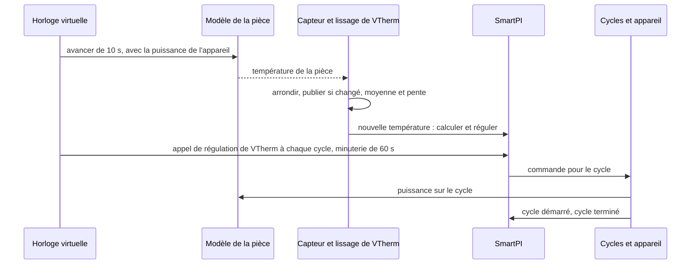

# Tests

Ce document rassemble tous les tests de ce fork : comment les lancer, le simulateur que la plupart
d'entre eux utilisent, chaque scénario de simulation et ce qu'il doit montrer, les autres tests,
classés par fonction, et les tests QAS sur un vrai Home Assistant. Les fonctions elles-mêmes sont décrites dans la
[documentation technique](technical_doc.md),
[Dépendances entre zones et deuxième source de chaleur](zone_dependencies.md) et
[Entrée eau](water_input.md). Les tests propres à l'auteur ne changent pas et tournent avec ceux-ci.

## Sommaire

1. [Lancer les tests](#1-lancer-les-tests)
2. [Le simulateur](#2-le-simulateur)
3. [Scénarios de simulation](#3-scénarios-de-simulation)
4. [Tests par fonction](#4-tests-par-fonction)
5. [Limites](#5-limites)
6. [QAS sur un vrai Home Assistant](#6-qas-sur-un-vrai-home-assistant)

## 1. Lancer les tests

Lancez les tests depuis le dossier du dépôt, avec une copie de Versatile Thermostat (VTherm) dans
le chemin de recherche de Python (Python path). C'est la même configuration que l'intégration continue de l'auteur
(CI, les tests que GitHub lance automatiquement) :

    PYTHONPATH=<versatile_thermostat copy>:$PWD python -m pytest tests/ -q

Il y a deux ensembles de tests :

| Ensemble | Ce qu'il contient | Où il tourne |
|---|---|---|
| Court | les tests unitaires (petits tests d'une seule partie du code) et les simulations qui ne prennent que quelques secondes | à chaque pull request (workflow « Tests »), et en local par défaut |
| Long | l'ensemble court, plus les longues simulations et les comparaisons avec le code de VTherm lui-même | en local avec `SMARTPI_SIM_LOCAL=1` ; sur GitHub dans le workflow « Full tests », à chaque push sur la branche `qas` et à la demande |

Les longues simulations dépendent de `SMARTPI_SIM_LOCAL`. Sans cette variable, elles apparaissent
comme ignorées (skipped).

## 2. Le simulateur

### 2.1 Pourquoi

- **Une maison est lente et ne se répète jamais.** SmartPI apprend sur plusieurs jours. Dans une
  vraie maison, chaque question sur les extensions (une porte, un plancher plus lent, une chaudière
  qui attend plus de demande) prendrait des semaines. Et l'essai suivant n'aurait jamais la même
  météo.
- **La vérité est connue.** Dans le simulateur, le test fixe la puissance de chauffe de la pièce
  `a`, ses déperditions `b`, les retards et les échanges de chaleur. Ce que SmartPI apprend peut
  donc être comparé à ces vraies valeurs. Dans une maison, seule la température de la pièce peut
  être jugée.
- **Le vrai code tourne.** Le simulateur fait tourner le vrai handler et le vrai algorithme de
  SmartPI. Seul le travail que Versatile Thermostat et Home Assistant font autour d'eux est copié.
- **Les comparaisons se font pendant le test.** Un scénario tourne deux fois, par exemple avec et
  sans une fonction, et les deux simulations sont comparées. Des résultats sauvegardés à l'avance
  ne sont pas utilisés : ils ne correspondraient plus après chaque changement de l'algorithme de
  l'auteur.

### 2.2 Ce qu'il modélise

| Partie | Fichier | Ce qu'elle fait |
|---|---|---|
| Pièces | `tests/sim/plant.py` | Un modèle thermique simple, dans les unités de SmartPI. La vitesse à laquelle un chauffage réchauffe la pièce est le `a` de SmartPI (°C/min à pleine puissance). Un lien avec l'extérieur est le `b` de SmartPI (1/min). Un chauffage a un retard. Un émetteur de chaleur lent, comme un plancher chauffant, fait passer sa chaleur par une inertie : la chaleur qu'il donne suit l'appareil lentement, pas tout de suite. Un émetteur « à deux étages » la fait passer par deux inerties plus courtes à la suite, comme une dalle de plancher qui se réchauffe dans son épaisseur. Deux pièces peuvent être reliées en permanence, ou par une porte qui s'ouvre selon un horaire. Le modèle est calculé par pas de temps de 10 s ou moins. |
| Capteurs et lissage de VTherm | `tests/sim/sensors.py` | Un capteur est lu toutes les 10 s et arrondi (à 0.1 °C par défaut). Sa valeur n'est publiée que quand la valeur arrondie change. La moyenne glissante et la pente (vitesse de variation) de VTherm sont copiées : la moyenne a une demi-vie de 300 s, et la pente est en °C/h. |
| Cycles de chauffe | `tests/sim/scheduler.py` | Une copie de l'ordonnanceur de cycles de VTherm (la partie qui transforme une commande en cycles de l'appareil) pour un appareil : cycles tout-ou-rien, temps minimaux de marche et d'arrêt, vannes. L'ordonnanceur de VTherm lui-même n'est pas importé : il est interne à VTherm et change avec la branche principale de VTherm. Il y a une différence voulue : une erreur dans un cycle arrête la simulation, au lieu d'être seulement écrite dans le journal. |
| Temps | `tests/sim/clock.py` | Une horloge virtuelle remplace l'horloge de SmartPI, donc une semaine simulée ne prend que quelques secondes. Elle fait aussi tourner les minuteries : l'appel de régulation de VTherm à chaque cycle, le recalcul de SmartPI toutes les 60 s, et les cycles. |
| Chaudière et Smart Boiler | `tests/sim/boiler.py` | L'eau qui arrive à un circuit : à température fixe, ou sur une courbe de chauffe (une température d'eau fixée à partir de la température extérieure). On peut y ajouter les cycles du brûleur, la priorité à l'eau chaude sanitaire (la chaudière chauffe d'abord le ballon d'eau chaude), et une chaudière qui ne démarre que quand une zone demande de la chaleur. Un remplaçant de Smart Boiler donne à SmartPI les données d'eau. |
| Météo | `tests/sim/weather.py` | La température extérieure : constante, une variation sur la journée, ou un saut brusque. |
| Mise en place des scénarios | `tests/sim/runner.py` | Une zone (ses `a`, `b`, retard, consigne, cycle, vanne ou appareil tout-ou-rien, capteur, voisins, presets, chaudière), un deuxième thermostat dans la zone (sa puissance, son retard et son inertie), et plusieurs zones dans un même monde partagé. |
| Mesures | `tests/sim/metrics.py` | Ce que SmartPI a appris comparé aux vraies valeurs, quand sa phase d'apprentissage s'est terminée, et l'erreur de la pièce. |

### 2.3 Un pas de simulation

## 3. Scénarios de simulation

Sauf indication contraire dans une ligne, la pièce a `a` 0.03 °C/min, `b` 0.001 /min, un retard de
10 min, un appareil tout-ou-rien avec un cycle de 10 min, un capteur de 0.1 °C et une consigne de
20 °C. La température extérieure est de 3 °C, avec une variation sur la journée de ±3 °C.
L'« erreur » est l'écart moyen entre la température de la pièce et sa consigne. « ±x % » signifie
à moins de x % de la vraie valeur. Une plage sans unité, comme 0.5–1.2, est la valeur apprise
divisée par la vraie valeur.

### 3.1 Zones voisines — `test_smartpi_sim_neighbours.py` (court)

Une pièce avec un capteur de 0.01 °C, à côté d'un couloir. L'échange de chaleur avec le couloir,
`k`, vaut 0.002. La porte est ouverte 7:00–9:00, 12:00–13:30 et 18:00–22:00.

| Repère | Scénario | Ce qu'il doit montrer |
|---|---|---|
| N1 | le couloir est dans la liste mais désactivé (mode `none`) | exactement la même simulation que sans lui |
| N2 | le couloir derrière une porte, 3 jours | `k` ±20 % ; `a` et `b` ±5 % ; aucun retard appris pendant que la porte est ouverte |
| N3 | le couloir toujours ouvert, à 20 °C ; sa température saute de +4 °C à 30 h et de −4 °C à 66 h | rien de publié à 42 h ; à 66 h, `k` ±10 % et les déperditions sans le couloir ±10 % ; après le deuxième saut, une erreur plus petite que sans la fonction |
| N3 grossier | la même chose avec un capteur de 0.1 °C et un seul saut | soit rien de publié (le couloir affiché comme « impossible à distinguer », et le `b` de SmartPI lui-même utilisé), soit `k` ±20 % |
| N4 | le couloir indisponible | exactement la même simulation que sans lui |
| N5 | mode refroidissement, le couloir à 28 °C derrière une porte | `k` ±25 % ; erreur sous 0.3 °C à partir de 60 h |
| N6 | la fenêtre du couloir ouverte pendant une heure pendant que la porte est ouverte, une fois pour chaque réaction | aucun `k` appris pendant ce temps ; la réaction appliquée (rien, arrêt, hors-gel 7 °C, éco 17 °C) ; l'appareil marche ou s'arrête en conséquence ; ensuite, la pièce ne monte pas de plus de 0.6 °C au-dessus de sa consigne (dépassement) |
| N7 | une pièce entre deux voisins toujours ouverts, la température de chacun sautant une fois | pour chacun : `k` à ±35 %, ou affiché comme « impossible à distinguer » |

### 3.2 Une zone à deux sources de chaleur — `test_smartpi_sim_second_source.py`

La source principale est le radiateur de la pièce. Dans la plupart des scénarios, la source
additionnelle est un plancher chauffant à eau : même puissance que le radiateur, un retard de
30 min, une inertie de 180 min, et la règle de répartition (comment la chaleur est répartie entre
les deux sources) `lead_band` à 20 %.

| Repère | Scénario | Ensemble | Ce qu'il doit montrer |
|---|---|---|---|
| Z1, Z3 | le plancher dès le départ, 40 h | court | le plancher fonctionne par blocs pendant que SmartPI apprend, puis suit la règle ; le modèle de la zone est publié avant 30 h, avec `a`, `b` et la puissance du plancher ±20 % ; SmartPI utilise ce modèle ; à partir de 30 h, le plancher donne plus de 20 % de la chaleur et l'erreur est sous 0.08 °C |
| — | le SmartPI du plancher lui-même pendant qu'il sert de source additionnelle | court | il n'apprend rien et ne change rien ; il suit la commande de la source principale ; il régule de nouveau une fois la source principale retirée |
| Z6 | la source principale ne répond plus | court | après 15 min, la source additionnelle régule seule ; la pièce reste au-dessus de 19.3 °C ; quand la source principale revient, la source additionnelle la suit de nouveau |
| — | la source principale éteinte, avec un cycle de 20 min | court | la source additionnelle reste éteinte et ne prend pas en charge la zone |
| — | le plancher sur l'eau de Smart Boiler | court | le plancher transforme la puissance de la source principale en sa propre commande, avec ses propres données d'eau |
| — | délestage (VTherm éteint des appareils quand la maison consomme trop de puissance) | court | une source principale délestée envoie quand même sa commande ; une source additionnelle délestée reste éteinte |
| — | un redémarrage de Home Assistant après 36 h | court | le modèle de la zone est gardé ; erreur sous 0.15 °C ensuite |
| Z7 | refroidissement avec deux sources | court | un modèle de refroidissement séparé, ±25 % ; erreur sous 0.15 °C |
| — | une vanne comme source additionnelle, que VTherm recalcule aussi | court | la vanne suit la source principale |
| Z1 comparé | comparé avec deux SmartPI qui fonctionnent indépendamment, capteurs de 0.01 et 0.1 °C, 96 h | long | erreur au plus 0.03 °C au-dessus de la paire indépendante ; le plancher donne plus de 35 % de la chaleur |
| Z1 nuits | trois nuits avec la consigne abaissée à 17 °C | long | dépassement au plus 0.1 °C au-dessus de la paire indépendante ; le dépassement de la dernière nuit au plus 0.15 °C au-dessus du plus grand dépassement des nuits précédentes (il ne grandit pas nuit après nuit) ; le plancher donne moins de 90 % de la chaleur |
| Z2 | règle `source_first` à 50 % | long | la source principale se stabilise sur la courbe de la règle (±0.15) |
| — | règle `together` à 200 % | long | la même chose |
| Z4 | un deuxième radiateur comme source additionnelle | long | chacun donne la moitié de la chaleur (±0.15) ; erreur au plus 0.03 °C au-dessus de la paire indépendante |
| Z5 | une source principale trop faible pour le froid (`a` 0.015, extérieur −5 °C) | long | le plancher garde la pièce au-dessus de 18.5 °C pendant que SmartPI apprend ; une fois le temps plus doux, SmartPI termine son apprentissage |

### 3.3 Douze pièces et quatre installations — `test_smartpi_sim_zone_set.py` (long)

Six pièces (des déperditions lentes aux rapides, des radiateurs lents aux rapides) tournent par
temps doux (3 °C) et par temps froid (−8 °C). Chacune a un plancher chauffant à eau de même
puissance. Chacune tourne 96 h, puis trois nuits avec la consigne abaissée à 17 °C (pendant 6, 8 et 10 h). Chacune est comparée à
deux SmartPI indépendants. Pour chaque pièce :

- le modèle de la zone est publié au plus tard à 30 h, avec `a`, `b` et la puissance du plancher
  ±15 % ;
- l'erreur de 48 h à 96 h est au plus 0.02 °C au-dessus de la paire indépendante ;
- le pire dépassement après une nuit est au plus 0.1 °C au-dessus de la paire indépendante ;
- chaque matin, la pièce atteint sa consigne moins 0.2 °C, en moyenne au plus 1 h plus tard que la
  paire indépendante.

Les mêmes vérifications tournent pour un plancher derrière une vanne, une dalle qui se réchauffe
dans son épaisseur, et de l'eau sur des courbes de chauffe. Deux zones côte à côte (toujours
ouvertes, ou avec une porte ouverte 6:00–23:00) doivent chacune garder une erreur au plus 0.02 °C
au-dessus de la paire indépendante. Les résultats sont dans
[Dépendances entre zones, §5.8](zone_dependencies.md#58-résultats-et-limites-simulation).

### 3.4 Eau — `test_smartpi_sim_water.py` (court)

Un radiateur (`a` 0.06 avec une eau à 60 °C) sur une chaudière avec une courbe de chauffe.

| Scénario | Ce qu'il doit montrer |
|---|---|
| avec et sans les données d'eau de Smart Boiler, 48 h | sans les données, SmartPI apprend moins de la moitié de `a` ; avec les données, entre 0.5 et 1.2 fois `a`, et plus de 1.5 fois la valeur apprise sans elles |
| eau chaude sanitaire deux fois par jour, cycles du brûleur | pendant que la chaudière chauffe l'eau chaude sanitaire, l'intégrale (la part de la commande qui s'accumule dans le temps) et la commande ne bougent pas ; erreur sous 0.3 °C |
| les données d'eau absentes pendant 2 h, puis pour de bon | une courte interruption garde le facteur d'eau (la chaleur que donne l'eau comparée à l'eau de référence) ; une interruption durable met le facteur à 1 et propose la remise à zéro une seule fois |
| une chaudière qui ne démarre que quand la zone demande de la chaleur | la pièce reste au-dessus de 19 °C ; SmartPI termine son apprentissage et apprend `a` dans 0.5–1.2 |

### 3.5 Une chaudière qui n'est pas appelée — `test_smartpi_sim_boiler_call.py` (court)

Un radiateur de 2000 W derrière une vanne, avec un capteur de 0.01 °C. La chaudière ne démarre qu'à
partir d'une demande de 2500 W, donc cette pièce seule ne peut jamais la démarrer. D'autres zones
(3000 W) la démarrent, sauf pendant une plage de la journée.

| Repère | Scénario | Ce qu'il doit montrer |
|---|---|---|
| B1 | chaudière centrale de VTherm, sans données d'eau, pas de chaudière 2:00–8:00 | SmartPI non informé que la chaudière n'est pas appelée : `a` sous la moitié ; informé : `a` dans 0.85–1.2, `b` dans 0.95–1.05, aucun `a` appris pendant que la chaudière n'est pas appelée, le retard dans 9–13 min |
| B2 | appel de Smart Boiler avec données d'eau, pas de chaudière 10:00–16:00 | `b` dans 0.95–1.05, `a` dans 0.9–1.15, aucun `a` appris pendant que la chaudière n'est pas appelée |

Les résultats sont dans [Entrée eau, §4.4](water_input.md#44-résultats-simulation).

### 3.6 SmartPI seul, deux thermostats, et le simulateur lui-même

| Fichier | Ensemble | Ce qu'il vérifie |
|---|---|---|
| `test_smartpi_sim_baseline.py` | court et long | SmartPI seul apprend une pièce connue. Avec un capteur de 0.01 °C : `a` et `b` ±5 % et le retard à 4 min près, le tout en 12 h (une grille de 12 pièces dans l'ensemble long). Avec un capteur de 0.1 °C, il termine quand même son apprentissage, avec `a` et `b` dans 0.4–1.6 |
| `test_smartpi_sim_two_thermostats.py` | court et long | le retard et l'inertie du plancher dans le modèle de la pièce ; deux thermostats, chacun avec son propre SmartPI, qui chauffent une même pièce (le fonctionnement actuel, la base de comparaison pour Z1 et Z4) |
| `test_smartpi_regression_no_dependencies.py` | court | des fonctions configurées mais pas actives : exactement la même simulation et le même état sauvegardé que sans la fonction |
| `test_smartpi_sim_harness.py` | court | l'horloge, les minuteries, les cycles tout-ou-rien, les temps minimaux de marche et d'arrêt, les vannes, l'appel de régulation de VTherm à chaque cycle ; la même simulation faite deux fois donne le même résultat |
| `test_smartpi_sim_scheduler_parity.py` | long | l'ordonnanceur de cycles copié et la pente donnent les mêmes événements que le code de VTherm lui-même, sur des milliers de commandes et de lectures aléatoires |

## 4. Tests par fonction

### 4.1 Événements AutoCalib

| Fichier | Ce qu'il vérifie |
|---|---|
| `test_smartpi_autocalib_events.py` | chaque événement AutoCalib porte le vrai `entity_id` du thermostat et son nom dans `name` |

### 4.2 Entrées connues (la base des extensions)

| Fichier | Ce qu'il vérifie |
|---|---|
| `test_smartpi_effective_model.py` | comment les entrées connues (la chaleur échangée avec les zones voisines, la chaleur d'une deuxième source) sont combinées en `b_eff` et `T_ref`, les déperditions et la température de référence qu'utilise la régulation ; rien ne change sans elles |
| `test_smartpi_learning_window_known_inputs.py` | les fenêtres d'apprentissage retirent la chaleur des entrées connues |
| `test_smartpi_dependencies_algo.py` | l'algorithme utilise `b_eff` et `T_ref` partout dans sa régulation, garde les valeurs brutes pour l'apprentissage, met l'apprentissage en pause tant qu'un verrou d'apprentissage est actif (une condition comme la porte ouverte d'un voisin), et sauvegarde et charge son état |
| `test_smartpi_dependencies.py`, `test_smartpi_dependency_inputs.py` | les éléments configurés, comment ils sont vérifiés, les lectures utilisées dans un calcul |
| `test_config_flow.py`, `test_config_flow_dependencies.py` | le menu d'options d'une entrée de thermostat et la liste des dépendances |

### 4.3 Zones voisines

| Fichier | Ce qu'il vérifie |
|---|---|
| `test_smartpi_coupling_estimator.py` | l'apprentissage de `k` pour un voisin derrière une porte, pour plusieurs portes à la fois, et pour un voisin toujours ouvert |
| `test_smartpi_dependency_model.py` | les verrous d'apprentissage, les réactions à la fenêtre d'un voisin, les presets en refroidissement, un voisin toujours ouvert qui entre dans le modèle sans saut |
| `test_smartpi_dependencies_handler.py` | les lectures depuis Home Assistant |
| `test_config_flow_neighbours.py` | les formulaires des voisins : suggestions, erreurs, avertissements, modification, l'étape de remise à zéro |

### 4.4 Une zone à deux sources de chaleur

| Fichier | Ce qu'il vérifie |
|---|---|
| `test_smartpi_zone_fit.py` | le modèle commun de la zone (un seul modèle ajusté pour les deux sources ensemble) trouve le retard de la source principale, l'échelle de temps du plancher, `a`, `b`, la puissance du plancher et le `k` d'un voisin |
| `test_smartpi_source_model.py`, `test_smartpi_source_candidates.py` | la chaleur du plancher calculée à partir de ses cycles ; les échelles de temps candidates |
| `test_smartpi_split.py` | les règles de répartition et la boucle d'allocation |
| `test_smartpi_source_link.py` | le lien entre les deux thermostats : commandes, cycles, une source principale qui ne répond plus, le plafond de puissance |
| `test_smartpi_dependency_model_source.py` | les blocs d'apprentissage, l'horloge d'apprentissage et son délai maximal, le freinage, le rattrapage plus rapide après une nuit, un redémarrage, le refroidissement |
| `test_smartpi_dependencies_handler.py` | les types de chauffage lus dans les deux entrées, la remise à zéro demandée depuis un formulaire, un thermostat maître modifié |
| `test_config_flow_zone.py` | le formulaire de la zone : le thermostat maître et ses vérifications, la recommandation, le déplacement de la source principale, l'entrée de l'autre thermostat, un retard et une inertie personnalisés, la suppression, l'étape de remise à zéro |

### 4.5 Eau

| Fichier | Ce qu'il vérifie |
|---|---|
| `test_smartpi_water_input.py` | le facteur d'eau, ses moyennes, l'eau chaude sanitaire, les interruptions courtes et durables, la sauvegarde et le chargement de l'état |
| `test_smartpi_water_algo.py` | commande = puissance / facteur, apprentissage = commande × facteur, la limite de puissance, les maintiens pendant l'eau chaude sanitaire et avec une eau froide |
| `test_smartpi_water_handler.py` | la lecture de Smart Boiler, `water_factor` publié, la remise à zéro proposée quand les données apparaissent ou disparaissent |
| `test_config_flow_heating_type.py` | le type de chauffage dans les réglages ; l'étape de la réparation (l'avis de réparation de Home Assistant) |

### 4.6 Une chaudière qui n'est pas appelée

| Fichier | Ce qu'il vérifie |
|---|---|
| `test_smartpi_boiler_call.py` | les modes : une chaudière qui répond en 15 min ne change rien ; pour un appel sans réponse, d'abord l'émetteur refroidit, puis le maintien, puis l'émetteur se réchauffe après le démarrage de la chaudière ; les appareils tout-ou-rien et leur cycle ; une lecture perdue ; les raisons de Smart Boiler |
| `test_smartpi_boiler_algo.py` | l'apprentissage ne voit aucune chaleur pendant le maintien et attend autour de cette période ; le retard n'est pas appris à partir du démarrage de la chaudière ; la correction du feed-forward est gelée ; une calibration est annulée |
| `test_smartpi_boiler_handler.py` | les champs de Smart Boiler et la chaudière centrale de VTherm, avec chaque sorte de valeur fausse ou absente |

## 5. Limites

- **Le simulateur est plus clément qu'une maison.** Il n'a pas de bruit de capteur, à part
  l'arrondi ; pas de soleil, pas de personnes ni de cuisine ; et une seule température par pièce,
  sauf si le modèle de dalle est choisi. Les résultats des autres documents sont ce que SmartPI
  obtient dans ces conditions.
- **La météo** est une constante, une variation sur la journée ou un saut brusque ; il n'y a pas de
  prévision.
- **La régulation propre d'une chaudière** (la modulation, c'est-à-dire le changement de puissance
  de la flamme, et la durée minimale de combustion) n'est pas modélisée au-delà de ce dont les
  scénarios ci-dessus ont besoin.
- **VTherm est copié, pas exécuté,** dans le simulateur. L'ensemble long vérifie la copie par
  rapport au code de VTherm lui-même, parce que la branche principale de VTherm peut changer. Les
  tests QAS (section 6) font tourner le vrai VTherm.

## 6. QAS sur un vrai Home Assistant

Les tests ci-dessus font tourner SmartPI dans le processus de test, sur une copie de l'ordonnanceur
de Versatile Thermostat. Ils vérifient la physique, l'apprentissage et les règles de répartition,
mais pas ce que seul un vrai Home Assistant montre. Les tests QAS (QAS : quality assurance,
l'assurance qualité ; c'est la branche `qas` qu'ils testent) le font, sur un banc de test de huit
instances Home Assistant (le projet séparé `ha-testbed`) :

- le vrai Versatile Thermostat 10.5.1, avec sa chaudière centrale, son gestionnaire de puissance et
  sa détection de fenêtre, deux thermostats reliés par Home Assistant et un maître over_climate ;
- les formulaires dans Home Assistant, le registre des entités et ses pièces (areas) ;
- l'état sauvegardé dans `.storage`, après de vrais redémarrages ;
- le Recorder, le journal de bord (logbook) et les avis de réparation.

Les tests QAS sont lancés par la session de test du banc, jamais par la session qui écrit le code,
et toujours sur un seul commit de la branche `qas`. Ce dépôt contient le paquet de tests : le
simulateur, les aides, les configurations, les scripts de mise en place, le lanceur (runner) et ce
catalogue.

### 6.1 Le paquet de tests

Tout est sous `tests/qas/`. Aucun fichier n'y est nommé `test_*.py`, donc le `pytest tests/` de la CI
ne le lance pas : le lanceur a besoin du `lib/` du banc.

| Chemin | Ce que c'est |
|---|---|
| `custom_components/smartpi_room_sim/` | le simulateur de pièces sous forme d'intégration Home Assistant : pièces, chauffages, vannes, une chaudière, portes, fenêtres et l'extérieur. Sa physique (`physics.py`) est le même fichier que celui qu'utilise le simulateur dans le processus de test : `tests/sim/plant.py` le charge |
| `custom_components/smartpi_qas_helpers/` | des aides réservées aux tests, qui agissent à l'intérieur du SmartPI en marche : déclencher un événement AutoCalib, rendre silencieuse la source principale d'une zone, charger un état appris, lister les événements déclenchés |
| `roles.py` | les huit rôles en un seul endroit : pièces, thermostats, entrées SmartPI et options de base |
| `config/<role>.yaml` | le `configuration.yaml` de chaque rôle, écrit par `config/build.py` à partir de `roles.py` |
| `setup/setup_role.py` | met en place une instance par l'API, par étapes (`setup/stages.py`), puis la redémarre |
| `run.py`, `scenarios/` | le lanceur et les scénarios, sur le `lib/harness.py` du banc |
| `compare.py` | compare ce que deux instances ont mesuré (QB1, QE5) |
| `README.md` | comment le lancer, en bref |

**Le simulateur.** Une pièce a des déperditions vers l'extérieur `b` et une capacité thermique. Un
chauffage a un gain `a`, un retard et une inertie d'émetteur (un étage, ou deux pour une dalle). Les
pièces sont reliées en permanence ou par une porte, et une fenêtre relie une pièce à l'extérieur.
Un émetteur à eau ne chauffe qu'avec l'eau de la chaudière : il se réchauffe vers 60 °C tant que
l'interrupteur de la chaudière est allumé, et refroidit jusqu'à 12 °C (sous la température des
pièces) tant qu'il est éteint. Les capteurs de température arrondissent à 0.1 ou 0.01 °C et ne sont
écrits que quand leur valeur change. Des services fixent la température d'une pièce, d'un coup ou
progressivement, déplacent la moyenne extérieure, ouvrent ou ferment une porte ou une fenêtre, font
qu'un appareil ne répond plus (il garde son état, et peut aussi devenir indisponible), et
réinitialisent les entrées. Tous les identifiants d'entités commencent par `smartpi_room_sim_` : rien
ne vient d'une vraie maison.

### 6.2 Les rôles des instances

| Inst. | Rôle | Ce qu'elle contient |
|---|---|---|
| 1 | `base` | le salon : VTherm over_switch avec SmartPI, sans extension ; un grenier non chauffé (un capteur pour QB3) |
| 2 | `neighbours` | la cuisine (SmartPI), avec comme voisins le couloir derrière une porte (TPI, avec un capteur de fenêtre) et la salle à manger toujours ouverte (TPI) |
| 3 | `zone` | le séjour : un radiateur (source principale) et un plancher (source additionnelle) sous le maître `Lounge` (over_climate, autorégulation désactivée) ; des thermostats de réserve pour QE1 |
| 4 | `zone-ref` | le même séjour avec deux SmartPI indépendants (la comparaison pour QE5) |
| 5 | `zone-valve` | la pièce de travail : le plancher est une vanne (over_valve) ; le gestionnaire de puissance de VTherm |
| 6 | `central-boiler` | la chaudière centrale de VTherm (seuil de puissance 2500 W) : la chambre (2000 W) ne peut pas la démarrer seule, le bureau (3000 W) le peut |
| 7 | `ref-0.4.0` | le jumeau de l'instance 1 sur la version 0.4.0 de l'auteur, mise à jour plus tard vers `qas`, puis ramenée en arrière |
| 8 | `electric` | les types de chauffage électriques (un tapis chauffant électrique, un radiateur électrique rapide) ; les relances |

Chaque VTherm a un délai de sécurité de 1440 min : un capteur qui n'écrit que quand sa valeur change
garde une même valeur plus longtemps que les 60 min par défaut de VTherm, et VTherm le prendrait
pour un capteur en panne.

### 6.3 Déploiement et lancement

La session de test du banc suit son propre `docs/workflow.md`. Pour ce paquet :

1. **Préparer** (stage) ce dépôt au commit de `qas` à tester, et Versatile Thermostat au tag de sa
   dernière version publiée (10.5.1 au 2026-10-14).
2. **Déployer** chaque instance avec son rôle :

       bin/deploy.sh --instance N --stage stage/vtherm_smartpi \
           --components stage/vtherm_smartpi/tests/qas/custom_components \
           --components stage/versatile_thermostat/custom_components \
           --config stage/vtherm_smartpi/tests/qas/config/<role>.yaml

3. **La mettre en place** par l'API (les entrées de VTherm, les pièces, les seuils de la chaudière et
   la puissance maximale, les entrées de SmartPI, les options de base), puis la redémarrer :

       HA_INSTANCE=N python stage/vtherm_smartpi/tests/qas/setup/setup_role.py

   Les étapes, dans l'ordre : `vtherm` (la configuration centrale de VTherm, l'entrée de valeurs par
   défaut de SmartPI, les thermostats, puis les maîtres), `areas`, `inputs`, `smartpi` (une entrée
   par thermostat SmartPI) et `options`. Chaque étape saute ce qui existe déjà ; `--stage` en lance
   une seule.
4. **Lancer** des scénarios, ou `M` pour l'ensemble minimal du rôle :

       HA_INSTANCE=N python stage/vtherm_smartpi/tests/qas/run.py M
       HA_INSTANCE=N python stage/vtherm_smartpi/tests/qas/run.py QD5      # detached: 72 h

   `run.py --list` affiche les scénarios. Chacun ne tourne qu'à partir de la base de son rôle (ses
   entrées SmartPI et leurs options ; les voisins et la zone sont comparés par ce qu'ils signifient,
   pas par les identifiants que donnent les formulaires). Entre deux scénarios, les entrées du
   simulateur et les thermostats reviennent à la base.
5. **Comparer** les paires : `python stage/vtherm_smartpi/tests/qas/compare.py qb1` (instances 1 et
   7) et `compare.py qe5` (instances 3 et 4), depuis le dossier du banc.

**L'instance 7** passe de 0.4.0 à `qas`, puis revient. Le banc déploie le fork en 0.4.0 (51db763)
avec `--ref`, et les composants du paquet de tests depuis une copie de travail (checkout) de `qas` :

    QB1 / QB1s  →  QB2a (or QB2l after QB1)  →  deploy qas  →  QB2  →  QB3a  →  deploy 0.4.0  →  QB3

### 6.4 Durées

Un scénario attend ce que SmartPI fait après ses propres délais, plus une marge de deux calculs. Le
lanceur lit les délais dans l'extension préparée (`smartpi/const.py` et `smartpi/source_model.py`) :

| Quoi | Durée |
|---|---|
| un calcul | 60 s |
| le cycle de VTherm | 10 min |
| après la fermeture d'une porte, l'apprentissage attend | 10 min |
| le délai de grâce de la chaudière | 15 min, plus le cycle pour un appareil tout-ou-rien |
| la stabilisation d'un émetteur (le retard plus trois fois l'inertie) | radiateur 65 min, plancher à eau 570 min |
| une source principale silencieuse | 15 min |
| la détection de fenêtre de VTherm | 30 s |

Le simulateur avance toutes les 7 s et la température extérieure oscille sur 2838 s : aucune période
du simulateur n'est un multiple des 60 s de SmartPI ni du cycle. Les températures des pièces changent
en rampes (progressivement).

### 6.5 Le catalogue

« Détaché » : plus de deux heures, donc le banc le lance en arrière-plan. « Minimum » : dans
l'ensemble minimal, lancé après chaque changement. L'ensemble « avec Smart Boiler » est prévu : la
façon de tester avec Smart Boiler (la vraie extension à une version donnée, ou un remplaçant de son
interface réservé aux tests) reste à décider, et rien n'en est construit.

| ID | Ce qu'il vérifie | Instance et rôle | Durée | Détaché | Jumeau dans le processus de test | Minimum | Ensemble |
|---|---|---|---|---|---|---|---|
| QA1 | Après le redémarrage de la mise en place, chaque entrée SmartPI et VTherm est chargée, ni SmartPI ni VTherm n'écrit d'avertissement ou d'erreur dans le journal, chaque thermostat SmartPI a ses diagnostics, et rien de Smart Boiler n'est présent. | 1 `base`, 8 `electric` | 15 min | non | test_factory.py | oui | sans Smart Boiler |
| QA2 | Enregistrer sans changement les réglages d'une entrée de thermostat passe par le menu d'options sans étape de remise à zéro, garde les options enregistrées, et recharge l'entrée une seule fois, sans boucle. | 1 `base` | 15 min | non | test_config_flow_dependencies.py | oui | sans Smart Boiler |
| QA3 | Les quatre services de SmartPI fonctionnent sur VTherm 10.5.1, et un apprentissage en pause reste en pause après un redémarrage. | 1 `base` | 30 min | non | test_services.py | non | sans Smart Boiler |
| QA4 | Les événements AutoCalib portent l'entité climate du thermostat dans entity_id et son nom dans name, et ni le Recorder ni le journal de bord ne signale un identifiant d'entité invalide. | 1 `base` | 60 min | non | test_smartpi_autocalib_events.py | oui | sans Smart Boiler |
| QA5 | Deux redémarrages gardent l'état appris (le modèle, ses compteurs et le jeton de remise à zéro appliqué), et un jeton de remise à zéro n'est pas appliqué une deuxième fois. | 1 `base` | 20 min | non | test_algo_persistence.py | oui | sans Smart Boiler |
| QA6 | Un type de chauffage à eau montre le bloc water avec la source none et le facteur 1, et pas de bloc boiler sans la chaudière centrale de VTherm ; un type électrique ne montre ni l'un ni l'autre ; et rien n'est écrit dans le journal à chaque appel de régulation. | 1 `base`, 8 `electric` | 20 min | non | test_smartpi_water_handler.py, test_smartpi_boiler_handler.py | oui | sans Smart Boiler |
| QB1 | Pendant 48 h, la pièce jumelle apprend et régule ; l'instance garde a, b et son erreur moyenne de 24 à 48 h, et compare.py qb1 réussit quand les a et b de l'instance qas sont à ±10 % de ceux de 0.4.0 et que son erreur moyenne est au plus 0.03 °C au-dessus. | 1 `base`, 7 `ref-0.4.0` | 48 h | oui | test_smartpi_regression_no_dependencies.py, test_smartpi_sim_baseline.py | non | sans Smart Boiler |
| QB1s | Pendant 45 minutes, la pièce jumelle régule et rien n'enregistre d'erreur dans le journal, et l'instance garde ce que lit compare.py qb1s (les deux instances en régulation, les phases nommées). Variante courte de QB1. | 1 `base`, 7 `ref-0.4.0` | 45 min | non | test_smartpi_sim_baseline.py | oui | sans Smart Boiler |
| QB2a | Sur 0.4.0, avant la mise à jour : l'état de SmartPI est l'état appris préparé pour le test (fixture), sauvegardé par 0.4.0 elle-même avec l'apprentissage en pause, et son modèle est gardé pour QB2. | 7 `ref-0.4.0` | 10 min | non | test_algo_persistence.py | oui | sans Smart Boiler |
| QB2 | Après la mise à jour de 0.4.0 vers qas, l'état sauvegardé par 0.4.0 est chargé sans changement, aucun avertissement sur son format n'est écrit dans le journal, rien n'est remis à zéro, et le menu d'options de l'ancienne entrée fonctionne. | 7 `ref-0.4.0` | 30 min | non | test_algo_persistence.py | oui | sans Smart Boiler |
| QB3a | Sur qas, avant de revenir à 0.4.0 : un voisin (le capteur du grenier) est ajouté à l'entrée, l'apprentissage est mis en pause et le modèle est gardé pour QB3 ; cela est laissé en place exprès. | 7 `ref-0.4.0` | 10 min | non | — | non | sans Smart Boiler |
| QB3 | De retour sur 0.4.0 avec un voisin configuré, l'entrée se charge sans erreur, et l'état aussi ; enregistrer les options dans 0.4.0 supprime les clés du fork, un point déjà connu. | 7 `ref-0.4.0` | 30 min | non | — | non | sans Smart Boiler |
| QB2l | Sur 0.4.0 après QB1, avant la mise à jour : le modèle que 0.4.0 a appris elle-même est gardé pour QB2 avec l'apprentissage en pause, sans état de départ chargé. | 7 `ref-0.4.0` | 5 min | non | test_algo_persistence.py | non | sans Smart Boiler |
| QC1 | Pour un thermostat que sert la chaudière centrale de VTherm, le bloc boiler indique la source vtherm_central_boiler, et son champ called suit le capteur binaire de la chaudière centrale. | 6 `central-boiler` | 30 min | non | test_smartpi_boiler_handler.py | oui | sans Smart Boiler |
| QC2 | La petite zone, qui appelle seule sous les seuils, passe en emitter_cooling après le délai de grâce, en held après le temps de stabilisation de son émetteur sans apprendre a, en emitter_warming dès que la grande zone démarre la chaudière, et revient à l'apprentissage normal un temps de stabilisation plus tard. | 6 `central-boiler` | 2.5 h | oui | test_smartpi_boiler_call.py, test_smartpi_boiler_algo.py | non | sans Smart Boiler |
| QC2s | La petite zone, qui appelle seule sous les seuils, passe en emitter_cooling après le délai de grâce et en held après le temps de stabilisation de son émetteur sans apprendre a, puis en emitter_warming dès que la grande zone démarre la chaudière. Variante courte de QC2, QC4. | 6 `central-boiler` | 95 min | non | test_smartpi_boiler_call.py, test_smartpi_boiler_algo.py | oui | sans Smart Boiler |
| QC3 | Sans le capteur binaire de la chaudière centrale (désactivé), SmartPI ne lit aucun appel de la chaudière et apprend comme avant, sans écrire d'erreur dans le journal ; le capteur revient ensuite. | 6 `central-boiler` | 20 min | non | test_smartpi_boiler_handler.py | oui | sans Smart Boiler |
| QC4 | Chaque jour de 2:00 à 8:00, la grande zone reste éteinte, donc la petite zone appelle sans la chaudière ; après 48 h, le a qu'elle a appris est dans 0.85–1.2 du vrai a de son radiateur. | 6 `central-boiler` | 48 h | oui | B1 (test_smartpi_sim_boiler_call.py) | non | sans Smart Boiler |
| QD1 | Les formulaires des voisins montrent chaque erreur et chaque avertissement, suggèrent le capteur de porte des pièces (areas) des deux zones, modifient et suppriment avec leur étape de remise à zéro, et s'arrêtent avec neighbour_missing, dependencies_unchanged et zone_changed. | 2 `neighbours` | 45 min | non | test_config_flow_neighbours.py | oui | sans Smart Boiler |
| QD2 | Une remise à zéro choisie dans un formulaire de voisin remet à zéro le modèle de la cuisine une seule fois, et le redémarrage suivant ne le remet pas de nouveau à zéro. | 2 `neighbours` | 20 min | non | test_smartpi_dependencies_handler.py | oui | sans Smart Boiler |
| QD3 | Un voisin indisponible, ou en mode none, ne joue aucun rôle : sa connexion est inactive et le modèle de la cuisine n'a aucune entrée connue venant de lui. | 2 `neighbours` | 30 min | non | N1, N4 | oui | sans Smart Boiler |
| QD4 | Porte ouverte, la fenêtre ouverte du couloir fait réagir la cuisine comme le dit son réglage (rien, arrêt, hors-gel, éco), sans apprendre aucun k pendant ce temps, et la cuisine revient à la normale une fois la fenêtre et la porte fermées. | 2 `neighbours` | 60 min | non | N6 | oui | sans Smart Boiler |
| QD5 | Avec la porte ouverte chaque jour 7–9, 12–13:30 et 18–22 pendant 72 h, la cuisine apprend le k du couloir à ±25 % du vrai échange, et aucun temps mort pendant que la porte est ouverte. | 2 `neighbours` | 72 h | oui | N2, N5 | non | sans Smart Boiler |
| QD5s | Ouverte deux fois pendant 8 minutes, la porte met en pause l'apprentissage de la cuisine (door_open, puis door_settling) et aucun temps mort n'est appris pendant qu'elle est ouverte. Variante courte de QD5. | 2 `neighbours` | 40 min | non | N2 | oui | sans Smart Boiler |
| QD6 | Avec la salle à manger toujours ouverte et sa température qui fait des sauts d'elle-même pendant 72 h, la cuisine apprend son k à ±20 % du vrai échange, ou l'affiche comme « impossible à distinguer ». | 2 `neighbours` | 72 h | oui | N3 | non | sans Smart Boiler |
| QD6s | Quand la température de la salle à manger toujours ouverte fait un saut, la cuisine la garde connectée sans mettre son apprentissage en pause, et n'écrit aucune erreur dans le journal. Variante courte de QD6. | 2 `neighbours` | 30 min | non | N3 | oui | sans Smart Boiler |
| QE1 | Le formulaire de zone refuse chaque mauvais maître, crée l'entrée manquante d'un appareil en ne redémarrant que ce thermostat, déplace vers la source principale une zone configurée depuis la source additionnelle, s'arrête avec zone_changed, et supprime la zone. | 3 `zone` | 60 min | non | test_config_flow_zone.py | oui | sans Smart Boiler |
| QE2 | Dans la zone en marche, la source additionnelle n'apprend rien et applique la commande de la source principale, et changer son type de chauffage redémarre la source principale. | 3 `zone` | 60 min | non | test_smartpi_sim_second_source.py | oui | sans Smart Boiler |
| QE3 | Quand la source principale devient silencieuse, la source additionnelle régule seule la zone après 15 minutes, la pièce restant au-dessus de 19.3 °C, et suit de nouveau la source principale dès qu'elle revient. | 3 `zone` | 60 min | non | Z6 | oui | sans Smart Boiler |
| QE4 | Quand les appareils du maître changent dans VTherm, SmartPI écrit un avertissement dans le journal au démarrage et la zone continue de fonctionner. | 3 `zone` | 15 min | non | test_smartpi_dependencies_handler.py | oui | sans Smart Boiler |
| QE5 | Pendant 48 h, la zone publie son modèle avant environ 30 h, régule au plus 0.05 °C moins bien que la paire indépendante, le plancher donne plus de 20 % de la chaleur, et un redémarrage à 36 h garde le modèle ; compare.py qe5 en juge. | 3 `zone`, 4 `zone-ref` | 48 h | oui | Z1 comparé | non | sans Smart Boiler |
| QE5s | Pendant 45 minutes, la zone (ou la paire indépendante) régule et rien n'enregistre d'erreur dans le journal, le plancher suivant le radiateur dans la zone. Variante courte de QE5. | 3 `zone`, 4 `zone-ref` | 45 min | non | Z1 comparé | oui | sans Smart Boiler |
| QE6 | Quand le gestionnaire de puissance de VTherm déleste les appareils de la zone, une source principale délestée envoie quand même sa commande et une source additionnelle délestée reste éteinte. | 5 `zone-valve` | 60 min | non | délestage | non | sans Smart Boiler |
| QE7 | Pendant 2 h, la vanne, comme source additionnelle, suit la commande de la source principale. | 5 `zone-valve` | 2 h | non | vanne comme source additionnelle | non | sans Smart Boiler |
| QZ1 | SmartPI n'écrit aucune erreur dans le journal et chacun de ses avertissements est listé, le Recorder ne refuse aucun des attributs des diagnostics, les formulaires lus en polonais montrent du texte et pas des clés, et après trois rechargements d'une entrée, son thermostat ne calcule pas deux fois. | toutes | 25 min | non | — | oui | sans Smart Boiler |
| QW1 | Données d'eau présentes pendant 48 h : source live, a dans 0.5–1.2 de la vraie valeur et plus de 1.5 fois la valeur apprise sans les données (prévu, non construit) | — | — | — | eau avec et sans données | — | avec Smart Boiler |
| QW2 | Eau chaude sanitaire prioritaire (dhw_active) : φ = 0, commande et intégrale maintenues (prévu, non construit) | — | — | — | eau chaude sanitaire | — | avec Smart Boiler |
| QW3 | Données absentes pendant 2 h, puis pour de bon : la moyenne longue gardée, puis φ = 1 et la réparation water_data_gone une seule fois ; sa résolution remet le modèle à zéro (prévu, non construit) | — | — | — | interruptions ; test_config_flow_heating_type.py | — | avec Smart Boiler |
| QW4 | Les données apparaissent après l'apprentissage : la réparation water_data_appeared une seule fois (prévu, non construit) | — | — | — | test_smartpi_water_handler.py | — | avec Smart Boiler |
| QW5 | L'appel de Smart Boiler (below_threshold, no_demand, activation_delay, boiler_fault) : source smart_boiler, le maintien comme dans QC2, les champs de demande (prévu, non construit) | — | — | — | B2 ; test_smartpi_boiler_handler.py | — | avec Smart Boiler |
| QW6 | Le plancher d'une zone sur l'eau de Smart Boiler : la source additionnelle transforme la puissance de la source principale en sa propre commande, avec ses propres données d'eau (prévu, non construit) | — | — | — | plancher sur l'eau | — | avec Smart Boiler |
| QW7 | Thermostat non associé à un circuit, ou Smart Boiler retiré : durable, φ = 1 (prévu, non construit) | — | — | — | test_smartpi_water_input.py | — | avec Smart Boiler |
| QW8 | Type de chauffage électrique avec Smart Boiler présent : ne lit jamais Smart Boiler (prévu, non construit) | — | — | — | test_smartpi_water_handler.py | — | avec Smart Boiler |

L'ensemble minimal prend, par instance, d'environ 1 h (instances 4, 5 et 8) à environ 4.5 h
(instance 3) ; toutes les instances tournent en parallèle. Les longs scénarios (QB1, QC2, QC4, QD5,
QD6, QE5) tournent détachés ; ensemble, ils prennent environ trois jours.

**À chaque lancement**, QZ1 vérifie : aucune erreur de SmartPI, chacun de ses avertissements listé,
aucun attribut des diagnostics refusé par le Recorder, les formulaires en polonais qui montrent du
texte et pas des clés brutes, et aucun thermostat qui calcule deux fois après plusieurs rechargements
de son entrée.

### 6.6 Vérifié sans le banc

| Fichier | Ce qu'il vérifie | Où il tourne |
|---|---|---|
| `test_qas_room_sim.py` | la physique du simulateur comparée au modèle du premier ordre et au réseau de pièces du simulateur dans le processus de test, ses portes, fenêtres, chaudière, appareils et sa réinitialisation ; ses entités et services dans Home Assistant | CI |
| `test_qas_pack.py` | aucun fichier du paquet collecté par pytest ; les fichiers des rôles à jour et valides ; le paquet se compile et s'importe sans le banc ; chaque scénario du plan enregistré avec une attente d'une phrase, et présent dans ce catalogue ; la base du lanceur ; `compare.py` ; l'état de départ préparé se charge | CI |
| `test_qas_setup_flows.py` | la mise en place de chaque rôle par les vrais formulaires de Versatile Thermostat 10.5.1 et de SmartPI, sans aucune erreur dans le journal, puis une deuxième fois sans aucun changement ; les chemins de formulaires de QD1, QE1, QE2 et QE4 | en local, avec `SMARTPI_QAS_LOCAL=1` |

### 6.7 Points connus

- **Un capteur de diagnostic en double pendant la création des entrées.** Créer l'entrée SmartPI
  propre d'un thermostat, ou enregistrer ses options, fait que l'entrée de valeurs par défaut ajoute
  de nouveau le capteur de diagnostic d'un autre thermostat SmartPI qui n'a pas encore sa propre
  entrée. Home Assistant refuse le doublon et écrit une erreur dans le journal. C'est le code de
  l'auteur (`sensor.py`, inchangé depuis 0.4.0). Une fois que chaque thermostat a son entrée, cela
  n'arrive plus ; la mise en place redémarre l'instance à la fin, donc les scénarios lisent un
  journal sans cette erreur.
- **Retour à 0.4.0.** Enregistrer les options dans 0.4.0 supprime les clés du fork (voisins, zone,
  type de chauffage). QB3 le montre.
- **L'état appris** que chargent QB2a et QD2 (`smartpi_qas_helpers/fixtures/learned_room.json`)
  vient du simulateur dans le processus de test (a = 0.035, b = 0.0012, après sa sortie de la phase
  d'apprentissage) ; SmartPI 0.4.0 le charge sans changement.
