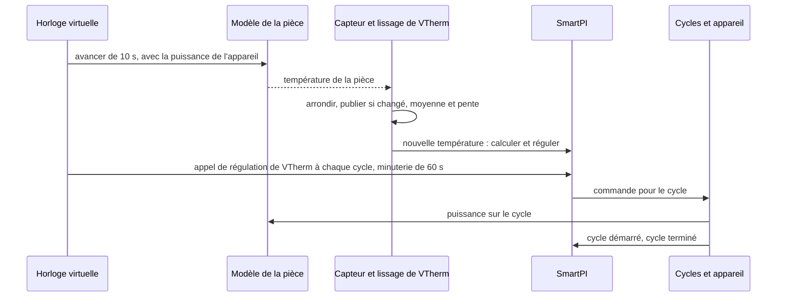

# Tests

Ce document rassemble tous les tests de ce fork : comment les lancer, le simulateur que la plupart
d'entre eux utilisent, chaque scénario de simulation et ce qu'il doit montrer, les autres tests,
classés par fonction, et les tests QAS sur un vrai Home Assistant. Les fonctions elles-mêmes sont décrites dans la
[documentation technique](technical_doc.md),
[Dépendances entre zones et deuxième source de chaleur](zone_dependencies.md) et
[Entrées eau et chaudière](water_input.md). Les tests propres à l'auteur tournent avec ceux-ci. Deux
d'entre eux suivent un fonctionnement que le fork change : `test_config_flow.py` (les formulaires) et
`test_smartpi_valve_runtime_sync.py`, dont le thermostat garde maintenant ses réglages SmartPI dans sa
propre entrée SmartPI, là où SmartPI les lit, et non dans celle de Versatile Thermostat
(`smartpi_options` du remplaçant de test `fakes/fake_thermostat_runtime.py`). La section 7 donne la
couverture du code.

## Sommaire

1. [Lancer les tests](#1-lancer-les-tests)
2. [Le simulateur](#2-le-simulateur)
3. [Scénarios de simulation](#3-scénarios-de-simulation)
4. [Tests par fonction](#4-tests-par-fonction)
5. [Limites](#5-limites)
6. [QAS sur un vrai Home Assistant](#6-qas-sur-un-vrai-home-assistant)
7. [Couverture du code](#7-couverture-du-code)

## 1. Lancer les tests

Lancez les tests depuis le dossier du dépôt, avec une copie de Versatile Thermostat (VTherm) dans
le chemin de recherche de Python (Python path). C'est la même configuration que l'intégration continue de l'auteur
(CI, les tests que GitHub lance automatiquement) :

    PYTHONPATH=<versatile_thermostat copy>:$PWD python -m pytest tests/ -q

Il y a deux ensembles de tests :

| Ensemble | Ce qu'il contient | Où il tourne |
|---|---|---|
| Court | les tests unitaires (petits tests d'une seule partie du code) et les simulations qui ne prennent que quelques secondes | à chaque pull request (workflow « Tests »), et en local par défaut |
| Long | l'ensemble court, plus les longues simulations et les comparaisons avec le code de VTherm lui-même | en local avec `SMARTPI_SIM_LOCAL=1` ; sur GitHub dans le workflow « Full tests », à chaque push sur la branche `qas` et à la demande |

Les longues simulations dépendent de `SMARTPI_SIM_LOCAL`. Sans cette variable, elles apparaissent
comme ignorées (skipped).

## 2. Le simulateur

### 2.1 Pourquoi

- **Une maison est lente et ne se répète jamais.** SmartPI apprend sur plusieurs jours. Dans une
  vraie maison, chaque question sur les extensions (une porte, un plancher plus lent, une chaudière
  qui attend plus de demande) prendrait des semaines. Et l'essai suivant n'aurait jamais la même
  météo.
- **La vérité est connue.** Dans le simulateur, le test fixe la puissance de chauffe de la pièce
  `a`, ses déperditions `b`, les retards et les échanges de chaleur. Ce que SmartPI apprend peut
  donc être comparé à ces vraies valeurs. Dans une maison, seule la température de la pièce peut
  être jugée.
- **Le vrai code tourne.** Le simulateur fait tourner le vrai handler et le vrai algorithme de
  SmartPI. Seul le travail que Versatile Thermostat et Home Assistant font autour d'eux est copié.
- **Les comparaisons se font pendant le test.** Un scénario tourne deux fois, par exemple avec et
  sans une fonction, et les deux simulations sont comparées. Des résultats sauvegardés à l'avance
  ne sont pas utilisés : ils ne correspondraient plus après chaque changement de l'algorithme de
  l'auteur.

### 2.2 Ce qu'il modélise

| Partie | Fichier | Ce qu'elle fait |
|---|---|---|
| Pièces | `tests/sim/plant.py` | Un modèle thermique simple, dans les unités de SmartPI. La vitesse à laquelle un chauffage réchauffe la pièce est le `a` de SmartPI (°C/min à pleine puissance). Un lien avec l'extérieur est le `b` de SmartPI (1/min). Un chauffage a un retard. Un émetteur de chaleur lent, comme un plancher chauffant, fait passer sa chaleur par une inertie : la chaleur qu'il donne suit l'appareil lentement, pas tout de suite. Un émetteur « à deux étages » la fait passer par deux inerties plus courtes à la suite, comme une dalle de plancher qui se réchauffe dans son épaisseur. Deux pièces peuvent être reliées en permanence, ou par une porte qui s'ouvre selon un horaire. Le modèle est calculé par pas de temps de 10 s ou moins. |
| Capteurs et lissage de VTherm | `tests/sim/sensors.py` | Un capteur est lu toutes les 10 s et arrondi (à 0.1 °C par défaut). Sa valeur n'est publiée que quand la valeur arrondie change. La moyenne glissante et la pente (vitesse de variation) de VTherm sont copiées : la moyenne a une demi-vie de 300 s, et la pente est en °C/h. |
| Cycles de chauffe | `tests/sim/scheduler.py` | Une copie de l'ordonnanceur de cycles de VTherm (la partie qui transforme une commande en cycles de l'appareil) pour un appareil : cycles tout-ou-rien, temps minimaux de marche et d'arrêt, vannes. L'ordonnanceur de VTherm lui-même n'est pas importé : il est interne à VTherm et change avec la branche principale de VTherm. Il y a une différence voulue : une erreur dans un cycle arrête la simulation, au lieu d'être seulement écrite dans le journal. |
| Temps | `tests/sim/clock.py` | Une horloge virtuelle remplace l'horloge de SmartPI, donc une semaine simulée ne prend que quelques secondes. Elle fait aussi tourner les minuteries : l'appel de régulation de VTherm à chaque cycle, le recalcul de SmartPI toutes les 60 s, et les cycles. |
| Chaudière et sources des données d'eau | `tests/sim/boiler.py` | L'eau qui arrive à un circuit : à température fixe, ou sur une courbe de chauffe (une température d'eau fixée à partir de la température extérieure). On peut y ajouter les cycles du brûleur, la priorité à l'eau chaude sanitaire (la chaudière chauffe d'abord le ballon d'eau chaude), et une chaudière qui ne démarre que quand une zone demande de la chaleur. Son eau arrive à SmartPI par l'une ou l'autre des sources qu'un utilisateur peut choisir : un fournisseur de test du contrat de SmartPI (`SimHeatingProvider`, inscrit comme le ferait une intégration), ou des entités (un capteur de départ par circuit et les signaux d'eau chaude et de chauffe de la chaudière, dans un remplaçant des états de Home Assistant). Un test peut imposer la raison d'une interruption pendant une plage de temps : le fournisseur la donne, le capteur de départ devient indisponible. |
| Météo | `tests/sim/weather.py` | La température extérieure : constante, une variation sur la journée, ou un saut brusque. |
| Mise en place des scénarios | `tests/sim/runner.py` | Une zone (ses `a`, `b`, retard, consigne, cycle, vanne ou appareil tout-ou-rien, capteur, voisins, presets, chaudière et la source de ses données d'eau : `water_data`, aucune, `provider` ou `entities`), un deuxième thermostat dans la zone (sa puissance, son retard et son inertie), et plusieurs zones dans un même monde partagé. |
| Mesures | `tests/sim/metrics.py` | Ce que SmartPI a appris comparé aux vraies valeurs, quand sa phase d'apprentissage s'est terminée, et l'erreur de la pièce. |

### 2.3 Un pas de simulation

## 3. Scénarios de simulation

Sauf indication contraire dans une ligne, la pièce a `a` 0.03 °C/min, `b` 0.001 /min, un retard de
10 min, un appareil tout-ou-rien avec un cycle de 10 min, un capteur de 0.1 °C et une consigne de
20 °C. La température extérieure est de 3 °C, avec une variation sur la journée de ±3 °C.
L'« erreur » est l'écart moyen entre la température de la pièce et sa consigne. « ±x % » signifie
à moins de x % de la vraie valeur. Une plage sans unité, comme 0.5–1.2, est la valeur apprise
divisée par la vraie valeur.

### 3.1 Zones voisines — `test_smartpi_sim_neighbours.py` (court)

Une pièce avec un capteur de 0.01 °C, à côté d'un couloir. L'échange de chaleur avec le couloir,
`k`, vaut 0.002. La porte est ouverte 7:00–9:00, 12:00–13:30 et 18:00–22:00.

| Repère | Scénario | Ce qu'il doit montrer |
|---|---|---|
| N1 | le couloir est dans la liste mais désactivé (mode `none`) | exactement la même simulation que sans lui |
| N2 | le couloir derrière une porte, 3 jours | `k` ±20 % ; `a` et `b` ±5 % ; aucun retard appris pendant que la porte est ouverte |
| N3 | le couloir toujours ouvert, à 20 °C ; sa température saute de +4 °C à 30 h et de −4 °C à 66 h | rien de publié à 42 h ; à 66 h, `k` ±10 % et les déperditions sans le couloir ±10 % ; après le deuxième saut, une erreur plus petite que sans la fonction |
| N3 grossier | la même chose avec un capteur de 0.1 °C et un seul saut | soit rien de publié (le couloir affiché comme « impossible à distinguer », et le `b` de SmartPI lui-même utilisé), soit `k` ±20 % |
| N4 | le couloir indisponible | exactement la même simulation que sans lui |
| N5 | mode refroidissement, le couloir à 28 °C derrière une porte | `k` ±25 % ; erreur sous 0.3 °C à partir de 60 h |
| N6 | la fenêtre du couloir ouverte pendant une heure pendant que la porte est ouverte, une fois pour chaque réaction | aucun `k` appris pendant ce temps ; la réaction appliquée (rien, arrêt, hors-gel 7 °C, éco 17 °C) ; l'appareil marche ou s'arrête en conséquence ; ensuite, la pièce ne monte pas de plus de 0.6 °C au-dessus de sa consigne (dépassement) |
| N7 | une pièce entre deux voisins toujours ouverts, la température de chacun sautant une fois | pour chacun : `k` à ±35 %, ou affiché comme « impossible à distinguer » |

### 3.2 Une zone à deux sources de chaleur — `test_smartpi_sim_second_source.py`

La source principale est le radiateur de la pièce. Dans la plupart des scénarios, la source
additionnelle est un plancher chauffant à eau : même puissance que le radiateur, un retard de
30 min, une inertie de 180 min, et la règle de répartition (comment la chaleur est répartie entre
les deux sources) `lead_band` à 20 %.

| Repère | Scénario | Ensemble | Ce qu'il doit montrer |
|---|---|---|---|
| Z1, Z3 | le plancher dès le départ, 40 h | court | le plancher fonctionne par blocs pendant que SmartPI apprend, puis suit la règle ; le modèle de la zone est publié avant 30 h, avec `a`, `b` et la puissance du plancher ±20 % ; SmartPI utilise ce modèle ; à partir de 30 h, le plancher donne plus de 20 % de la chaleur et l'erreur est sous 0.08 °C |
| — | le SmartPI du plancher lui-même pendant qu'il sert de source additionnelle | court | il n'apprend rien et ne change rien ; il suit la commande de la source principale ; il régule de nouveau une fois la source principale retirée |
| Z6 | la source principale ne répond plus | court | après 15 min, la source additionnelle régule seule ; la pièce reste au-dessus de 19.3 °C ; quand la source principale revient, la source additionnelle la suit de nouveau |
| — | la source principale éteinte, avec un cycle de 20 min | court | la source additionnelle reste éteinte et ne prend pas en charge la zone |
| — | le plancher sur l'eau, ses données d'eau venant d'un fournisseur | court | le plancher transforme la puissance de la source principale en sa propre commande, avec ses propres données d'eau |
| — | délestage (VTherm éteint des appareils quand la maison consomme trop de puissance) | court | une source principale délestée envoie quand même sa commande ; une source additionnelle délestée reste éteinte |
| — | un redémarrage de Home Assistant après 36 h | court | le modèle de la zone est gardé ; erreur sous 0.15 °C ensuite |
| Z7 | refroidissement avec deux sources | court | un modèle de refroidissement séparé, ±25 % ; erreur sous 0.15 °C |
| — | une vanne comme source additionnelle, que VTherm recalcule aussi | court | la vanne suit la source principale |
| Z1 comparé | comparé avec deux SmartPI qui fonctionnent indépendamment, capteurs de 0.01 et 0.1 °C, 96 h | long | erreur au plus 0.03 °C au-dessus de la paire indépendante ; le plancher donne plus de 35 % de la chaleur |
| Z1 nuits | trois nuits avec la consigne abaissée à 17 °C | long | dépassement au plus 0.1 °C au-dessus de la paire indépendante ; le dépassement de la dernière nuit au plus 0.15 °C au-dessus du plus grand dépassement des nuits précédentes (il ne grandit pas nuit après nuit) ; le plancher donne moins de 90 % de la chaleur |
| Z2 | règle `source_first` à 50 % | long | la source principale se stabilise sur la courbe de la règle (±0.15) |
| — | règle `together` à 200 % | long | la même chose |
| Z4 | un deuxième radiateur comme source additionnelle | long | chacun donne la moitié de la chaleur (±0.15) ; erreur au plus 0.03 °C au-dessus de la paire indépendante |
| Z5 | une source principale trop faible pour le froid (`a` 0.015, extérieur −5 °C) | long | le plancher garde la pièce au-dessus de 18.5 °C pendant que SmartPI apprend ; une fois le temps plus doux, SmartPI termine son apprentissage |

### 3.3 Douze pièces et quatre installations — `test_smartpi_sim_zone_set.py` (long)

Six pièces (des déperditions lentes aux rapides, des radiateurs lents aux rapides) tournent par
temps doux (3 °C) et par temps froid (−8 °C). Chacune a un plancher chauffant à eau de même
puissance. Chacune tourne 96 h, puis trois nuits avec la consigne abaissée à 17 °C (pendant 6, 8 et 10 h). Chacune est comparée à
deux SmartPI indépendants. Pour chaque pièce :

- le modèle de la zone est publié au plus tard à 30 h, avec `a`, `b` et la puissance du plancher
  ±15 % ;
- l'erreur de 48 h à 96 h est au plus 0.02 °C au-dessus de la paire indépendante ;
- le pire dépassement après une nuit est au plus 0.1 °C au-dessus de la paire indépendante ;
- chaque matin, la pièce atteint sa consigne moins 0.2 °C, en moyenne au plus 1 h plus tard que la
  paire indépendante.

Les mêmes vérifications tournent pour un plancher derrière une vanne, une dalle qui se réchauffe
dans son épaisseur, et de l'eau sur des courbes de chauffe (données d'eau venant d'entités). Deux zones côte à côte (toujours
ouvertes, ou avec une porte ouverte 6:00–23:00) doivent chacune garder une erreur au plus 0.02 °C
au-dessus de la paire indépendante. Les résultats sont dans
[Dépendances entre zones, §5.8](zone_dependencies.md#58-résultats-et-limites-simulation).

### 3.4 Eau — `test_smartpi_sim_water.py` (court)

Un radiateur (`a` 0.06 avec une eau à 60 °C) sur une chaudière avec une courbe de chauffe. Les
données d'eau viennent d'un fournisseur ou d'entités ; les scénarios marqués « les deux » tournent
avec chacune de ces sources.

| Repère | Scénario | Ce qu'il doit montrer |
|---|---|---|
| W1 | sans données d'eau, et avec elles venant d'un fournisseur et d'entités, 48 h | sans les données, SmartPI apprend moins de la moitié de `a` ; avec les données venant de l'une ou l'autre source, entre 0.5 et 1.2 fois `a`, et plus de 1.5 fois la valeur apprise sans elles |
| — | eau chaude sanitaire deux fois par jour, cycles du brûleur (les deux) | pendant que la chaudière chauffe l'eau chaude sanitaire, l'intégrale (la part de la commande qui s'accumule dans le temps) et la commande ne bougent pas ; erreur sous 0.3 °C |
| — | les données du fournisseur absentes pendant 2 h, puis pour de bon (`not_mapped`) | une courte interruption garde le facteur d'eau (la chaleur que donne l'eau comparée à l'eau de référence) ; une interruption durable met le facteur à 1 et propose la remise à zéro une seule fois |
| — | le capteur de départ indisponible à partir de 24 h (entités) | pendant 24 h, il garde le facteur (raison `unavailable`) et ne propose rien ; ensuite l'interruption compte comme durable : facteur 1 et la remise à zéro proposée une seule fois |
| — | une chaudière qui ne démarre que quand la zone demande de la chaleur (les deux) | la pièce reste au-dessus de 19 °C ; SmartPI termine son apprentissage et apprend `a` dans 0.5–1.2 |

### 3.5 Une chaudière qui n'est pas appelée — `test_smartpi_sim_boiler_call.py` (court)

Un radiateur de 2000 W derrière une vanne, avec un capteur de 0.01 °C. La chaudière ne démarre qu'à
partir d'une demande de 2500 W, donc cette pièce seule ne peut jamais la démarrer. D'autres zones
(3000 W) la démarrent, sauf pendant une plage de la journée.

| Repère | Scénario | Ce qu'il doit montrer |
|---|---|---|
| B1 | l'appel venant de la chaudière centrale de VTherm (ses entités en direct), sans données d'eau, pas de chaudière 2:00–8:00 | SmartPI non informé que la chaudière n'est pas appelée : `a` sous la moitié ; informé : `a` dans 0.85–1.2, `b` dans 0.95–1.05, aucun `a` appris pendant que la chaudière n'est pas appelée, le retard dans 9–13 min ; la raison de VTherm `below_threshold` (et, un instant à un basculement, `activation_delay`) |
| B1 entité | la même chose, l'appel venant d'un capteur binaire (entités) | la même chose ; la raison `not_called` (pas d'entité de raison) |
| B2 | l'appel d'un fournisseur, l'eau venant du fournisseur ou d'entités, pas de chaudière 10:00–16:00 | `b` dans 0.95–1.05, `a` dans 0.9–1.15, aucun `a` appris pendant que la chaudière n'est pas appelée ; la raison du fournisseur `below_threshold` |

Les résultats sont dans [Entrées eau et chaudière, §4.4](water_input.md#44-résultats-simulation).

### 3.6 SmartPI seul, deux thermostats, et le simulateur lui-même

| Fichier | Ensemble | Ce qu'il vérifie |
|---|---|---|
| `test_smartpi_sim_baseline.py` | court et long | SmartPI seul apprend une pièce connue. Avec un capteur de 0.01 °C : `a` et `b` ±5 % et le retard à 4 min près, le tout en 12 h (une grille de 12 pièces dans l'ensemble long). Avec un capteur de 0.1 °C, il termine son apprentissage (en 15 h environ) avec `a` et `b` à ±15 % ; dans l'ensemble long, quatre nuits avec réduit laissent `a` et `b` à ±10 % (trois pièces, trois phases d'appel) |
| `test_smartpi_sim_two_thermostats.py` | court et long | le retard et l'inertie du plancher dans le modèle de la pièce ; deux thermostats, chacun avec son propre SmartPI, qui chauffent une même pièce (le fonctionnement actuel, la base de comparaison pour Z1 et Z4) |
| `test_smartpi_regression_no_dependencies.py` | court | des fonctions configurées mais pas actives : exactement la même simulation et le même état sauvegardé que sans la fonction |
| `test_smartpi_sim_harness.py` | court | l'horloge, les minuteries, les cycles tout-ou-rien, les temps minimaux de marche et d'arrêt, les vannes, l'appel de régulation de VTherm à chaque cycle ; la même simulation faite deux fois donne le même résultat |
| `test_smartpi_sim_scheduler_parity.py` | long | l'ordonnanceur de cycles copié et la pente donnent les mêmes événements que le code de VTherm lui-même, sur des milliers de commandes et de lectures aléatoires |

## 4. Tests par fonction

### 4.1 Événements AutoCalib

| Fichier | Ce qu'il vérifie |
|---|---|
| `test_smartpi_autocalib_events.py` | chaque événement AutoCalib porte le vrai `entity_id` du thermostat et son nom dans `name` |

### 4.2 Entrées connues (la base des extensions)

| Fichier | Ce qu'il vérifie |
|---|---|
| `test_smartpi_effective_model.py` | comment les entrées connues (la chaleur échangée avec les zones voisines, la chaleur d'une deuxième source) sont combinées en `b_eff` et `T_ref`, les déperditions et la température de référence qu'utilise la régulation ; rien ne change sans elles |
| `test_smartpi_effective_model_edges.py` | cas limites trouvés par la couverture du code (section 7) : un apport de chaleur nul ou qui n'est pas un nombre est écarté |
| `test_smartpi_learning_window_known_inputs.py` | les fenêtres d'apprentissage retirent la chaleur des entrées connues |
| `test_smartpi_dependencies_algo.py` | l'algorithme utilise `b_eff` et `T_ref` partout dans sa régulation, garde les valeurs brutes pour l'apprentissage, met l'apprentissage en pause tant qu'un verrou d'apprentissage est actif (une condition comme la porte ouverte d'un voisin), et sauvegarde et charge son état ; le préréglage de la fenêtre d'un voisin sans consigne, une commande de source hors du rôle de source, un modèle commun publié après la phase d'apprentissage (a et b gardés) |
| `test_smartpi_dependencies.py`, `test_smartpi_dependency_inputs.py` | les éléments configurés, comment ils sont vérifiés, les lectures utilisées dans un calcul |
| `test_config_flow.py`, `test_config_flow_dependencies.py` | le menu d'options d'une entrée de thermostat (avec Water and boiler pour un type de chauffage à eau, Save and finish en dernier) et de l'entrée de valeurs par défaut ; la création d'une entrée par le menu ; la liste des dépendances (chaque étape revient au menu, un retrait sans rien choisi revient au menu avec une note, un élément pour revenir) |

### 4.3 Zones voisines

| Fichier | Ce qu'il vérifie |
|---|---|
| `test_smartpi_coupling_estimator.py` | l'apprentissage de `k` pour un voisin derrière une porte, pour plusieurs portes à la fois, et pour un voisin toujours ouvert |
| `test_smartpi_dependency_model.py` | les verrous d'apprentissage, les réactions à la fenêtre d'un voisin, les presets en refroidissement, un voisin toujours ouvert qui entre dans le modèle sans saut |
| `test_smartpi_dependencies_handler.py` | les lectures depuis Home Assistant |
| `test_config_flow_neighbours.py` | les formulaires des voisins : suggestions, erreurs, avertissements, modification, un voisin disparu refusé sur le formulaire, chaque étape revient au menu (rien n'est écrit avant Save and finish), la question de remise à zéro à l'enregistrement |
| `test_smartpi_coupling_estimator_edges.py`, `test_smartpi_dependencies_edges.py` | cas limites trouvés par la couverture du code (section 7) : des ajustements avec un coefficient négatif ou au-delà de sa borne, des portes dont les échanges s'annulent, une source qui n'a pas fonctionné pendant les fenêtres de porte, un historique dont les valeurs ne concordent pas, des lignes enregistrées d'une autre forme, un rapport de cycle vide, l'oubli des éléments retirés ; des éléments enregistrés qui ne sont pas des dictionnaires, un seul capteur de porte enregistré comme texte, une bande d'avance hors limites |

### 4.4 Une zone à deux sources de chaleur

| Fichier | Ce qu'il vérifie |
|---|---|
| `test_smartpi_zone_fit.py` | le modèle commun de la zone (un seul modèle ajusté pour les deux sources ensemble) trouve le retard de la source principale, l'échelle de temps du plancher, `a`, `b`, la puissance du plancher et le `k` d'un voisin |
| `test_smartpi_source_model.py`, `test_smartpi_source_candidates.py` | la chaleur du plancher calculée à partir de ses cycles ; les échelles de temps candidates |
| `test_smartpi_split.py` | les règles de répartition et la boucle d'allocation |
| `test_smartpi_source_link.py` | le lien entre les deux thermostats : commandes, cycles, une source principale qui ne répond plus, le plafond de puissance |
| `test_smartpi_dependency_model_source.py` | les blocs d'apprentissage, l'horloge d'apprentissage et son délai maximal, le freinage, le rattrapage plus rapide après une nuit, un redémarrage, le refroidissement |
| `test_smartpi_dependencies_handler.py` | les types de chauffage lus dans les deux entrées, la remise à zéro demandée depuis un formulaire, un thermostat maître modifié (ses appareils comparés par identifiant unique, aussi au rechargement de l'entrée, quand le thermostat n'a pas encore d'identifiant d'entité) ; une seconde source éteinte éteint son appareil, une plage du thermostat qui n'en est pas une, une source introuvable, une zone dont le thermostat maître a été supprimé |
| `test_config_flow_zone.py` | le formulaire de la zone : le thermostat maître et ses vérifications (aucun : retour au menu, qui dit pourquoi), une source sans type de chauffage à qui on le demande, la recommandation, le déplacement de la source principale (les voisins fusionnés ; refusé à l'étape du paramètre quand ils ne peuvent pas l'être), l'entrée de l'autre thermostat créée à l'enregistrement (ses options ouvrent un menu à elles), un retard et une inertie personnalisés, la suppression, la question de remise à zéro à l'enregistrement, une zone configurée pendant la création d'une entrée, deux fenêtres ouvertes en même temps ; une zone déplacée vers l'autre thermostat puis ramenée dans la même fenêtre (seule cette entrée la garde ; refusé, sans rien changer, quand ses voisins entreraient en conflit) |
| `test_smartpi_zone_fit_edges.py`, `test_smartpi_dependency_model_edges.py`, `test_smartpi_source_candidates_edges.py`, `test_smartpi_split_edges.py` | cas limites trouvés par la couverture du code (section 7) : une source qui n'a jamais fonctionné, un capteur bruité, des échantillons qui ne sont pas des nombres, des états enregistrés illisibles ; la même source configurée de nouveau, un coefficient appris en refroidissement à travers un redémarrage, pas de température extérieure, pas de demande de la source principale, pas de consigne, un coefficient publié pendant une relance, des ajustements et des réponses enregistrés illisibles ; une boucle sans demande de la source principale pour l'instant |

### 4.5 Eau

| Fichier | Ce qu'il vérifie |
|---|---|
| `test_smartpi_water_input.py` | le facteur d'eau, ses moyennes, l'eau chaude sanitaire, les interruptions courtes et durables, la sauvegarde et le chargement de l'état (avec les entrées auxquelles il appartient), l'oubli des données |
| `test_smartpi_water_algo.py` | commande = puissance / facteur, apprentissage = commande × facteur, la limite de puissance, les maintiens pendant l'eau chaude sanitaire et avec une eau froide ; le plancher d'activation de la vanne avec les données d'eau |
| `test_smartpi_heating_inputs.py` | les sources, lues seules : les entités (nombres, °F et K, indisponible, inconnu ou texte, une entité absente, les combinaisons de chauffe, d'eau chaude et de défaut, l'entité de raison, une entité gardée par son identifiant de registre lors d'un renommage) ; le registre des fournisseurs (inscription, retrait, deux fournisseurs, des noms inhabituels), un fournisseur lu avec prudence (non inscrit, `None`, une mauvaise version, une exception, pas un dictionnaire, un dictionnaire qui échoue, pas de méthode, de mauvais types, des nombres trop grands, des raisons que SmartPI ne connaît pas, les champs de la demande) et signalé une seule fois quand il est absent longtemps ; la chaudière centrale de VTherm à partir de ses entités en direct (appelée, les trois raisons déduites, des puissances en W et en kW, des entités absentes, un thermostat qu'elle ne compte pas) ; les options lues : signaux par défaut ou propres, des entrées sans les clés, des sources inconnues |
| `test_smartpi_water_handler.py` | le handler lit la source choisie (un fournisseur de test, ou des entités avec les signaux propres du thermostat ou ceux des valeurs par défaut), publie `water_factor`, propose la remise à zéro quand les données apparaissent ou disparaissent, mais pas pour les entrées pour lesquelles les options ont gardé le modèle ; d'autres entrées choisies dans les options effacent l'état de l'eau des anciennes entrées (un état durable, une moyenne à long terme) et une réparation ouverte, les mêmes entrées gardent le leur lors d'un redémarrage, et une entrée d'avant les sources garde les règles actuelles des interruptions sans données ; un fournisseur choisi absent pendant 10 minutes donne un seul avertissement ; un type électrique ou aucun type ne lit rien ; un remplaçant de Home Assistant sans registres lit les entités enregistrées telles quelles |
| `test_config_flow_heating_inputs.py` | les formulaires : le menu des valeurs par défaut et Boiler signals (stockés par identifiant de registre, un champ vidé retiré) ; Water and boiler : les listes construites à partir des fournisseurs inscrits, la chaudière centrale de VTherm proposée (et choisie par défaut) seulement là où elle sert le thermostat, un fournisseur qui n'est plus inscrit affiché comme non disponible, le capteur de départ, les signaux par défaut ou propres (pré-remplis à partir des valeurs par défaut ; un signal propre laissé vide reste vide), la question de remise à zéro à l'enregistrement seulement lors d'un changement de la source de l'eau ou de son capteur (remise à zéro, ou modèle gardé), des entrées sans les clés ; chaque étape revient au menu ; un type électrique sans l'élément ; la source additionnelle d'une zone qui ne choisit que son eau ; la nouvelle entrée du formulaire de zone sans les signaux des valeurs par défaut |
| `test_config_flow_heating_type.py` | le type de chauffage en premier dans les réglages d'un thermostat, « Not set » (non défini, enregistré comme aucune clé), absent du formulaire des valeurs par défaut ; l'étape de la réparation (l'avis de réparation de Home Assistant) |

### 4.6 Une chaudière qui n'est pas appelée

| Fichier | Ce qu'il vérifie |
|---|---|
| `test_smartpi_boiler_call.py` | les modes : une chaudière qui répond en 15 min ne change rien ; pour un appel sans réponse, d'abord l'émetteur refroidit, puis le maintien, puis l'émetteur se réchauffe après le démarrage de la chaudière ; les appareils tout-ou-rien et leur cycle ; une lecture perdue ; les raisons des fournisseurs ; les diagnostics avec la source choisie et ses entrées, aussi sans lecture |
| `test_smartpi_boiler_algo.py` | l'apprentissage ne voit aucune chaleur pendant le maintien et attend autour de cette période ; le retard n'est pas appris à partir du démarrage de la chaudière ; la correction du feed-forward est gelée ; une calibration est annulée |
| `test_smartpi_boiler_handler.py` | le handler lit la source de l'appel choisie : un fournisseur (ses raisons et sa demande ; aucune autre source quand il ne dit rien), des entités (les signaux propres du thermostat ou ceux des valeurs par défaut), la chaudière centrale de VTherm (la valeur par défaut là où elle sert le thermostat, sa raison et sa demande), aucune ; le bloc `boiler` affiché pour une source choisie sans données ; un type électrique ou aucun type ne lit rien |

### 4.7 Le capteur de diagnostic

| Fichier | Ce qu'il vérifie |
|---|---|
| `test_sensor_own_entry.py` | l'entrée de valeurs par défaut montre le capteur de diagnostic d'un thermostat qui n'a pas sa propre entrée ; quand le thermostat reçoit sa propre entrée, cette entrée reprend le capteur : Home Assistant ne refuse aucun identifiant unique en double quand l'entrée est créée, rechargée ou ses options enregistrées, et le capteur reste actif quand l'entrée de valeurs par défaut est rechargée ; une entrée propre qui utilise les valeurs par défaut enregistre les diagnostics complets comme le disent les valeurs par défaut, et un changement des valeurs par défaut recrée son capteur ; un capteur retiré après qu'un autre a repris son thermostat laisse celui-ci actif |

### 4.8 Les réglages, l'enregistrement des options et la migration

| Fichier | Ce qu'il vérifie |
|---|---|
| `test_smartpi_settings.py` | les réglages lus clé par clé : sans entrée propre, un thermostat prend les réglages partagés dans les valeurs par défaut et aucun réglage « ce thermostat seulement » (ni des valeurs par défaut, ni les délais TPI de VTherm) ; une entrée qui utilise les valeurs par défaut ajoute ses propres réglages « ce thermostat seulement » ; une entrée avec ses propres valeurs l'emporte ; une entrée de la version 0.4.0 garde sa copie complète, sans type de chauffage ; un réglage partagé absent d'une entrée est journalisé une fois et prend la valeur des valeurs par défaut ou du formulaire ; les options enregistrées remplacent en bloc les premières données ; le handler : non défini veut dire non utilisé (pas de données d'eau, pas de délais, pas de redémarrage PWM, pas de courbe de vanne), défini veut dire utilisé, une courbe de vanne activée sans ses points est signalée et désactivée, les diagnostics complets viennent des valeurs par défaut ; un enregistrement des valeurs par défaut recharge les thermostats qui les utilisent |
| `test_config_flow_settings.py` | les réglages d'un thermostat : le type de chauffage d'abord, puis les réglages « ce thermostat seulement » et « Use the SmartPI defaults » ; « Not set » enregistré comme aucune clé ; activé, l'entrée ne contient aucun réglage partagé ; désactivé, les propres valeurs partent de celles des valeurs par défaut (`settings_own`) ; la courbe de vanne après son interrupteur et comme élément du menu ; l'élément du régulateur des valeurs par défaut avec les seuls réglages partagés ; une nouvelle entrée créée par le menu (rien en propre ; la question de remise à zéro quand son type de chauffage est défini) ; un thermostat qui a déjà une entrée, une entité sans identifiant unique |
| `test_config_flow_save.py` | le fonctionnement des options : rien n'est écrit avant Save and finish ; fermer la fenêtre n'écrit rien et ne crée aucune autre entrée ; le menu nomme les sections non enregistrées avec les libellés de la langue de l'interface ; une modification annulée n'est pas une modification ; le menu suit le brouillon (Water and boiler, la courbe de vanne) ; une seule question de remise à zéro avec toutes ses raisons, aucune sans raison ; des dépendances modifiées dans une autre fenêtre arrêtent l'enregistrement ; un rechargement par entrée quand la zone passe dans l'entrée de l'autre thermostat, et une ancienne marque d'enregistrement n'est pas utilisée |
| `test_config_migration.py` | la version mineure 1 → 2 (la version majeure reste 1, donc la 0.4.0 charge encore les entrées) : l'entrée d'un thermostat garde ses valeurs et n'utilise pas les valeurs par défaut ; l'entrée des valeurs par défaut reçoit chaque réglage partagé et perd les autres ; seuls les réglages « ce thermostat seulement » définis attendent d'être déplacés ; après le démarrage, chaque thermostat sur SmartPI sans entrée en reçoit une avec eux et un avis de réparation les liste ; rien de défini ne crée rien ; retirer la clé temporaire ne recharge rien ; une version majeure plus récente est refusée ; une entrée déjà migrée reste telle quelle ; l'entité climate d'une autre intégration et une importation qui ne crée pas d'entrée ne sont pas nommées dans l'avis ; une entrée de base supprimée ne déplace rien |
| `test_config_flow_paths.py` | les formulaires dans les cas que seules certaines installations atteignent : une entité sans identifiant unique refusée, un voisin dont l'entrée indique cette zone en retour, une porte qui est aussi le capteur de fenêtre, la répartition recommandée pour des appareils de vitesse proche, une entrée dont le thermostat a été supprimé, un changement fait dans une autre fenêtre (ou dans les options de VTherm) pendant qu'une fenêtre est ouverte (l'enregistrement ferme la fenêtre sans rien écrire), l'entrée d'un membre de zone qui ne peut pas être créée |
| `test_services_routing.py` | les quatre services atteignent les thermostats qu'un appel nomme (dans sa cible ou ses données, un seul ou une liste ; la méthode sur le thermostat ou sur son gestionnaire), chacun une fois, et laissent les autres (un autre algorithme, une entité absente, un thermostat sans la méthode, signalé) ; ils sont enregistrés une fois et retirés |

### 4.9 Changements repris du nouveau code de l'auteur

Le code plus récent de l'auteur (branche `trajectoryv2`, `SPINew` dans le fork) est repris par étapes.
Les tests de l'auteur viennent avec chaque changement ; les tests ci-dessous vérifient que les
ajouts du fork fonctionnent toujours avec lui.

| Fichier | Ce qu'il vérifie |
|---|---|
| `test_smartpi_regulation_gaps.py` | un thermostat qui quitte le rôle de source additionnelle n'intègre rien pour le temps passé dans ce rôle ; un redémarrage dans l'autre mode HVAC réinitialise le PI au premier calcul seulement |
| `test_smartpi_ab_drift.py` (deux tests ajoutés) | l'état de la pièce apprise du paquet QAS, enregistré avec un seul `learn_seq` commun, initialise les deux compteurs de dérive ; des historiques semés par l'ajustement conjoint d'une zone laissent toujours `b` suivre une dérive |
| `test_smartpi_raw_slopes.py` | les pentes d'apprentissage viennent de la température mesurée brute : une rampe lente lue par un capteur de 0.1 °C donne sa vraie pente, moins la vitesse due aux entrées connues ; une zone retenue par une chaudière non appelée continue d'enregistrer des échantillons bruts ; un changement de l'appel de la chaudière vide l'historique brut et l'historique filtré |

## 5. Limites

- **Le simulateur est plus clément qu'une maison.** Il n'a pas de bruit de capteur, à part
  l'arrondi ; pas de soleil, pas de personnes ni de cuisine ; et une seule température par pièce,
  sauf si le modèle de dalle est choisi. Les résultats des autres documents sont ce que SmartPI
  obtient dans ces conditions.
- **La météo** est une constante, une variation sur la journée ou un saut brusque ; il n'y a pas de
  prévision.
- **La régulation propre d'une chaudière** (la modulation, c'est-à-dire le changement de puissance
  de la flamme, et la durée minimale de combustion) n'est pas modélisée au-delà de ce dont les
  scénarios ci-dessus ont besoin.
- **VTherm est copié, pas exécuté,** dans le simulateur. L'ensemble long vérifie la copie par
  rapport au code de VTherm lui-même, parce que la branche principale de VTherm peut changer. Les
  tests QAS (section 6) font tourner le vrai VTherm.

## 6. QAS sur un vrai Home Assistant

Les tests ci-dessus font tourner SmartPI dans le processus de test, sur une copie de l'ordonnanceur
de Versatile Thermostat. Ils vérifient la physique, l'apprentissage et les règles de répartition,
mais pas ce que seul un vrai Home Assistant montre. Les tests QAS (QAS : quality assurance,
l'assurance qualité ; c'est la branche `qas` qu'ils testent) le font, sur un banc de test
d'instances Home Assistant (le projet séparé `ha-testbed` ; huit instances au 2026-10-14, pour neuf
rôles) :

- le vrai Versatile Thermostat 10.5.1, avec sa chaudière centrale, son gestionnaire de puissance et
  sa détection de fenêtre, deux thermostats reliés par Home Assistant et un maître over_climate ;
- les formulaires dans Home Assistant, le registre des entités et ses pièces (areas) ;
- l'état sauvegardé dans `.storage`, après de vrais redémarrages ;
- le Recorder, le journal de bord (logbook) et les avis de réparation.

Les tests QAS sont lancés par la session de test du banc, jamais par la session qui écrit le code,
et toujours sur un seul commit de la branche `qas`. Ce dépôt contient le paquet de tests : le
simulateur, les aides, les configurations, les scripts de mise en place, le lanceur (runner) et ce
catalogue.

### 6.1 Le paquet de tests

Tout est sous `tests/qas/`. Aucun fichier n'y est nommé `test_*.py`, donc le `pytest tests/` de la CI
ne le lance pas : le lanceur a besoin du `lib/` du banc.

| Chemin | Ce que c'est |
|---|---|
| `custom_components/smartpi_room_sim/` | le simulateur de pièces sous forme d'intégration Home Assistant : pièces, chauffages, vannes, une chaudière, portes, fenêtres et l'extérieur. Sa physique (`physics.py`) est le même fichier que celui qu'utilise le simulateur dans le processus de test : `tests/sim/plant.py` le charge |
| `custom_components/smartpi_qas_helpers/` | des aides réservées aux tests, qui agissent à l'intérieur du SmartPI en marche : déclencher un événement AutoCalib, rendre silencieuse la source principale d'une zone, charger un état appris, lister les événements déclenchés, compter combien de fois une entrée SmartPI a été mise en place (`entry_setups`, pour QA7) ; et un fournisseur de chauffage du contrat de SmartPI, alimenté par le simulateur, qu'un scénario peut retirer du registre ou faire donner une raison (la chaudière non appelée, l'eau d'un circuit non associé) |
| `roles.py` | les neuf rôles en un seul endroit : pièces, thermostats, entrées SmartPI et options de base (avec les sources de l'eau et de la chaudière) |
| `config/<role>.yaml` | le `configuration.yaml` de chaque rôle, écrit par `config/build.py` à partir de `roles.py` |
| `setup/setup_role.py` | met en place une instance dans un rôle, par l'API, par étapes (`setup/stages.py`), puis la redémarre |
| `run.py`, `scenarios/` | le lanceur et les scénarios, sur le `lib/harness.py` du banc |
| `compare.py` | compare ce que deux instances ont mesuré (QB1, QE5), à partir des deux fichiers de résultats qu'on lui donne |
| `README.md` | comment le lancer, en bref |

**Le simulateur.** Une pièce a des déperditions vers l'extérieur `b` et une capacité thermique. Un
chauffage a un gain `a`, un retard et une inertie d'émetteur (un étage, ou deux pour une dalle). Les
pièces sont reliées en permanence ou par une porte, et une fenêtre relie une pièce à l'extérieur.
Un émetteur à eau ne chauffe qu'avec l'eau de la chaudière : il se réchauffe vers la température de
l'eau de la chaudière allumée (60 °C, 40 °C dans le rôle `water`) tant que l'interrupteur de la
chaudière est allumé, et refroidit jusqu'à 12 °C (sous la température des pièces) tant qu'il est
éteint. La chaudière peut être éteinte ou mise en défaut (elle ne s'allume alors pas), et l'eau
chaude sanitaire peut être prioritaire pendant un temps (les circuits ne reçoivent pas de chaleur,
et le départ de la chaudière montre l'eau envoyée au ballon). Chaque émetteur à eau a un capteur
sur son tuyau de départ (`sensor.smartpi_room_sim_<heater>_supply`), et la chaudière a trois
signaux : elle peut chauffer, l'eau chaude est prioritaire, un défaut (des capteurs binaires). Les
capteurs de température arrondissent à 0.1 ou 0.01 °C et ne sont écrits que quand leur valeur
change. Des services fixent la température d'une pièce, d'un coup ou progressivement, déplacent la
moyenne extérieure, ouvrent ou ferment une porte ou une fenêtre, font qu'un appareil ne répond plus
(il garde son état, et peut aussi devenir indisponible), règlent l'état de la chaudière, lancent
l'eau chaude, et réinitialisent les entrées. Tous les identifiants d'entités commencent par
`smartpi_room_sim_` : rien ne vient d'une vraie maison.

**Le fournisseur de chauffage.** Dans les rôles `water` et `electric`, les aides inscrivent un
fournisseur du contrat de SmartPI (v1) nommé `qas`. Il sert les thermostats SmartPI du rôle : pour
chacun, l'eau de la chaudière simulée, si elle peut chauffer (et pourquoi pas : eau chaude, éteinte,
défaut, brûleur éteint), si la chaudière est appelée, et une demande. Un scénario peut le retirer du
registre, imposer une raison pour le départ (`flow_stale`, `not_mapped`, …) ou dire que la chaudière
n'est pas appelée, avec une raison (la chaudière simulée arrête alors de s'allumer) ;
`provider_status` dit combien de fois SmartPI l'a interrogé, par thermostat.

### 6.2 Les rôles

Quelle instance fait tourner quel rôle, et quand, c'est le choix de la session de test du banc : un
rôle ne nomme aucune instance, et la mise en place et le lanceur prennent le rôle dans `--role`.

| Rôle | Ce qu'il contient |
|---|---|
| `base` | le salon : VTherm over_switch avec SmartPI, sans extension ; un grenier non chauffé (un capteur pour QB3) |
| `neighbours` | la cuisine (SmartPI), avec comme voisins le couloir derrière une porte (TPI, avec un capteur de fenêtre) et la salle à manger toujours ouverte (TPI) |
| `zone` | le séjour : un radiateur (source principale) et un plancher (source additionnelle) sous le maître `Lounge` (over_climate, autorégulation désactivée) ; des thermostats de réserve pour QE1 |
| `zone-ref` | le même séjour avec deux SmartPI indépendants (la comparaison pour QE5) |
| `zone-valve` | la pièce de travail : le plancher est une vanne (over_valve) ; le gestionnaire de puissance de VTherm |
| `central-boiler` | la chaudière centrale de VTherm (seuil de puissance 2500 W) : la chambre (2000 W) ne peut pas la démarrer seule, le bureau (3000 W) le peut |
| `ref-0.4.0` | le jumeau de `base` sur la version 0.4.0 de l'auteur, mise à jour plus tard vers `qas`, puis ramenée en arrière |
| `electric` | les types de chauffage électriques (un tapis chauffant électrique, un radiateur électrique rapide), avec le fournisseur de chauffage des aides inscrit (QW8) ; les relances |
| `water` | la chaudière s'allume dès le départ à 40 °C ; le radiateur du studio lit son eau dans des entités (son capteur de départ, les signaux de la chaudière dans « SmartPI defaults ») et l'appel de la chaudière dans le fournisseur des aides ; le plancher de la chambre d'enfant (une vanne) lit son eau dans le fournisseur ; le séjour est une zone (un radiateur et un plancher) dont les deux thermostats lisent leur eau dans le fournisseur |

Chaque VTherm a un délai de sécurité de 1440 min : un capteur qui n'écrit que quand sa valeur change
garde une même valeur plus longtemps que les 60 min par défaut de VTherm, et VTherm le prendrait
pour un capteur en panne.

### 6.3 Déploiement et lancement

La session de test du banc suit son propre `docs/workflow.md`. Pour ce paquet :

1. **Préparer** (stage) ce dépôt au commit de `qas` à tester, et Versatile Thermostat au tag de sa
   dernière version publiée (10.5.1 au 2026-10-14).
2. **Déployer** chaque instance avec son rôle :

       bin/deploy.sh --instance N --stage stage/vtherm_smartpi \
           --components stage/vtherm_smartpi/tests/qas/custom_components \
           --components stage/versatile_thermostat/custom_components \
           --config stage/vtherm_smartpi/tests/qas/config/<role>.yaml

3. **La mettre en place** dans son rôle par l'API (les entrées de VTherm, les pièces, les seuils de
   la chaudière et la puissance maximale, les entrées de SmartPI, les options de base), puis la
   redémarrer :

       HA_INSTANCE=N python stage/vtherm_smartpi/tests/qas/setup/setup_role.py --role ROLE

   Les étapes, dans l'ordre : `vtherm` (la configuration centrale de VTherm, l'entrée de valeurs par
   défaut de SmartPI, les thermostats, puis les maîtres), `areas`, `inputs`, `smartpi` (une entrée
   par thermostat SmartPI) et `options` (les réglages enregistrés une fois, les voisins, la zone,
   les signaux de la chaudière dans l'entrée de valeurs par défaut et les sources de l'eau et de la
   chaudière de chaque thermostat, le modèle gardé). Chaque étape saute ce qui existe déjà ;
   `--stage` en lance une seule.
4. **Lancer** des scénarios, ou `M` pour l'ensemble minimal du rôle :

       HA_INSTANCE=N python stage/vtherm_smartpi/tests/qas/run.py --role ROLE M
       HA_INSTANCE=N python stage/vtherm_smartpi/tests/qas/run.py --role neighbours QD5   # detached: 72 h

   `run.py --list` affiche les scénarios. Chacun ne tourne qu'à partir de la base de son rôle (ses
   entrées SmartPI et leurs options ; les voisins et la zone sont comparés par ce qu'ils signifient,
   pas par les identifiants que donnent les formulaires ; les sources de l'eau et de la chaudière, et
   les entités qu'elles lisent, par leur identifiant d'entité). Entre deux scénarios, les entrées du
   simulateur (aussi l'état de la chaudière et l'eau chaude), le fournisseur des aides et les
   thermostats reviennent à la base.
5. **Comparer** les paires, depuis le dossier du banc, en nommant les deux instances qui les ont
   fait tourner (ou leurs deux fichiers de résultats) :
   `python stage/vtherm_smartpi/tests/qas/compare.py qb1 NEW REF` (NEW a fait tourner `base`, REF
   `ref-0.4.0`) et `compare.py qe5 NEW REF` (NEW a fait tourner `zone`, REF `zone-ref`).

**L'instance qui fait tourner `ref-0.4.0`** passe de 0.4.0 à `qas`, puis revient. Le banc déploie le fork en 0.4.0 (51db763)
avec `--ref`, et les composants du paquet de tests depuis une copie de travail (checkout) de `qas` :

    QB1 / QB1s  →  QB2a (or QB2l after QB1)  →  deploy qas  →  QB2  →  QB3a  →  deploy 0.4.0  →  QB3

### 6.4 Durées

Un scénario attend ce que SmartPI fait après ses propres délais, plus une marge de deux calculs. Le
lanceur lit les délais dans l'extension préparée (`smartpi/const.py` et `smartpi/source_model.py`) :

| Quoi | Durée |
|---|---|
| un calcul | 60 s |
| le cycle de VTherm | 10 min |
| après la fermeture d'une porte, l'apprentissage attend | 10 min |
| le délai de grâce de la chaudière | 15 min, plus le cycle pour un appareil tout-ou-rien |
| la stabilisation d'un émetteur (le retard plus trois fois l'inertie) | radiateur 65 min, plancher à eau 570 min |
| un fournisseur choisi absent, avant que SmartPI avertisse | 10 min |
| une source principale silencieuse | 15 min |
| la détection de fenêtre de VTherm | 30 s |

Le simulateur avance toutes les 7 s et la température extérieure oscille sur 2838 s : aucune période
du simulateur n'est un multiple des 60 s de SmartPI ni du cycle. Les températures des pièces changent
en rampes (progressivement).

### 6.5 Le catalogue

« Détaché » : plus de deux heures, donc le banc le lance en arrière-plan. « Minimum » : dans
l'ensemble minimal, lancé après chaque changement. « Ensemble » : les scénarios « avec données
d'eau » utilisent le rôle `water` (ou le fournisseur des aides dans le rôle `electric`) ; les autres
n'ont besoin d'aucune donnée d'eau.

| ID | Ce qu'il vérifie | Rôle | Durée | Détaché | Jumeau dans le processus de test | Minimum | Ensemble |
|---|---|---|---|---|---|---|---|
| QA1 | Après le redémarrage de la mise en place, chaque entrée SmartPI et VTherm est chargée, ni SmartPI ni VTherm n'écrit d'avertissement ou d'erreur dans le journal, chaque thermostat SmartPI a ses diagnostics, aucun fournisseur de chauffage n'est inscrit sauf celui des aides là où le rôle l'a, et aucune entrée ne choisit de source pour l'eau ou pour l'appel de la chaudière. | `base`, `electric` | 15 min | non | test_factory.py | oui | sans données d'eau |
| QA2 | Enregistrer sans changement les réglages d'une entrée de thermostat passe par le menu d'options et « Save and finish » sans la question de remise à zéro, garde les options enregistrées, et recharge l'entrée une seule fois, sans boucle. | `base` | 15 min | non | test_config_flow_dependencies.py | oui | sans données d'eau |
| QA3 | Les quatre services de SmartPI fonctionnent sur VTherm 10.5.1, et un apprentissage en pause reste en pause après un redémarrage. | `base` | 30 min | non | test_services.py | non | sans données d'eau |
| QA4 | Les événements AutoCalib portent l'entité climate du thermostat dans entity_id et son nom dans name, et ni le Recorder ni le journal de bord ne signale un identifiant d'entité invalide. | `base` | 60 min | non | test_smartpi_autocalib_events.py | oui | sans données d'eau |
| QA5 | Deux redémarrages gardent l'état appris (le modèle, ses compteurs et le jeton de remise à zéro appliqué), et un jeton de remise à zéro n'est pas appliqué une deuxième fois. | `base` | 20 min | non | test_algo_persistence.py | oui | sans données d'eau |
| QA6 | Un type de chauffage à eau sans source de données d'eau montre le bloc water avec la source none, le facteur 1 et ses entrées sans aucune source, et pas de bloc boiler sans source de l'appel ; un type électrique ne montre ni l'un ni l'autre ; et rien n'est écrit dans le journal à chaque appel de régulation. | `base`, `electric` | 20 min | non | test_smartpi_water_handler.py, test_smartpi_boiler_handler.py | oui | sans données d'eau |
| QA7 | Une modification faite dans les options puis la fenêtre fermée n'enregistre rien et ne recharge rien ; le menu nomme la modification dans la langue de l'instance (en anglais là où SmartPI n'a pas de texte à lui) ; la même modification enregistrée est stockée et recharge l'entrée une seule fois. | `base` | 15 min | non | test_config_flow_save.py | oui | sans données d'eau |
| QB1 | Pendant 48 h, la pièce jumelle apprend et régule ; l'instance garde a, b et son erreur moyenne de 24 à 48 h, et compare.py qb1 réussit quand les a et b de l'instance qas sont à ±10 % de ceux de 0.4.0 et que son erreur moyenne est au plus 0.03 °C au-dessus. | `base`, `ref-0.4.0` | 48 h | oui | test_smartpi_regression_no_dependencies.py, test_smartpi_sim_baseline.py | non | sans données d'eau |
| QB1s | Pendant 45 minutes, la pièce jumelle régule et rien n'enregistre d'erreur dans le journal, et l'instance garde ce que lit compare.py qb1s (les deux instances en régulation, les phases nommées). Variante courte de QB1. | `base`, `ref-0.4.0` | 45 min | non | test_smartpi_sim_baseline.py | oui | sans données d'eau |
| QB2a | Sur 0.4.0, avant la mise à jour : l'état de SmartPI est l'état appris préparé pour le test (fixture), sauvegardé par 0.4.0 elle-même avec l'apprentissage en pause, et son modèle est gardé pour QB2. | `ref-0.4.0` | 10 min | non | test_algo_persistence.py | oui | sans données d'eau |
| QB2 | Après la mise à jour de 0.4.0 vers qas, l'état sauvegardé par 0.4.0 est chargé sans changement, aucun avertissement sur son format n'est écrit dans le journal, rien n'est remis à zéro, et le menu d'options de l'ancienne entrée fonctionne. | `ref-0.4.0` | 30 min | non | test_algo_persistence.py | oui | sans données d'eau |
| QB3a | Sur qas, avant de revenir à 0.4.0 : un voisin (le capteur du grenier) est ajouté à l'entrée, l'apprentissage est mis en pause et le modèle est gardé pour QB3 ; cela est laissé en place exprès. | `ref-0.4.0` | 10 min | non | — | non | sans données d'eau |
| QB3 | De retour sur 0.4.0 avec un voisin configuré, les entrées migrées vers la version 1.2 se chargent sans erreur (leur version majeure est toujours 1), et l'état aussi ; enregistrer les options dans 0.4.0 supprime les clés du fork, un point déjà connu. | `ref-0.4.0` | 30 min | non | — | non | sans données d'eau |
| QB2l | Sur 0.4.0 après QB1, avant la mise à jour : le modèle que 0.4.0 a appris elle-même est gardé pour QB2 avec l'apprentissage en pause, sans état de départ chargé. | `ref-0.4.0` | 5 min | non | test_algo_persistence.py | non | sans données d'eau |
| QC1 | Pour un thermostat que sert la chaudière centrale de VTherm, le bloc boiler indique la source vtherm_central_boiler, son champ called suit le capteur binaire de la chaudière centrale, et, chaudière éteinte, sa raison et sa demande viennent des entités en direct de VTherm (rien n'appelle : no_demand, le seuil de puissance 2.5 kW). | `central-boiler` | 30 min | non | test_smartpi_boiler_handler.py | oui | sans données d'eau |
| QC2 | La petite zone, qui appelle seule sous les seuils, passe en emitter_cooling après le délai de grâce, en held après le temps de stabilisation de son émetteur (raison de VTherm below_threshold) sans apprendre a, en emitter_warming dès que la grande zone démarre la chaudière, et revient à l'apprentissage normal un temps de stabilisation plus tard. | `central-boiler` | 2.5 h | oui | test_smartpi_boiler_call.py, test_smartpi_boiler_algo.py | non | sans données d'eau |
| QC2s | La petite zone, qui appelle seule sous les seuils, passe en emitter_cooling après le délai de grâce et en held après le temps de stabilisation de son émetteur (raison de VTherm below_threshold) sans apprendre a, puis en emitter_warming dès que la grande zone démarre la chaudière. Variante courte de QC2, QC4. | `central-boiler` | 95 min | non | test_smartpi_boiler_call.py, test_smartpi_boiler_algo.py | oui | sans données d'eau |
| QC3 | Sans le capteur binaire de la chaudière centrale (désactivé), SmartPI ne lit aucun appel de la chaudière (sa source est affichée sans données) et apprend comme avant, sans écrire d'erreur dans le journal ; le capteur revient ensuite. | `central-boiler` | 20 min | non | test_smartpi_boiler_handler.py | oui | sans données d'eau |
| QC4 | Chaque jour de 2:00 à 8:00, la grande zone reste éteinte, donc la petite zone appelle sans la chaudière ; après 48 h, le a qu'elle a appris est dans 0.85–1.2 du vrai a de son radiateur. | `central-boiler` | 48 h | oui | B1 (test_smartpi_sim_boiler_call.py) | non | sans données d'eau |
| QD1 | Les formulaires des voisins montrent chaque erreur et chaque avertissement, suggèrent le capteur de porte des pièces (areas) des deux zones, modifient et suppriment avec la question de remise à zéro à l'enregistrement, refusent sur le formulaire un voisin disparu, reviennent au menu quand rien n'est choisi pour le retrait, et arrêtent l'enregistrement avec zone_changed. | `neighbours` | 45 min | non | test_config_flow_neighbours.py | oui | sans données d'eau |
| QD2 | Une remise à zéro choisie dans un formulaire de voisin remet à zéro le modèle de la cuisine une seule fois, et le redémarrage suivant ne le remet pas de nouveau à zéro. | `neighbours` | 20 min | non | test_smartpi_dependencies_handler.py | oui | sans données d'eau |
| QD3 | Un voisin indisponible, ou en mode none, ne joue aucun rôle : sa connexion est inactive et le modèle de la cuisine n'a aucune entrée connue venant de lui. | `neighbours` | 30 min | non | N1, N4 | oui | sans données d'eau |
| QD4 | Porte ouverte, la fenêtre ouverte du couloir fait réagir la cuisine comme le dit son réglage (rien, arrêt, hors-gel, éco), sans apprendre aucun k pendant ce temps, et la cuisine revient à la normale une fois la fenêtre et la porte fermées. | `neighbours` | 60 min | non | N6 | oui | sans données d'eau |
| QD5 | Avec la porte ouverte chaque jour 7–9, 12–13:30 et 18–22 pendant 72 h, la cuisine apprend le k du couloir à ±25 % du vrai échange, et aucun temps mort pendant que la porte est ouverte. | `neighbours` | 72 h | oui | N2, N5 | non | sans données d'eau |
| QD5s | Ouverte deux fois pendant 8 minutes, la porte met en pause l'apprentissage de la cuisine (door_open, puis door_settling) et aucun temps mort n'est appris pendant qu'elle est ouverte. Variante courte de QD5. | `neighbours` | 40 min | non | N2 | oui | sans données d'eau |
| QD6 | Avec la salle à manger toujours ouverte et sa température qui fait des sauts d'elle-même pendant 72 h, la cuisine apprend son k à ±20 % du vrai échange, ou l'affiche comme « impossible à distinguer ». | `neighbours` | 72 h | oui | N3 | non | sans données d'eau |
| QD6s | Quand la température de la salle à manger toujours ouverte fait un saut, la cuisine la garde connectée sans mettre son apprentissage en pause, et n'écrit aucune erreur dans le journal. Variante courte de QD6. | `neighbours` | 30 min | non | N3 | oui | sans données d'eau |
| QE1 | Le formulaire de zone refuse chaque mauvais maître, crée à l'enregistrement l'entrée manquante d'un appareil en ne redémarrant que ce thermostat, déplace vers la source principale une zone configurée depuis la source additionnelle, arrête l'enregistrement avec zone_changed, et supprime la zone. | `zone` | 60 min | non | test_config_flow_zone.py | oui | sans données d'eau |
| QE2 | Dans la zone en marche, la source additionnelle n'apprend rien et applique la commande de la source principale, et changer son type de chauffage redémarre la source principale. | `zone` | 60 min | non | test_smartpi_sim_second_source.py | oui | sans données d'eau |
| QE3 | Quand la source principale devient silencieuse, la source additionnelle régule seule la zone après 15 minutes, la pièce restant au-dessus de 19.3 °C, et suit de nouveau la source principale dès qu'elle revient. | `zone` | 60 min | non | Z6 | oui | sans données d'eau |
| QE4 | Quand les appareils du maître changent dans VTherm, SmartPI écrit un avertissement dans le journal au démarrage et la zone continue de fonctionner. | `zone` | 15 min | non | test_smartpi_dependencies_handler.py | oui | sans données d'eau |
| QE5 | Pendant 48 h, la zone publie son modèle avant environ 30 h, régule au plus 0.05 °C moins bien que la paire indépendante, le plancher donne plus de 20 % de la chaleur, et un redémarrage à 36 h garde le modèle ; compare.py qe5 en juge. | `zone`, `zone-ref` | 48 h | oui | Z1 comparé | non | sans données d'eau |
| QE5s | Pendant 45 minutes, la zone (ou la paire indépendante) régule et rien n'enregistre d'erreur dans le journal, le plancher suivant le radiateur dans la zone. Variante courte de QE5. | `zone`, `zone-ref` | 45 min | non | Z1 comparé | oui | sans données d'eau |
| QE6 | Quand le gestionnaire de puissance de VTherm déleste les appareils de la zone, une source principale délestée envoie quand même sa commande et une source additionnelle délestée reste éteinte. | `zone-valve` | 60 min | non | délestage | non | sans données d'eau |
| QE7 | Pendant 2 h, la vanne, comme source additionnelle, suit la commande de la source principale. | `zone-valve` | 2 h | non | vanne comme source additionnelle | non | sans données d'eau |
| QW1 | Avec des données d'eau pendant 48 h (le studio par des entités, la chambre d'enfant par le fournisseur), les deux blocs water indiquent la source live avec le facteur de l'eau à 40 °C de la chaudière, et chaque a appris est dans 0.5–1.2 du vrai a de son émetteur à l'eau de référence. | `water` | 48 h | oui | W1 (test_smartpi_sim_water.py) | non | avec données d'eau |
| QW1s | Pendant 45 minutes, les deux blocs water indiquent la source live, leurs sources donnant des données, avec le facteur de l'eau à 40 °C de la chaudière, water_factor est publié sur chaque thermostat et rien n'écrit d'erreur dans le journal. Variante courte de QW1. | `water` | 45 min | non | W1 (test_smartpi_sim_water.py) | oui | avec données d'eau |
| QW2 | Eau chaude sanitaire pendant 20 minutes : le bloc water du studio indique la source dhw, le facteur 0 et no_heat, sa commande reste telle qu'elle était (et son intégrale, une fois que SmartPI régule), son entrée d'eau chaude le montre ; ensuite, la source est de nouveau live. | `water` | 30 min | non | eau chaude sanitaire (test_smartpi_sim_water.py) | oui | avec données d'eau |
| QW3 | Avec un modèle appris, les données du fournisseur absentes (flow_stale) gardent la moyenne à long terme de la chambre d'enfant ; durables (not_mapped), elles donnent le facteur 1 et la réparation water_data_gone une seule fois ; sa résolution remet le modèle à zéro. | `water` | 50 min | non | interruptions (test_smartpi_sim_water.py) ; test_smartpi_water_handler.py | oui | avec données d'eau |
| QW4 | Avec un modèle appris, les données de la chambre d'enfant perdues pour de bon, puis revenues : la réparation water_data_gone, puis water_data_appeared une seule fois ; gardé lors de sa résolution, le modèle reste. | `water` | 40 min | non | test_smartpi_water_handler.py | oui | avec données d'eau |
| QW5 | Le fournisseur dit que la chaudière n'est pas appelée (below_threshold) pendant que le studio appelle : son bloc boiler indique la source provider:qas, called à false, la raison et la demande du fournisseur, emitter_cooling après le délai de grâce, held après le temps de stabilisation sans apprendre a ; les autres raisons s'affichent ; de nouveau appelée, emitter_warming. | `water` | 95 min | non | B2 (test_smartpi_sim_boiler_call.py) ; test_smartpi_boiler_handler.py | oui | avec données d'eau |
| QW6 | Dans la zone du séjour, le plancher (la source additionnelle, eau venant du fournisseur) applique la puissance de la source principale avec son propre facteur d'eau : son bloc water est live avec le facteur du plancher, et sa commande est la puissance de la source principale divisée par ce facteur (au plus 100 %). | `water` | 60 min | non | test_smartpi_sim_second_source.py | oui | avec données d'eau |
| QW7 | Le fournisseur signale que le circuit de la chambre d'enfant n'est pas associé (not mapped) : son eau est tout de suite lasting, avec le facteur 1 et la raison du fournisseur ; associé de nouveau, elle est live. | `water` | 15 min | non | test_smartpi_water_input.py | oui | avec données d'eau |
| QW8 | Avec le fournisseur de chauffage des aides inscrit, les types électriques ne le lisent jamais : il n'est interrogé pour aucun de leurs thermostats, et leurs diagnostics n'ont ni bloc water ni bloc boiler. | `electric` | 15 min | non | test_smartpi_water_handler.py | oui | avec données d'eau |
| QW9 | La source de l'eau du studio changée dans les options : vers none, la remise à zéro est demandée (modèle gardé), le facteur est tout de suite 1 et aucune réparation ne vient ; de retour à entities, la question revient (modèle gardé), les données commencent en live sans réparation. | `water` | 25 min | non | test_config_flow_heating_inputs.py, test_smartpi_water_handler.py | oui | avec données d'eau |
| QW10 | Le fournisseur retiré du registre : les entrées de la chambre d'enfant le montrent non disponible, sa moyenne à long terme reste utilisée, et SmartPI avertit une seule fois par thermostat après 10 minutes ; inscrit de nouveau, les données sont live. | `water` | 25 min | non | test_smartpi_water_handler.py, test_smartpi_heating_inputs.py | oui | avec données d'eau |
| QZ1 | SmartPI n'écrit aucune erreur dans le journal et chacun de ses avertissements est listé, le Recorder ne refuse aucun des attributs des diagnostics, les formulaires lus en polonais montrent du texte et pas des clés, et après trois rechargements d'une entrée, son thermostat ne calcule pas deux fois, aucun maître de zone n'est signalé comme modifié et aucun capteur de diagnostic n'est refusé comme doublon. | toutes | 25 min | non | — | oui | sans données d'eau |

L'ensemble minimal prend, par rôle, d'environ 25 min (`zone-valve`) à environ 6.5 h (`water`) ; les
instances tournent en parallèle. Les longs scénarios (QB1, QC2, QC4, QD5, QD6, QE5, QW1) tournent
détachés, de 2.5 h à 72 h chacun.

**À chaque lancement**, QZ1 vérifie : aucune erreur de SmartPI, chacun de ses avertissements listé,
aucun attribut des diagnostics refusé par le Recorder, les formulaires en polonais qui montrent du
texte et pas des clés brutes, aucun thermostat qui calcule deux fois après plusieurs rechargements
de son entrée, alors aucun avertissement indiquant que le maître d'une zone n'a plus ses deux
appareils, et aucun capteur de diagnostic refusé comme doublon.

### 6.6 Vérifié sans le banc

| Fichier | Ce qu'il vérifie | Où il tourne |
|---|---|---|
| `test_qas_room_sim.py` | la physique du simulateur comparée au modèle du premier ordre et au réseau de pièces du simulateur dans le processus de test, ses portes, fenêtres, chaudière (éteinte, en défaut, eau chaude), appareils et sa réinitialisation ; ses entités (aussi les capteurs de départ et les signaux de la chaudière) et services dans Home Assistant ; le fournisseur de chauffage des aides, lu par le propre lecteur de SmartPI comme le dit son contrat, ses réponses à l'état de la chaudière, et ses services | CI |
| `test_qas_pack.py` | aucun fichier du paquet collecté par pytest ; les fichiers des rôles à jour et valides, aucun rôle ne nommant une instance ; le paquet se compile et s'importe sans le banc ; chaque scénario du plan enregistré avec une attente d'une phrase, et présent dans ce catalogue ; la base du lanceur (aussi les sources et les entités du rôle `water`) et le rôle exigé pour lancer ; `compare.py` avec les deux fichiers de résultats qu'on lui donne ; l'état de départ préparé se charge | CI |
| `test_qas_setup_flows.py` | la mise en place de chaque rôle par les vrais formulaires de Versatile Thermostat 10.5.1 et de SmartPI, sans aucune erreur dans le journal, puis une deuxième fois sans aucun changement ; les rôles de zone avec chaque entrée SmartPI rechargée, sans avertissement indiquant que le maître de la zone a changé ; l'entrée propre d'un thermostat qui reprend son capteur de diagnostic à l'entrée de valeurs par défaut (l'entrée créée, rechargée, ses options enregistrées, le formulaire de zone, l'entrée de valeurs par défaut rechargée) sans identifiant unique en double ; les sources du rôle `water` et les signaux de la chaudière dans l'entrée de valeurs par défaut, comme le dit le rôle ; chaque fenêtre par son menu et « Save and finish » ; les chemins de formulaires de QD1, QE1, QE2, QE4 et QW9 | en local, avec `SMARTPI_QAS_LOCAL=1` |

### 6.7 Points connus

- **Retour à 0.4.0.** Les entrées migrées vers la version 1.2 gardent la version majeure 1, donc la
  0.4.0 les charge. La 0.4.0 ignore « Use the SmartPI defaults » : l'entrée d'un thermostat avec
  l'interrupteur activé ne contient aucun réglage partagé, donc la 0.4.0 fait tourner ce thermostat
  avec les valeurs de son code pour eux. Enregistrer les options dans 0.4.0 supprime les clés du fork
  (voisins, zone, type de chauffage). QB3 le montre.
- **Le fournisseur de chauffage de l'ensemble QAS « avec données d'eau »** est le remplaçant de
  test des aides, alimenté par le simulateur : il montre que SmartPI lit tout fournisseur de son
  contrat, pas qu'une intégration donnée fournit les bonnes valeurs.
- **L'état appris** que chargent QB2a, QD2, QW3 et QW4 (`smartpi_qas_helpers/fixtures/learned_room.json`)
  vient du simulateur dans le processus de test (a = 0.035, b = 0.0012, après sa sortie de la phase
  d'apprentissage) ; SmartPI 0.4.0 le charge sans changement.

## 7. Couverture du code

La part du code du plugin que les tests exécutent, mesurée avec coverage.py sur la suite locale
complète (l'ensemble long de la section 1 avec les vérifications QAS qui tournent sans le banc,
section 6.6) : les lignes, et les branches (chaque chemin que peut prendre un `if` ou une boucle).

    COVERAGE_FILE=<scratch>/.coverage SMARTPI_SIM_LOCAL=1 SMARTPI_QAS_LOCAL=1 \
      PYTHONPATH=<versatile_thermostat copy>:$PWD python -m pytest tests/ -q -p no:cacheprovider -n 4 \
      --cov=custom_components/vtherm_smartpi --cov-branch --cov-report=json:<scratch>/cov.json

La référence est `dev` à 112e9e5, mesurée le 2026-10-14, avant les entrées du système de chauffage.
« Combiné » est le chiffre de coverage.py lui-même, lignes et branches ensemble. Les 1397 tests
passent.

### 7.1 Tout le plugin

Chaque fichier garde ou augmente sa couverture.

| Fichier | Lignes (référence → maintenant) | Branches (référence → maintenant) | Combiné (référence → maintenant) |
|---|---:|---:|---:|
| `__init__.py` | 77.5 % → 274/282 (97.2 %) | 54.2 % → 118/128 (92.2 %) | 71.0 % → 95.6 % |
| `algo.py` | 92.4 % → 1840/1988 (92.6 %) | 81.8 % → 401/484 (82.9 %) | 90.4 % → 90.7 % |
| `commons.py` | 100.0 % → 4/4 (100.0 %) | — → — | 100.0 % → 100.0 % |
| `config_flow.py` | 95.6 % → 1037/1060 (97.8 %) | 89.8 % → 365/378 (96.6 %) | 94.1 % → 97.5 % |
| `const.py` | 100.0 % → 75/75 (100.0 %) | — → — | 100.0 % → 100.0 % |
| `cycle_utils.py` | 100.0 % → 5/5 (100.0 %) | — → — | 100.0 % → 100.0 % |
| `factory.py` | 100.0 % → 10/10 (100.0 %) | — → — | 100.0 % → 100.0 % |
| `handler.py` | 92.0 % → 629/673 (93.5 %) | 84.6 % → 170/198 (85.9 %) | 90.3 % → 91.7 % |
| `heating_inputs.py` | nouveau → 353/353 (100.0 %) | nouveau → 106/106 (100.0 %) | nouveau → 100.0 % |
| `hvac_mode.py` | 70.8 % → 46/65 (70.8 %) | 21.4 % → 3/14 (21.4 %) | 62.0 % → 62.0 % |
| `repairs.py` | 100.0 % → 22/22 (100.0 %) | 100.0 % → 4/4 (100.0 %) | 100.0 % → 100.0 % |
| `sensor.py` | 96.0 % → 184/190 (96.8 %) | 83.3 % → 57/64 (89.1 %) | 92.7 % → 94.9 % |
| `settings.py` | nouveau → 49/49 (100.0 %) | nouveau → 10/10 (100.0 %) | nouveau → 100.0 % |
| `smartpi/__init__.py` | 100.0 % → 7/7 (100.0 %) | — → — | 100.0 % → 100.0 % |
| `smartpi/ab_aggregator.py` | 96.3 % → 26/27 (96.3 %) | 90.0 % → 9/10 (90.0 %) | 94.6 % → 94.6 % |
| `smartpi/ab_drift.py` | 87.5 % → 119/136 (87.5 %) | 69.4 % → 25/36 (69.4 %) | 83.7 % → 83.7 % |
| `smartpi/ab_estimator.py` | 90.9 % → 378/416 (90.9 %) | 82.4 % → 89/108 (82.4 %) | 89.1 % → 89.1 % |
| `smartpi/autocalib.py` | 88.8 % → 253/285 (88.8 %) | 71.8 % → 56/78 (71.8 %) | 85.1 % → 85.1 % |
| `smartpi/boiler_call.py` | 100.0 % → 69/69 (100.0 %) | 100.0 % → 18/18 (100.0 %) | 100.0 % → 100.0 % |
| `smartpi/calibration.py` | 88.6 % → 147/166 (88.6 %) | 76.3 % → 29/38 (76.3 %) | 86.3 % → 86.3 % |
| `smartpi/command_ownership.py` | 98.8 % → 164/166 (98.8 %) | 93.8 % → 30/32 (93.8 %) | 98.0 % → 98.0 % |
| `smartpi/const.py` | 100.0 % → 320/320 (100.0 %) | 100.0 % → 4/4 (100.0 %) | 100.0 % → 100.0 % |
| `smartpi/controller.py` | 94.7 % → 232/245 (94.7 %) | 80.3 % → 61/76 (80.3 %) | 91.3 % → 91.3 % |
| `smartpi/coupling_estimator.py` | 95.9 % → 407/415 (98.1 %) | 87.6 % → 161/170 (94.7 %) | 93.5 % → 97.1 % |
| `smartpi/deadband.py` | 95.1 % → 154/162 (95.1 %) | 88.9 % → 32/36 (88.9 %) | 93.9 % → 93.9 % |
| `smartpi/deadband_output.py` | 100.0 % → 16/16 (100.0 %) | 100.0 % → 4/4 (100.0 %) | 100.0 % → 100.0 % |
| `smartpi/deadtime_estimator.py` | 91.9 % → 203/221 (91.9 %) | 81.1 % → 60/74 (81.1 %) | 89.2 % → 89.2 % |
| `smartpi/dependencies.py` | 98.4 % → 193/193 (100.0 %) | 95.7 % → 70/70 (100.0 %) | 97.7 % → 100.0 % |
| `smartpi/dependency_inputs.py` | 100.0 % → 78/78 (100.0 %) | 100.0 % → 12/12 (100.0 %) | 100.0 % → 100.0 % |
| `smartpi/dependency_model.py` | 98.1 % → 576/576 (100.0 %) | 95.6 % → 228/228 (100.0 %) | 97.4 % → 100.0 % |
| `smartpi/device_link.py` | 98.3 % → 59/60 (98.3 %) | 96.4 % → 27/28 (96.4 %) | 97.7 % → 97.7 % |
| `smartpi/diagnostic_history.py` | 100.0 % → 11/11 (100.0 %) | — → — | 100.0 % → 100.0 % |
| `smartpi/diagnostics.py` | 92.1 % → 105/114 (92.1 %) | 78.6 % → 33/42 (78.6 %) | 88.5 % → 88.5 % |
| `smartpi/effective_model.py` | 97.9 % → 94/96 (97.9 %) | 90.0 % → 28/30 (93.3 %) | 96.0 % → 96.8 % |
| `smartpi/feedforward.py` | 100.0 % → 38/38 (100.0 %) | 100.0 % → 4/4 (100.0 %) | 100.0 % → 100.0 % |
| `smartpi/ff3.py` | 90.2 % → 110/122 (90.2 %) | 80.0 % → 48/60 (80.0 %) | 86.8 % → 86.8 % |
| `smartpi/ff3_eligibility.py` | 96.8 % → 92/95 (96.8 %) | 97.5 % → 39/40 (97.5 %) | 97.0 % → 97.0 % |
| `smartpi/ff3_predictor.py` | 93.9 % → 62/66 (93.9 %) | 75.0 % → 12/16 (75.0 %) | 90.2 % → 90.2 % |
| `smartpi/ff_ab_confidence.py` | 100.0 % → 32/32 (100.0 %) | 100.0 % → 12/12 (100.0 %) | 100.0 % → 100.0 % |
| `smartpi/ff_trim.py` | 93.2 % → 836/897 (93.2 %) | 81.2 % → 242/298 (81.2 %) | 90.2 % → 90.2 % |
| `smartpi/ff_trim_periodic.py` | 93.2 % → 177/190 (93.2 %) | 87.5 % → 56/64 (87.5 %) | 91.7 % → 91.7 % |
| `smartpi/gains.py` | 96.9 % → 126/130 (96.9 %) | 91.7 % → 22/24 (91.7 %) | 96.1 % → 96.1 % |
| `smartpi/governance.py` | 97.3 % → 71/73 (97.3 %) | 92.3 % → 24/26 (92.3 %) | 96.0 % → 96.0 % |
| `smartpi/guards.py` | 97.4 % → 76/78 (97.4 %) | 94.4 % → 17/18 (94.4 %) | 96.9 % → 96.9 % |
| `smartpi/integral_guard.py` | 94.3 % → 99/105 (94.3 %) | 94.1 % → 32/34 (94.1 %) | 94.2 % → 94.2 % |
| `smartpi/learning_window.py` | 92.4 % → 304/329 (92.4 %) | 91.8 % → 101/110 (91.8 %) | 92.3 % → 92.3 % |
| `smartpi/setpoint.py` | 94.3 % → 526/558 (94.3 %) | 85.6 % → 137/160 (85.6 %) | 92.3 % → 92.3 % |
| `smartpi/source_candidates.py` | 95.7 % → 47/47 (100.0 %) | 100.0 % → 18/18 (100.0 %) | 96.9 % → 100.0 % |
| `smartpi/source_link.py` | 100.0 % → 94/94 (100.0 %) | 100.0 % → 30/30 (100.0 %) | 100.0 % → 100.0 % |
| `smartpi/source_model.py` | 99.1 % → 109/109 (100.0 %) | 100.0 % → 32/32 (100.0 %) | 99.3 % → 100.0 % |
| `smartpi/source_settings.py` | 100.0 % → 35/35 (100.0 %) | 100.0 % → 4/4 (100.0 %) | 100.0 % → 100.0 % |
| `smartpi/split.py` | 98.9 % → 95/95 (100.0 %) | 95.5 % → 22/22 (100.0 %) | 98.3 % → 100.0 % |
| `smartpi/thermal_twin_1r1c.py` | 82.4 % → 324/393 (82.4 %) | 66.4 % → 85/128 (66.4 %) | 78.5 % → 78.5 % |
| `smartpi/timestamp_utils.py` | 78.1 % → 25/32 (78.1 %) | 71.4 % → 10/14 (71.4 %) | 76.1 % → 76.1 % |
| `smartpi/tint_filter.py` | 95.7 % → 90/94 (95.7 %) | 87.5 % → 21/24 (87.5 %) | 94.1 % → 94.1 % |
| `smartpi/trajectory.py` | 93.9 % → 93/99 (93.9 %) | 82.4 % → 28/34 (82.4 %) | 91.0 % → 91.0 % |
| `smartpi/valve_curve.py` | 95.7 % → 66/69 (95.7 %) | 90.0 % → 18/20 (90.0 %) | 94.4 % → 94.4 % |
| `smartpi/water_input.py` | 100.0 % → 166/166 (100.0 %) | 97.6 % → 44/44 (100.0 %) | 99.5 % → 100.0 % |
| `smartpi/zone_fit.py` | 92.3 % → 202/208 (97.1 %) | 82.1 % → 72/78 (92.3 %) | 89.5 % → 95.8 % |
| **Total** | 93.5 % → 12034/12709 (94.7 %) | 84.6 % → 3340/3794 (88.0 %) | 91.5 % → 93.2 % |

### 7.2 Les lignes propres au fork

Les lignes que le fork a ajoutées ou modifiées (`git diff -U0 6a131df HEAD -- custom_components/vtherm_smartpi`,
les lignes `+` ; 6a131df est le code de l'auteur dont le fork est parti). Une branche compte pour
le fork quand sa ligne en fait partie. Objectifs : 95 % des lignes et 90 % des branches.
Maintenant 99.2 % des lignes et 98.0 % des branches (97.7 % et 93.1 % à la référence).

| Fichier | Lignes | Branches | Non couvert |
|---|---:|---:|---|
| `algo.py` | 315/315 (100.0 %) | 99/100 (99.0 %) | 1052→1063 |
| `config_flow.py` | 951/964 (98.7 %) | 343/352 (97.4 %) | 469, 470, 594, 630, 1190, 1837, 1843, 1853, 1854, 1855, 1856, 1857, 1928, 1099→1098 |
| `handler.py` | 350/356 (98.3 %) | 104/108 (96.3 %) | 365, 366, 396, 397, 1187, 1188, 297→sortie, 457→459, 465→468, 485→491 |
| `smartpi/coupling_estimator.py` | 407/415 (98.1 %) | 161/170 (94.7 %) | 105, 167, 227, 231, 238, 253, 528, 670, 180→198 |
| `smartpi/effective_model.py` | 94/96 (97.9 %) | 28/30 (93.3 %) | 34, 169 |
| `smartpi/zone_fit.py` | 202/208 (97.1 %) | 72/78 (92.3 %) | 94, 104, 108, 167, 202, 255 |
| **Total** | 4469/4504 (99.2 %) | 1487/1518 (98.0 %) | |

Les autres fichiers du fork sont à 100 % : `__init__.py`, `const.py`, `heating_inputs.py`, `repairs.py`, `sensor.py`, `settings.py`, `smartpi/boiler_call.py`, `smartpi/calibration.py`, `smartpi/const.py`, `smartpi/dependencies.py`, `smartpi/dependency_inputs.py`, `smartpi/dependency_model.py`, `smartpi/diagnostics.py`, `smartpi/learning_window.py`, `smartpi/source_candidates.py`, `smartpi/source_link.py`, `smartpi/source_model.py`, `smartpi/source_settings.py`, `smartpi/split.py`, `smartpi/water_input.py`.

**Ce qui reste non couvert.** Rien n'a besoin d'un vrai Home Assistant : chacun est une
protection qu'aucune entrée réelle n'atteint.

- `algo.py` 1052→1063 : un cycle qui se termine sans sa durée nominale n'enregistre pas de
  puissance pour l'apprentissage des voisins ; l'ordonnanceur de VTherm donne toujours la durée.
- `config_flow.py` 469–470 : un élément de zone dont la réponse de l'émetteur est illisible ; le
  formulaire de la zone n'enregistre que des réponses lisibles (seule une entrée modifiée à la main
  en a une).
- `config_flow.py` 594 : un thermostat sans identifiant unique ; chaque appel passe l'identifiant
  unique d'une entité du registre.
- `config_flow.py` 630 : le nom d'une source principale sans entrée SmartPI ; une fenêtre n'apprend
  l'existence d'une source principale que par une entrée enregistrée, dont elle trouve le titre
  d'abord.
- `config_flow.py` 1099→1098 : un problème sur un autre élément de la liste que le nouveau ; chaque
  formulaire garde la liste enregistrée valide, donc seul le nouvel élément peut échouer.
- `config_flow.py` 1190 : une entité climate dont l'entrée de configuration a disparu ; Home
  Assistant retire les entités avec leur entrée.
- `config_flow.py` 1837–1857 : les listes vérifiées de nouveau à l'enregistrement ; chaque section
  vérifie ce qu'elle change, et un changement fait dans une autre fenêtre arrête l'enregistrement
  avant (`zone_changed`), donc seule une liste modifiée à la main arrive là.
- `config_flow.py` 1928 : la base des deux flux, que chacun d'eux remplace.
- `handler.py` 365–366, 396–397, 1187–1188 : une exception du registre des entités ou des
  problèmes de Home Assistant, attrapée pour que la régulation continue ; Home Assistant n'en lève
  pas là.
- `handler.py` 297→sortie : un état enregistré chargé alors que le thermostat n'a pas
  d'algorithme ; VTherm construit l'algorithme avant de restaurer l'état.
- `handler.py` 457→459, 465→468, 485→491 : un thermostat qui travaille comme seconde source avec un
  autre algorithme que SmartPI ; le gestionnaire ne sert que les thermostats sous SmartPI.
- `smartpi/coupling_estimator.py` 105 : des échantillons sans écart dans le temps ; leurs instants
  ne font que croître.
- `smartpi/coupling_estimator.py` 167, 238, 253, 670, 180→198 : des filets de sécurité numériques
  du solveur linéaire ; les appelants vérifient d'abord que la matrice est bien conditionnée,
  l'inverse d'une matrice qui vient d'être résolue ne peut pas échouer, et le solveur converge
  bien avant sa limite.
- `smartpi/coupling_estimator.py` 227, 231 : le modèle commun ne tourne qu'avec au moins 24 lignes
  et une fois ses colonnes distinguables.
- `smartpi/coupling_estimator.py` 528 : aucun temps entre deux échantillons ; les instants
  successifs ne font que croître.
- `smartpi/effective_model.py` 34 : un instant avant le premier point de la trajectoire ; la
  trajectoire commence à 0 et les instants antérieurs reviennent avant.
- `smartpi/effective_model.py` 169 : une perte sous sa borne basse ; le `b` appris est tenu à
  cette borne.
- `smartpi/zone_fit.py` 94, 104, 108, 255 : des filets de sécurité numériques sur des matrices que
  le solveur a déjà résolues.
- `smartpi/zone_fit.py` 167 : un échantillon avec des valeurs pour d'autres candidats que ceux du
  modèle ; son seul appelant passe une valeur par candidat.
- `smartpi/zone_fit.py` 202 : une puissance qui n'est pas un nombre fini ; les entrées sont
  vérifiées à l'arrivée.

La couverture a aussi montré du code que rien n'utilisait ; il a été retiré : la propriété
`response` de la seconde source et deux méthodes des formulaires.

### 7.3 Fonctions, variantes et cas d'usage

Une ligne par variante ou cas d'usage : où elle est testée dans le processus (`fichier::test`), dans
la simulation (section 3) et sur le banc (section 6), et son état. « Couvert » : testé là où cela
compte ; la dernière colonne dit ce qui reste non testé et pourquoi.

**Entrées connues** (la base des extensions)

| Variante / cas d'usage | Test dans le processus | Simulation | QAS | État | Action |
|---|---|---|---|---|---|
| Composition : `b_eff`, `T_ref`, la borne du décalage | `test_smartpi_effective_model.py::test_one_exchange_shifts_the_reference_towards_the_other_temperature`, `::test_reference_lies_between_outdoor_and_neighbour`, `::test_known_heat_is_bounded_when_losses_are_small` | N2, N3 | QD5 | couvert | — |
| Le point de substitution (chaque composant de la régulation utilise `b_eff`, `T_ref`) | `test_smartpi_dependencies_algo.py::test_substitution_reaches_every_control_component` | N3, N7 | QD6 | couvert | — |
| La correction de l'apprentissage (valeurs brutes pour l'apprentissage, chaleur connue retirée) | `test_smartpi_dependencies_algo.py::test_known_exchange_corrects_the_learning`, `test_smartpi_learning_window_known_inputs.py` | N2 | QD5 | couvert | — |
| Les verrous (`door_open`, `door_settling`, `neighbour_window` ; temps morts en pause) | `test_smartpi_dependency_model.py::test_open_door_gates_learning_then_the_door_settles`, `test_smartpi_dependencies_algo.py::test_learning_gate_pauses_learning_and_dead_times` | N6 | QD4, QD5s | couvert | — |
| Chauffage et refroidissement | `test_smartpi_dependency_model.py::test_preset_outside_the_thermostat_range_falls_back_to_turning_off`, `test_smartpi_dependency_model_source.py::test_in_cooling_the_source_has_its_own_coefficient_and_a_negative_effect` | N5, Z7 | — | couvert | le refroidissement n'est pas sur le banc (chauffage seulement dans la maison des tests) |
| L'entrée progressive d'un coefficient nouvellement connu | `test_smartpi_dependency_model_source.py::test_a_newly_known_coefficient_enters_gradually`, `test_smartpi_dependencies_algo.py::test_the_fitted_loss_in_the_gains_fades_in_with_its_exchange` | N3 | — | couvert | — |
| Rien ne change sans dépendances | `test_smartpi_regression_no_dependencies.py::test_inactive_dependencies_change_nothing`, `test_smartpi_effective_model.py::test_without_inputs_the_raw_values_pass_through_unchanged` | §3.6 référence | QB1 | couvert | — |

**Zones voisines**

| Variante / cas d'usage | Test dans le processus | Simulation | QAS | État | Action |
|---|---|---|---|---|---|
| Mode `door` | `test_smartpi_coupling_estimator.py::test_door_neighbour_k_is_learned` | N2 | QD5 | couvert | — |
| Mode `always` | `test_smartpi_coupling_estimator.py::test_always_neighbour_is_fitted_with_b_when_separable` | N3, N7 | QD6 | couvert | — |
| Mode `none` | `test_smartpi_dependency_model.py::test_without_readings_there_are_no_inputs` | N1 | QD3 | couvert | — |
| Capteurs de porte : un, plusieurs, partagé, inconnu ou indisponible (fermé) | `test_smartpi_coupling_estimator.py::test_two_door_neighbours_open_together_are_separated`, `test_smartpi_dependencies.py`, `test_smartpi_dependency_inputs.py` | N2 | QD5s | couvert | — |
| Réactions à la fenêtre `nothing`, `turn_off`, `frost`, `eco`, sans preset | `test_smartpi_dependency_model.py::test_window_reaction_follows_the_chosen_action`, `::test_missing_preset_falls_back_to_turning_off`, `::test_most_protective_reaction_wins` | N6 | QD4 | couvert | — |
| Apprentissage de `k` : porte, toujours, indiscernable | `test_smartpi_coupling_estimator.py::test_door_neighbours_that_cannot_be_told_apart_share_one_coefficient`, `::test_always_neighbour_that_cannot_be_separated_is_not_published` | N3 grossier | QD6 | couvert | — |
| Un voisin indisponible, en mode sécurité, sans température | `test_smartpi_dependencies_handler.py::test_unknown_registry_id_has_no_influence`, `::test_neighbour_appearing_later_becomes_available`, `test_smartpi_dependency_inputs.py` | N4 | QD3 | couvert | — |
| Un voisin VTherm ou capteur | `test_config_flow_neighbours.py::test_sensor_neighbour_has_no_window_reaction`, `test_smartpi_dependency_model.py::test_sensor_neighbour_has_no_window` | N2, N3 | QD1 | couvert | — |
| Formulaires : chaque erreur, avertissement, suggestion, le voisin disparu, la question de remise à zéro | `test_config_flow_neighbours.py` (tous) | — | QD1 | couvert | — |
| Redémarrage : les échanges appris gardés, un état illisible abandonné | `test_smartpi_dependency_model.py::test_state_survives_a_restart`, `::test_unreadable_saved_state_is_dropped` | — | QD2 | couvert | — |

**Une zone à deux sources de chaleur**

| Variante / cas d'usage | Test dans le processus | Simulation | QAS | État | Action |
|---|---|---|---|---|---|
| Règles `lead_band`, `source_first`, `together` et leurs paramètres | `test_smartpi_split.py::test_rule_curves`, `::test_invalid_rules_are_rejected` | Z1, Z2 | QE5 | couvert | — |
| Types d'émetteur et la recommandation | `test_smartpi_split.py::test_recommendation_by_emitter`, `test_smartpi_source_model.py::test_emitter_types_give_starting_values` | Z4 | — | couvert | — |
| Réponse personnalisée | `test_config_flow_zone.py::test_a_custom_response_is_set_for_the_additional_source_only`, `test_smartpi_dependencies_handler.py::test_the_zone_reads_both_heating_types_from_the_entries` | — | — | couvert | — |
| L'ajustement commun : publié, hors délai, les deux modes HVAC | `test_smartpi_zone_fit.py` (tous), `test_smartpi_dependency_model_source.py::test_a_fit_late_beyond_its_timeout_lets_smartpi_learn_on_its_own` | Z1, Z7 | QE5 | couvert | — |
| Blocs d'apprentissage et l'horloge d'apprentissage | `test_smartpi_dependency_model_source.py::test_while_smartpi_learns_the_source_works_in_blocks`, `::test_the_learning_clock_counts_the_source_at_work_per_hvac_mode` | Z1 | QE5 | couvert | — |
| La boucle de répartition | `test_smartpi_split.py::test_the_loop_settles_on_the_rule_without_pulling`, `test_smartpi_dependency_model_source.py::test_after_learning_the_allocation_loop_drives_the_source` | Z1 | QE5 | couvert | — |
| Le frein prédictif | `test_smartpi_dependency_model_source.py::test_the_brake_eases_the_source_off_before_the_setpoint` et les tests du frein | Z1 nuits | — | couvert | — |
| Le coup de pouce à la reprise | `test_smartpi_dependency_model_source.py::test_the_boost_ends_before_the_lead_s_heat_on_the_way_overshoots` | Z1 nuits | — | couvert | — |
| Le chemin d'exécution : interrupteur, vanne, eau | `test_smartpi_sim_second_source.py::test_a_valve_source_follows_its_lead_even_when_vtherm_recalculates_it`, `::test_an_executive_source_applies_the_lead_s_power_with_its_own_water` | §3.2 vanne source, plancher sur eau | QE2, QE7, QW6 | couvert | — |
| Une source principale silencieuse | `test_smartpi_source_link.py::test_a_lead_that_publishes_nothing_for_a_while_is_silent` | Z6 | QE3 | couvert | — |
| Une source principale retirée, la zone supprimée | `test_config_flow_zone.py::test_removing_the_zone_lets_both_regulate_alone` | — | QE1 | couvert | — |
| Délestage de chaque source | `test_smartpi_source_link.py::test_the_source_s_power_cap_is_kept_while_it_is_attached` | §3.2 délestage | QE6 | couvert | — |
| Les appareils du maître modifiés | `test_smartpi_dependencies_handler.py::test_a_master_with_another_device_is_reported_at_a_reload` et les tests du maître | — | QE4 | couvert | — |
| Formulaires : chaque erreur, l'entrée créée à l'enregistrement, la zone déplacée, `zone_changed`, la suppression, un membre sans type de chauffage, une zone configurée pendant la création d'une entrée, une zone déplacée puis ramenée dans la même fenêtre | `test_config_flow_zone.py` (tous) | — | QE1 | couvert | — |
| Redémarrage | `test_smartpi_dependency_model_source.py::test_the_fit_its_response_and_the_learning_clock_survive_a_restart` | §3.2 redémarrage | QE5 | couvert | — |

**Entrées venant de l'installation de chauffage**

| Variante / cas d'usage | Test dans le processus | Simulation | QAS | État | Action |
|---|---|---|---|---|---|
| Eau venant d'entités : données, indisponible, mauvais type, entité absente | `test_smartpi_heating_inputs.py::test_the_supply_sensor`, `::test_a_missing_supply_entity_gives_no_data` | W1 | QW1, QW9 | couvert | — |
| Eau venant d'un fournisseur : données, `None`, mauvaise version, une exception, mauvais types, fournisseur absent | `test_smartpi_heating_inputs.py::test_a_provider_is_read_defensively`, `::test_badly_typed_water_fields_are_no_data`, `test_smartpi_water_handler.py::test_any_failure_means_no_data` | W1, §3.4 données absentes | QW1, QW7, QW10 | couvert | — |
| L'appel de la chaudière : entités, fournisseur, chaudière centrale de VTherm, aucun | `test_smartpi_boiler_handler.py` (tous), `test_smartpi_heating_inputs.py::test_vt_s_central_boiler_called` | B1, B2 | QC1, QW5 | couvert | — |
| Signaux de la chaudière `defaults` / `own` | `test_smartpi_heating_inputs.py::test_the_boiler_signals_come_from_the_defaults_unless_the_thermostat_sets_its_own`, `test_config_flow_heating_inputs.py::test_the_thermostat_s_own_signals_are_prefilled_from_the_defaults` | — | QW1 | couvert | — |
| Les raisons déduites et la demande de VTherm | `test_smartpi_heating_inputs.py::test_vt_s_reasons_follow_its_own_rule`, `::test_vt_s_powers_are_compared_in_one_unit` | — | QC2 | couvert | — |
| Les états du facteur d'eau `live`, `none`, `average`, `lasting`, `dhw`, `unused` | `test_smartpi_water_input.py` (tous) | W1, §3.4 | QW1–QW4 | couvert | — |
| Les maintiens `no_heat`, `low_heat` | `test_smartpi_water_algo.py::test_hot_water_holds_the_command_and_the_integral`, `::test_cold_water_from_an_idle_boiler_still_calls_for_heat` | §3.4 eau chaude | QW2 | couvert | — |
| La réparation : apparition, disparition, réglée, tranchée par les options | `test_smartpi_water_handler.py::test_water_appearing_offers_the_model_reset_once_learned`, `::test_water_going_for_good_offers_the_model_reset`, `test_config_flow_heating_type.py::test_the_repair_resets_the_model_only_when_checked` | §3.4 données absentes, capteur indisponible | QW3, QW4, QW9 | couvert | — |
| Aucun type de chauffage, types électriques | `test_smartpi_water_handler.py::test_an_electric_or_no_type_neither_reads_nor_publishes`, `test_smartpi_boiler_handler.py::test_an_electric_or_no_heating_type_does_not_read_the_boiler` | — | QA6, QW8 | couvert | — |

**L'appel de la chaudière**

| Variante / cas d'usage | Test dans le processus | Simulation | QAS | État | Action |
|---|---|---|---|---|---|
| Modes : délai de grâce, `emitter_cooling`, `held`, `emitter_warming` | `test_smartpi_boiler_call.py::test_a_call_left_unanswered_holds_the_zone_until_the_boiler_starts_and_the_emitter_warms` | B1 | QC2, QC4 | couvert | — |
| Interrupteur et vanne | `test_smartpi_boiler_call.py::test_a_switched_device_off_within_its_cycle_is_no_hold`, `test_smartpi_boiler_algo.py::test_a_switched_device_gets_its_cycle_added_to_the_grace` | B1 | QC2 | couvert | — |
| Un arrêt pendant le réchauffement | `test_smartpi_boiler_call.py::test_stopping_again_while_the_emitter_warms_cools_it_at_once` | — | — | couvert | — |
| L'apprentissage basculé pendant le maintien | `test_smartpi_boiler_algo.py::test_pausing_learning_while_held_restarts_the_dead_time_estimator_from_its_input` | — | — | couvert | — |
| Calibration pendant le maintien | `test_smartpi_boiler_algo.py::test_a_calibration_is_cancelled_while_the_boiler_is_not_called` | — | — | couvert | — |
| La source additionnelle | `test_smartpi_boiler_algo.py::test_working_as_another_thermostat_s_source_clears_the_boiler_s_mode` | B2 | QW6 | couvert | — |
| Chaque source et raison | `test_smartpi_boiler_handler.py::test_a_provider_says_why_it_does_not_call_the_boiler`, `test_smartpi_heating_inputs.py::test_a_provider_says_why_it_does_not_call_the_boiler` | B2 | QC2, QW5 | couvert | — |

**L'extension autour d'elles**

| Variante / cas d'usage | Test dans le processus | Simulation | QAS | État | Action |
|---|---|---|---|---|---|
| Les options : menu, sections, un seul enregistrement, fermer abandonne, la question de remise à zéro une fois, un changement fait entre-temps dans une autre fenêtre | `test_config_flow_save.py` (tous), `test_config_flow_paths.py` (tous), `test_config_flow.py`, `test_config_flow_dependencies.py` | — | QA2, QA7 | couvert | — |
| Les réglages : partagés et « ce thermostat seulement », « Use the SmartPI defaults », lus clé par clé | `test_config_flow_settings.py` (tous), `test_smartpi_settings.py` (tous) | — | QA6, QB2 | couvert | — |
| La migration vers la version 1.2 et le retour à 0.4.0 | `test_config_migration.py` (tous) | — | QB2, QB3 | couvert | — |
| Services : les quatre, comment un appel nomme ses thermostats | `test_services_routing.py` (tous), `test_services.py`, `test_handler_attributes.py::test_set_learning_service_publishes_and_persists` | — | QA3 | couvert | — |
| État sauvegardé : les clés du fork, les données de la 0.4.0, le jeton de remise à zéro | `test_smartpi_dependencies_algo.py::test_dependency_state_persists_only_when_present`, `test_smartpi_dependencies_handler.py::test_the_reset_token_survives_a_restart`, `test_algo_persistence.py` | — | QA5, QB2 | couvert | — |
| Blocs de diagnostics et leur absence | `test_smartpi_dependencies_algo.py::test_diagnostics_show_dependencies_only_when_configured`, `test_smartpi_boiler_call.py::test_the_diagnostics_show_the_chosen_source_and_its_inputs_without_a_reading`, `test_smartpi_water_algo.py::test_diagnostics_and_persistence_of_a_water_type` | — | QA6, QC1 | couvert | — |
| Le capteur de diagnostic : entrée propre, valeurs par défaut, diagnostics complets | `test_sensor_own_entry.py` (tous), `test_sensor.py` | — | QZ1 | couvert | — |
| Événements AutoCalib | `test_smartpi_autocalib_events.py` (tous) | — | QA4 | couvert | — |
| Types de chauffage, à eau et électriques | `test_config_flow_heating_type.py`, `test_smartpi_water_input.py::test_electric_and_unset_types_ignore_the_water` | — | QA6 | couvert | — |
