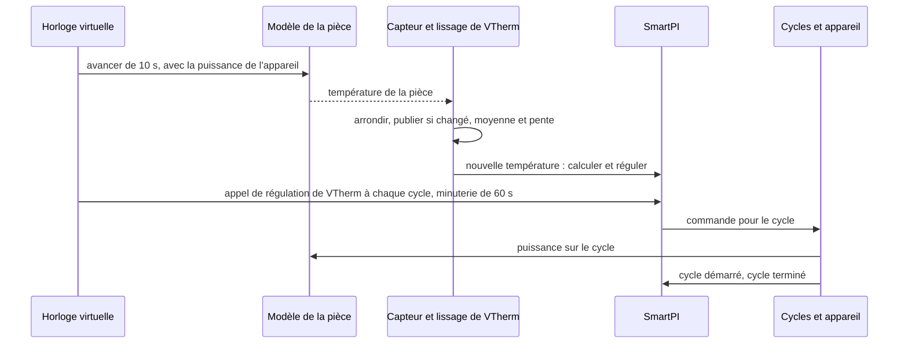

# Tests

Ce document rassemble tous les tests de ce fork : comment les lancer, le simulateur que la plupart
d'entre eux utilisent, chaque scénario de simulation et ce qu'il doit montrer, et les autres tests,
classés par fonction. Les fonctions elles-mêmes sont décrites dans la
[documentation technique](technical_doc.md),
[Dépendances entre zones et deuxième source de chaleur](zone_dependencies.md) et
[Entrée eau](water_input.md). Les tests propres à l'auteur ne changent pas et tournent avec ceux-ci.

## Sommaire

1. [Lancer les tests](#1-lancer-les-tests)
2. [Le simulateur](#2-le-simulateur)
3. [Scénarios de simulation](#3-scénarios-de-simulation)
4. [Tests par fonction](#4-tests-par-fonction)
5. [Limites](#5-limites)

## 1. Lancer les tests

Lancez les tests depuis le dossier du dépôt, avec une copie de Versatile Thermostat (VTherm) dans
le chemin de recherche de Python (Python path). C'est la même configuration que l'intégration continue de l'auteur
(CI, les tests que GitHub lance automatiquement) :

    PYTHONPATH=<versatile_thermostat copy>:$PWD python -m pytest tests/ -q

Il y a deux ensembles de tests :

| Ensemble | Ce qu'il contient | Où il tourne |
|---|---|---|
| Court | les tests unitaires (petits tests d'une seule partie du code) et les simulations qui ne prennent que quelques secondes | à chaque pull request (workflow « Tests »), et en local par défaut |
| Long | l'ensemble court, plus les longues simulations et les comparaisons avec le code de VTherm lui-même | en local avec `SMARTPI_SIM_LOCAL=1` ; sur GitHub dans le workflow « Full tests », à chaque push sur la branche `qas` et à la demande |

Les longues simulations dépendent de `SMARTPI_SIM_LOCAL`. Sans cette variable, elles apparaissent
comme ignorées (skipped).

## 2. Le simulateur

### 2.1 Pourquoi

- **Une maison est lente et ne se répète jamais.** SmartPI apprend sur plusieurs jours. Dans une
  vraie maison, chaque question sur les extensions (une porte, un plancher plus lent, une chaudière
  qui attend plus de demande) prendrait des semaines. Et l'essai suivant n'aurait jamais la même
  météo.
- **La vérité est connue.** Dans le simulateur, le test fixe la puissance de chauffe de la pièce
  `a`, ses déperditions `b`, les retards et les échanges de chaleur. Ce que SmartPI apprend peut
  donc être comparé à ces vraies valeurs. Dans une maison, seule la température de la pièce peut
  être jugée.
- **Le vrai code tourne.** Le simulateur fait tourner le vrai handler et le vrai algorithme de
  SmartPI. Seul le travail que Versatile Thermostat et Home Assistant font autour d'eux est copié.
- **Les comparaisons se font pendant le test.** Un scénario tourne deux fois, par exemple avec et
  sans une fonction, et les deux simulations sont comparées. Des résultats sauvegardés à l'avance
  ne sont pas utilisés : ils ne correspondraient plus après chaque changement de l'algorithme de
  l'auteur.

### 2.2 Ce qu'il modélise

| Partie | Fichier | Ce qu'elle fait |
|---|---|---|
| Pièces | `tests/sim/plant.py` | Un modèle thermique simple, dans les unités de SmartPI. La vitesse à laquelle un chauffage réchauffe la pièce est le `a` de SmartPI (°C/min à pleine puissance). Un lien avec l'extérieur est le `b` de SmartPI (1/min). Un chauffage a un retard. Un émetteur de chaleur lent, comme un plancher chauffant, fait passer sa chaleur par une inertie : la chaleur qu'il donne suit l'appareil lentement, pas tout de suite. Un émetteur « à deux étages » la fait passer par deux inerties plus courtes à la suite, comme une dalle de plancher qui se réchauffe dans son épaisseur. Deux pièces peuvent être reliées en permanence, ou par une porte qui s'ouvre selon un horaire. Le modèle est calculé par pas de temps de 10 s ou moins. |
| Capteurs et lissage de VTherm | `tests/sim/sensors.py` | Un capteur est lu toutes les 10 s et arrondi (à 0.1 °C par défaut). Sa valeur n'est publiée que quand la valeur arrondie change. La moyenne glissante et la pente (vitesse de variation) de VTherm sont copiées : la moyenne a une demi-vie de 300 s, et la pente est en °C/h. |
| Cycles de chauffe | `tests/sim/scheduler.py` | Une copie de l'ordonnanceur de cycles de VTherm (la partie qui transforme une commande en cycles de l'appareil) pour un appareil : cycles tout-ou-rien, temps minimaux de marche et d'arrêt, vannes. L'ordonnanceur de VTherm lui-même n'est pas importé : il est interne à VTherm et change avec la branche principale de VTherm. Il y a une différence voulue : une erreur dans un cycle arrête la simulation, au lieu d'être seulement écrite dans le journal. |
| Temps | `tests/sim/clock.py` | Une horloge virtuelle remplace l'horloge de SmartPI, donc une semaine simulée ne prend que quelques secondes. Elle fait aussi tourner les minuteries : l'appel de régulation de VTherm à chaque cycle, le recalcul de SmartPI toutes les 60 s, et les cycles. |
| Chaudière et Smart Boiler | `tests/sim/boiler.py` | L'eau qui arrive à un circuit : à température fixe, ou sur une courbe de chauffe (une température d'eau fixée à partir de la température extérieure). On peut y ajouter les cycles du brûleur, la priorité à l'eau chaude sanitaire (la chaudière chauffe d'abord le ballon d'eau chaude), et une chaudière qui ne démarre que quand une zone demande de la chaleur. Un remplaçant de Smart Boiler donne à SmartPI les données d'eau. |
| Météo | `tests/sim/weather.py` | La température extérieure : constante, une variation sur la journée, ou un saut brusque. |
| Mise en place des scénarios | `tests/sim/runner.py` | Une zone (ses `a`, `b`, retard, consigne, cycle, vanne ou appareil tout-ou-rien, capteur, voisins, presets, chaudière), un deuxième thermostat dans la zone (sa puissance, son retard et son inertie), et plusieurs zones dans un même monde partagé. |
| Mesures | `tests/sim/metrics.py` | Ce que SmartPI a appris comparé aux vraies valeurs, quand sa phase d'apprentissage s'est terminée, et l'erreur de la pièce. |

### 2.3 Un pas de simulation

## 3. Scénarios de simulation

Sauf indication contraire dans une ligne, la pièce a `a` 0.03 °C/min, `b` 0.001 /min, un retard de
10 min, un appareil tout-ou-rien avec un cycle de 10 min, un capteur de 0.1 °C et une consigne de
20 °C. La température extérieure est de 3 °C, avec une variation sur la journée de ±3 °C.
L'« erreur » est l'écart moyen entre la température de la pièce et sa consigne. « ±x % » signifie
à moins de x % de la vraie valeur. Une plage sans unité, comme 0.5–1.2, est la valeur apprise
divisée par la vraie valeur.

### 3.1 Zones voisines — `test_smartpi_sim_neighbours.py` (court)

Une pièce avec un capteur de 0.01 °C, à côté d'un couloir. L'échange de chaleur avec le couloir,
`k`, vaut 0.002. La porte est ouverte 7:00–9:00, 12:00–13:30 et 18:00–22:00.

| Repère | Scénario | Ce qu'il doit montrer |
|---|---|---|
| N1 | le couloir est dans la liste mais désactivé (mode `none`) | exactement la même simulation que sans lui |
| N2 | le couloir derrière une porte, 3 jours | `k` ±20 % ; `a` et `b` ±5 % ; aucun retard appris pendant que la porte est ouverte |
| N3 | le couloir toujours ouvert, à 20 °C ; sa température saute de +4 °C à 30 h et de −4 °C à 66 h | rien de publié à 42 h ; à 66 h, `k` ±10 % et les déperditions sans le couloir ±10 % ; après le deuxième saut, une erreur plus petite que sans la fonction |
| N3 grossier | la même chose avec un capteur de 0.1 °C et un seul saut | soit rien de publié (le couloir affiché comme « impossible à distinguer », et le `b` de SmartPI lui-même utilisé), soit `k` ±20 % |
| N4 | le couloir indisponible | exactement la même simulation que sans lui |
| N5 | mode refroidissement, le couloir à 28 °C derrière une porte | `k` ±25 % ; erreur sous 0.3 °C à partir de 60 h |
| N6 | la fenêtre du couloir ouverte pendant une heure pendant que la porte est ouverte, une fois pour chaque réaction | aucun `k` appris pendant ce temps ; la réaction appliquée (rien, arrêt, hors-gel 7 °C, éco 17 °C) ; l'appareil marche ou s'arrête en conséquence ; ensuite, la pièce ne monte pas de plus de 0.6 °C au-dessus de sa consigne (dépassement) |
| N7 | une pièce entre deux voisins toujours ouverts, la température de chacun sautant une fois | pour chacun : `k` à ±35 %, ou affiché comme « impossible à distinguer » |

### 3.2 Une zone à deux sources de chaleur — `test_smartpi_sim_second_source.py`

La source principale est le radiateur de la pièce. Dans la plupart des scénarios, la source
additionnelle est un plancher chauffant à eau : même puissance que le radiateur, un retard de
30 min, une inertie de 180 min, et la règle de répartition (comment la chaleur est répartie entre
les deux sources) `lead_band` à 20 %.

| Repère | Scénario | Ensemble | Ce qu'il doit montrer |
|---|---|---|---|
| Z1, Z3 | le plancher dès le départ, 40 h | court | le plancher fonctionne par blocs pendant que SmartPI apprend, puis suit la règle ; le modèle de la zone est publié avant 30 h, avec `a`, `b` et la puissance du plancher ±20 % ; SmartPI utilise ce modèle ; à partir de 30 h, le plancher donne plus de 20 % de la chaleur et l'erreur est sous 0.08 °C |
| — | le SmartPI du plancher lui-même pendant qu'il sert de source additionnelle | court | il n'apprend rien et ne change rien ; il suit la commande de la source principale ; il régule de nouveau une fois la source principale retirée |
| Z6 | la source principale ne répond plus | court | après 15 min, la source additionnelle régule seule ; la pièce reste au-dessus de 19.3 °C ; quand la source principale revient, la source additionnelle la suit de nouveau |
| — | la source principale éteinte, avec un cycle de 20 min | court | la source additionnelle reste éteinte et ne prend pas en charge la zone |
| — | le plancher sur l'eau de Smart Boiler | court | le plancher transforme la puissance de la source principale en sa propre commande, avec ses propres données d'eau |
| — | délestage (VTherm éteint des appareils quand la maison consomme trop de puissance) | court | une source principale délestée envoie quand même sa commande ; une source additionnelle délestée reste éteinte |
| — | un redémarrage de Home Assistant après 36 h | court | le modèle de la zone est gardé ; erreur sous 0.15 °C ensuite |
| Z7 | refroidissement avec deux sources | court | un modèle de refroidissement séparé, ±25 % ; erreur sous 0.15 °C |
| — | une vanne comme source additionnelle, que VTherm recalcule aussi | court | la vanne suit la source principale |
| Z1 comparé | comparé avec deux SmartPI qui fonctionnent indépendamment, capteurs de 0.01 et 0.1 °C, 96 h | long | erreur au plus 0.03 °C au-dessus de la paire indépendante ; le plancher donne plus de 35 % de la chaleur |
| Z1 nuits | trois nuits avec la consigne abaissée à 17 °C | long | dépassement au plus 0.1 °C au-dessus de la paire indépendante ; le dépassement de la dernière nuit au plus 0.15 °C au-dessus du plus grand dépassement des nuits précédentes (il ne grandit pas nuit après nuit) ; le plancher donne moins de 90 % de la chaleur |
| Z2 | règle `source_first` à 50 % | long | la source principale se stabilise sur la courbe de la règle (±0.15) |
| — | règle `together` à 200 % | long | la même chose |
| Z4 | un deuxième radiateur comme source additionnelle | long | chacun donne la moitié de la chaleur (±0.15) ; erreur au plus 0.03 °C au-dessus de la paire indépendante |
| Z5 | une source principale trop faible pour le froid (`a` 0.015, extérieur −5 °C) | long | le plancher garde la pièce au-dessus de 18.5 °C pendant que SmartPI apprend ; une fois le temps plus doux, SmartPI termine son apprentissage |

### 3.3 Douze pièces et quatre installations — `test_smartpi_sim_zone_set.py` (long)

Six pièces (des déperditions lentes aux rapides, des radiateurs lents aux rapides) tournent par
temps doux (3 °C) et par temps froid (−8 °C). Chacune a un plancher chauffant à eau de même
puissance. Chacune tourne 96 h, puis trois nuits avec la consigne abaissée à 17 °C (pendant 6, 8 et 10 h). Chacune est comparée à
deux SmartPI indépendants. Pour chaque pièce :

- le modèle de la zone est publié au plus tard à 30 h, avec `a`, `b` et la puissance du plancher
  ±15 % ;
- l'erreur de 48 h à 96 h est au plus 0.02 °C au-dessus de la paire indépendante ;
- le pire dépassement après une nuit est au plus 0.1 °C au-dessus de la paire indépendante ;
- chaque matin, la pièce atteint sa consigne moins 0.2 °C, en moyenne au plus 1 h plus tard que la
  paire indépendante.

Les mêmes vérifications tournent pour un plancher derrière une vanne, une dalle qui se réchauffe
dans son épaisseur, et de l'eau sur des courbes de chauffe. Deux zones côte à côte (toujours
ouvertes, ou avec une porte ouverte 6:00–23:00) doivent chacune garder une erreur au plus 0.02 °C
au-dessus de la paire indépendante. Les résultats sont dans
[Dépendances entre zones, §5.8](zone_dependencies.md#58-résultats-et-limites-simulation).

### 3.4 Eau — `test_smartpi_sim_water.py` (court)

Un radiateur (`a` 0.06 avec une eau à 60 °C) sur une chaudière avec une courbe de chauffe.

| Scénario | Ce qu'il doit montrer |
|---|---|
| avec et sans les données d'eau de Smart Boiler, 48 h | sans les données, SmartPI apprend moins de la moitié de `a` ; avec les données, entre 0.5 et 1.2 fois `a`, et plus de 1.5 fois la valeur apprise sans elles |
| eau chaude sanitaire deux fois par jour, cycles du brûleur | pendant que la chaudière chauffe l'eau chaude sanitaire, l'intégrale (la part de la commande qui s'accumule dans le temps) et la commande ne bougent pas ; erreur sous 0.3 °C |
| les données d'eau absentes pendant 2 h, puis pour de bon | une courte interruption garde le facteur d'eau (la chaleur que donne l'eau comparée à l'eau de référence) ; une interruption durable met le facteur à 1 et propose la remise à zéro une seule fois |
| une chaudière qui ne démarre que quand la zone demande de la chaleur | la pièce reste au-dessus de 19 °C ; SmartPI termine son apprentissage et apprend `a` dans 0.5–1.2 |

### 3.5 Une chaudière qui n'est pas appelée — `test_smartpi_sim_boiler_call.py` (court)

Un radiateur de 2000 W derrière une vanne, avec un capteur de 0.01 °C. La chaudière ne démarre qu'à
partir d'une demande de 2500 W, donc cette pièce seule ne peut jamais la démarrer. D'autres zones
(3000 W) la démarrent, sauf pendant une plage de la journée.

| Repère | Scénario | Ce qu'il doit montrer |
|---|---|---|
| B1 | chaudière centrale de VTherm, sans données d'eau, pas de chaudière 2:00–8:00 | SmartPI non informé que la chaudière n'est pas appelée : `a` sous la moitié ; informé : `a` dans 0.85–1.2, `b` dans 0.95–1.05, aucun `a` appris pendant que la chaudière n'est pas appelée, le retard dans 9–13 min |
| B2 | appel de Smart Boiler avec données d'eau, pas de chaudière 10:00–16:00 | `b` dans 0.95–1.05, `a` dans 0.9–1.15, aucun `a` appris pendant que la chaudière n'est pas appelée |

Les résultats sont dans [Entrée eau, §4.4](water_input.md#44-résultats-simulation).

### 3.6 SmartPI seul, deux thermostats, et le simulateur lui-même

| Fichier | Ensemble | Ce qu'il vérifie |
|---|---|---|
| `test_smartpi_sim_baseline.py` | court et long | SmartPI seul apprend une pièce connue. Avec un capteur de 0.01 °C : `a` et `b` ±5 % et le retard à 4 min près, le tout en 12 h (une grille de 12 pièces dans l'ensemble long). Avec un capteur de 0.1 °C, il termine quand même son apprentissage, avec `a` et `b` dans 0.4–1.6 |
| `test_smartpi_sim_two_thermostats.py` | court et long | le retard et l'inertie du plancher dans le modèle de la pièce ; deux thermostats, chacun avec son propre SmartPI, qui chauffent une même pièce (le fonctionnement actuel, la base de comparaison pour Z1 et Z4) |
| `test_smartpi_regression_no_dependencies.py` | court | des fonctions configurées mais pas actives : exactement la même simulation et le même état sauvegardé que sans la fonction |
| `test_smartpi_sim_harness.py` | court | l'horloge, les minuteries, les cycles tout-ou-rien, les temps minimaux de marche et d'arrêt, les vannes, l'appel de régulation de VTherm à chaque cycle ; la même simulation faite deux fois donne le même résultat |
| `test_smartpi_sim_scheduler_parity.py` | long | l'ordonnanceur de cycles copié et la pente donnent les mêmes événements que le code de VTherm lui-même, sur des milliers de commandes et de lectures aléatoires |

## 4. Tests par fonction

### 4.1 Événements AutoCalib

| Fichier | Ce qu'il vérifie |
|---|---|
| `test_smartpi_autocalib_events.py` | chaque événement AutoCalib porte le vrai `entity_id` du thermostat et son nom dans `name` |

### 4.2 Entrées connues (la base des extensions)

| Fichier | Ce qu'il vérifie |
|---|---|
| `test_smartpi_effective_model.py` | comment les entrées connues (la chaleur échangée avec les zones voisines, la chaleur d'une deuxième source) sont combinées en `b_eff` et `T_ref`, les déperditions et la température de référence qu'utilise la régulation ; rien ne change sans elles |
| `test_smartpi_learning_window_known_inputs.py` | les fenêtres d'apprentissage retirent la chaleur des entrées connues |
| `test_smartpi_dependencies_algo.py` | l'algorithme utilise `b_eff` et `T_ref` partout dans sa régulation, garde les valeurs brutes pour l'apprentissage, met l'apprentissage en pause tant qu'un verrou d'apprentissage est actif (une condition comme la porte ouverte d'un voisin), et sauvegarde et charge son état |
| `test_smartpi_dependencies.py`, `test_smartpi_dependency_inputs.py` | les éléments configurés, comment ils sont vérifiés, les lectures utilisées dans un calcul |
| `test_config_flow.py`, `test_config_flow_dependencies.py` | le menu d'options d'une entrée de thermostat et la liste des dépendances |

### 4.3 Zones voisines

| Fichier | Ce qu'il vérifie |
|---|---|
| `test_smartpi_coupling_estimator.py` | l'apprentissage de `k` pour un voisin derrière une porte, pour plusieurs portes à la fois, et pour un voisin toujours ouvert |
| `test_smartpi_dependency_model.py` | les verrous d'apprentissage, les réactions à la fenêtre d'un voisin, les presets en refroidissement, un voisin toujours ouvert qui entre dans le modèle sans saut |
| `test_smartpi_dependencies_handler.py` | les lectures depuis Home Assistant |
| `test_config_flow_neighbours.py` | les formulaires des voisins : suggestions, erreurs, avertissements, modification, l'étape de remise à zéro |

### 4.4 Une zone à deux sources de chaleur

| Fichier | Ce qu'il vérifie |
|---|---|
| `test_smartpi_zone_fit.py` | le modèle commun de la zone (un seul modèle ajusté pour les deux sources ensemble) trouve le retard de la source principale, l'échelle de temps du plancher, `a`, `b`, la puissance du plancher et le `k` d'un voisin |
| `test_smartpi_source_model.py`, `test_smartpi_source_candidates.py` | la chaleur du plancher calculée à partir de ses cycles ; les échelles de temps candidates |
| `test_smartpi_split.py` | les règles de répartition et la boucle d'allocation |
| `test_smartpi_source_link.py` | le lien entre les deux thermostats : commandes, cycles, une source principale qui ne répond plus, le plafond de puissance |
| `test_smartpi_dependency_model_source.py` | les blocs d'apprentissage, l'horloge d'apprentissage et son délai maximal, le freinage, le rattrapage plus rapide après une nuit, un redémarrage, le refroidissement |
| `test_smartpi_dependencies_handler.py` | les types de chauffage lus dans les deux entrées, la remise à zéro demandée depuis un formulaire, un thermostat maître modifié |
| `test_config_flow_zone.py` | le formulaire de la zone : le thermostat maître et ses vérifications, la recommandation, le déplacement de la source principale, l'entrée de l'autre thermostat, un retard et une inertie personnalisés, la suppression, l'étape de remise à zéro |

### 4.5 Eau

| Fichier | Ce qu'il vérifie |
|---|---|
| `test_smartpi_water_input.py` | le facteur d'eau, ses moyennes, l'eau chaude sanitaire, les interruptions courtes et durables, la sauvegarde et le chargement de l'état |
| `test_smartpi_water_algo.py` | commande = puissance / facteur, apprentissage = commande × facteur, la limite de puissance, les maintiens pendant l'eau chaude sanitaire et avec une eau froide |
| `test_smartpi_water_handler.py` | la lecture de Smart Boiler, `water_factor` publié, la remise à zéro proposée quand les données apparaissent ou disparaissent |
| `test_config_flow_heating_type.py` | le type de chauffage dans les réglages ; l'étape de la réparation (l'avis de réparation de Home Assistant) |

### 4.6 Une chaudière qui n'est pas appelée

| Fichier | Ce qu'il vérifie |
|---|---|
| `test_smartpi_boiler_call.py` | les modes : une chaudière qui répond en 15 min ne change rien ; pour un appel sans réponse, d'abord l'émetteur refroidit, puis le maintien, puis l'émetteur se réchauffe après le démarrage de la chaudière ; les appareils tout-ou-rien et leur cycle ; une lecture perdue ; les raisons de Smart Boiler |
| `test_smartpi_boiler_algo.py` | l'apprentissage ne voit aucune chaleur pendant le maintien et attend autour de cette période ; le retard n'est pas appris à partir du démarrage de la chaudière ; la correction du feed-forward est gelée ; une calibration est annulée |
| `test_smartpi_boiler_handler.py` | les champs de Smart Boiler et la chaudière centrale de VTherm, avec chaque sorte de valeur fausse ou absente |

## 5. Limites

- **Le simulateur est plus clément qu'une maison.** Il n'a pas de bruit de capteur, à part
  l'arrondi ; pas de soleil, pas de personnes ni de cuisine ; et une seule température par pièce,
  sauf si le modèle de dalle est choisi. Les résultats des autres documents sont ce que SmartPI
  obtient dans ces conditions.
- **La météo** est une constante, une variation sur la journée ou un saut brusque ; il n'y a pas de
  prévision.
- **La régulation propre d'une chaudière** (la modulation, c'est-à-dire le changement de puissance
  de la flamme, et la durée minimale de combustion) n'est pas modélisée au-delà de ce dont les
  scénarios ci-dessus ont besoin.
- **VTherm est copié, pas exécuté,** dans le simulateur. L'ensemble long vérifie la copie par
  rapport au code de VTherm lui-même, parce que la branche principale de VTherm peut changer.
