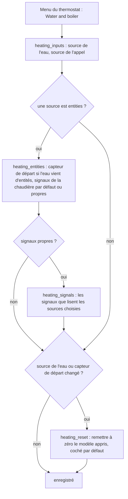
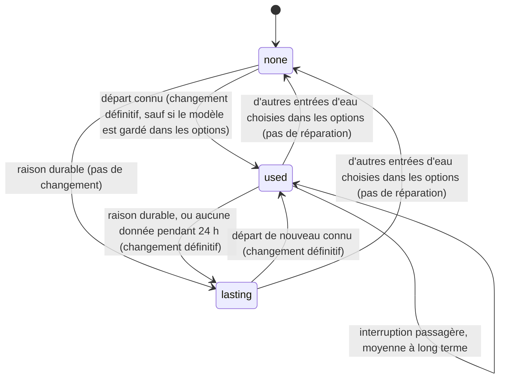
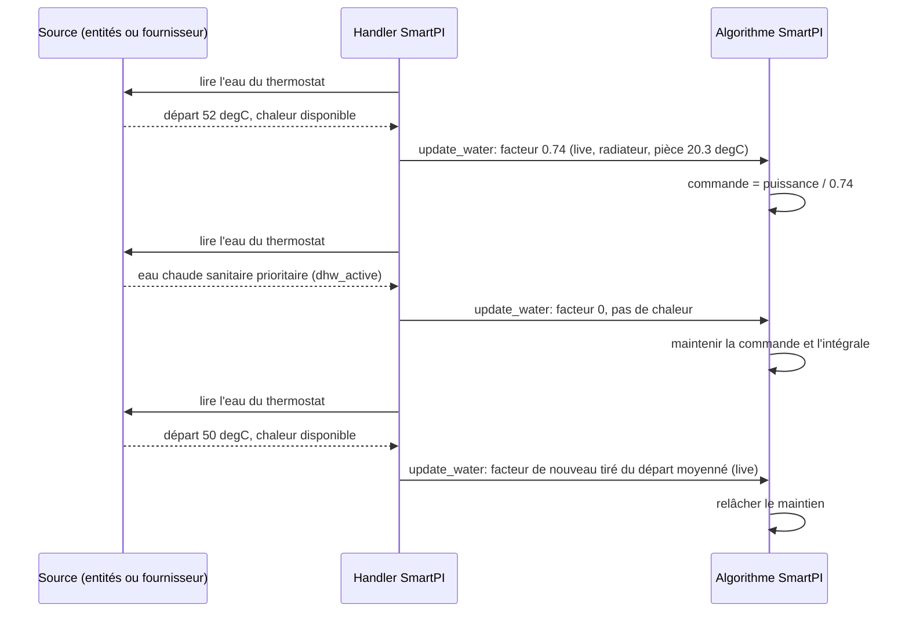
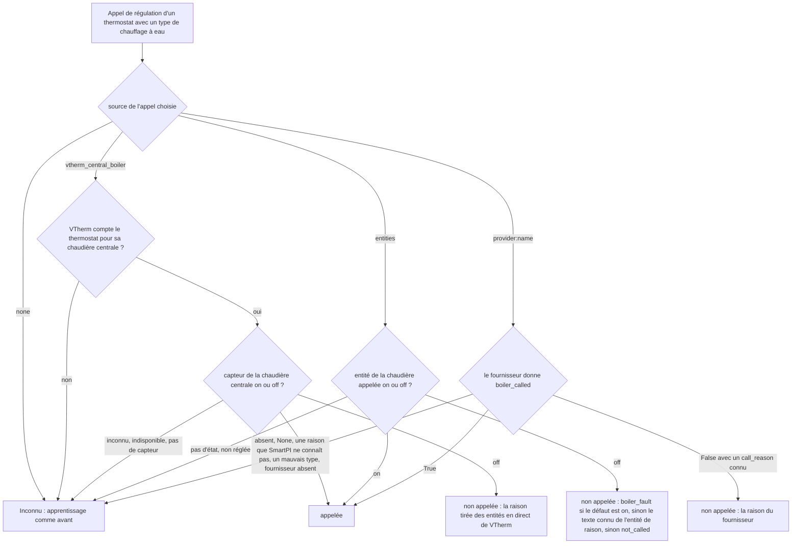
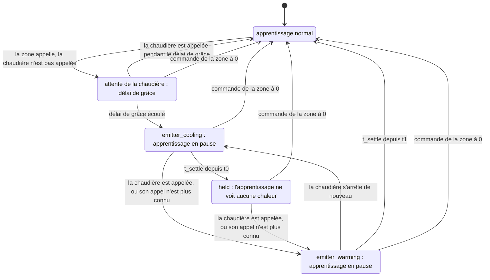
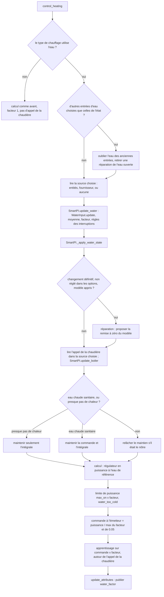

# Entrées eau et chaudière

SmartPI peut lire deux entrées venant de l'installation de chauffage. Chacune vient d'une source que
vous choisissez dans les options du thermostat :

- **Données d'eau** : la température de l'eau qui arrive aux émetteurs du thermostat (les
  radiateurs, les boucles de plancher chauffant ou les autres appareils qui donnent la chaleur à la
  pièce), et si la chaudière peut chauffer en ce moment. La section 3 explique comment SmartPI les
  utilise.
- **L'appel de la chaudière** : si la chaudière reçoit l'ordre de chauffer. La section 4 explique ce
  que fait SmartPI quand la zone demande de la chaleur que la chaudière ne donne pas.

Les sources sont `none` (aucune), `entities` (des entités Home Assistant de n'importe quelle
intégration, ou un simple capteur sur un tuyau) et un **fournisseur** (une intégration qui
implémente le contrat de SmartPI, section 5.2). Pour l'appel de la chaudière, la chaudière centrale
de Versatile Thermostat est aussi une source. Pour les deux entrées, ce document couvre les raisons,
la configuration, la logique et ses décisions, les composants et les interfaces, l'état sauvegardé
(la persistance), les diagnostics, les constantes et les limites. La
[documentation technique](technical_doc.md) décrit le régulateur PI, son feed-forward (la part de
la commande calculée à partir du modèle de la pièce, de la consigne et de la température
extérieure) et son propre apprentissage, ainsi que les changements que ces entrées y apportent.
[Tests](testing.md) décrit les tests.

Sans source, ou sans données venant d'elle, la commande de SmartPI et sa façon d'apprendre la
puissance de l'émetteur restent comme avant (comme sans ces entrées).

Abréviations : Home Assistant (HA), Versatile Thermostat (VTherm), eau chaude sanitaire (ECS).

## Sommaire

1. [Vue d'ensemble](#1-vue-densemble)
2. [Configuration](#2-configuration)
3. [Données d'eau](#3-données-deau)
4. [Une chaudière qui n'est pas appelée](#4-une-chaudière-qui-nest-pas-appelée)
5. [Composants et interfaces](#5-composants-et-interfaces)
6. [Un calcul](#6-un-calcul)
7. [État sauvegardé](#7-état-sauvegardé)
8. [Diagnostics](#8-diagnostics)
9. [Tests](#9-tests)
10. [Constantes, limites et points ouverts](#10-constantes-limites-et-points-ouverts)

## 1. Vue d'ensemble

SmartPI utilise un modèle de la pièce : `dT/dt = a·u − b·(T − T_ext)`. Ici, `T` est la
température de la pièce, `T_ext` la température extérieure, `u` la commande, `a` de combien
l'émetteur réchauffe la pièce par unité de commande, et `b` la vitesse à laquelle la pièce perd sa
chaleur vers l'extérieur. Le modèle suppose qu'une unité de commande `u` apporte toujours la même
chaleur. Avec un chauffage à eau, ce n'est pas vrai :

- une chaudière avec une courbe de chauffe (la température de l'eau suit la température
  extérieure), ou une vanne mélangeuse, baisse la température de l'eau quand il fait doux dehors.
  La même ouverture de vanne ou le même taux de marche (la part du temps où un appareil
  tout-ou-rien est allumé) donne alors moins de chaleur ;
- le brûleur s'allume et s'éteint, donc la température de l'eau varie de plusieurs degrés en
  quelques minutes ;
- quand l'eau chaude sanitaire est prioritaire, elle prend la chaleur de la chaudière au circuit de
  chauffage pendant des dizaines de minutes ;
- une chaudière peut ne pas s'allumer du tout pendant que la zone appelle : ses critères de
  démarrage ne sont pas encore remplis (section 4).

SmartPI apprend alors une valeur de `a` qui mélange la pièce et l'eau. Son feed-forward extérieur
compte aussi la météo deux fois : une fois à travers la courbe de la chaudière, et une fois à
travers son propre modèle.

Le **facteur de puissance de l'émetteur** `φ` corrige cela. Il indique quelle puissance une unité
de commande donne avec l'eau qui arrive à l'émetteur, comparée à une température d'eau de référence
(l'« eau de référence »). SmartPI travaille en puissance à l'eau de référence. Son régulateur, son
modèle et son apprentissage voient tous cette puissance. L'émetteur reçoit `power / φ`. Les
coefficients appris gardent alors leur sens physique, et un changement de l'eau ne ressemble plus à
un changement de la pièce. L'appel de la chaudière dit à SmartPI quand aucune chaleur n'arrive du
tout, pour qu'il n'apprenne pas à partir de ces moments.

| Entrée | Signaux | Sources |
|---|---|---|
| Données d'eau | la température de départ de l'eau du circuit du thermostat ; la chaudière peut chauffer ; l'eau chaude sanitaire est prioritaire ; un défaut de la chaudière | `none` (par défaut), `entities`, `provider:<name>` |
| L'appel de la chaudière | la chaudière est appelée ; pourquoi elle ne l'est pas ; la demande comparée aux critères de démarrage de la chaudière (diagnostics seulement) | `none`, `vtherm_central_boiler` (proposée, et choisie par défaut, quand la chaudière centrale de VTherm sert le thermostat), `entities`, `provider:<name>` |

Décisions et raisons :

- **Optionnel.** Sans données d'eau, `φ = 1` : SmartPI se comporte comme sans ces entrées. Sans
  l'appel de la chaudière, SmartPI prend chaque commande comme de la chaleur, comme avant.
- **Un choix explicite.** Vous choisissez la source de chaque entrée dans les options, comme vous
  choisissez l'algorithme de VTherm (TPI, SmartPI, …). La liste est construite à l'ouverture du
  formulaire : les sources fixes et les fournisseurs inscrits à ce moment. SmartPI ne choisit jamais
  une source tout seul : il n'y a pas de choix « automatique », donc une source qui apparaît ou
  disparaît ne change jamais ce que lit SmartPI.
- **Des entités pour toute installation.** Toute intégration qui montre la température de l'eau,
  ou un simple capteur de température sur le tuyau de départ, peut alimenter SmartPI. Les signaux
  de toute la chaudière (elle peut chauffer, l'eau chaude, un défaut, son appel) sont réglés une
  seule fois, dans l'entrée « SmartPI defaults » (l'entrée des valeurs par défaut). Un thermostat
  les prend là ou règle les siens. Le capteur de départ est toujours celui du thermostat, parce que
  chaque thermostat a son propre circuit : les radiateurs reçoivent l'eau de départ de la chaudière,
  une boucle de plancher reçoit l'eau après sa vanne mélangeuse.
- **Un contrat pour les intégrations qui en savent plus.** Une intégration qui connaît les
  circuits, les raisons et les critères de démarrage de la chaudière peut s'inscrire comme
  fournisseur (section 5.2). Elle donne tout en un seul appel, et SmartPI n'importe rien d'elle.
- **SmartPI calcule le facteur.** La source connaît l'eau mais pas les émetteurs. SmartPI connaît
  son type de chauffage et la pièce.
- **SmartPI ne fait que lire.** Il ne demande jamais une température d'eau : la température de
  l'eau ne peut en général pas être réglée séparément pour chaque zone. La seule sortie de SmartPI
  pour les autres intégrations est le facteur qu'il applique (`water_factor`, section 3.4).

## 2. Configuration

**Type de chauffage** (`smart_pi_heating_type`) — réglé dans les réglages du régulateur de l'entrée
« SmartPI defaults » (comme valeur par défaut) et de chaque entrée de thermostat. Par défaut :
radiateur à eau. Seul un type à eau lit les données d'eau et l'appel de la chaudière.

| Valeur | Type de chauffage | Exposant `n` | Eau de référence `T_wref` | Utilise les entrées |
|---|---|---|---|---|
| `radiator` | Radiateur à eau | 1.3 | 60 °C | oui |
| `floor_water` | Plancher chauffant à eau | 1.1 | 45 °C | oui |
| `floor_electric` | Tapis chauffant électrique | — | — | non |
| `electric_fast` | Radiateur électrique rapide | — | — | non |

Les exposants et les eaux de référence sont provisoires. Ils doivent encore être vérifiés avec des
données d'installations réelles.

**L'entrée « SmartPI defaults ».** Ses options ouvrent un menu (ses libellés sont affichés en
anglais) : **Regulator settings** (les réglages, comme avant) et **Boiler signals** (les signaux de
la chaudière). Les signaux de la chaudière sont des entités, toutes optionnelles : laissez un champ
vide si vous n'avez pas une telle entité. Chaque thermostat qui lit des entités les utilise, sauf
s'il règle les siens.

**L'entrée d'un thermostat.** Pour un type de chauffage à eau, son menu a **Water and boiler** (eau
et chaudière), à côté des réglages du régulateur, de la zone et des voisins. Un thermostat qui sert
de source additionnelle à une zone ouvre un menu à lui : ses réglages, et **Water and boiler** avec
seulement les données d'eau (son apprentissage est en pause tant qu'il suit la source principale,
donc l'appel de la chaudière n'est pas lu pour lui).



| Champ (libellé affiché en anglais, clé) | Type, domaine d'entité | Par défaut | Affiché |
|---|---|---|---|
| Water data — données d'eau (`smart_pi_water_source`) | liste de choix : `none`, `entities`, `provider:<name>` | `none` | Water and boiler |
| Boiler's call — appel de la chaudière (`smart_pi_boiler_call_source`) | liste de choix : `none`, `vtherm_central_boiler`, `entities`, `provider:<name>` | `vtherm_central_boiler` quand la chaudière centrale de VTherm sert le thermostat, sinon `none` | Water and boiler ; pas pour la source additionnelle d'une zone |
| Supply water temperature — température de départ de l'eau (`smart_pi_supply_entity`) | `sensor`, classe d'appareil (device class) temperature | — (obligatoire) | eau venant d'entités |
| Boiler signals — signaux de la chaudière (`smart_pi_boiler_signals`) | liste de choix : `defaults` (comme dans SmartPI defaults), `own` (ceux du thermostat) | `defaults` | une source est entities |
| Boiler can heat — la chaudière peut chauffer (`smart_pi_heat_available_entity`) | `binary_sensor` : on tant que la chaudière peut chauffer les circuits | — | Boiler signals ; signaux propres pour l'eau |
| Hot water has priority — l'eau chaude est prioritaire (`smart_pi_dhw_entity`) | `binary_sensor` : on tant que la chaudière chauffe l'eau chaude sanitaire | — | Boiler signals ; signaux propres pour l'eau |
| Boiler fault — défaut de la chaudière (`smart_pi_fault_entity`) | `binary_sensor` : on tant que la chaudière signale un défaut | — | Boiler signals ; signaux propres pour l'une ou l'autre entrée |
| Boiler is called for heat — la chaudière est appelée pour chauffer (`smart_pi_boiler_called_entity`) | `binary_sensor` : on tant que la chaudière reçoit l'ordre de chauffer | — | Boiler signals ; signaux propres pour l'appel |
| Why the boiler is not called — pourquoi la chaudière n'est pas appelée (`smart_pi_boiler_reason_entity`) | `sensor` avec un texte : `below_threshold`, `no_demand`, `activation_delay` ou `boiler_fault` | — | Boiler signals ; signaux propres pour l'appel |

- Un fournisseur est listé par son nom. Un fournisseur choisi mais qui n'est plus inscrit reste
  choisi et s'affiche comme « `<name>` (not available) » (non disponible). Pendant ce temps,
  SmartPI ne lit aucune donnée venant de lui.
- Une entité qui a une entrée dans le registre des entités est stockée par son identifiant de
  registre (registry id), donc elle fonctionne encore après un renommage. Une entité sans entrée
  dans le registre (par exemple un capteur YAML sans identifiant unique) est stockée par son
  identifiant d'entité.
- **L'étape de remise à zéro.** Quand la source de l'eau ou le capteur de départ change, la
  puissance apprise change d'unités : avec des données d'eau, elle est mesurée à l'eau de référence.
  Le formulaire demande donc s'il faut remettre à zéro le modèle appris de SmartPI pour ce
  thermostat (coché par défaut). Si vous gardez le modèle, SmartPI s'en souvient
  (`smart_pi_model_kept_for_water`) et ne redemande pas quand les données de ces entrées commencent
  (section 3.4). Un changement de l'appel de la chaudière ou des signaux ne change pas les unités et
  ne demande rien.
- Une entrée sans ces clés (une entrée d'avant elles) fonctionne comme avant : pas de données
  d'eau, et l'appel de la chaudière venant de la chaudière centrale de VTherm là où elle sert le
  thermostat. Un état de l'eau qu'elle a sauvegardé avant est gardé, comme une interruption sans
  données : la moyenne à long terme pendant 24 h, puis durable (section 3.3).

**Pour utiliser les données d'eau avec des entités :**

- Réglez les signaux de la chaudière dans « SmartPI defaults » → Boiler signals (ceux que vous
  avez).
- Dans Water and boiler du thermostat : données d'eau `entities`, puis son capteur de départ, et les
  signaux de la chaudière « As in SmartPI defaults » (comme dans SmartPI defaults).
- Le bloc `water` des diagnostics montre les données utilisées : `source` vaut `live`, et `inputs`
  montre chaque entité.

**Pour utiliser les données d'eau avec un fournisseur :**

- Installez l'intégration qui implémente le contrat de SmartPI, et reliez-y le thermostat à son
  circuit (voir la documentation de cette intégration).
- Dans Water and boiler du thermostat : données d'eau `provider:<name>` (et l'appel de la
  chaudière, si le fournisseur le donne).
- Dans les diagnostics, `water.source` vaut `live` et `inputs.*.source` vaut `provider:<name>`.

Une entrée sans type de chauffage à elle prend la valeur par défaut, qui est un radiateur à eau.
Pour un émetteur électrique, choisissez un type électrique : il ne lit ni l'eau ni l'appel de la
chaudière.

## 3. Données d'eau

### 3.1 D'où viennent les données

À chaque appel de régulation, le handler lit les données d'eau dans la source choisie pour le
thermostat. Cela se passe dans `SmartPIHandler._update_water`, appelé depuis `control_heating` et,
pour la source additionnelle d'une zone, depuis `_control_as_source`. La source donne un
`WaterReading` :

| `WaterReading` | Depuis des entités | Depuis un fournisseur |
|---|---|---|
| `supply_c` | l'état du capteur de départ, sous forme de nombre ; °F et K convertis en °C (sans unité : °C) | `supply_temperature`, un nombre fini |
| `supply_reason` | `unavailable` quand le capteur n'a pas de nombre (indisponible, inconnu, texte) | `supply_reason` (texte) ; quand le fournisseur ne donne rien : `provider_missing`, `not_served` ou `provider_error` |
| `heat_available`, `heat_reason` | eau chaude on : faux, `dhw_active` ; sinon défaut on : faux, `fault` ; sinon « peut chauffer » off : faux, `no_heat` ; on : vrai ; pas d'état : inconnu | `heat_available` (vrai ou faux), `heat_reason` (texte) |

| Règle | |
|---|---|
| Rien d'importé | SmartPI n'importe aucun code d'un fournisseur. Il lit le registre dans `hass.data` et vérifie que la méthode existe. |
| Échecs du fournisseur | Non inscrit : `provider_missing`. Il renvoie `None` (il ne sert pas ce thermostat) : `not_served`. Une version inconnue, une exception, une réponse qui n'est pas un dictionnaire (mapping), pas de méthode : `provider_error`. Ces cas ne sont écrits dans le journal qu'au niveau debug, donc un appel de régulation ne remplit jamais le journal. Un fournisseur choisi absent pendant 10 minutes est signalé une seule fois par un avertissement (au démarrage, il peut s'inscrire après SmartPI). |
| Types | Une valeur du mauvais type compte comme absente : par exemple une température donnée sous forme de texte, un `heat_available` qui n'est ni vrai ni faux, ou une raison vide. |
| Fraîcheur | Pas de limite d'âge : un capteur qui n'écrit que quand sa valeur change peut garder une même valeur juste pendant des heures. Une perte durable est couverte par la règle des 24 h (section 3.3). |
| Raisons que SmartPI ne connaît pas | Elles signifient « pas de données pour ce moment » : une interruption passagère, durable après 24 h (section 3.3). |

`heat_available` peut changer à chaque cycle du brûleur. Il n'est donc pas utilisé comme verrou
d'apprentissage (une condition qui met l'apprentissage en pause, section 3.4). Il décide seulement
quand de nouvelles valeurs entrent dans la moyenne à long terme de `φ` (section 3.3).

### 3.2 Le facteur

    φ = min( (max(T_s − T_room, 0) / (T_wref − 20)) ** n , 1 )

- **`T_s`** est `supply_temperature` moyennée sur `WATER_AVERAGE_S` (15 min, une moyenne
  exponentielle dans le temps). La moyenne est nécessaire parce que le brûleur qui s'allume et
  s'éteint fait sauter la valeur brute. Après une longue interruption, la moyenne prend la première
  nouvelle valeur.
- **`T_room`** est la température de la pièce du thermostat (`current_temperature` de VTherm).
- **Référence.** Avec l'eau de référence et une pièce à 20 °C, `φ = 1`. La moitié de l'écart (la
  différence entre la température de l'eau et celle de la pièce) donne `0.5 ** n`.
- **Une eau plus chaude que la référence** compte comme la référence (`φ ≤ 1`). La plage de
  puissance du régulateur est 0..1, donc un facteur plus élevé ne ferait que plafonner la commande.
  Ainsi, l'émetteur donne au moins la chaleur qu'il donne sans les données d'eau. Ces jours-là,
  l'émetteur donne plus que ce que dit le facteur, et la puissance apprise dérive vers le haut,
  comme sans données d'eau.
- **Température de la pièce inconnue** avec un départ connu : SmartPI garde le facteur en usage (ce
  n'est pas une interruption des données).
- **Eau chaude sanitaire prioritaire.** Tant que `heat_reason` vaut `dhw_active`, `φ = 0`. Le départ
  de la chaudière montre alors l'eau qui chauffe le ballon d'eau chaude, pas l'eau de ce circuit.
  Ces mesures n'entrent dans aucune moyenne.

### 3.3 Données manquantes

| Situation | Nature | `φ` utilisé | Source affichée |
|---|---|---|---|
| `supply_temperature` connue | — | à partir du départ moyenné | `live` |
| `heat_reason == dhw_active`, avec un départ connu ou après avoir vu des données | — | 0 | `dhw` |
| `flow_unknown`, `flow_stale`, après avoir vu des données | passagère | la moyenne à long terme de `φ` (`WATER_LONG_AVERAGE_S`, 3 jours), pour que le modèle appris garde ses unités ; 1 s'il n'y a pas encore de moyenne | `average` |
| une raison que SmartPI ne connaît pas (parmi elles `unavailable`, `provider_missing`, `not_served`, `provider_error`), ou aucune donnée, après avoir vu des données | passagère pendant `WATER_NO_DATA_LASTING_S` (24 h), puis durable | comme passagère, puis comme durable | `average`, puis `lasting` |
| `not_mapped`, `circuit_not_measured`, `several_circuits` | durable | 1, comme sans données d'eau | `lasting` |
| aucune donnée depuis le démarrage (toute raison sauf une raison durable) | — | 1 | `none` |
| après une raison durable, jusqu'à ce qu'un départ soit de nouveau connu | — | 1 | `lasting` |
| d'autres entrées d'eau choisies dans les options (une autre source, un autre capteur de départ, ou aucune) | — | 1 jusqu'à ce que les nouvelles entrées donnent des données ; ce qui a été appris de l'eau des anciennes entrées est effacé tout de suite | `none` |
| type de chauffage électrique | — | 1 | — (pas de bloc `water`) |

La moyenne à long terme suit `φ` seulement quand la chaudière chauffe : tant que `heat_available`
est vrai, ou, sans ce signal, tant que `φ ≥ WATER_NO_HEAT`. Ainsi, les jours où la chaudière est à
l'arrêt ne tirent pas la moyenne vers le bas. Une journée entière sans aucune donnée, après avoir vu
des données, compte comme durable. Cela arrive par exemple quand le fournisseur est supprimé, quand
il ne sert plus le thermostat, ou quand le capteur de départ a disparu.

### 3.4 Utilisation dans SmartPI

1. **Commande.** La sortie du régulateur est une puissance à l'eau de référence. La commande
   envoyée à l'émetteur est `power / max(φ, WATER_NO_HEAT)`, au plus 1. Elle est calculée avant
   l'application de la courbe de vanne (`SmartPI._to_actuator_power`). Le minimum (borne basse)
   `WATER_NO_HEAT` (0.05) compte quand l'eau est à peu près à la température de la pièce. C'est
   typique d'une chaudière à l'arrêt qui ne s'allume qu'à la demande. La zone doit quand même
   pouvoir demander de la chaleur, donc sa commande peut atteindre 1 et allumer la chaudière.
2. **Apprentissage.** La puissance à partir de laquelle SmartPI apprend est la commande appliquée
   × `φ` (`SmartPI._to_linear_power`). Cela vaut pour la commande engagée (aussi dans la régulation
   tout-ou-rien de la phase d'apprentissage), la puissance réalisée d'un cycle, l'anti-windup par
   tracking (il empêche la partie intégrale du régulateur de trop grandir pendant que la sortie est
   limitée) et la puissance enregistrée pour la correction du feed-forward (FFTrim, une correction
   apprise du feed-forward). Un nouveau facteur met tout de suite à jour la puissance engagée.
   Les données d'eau n'ajoutent aucun verrou d'apprentissage à elles. Une entrée nulle (brûleur
   éteint, eau chaude sanitaire, vanne fermée) apprend à SmartPI les déperditions. Toute
   intégration peut mettre en pause l'apprentissage de SmartPI avec
   `vtherm_smartpi.set_smartpi_learning`, comme avant. L'appel de la chaudière le met aussi en
   pause, pendant que l'émetteur refroidit ou se réchauffe autour d'un maintien (section 4).
   L'estimateur de temps mort mesure le délai avant que la pièce réagisse quand l'émetteur s'allume
   ou s'éteint. Il n'accepte que de grands sauts de commande. Il reçoit la commande elle-même (0
   pendant l'eau chaude sanitaire).
3. **Limite de puissance et délais.** Avec `φ < 1`, la sortie est limitée à
   `max(φ, WATER_NO_HEAT)` × `max_on_percent` (`_apply_soft_constraints`). C'est ce que donne une
   commande pleine. Le minimum `WATER_NO_HEAT` permet à la commande d'atteindre quand même
   `max_on_percent` quand l'eau n'apporte presque pas de chaleur. L'anti-windup compare le modèle à
   la puissance réalisée, et il voit cette limite. Une demande au-dessus de la limite est affichée
   comme `water_too_cold`. Le délai minimal d'activation et le seuil d'activation de la vanne sont
   vérifiés sur la commande, pas sur la puissance.
4. **Eau chaude sanitaire et eau froide.** Tant que l'eau chaude sanitaire est prioritaire
   (`dhw_active`), la commande de l'émetteur est maintenue à sa dernière valeur (une demande nulle
   donne toujours zéro). L'intégrale est maintenue aussi (`integral_hold_mode = "no_heat"`). Ainsi,
   SmartPI ne pousse pas la vanne vers l'ouverture complète alors qu'aucune chaleur ne peut
   arriver. Quand l'eau n'apporte presque pas de chaleur et que l'eau chaude sanitaire n'en est pas
   la cause (`φ < WATER_NO_HEAT`, par exemple une chaudière à l'arrêt), seule l'intégrale est
   maintenue, et la commande suit le régulateur. Les deux maintiens sont appliqués de nouveau à
   chaque calcul. Si un autre maintien est déjà en cours, SmartPI le laisse tel quel.
5. **`water_factor`, la sortie de SmartPI.** Tant que le facteur vient des données d'eau (`live`,
   `average`, `dhw`), SmartPI écrit `water_factor` dans les `specific_states` du thermostat. Sa
   valeur est le facteur appliqué, arrondi à 0.001. Sinon (`none`, `lasting`, type électrique), la
   clé est absente. Toute intégration peut la lire. Quand la clé est présente, elle sait que
   l'algorithme de ce thermostat utilise les données d'eau : un fournisseur peut alors ne pas faire
   sa propre pause d'apprentissage lors des grandes variations de l'eau.
6. **Données qui apparaissent ou disparaissent pour de bon.** Les données d'eau peuvent commencer à
   être utilisées (premières données, ou un départ connu après une interruption durable). Elles
   peuvent aussi s'arrêter pour de bon (une raison durable, ou aucune donnée pendant 24 h). Dans les
   deux cas, la puissance apprise change d'unités. Si SmartPI a un modèle appris (il a passé sa
   phase d'apprentissage), il crée une réparation Home Assistant (dans « Réparations ») :
   « Water temperature data are now available » (les données de température de l'eau sont
   maintenant disponibles) ou « … are no longer available » (… ne sont plus disponibles). La
   réparation a une seule étape, avec l'option **Reset the learned model** (remettre à zéro le modèle
   appris), cochée par défaut. La confirmer appelle `vtherm_smartpi.reset_smartpi_learning` pour le
   thermostat. SmartPI ne convertit pas le modèle appris dans les nouvelles unités (décision du
   propriétaire du 2026-10-12) ; il propose la remise à zéro à la place. Les règles :
   - une interruption passagère ne crée jamais la réparation ;
   - **un changement fait dans les options y est réglé.** L'étape de remise à zéro des options a
     déjà posé la question (section 2). D'autres entrées d'eau effacent tout de suite ce qui a été
     appris de l'eau des anciennes (leur disponibilité et leurs moyennes, pour que les nouvelles
     entrées partent comme neuves), et une réparation de l'eau encore ouverte est retirée. Si le
     modèle est gardé, les premières données des nouvelles entrées ne créent pas de réparation.
     S'il est remis à zéro, SmartPI apprend de nouveau et ne demande rien pendant qu'il apprend ;
   - la réparation est pour les changements que les options n'ont pas vus : les données perdues
     pendant 24 h ou signalées comme durables, les données revenues après cela, ou les données qui
     ne commencent qu'une fois que SmartPI a fini d'apprendre de nouveau ;
   - le problème (issue) de la réparation est `water_data_changed_<thermostat unique id>`. Il est
     créé comme persistant : il reste jusqu'à ce que l'utilisateur y réponde, et SmartPI ne le
     supprime pas. Son seul champ est `reset_model` ;
   - un changement du type de chauffage efface ce que l'entrée eau savait (section 7). Donc, après
     un passage à un type à eau, SmartPI propose la remise à zéro aux premières données, s'il a un
     modèle appris. Un passage à un type électrique ne propose rien.
7. **Puissance dans les diagnostics.** Avec des données d'eau, les valeurs du bloc `power`
   (`pi_percent`, `ff_percent`, `command_percent`, `limited_percent`, `applied_percent`, les valeurs
   `linear_*`) et les séries d'historique `power.command_percent` et `power.applied_percent` sont
   des puissances à l'eau de référence. `current_cycle_percent` et `next_cycle_percent` sont la
   commande envoyée à l'émetteur.

### 3.5 Cycle de vie des données

La disponibilité des données d'eau décide d'où vient le facteur et quand la remise à zéro est
proposée.



Pendant une séquence de chauffe du brûleur puis d'eau chaude sanitaire :



### 3.6 Résultats (simulation)

Configuration : un radiateur sur une chaudière avec une courbe de chauffe, extérieur 3 °C ± 3 °C,
48 h ([Tests, §3.4](testing.md#34-eau--test_smartpi_sim_waterpy-court)). Sans données d'eau,
SmartPI apprend moins de la moitié de la puissance du radiateur à l'eau de référence : l'eau plus
froide donnée par la courbe ressemble à un radiateur plus faible. Avec des données d'eau, venant
d'entités ou d'un fournisseur, il apprend entre 0.5 et 1.2 fois cette puissance, et plus de 1.5 fois
la valeur qu'il apprend sans elles.

## 4. Une chaudière qui n'est pas appelée

Une chaudière peut ne s'allumer que quand la demande des zones remplit ses critères de démarrage, et
seulement après un délai d'activation. Ces critères portent sur le nombre d'appareils ou de zones
qui appellent, leur puissance totale et la plus grande ouverture de vanne. Une zone en dessous de
ces critères demande de la chaleur qui ne vient pas. SmartPI traite la commande de la zone comme si
la chaleur était venue. Il apprend alors un émetteur trop faible (`a`), un mauvais temps mort (le
délai avant que la pièce réagisse) et un biais dans sa correction du feed-forward. Dans une
simulation d'une zone qui appelle toute la nuit sans la chaudière, son `a` appris est tombé à 1 %
de la vraie valeur (section 4.4). Un signal « la chaudière peut chauffer » ne permet pas de
distinguer ce cas : le brûleur fait aussi des pauses pendant que la chaudière est appelée.

### 4.1 D'où vient l'appel de la chaudière

La source est choisie dans les options du thermostat (section 2). SmartPI ne lit que cette source :
quand elle ne donne rien, l'appel est inconnu, et SmartPI apprend comme avant.



| Source | Ce qui est lu | Proposée | Raisons quand la chaudière n'est pas appelée |
|---|---|---|---|
| `none` | rien | toujours | — |
| `vtherm_central_boiler` | le capteur binaire d'identifiant unique `central_boiler_state`, et les entités en direct de VTherm (ci-dessous) | quand VTherm compte le thermostat pour sa chaudière centrale (`used_by_controls_central_boiler`) ; c'est alors la valeur par défaut | `activation_delay`, `no_demand`, `below_threshold` ; `not_called` quand les entités de la demande manquent |
| `entities` | les signaux de la chaudière : appelée (on/off), pourquoi pas (texte), défaut (on/off) ; ceux des valeurs par défaut ou ceux du thermostat | toujours | `boiler_fault` (défaut on) ; le texte de l'entité de raison quand c'est un texte que SmartPI connaît ; sinon `not_called` |
| `provider:<name>` | `boiler_called`, `call_reason` et `demand` (section 5.2) | quand il est inscrit | `below_threshold` (des zones appellent, mais en dessous des critères), `no_demand` (aucune zone n'appelle), `activation_delay`, `boiler_fault` |

**Les raisons et la demande de VTherm.** La chaudière centrale de VTherm décide à partir d'un nombre
d'appareils actifs et de leur puissance totale, comparés à deux seuils (un seuil de 0 désactive son
critère). SmartPI lit les quatre entités en direct (des entités qui donnent la valeur actuelle), par
leur identifiant unique : les capteurs `nb_device_active_boiler` et `total_power_active_boiler`, et
les nombres `boiler_activation_threshold` et `boiler_power_activation_threshold`. Il applique la
règle de VTherm lui-même (`feature_central_boiler_manager.py`) : un critère est rempli quand son
seuil est au-dessus de 0 et que la valeur l'atteint. Tant que la chaudière est éteinte :

- un critère rempli → `activation_delay` (VTherm attend son délai d'activation avant d'allumer la
  chaudière) ;
- rien d'actif (aucun appareil et aucune puissance) → `no_demand` ;
- sinon → `below_threshold`.

SmartPI ne lit pas l'attribut `central_boiler_manager` du capteur binaire de VTherm : dans VTherm
10.5.1, il n'est écrit que quand la chaudière s'allume ou s'éteint, donc ses nombres seraient
périmés (décision du propriétaire du 2026-10-14). VTherm compte une puissance en kW comme des kW, et
toute autre comme des W ; SmartPI fait de même avant de comparer les deux puissances.

Autres règles :

- `True`, ou « on », signifie que la chaudière reçoit l'ordre de chauffer. Une pause du brûleur, ou
  l'eau chaude sanitaire prioritaire, apparaît seulement dans les données d'eau (section 3).
- Le capteur de VTherm suit la décision de VTherm, après le délai d'activation de VTherm. Cette
  décision tient compte des seuils de nombre d'appareils et de puissance, et de toutes les autres
  zones qui appellent.
- **La demande** sert seulement aux diagnostics. Venant de VTherm : `demand_count` et
  `count_threshold` (`count_by` `devices`), `demand_power_kw` et `power_threshold_kw` (kW). Venant
  d'un fournisseur : les champs de son dictionnaire `demand`, parmi `demand_count`,
  `count_threshold`, `count_by` (`devices` ou `zones`), `demand_power_kw`, `power_threshold_kw`
  (kW), `demand_opening` et `opening_threshold` (0 à 1). SmartPI garde seulement les valeurs du bon
  type ; pour un nombre, un entier donné sous forme de nombre décimal compte comme du bon type. Il
  garde les nombres comme des entiers et arrondit les valeurs en kW et d'ouverture à 3 décimales.
- Un fournisseur ne devrait pas ajouter de pause d'apprentissage à lui pour ce cas : SmartPI le gère
  lui-même, et une deuxième pause se terminerait au mauvais moment.

### 4.2 Apprentissage autour d'un maintien

Dans les règles ci-dessous, `u` est la commande de l'appareil de la zone, `called` est l'appel de
la chaudière, `t0` est le début de l'appel de la zone resté sans réponse, et `t1` est le démarrage
de la chaudière après un maintien. `L` est le retard de l'émetteur et `tau` son inertie (constante
de temps). Le délai de grâce est le temps dont dispose la chaudière pour répondre à l'appel de la
zone.

    calling     = en chauffage  et  u > 0
    grace       = BOILER_CALL_GRACE_S (15 min), plus le cycle pour un appareil tout-ou-rien
    t_settle    = L + 3·tau de l'émetteur du type de chauffage (radiateur 65 min, plancher à eau 570 min)

    emitter_cooling   calling, chaudière non appelée depuis t0, t0 + grace <= t < t0 + t_settle
                      (ou tout de suite si la chaudière s'arrête de nouveau pendant que l'émetteur se réchauffe)
    held              calling, chaudière non appelée depuis t0, t >= t0 + t_settle
    emitter_warming   calling, chaudière de nouveau appelée (ou appel plus connu) à t1 après
                      emitter_cooling ou held, t < t1 + t_settle

- **Une chaudière qui répond à l'appel de la zone pendant le délai de grâce** ne change rien. Par
  exemple une chaudière qui s'allume à la demande, ou le délai d'activation de VTherm, de 10 min au
  plus. SmartPI apprend comme avant à partir du saut de commande de la zone elle-même, avec la
  réaction de la chaudière comprise dedans. Il en va de même pour une chaudière déjà en marche, ou
  pour une chaudière qui fait des cycles avec des arrêts plus courts que le délai de grâce : son eau
  reste chaude. Un appareil tout-ou-rien ne compte pour la chaudière que lorsqu'il est allumé. La
  partie éteinte de son cycle n'est donc pas un arrêt de la réponse de la chaudière, et son cycle
  est ajouté au délai de grâce.
- **Refroidissement de l'émetteur.** La chaudière s'est arrêtée pendant que la zone appelle (ou elle
  n'a jamais répondu). La pompe du circuit s'arrête quelques minutes plus tard. L'émetteur ne donne
  alors que la chaleur qu'il contient encore, et cette chaleur baisse au rythme de l'inertie de
  l'émetteur. L'apprentissage attend. Après trois fois l'inertie, il en reste moins de 5 %.
- **Maintenu.** Aucune chaleur n'arrive. L'apprentissage voit une puissance de 0. (Avec des données
  d'eau, la puissance est déjà la commande multipliée par un facteur proche de 0, et elle reste
  telle quelle.) Les fenêtres d'apprentissage où la zone refroidit apprennent `b`, et aucune mesure
  de `a` n'est prise.
- **Réchauffement de l'émetteur.** La chaudière a démarré après un maintien. Son eau doit atteindre
  l'émetteur et le réchauffer. Mais la vanne est restée ouverte tout le temps, donc il n'y a pas de
  saut de la commande de la zone que l'apprentissage de SmartPI attendrait. L'apprentissage attend
  de nouveau. SmartPI ne mesure pas non plus le démarrage de la chaudière comme un temps mort. Ce
  retard vient de l'eau, pas de la vanne, et le temps mort de SmartPI est celui de la vanne. (Dans la
  simulation, la réponse au démarrage de la chaudière est venue en 2 à 5 min, et la réponse à la
  vanne en 11 min.)



| | Délai de grâce, apprentissage normal | `emitter_cooling` | `held` | `emitter_warming` |
|---|---|---|---|---|
| `a`, `b` | appris | en pause (verrou `boiler_settling`) | appris avec la puissance 0 : seulement la façon dont la zone refroidit | en pause (verrou `boiler_settling`) |
| Estimateur de temps mort | normal | en pause (verrou) | entrée 0, pas de saut | en pause (verrou) ; ensuite de nouveau la commande, sans saut |
| Correction du feed-forward | active | gelée (`boiler_not_heating`) | gelée | gelée |
| Échanges avec les voisins, ajustement de la zone | appris | en pause | en pause | en pause |
| Puissance réalisée d'un cycle, enregistrée pour eux | celle du cycle | 0 | 0 | celle du cycle |

- Chaque changement de mode abandonne la fenêtre d'apprentissage ouverte et le saut en cours de
  l'estimateur de temps mort (un appel resté sans chaleur, ou le démarrage de la chaudière). Mettre
  en pause ou reprendre l'apprentissage pendant que la zone est maintenue fait de même, et
  l'estimateur repart de l'entrée qu'il reçoit.
- Une calibration en cours est annulée dès que la zone refroidit ou est maintenue. Sinon, elle
  mesurerait la réponse à une chaleur qui ne vient pas.
- Un thermostat qui sert de source additionnelle à un autre thermostat suit la commande de cet
  autre thermostat, pas la sienne. Son mode est donc effacé.
- **Une chaudière qui fait des cycles sous le seuil de la zone elle-même**, avec des arrêts plus
  courts que le délai de grâce (les à-coups de la section 10), ne met pas la zone en maintien. Là,
  l'apprentissage prend la commande comme de la chaleur, comme avant.
- **« Appeler » signifie que la commande de SmartPI lui-même est au-dessus de 0.** VTherm et les
  fournisseurs décident qu'une zone appelle à partir de `is_device_active` de VTherm. Pour une vanne
  sur VTherm 10.5, cela veut dire une commande au-dessus du seuil minimal de la vanne. Donc une zone
  dont la commande est sous ce seuil appelle pour SmartPI mais pas pour la chaudière, et elle peut
  être maintenue.
- **Dans une zone à deux sources de chaleur**, c'est l'appel de la source principale elle-même qui
  décide. La source principale peut être à 0 % pendant que la source additionnelle chauffe et que la
  chaudière n'est pas appelée. Les cycles de la source additionnelle comptent alors toujours comme
  de la chaleur dans l'ajustement de la zone (au niveau 1 sans données d'eau).
- **La régulation ne change pas.** Le régulateur ne change pas sa commande parce que la chaudière
  n'est pas appelée. La partie proportionnelle et l'intégrale montent jusqu'à ce que la demande de
  la zone remplisse les critères de la chaudière, ou jusqu'à ce que les autres zones fassent appeler
  la chaudière. Une zone qui a besoin de moins que le seuil fait quand même faire des cycles à la
  chaudière, et elle peut rester sous sa consigne (section 10). Même quand SmartPI connaît l'appel
  de la chaudière, dans la simulation, une zone qui avait besoin de 20 % sous un seuil de 70 % est
  quand même restée 0.2 à 0.7 degC trop basse pendant 30 h. C'est le point ouvert sur la
  régulation, pas sur l'apprentissage.
- Après un changement du type de chauffage, le temps de stabilisation suit le nouvel émetteur.

### 4.3 Diagnostics et état

Le bloc `boiler` de la section 8 montre la source, l'appel, sa raison, le mode d'apprentissage et
d'où vient chaque signal. Il montre aussi la demande comparée aux seuils, là où la source la donne :
les entités en direct de VTherm, ou le `demand` du fournisseur. Rien n'est sauvegardé. Après un
redémarrage, les modes repartent de la première lecture.

### 4.4 Résultats (simulation)

`tests/test_smartpi_sim_boiler_call.py` simule un radiateur de 2000 W derrière une vanne. Le seuil
de démarrage de la chaudière est de 2500 W. Il n'est atteint qu'avec les autres zones (3000 W), et
celles-ci n'appellent pas pendant une plage de la journée. Quand la chaudière s'allume, son eau se
réchauffe avec une inertie de 4 min ; sinon, l'eau refroidit sous la température de la pièce. Le
capteur a un pas de 0.01 °C, la simulation dure 96 h, et la température extérieure est de
3 °C ± 2 °C. « Informé » signifie que SmartPI connaît l'appel de la chaudière ; « non informé »
signifie qu'il ne le connaît pas.

| Cas | Non informé | Informé |
|---|---|---|
| B1 : l'appel venant de la chaudière centrale de VTherm, sans données d'eau, pas de chaudière 2:00–8:00 | `a` 0.01 de la vraie valeur, `b` 0.98 | `a` 1.06, `b` 0.98 |
| B1 : la même chose, l'appel venant d'un capteur binaire (entités) | — | `a` 1.06, `b` 0.98 |
| B2 : l'appel venant d'un fournisseur, l'eau venant du fournisseur, pas de chaudière 10:00–16:00 | — | `a` 1.04, `b` 0.98 |
| B2 : l'appel venant d'un fournisseur, l'eau venant d'entités | `a` 1.05, `b` 0.98 (une simulation d'essai ; les données d'eau montrent déjà la chaleur manquante) | `a` 1.04, `b` 0.98 |

Les tests vérifient les résultats des simulations « informé ». Ils vérifient aussi qu'aucune mesure
de `a` n'est apprise pendant que la chaudière n'est pas appelée, et les raisons données :
`below_threshold` pour VTherm (avec, un instant à chaque basculement, `activation_delay` : la
chaudière simulée bascule à son pas suivant), `not_called` pour le capteur binaire (pas d'entité de
raison), `below_threshold` pour le fournisseur. Pour les cas B1, ils vérifient aussi que le temps
mort reste celui de la vanne : 11.3 min, contre 11.2 min (avec `a` 0.99 et `b` 0.98) quand la
chaudière est toujours appelée. La zone qui allume la chaudière toute seule (pendant la phase
d'apprentissage de SmartPI, avec sa commande à 100 %) apprend quand même son temps mort et quitte la
phase d'apprentissage, parce que son appel reçoit une réponse pendant le délai de grâce. Avec un
capteur de 0.1 °C, l'estimateur de SmartPI lui-même se trompe d'environ 20 % sur la vraie valeur,
même quand la chaudière est toujours appelée. Cela cache les différences.

## 5. Composants et interfaces

### 5.1 Composants

| Composant | Fichier | Rôle |
|---|---|---|
| `HeatingInputsConfig`, `BoilerSignals`, `config_from_options` | `heating_inputs.py` | Les sources choisies dans les options et les entités qu'elles lisent ; les signaux de la chaudière venant de l'entrée des valeurs par défaut, sauf si le thermostat règle les siens ; les valeurs par défaut d'une entrée sans ces clés. |
| `water_from_entities`, `boiler_from_entities` | `heating_inputs.py` | Les données d'eau et l'appel de la chaudière venant d'entités (section 3.1, section 4.1), avec l'origine de chaque signal pour les diagnostics. Les entités gardées par identifiant de registre sont ramenées à leur identifiant d'entité. |
| `ask_provider`, `water_from_provider`, `boiler_from_provider`, `ProviderWatch` | `heating_inputs.py` | La réponse du fournisseur, lue avec prudence (section 5.2) ; un fournisseur choisi absent longtemps, signalé une seule fois. |
| `boiler_from_vtherm`, `vtherm_demand`, `vtherm_reason` | `heating_inputs.py` | La chaudière centrale de VTherm : son appel, sa demande tirée de ses entités en direct et la raison selon la règle de VTherm. |
| `WaterInput` | `smartpi/water_input.py` | Logique pure, sans code HA : le facteur, la moyenne du départ sur 15 min, la moyenne à long terme de `φ`, les règles des interruptions, la disponibilité (`none`, `used`, `lasting`) et ses changements définitifs ; `inputs`, les entrées d'eau auxquelles l'état appartient, et `forget_data` quand d'autres entrées sont choisies ; l'état sauvegardé. |
| `WaterReading`, `WaterState` | `smartpi/water_input.py` | Ce que la source a donné ; le facteur en usage, sa source, le départ moyenné, les raisons, `no_heat`, `changed_for_good`. |
| `SmartPIHandler._heating_inputs`, `_read_water`, `_update_water`, `_water_change_settled`, `_withdraw_model_reset` | `handler.py` | Avant chaque calcul d'un type à eau (depuis `control_heating`, et depuis `_control_as_source` pour la source additionnelle d'une zone) : pour d'autres entrées d'eau que celles de l'état, `algo.forget_water_data()` et la réparation de l'eau ouverte retirée ; lire la source choisie, `algo.update_water(...)` avec les entrées ; lors d'un changement définitif que les options n'ont pas réglé, `_offer_model_reset`. |
| `SmartPIHandler._read_boiler`, `_update_boiler`, `_ask_provider` | `handler.py` | L'appel de la chaudière venant de la source choisie, seulement pour un type de chauffage à eau ; l'avertissement pour un fournisseur absent longtemps. |
| `SmartPIHandler.update_attributes` | `handler.py` | Écrit ou retire `water_factor` dans `specific_states`. |
| `SmartPI.update_water`, `forget_water_data`, `_apply_water_state` | `algo.py` | Applique le facteur ; démarre et termine le maintien « sans chaleur » ; met à jour la puissance engagée ; garde les entrées pour les diagnostics. |
| `SmartPI._to_actuator_power`, `_water_command`, `_to_linear_power` | `algo.py` | Commande = puissance / `max(φ, WATER_NO_HEAT)` (ou la commande maintenue) ; puissance = commande × `φ`. Avec des données d'eau, la commande engagée est la référence et sa puissance suit le facteur. |
| `SmartPI._deadtime_power` | `algo.py` | Le saut de commande pour l'estimateur de temps mort (0 pendant l'eau chaude sanitaire). |
| `SmartPI._apply_soft_constraints` | `algo.py` | Limite de puissance `max_on_percent × max(φ, WATER_NO_HEAT)` ; `water_too_cold`. |
| `BoilerCall`, `BoilerReading` | `smartpi/boiler_call.py` | Logique pure : l'appel de la chaudière, le mode d'apprentissage (`emitter_cooling`, `held`, `emitter_warming`), le délai de grâce et le temps de stabilisation selon le type de chauffage, les diagnostics `boiler` avec la source choisie et ses entrées (section 4). |
| `SmartPI.update_boiler`, `_read_known_inputs`, `_learning_power`, `_deadtime_input` | `algo.py` | Le mode d'apprentissage à chaque calcul : apprentissage avec la puissance 0 pendant le maintien, le verrou `boiler_settling` pendant que l'émetteur refroidit ou se réchauffe, l'entrée et les sauts de l'estimateur de temps mort, la correction du feed-forward gelée, la couche des dépendances informée (`heat_withheld`), la puissance réalisée d'un cycle enregistrée à 0. |
| Options : `async_step_boiler_signals`, `async_step_heating_inputs`, `heating_entities`, `heating_signals`, `heating_reset`, `source_menu` | `config_flow.py` | Les formulaires de la section 2 ; les listes de sources construites à partir des fournisseurs inscrits. |
| `WaterModelResetFlow` | `repairs.py` | L'étape de la réparation : remettre à zéro le modèle appris (coché par défaut). |
| Type de chauffage | `config_flow.py`, `const.py` | Le sélecteur `smart_pi_heating_type` dans les réglages du régulateur. |

### 5.2 Le contrat des fournisseurs (v1)

Un fournisseur est une intégration qui donne à SmartPI les données d'eau et l'appel de la chaudière
pour les thermostats qu'elle sert. SmartPI n'importe rien d'elle, et elle n'importe rien de SmartPI.
SmartPI peut être chargé avant ou après elle.

- **Registre.** `hass.data["vtherm_smartpi_heating_providers"]` est un dictionnaire (dict), nom →
  fournisseur. Un fournisseur s'y inscrit quand il démarre et s'en retire quand il est déchargé. Le
  nom est ce que montrent les options (`provider:<name>`) ; gardez-le stable, puisque les entrées le
  stockent.
- **L'objet fournisseur** a :
  - `name` (str) ;
  - `version` (int) : `1` pour ce contrat ;
  - `heating_inputs(entity_id: str) -> Mapping | None` : les données pour cette entité climate
    VTherm, ou `None` quand le fournisseur ne la sert pas.
- **Quand il est appelé.** Depuis la boucle d'événements de Home Assistant, à chaque calcul de
  chaque thermostat qui a choisi le fournisseur (environ une fois par minute et par thermostat), une
  fois pour l'eau et une fois pour l'appel. Il doit être rapide et ne faire aucune entrée-sortie
  (I/O) : il renvoie des valeurs que le fournisseur a déjà.
- **Champs** (chacun peut être absent ou `None`) :

  | Champ | Type | Signification |
  |---|---|---|
  | `supply_temperature` | float, °C | l'eau qui arrive au circuit du thermostat |
  | `supply_reason` | str | pourquoi il n'y a pas de température de départ : `flow_unknown`, `flow_stale` (passagères) ; `not_mapped`, `circuit_not_measured`, `several_circuits` (durables) ; tout autre texte est passager, durable après 24 h |
  | `heat_available` | bool | la chaudière peut chauffer le circuit en ce moment |
  | `heat_reason` | str | pourquoi pas : `dhw_active` (l'eau chaude sanitaire est prioritaire : `φ = 0`), ou un texte affiché dans les diagnostics (`flame_off`, `boiler_off`, `fault`, …) |
  | `boiler_called` | bool | la chaudière reçoit l'ordre de chauffer (`None` : le fournisseur n'en décide pas en ce moment) |
  | `call_reason` | str | pourquoi pas, avec `boiler_called` faux : `below_threshold`, `no_demand`, `activation_delay`, `boiler_fault` |
  | `demand` | mapping | pour les diagnostics : `demand_count` et `count_threshold` (int), `count_by` (str), `demand_power_kw` et `power_threshold_kw` (float, kW), `demand_opening` et `opening_threshold` (float, 0 à 1) |

- **Versions.** Un fournisseur avec une autre `version` n'est pas lu (aucune donnée venant de lui).
  Une version plus récente du contrat peut ajouter des champs ; SmartPI ignore les champs qu'il ne
  connaît pas.
- **Erreurs.** Une exception, une réponse qui n'est pas un dictionnaire, un mauvais type, ou un
  `call_reason` que SmartPI ne connaît pas signifient « pas de données de cette source pour
  l'instant » (sections 3.1 et 4.1). Rien n'est écrit dans le journal au-dessus du niveau debug,
  sauf un fournisseur choisi absent pendant 10 minutes (un seul avertissement).
- **Ce que SmartPI donne en retour :** `water_factor` dans les `specific_states` du thermostat
  (section 3.4).

Un fournisseur minimal :

```python
PROVIDERS_KEY = "vtherm_smartpi_heating_providers"


class BoilerProvider:
    """Gives SmartPI the water of each circuit and whether the boiler is called."""

    name = "my_boiler"
    version = 1

    def __init__(self, circuits):
        self.circuits = circuits  # identifiant de l'entité climate -> votre objet circuit
        self.called = False

    def heating_inputs(self, entity_id):
        circuit = self.circuits.get(entity_id)
        if circuit is None:
            return None  # ce thermostat n'est pas servi
        return {
            "supply_temperature": circuit.supply_c,
            "heat_available": not circuit.hot_water,
            "heat_reason": "dhw_active" if circuit.hot_water else None,
            "boiler_called": self.called,
            "call_reason": None if self.called else "no_demand",
        }


async def async_setup_entry(hass, entry):
    provider = BoilerProvider(circuits={})
    hass.data.setdefault(PROVIDERS_KEY, {})[provider.name] = provider
    entry.async_on_unload(lambda: hass.data[PROVIDERS_KEY].pop(provider.name, None))
    return True
```

## 6. Un calcul



## 7. État sauvegardé

**Les options.** Les sources et leurs entités sont stockées dans les options des entrées :

| Clé | Entrée | Signification |
|---|---|---|
| `smart_pi_water_source`, `smart_pi_boiler_call_source` | thermostat | les sources choisies |
| `smart_pi_supply_entity` | thermostat | le capteur de départ (identifiant de registre, ou identifiant d'entité) |
| `smart_pi_boiler_signals` | thermostat | `defaults` ou `own` |
| `smart_pi_heat_available_entity`, `smart_pi_dhw_entity`, `smart_pi_fault_entity`, `smart_pi_boiler_called_entity`, `smart_pi_boiler_reason_entity` | « SmartPI defaults » ; un thermostat avec `own` | les signaux de la chaudière |
| `smart_pi_model_kept_for_water` | thermostat | les entrées d'eau (source et capteur de départ) pour lesquelles l'utilisateur a gardé le modèle appris à l'étape de remise à zéro |
| `smart_pi_reset_token` | thermostat | posé par l'étape de remise à zéro pour remettre à zéro le modèle appris une seule fois (comme pour les voisins et la zone) |

Une entrée sans ces clés fonctionne comme avant (section 2). L'entrée que le formulaire de zone crée
pour une source additionnelle ne copie pas les signaux des valeurs par défaut : elle les prend dans
les valeurs par défaut.

**L'état de l'algorithme.** `SmartPI.save_state()` ajoute une clé `water` dès que l'entrée eau a vu
des données ou une raison durable. Ainsi, un thermostat sans données d'eau garde l'ancien format. La
clé contient ces champs :

| Champ | Signification |
|---|---|
| `heating_type` | Le type de chauffage auquel l'état appartient. Un état d'un autre type est ignoré. |
| `availability` | `none`, `used` ou `lasting`. Grâce à lui, la première lecture après un redémarrage n'est pas prise pour un changement définitif. |
| `long_average` | Moyenne à long terme de `φ`. Elle est gardée lors d'un redémarrage et utilisée pour les interruptions passagères. |
| `no_data_s` | Depuis combien de temps dure une interruption sans aucune donnée. Le décompte continue après un redémarrage, donc la règle des 24 h fonctionne même avec des redémarrages fréquents. |
| `inputs` | Les entrées d'eau (source et capteur de départ, comme `smart_pi_model_kept_for_water` les écrit) auxquelles l'état appartient. D'autres entrées choisies dans les options effacent l'état. Un état sauvegardé avant ce champ est gardé jusqu'à ce que les options choisissent une source. |

La clé est aussi écrite tant qu'une source d'eau est choisie mais ne donne pas encore de données,
pour qu'un redémarrage garde les entrées. La moyenne du départ sur 15 min n'est pas sauvegardée.
Elle repart de la première lecture. Un changement du type de chauffage efface les moyennes, et
d'autres entrées d'eau aussi. La remise à zéro de l'apprentissage (`reset_learning`) les garde,
parce qu'elles décrivent l'eau, pas la pièce.

## 8. Diagnostics

Pour un type de chauffage à eau, les diagnostics publiés (`live`) reçoivent un bloc `water` :

| Champ | Signification |
|---|---|
| `heating_type` | Le type de chauffage du thermostat. |
| `factor` | `φ` appliqué maintenant. |
| `source` | `live`, `average`, `dhw`, `lasting` ou `none` (section 3.3). |
| `supply_avg_c` | Le départ moyenné, °C. |
| `supply_reason`, `heat_reason` | Les dernières raisons données par la source (section 3.1). |
| `no_heat` | Eau chaude sanitaire : la commande et l'intégrale sont maintenues. |
| `low_heat` | L'eau n'apporte presque pas de chaleur : l'intégrale est maintenue. |
| `water_too_cold` | La demande a dépassé ce que l'eau donne à pleine commande. |
| `inputs` | Pour chaque signal (`supply`, `heat`, `dhw`, `fault`) : sa `source` (`entity`, `provider:<name>`, `none`), l'`entity` quand c'en est une, `available` pour un fournisseur (faux : non inscrit), et `data` (il donne des données en ce moment). |

Quand une source de l'appel est choisie (section 4), `live` reçoit aussi un bloc `boiler`, même
quand la source ne donne pas de données :

| Champ | Signification |
|---|---|
| `source` | `entities`, `provider:<name>` ou `vtherm_central_boiler`. |
| `called` | Si la chaudière est appelée pour chauffer en ce moment (`null` : inconnu). |
| `reason` | Pourquoi elle ne l'est pas (section 4.1). |
| `learning` | `emitter_cooling`, `held`, `emitter_warming` ou `null` (section 4.2). |
| `demand` | La demande comparée aux critères de démarrage, là où la source la donne (section 4.1). |
| `inputs` | Pour chaque signal (`called`, `reason`, et `fault` pour les entités) : sa `source`, l'`entity` quand c'en est une, `available` pour un fournisseur, et `data`. |

## 9. Tests

[Tests](testing.md) décrit les tests des données d'eau, de l'appel de la chaudière et de leurs
sources : tests unitaires, de l'algorithme, du handler, des formulaires et de simulation, et les
scénarios QAS sur un vrai Home Assistant, avec leurs critères. Les résultats de la section 4.4
viennent de ces tests.

## 10. Constantes, limites et points ouverts

| Constante | Valeur |
|---|---|
| `WATER_EMITTERS` (`smartpi/const.py`) | radiator (1.3, 60 °C), floor_water (1.1, 45 °C) |
| `WATER_AVERAGE_S` | 15 min |
| `WATER_LONG_AVERAGE_S` | 3 jours |
| `WATER_NO_HEAT` | 0.05 |
| `WATER_FACTOR_MAX` | 1.0 |
| `WATER_NO_DATA_LASTING_S` | 24 h |
| `WATER_ROOM_REFERENCE_C` | 20 °C (la pièce de l'eau de référence dans le facteur) |
| `BOILER_CALL_GRACE_S` | 15 min (section 4) |
| `CONTRACT_VERSION` (`heating_inputs.py`) | 1 (section 5.2) |
| `PROVIDER_MISSING_WARNING_S` (`heating_inputs.py`) | 10 min : un fournisseur choisi absent aussi longtemps est signalé une seule fois |

- **Exposants et eaux de référence provisoires** : ils doivent encore être vérifiés avec des
  données d'installations réelles.
- **Sans entité d'eau chaude**, l'eau chaude sanitaire prioritaire n'apparaît que comme une eau plus
  froide (venant d'entités) : le facteur baisse avec le départ moyenné au lieu de passer à 0, et la
  commande n'est pas maintenue.
- **Les raisons d'une chaudière autre que celle de VTherm** viennent seulement d'une entité de
  raison ou d'un fournisseur. Avec seulement une entité « chaudière appelée », une chaudière qui
  n'est pas appelée donne `not_called`.
- **La zone à deux sources de chaleur** (un radiateur et une boucle de plancher dans une même
  pièce) utilise le facteur propre à chaque source. La commande de la source principale est une
  puissance à l'eau de référence. La source additionnelle la transforme en sa propre commande avec
  son propre facteur (sa propre source d'eau). Elle transmet à la source principale ses cycles (ceux
  d'un appareil tout-ou-rien, à leur facteur) et son plafond de puissance. Voir
  [Dépendances entre zones et deuxième source de chaleur, §5.2 et §5.7](zone_dependencies.md#5-une-deuxième-source-de-chaleur).
- **Un seuil de démarrage de la chaudière** : on peut régler la chaudière centrale de Versatile
  Thermostat, ou un autre système qui pilote la chaudière, pour qu'elle ne s'allume qu'au-dessus
  d'une puissance totale ou d'une ouverture de vanne, avec le critère du nombre de zones désactivé.
  Une zone dont la demande reste sous le seuil demande de la chaleur qui ne vient pas. Sa commande
  est convertie en puissance à partir de la puissance de l'appareil réglée dans Versatile Thermostat
  (2000 W à 20 % donnent 400 W, sous un seuil de 600 W). Quand SmartPI est informé que la chaudière
  n'est pas appelée, il n'apprend plus à partir de cette commande une fois que l'appel est resté
  sans réponse plus longtemps que le délai de grâce (section 4). Sa régulation ne change pas :
  - Quand SmartPI n'est pas informé et n'a pas de données d'eau, il prend sa commande comme de la
    chaleur. Informé ou non, l'intégrale monte jusqu'à ce que la commande dépasse le seuil. La
    chaudière s'allume alors par à-coups. Une simulation d'essai, en dehors de la suite de tests, a
    utilisé une seule zone qui avait besoin d'une ouverture de 20 %. Là, un seuil de 35 % a donné
    environ 5 démarrages par heure et une intégrale deux fois plus grande. Avec 70 %, la zone est
    restée 0.2 à 0.7 degC sous sa consigne pendant 30 h.
  - Avec des données d'eau, l'eau qui refroidit fait baisser `φ` dans la moyenne sur 15 min, donc
    l'apprentissage arrête de compter la chaleur manquante. Mais la commande `power / φ` monte
    alors au-dessus du seuil, puis redescend une fois l'eau chaude. Avec un seuil de 35 %, cela a
    donné environ 10 démarrages par heure, avec des allumages de 2 min.
  - « La chaudière peut chauffer » à faux ne permet pas de distinguer ce cas d'une pause ordinaire
    du brûleur. L'appel de la chaudière (section 4) le permet. Dans la même simulation, une
    hystérésis de démarrage côté chaudière (la chaudière démarre à une demande plus haute que celle
    à laquelle elle s'arrête) a supprimé les cycles courts : 0.7 démarrage par heure, des
    allumages de 68 min. Encore ouvert : un fonctionnement à faible charge côté chaudière, où
    SmartPI maintient son intégrale et garde sa commande pendant que la chaudière n'est pas
    appelée.
  - Rien de tout cela n'arrive quand une seule zone active suffit à allumer la chaudière (le
    nombre par défaut de 1).
- **Temps mort avec une chaudière qui s'allume à la demande** : quand un saut « marche » commence
  avec de l'eau froide, le temps mort que mesure SmartPI comprend la montée en température de la
  chaudière.
- **La remise à zéro du modèle est proposée sous forme de réparation Home Assistant** pour les
  changements que les options n'ont pas vus : les données d'eau changent pendant que SmartPI tourne,
  en dehors de tout formulaire d'options. À ce moment-là, une réparation est le moyen pour une
  intégration de proposer une étape à l'utilisateur.
