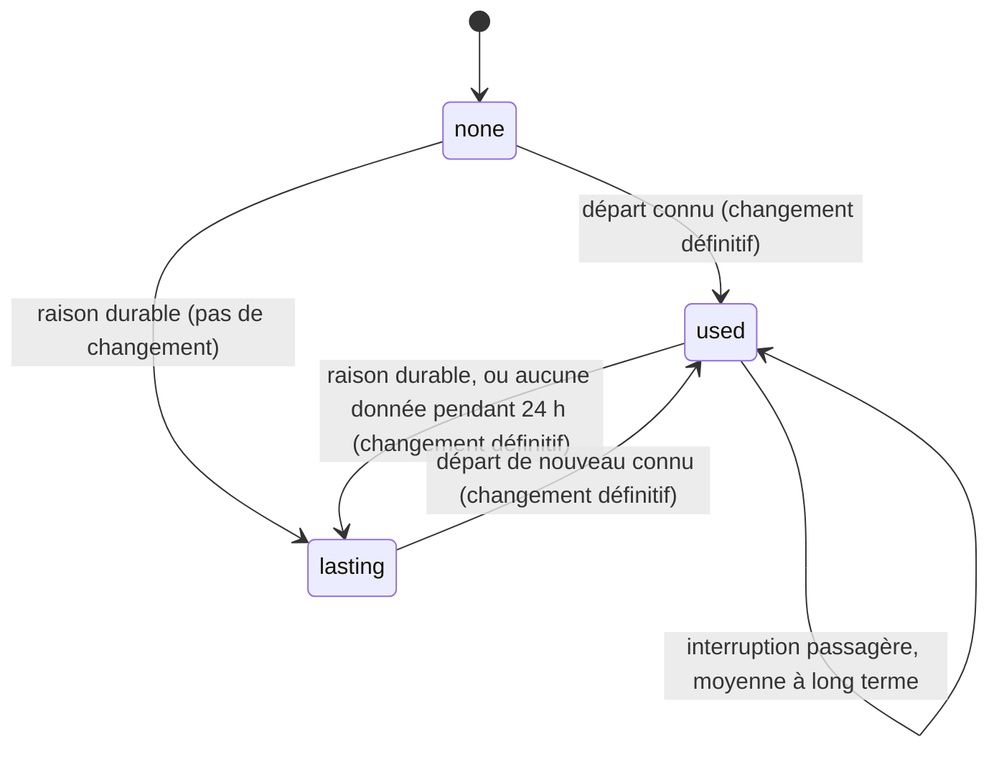
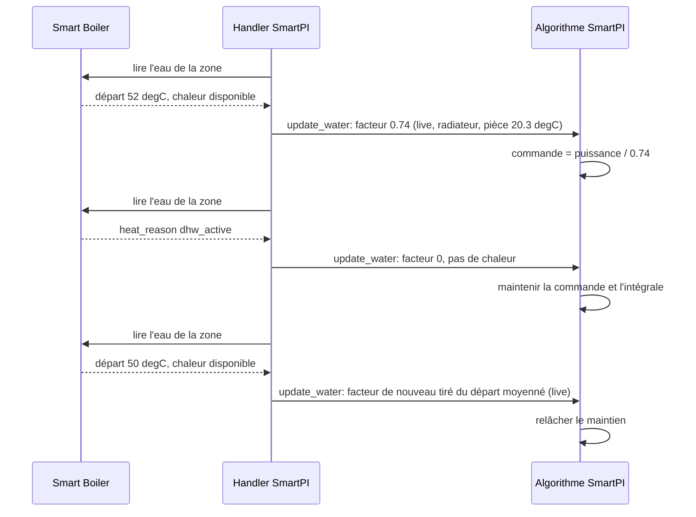
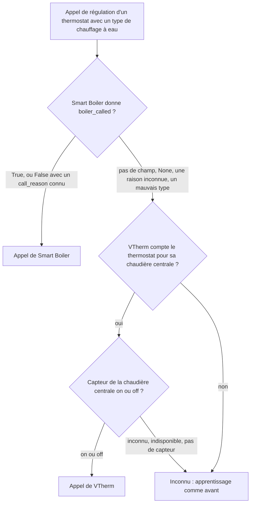
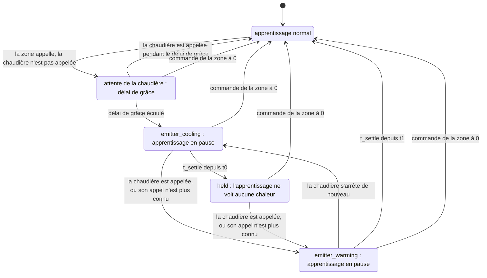
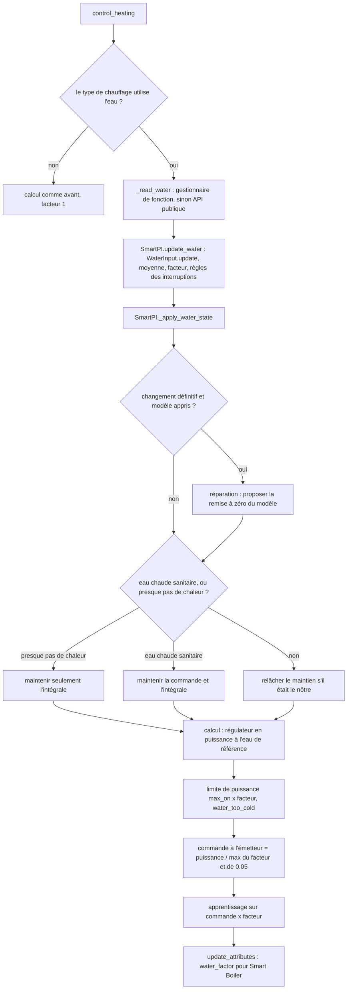

# Entrée eau — la température de départ de l'eau fournie par Smart Boiler

Ce document décrit deux choses. La section 3 explique comment SmartPI utilise la température de
l'eau qui arrive aux émetteurs d'un thermostat (les radiateurs, les boucles de plancher chauffant
ou les autres appareils qui donnent la chaleur à la pièce). La section 4 explique ce que fait
SmartPI quand la zone demande de la chaleur que la chaudière ne donne pas. Pour les deux, le
document couvre les raisons, la configuration, la logique et ses décisions, les composants et les
interfaces, l'état sauvegardé, les diagnostics, les constantes et les limites. La
[documentation technique](technical_doc.md) décrit le régulateur PI, son feed-forward (la part de
la commande calculée à partir du modèle de la pièce, de la consigne et de la température
extérieure) et son propre apprentissage, ainsi que les changements que cette fonction y apporte.
[Tests](testing.md) décrit les tests.

Les données viennent de l'extension Smart Boiler. Les noms, les types et les valeurs que SmartPI
lit ici doivent correspondre à la
[spécification de l'interface eau](https://github.com/Shadow-230/vtherm-smart-boiler/blob/dev/documentation/en/water-interface.md)
de Smart Boiler. Sans Smart Boiler, ou sans données d'eau pour un thermostat, la commande de
SmartPI et sa façon d'apprendre la puissance de l'émetteur restent comme avant (comme sans cette
fonction). Un type de chauffage à eau utilise aussi une donnée de plus : savoir si la chaudière est
appelée. Elle vient de Smart Boiler, ou de VTherm quand la chaudière centrale de Versatile
Thermostat pilote la chaudière (section 4).

Abréviations : Home Assistant (HA), Versatile Thermostat (VTherm), eau chaude sanitaire (ECS).

## Sommaire

1. [Vue d'ensemble](#1-vue-densemble)
2. [Configuration](#2-configuration)
3. [Données d'eau](#3-données-deau)
4. [Une chaudière qui n'est pas appelée](#4-une-chaudière-qui-nest-pas-appelée)
5. [Composants et interfaces](#5-composants-et-interfaces)
6. [Un calcul](#6-un-calcul)
7. [État sauvegardé](#7-état-sauvegardé)
8. [Diagnostics](#8-diagnostics)
9. [Tests](#9-tests)
10. [Constantes, limites et points ouverts](#10-constantes-limites-et-points-ouverts)

## 1. Vue d'ensemble

SmartPI utilise un modèle de la pièce : `dT/dt = a·u − b·(T − T_ext)`. Ici, `T` est la
température de la pièce, `T_ext` la température extérieure, `u` la commande, `a` de combien
l'émetteur réchauffe la pièce par unité de commande, et `b` la vitesse à laquelle la pièce perd sa
chaleur vers l'extérieur. Le modèle suppose qu'une unité de commande `u` apporte toujours la même
chaleur. Avec un chauffage à eau, ce n'est pas vrai :

- une chaudière avec une courbe de chauffe (la température de l'eau suit la température
  extérieure), ou une vanne mélangeuse, baisse la température de l'eau quand il fait doux dehors.
  La même ouverture de vanne ou le même taux de marche (la part du temps où un appareil
  tout-ou-rien est allumé) donne alors moins de chaleur ;
- le brûleur s'allume et s'éteint, donc la température de l'eau varie de plusieurs degrés en
  quelques minutes ;
- quand l'eau chaude sanitaire est prioritaire, elle prend la chaleur de la chaudière au circuit de
  chauffage pendant des dizaines de minutes.

SmartPI apprend alors une valeur de `a` qui mélange la pièce et l'eau. Son feed-forward extérieur
compte aussi la météo deux fois : une fois à travers la courbe de la chaudière, et une fois à
travers son propre modèle.

Le **facteur de puissance de l'émetteur** `φ` corrige cela. Il indique quelle puissance une unité
de commande donne avec l'eau qui arrive à l'émetteur, comparée à une température d'eau de référence
(l'« eau de référence »). SmartPI travaille en puissance à l'eau de référence. Son régulateur, son
modèle et son apprentissage voient tous cette puissance. L'émetteur reçoit `power / φ`. Les
coefficients appris gardent alors leur sens physique, et un changement de l'eau ne ressemble plus à
un changement de la pièce.

Principes (convenus avec le propriétaire le 2026-10-12) :

- **Optionnel.** Sans données d'eau, `φ = 1` : SmartPI se comporte comme sans cette fonction.
- **Une seule source.** Toutes les données sur la chaudière viennent de Smart Boiler. Smart Boiler
  gère tous les capteurs d'eau, de brûleur et d'eau chaude. SmartPI n'a aucun réglage de capteur
  d'eau à lui. (Le propriétaire a élargi ce point le 2026-10-14 : quand Smart Boiler ne pilote pas
  la chaudière, l'information « la chaudière est appelée » vient aussi de la chaudière centrale de
  VTherm, section 4.)
- **Une seule source de chaleur par thermostat VTherm.** Chaque thermostat a son propre circuit et
  sa propre eau. Les radiateurs reçoivent l'eau de départ de la chaudière ; une boucle de plancher
  reçoit l'eau mesurée par le capteur placé après sa vanne mélangeuse.
- **SmartPI calcule le facteur.** Smart Boiler connaît l'eau mais pas les émetteurs. SmartPI
  connaît son type de chauffage et la pièce.
- **SmartPI ne fait que lire l'eau.** Il ne demande jamais une température d'eau. Cela demanderait
  une grosse refonte de Smart Boiler, et la température de l'eau ne peut en général pas être réglée
  séparément pour chaque zone (interface de Smart Boiler, section 9).

## 2. Configuration

**Type de chauffage** (`smart_pi_heating_type`) — réglé dans les réglages du régulateur de l'entrée
globale (comme valeur par défaut) et de chaque entrée de thermostat. Par défaut : radiateur à eau.

| Valeur | Type de chauffage | Exposant `n` | Eau de référence `T_wref` | Utilise les données d'eau |
|---|---|---|---|---|
| `radiator` | Radiateur à eau | 1.3 | 60 °C | oui |
| `floor_water` | Plancher chauffant à eau | 1.1 | 45 °C | oui |
| `floor_electric` | Tapis chauffant électrique | — | — | non |
| `electric_fast` | Radiateur électrique rapide | — | — | non |

Les exposants et les eaux de référence sont provisoires. Ils doivent encore être vérifiés avec des
données d'installations réelles. Un type de chauffage électrique ne lit jamais Smart Boiler.

**Pour utiliser les données d'eau :**

- Smart Boiler relie le thermostat à son circuit et au capteur de température de départ du circuit
  (voir la documentation de Smart Boiler). SmartPI n'a besoin d'aucun autre réglage que le type de
  chauffage.
- Le bloc `water` des diagnostics montre si SmartPI utilise les données : dans ce cas, `source`
  vaut `live`.
- Une entrée sans type de chauffage à elle prend la valeur par défaut globale, qui est un radiateur
  à eau. Pour un émetteur électrique, choisissez un type électrique, pour qu'il ne lise ni Smart
  Boiler ni l'appel de la chaudière.

## 3. Données d'eau

### 3.1 Lecture des données

À chaque appel de régulation, le handler lit les données d'eau pour l'`entity_id` de son entité
climate VTherm. Cela se passe dans `SmartPIHandler._update_water`, appelé depuis `control_heating`
et, pour la source additionnelle d'une zone, depuis `_control_as_source`. Le handler utilise la
première de ces sources qui est disponible :

1. `thermostat.get_feature_manager("vtherm_smart_boiler")` et ses propriétés — sur VTherm
   10.5.0.beta1 et les versions suivantes, une fois que le thermostat a ce gestionnaire de
   fonction (feature manager) ;
2. `hass.data["vtherm_smart_boiler_api"].zone_water(entity_id)` — sur toute version de VTherm,
   aussi avant le rechargement de VTherm.

| Règle | |
|---|---|
| Rien d'importé | SmartPI n'importe aucun code de Smart Boiler. Il vérifie que la méthode, la clé et la fonction existent. |
| Échecs | Toute exception, une clé ou une fonction absente, ou un dictionnaire `None` signifie « pas de données pour l'instant ». |
| Types | Une valeur du mauvais type compte comme absente : par exemple une température donnée sous forme de texte, un `heat_available` qui n'est ni vrai ni faux, ou une raison vide. |
| Fraîcheur | SmartPI fait confiance à `None` et à sa raison. Il ne fixe lui-même aucune limite d'âge sur `supply_measured_at`. |
| Raisons inconnues | Une valeur inconnue de `supply_reason` signifie « pas de données pour ce moment » (spécification de l'interface, section 8). |

Champs lus : `supply_temperature`, `supply_reason`, `heat_available`, `heat_reason`.
`heat_available` change à chaque cycle du brûleur. Il n'est donc pas utilisé comme verrou
d'apprentissage (une condition qui met l'apprentissage en pause, section 3.4). Il décide seulement
quand de nouvelles valeurs entrent dans la moyenne à long terme de `φ` (section 3.3).

### 3.2 Le facteur

    φ = min( (max(T_s − T_room, 0) / (T_wref − 20)) ** n , 1 )

- **`T_s`** est `supply_temperature` moyennée sur `WATER_AVERAGE_S` (15 min, une moyenne
  exponentielle dans le temps). La moyenne est nécessaire parce que le brûleur qui s'allume et
  s'éteint fait sauter la valeur brute. Après une longue interruption, la moyenne prend la première
  nouvelle valeur.
- **`T_room`** est la température de la pièce du thermostat (`current_temperature` de VTherm).
- **Référence.** Avec l'eau de référence et une pièce à 20 °C, `φ = 1`. La moitié de l'écart (la
  différence entre la température de l'eau et celle de la pièce) donne `0.5 ** n`.
- **Une eau plus chaude que la référence** compte comme la référence (`φ ≤ 1`). La plage de
  puissance du régulateur est 0..1, donc un facteur plus élevé ne ferait que plafonner la commande.
  Ainsi, l'émetteur donne au moins la chaleur qu'il donne sans cette fonction. Ces jours-là,
  l'émetteur donne plus que ce que dit le facteur, et la puissance apprise dérive vers le haut,
  comme sans données d'eau.
- **Température de la pièce inconnue** avec un départ connu : SmartPI garde le facteur en usage (ce
  n'est pas une interruption des données).
- **Eau chaude sanitaire prioritaire.** Tant que `heat_reason` vaut `dhw_active`, `φ = 0`. Le départ
  de la chaudière montre alors l'eau qui chauffe le ballon d'eau chaude, pas l'eau de ce circuit.
  Ces mesures n'entrent dans aucune moyenne.

### 3.3 Données manquantes

| Situation | Nature | `φ` utilisé | Source affichée |
|---|---|---|---|
| `supply_temperature` connue | — | à partir du départ moyenné | `live` |
| `heat_reason == dhw_active`, avec un départ connu ou après avoir vu des données | — | 0 | `dhw` |
| `flow_unknown`, `flow_stale`, après avoir vu des données | passagère | la moyenne à long terme de `φ` (`WATER_LONG_AVERAGE_S`, 3 jours), pour que le modèle appris garde ses unités ; 1 s'il n'y a pas encore de moyenne | `average` |
| une raison inconnue, ou aucune donnée, après avoir vu des données | passagère pendant `WATER_NO_DATA_LASTING_S` (24 h), puis durable | comme passagère, puis comme durable | `average`, puis `lasting` |
| `not_mapped`, `circuit_not_measured`, `several_circuits` | durable | 1, comme sans l'interface | `lasting` |
| aucune donnée depuis le démarrage (toute raison sauf une raison durable) | — | 1 | `none` |
| après une raison durable, jusqu'à ce qu'un départ soit de nouveau connu | — | 1 | `lasting` |
| type de chauffage électrique | — | 1 | — (pas de bloc `water`) |

La moyenne à long terme suit `φ` seulement quand la chaudière chauffe : tant que `heat_available`
est vrai, ou, sans ce signal, tant que `φ ≥ WATER_NO_HEAT`. Ainsi, les jours où la chaudière est à
l'arrêt ne tirent pas la moyenne vers le bas. Une journée entière sans aucune donnée, après avoir vu
des données, compte comme durable. Cela arrive par exemple quand Smart Boiler est supprimé ou quand
le thermostat ne fait plus partie de ses zones.

### 3.4 Utilisation dans SmartPI

1. **Commande.** La sortie du régulateur est une puissance à l'eau de référence. La commande
   envoyée à l'émetteur est `power / max(φ, WATER_NO_HEAT)`, au plus 1. Elle est calculée avant
   l'application de la courbe de vanne (`SmartPI._to_actuator_power`). Le minimum (borne basse)
   `WATER_NO_HEAT` (0.05) compte quand l'eau est à peu près à la température de la pièce. C'est
   typique d'une chaudière à l'arrêt qui ne s'allume qu'à la demande. La zone doit quand même
   pouvoir demander de la chaleur, donc sa commande peut atteindre 1 et allumer la chaudière.
2. **Apprentissage.** La puissance à partir de laquelle SmartPI apprend est la commande appliquée
   × `φ` (`SmartPI._to_linear_power`). Cela vaut pour la commande engagée (aussi dans la régulation
   tout-ou-rien de la phase d'apprentissage), la puissance réalisée d'un cycle, l'anti-windup par
   tracking (il empêche la partie intégrale du régulateur de trop grandir pendant que la sortie est
   limitée) et la puissance enregistrée pour la correction du feed-forward (FFTrim, une correction
   apprise du feed-forward). Un nouveau facteur met tout de suite à jour la puissance engagée.
   L'entrée eau n'ajoute aucun verrou d'apprentissage à elle. Une entrée nulle (brûleur éteint, eau
   chaude sanitaire, vanne fermée) apprend à SmartPI les déperditions. Les pauses d'apprentissage
   viennent toujours de Smart Boiler via `vtherm_smartpi.set_smartpi_learning`, comme avant. Elles
   viennent aussi de l'appel de la chaudière, pendant que l'émetteur refroidit ou se réchauffe
   autour d'un maintien (section 4). L'estimateur de
   temps mort mesure le délai avant que la pièce réagisse quand l'émetteur s'allume ou s'éteint. Il
   n'accepte que de grands sauts de commande. Il reçoit la commande elle-même (0 pendant l'eau
   chaude sanitaire).
3. **Limite de puissance et délais.** Avec `φ < 1`, la sortie est limitée à
   `max(φ, WATER_NO_HEAT)` × `max_on_percent` (`_apply_soft_constraints`). C'est ce que donne une
   commande pleine. Le minimum `WATER_NO_HEAT` permet à la commande d'atteindre quand même
   `max_on_percent` quand l'eau n'apporte presque pas de chaleur. L'anti-windup compare le modèle à
   la puissance réalisée, et il voit cette limite. Une demande au-dessus de la limite est affichée
   comme `water_too_cold`. Le délai minimal d'activation et le seuil d'activation de la vanne sont
   vérifiés sur la commande, pas sur la puissance.
4. **Eau chaude sanitaire et eau froide.** Tant que l'eau chaude sanitaire est prioritaire
   (`dhw_active`), la commande de l'émetteur est maintenue à sa dernière valeur (une demande nulle
   donne toujours zéro). L'intégrale est maintenue aussi (`integral_hold_mode = "no_heat"`). Ainsi,
   SmartPI ne pousse pas la vanne vers l'ouverture complète alors qu'aucune chaleur ne peut
   arriver. Quand l'eau n'apporte presque pas de chaleur et que l'eau chaude sanitaire n'en est pas
   la cause (`φ < WATER_NO_HEAT`, par exemple une chaudière à l'arrêt), seule l'intégrale est
   maintenue, et la commande suit le régulateur. Les deux maintiens sont appliqués de nouveau à
   chaque calcul. Si un autre maintien est déjà en cours, SmartPI le laisse tel quel.
5. **Clé pour Smart Boiler.** Tant que le facteur vient des données d'eau (`live`, `average`,
   `dhw`), SmartPI écrit `water_factor` dans les `specific_states` du thermostat. Sa valeur est le
   facteur appliqué, arrondi à 0.001. Sinon (`none`, `lasting`, type électrique), la clé est
   absente. Quand la clé est présente, Smart Boiler sait que ce thermostat utilise les données
   d'eau. Smart Boiler ne fait alors pas sa pause d'apprentissage lors des grandes variations de
   l'eau.
6. **Données qui apparaissent ou disparaissent pour de bon.** Les données d'eau peuvent commencer à
   être utilisées (premières données, ou un départ connu après une interruption durable). Elles
   peuvent aussi s'arrêter pour de bon (une raison durable, ou aucune donnée pendant 24 h). Dans les
   deux cas, la puissance apprise change d'unités. Si SmartPI a un modèle appris (il a passé sa
   phase d'apprentissage), il crée une réparation Home Assistant (dans « Réparations ») :
   « Water temperature data are now available » (les données de température de l'eau sont
   maintenant disponibles) ou « … are no longer available » (… ne sont plus disponibles). La
   réparation a une seule étape, avec l'option **Reset the learned model** (remettre à zéro le modèle
   appris), cochée par défaut. La confirmer appelle `vtherm_smartpi.reset_smartpi_learning` pour le
   thermostat. SmartPI ne convertit pas le modèle appris dans les nouvelles unités (décision du
   propriétaire du 2026-10-12) ; il propose la remise à zéro à la place. Une interruption
   passagère ne crée jamais la réparation. Le problème (issue) de la réparation est
   `water_data_changed_<thermostat unique id>`. Il est créé comme persistant : il reste jusqu'à ce
   que l'utilisateur y réponde, et SmartPI ne le supprime pas. Son seul champ est `reset_model`. Un
   changement du type de chauffage efface ce que l'entrée eau savait (section 7). Donc, après un
   passage à un type à eau, SmartPI propose la remise à zéro aux premières données, s'il a un
   modèle appris. Un passage à un type électrique ne propose rien.
7. **Puissance dans les diagnostics.** Avec des données d'eau, les valeurs du bloc `power`
   (`pi_percent`, `ff_percent`, `command_percent`, `limited_percent`, `applied_percent`, les valeurs
   `linear_*`) et les séries d'historique `power.command_percent` et `power.applied_percent` sont
   des puissances à l'eau de référence. `current_cycle_percent` et `next_cycle_percent` sont la
   commande envoyée à l'émetteur.

### 3.5 Cycle de vie des données

La disponibilité des données d'eau décide d'où vient le facteur et quand la remise à zéro est
proposée.

Pendant une séquence de chauffe du brûleur puis d'eau chaude sanitaire :

### 3.6 Résultats (simulation)

Configuration : un radiateur sur une chaudière avec une courbe de chauffe, extérieur 3 °C ± 3 °C,
48 h ([Tests, §3.4](testing.md#34-eau--test_smartpi_sim_waterpy-court)). Sans les données d'eau,
SmartPI apprend moins de la moitié de la puissance du radiateur à l'eau de référence : l'eau plus
froide donnée par la courbe ressemble à un radiateur plus faible. Avec les données d'eau, il apprend
entre 0.5 et 1.2 fois cette puissance, et plus de 1.5 fois la valeur qu'il apprend sans elles.

## 4. Une chaudière qui n'est pas appelée

Une chaudière peut ne s'allumer que quand la demande des zones remplit ses critères de démarrage, et
seulement après un délai d'activation. Ces critères portent sur le nombre d'appareils ou de zones
qui appellent, leur puissance totale et la plus grande ouverture de vanne. Une zone en dessous de
ces critères demande de la chaleur qui ne vient pas. SmartPI traite la commande de la zone comme si
la chaleur était venue. Il apprend alors un émetteur trop faible (`a`), un mauvais temps mort (le
délai avant que la pièce réagisse) et un biais dans sa correction du feed-forward. Dans une
simulation d'une zone qui appelle toute la nuit sans la chaudière, son `a` appris est tombé à 1 %
de la vraie valeur (section 4.4). Le `heat_available` de Smart Boiler ne permet pas de distinguer ce
cas : `flame_off` arrive aussi à chaque pause ordinaire du brûleur pendant que la chaudière est
appelée.

### 4.1 D'où vient l'appel de la chaudière

| Source | Quand | Valeurs |
|---|---|---|
| Smart Boiler : `boiler_called`, `call_reason` de son interface eau (le gestionnaire de fonction ou `zone_water`) | Smart Boiler pilote la chaudière | `True` ; `False` avec `below_threshold` (des zones appellent, mais en dessous des critères de nombre, de puissance et d'ouverture), `no_demand` (aucune zone n'appelle), `activation_delay` ou `boiler_fault` |
| La chaudière centrale de Versatile Thermostat : son capteur binaire (identifiant unique `central_boiler_state`) | Smart Boiler ne dit rien (`None` avec `not_controlling` ou `waiting_data`, une version plus ancienne sans ces champs, une raison inconnue, un mauvais type), et VTherm compte le thermostat pour sa chaudière centrale (`is_used_by_central_boiler`) | on, ou off (`not_called`) |
| aucune | dans les autres cas, et pour un type de chauffage électrique | SmartPI apprend comme avant (après un maintien, une fois l'émetteur réchauffé) |

- Smart Boiler et la chaudière centrale de VTherm ne pilotent jamais la chaudière en même temps.
  Smart Boiler garde son propre pilotage désactivé tant que la chaudière centrale de VTherm est
  configurée. Quand Smart Boiler pilote, il n'y a pas de chaudière centrale VTherm sur laquelle se
  rabattre. SmartPI apprend alors comme avant jusqu'à ce que Smart Boiler publie ses champs.
- `True` signifie que la chaudière reçoit l'ordre de chauffer. Une pause du brûleur, ou l'eau
  chaude sanitaire prioritaire, apparaît seulement dans `heat_available` et `heat_reason`
  (section 3).
- Le capteur de VTherm suit la décision de VTherm, après le délai d'activation de VTherm. Cette
  décision tient compte des seuils de nombre d'appareils et de puissance, et de toutes les autres
  zones qui appellent.
- Les champs de Smart Boiler ont été convenus avec le projet Smart Boiler le 2026-10-14. Tant que
  Smart Boiler ne les publie pas, SmartPI les lit avec prudence, en vérifiant les valeurs absentes
  ou fausses. Smart Boiler n'ajoute aucune pause d'apprentissage à lui pour ce cas, parce qu'une
  deuxième pause se terminerait au mauvais moment.
- Les champs de demande de Smart Boiler servent seulement aux diagnostics : `demand_count` et
  `count_threshold` (comptés selon `count_by` : `devices`, les têtes de VTherm, ou `zones`),
  `demand_power_kw` et `power_threshold_kw` (kW), `demand_opening` et `opening_threshold` (0 à
  1). SmartPI garde seulement les valeurs du bon type ; pour un nombre, un entier donné sous forme
  de nombre décimal compte comme du bon type. Il garde les nombres comme des entiers et arrondit les
  valeurs en kW et d'ouverture à 3 décimales.

### 4.2 Apprentissage autour d'un maintien

Dans les règles ci-dessous, `u` est la commande de l'appareil de la zone, `called` est l'appel de
la chaudière, `t0` est le début de l'appel de la zone resté sans réponse, et `t1` est le démarrage
de la chaudière après un maintien. `L` est le retard de l'émetteur et `tau` son inertie (constante
de temps). Le délai de grâce est le temps dont dispose la chaudière pour répondre à l'appel de la
zone.

    calling     = en chauffage  et  u > 0
    grace       = BOILER_CALL_GRACE_S (15 min), plus le cycle pour un appareil tout-ou-rien
    t_settle    = L + 3·tau de l'émetteur du type de chauffage (radiateur 65 min, plancher à eau 570 min)

    emitter_cooling   calling, chaudière non appelée depuis t0, t0 + grace <= t < t0 + t_settle
                      (ou tout de suite si la chaudière s'arrête de nouveau pendant que l'émetteur se réchauffe)
    held              calling, chaudière non appelée depuis t0, t >= t0 + t_settle
    emitter_warming   calling, chaudière de nouveau appelée (ou appel plus connu) à t1 après
                      emitter_cooling ou held, t < t1 + t_settle

- **Une chaudière qui répond à l'appel de la zone pendant le délai de grâce** ne change rien. Par
  exemple une chaudière qui s'allume à la demande, ou le délai d'activation de VTherm, de 10 min au
  plus. SmartPI apprend comme avant à partir du saut de commande de la zone elle-même, avec la
  réaction de la chaudière comprise dedans. Il en va de même pour une chaudière déjà en marche, ou
  pour une chaudière qui fait des cycles avec des arrêts plus courts que le délai de grâce : son eau
  reste chaude. Un appareil tout-ou-rien ne compte pour la chaudière que lorsqu'il est allumé. La
  partie éteinte de son cycle n'est donc pas un arrêt de la réponse de la chaudière, et son cycle
  est ajouté au délai de grâce.
- **Refroidissement de l'émetteur.** La chaudière s'est arrêtée pendant que la zone appelle (ou elle
  n'a jamais répondu). La pompe du circuit s'arrête quelques minutes plus tard. L'émetteur ne donne
  alors que la chaleur qu'il contient encore, et cette chaleur baisse au rythme de l'inertie de
  l'émetteur. L'apprentissage attend. Après trois fois l'inertie, il en reste moins de 5 %.
- **Maintenu.** Aucune chaleur n'arrive. L'apprentissage voit une puissance de 0. (Avec des données
  d'eau, la puissance est déjà la commande multipliée par un facteur proche de 0, et elle reste
  telle quelle.) Les fenêtres d'apprentissage où la zone refroidit apprennent `b`, et aucune mesure
  de `a` n'est prise.
- **Réchauffement de l'émetteur.** La chaudière a démarré après un maintien. Son eau doit atteindre
  l'émetteur et le réchauffer. Mais la vanne est restée ouverte tout le temps, donc il n'y a pas de
  saut de la commande de la zone que l'apprentissage de SmartPI attendrait. L'apprentissage attend
  de nouveau. SmartPI ne mesure pas non plus le démarrage de la chaudière comme un temps mort. Ce
  retard vient de l'eau, pas de la vanne, et le temps mort de SmartPI est celui de la vanne. (Dans la
  simulation, la réponse au démarrage de la chaudière est venue en 2 à 5 min, et la réponse à la
  vanne en 11 min.)

| | Délai de grâce, apprentissage normal | `emitter_cooling` | `held` | `emitter_warming` |
|---|---|---|---|---|
| `a`, `b` | appris | en pause (verrou `boiler_settling`) | appris avec la puissance 0 : seulement la façon dont la zone refroidit | en pause (verrou `boiler_settling`) |
| Estimateur de temps mort | normal | en pause (verrou) | entrée 0, pas de saut | en pause (verrou) ; ensuite de nouveau la commande, sans saut |
| Correction du feed-forward | active | gelée (`boiler_not_heating`) | gelée | gelée |
| Échanges avec les voisins, ajustement de la zone | appris | en pause | en pause | en pause |
| Puissance réalisée d'un cycle, enregistrée pour eux | celle du cycle | 0 | 0 | celle du cycle |

- Chaque changement de mode abandonne la fenêtre d'apprentissage ouverte et le saut en cours de
  l'estimateur de temps mort (un appel resté sans chaleur, ou le démarrage de la chaudière). Mettre
  en pause ou reprendre l'apprentissage pendant que la zone est maintenue fait de même, et
  l'estimateur repart de l'entrée qu'il reçoit.
- Une calibration en cours est annulée dès que la zone refroidit ou est maintenue. Sinon, elle
  mesurerait la réponse à une chaleur qui ne vient pas.
- Un thermostat qui sert de source additionnelle à un autre thermostat suit la commande de cet
  autre thermostat, pas la sienne. Son mode est donc effacé.
- **Une chaudière qui fait des cycles sous le seuil de la zone elle-même**, avec des arrêts plus
  courts que le délai de grâce (les à-coups de la section 10), ne met pas la zone en maintien. Là,
  l'apprentissage prend la commande comme de la chaleur, comme avant.
- **« Appeler » signifie que la commande de SmartPI lui-même est au-dessus de 0.** VTherm et Smart
  Boiler décident qu'une zone appelle à partir de `is_device_active` de VTherm. Pour une vanne sur
  VTherm 10.5, cela veut dire une commande au-dessus du seuil minimal de la vanne. Donc une zone
  dont la commande est sous ce seuil appelle pour SmartPI mais pas pour la chaudière, et elle peut
  être maintenue.
- **Dans une zone à deux sources de chaleur**, c'est l'appel de la source principale elle-même qui
  décide. La source principale peut être à 0 % pendant que la source additionnelle chauffe et que la
  chaudière n'est pas appelée. Les cycles de la source additionnelle comptent alors toujours comme
  de la chaleur dans l'ajustement de la zone (au niveau 1 sans données d'eau).
- **La régulation ne change pas.** Le régulateur ne change pas sa commande parce que la chaudière
  n'est pas appelée. La partie proportionnelle et l'intégrale montent jusqu'à ce que la demande de
  la zone remplisse les critères de la chaudière, ou jusqu'à ce que les autres zones fassent appeler
  la chaudière. Une zone qui a besoin de moins que le seuil fait quand même faire des cycles à la
  chaudière, et elle peut rester sous sa consigne (section 10). Même quand SmartPI connaît l'appel
  de la chaudière, dans la simulation, une zone qui avait besoin de 20 % sous un seuil de 70 % est
  quand même restée 0.2 à 0.7 degC trop basse pendant 30 h. C'est le point ouvert sur la
  régulation, pas sur l'apprentissage.
- Après un changement du type de chauffage, le temps de stabilisation suit le nouvel émetteur.

### 4.3 Diagnostics et état

Le bloc `boiler` de la section 8 montre la source, l'appel, sa raison et le mode d'apprentissage.
Avec Smart Boiler, il montre aussi la demande comparée aux seuils. Rien n'est sauvegardé. Après un
redémarrage, les modes repartent de la première lecture.

### 4.4 Résultats (simulation)

`tests/test_smartpi_sim_boiler_call.py` simule un radiateur de 2000 W derrière une vanne. Le seuil
de démarrage de la chaudière est de 2500 W. Il n'est atteint qu'avec les autres zones (3000 W), et
celles-ci n'appellent pas pendant une plage de la journée. Quand la chaudière s'allume, son eau se
réchauffe avec une inertie de 4 min ; sinon, l'eau refroidit sous la température de la pièce. Le
capteur a un pas de 0.01 °C, la simulation dure 96 h, et la température extérieure est de
3 °C ± 2 °C. « Informé » signifie que SmartPI connaît l'appel de la chaudière ; « non informé »
signifie qu'il ne le connaît pas.

| Cas | Non informé | Informé |
|---|---|---|
| Chaudière centrale de VTherm, sans données d'eau, pas de chaudière 2:00–8:00 | `a` 0.01 de la vraie valeur, `b` 0.98 | `a` 1.06, `b` 0.98 |
| Smart Boiler avec données d'eau, pas de chaudière 10:00–16:00 | `a` 1.05, `b` 0.99 (une simulation d'essai ; les données d'eau montrent déjà la chaleur manquante) | `a` 1.04, `b` 0.98 |

Les tests vérifient les résultats des simulations « informé ». Ils vérifient aussi qu'aucune mesure
de `a` n'est apprise pendant que la chaudière n'est pas appelée. Pour le cas de VTherm, ils
vérifient aussi que le temps mort reste celui de la vanne : 11.3 min, contre 11.2 min (avec `a`
0.99 et `b` 0.98) quand la chaudière est toujours appelée. La zone qui allume la chaudière toute
seule (pendant la phase d'apprentissage de SmartPI, avec sa commande à 100 %) apprend quand même
son temps mort et quitte la phase d'apprentissage, parce que son appel reçoit une réponse pendant
le délai de grâce. Avec un capteur de 0.1 °C, l'estimateur de SmartPI lui-même se trompe d'environ
20 % sur la vraie valeur, même quand la chaudière est toujours appelée. Cela cache les différences.

## 5. Composants et interfaces

| Composant | Fichier | Rôle |
|---|---|---|
| `WaterInput` | `smartpi/water_input.py` | Logique pure, sans code HA : le facteur, la moyenne du départ sur 15 min, la moyenne à long terme de `φ`, les règles des interruptions, la disponibilité (`none`, `used`, `lasting`) et ses changements définitifs ; l'état sauvegardé. |
| `WaterReading`, `WaterState` | `smartpi/water_input.py` | Ce que Smart Boiler a donné ; le facteur en usage, sa source, le départ moyenné, les raisons, `no_heat`, `changed_for_good`. |
| `SmartPIHandler._read_water` | `handler.py` | Lit le gestionnaire de fonction ou l'API publique et vérifie les types. Tout échec donne `None`. |
| `SmartPIHandler._update_water` | `handler.py` | Avant chaque calcul d'un type à eau (depuis `control_heating`, et depuis `_control_as_source` pour la source additionnelle d'une zone) : `algo.update_water(...)` ; lors d'un changement définitif, `_offer_model_reset`. |
| `SmartPIHandler.update_attributes` | `handler.py` | Écrit ou retire `water_factor` dans `specific_states`. |
| `SmartPI.update_water`, `_apply_water_state` | `algo.py` | Applique le facteur ; démarre et termine le maintien « sans chaleur » ; met à jour la puissance engagée. |
| `SmartPI._to_actuator_power`, `_water_command`, `_to_linear_power` | `algo.py` | Commande = puissance / `max(φ, WATER_NO_HEAT)` (ou la commande maintenue) ; puissance = commande × `φ`. Avec des données d'eau, la commande engagée est la référence et sa puissance suit le facteur. |
| `SmartPI._deadtime_power` | `algo.py` | Le saut de commande pour l'estimateur de temps mort (0 pendant l'eau chaude sanitaire). |
| `SmartPI._apply_soft_constraints` | `algo.py` | Limite de puissance `max_on_percent × max(φ, WATER_NO_HEAT)` ; `water_too_cold`. |
| `WaterModelResetFlow` | `repairs.py` | L'étape de la réparation : remettre à zéro le modèle appris (coché par défaut). |
| Type de chauffage | `config_flow.py`, `const.py` | Le sélecteur `smart_pi_heating_type` dans les réglages du régulateur. |
| `BoilerCall`, `BoilerReading` | `smartpi/boiler_call.py` | Logique pure : l'appel de la chaudière, le mode d'apprentissage (`emitter_cooling`, `held`, `emitter_warming`), le délai de grâce et le temps de stabilisation selon le type de chauffage, les diagnostics `boiler` (section 4). |
| `SmartPIHandler._read_boiler`, `vtherm_central_boiler_on` | `handler.py` | `boiler_called`, `call_reason` et les champs de demande de Smart Boiler, sinon la chaudière centrale de VTherm pour un thermostat qu'elle sert ; seulement pour un type de chauffage à eau. |
| `SmartPI.update_boiler`, `_read_known_inputs`, `_learning_power`, `_deadtime_input` | `algo.py` | Le mode d'apprentissage à chaque calcul : apprentissage avec la puissance 0 pendant le maintien, le verrou `boiler_settling` pendant que l'émetteur refroidit ou se réchauffe, l'entrée et les sauts de l'estimateur de temps mort, la correction du feed-forward gelée, la couche des dépendances informée (`heat_withheld`), la puissance réalisée d'un cycle enregistrée à 0. |

## 6. Un calcul

## 7. État sauvegardé

`SmartPI.save_state()` ajoute une clé `water` dès que l'entrée eau a vu des données ou une raison
durable. Ainsi, un thermostat sans données d'eau garde l'ancien format. La clé contient ces
champs :

| Champ | Signification |
|---|---|
| `heating_type` | Le type de chauffage auquel l'état appartient. Un état d'un autre type est ignoré. |
| `availability` | `none`, `used` ou `lasting`. Grâce à lui, la première lecture après un redémarrage n'est pas prise pour un changement définitif. |
| `long_average` | Moyenne à long terme de `φ`. Elle est gardée lors d'un redémarrage et utilisée pour les interruptions passagères. |
| `no_data_s` | Depuis combien de temps dure une interruption sans aucune donnée. Le décompte continue après un redémarrage, donc la règle des 24 h fonctionne même avec des redémarrages fréquents. |

La moyenne du départ sur 15 min n'est pas sauvegardée. Elle repart de la première lecture. Un
changement du type de chauffage efface les moyennes. La remise à zéro de l'apprentissage
(`reset_learning`) les garde, parce qu'elles décrivent l'eau, pas la pièce.

## 8. Diagnostics

Pour un type de chauffage à eau, les diagnostics publiés (`live`) reçoivent un bloc `water` :

| Champ | Signification |
|---|---|
| `heating_type` | Le type de chauffage du thermostat. |
| `factor` | `φ` appliqué maintenant. |
| `source` | `live`, `average`, `dhw`, `lasting` ou `none` (section 3.3). |
| `supply_avg_c` | Le départ moyenné, °C. |
| `supply_reason`, `heat_reason` | Les dernières raisons données par Smart Boiler. |
| `no_heat` | Eau chaude sanitaire : la commande et l'intégrale sont maintenues. |
| `low_heat` | L'eau n'apporte presque pas de chaleur : l'intégrale est maintenue. |
| `water_too_cold` | La demande a dépassé ce que l'eau donne à pleine commande. |

Quand l'appel de la chaudière est connu (section 4), `live` reçoit aussi un bloc `boiler` :

| Champ | Signification |
|---|---|
| `source` | `smart_boiler` ou `vtherm_central_boiler`. |
| `called` | Si la chaudière est appelée pour chauffer en ce moment. |
| `reason` | Pourquoi elle ne l'est pas : le `call_reason` de Smart Boiler, ou `not_called` pour la chaudière centrale de VTherm. |
| `learning` | `emitter_cooling`, `held`, `emitter_warming` ou `null` (section 4.2). |
| `demand` | La demande comparée à ses seuils, telle que Smart Boiler la donne : `demand_count`, `count_threshold`, `count_by`, `demand_power_kw`, `power_threshold_kw`, `demand_opening`, `opening_threshold`. |

## 9. Tests

[Tests](testing.md) décrit les tests de l'entrée eau et de l'appel de la chaudière : tests
unitaires, de l'algorithme, du handler, des formulaires et de simulation, avec les scénarios et
leurs critères. Les résultats de la section 4.4 viennent de ces tests.

## 10. Constantes, limites et points ouverts

| Constante (`smartpi/const.py`) | Valeur |
|---|---|
| `WATER_EMITTERS` | radiator (1.3, 60 °C), floor_water (1.1, 45 °C) |
| `WATER_AVERAGE_S` | 15 min |
| `WATER_LONG_AVERAGE_S` | 3 jours |
| `WATER_NO_HEAT` | 0.05 |
| `WATER_FACTOR_MAX` | 1.0 |
| `WATER_NO_DATA_LASTING_S` | 24 h |
| `WATER_ROOM_REFERENCE_C` | 20 °C (la pièce de l'eau de référence dans le facteur) |
| `BOILER_CALL_GRACE_S` | 15 min (section 4) |

- **Exposants et eaux de référence provisoires** : ils doivent encore être vérifiés avec des
  données d'installations réelles.
- **La zone à deux sources de chaleur** (un radiateur et une boucle de plancher dans une même
  pièce) utilise le facteur propre à chaque source. La commande de la source principale est une
  puissance à l'eau de référence. La source additionnelle la transforme en sa propre commande avec
  son propre facteur. Elle transmet à la source principale ses cycles (ceux d'un appareil
  tout-ou-rien, à leur facteur) et son plafond de puissance. Voir
  [Dépendances entre zones et deuxième source de chaleur, §5.2 et §5.7](zone_dependencies.md#5-une-deuxième-source-de-chaleur).
- **Un seuil de démarrage de la chaudière** : la chaudière centrale de Versatile Thermostat, ou
  Smart Boiler, peut être réglée pour ne s'allumer qu'au-dessus d'une puissance totale ou d'une
  ouverture de vanne, avec le critère du nombre de zones désactivé. Une zone dont la demande reste
  sous le seuil demande de la chaleur qui ne vient pas. Sa commande est convertie en puissance à
  partir de la puissance de l'appareil réglée dans Versatile Thermostat (2000 W à 20 % donnent
  400 W, sous un seuil de 600 W). Quand SmartPI est informé que la chaudière n'est pas appelée, il
  n'apprend plus à partir de cette commande une fois que l'appel est resté sans réponse plus
  longtemps que le délai de grâce (section 4). Sa régulation ne change pas :
  - Quand SmartPI n'est pas informé et n'a pas de données d'eau, il prend sa commande comme de la
    chaleur. Informé ou non, l'intégrale monte jusqu'à ce que la commande dépasse le seuil. La
    chaudière s'allume alors par à-coups. Une simulation d'essai, en dehors de la suite de tests, a
    utilisé une seule zone qui avait besoin d'une ouverture de 20 %. Là, un seuil de 35 % a donné
    environ 5 démarrages par heure et une intégrale deux fois plus grande. Avec 70 %, la zone est
    restée 0.2 à 0.7 degC sous sa consigne pendant 30 h.
  - Avec des données d'eau, l'eau qui refroidit fait baisser `φ` dans la moyenne sur 15 min, donc
    l'apprentissage arrête de compter la chaleur manquante. Mais la commande `power / φ` monte
    alors au-dessus du seuil, puis redescend une fois l'eau chaude. Avec un seuil de 35 %, cela a
    donné environ 10 démarrages par heure, avec des allumages de 2 min.
  - `heat_available` faux (`flame_off`) ne permet pas de distinguer ce cas d'une pause ordinaire
    du brûleur. L'appel de la chaudière (section 4) le permet. Dans la même simulation, une
    hystérésis de démarrage côté chaudière (la chaudière démarre à une demande plus haute que celle
    à laquelle elle s'arrête) a supprimé les cycles courts : 0.7 démarrage par heure, des
    allumages de 68 min. Encore ouvert, et à décider avec Smart Boiler : un fonctionnement à
    faible charge côté Smart Boiler, où SmartPI maintient son intégrale et garde sa commande
    pendant que la chaudière n'est pas appelée.
  - Rien de tout cela n'arrive quand une seule zone active suffit à allumer la chaudière (le
    nombre par défaut de 1).
- **Temps mort avec une chaudière qui s'allume à la demande** : quand un saut « marche » commence
  avec de l'eau froide, le temps mort que mesure SmartPI comprend la montée en température de la
  chaudière.
- **La remise à zéro du modèle est proposée sous forme de réparation Home Assistant** : les
  données d'eau changent pendant que SmartPI tourne, en dehors de tout formulaire d'options. À ce
  moment-là, une réparation est le moyen pour une intégration de proposer une étape à
  l'utilisateur.
- **Le côté Smart Boiler** (les propriétés du gestionnaire de fonction, l'API publique, la lecture
  de `water_factor`) est implémenté dans l'extension Smart Boiler. Sans Smart Boiler, ou avec une
  version de Smart Boiler qui ne l'a pas, SmartPI ne trouve tout simplement pas de données.

