# Dépendances entre zones et deuxième source de chaleur — documentation technique

> **En service** dans la branche `dev` du fork : les zones voisines et la zone à deux sources de chaleur,
> chacune avec son propre formulaire d'options. [Tests](testing.md) décrit les tests et le simulateur
> qui ont produit les résultats.

Ce document décrit comment SmartPI tient compte de ce qui se passe autour d'une zone : la chaleur
que la zone échange avec les zones voisines, et un deuxième appareil qui chauffe la même zone. Il
couvre le modèle, l'apprentissage, les décisions et leurs raisons, l'état sauvegardé entre les
redémarrages, les diagnostics et les tests. La [documentation technique](technical_doc.md)
décrit le régulateur PI, son feed-forward et son propre apprentissage.

Abréviations : Home Assistant (HA), Versatile Thermostat (VTherm), feed-forward (FF : la part
de la commande qui découle du modèle de la zone), moindres carrés (LS, de l'anglais least squares :
la méthode habituelle pour ajuster un modèle à des données mesurées).

## Sommaire

1. [Vue d'ensemble](#1-vue-densemble)
2. [Configuration](#2-configuration)
3. [Le modèle avec entrées connues](#3-le-modèle-avec-entrées-connues)
4. [Zones voisines](#4-zones-voisines)
5. [Une deuxième source de chaleur](#5-une-deuxième-source-de-chaleur)
6. [Composants et interfaces](#6-composants-et-interfaces)
7. [Un calcul](#7-un-calcul)
8. [État sauvegardé](#8-état-sauvegardé)
9. [Diagnostics](#9-diagnostics)
10. [Tests](#10-tests)
11. [Constantes](#11-constantes)

## 1. Vue d'ensemble

SmartPI modélise une zone comme une seule masse thermique (un seul bloc qui stocke la chaleur). Son
propre actionneur la chauffe, et elle perd de la chaleur vers l'extérieur (`dT/dt = a·u − b·(T − T_ext)`).
Deux situations courantes ne rentrent pas dans ce schéma :

- **Une zone voisine** à une autre température échange de la chaleur avec la zone. Cela se passe
  par une porte ouverte, ou en permanence (un espace ouvert, sans cloison). Aujourd'hui, cet échange
  finit dans le `b` de SmartPI, donc `b` varie alors avec la température du voisin et avec les portes.
- **Un deuxième appareil** chauffe la même zone, par exemple un plancher chauffant à côté d'un
  radiateur. Aujourd'hui, chaque appareil a son propre SmartPI, et chacun voit la chaleur de l'autre
  comme une perturbation (un effet extérieur qu'il ne peut pas expliquer).

L'extension garde telles quelles la loi de commande de SmartPI (la règle qui calcule la commande) et
son apprentissage. Elle ajoute des **entrées connues** au modèle : la chaleur échangée avec d'autres
températures, et la chaleur apportée directement. Ces entrées sont combinées dans les deux valeurs
que la loi de commande utilise déjà. Cela se fait à un seul endroit du code, le point de substitution.
Sans aucune dépendance configurée, rien ne change. Un test vérifie, bit pour bit, que des dépendances
inactives donnent le même déroulement qu'avec la substitution désactivée.

**Pourquoi une liste générale d'entrées connues.** Les deux premiers usages (l'échange avec un voisin,
la chaleur d'une deuxième source) ne sont pas les derniers. Une prévision météo et des facteurs météo
sont prévus pour la même liste. La liste accepte donc deux sortes d'entrée : un échange avec une autre
température, et une chaleur apportée directement. Chaque entrée a une valeur actuelle et une
trajectoire, c'est-à-dire ses valeurs attendues sur une période à venir, l'horizon
(`SOURCE_TRAJECTORY_MIN`). La loi de commande lit les entrées à un seul endroit de `algo.py`. Une
nouvelle entrée ne change ni cet endroit ni les composants de régulation de SmartPI.
**Pourquoi la comparaison se fait pendant le test.** Le test différentiel exécute deux fois le même
scénario, une fois avec la substitution activée et une fois avec la substitution désactivée. Il ne
compare pas avec des exécutions de référence enregistrées à l'avance, car celles-ci casseraient à
chaque modification de l'algorithme de l'auteur.

| Étape | Contenu | État |
|---|---|---|
| Fondation | entrées connues, composition, point de substitution, correction de l'apprentissage et verrous d'apprentissage, état sauvegardé, diagnostics, menu des options | en service |
| Zones voisines | trois modes de connexion, échange appris, réaction à une fenêtre ouverte chez un voisin, formulaires d'options | en service |
| Deuxième source de chaleur | types d'émetteurs, chaleur et échelle de temps de la source additionnelle, ajustement commun de la zone, blocs d'apprentissage, règles de répartition, boucle d'allocation et freinage anticipé, rôle d'exécutant avec les données d'eau et un repli, formulaire de zone depuis le thermostat maître | en service |

## 2. Configuration

Cette section couvre ce que l'utilisateur règle pour une zone et ses voisins, dans les options d'une
entrée de thermostat.

### 2.1 Options et formulaires

Les options d'une entrée de thermostat fonctionnent comme celles de Versatile Thermostat. Chaque
section s'ouvre depuis un menu et y revient. Les modifications restent dans la fenêtre ouverte (le
« brouillon ») jusqu'au dernier élément, **Save and finish** (enregistrer et terminer ; libellé affiché
en anglais), qui les écrit. Fermer la fenêtre les abandonne. Le menu dit quelles sections ont des
modifications non enregistrées. Une nouvelle entrée de thermostat se crée avec le même menu : rien
n'est créé avant **Save and finish**.

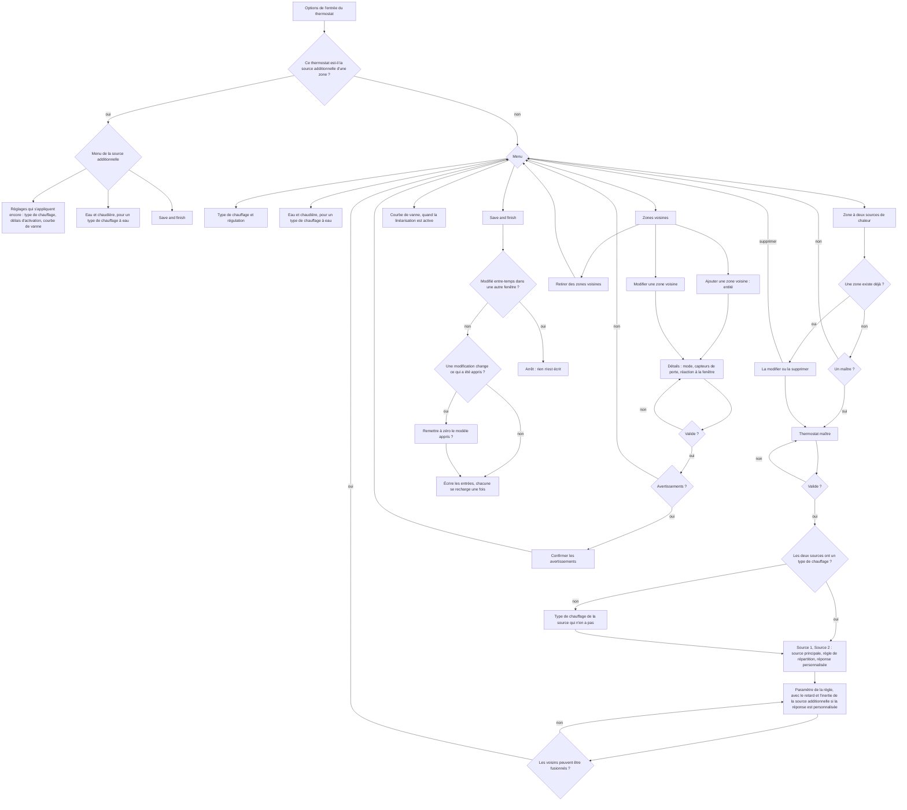

**Zone à deux sources de chaleur.**

- **Thermostat maître.** Le formulaire liste les Versatile Thermostat sur climate qui ont ce
  thermostat parmi leurs appareils. (Un VTherm sur climate commande d'autres thermostats, ses appareils.)
  S'il n'y en a aucun, la section revient au menu, qui explique quoi créer. Le maître doit avoir l'autorégulation désactivée,
  car SmartPI régule dans ses appareils. Il doit avoir exactement deux appareils. Les deux doivent être des
  Versatile Thermostat qui utilisent SmartPI et mesurent la zone avec le même capteur de température.
  Aucun des deux ne peut déjà appartenir à une autre zone.
- **Types de chauffage.** La zone a besoin du type de chauffage des deux appareils. Un appareil dont
  l'entrée propre n'en définit pas doit l'indiquer dans une étape avant les sources. Le type est écrit
  dans l'entrée de cet appareil à **Save and finish** (une entrée est créée pour lui s'il n'en a pas).
- **Sources.** Source 1 et Source 2 sont les appareils du maître. Le formulaire montre chacune avec le
  type de chauffage de sa propre entrée. Dans la même étape, l'utilisateur choisit
  la **source principale** : celle dont le SmartPI régule et corrige vite. Par défaut, c'est l'appareil
  le plus rapide. L'utilisateur choisit aussi la règle de répartition, et le formulaire propose la règle
  recommandée pour les deux types de chauffage (section 5.3). Enfin, l'utilisateur indique s'il veut
  régler le retard et l'inertie de la source additionnelle au lieu de partir de son type de chauffage. Le
  formulaire ne demande pas le retard de la source principale, car l'ajustement de la zone l'apprend
  (section 5.4). Une zone enregistrée par une version antérieure peut contenir le retard et l'inertie
  propres à la source principale. Elle les garde, mais ils ne sont pas utilisés.
- **Paramètre.** Cette étape montre le paramètre de la règle et ce qu'il signifie pour ces deux
  thermostats (`together` 10 à 1000 %, `source_first` et `lead_band` 0 à 100 %). Elle avertit quand le
  type de chauffage de la source principale répond plus lentement que celui de l'autre. Si l'utilisateur
  les a demandés, elle demande aussi le retard et l'inertie de la source additionnelle (0 à 600 min).
- **Où c'est enregistré.** La zone est enregistrée dans l'entrée de la source principale, comme son
  élément `source`, qui nomme aussi le maître (`zone_master`). Les voisins et les portes de la zone sont
  dans la même entrée. L'entrée de l'autre thermostat ne stocke rien sur la zone. Ce thermostat trouve
  son rôle dans l'entrée de la source principale. Un thermostat sans entrée SmartPI en reçoit une à
  **Save and finish**. Elle utilise les réglages partagés des valeurs par défaut et contient son type de
  chauffage. Sa création ne redémarre que ce thermostat.
- **Une source principale autre que le thermostat dont les options sont ouvertes.** Cela arrive quand
  la zone est configurée depuis le thermostat qui devient la source additionnelle, ou quand on change de
  source principale. Le formulaire déplace alors la zone, avec les voisins de cette entrée, vers l'entrée
  de la source principale, et vide la liste de cette entrée. Une ancienne source principale fonctionne
  alors comme source additionnelle. Un voisin qui fait maintenant partie de la zone est retiré. Si un
  voisin déplacé entre en conflit avec un des voisins propres à la nouvelle source principale (le même
  voisin ou le même capteur de porte), c'est le voisin déplacé qui l'emporte. Si la liste ne passe
  toujours pas la validation, l'étape du paramètre affiche l'erreur `zone_move_conflict`. Les voisins
  déplacés apprennent de nouveau leur échange dans la nouvelle source principale. Les deux entrées sont
  écrites à **Save and finish**.
- **Une seule fenêtre à la fois.** À **Save and finish**, le formulaire vérifie de nouveau que le maître
  et les entrées des deux thermostats sont toujours tels qu'il les a lus, et que la liste des dépendances
  de cette entrée n'a pas changé dans une autre fenêtre. Sinon, il s'arrête (`zone_changed`), n'écrit
  rien et demande à l'utilisateur de rouvrir la fenêtre. Ainsi, deux fenêtres ouvertes en même temps ne
  peuvent pas laisser chaque thermostat nommer l'autre.
- **Voisins d'une zone.** La source additionnelle de la zone et son maître ne peuvent pas être ajoutés
  comme voisins de la zone, car ils chauffent ou mesurent la même zone.
- **Quand la fenêtre s'arrête.** Seul **Save and finish** peut fermer la fenêtre sans rien écrire :
  quand la zone a changé pendant qu'elle était ouverte (`zone_changed`), ou quand l'entrée de l'autre
  thermostat de la zone ne peut pas être créée (`main_entry_missing`). Dans une section, un problème est une erreur
  sur son formulaire, ou la section revient au menu avec une note.
- **Les options de la source additionnelle** ouvrent un menu à elles, qui montre quelle entrée contient
  la zone. Son premier élément contient les réglages qui s'appliquent encore tant qu'elle suit la source
  principale : son type de chauffage, ses délais d'activation et, pour une vanne, sa courbe. Ses autres réglages du régulateur
  gardent leurs valeurs. Ils ne s'appliquent que lorsqu'elle régule seule parce que la source principale
  est devenue silencieuse, c'est-à-dire qu'elle n'envoie plus de commandes (section 5.7).
- **Types de chauffage au démarrage.** À chaque démarrage de la source principale, le handler lit
  les types de chauffage des deux thermostats dans leurs entrées. Enregistrer l'entrée de
  la source additionnelle redémarre aussi la source principale. Un type de chauffage modifié prend donc
  effet tout de suite. Une réponse personnalisée réglée dans le formulaire de zone est conservée. Un type
  de chauffage modifié de cette façon ne compte pas comme une modification de la zone : si l'utilisateur
  ne modifie ensuite que la règle, le formulaire ne propose pas de remise à zéro.
- **Un maître modifié.** Au démarrage, et quand son entrée est rechargée, la source principale vérifie
  que le maître a toujours exactement ces deux thermostats comme appareils. Elle les compare par
  identifiant unique (l'identifiant qui ne change jamais ; au rechargement, le thermostat n'a pas
  encore son identifiant d'entité). S'ils diffèrent, elle écrit un avertissement dans le journal. La
  zone continue de fonctionner comme elle est configurée jusqu'à la prochaine ouverture du formulaire.
- **Supprimer la zone** rend à chaque thermostat sa propre régulation. L'ancienne source additionnelle
  régule avec le modèle qu'elle avait avant de prendre ce rôle. Une entrée que le formulaire a créée pour
  elle reste en place.
- **Recommandé sur le maître** (d'après le code de Versatile Thermostat) : un long délai de sécurité,
  car son mode sécurité éteint les deux appareils ; et un petit pas pour son seuil de régulation, car il
  arrondit à ce pas la consigne qu'il transmet.

**Voisins.**

- **Les erreurs** gardent le formulaire ouvert : une entité sans identifiant unique, la zone elle-même,
  un voisin en double, le mode porte sans capteur, un capteur de fenêtre, un capteur de porte d'un autre
  voisin.
- **Les avertissements** demandent une confirmation : l'entrée propre du voisin ne liste pas cette
  zone ; un capteur de porte est aussi le capteur de fenêtre de ce thermostat ; la détection automatique
  de fenêtre est configurée, et elle peut réagir à la porte ouverte.
- **Suggestions.** Le formulaire liste les capteurs de porte qui sont dans les pièces des deux zones et
  qu'aucun autre voisin n'utilise. Il ne les présélectionne pas, car l'un d'eux peut être une porte
  extérieure.
- **Un voisin affiché `indistinguishable`** n'a pas pu être distingué de l'extérieur ou d'un autre
  voisin. Rien n'est publié pour lui, et la zone fonctionne comme s'il n'existait pas.
- **Chaque étape se termine dans le menu.** Modifier un voisin dont l'entité n'existe plus est une
  erreur sur le formulaire (`neighbour_missing`). Retirer sans rien sélectionner revient au menu, qui le
  dit. Enregistrer après que la liste a changé dans une autre fenêtre arrête la fenêtre (`zone_changed`).
  Le menu des voisins, comme celui de la zone, a un élément pour revenir au menu principal.

**Configuration stockée.** Les éléments sont stockés dans les options de l'entrée, sous
`smart_pi_dependencies`. Un élément voisin contient `id`, `kind` (`neighbour`), `entity` (identifiant
du registre), `mode`, `door_sensors` et `neighbour_window_action`. L'élément source de la zone contient
`id`, `kind` (`source`), `entity`, `zone_master`, et `split_rule` avec son paramètre
(`split_ratio`, `source_alone_percent` ou `lead_band_percent`). Il contient aussi `lead_emitter` (le
type de chauffage de l'entrée de la source principale) et `source_emitter` (le type de chauffage de
l'entrée de la source additionnelle, relu au démarrage, ou `custom`). Pour une réponse personnalisée, il
contient `source_lag_min` et `source_tau_min`. Une zone enregistrée par une version antérieure peut
aussi contenir `lead_lag_min` et `lead_tau_min`, que rien n'utilise.

### 2.2 Remise à zéro du modèle appris

Une modification qui touche ce qui a été appris est une raison pour une seule question à **Save and
finish** : une étape « Remettre à zéro le modèle appris » (`model_reset`), cochée par défaut, qui
nomme les sections d'où viennent les raisons. Elle est posée une fois, même quand plusieurs sections
ont changé, et pas du tout sans raison :

| Modification | Une raison pour la question de remise à zéro |
|---|---|
| une zone configurée ou supprimée, sa source additionnelle remplacée par une autre, la source principale changée, la réponse personnalisée de la source additionnelle modifiée | oui |
| un voisin ajouté ou retiré, son mode ou ses capteurs de porte modifiés | oui |
| le type de chauffage, la source des données d'eau ou son capteur de départ ([Entrées eau et chaudière, §2](water_input.md#2-configuration)) | oui |
| la règle de répartition ou son paramètre, une réaction à la fenêtre, les délais d'activation et les autres réglages du régulateur | non |

- **Comment elle s'applique.** Si l'utilisateur choisit la remise à zéro, l'enregistrement stocke un
  nouveau jeton aléatoire (`smart_pi_reset_token`) dans chaque entrée concernée : celle de ce
  thermostat et, pour une zone, celle de la source principale (où se trouve la zone). Quand le
  thermostat démarre avec cette entrée, SmartPI remet à zéro tout son modèle appris, une seule fois :
  `a`, `b`, les temps morts (les délais avant que la zone réagisse à une commande), l'ajustement de la
  zone et les échanges, comme le fait le service `reset_smartpi_learning`. Il garde le jeton dans son
  état sauvegardé (`dependency_reset_token`), donc un redémarrage ultérieur ne remet pas le modèle à zéro
  une deuxième fois.
- Quand le mode ou les capteurs de porte d'un voisin changent, le voisin est stocké sous un nouvel
  identifiant. Son `k` appris repart donc de zéro, quel que soit le choix de l'utilisateur.
- Quand le type de chauffage de la source additionnelle change, la réponse sur laquelle sont construites
  ses échelles de temps candidates change aussi. L'ajustement de la zone est alors effacé au démarrage
  suivant (section 8) et appris de nouveau.

## 3. Le modèle avec entrées connues

### 3.1 Modèle de la zone

    dT/dt = a·u − b·(T − T_ext) + Σ_i g_i·(T_i − T) + Σ_j q_j

- `u` est la commande (0..1) appliquée par le thermostat pilote, celui dont le SmartPI régule la
  zone. `a` est son effet et `b` les déperditions vers l'extérieur, tels que SmartPI les apprend.
- Une **entrée d'échange** `i` relie la zone à une température `T_i` par une conductance `g_i`
  (1/min), c'est-à-dire la facilité avec laquelle la chaleur passe entre elles. Un voisin connecté à la
  zone est une entrée d'échange, avec `g = k`, le coefficient d'échange appris.
- Une **entrée de chaleur** `j` ajoute directement `q_j` (degC/min, positif ou négatif). La chaleur de
  la source additionnelle `a_f·x_f` est une entrée de chaleur (section 5).

### 3.2 Composition

Les entrées connues sont combinées dans les deux valeurs que la loi de commande utilise déjà : son
coefficient de déperdition et sa température extérieure :

    b_eff = b + Σ_i g_i
    T_ref = (b·T_ext + Σ_i g_i·T_i) / b_eff + Σ_j q_j / b_eff

- Le terme de chaleur décale `T_ref`. Le décalage est limité à `KNOWN_HEAT_MAX_SHIFT_C`, pour qu'une
  estimation trop faible des déperditions ne puisse pas le rendre trop grand. La limite doit être
  plus grande que le plus grand écart entre la consigne et l'extérieur. La raison : dans le
  feed-forward, `b` s'annule (`b/a · q/b = q/a`). Une limite plus petite que le décalage dont un plancher a besoin par temps froid
  faisait compter à SmartPI moins de chaleur du plancher qu'il n'y en avait (section 5.8).
- Avec des voisins toujours connectés, le `b` de SmartPI contient déjà leurs échanges. Dans ce cas,
  le terme de déperdition passe au coefficient `b_fit`, qui est ajusté sans eux (section 4.4). Il passe au
  même rythme que leurs échanges entrent dans le modèle :

        loss = b + w·(b_fit − b),   w = Σ_i w_i·k_i / Σ_i k_i

  Ici, `w_i` est la part de chaque échange toujours connecté qui est déjà dans le modèle
  (section 3.3). Avec `b = b_fit + Σ k_i`, `b_eff = loss + Σ w_i·k_i` reste égal à `b` pendant
  l'entrée progressive des échanges (ils entrent pas à pas).
- Chaque entrée a une valeur actuelle et peut avoir une trajectoire sur un horizon. La loi de commande
  n'utilise que la valeur actuelle. Dans une zone à deux sources, le freinage anticipé fait sa propre
  prédiction de la chaleur de la source additionnelle (section 5.6).
- La composition renvoie `b` et `T_ext` inchangés dans ces cas : il n'y a pas d'entrées, il n'y a pas
  de température extérieure, `b` n'est pas un nombre fini, ou les déperditions composées sont
  sous `KNOWN_INPUTS_B_EFF_MIN`.

### 3.3 Où le modèle est utilisé

| Partie de SmartPI | Utilise |
|---|---|
| FF1 (`k_ff = b/a`), FF3, trajectoire de consigne, jumeau thermique, near-band, fenêtres de la correction du feed-forward (FFTrim) | `b_eff`, `T_ref` |
| Temps d'intégration des gains | `Ti = 1 / (loss + Σ g)`, avec `loss` comme en section 3.2 (`1/tau` sans voisins toujours connectés) |
| Apprentissage de `a`, `b` et des temps morts, gouvernance, sécurité | `b` et `T_ext` bruts ; chaque fenêtre d'apprentissage est corrigée de la vitesse qu'ajoutent les entrées connues (`known_rate`) |

La correction est la vitesse de variation de la température qu'ajoutent les entrées actives, à la
température de la zone :

    known_rate = Σ_i g_i·(T_i − T) + Σ_j q_j

Elle est additionnée (intégrée) sur la fenêtre d'apprentissage et retirée de la variation mesurée. C'est
vrai aussi quand le début de la fenêtre glisse. Comme l'apprentissage utilise des données brutes, les
paramètres propres de SmartPI gardent le sens qu'ils avaient avant. Il y a une exception. Une fois que
les `k` des voisins toujours connectés sont dans le modèle, la correction retire leur échange des
fenêtres d'apprentissage de SmartPI. Le `b` propre de SmartPI (le `model.b` des diagnostics) passe
donc, au fil des fenêtres suivantes, de `b_fit + Σk` vers `b_fit`. Cela ne touche pas la loi de
commande, car son terme de déperdition est alors `b_fit` (section 3.2).

**Un coefficient qui devient connu entre progressivement.** Avant que le `k` d'un voisin ou le `a_f`
de la source soit publié, son effet agit sur la zone comme une perturbation inconnue. L'intégrale du
régulateur (la part de la commande qui se construit à partir des erreurs passées) l'a déjà absorbé.
L'ajouter au modèle d'un seul coup ferait sauter le feed-forward. La zone descendrait alors sous la
consigne ou la dépasserait, le temps que l'intégrale se réajuste. Le coefficient entre donc
progressivement, sur `KNOWN_INPUT_FADE_S`. Les voisins toujours connectés sont différents, car le `b`
de SmartPI contient déjà leurs échanges. Ils entrent ensemble, une fois que chacun d'eux est connu. Les
déperditions ajustées remplacent le `b` de SmartPI au même rythme (section 3.2), donc `b_eff` ne
baisse pas pour remonter ensuite. Dans une zone à deux sources, le `b` de l'ajustement remplace tout de suite le `b` de
SmartPI, et il ne contient pas ces échanges. Leur `k` issu de l'ajustement entre donc tout de suite
dans le modèle. Un coefficient déjà connu avant un redémarrage est entièrement dans le modèle dès le
départ. Cela couvre le `k` propre d'un voisin, le `k` issu de l'ajustement de la zone pour le mode HVAC
en cours, et le `a_f` de la source pour l'un ou l'autre mode HVAC.

## 4. Zones voisines

### 4.1 Configuration

Un voisin est une entité climate VTherm ou un capteur de température. Il est stocké par son identifiant
de registre, donc renommer l'entité garde le lien.

| Mode | La connexion est active | Usage typique |
|---|---|---|
| `none` | jamais : le voisin reste dans la liste mais il est ignoré. Passer un voisin existant à `none`, ou l'en sortir, fait repartir son `k` de zéro (section 2.2) | essayer sans un voisin |
| `door` | tant qu'au moins un des capteurs de porte est ouvert (inconnu ou indisponible compte comme fermé) | une pièce derrière une porte |
| `always` | toujours | un espace ouvert, sans cloison |

- Les capteurs de porte sont des capteurs binaires de classe `door`, `opening` ou `garage_door`. Les
  capteurs de fenêtre sont refusés, car la détection de fenêtre de VTherm gère une fenêtre vers l'extérieur.
- Un capteur de porte peut servir plusieurs entrées, mais pas deux voisins de la même zone.
- **`k` est seulement appris.** Il n'y a aucun moyen de le saisir à la main dans cette version. Un moyen
  pourra être ajouté si l'apprentissage échoue quelque part en pratique.
- **Une porte sans capteur n'est pas prise en charge** (décision du propriétaire du 2026-10-12). Il n'y a
  pas de mode pour une porte « habituellement fermée », et les ouvertures ne sont pas détectées à partir
  des données.
- **Configurez un voisin dans les entrées des deux zones**, chacune listant l'autre. L'échange marche
  dans les deux sens, et le formulaire avertit quand l'entrée propre du voisin ne liste pas cette zone.
- Les formulaires de voisin reviennent au menu des options ; le voisin est écrit à **Save and
  finish** (section 2.1).
- Pour un voisin VTherm, la **réaction à la fenêtre** dit quoi faire tant que la connexion est active
  et que le voisin signale une fenêtre ouverte : `nothing`, `turn_off`, `frost`, `eco`.
- Une connexion est ignorée tant que le voisin est indisponible, est en mode sécurité, ou n'a pas de
  température valide (un nombre fini).

### 4.2 Verrous d'apprentissage

Le verrou d'apprentissage décide si l'apprentissage propre de SmartPI (`a`, `b`, temps morts) peut se faire.

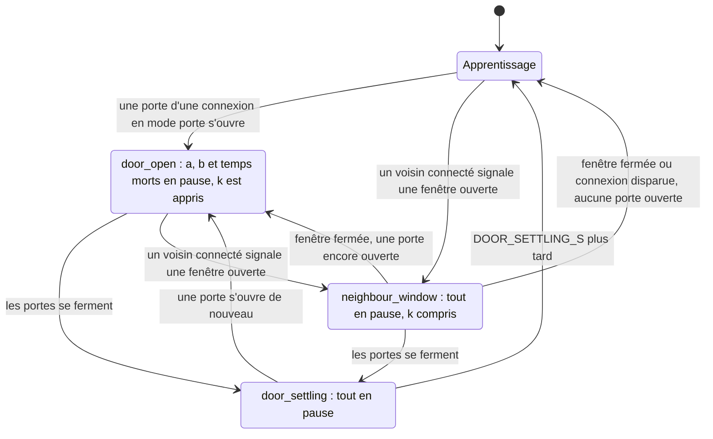

- Quand plusieurs verrous s'appliquent, la priorité est : `neighbour_window` d'abord, puis `door_open`,
  puis `source_heat`, puis `door_settling`. Le verrou `source_heat` appartient à la deuxième source
  (section 5.5). En dessous de tous, `boiler_settling` met l'apprentissage en pause pendant que l'émetteur
  refroidit parce que la chaudière n'est pas appelée, et pendant qu'il se réchauffe de nouveau une
  fois que la chaudière démarre ([Entrées eau et chaudière, §4](water_input.md#4-une-chaudière-qui-nest-pas-appelée)).
- Un voisin toujours connecté ne met pas l'apprentissage en pause. Le `b` de SmartPI contient son
  échange, et l'ajustement commun (section 4.4) l'en sépare. Le premier plan avait un verrou sur l'écart
  de température avec le voisin (`coupling_gradient`). Il a été abandonné : avec un voisin plus froid en
  permanence, il mettait l'apprentissage de SmartPI en pause la plupart du temps, et il ne donnait
  quand même pas un `k` correct.
- `k` n'est appris que lorsque SmartPI lui-même pourrait apprendre. Il faut pour cela : l'apprentissage
  activé et pas en pause ; la zone en chauffe ou en refroidissement ; pas de délestage, de coupure par une
  garde ni de calibration ; SmartPI sorti de sa phase d'apprentissage ; un temps mort fiable ; pas de
  fenêtre ouverte chez un voisin ; et aucun changement d'état de porte pendant les derniers
  `DOOR_SETTLING_S`.

### 4.3 Fenêtres de mesure

`k` est appris à partir de fenêtres de mesure de longueur fixe `COUPLING_WINDOW_S` (30 min). Elles sont
plus longues que les fenêtres d'apprentissage propres de SmartPI, car un capteur au 0.1 degC (qui donne
la température par pas de 0.1 degC) a besoin de temps pour montrer une pente.

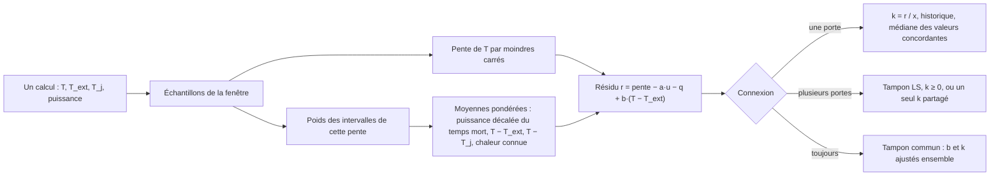

- **Pente.** La pente est une simple pente par moindres carrés (la droite qui passe au mieux par les
  échantillons). Une température stable porte aussi de l'information, car la puissance compense alors les
  déperditions.
- **Poids cohérents.** La pente par moindres carrés est une moyenne pondérée de la vitesse de variation
  de la température, avec plus de poids au milieu de la fenêtre. La puissance, les écarts de température
  et la chaleur connue sont moyennés avec les mêmes poids. Ainsi, le modèle de la fenêtre reste valable
  quand la courbe de température s'infléchit, par exemple avec l'ondulation des cycles tout-ou-rien. Avec
  de simples moyennes (à poids égaux) à la place, une ondulation régulière donnait à `k` une erreur
  systématique d'environ 6 % dans les tests.
- **Puissance réalisée.** La puissance qui agit sur la zone est la puissance appliquée, décalée du temps
  mort. C'est la puissance que chaque cycle terminé a réellement fournie, telle que VTherm la rapporte.
  Pour un actionneur tout-ou-rien, cette puissance compte depuis le début du cycle et, avec des données
  d'eau, au facteur d'eau de l'actionneur (section 5.2). La puissance commandée n'est utilisée que pour
  le cycle encore en cours. VTherm écourte souvent un cycle, et un cycle commence par son temps de
  marche. La moyenne de la puissance commandée était donc plus basse que ce que la zone recevait.
- Une fenêtre ne compte que si `|T − T_j| ≥ COUPLING_K_MIN_DT` pour au moins un voisin, et si elle
  contient au moins `MIN_WINDOW_SAMPLES` calculs. Une fenêtre recommence chaque fois que l'ensemble des
  voisins connectés ou l'ensemble des colonnes de chaleur de la source change, ou quand l'apprentissage
  n'est pas autorisé.

### 4.4 Apprentissage de l'échange

**Une porte.** `k = r / x`, avec `x = −(T − T_j)` moyenné sur la fenêtre. Deux sortes de valeurs sont
rejetées : les valeurs hors de `(0, COUPLING_K_MAX]`, et les valeurs aberrantes de l'historique. Une fois
que l'historique contient `OUTLIER_MIN_HISTORY` valeurs, une valeur aberrante est une valeur au-delà de
`OUTLIER_MAD_FACTOR` fois le MAD mis à l'échelle.
(Le MAD, écart absolu médian, mesure à quel point les valeurs sont dispersées.) `k` est publié comme la
médiane de l'historique une fois que l'historique contient `COUPLING_MIN_SAMPLES` valeurs qui concordent,
c'est-à-dire avec un rapport MAD sur médiane d'au plus `COUPLING_MAX_DISPERSION`. Le `b` de SmartPI est
propre ici, car SmartPI ne l'apprend que lorsque les portes sont fermées.

**Plusieurs portes ouvertes ensemble.** Les fenêtres alimentent un tampon de `COUPLING_LS_WINDOW` lignes.
Une fois que le tampon contient `COUPLING_MIN_SAMPLES` lignes, il est résolu par moindres carrés avec
`k ≥ 0`. La solution est publiée directement, sans historique. Parfois, les régresseurs (les colonnes
d'entrée de l'ajustement) ne peuvent pas être distingués : le nombre de conditionnement de la matrice de
Gram normalisée dépasse `COUPLING_LS_COND_MAX`. (Un nombre de conditionnement élevé signifie que les
colonnes varient trop ensemble pour être séparées.) Les connexions reçoivent alors un seul coefficient
commun, qui garde leur échange total, et elles sont marquées `indistinguishable`.

**Toujours connecté.** Le `b` de SmartPI contient déjà l'échange, donc `b` est ajusté en même temps
que `k` :

    slope − a·u − q = b·x_ext + Σ_j k_j·x_j,   x_ext = −(T − T_ext)

Écrit sous la forme `r = (b + Σ k_j)·x_ext + Σ k_j·(T_j − T_ext)`, cela montre que chaque `k` ne peut
être distingué que si la température propre du voisin varie indépendamment de la température extérieure
et de la zone. Un ajustement du tampon (`COUPLING_JOINT_WINDOW` fenêtres) ne compte que si :

- le tampon contient au moins `COUPLING_JOINT_MIN_ROWS` fenêtres. Des lignes issues de quelques heures
  seulement partagent les mêmes erreurs du `a` et du temps mort de SmartPI, donc elles s'accorderaient
  sur un `k` faux ;
- les colonnes centrées `x_ext` et `T_j − T_ext` (chacune moins sa moyenne) varient chacune d'au moins
  `COUPLING_K_MIN_DT`, et elles ne sont pas colinéaires, c'est-à-dire que l'une n'est pas simplement
  proportionnelle à l'autre (nombre de conditionnement d'au plus `COUPLING_LS_COND_MAX`). Si elles ne
  différaient que d'un décalage constant, une erreur constante, comme des apports de chaleur absents du
  modèle, déciderait de la répartition ;
- chaque coefficient est positif, avec une erreur type (l'incertitude de la valeur ajustée) d'au plus
  `COUPLING_JOINT_MAX_REL_SE` de sa valeur. Contrairement au nombre de conditionnement, l'erreur type
  diminue à mesure que de nouvelles fenêtres arrivent.

Un ajustement qui sépare les coefficients ajoute `k` et son `b` à un historique, au plus une fois toutes
les `COUPLING_JOINT_FIT_SPACING` nouvelles fenêtres. Ainsi, des ajustements qui concordent ne font pas
que répéter les mêmes données. L'historique est publié comme l'historique d'une porte. Une fois que
chaque voisin toujours connecté dont la connexion est active a son `k`, la loi de commande fait passer
son terme de déperdition au `b` ajusté, au rythme de l'entrée progressive des échanges (section 3.2). Cela
inclut le temps d'intégration. Jusque-là, aucun d'eux n'entre, et la zone fonctionne comme s'ils
n'existaient pas.

### 4.5 Une fenêtre chez un voisin connecté

| Réaction | Effet tant que la connexion est active et la fenêtre ouverte |
|---|---|
| `nothing` | l'apprentissage se met en pause, la régulation ne change pas |
| `turn_off` | la zone s'éteint par le chemin que SmartPI utilise pour une fenêtre ouverte (window-off), avec sa reprise protégée |
| `frost`, `eco` | la zone utilise son preset pour le mode HVAC en cours, mais jamais un preset plus exigeant que la consigne actuelle (chauffage : la plus basse des deux, refroidissement : la plus haute). En refroidissement, seul `eco` a un preset (`eco_cool_temp`), donc `frost` éteint la zone |

- Si le preset n'est pas configuré (VTherm rapporte 0) ou s'il est hors de la plage du thermostat, la
  zone s'éteint.
- Si plusieurs voisins ont une fenêtre ouverte, la réaction qui protège le plus l'emporte
  (`turn_off` > `frost` > `eco`).
- Une calibration en cours est annulée. Elle se termine comme annulée au lieu de rester bloquée.
- La réaction ne s'applique que lorsque la zone chauffe ou refroidit.
- La réaction s'applique aussi à une source additionnelle (section 5.6). `turn_off` lui donne 0 %.
  `frost` et `eco` font suivre à sa boucle d'allocation la même consigne, moins exigeante.
- **C'est SmartPI qui applique la réaction, pas VTherm.** L'interface des plugins ne permet pas à
  SmartPI de changer l'état de fenêtre, le mode HVAC ou le preset de VTherm. Le VTherm de la zone affiche
  donc toujours son propre état. Les diagnostics montrent la réaction en vigueur
  (`dependencies.neighbour_window_action`).

### 4.6 Résultats et limites (simulation)

- Avec le vrai `a` et le vrai temps mort, l'estimateur trouve `k` à 2 % près.
- L'erreur restante vient du modèle appris de SmartPI, car `k` est un petit reste dans un grand bilan :
  - porte, capteur au 0.01 degC : `k` à 1 % près, `a` et `b` restent propres ;
  - porte, capteur au 0.1 degC : `k` peut être faux de plusieurs dizaines de pour cent quand le `a`
    de SmartPI est faux de quelques pour cent ;
  - toujours connecté, capteur au 0.01 degC, sauts de la température du voisin : `k` +5.5 %,
    `b` ajusté −1 %, publié environ un jour après le premier saut et jamais avant ;
  - toujours connecté, capteur au 0.1 degC : rien n'est publié, le voisin est marqué
    `indistinguishable` et la zone fonctionne comme aujourd'hui.
- Séparer `b` d'un voisin toujours connecté demande que la température du voisin varie d'elle-même.
- Une zone où SmartPI n'atteint jamais une constante de temps fiable ne tire aucun bénéfice du
  feed-forward, car SmartPI garde alors son feed-forward désactivé.

## 5. Une deuxième source de chaleur

### 5.1 Les rôles et la décision principale

Une zone peut avoir deux sources de chaleur, chacune étant un VTherm avec SmartPI, par exemple un
radiateur et un plancher chauffant. La **source principale** est le thermostat de la zone dont le
SmartPI régule la zone. Dans le code et dans le lien entre les deux sources (section 5.7), elle
s'appelle le **lead**. Elle désigne l'autre thermostat comme sa **source additionnelle** (dans le
code, la **source**). La source additionnelle travaille alors pour elle. Il y a une seule source
additionnelle par zone, et pas de chaîne.

La zone se configure depuis son **thermostat maître** (section 2.1). C'est un Versatile Thermostat
sur climate dont les deux appareils sont les deux thermostats SmartPI. Un Versatile Thermostat
donne la même puissance à tous ses appareils et n'a qu'un seul type d'appareil. Donc deux sources
de puissances différentes sont toujours deux thermostats. Le maître garde la consigne de la zone,
ses presets, son planning, son mode et ses fenêtres, et transmet la même consigne aux deux. Il n'a
pas d'algorithme de puissance à lui : le SmartPI de la zone tourne dans ses appareils.

**Décision : la commande de la source principale reste exactement celle que calcule SmartPI.** Une
boucle d'allocation lente amène la source additionnelle vers la répartition que la règle choisit. La
chaleur de la source additionnelle entre dans le modèle de la source principale comme une entrée
connue. L'autre option était une correspondance fixe : des courbes fixes qui transforment une
demande en deux commandes. Elle a été rejetée :

- la source principale recevrait une autre commande que celle calculée par son régulateur. SmartPI
  y verrait un actionneur limité. Son anti-windup (la protection qui empêche l'intégrale de grossir
  tant que la sortie est limitée) viderait l'intégrale à chaque cycle. Le suivi de la propriété de
  la commande et la correction du feed-forward rejetteraient leurs fenêtres. La phase
  d'apprentissage verrait une mauvaise puissance ;
- la chaleur de la source additionnelle serait comptée deux fois, une fois dans la correspondance
  et une fois comme entrée connue ;
- avec une source lente, la moitié de la commande de la source principale ne montrerait son effet
  que des heures plus tard. La zone dépasserait alors sa consigne et oscillerait.

| | Correspondances fixes (rejetées) | Boucle d'allocation (choisie) |
|---|---|---|
| Régulateur, apprentissage et protections de SmartPI | à retravailler | inchangés |
| Source lente (plancher chauffant) | oscille | stable par construction |
| Réaction de la source additionnelle | immédiate | suit la règle en quelques minutes (source rapide) à quelques heures (plancher), plus une réponse proportionnelle à l'erreur de la zone |
| Répartition | exact à chaque instant | exact en régime établi |

**Décision : un seul modèle de la zone pour les deux sources.** Le modèle de la zone est appris une
seule fois, avec les deux sources en marche, par un ajustement commun de la zone (un seul ajustement
de toutes les valeurs ensemble, section 5.4). L'ajustement donne les déperditions `b`, le `a` et le
retard de la source principale, le `a_f` et l'échelle de temps de la source additionnelle, et les
`k` des voisins. SmartPI part de ce modèle et le garde. La première conception apprenait chaque
source à part, l'une après l'autre. Elle a été abandonnée (section 5.8). Avec des capteurs au pas
de 0.1 degC, les propres fenêtres d'apprentissage de SmartPI mesurent un refroidissement lent
environ deux fois moins rapide qu'il ne l'est vraiment. Chaque valeur apprise par-dessus le modèle
de SmartPI reprenait ses erreurs.

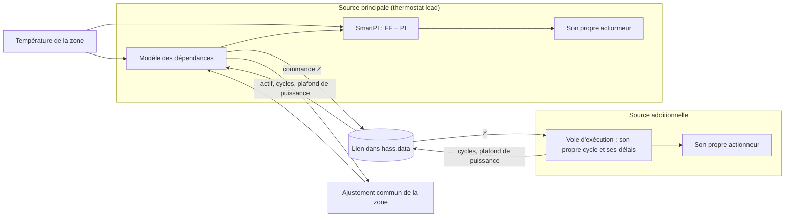

### 5.2 Types d'émetteurs et chaleur de la source additionnelle

La commande `u_f` appliquée par la source additionnelle atteint la zone après un retard `L_f` (un
retard de transport). Elle est aussi lissée par une inertie `tau_f` (un filtre du premier ordre),
qui représente la masse thermique de son émetteur :

    x_f(t + dt) = u_d + (x_f(t) − u_d)·exp(−dt / tau_f),   u_d = u_f(t − L_f)

`x_f` est une part (0..1) de la pleine puissance de la source, et sa chaleur vaut `a_f·x_f`. Grâce
aux commandes déjà envoyées, `x_f` est connu maintenant et peut être prédit sur un horizon. Ces
commandes continuent d'arriver pendant `L_f`, et on suppose que la dernière reste en place ensuite.

- **Cycles.** La source signale chaque cycle qu'elle démarre. Un actionneur tout-ou-rien
  chauffe d'abord, à son **niveau**, pendant son temps de marche. Une vanne garde sa puissance
  pendant tout le cycle. Le niveau vaut 1 sans données d'eau. Avec des données d'eau, c'est le
  facteur d'eau de la source (sa puissance comparée à sa puissance avec l'eau de référence, voir les
  [entrées eau et chaudière](water_input.md)). En effet, un plancher dont l'eau est à 30 degC donne, pendant
  qu'il est en marche, environ 37 % de la puissance qu'il donne avec une eau à 45 degC (pièce à
  20 degC). Les propres cycles de la source principale sont enregistrés de la même façon.
- **Le type de chaque appareil est le type de chauffage de sa propre entrée SmartPI.** Le
  formulaire de la zone peut à la place fixer un retard et une inertie personnalisés pour la source
  additionnelle. Le type donne les valeurs de départ ci-dessous. En fonctionnement, seule la
  réponse de la source additionnelle est utilisée, comme point de départ de ses candidats. Le retard
  de la source principale vient de l'ajustement de la zone (section 5.4). Son type sert à la
  recommandation du formulaire et aux diagnostics (`lead_emitter`).

| Type d'émetteur | `L_f` (min) | `tau_f` (min) |
|---|---|---|
| `electric_fast` (convecteur, ventilo-convecteur, climatiseur) | 2 | 3 |
| `radiator` (à eau) | 5 | 20 |
| `floor_electric` (tapis chauffant) | 10 | 90 |
| `floor_water` | 30 | 180 |
| `custom` | utilisateur | utilisateur |

- **La vraie échelle de temps est apprise.** Le retard et l'inertie d'un plancher dépendent de la
  chape, des tubes et de l'eau. Dans les fenêtres de mesure de 30 min de l'ajustement de la zone,
  on ne peut pas distinguer le retard de l'inertie, mais on peut trouver leur échelle de temps
  commune. Les candidats étirent la réponse du type par les facteurs `SOURCE_SCALE_MULTIPLIERS`
  (de 0.4 à 2.5 fois). Une source sans retard ni inertie reçoit à la place des inerties de
  `SOURCE_FAST_TAU_MIN`. Chaque candidat reconstruit `x_f` à partir des mêmes cycles. L'ajustement
  de la zone choisit le candidat qui explique le mieux la zone (section 5.4), séparément pour le
  chauffage et pour le refroidissement. Le candidat utilisé donne `x_f`, sa prédiction, la vitesse
  de la boucle d'allocation et l'horizon du freinage.

### 5.3 Règles de répartition

`W` est la commande de la source principale et `Z` la commande de la source additionnelle. Chaque
règle donne la moyenne visée pour la source principale, `f(Z)`. `together` et `source_first` sont
des courbes d'états stables, de `(0, 0)` à `(100 %, 100 %)`. `lead_band` maintient `W` au niveau
de la bande :

| Règle | Courbe | Paramètre (par défaut) | Exemples |
|---|---|---|---|
| `together` | `Z = p·W` ; dès que l'une est à 100 %, l'autre monte seule | `p` (100 %), de 10 à 1000 % | `p` = 200 % : W 20 %, Z 40 % |
| `source_first` | la source additionnelle seule jusqu'à θ ; au-delà, les deux montent et atteignent 100 % ensemble : `W = 100 %·(Z − θ)/(100 % − θ)` | θ (50 %), de 0 à 100 % | θ = 50 % : Z 30/W 0, Z 70/W 40, les deux à 100 ; θ = 100 % strictement l'une après l'autre ; θ = 0 comme `together` à 100 % |
| `lead_band` | la source additionnelle se stabilise de sorte que la moyenne de la source principale reste dans la bande | bande (20 %), de 0 à 100 % | la source principale garde toujours une marge pour les corrections rapides |

Les valeurs par défaut se recouvrent : les deux appareils travaillent ensemble sur une partie de la
plage.

**Recommandation selon le type d'émetteur** (la valeur par défaut du formulaire, avec sa raison) :

| Source principale + additionnelle | Par défaut | Raison |
|---|---|---|
| radiateur + plancher chauffant | `lead_band`, 20 % | le plancher porte la charge de base ; le radiateur complète et corrige vite (soleil, cuisine, une porte ouverte) |
| appareils de vitesse proche | `together`, 100 % | un pourcentage commun |
| une source additionnelle à utiliser en premier (par ex. une énergie moins chère) | `source_first`, choisi par l'utilisateur | priorité à la source additionnelle |
| une source principale nettement plus lente que l'additionnelle | avertissement | les corrections rapides reviennent à l'appareil le plus rapide : inversez les rôles |

`source_first` n'est pas la valeur par défaut avec un plancher. Avec une faible demande, le
radiateur reste à 0 % et le plancher régule seul. Le freinage anticipé (section 5.6) empêche le
plancher de surchauffer la zone, mais un plancher seul réagit à un apport de chaleur (soleil,
cuisine) avec des heures de retard.

### 5.4 L'ajustement commun de la zone

La zone suit ce modèle :

    dT/dt = a·u(t − L) − b·(T − T_ext) + a_f·x_f + Σ_j k_j·(T_j − T)

Ici, `u` est la puissance réalisée de la source principale, `L` son retard, `x_f` la chaleur de la
source additionnelle et `T_j` les températures des voisins connectés (leur terme vaut zéro tant
qu'une porte est fermée). Avec des données d'eau, les deux puissances sont des puissances pour
l'eau de référence.

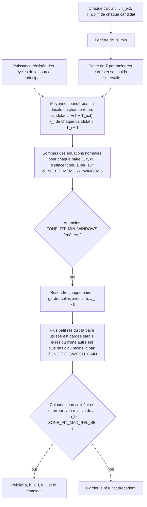

- **Fenêtres.** Chaque fenêtre de mesure de `COUPLING_WINDOW_S` (30 min) donne une ligne. La ligne
  est construite comme les fenêtres des voisins (section 4.3) : la pente simple de `T` par moindres
  carrés et, avec les mêmes poids, les moyennes des régresseurs. Une fenêtre recommence dans ces
  cas : après une calibration des temps morts de la source principale, un changement d'état d'une
  porte ou une fenêtre ouverte chez un voisin ; tant que la source additionnelle n'applique pas les
  commandes de la source principale ; tant que la zone est éteinte ; sans température de la zone
  ou sans température extérieure ; et après un écart entre deux calculs plus long que
  `ZONE_FIT_MAX_GAP_S`. Ainsi, aucune fenêtre ne couvre une pause. Les fenêtres ne s'arrêtent pas
  pour la pause d'apprentissage de SmartPI lui-même (`set_smartpi_learning`, que d'autres
  intégrations peuvent aussi utiliser), ni pour le délestage ou la coupure de garde. La puissance réalisée
  des cycles décrit toujours ce que la zone a reçu. SmartPI continue de maintenir le `a` et le `b`
  de l'ajustement (section 5.5) pendant que son apprentissage est en pause, car cela applique un
  modèle et n'apprend rien.
- **Le retard de la source principale, pris dans une grille** (une liste fixe de valeurs). La
  colonne de puissance est construite pour chaque retard de `ZONE_FIT_LEAD_DELAYS_MIN` (de 0 à
  60 min). Le temps mort propre à SmartPI n'est pas utilisé. Avec des montées lentes et un capteur
  au pas de 0.1 degC, il sort deux à six fois trop long. Cela décalait la puissance dans les
  fenêtres et empêchait l'ajustement d'être publié (21 à 62 min au lieu de 10 dans les essais ;
  section 5.8).
- **L'échelle de temps de la source additionnelle, prise parmi ses candidats** (section 5.2).
  Chaque paire d'un retard et d'un candidat est résolue par moindres carrés. La paire qui a le plus
  petit résidu (l'erreur qui reste) l'emporte.
- **Rien n'est pris dans le modèle de SmartPI.** Ainsi, l'ajustement fonctionne pendant que
  SmartPI apprend encore, et les erreurs de SmartPI n'y entrent pas.
- **Publication.** L'ajustement est publié quand trois conditions sont réunies. Il y a au moins
  `ZONE_FIT_MIN_WINDOWS` fenêtres (comptées avec l'effacement progressif, donc au plus tôt
  39 fenêtres, 19.5 h). La matrice est bien conditionnée (nombre de conditionnement de la matrice
  normalisée d'au plus `10·COUPLING_LS_COND_MAX`). L'erreur type relative de `a`, `b` et `a_f` est
  d'au plus `ZONE_FIT_MAX_REL_SE`. Les sommes s'effacent peu à peu sur `ZONE_FIT_MEMORY_WINDOWS`
  (6 jours) : les fenêtres plus anciennes comptent de moins en moins, donc l'ajustement suit les
  changements lents.
- **Chauffage et refroidissement séparés.** Il y a un ajustement pour chaque mode HVAC. En
  refroidissement, les colonnes des deux sources changent de signe, donc les effets ajustés restent
  positifs. Un ajustement de refroidissement n'est jamais utilisé en chauffage, et un ajustement de
  chauffage n'est jamais utilisé en refroidissement.
- **Voisins.** Un voisin connecté à la zone reçoit une colonne. Un voisin qui n'a jamais été
  connecté est laissé de côté. Une fois l'ajustement publié, son `k` remplace celui appris dans les
  propres fenêtres du voisin (section 4.4), dans la loi de commande, les gains et le freinage. Cela
  n'arrive que si le `k` de l'ajustement est dans `(0, COUPLING_K_MAX]` avec une erreur type
  relative d'au plus `ZONE_FIT_MAX_REL_SE`, car une porte rarement ouverte est ajustée à partir de
  peu de fenêtres. Les propres fenêtres du voisin traitent toujours la chaleur de la source
  additionnelle comme une colonne inconnue, pour que cette chaleur n'entre pas dans leur `k`. Un
  changement des voisins configurés fait repartir de zéro les sommes de l'ajustement. Le résultat
  publié est gardé jusqu'à l'arrivée d'un nouveau.

### 5.5 Apprentissage

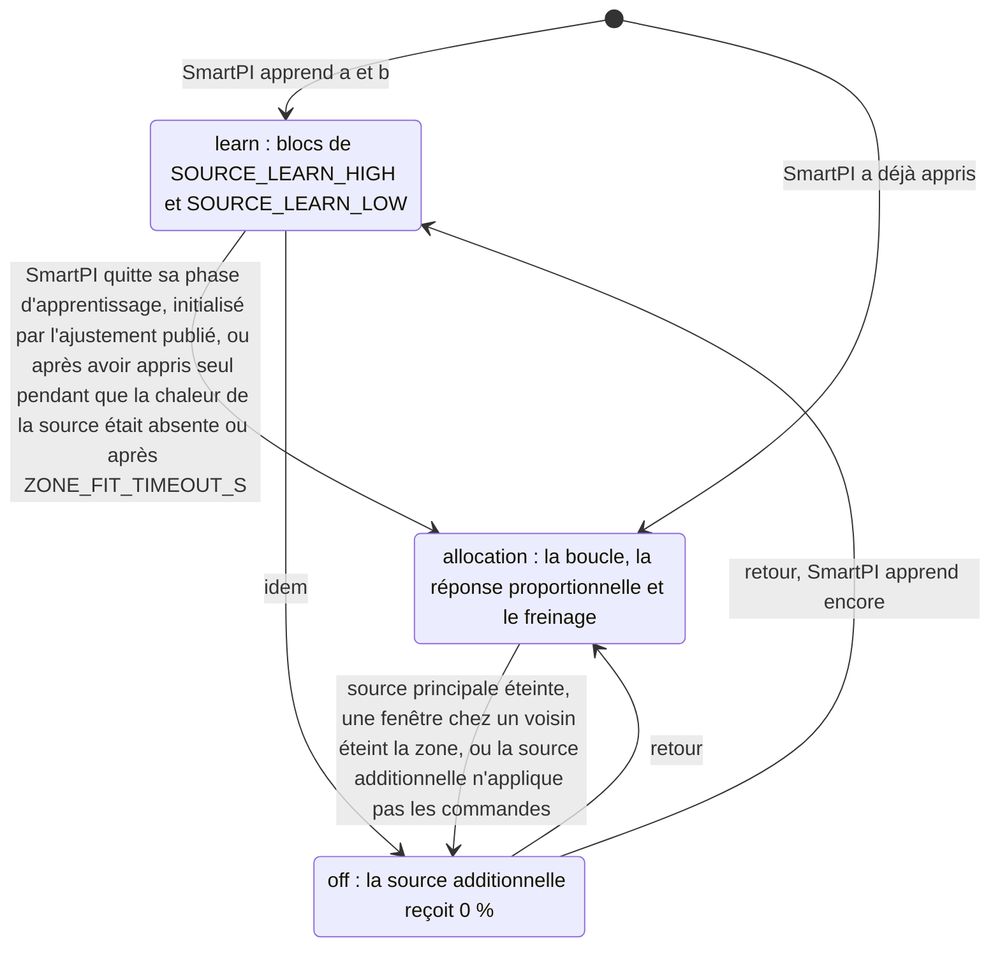

- **Les deux sources travaillent dès le premier jour.** Pendant que SmartPI apprend, la source
  additionnelle travaille par blocs qui alternent entre `SOURCE_LEARN_HIGH` et `SOURCE_LEARN_LOW`.
  Chaque bloc dure `max(SOURCE_LEARN_BLOCK_MIN_S, 2 × L_f + 2 × tau_f)`. Ainsi, l'ajustement voit
  la chaleur de la source changer pendant que la source principale régule. Une zone plus froide
  que sa consigne de `SOURCE_LEARN_COLD_C` reçoit la source additionnelle à pleine puissance. Une
  zone plus chaude que sa consigne de `SOURCE_LEARN_WARM_C` n'en reçoit rien.
- **L'horloge d'apprentissage.** Chaque mode HVAC a sa propre horloge. Elle mesure depuis combien de
  temps l'ajustement du mode est attendu pendant que la source additionnelle travaille. Elle ne
  compte que pendant que la source applique les commandes de la source principale et que
  l'ajustement du mode n'est pas publié. Elle ne compte pas pendant les écarts entre deux calculs
  plus longs que `ZONE_FIT_MAX_GAP_S`. Les blocs suivent cette horloge, tout comme le délai maximal
  ci-dessous.
- **Pour une source principale qui a déjà appris seule** (la source additionnelle est ajoutée plus
  tard), il n'y a pas de blocs. La boucle d'allocation tourne tout de suite, sans le freinage tant
  que l'ajustement n'est pas publié. Le verrou `source_heat` met en pause l'apprentissage de SmartPI
  jusqu'à ce que l'ajustement arrive ou que l'horloge du mode atteigne le délai maximal. Dans les
  simulations, l'allocation et la variation sur la journée ont suffi pour que l'ajustement soit
  publié après 19.5 h. Après un changement de mode HVAC, SmartPI apprend de nouveau. Si
  l'ajustement de ce mode est publié, SmartPI y prend ses valeurs de départ (il est initialisé par
  l'ajustement). Sinon, les blocs tournent sur l'horloge de ce mode.
- **SmartPI attend l'ajustement.** Tant que la chaleur de la source additionnelle est présente et
  que l'ajustement n'est pas publié, le verrou `source_heat` met en pause l'apprentissage propre à
  SmartPI de `a`, `b` et des temps morts. Sinon, SmartPI prendrait la chaleur du plancher pour la
  sienne. Le verrou a une hystérésis (des seuils différents pour l'activation et la
  désactivation). Il s'active dès que `x_f` atteint `SOURCE_X_MIN`. Il se désactive quand `x_f`
  passe sous `SOURCE_X_OFF` ou dès que l'ajustement est publié. Tant que le verrou est inactif,
  SmartPI apprend, y compris pendant les blocs bas. Donc, avec une source additionnelle rapide (un
  radiateur), SmartPI peut finir sa phase d'apprentissage avant l'arrivée de l'ajustement. Chaque
  fois qu'un verrou s'active ou se désactive, la fenêtre d'apprentissage ouverte de SmartPI est
  abandonnée. Avec un seul seuil, une source qui fonctionne près de ce seuil abandonnerait ces
  fenêtres encore et encore.
- **SmartPI part de l'ajustement.** SmartPI peut être en train d'apprendre alors que l'ajustement
  du mode actuel est publié : l'ajustement vient d'arriver, ou un changement de mode HVAC a fait
  réapprendre SmartPI. Alors le `a` et le `b` de SmartPI, et les historiques dont dépend la fin de
  sa phase d'apprentissage, sont fixés à partir de l'ajustement. Dès lors, SmartPI maintient le `a`
  et le `b` de l'ajustement, avec le signe du mode HVAC, à chaque calcul. Il les fixe de nouveau
  juste après sa propre étape d'apprentissage. Ainsi, une de ses propres fenêtres d'apprentissage
  qui se ferme pendant un calcul ne les déplace pas pendant un cycle.
- **Les fenêtres de l'ajustement tiennent lieu de celles de SmartPI.** SmartPI juge son modèle
  d'après ses propres compteurs d'échantillons appris et d'après la dispersion de son propre `b`.
  Le warm-up (la montée progressive) de son feed-forward suit `learn_ok_count`. Sa constante de
  temps a besoin de valeurs de `b` qui concordent. Sa near-band suit le modèle après dix
  échantillons de `a`. Quand l'ajustement est utilisé, ces contrôles voient l'ajustement à la
  place. Le `b` de l'ajustement donne la constante de temps, et les compteurs valent au moins ce
  que demandent les contrôles (`AB_CONFIDENCE_MIN_SAMPLES_A`, `AB_CONFIDENCE_MIN_SAMPLES_B`,
  `ZONE_FIT_MODEL_SAMPLES_A`, le compteur de warm-up du feed-forward). Sans cela, SmartPI gardait
  son feed-forward à environ un sixième de sa valeur, car il apprend rarement à consigne stable.
  L'intégrale portait la charge, et la zone se stabilisait loin de sa consigne (section 5.8).
- **Un ajustement qui ne vient pas.** Si l'horloge du mode atteint `ZONE_FIT_TIMEOUT_S` (48 h)
  sans ajustement publié, le verrou `source_heat` s'ouvre pour de bon dans ce mode : il ne met plus
  l'apprentissage en pause. SmartPI apprend alors seul, comme aujourd'hui, et les diagnostics
  affichent `timed_out`. Les horloges sont conservées après un redémarrage. L'ajustement continue de
  collecter des fenêtres. S'il est publié plus tard, il prend quand même la main, et SmartPI
  maintient alors le `a` et le `b` de l'ajustement (et ses compteurs) comme ci-dessus. Il en va de
  même pour une source principale qui avait appris avant l'ajout de la source additionnelle.
- **Ensuite, une entrée connue.** Une fois l'ajustement publié, la chaleur de la source
  additionnelle `a_f·x_f`, actuelle et prédite sur l'horizon, devient une entrée connue de la
  source principale. Elle entre progressivement, comme décrit en section 3.3.

### 5.6 Boucle d'allocation et freinage anticipé

```mermaid
flowchart LR
    S["Température et consigne de la zone"] --> L["SmartPI de la source principale"]
    L --> W["Actionneur de la source principale : sa propre commande W"]
    L --> D["Demande stable : feed-forward plus intégrale"]
    D --> LIM{"Source principale bloquée à une limite ?"}
    LIM -- "0 %, zone trop chaude" --> MIN["demande = minimum"]
    LIM -- "100 %, zone trop froide plus longtemps que le temps de stabilisation de la source" --> MAX["demande = maximum"]
    LIM -- non --> AV["Moyenne de la demande"]
    MIN --> AV
    MAX --> AV
    AV --> E["erreur = moyenne − f du Z appliqué"]
    E --> I["Intégrateur, limite de vitesse, maintiens"]
    I --> P["+ réponse proportionnelle à l'erreur de la zone"]
    P --> BR["Freinage anticipé : au plus le plus grand Z qui garde la zone prédite à sa consigne"]
    BR --> Z["Commande Z de la source additionnelle"]
    Z --> SRC["Source additionnelle : son propre cycle et ses délais"]
    SRC --> X["x_f à travers L_f et tau_f"]
    X --> K["Chaleur connue a_f·x_f dans le modèle de la source principale"]
    K --> L
```

- **Ce que suit la boucle.** La boucle suit la demande **stable** de la source principale : son
  feed-forward plus son intégrale, avant ses limites 0..100 %. La partie proportionnelle est
  laissée de côté. Elle répond à l'erreur du moment, par exemple après un changement de consigne, et
  ferait courir la source additionnelle après des changements de courte durée.
- **Sur la commande appliquée.** L'erreur de la boucle compare la moyenne de la source principale
  à la courbe de la règle, prise à la commande que la source additionnelle a réellement reçue,
  après le freinage. Elle n'utilise pas la valeur propre de la boucle. Tant que le freinage tient la
  source sous la valeur de la boucle, la boucle ne s'emballe pas davantage.
- **Pauses.** La boucle ne tourne pas tant que la zone ou la source additionnelle est éteinte,
  pendant une calibration, pendant que SmartPI apprend, ou quand il n'y a pas de demande stable.
  Elle garde alors sa commande et sa moyenne. Quand elle repart, elle n'intègre pas sur la pause.
  Un passage entre chauffage et refroidissement la fait repartir de 0, car chaque mode a sa propre
  répartition. Quand elle démarre après les blocs d'apprentissage, elle part de la chaleur que la source
  donne à ce moment (`x_f`), pour que la chaleur ne fasse pas de saut.
- **Une source principale bloquée à une limite.** Si la source principale est à 0 % et que la zone
  est plus chaude que sa consigne de `SPLIT_LIMIT_ERROR_C`, la boucle reçoit la demande la plus
  basse. La source principale peut aussi être au maximum de ce qu'elle peut donner : 100 % du
  pourcentage de marche maximal de VTherm, du haut de la courbe de vanne, de ce que permet son eau.
  Si la zone est alors plus froide d'autant, plus longtemps que le temps de stabilisation de la
  source additionnelle, la boucle reçoit la demande la plus haute, et la source monte en réserve.
  Pour une source lente (un plancher), la zone reste froide moins longtemps que cela après une
  hausse de consigne le matin, donc cette hausse ne fait pas bouger la boucle.
- **Maintiens.** La boucle ne fait pas monter la source tant que la zone est plus chaude que sa
  consigne de plus de `SPLIT_HOLD_ERROR_C`, ni descendre tant qu'elle est plus froide d'autant.
- **Réponse proportionnelle.** En plus de l'allocation, la source additionnelle réagit à l'erreur
  de la zone avec `SPLIT_ERROR_GAIN` de commande par degré. Cette valeur est divisée par le rapport
  ajusté `a_f/a` quand la source additionnelle est la plus forte (par 1 sinon, et avant
  l'ajustement). La réponse tombe à zéro avec l'erreur, donc c'est toujours la règle qui fixe la
  répartition.
- **La boucle.** `D` est la demande stable de la source principale, bornée à `[SPLIT_DEMAND_MIN,
  SPLIT_DEMAND_MAX]`. `Z` est la commande de la source additionnelle et `f` la règle :

        avg(D) ← avg(D) + (1 − exp(−dt / T_avg))·(D − avg(D))
        dZ/dt = clamp((avg(D) − f(Z_applied)) / T_I, ±1 / max(SPLIT_MIN_FULL_RANGE_S, L_f + tau_f))
        T_I = max(SPLIT_MIN_TIME_S, SPLIT_SETTLE_FACTOR·(L_f + tau_f))·r
        T_avg = max(SPLIT_AVERAGE_MIN_S, SPLIT_AVERAGE_FRACTION·T_I)
        Z = clamp(min(Z_loop + SPLIT_ERROR_GAIN·e / r, Z_brake), 0, 1)

  Ici, `e` est l'erreur de la zone, `Z_brake` le plafond du freinage (voir plus bas), et
  `r = max(1, a_f/a)` vient de l'ajustement (1 avant l'ajustement ; `r` suit l'ajustement avec une
  hystérésis de 20 %). La boucle ne monte pas tant que la zone est chaude ou que le freinage retient
  la source (`hold_up`). Elle ne descend pas tant que la zone est froide (`hold_down`).
- **Vitesse.** Une erreur maintenue pendant `SPLIT_SETTLE_FACTOR` temps de stabilisation
  (`L_f + tau_f`), et jamais moins de `SPLIT_MIN_TIME_S`, déplace la source de 100 %. Pour une
  source plus forte que la principale, ce temps grandit en proportion. Ce temps et son allongement
  suivent l'échelle de temps du candidat utilisé et le rapport ajusté `a_f/a`. La demande est
  moyennée sur `SPLIT_AVERAGE_FRACTION` de ce temps, et jamais sur moins de `SPLIT_AVERAGE_MIN_S`. La boucle ne
  parcourt jamais toute la plage plus vite que la source ne se stabilise, ni plus vite que
  `SPLIT_MIN_FULL_RANGE_S`. La réponse proportionnelle et le freinage agissent tout de suite.
- **Une fenêtre ouverte chez un voisin.** La réaction de la zone (section 4.5) s'applique aussi à
  la source additionnelle. Avec `turn_off`, elle reçoit 0 %. Avec `frost` ou `eco`, la boucle, les
  blocs d'apprentissage, la réponse proportionnelle et le freinage utilisent la consigne du preset
  au lieu de la consigne actuelle de la zone, mais jamais une consigne plus exigeante.
- **Calibration.** Pendant que SmartPI calibre les temps morts de la source principale, il met
  volontairement la source principale à 100 % puis à 0 %. La source additionnelle garde sa
  commande, et la boucle se met en pause.

**Rattrapage.** Après un abaissement de nuit (une consigne plus basse la nuit), la zone a besoin de
plus que sa charge stable. Le feed-forward de la source principale compte la chaleur connue de la
source additionnelle. Résultat : quand un plancher à pleine puissance se réchauffe, la source
principale lui cède sa part alors que la zone est encore trop froide d'un ou deux degrés. Seule sa
partie proportionnelle mène alors la suite du rattrapage, et SmartPI garde cette partie douce (son
intégrale est maintenue après un changement de consigne). Deux SmartPI indépendants rattrapent plus
vite, car chacun compte toute la charge. Donc, tant que la zone est plus froide que sa consigne de
plus de `SOURCE_BOOST_ERROR_C`, les entrées connues de la source principale laissent de côté la
chaleur de la source additionnelle. Cela vaut pour le feed-forward, pour `T_ref` et pour la
correction de l'apprentissage. La source principale travaille alors comme si elle était seule
(`recovery_boost` dans les diagnostics). Le renfort de rattrapage a besoin d'un ajustement publié
et du mode d'allocation ; sans eux, il est inactif. Le renfort s'arrête plus tôt dès que le modèle ajusté
indique que la zone atteindra cette bande d'ici la fin du retard ajusté de la source principale
plus un de ses cycles, aux puissances actuelles. La chaleur que la source principale a déjà envoyée
amène alors la zone dans la bande au lieu de la lui faire dépasser. Sans cet arrêt anticipé, les
pièces rapides dépassaient leur consigne de jusqu'à 0.66 degC (section 5.8).

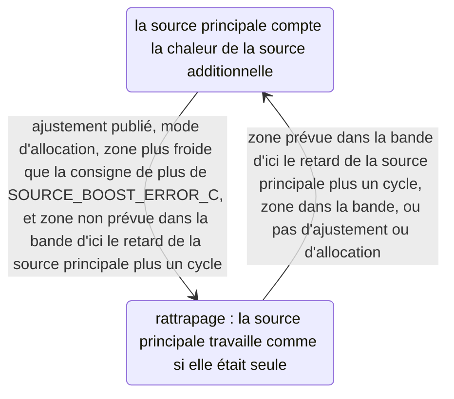

**Freinage anticipé.** Un plancher réagit avec des heures de retard : la chaleur déjà en route
continue d'arriver après que la zone a atteint sa consigne. Le freinage limite la commande à ce que
la zone peut recevoir selon le modèle ajusté :

    e(c) = setpoint − T(now + H),   H = max(L_f + tau_f, SOURCE_PREDICTION_MIN_S)

`T` est calculée pas à pas (intégrée), par pas de `SOURCE_PREDICTION_STEP_S`. La prédiction
utilise les `a`, `b`, `a_f` et `k` ajustés, et garde les températures extérieure et des voisins
telles qu'elles sont. Elle met la source additionnelle à la commande `c` (au plus son plafond de
puissance, section 5.7) après les commandes déjà en route. La source principale part de sa demande
stable et **cède sa charge**. Son feed-forward retire `a_f/a` pour chaque unité de `x_f` que la
chaleur connue de la source additionnelle ajoute (dans la mesure où cette chaleur est déjà dans sa
loi de commande), jusqu'à 0 %. Dans l'autre sens, elle reprend la charge jusqu'au maximum de ce
qu'elle peut donner (son facteur d'eau et son pourcentage de marche maximal). Pendant un
rattrapage, la demande de la source principale ne contient rien de la chaleur de la source. La
prédiction laisse la source principale compter de nouveau toute cette chaleur à partir de
maintenant, car le rattrapage se termine avant que la chaleur de la source n'arrive. Ainsi, le
freinage ne traite pas le renfort comme permanent.

- Le plafond est le plus grand `c` tel que `e(c) ≥ (1 − SPLIT_PREDICTED_SHARE)·e(allocation)`. Avec
  la part à 1, cela veut dire que la zone prédite est à sa consigne. `e` diminue quand `c`
  augmente. Sa courbe est plate tant que la source principale cède encore sa charge, et plus raide
  une fois la source principale descendue à 0. C'est pourquoi le plafond est trouvé par
  `SOURCE_BRAKE_STEPS` divisions par deux (on coupe à chaque fois l'intervalle de recherche en
  deux).
- Une zone peut être trop chaude quoi que fasse la source additionnelle, à cause de la propre
  chaleur de la source principale. On demande alors seulement à la source de ne pas en ajouter : le
  plafond est le plus grand `c` tel que `e(c) ≥ e(0)`.
- Les deux conditions ont une tolérance de `SOURCE_SENSITIVITY_MIN_C`. Une source qui déplace la
  zone prédite de moins que cela n'est pas freinée, et il n'y a pas de freinage sans ajustement
  publié.

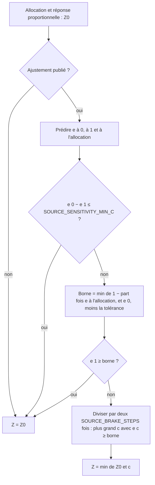

### 5.7 Voie d'exécution

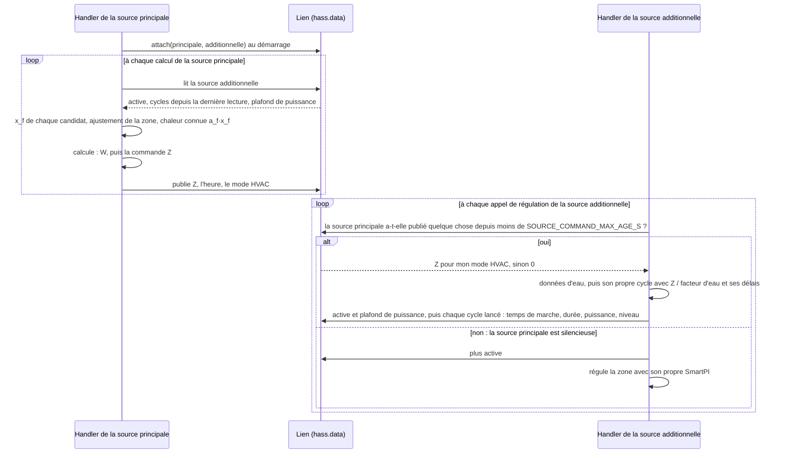

- **Le lien** se trouve dans `hass.data["vtherm_smartpi"]["source_link"]`. Il est gardé en mémoire
  seulement et reconstruit à chaque démarrage. Ses clés sont les identifiants uniques des
  thermostats. Il est interne à SmartPI : ce n'est pas une interface pour d'autres intégrations. Une
  source additionnelle ne suit qu'une seule source principale. Si une deuxième source principale la
  désigne, cette source principale reçoit un avertissement et n'a pas de source. Un cycle signalé
  contient `start_s`, `on_s`, `duration_s`, `power`, `switched` et `level`.
- **La commande** est appliquée avec le cycle et les délais propres de la source additionnelle. Elle
  vaut 0 dans ces cas : la commande a été donnée pour un autre mode HVAC (par exemple, la source
  principale est éteinte) ; le thermostat de la source additionnelle est lui-même éteint ; ou le
  gestionnaire de puissance déleste la charge de la source additionnelle elle-même. Sa propre
  détection de fenêtre et sa sécurité fonctionnent comme d'habitude. Chaque thermostat déleste sa
  propre charge : une source principale délestée donne donc toujours une commande.
- **Une source principale silencieuse.** Il peut arriver que la source principale ne publie rien du
  tout, pour aucun mode HVAC, pendant `SOURCE_COMMAND_MAX_AGE_S`, parce que son intégration s'est
  arrêtée ou n'est pas prête. La source additionnelle régule alors la zone avec son propre SmartPI et
  son propre modèle, et écrit un avertissement dans le journal, jusqu'au retour des commandes.
  Pendant ce temps, elle continue de signaler ses cycles, pour que la source principale connaisse la
  chaleur déjà en route quand elle revient. Une source principale éteinte (par l'utilisateur ou par
  sa détection de fenêtre) n'est pas silencieuse. Elle publie son 0 toutes les
  `SMARTPI_RECALC_INTERVAL_SEC`, car VTherm peut ne l'appeler que toutes les `cycle_min`. Jusqu'à la
  première commande, ce temps est compté à partir du rattachement : une source principale qui vient
  de démarrer n'est donc pas silencieuse non plus. Sans ce repli, la zone est tombée de 20 à
  16.2 degC en 12 h après une panne de la source principale. Avec lui, la zone est restée entre 19.4
  et 20.6 degC. Une source principale retirée de Home Assistant (ou rechargée) détache le lien tout de
  suite. La source additionnelle régule alors seule sans attendre, avec un message d'information dans
  le journal, jusqu'à ce qu'elle soit de nouveau rattachée.
- **L'eau.** La commande de la source principale est une puissance à l'eau de référence. La source
  additionnelle lit ses propres données d'eau à chaque appel de régulation et donne à son émetteur
  `power / factor` (au plus 1), comme le ferait son propre SmartPI. Elle publie son **plafond de
  puissance** : la plus grande puissance qu'une commande pleine donne en ce moment. C'est son facteur
  d'eau, au moins `WATER_NO_HEAT`, ou 1 sans données d'eau. Le freinage de la source principale
  l'utilise dans sa prédiction.
- **La source principale ne donne rien quand elle ne peut pas décider.** Si elle ne peut pas lire ses
  entrées de dépendance lors d'un calcul, elle publie 0 au lieu de sa dernière commande.
- **La source additionnelle est-elle là ?** À chaque appel de régulation, la source additionnelle
  indique au lien qu'elle applique les commandes. La source principale la compte comme active, et sa
  chaleur comme présente, seulement tant que ce message date de moins de `SOURCE_COMMAND_MAX_AGE_S`.
  Une source qui s'arrête sans prévenir cesse de compter après ce délai. Une source retirée cesse de
  compter tout de suite. Quand une source cesse de compter, sa chaleur sort du modèle tout de suite,
  et ses commandes comptent pour 0 à partir de là.
- **Les cycles.** La source additionnelle signale chaque cycle qu'elle lance (section 5.2). Quand
  un nouveau cycle démarre avant la fin du précédent, il remplace le reste du cycle précédent. Une
  vanne signale chaque nouvelle ouverture au moment où elle a lieu.
- **Le SmartPI propre de la source additionnelle est à l'arrêt.** Versatile Thermostat continue
  d'appeler son algorithme à chaque mesure. Entre deux appels de régulation, il recalcule aussi une
  vanne directement à partir de la sortie de l'algorithme. Tant que le rôle dure, chacun de ces
  calculs renvoie tout de suite la commande de la source principale. Rien n'est régulé, rien n'est
  appris, et le modèle appris reste tel qu'il était au début du rôle. Son état est sauvegardé comme
  d'habitude, et les services de SmartPI agissent sur cet état réel. Une calibration forcée demandée
  pendant le rôle attend la fin du rôle, car rien n'est calculé. À la fin du rôle, son SmartPI démarre
  un nouveau cycle à partir de son propre modèle.
- **Les diagnostics de la source additionnelle.** Son bloc `dependencies` ne montre que son rôle, la
  source principale et la commande qu'elle applique (section 9).

### 5.8 Résultats et limites (simulation)

La suite `tests/test_smartpi_sim_zone_set.py` (lancée avec `SMARTPI_SIM_LOCAL=1`) compare la zone
avec ses deux sources à l'installation actuelle : deux SmartPI qui régulent la zone chacun de leur
côté. Dans ces tests, un radiateur est la source principale et un plancher à eau (retard de 30 min,
inertie de 180 min, `a_f = a`) la source additionnelle. La règle est `lead_band` à 20 %, les capteurs
ont un pas de 0.1 degC, et la température extérieure est de 3 degC (doux) ou −8 degC (froid), avec une
variation quotidienne de ±3 degC. Le jour 1 commence 1 degC sous la consigne. L'erreur en régime
établi est la moyenne des jours 3–4. Viennent ensuite trois nuits avec la consigne abaissée à 17 degC
(pendant 6, 8 et 10 h).

**Douze pièces** (`b` de 0.0005 à 0.002 /min, `a` de 0.015 à 0.06 degC/min) :

| Mesure | Zone à deux sources | Deux SmartPI indépendants |
|---|---|---|
| Erreur en régime établi, moyenne des 12 pièces | 0.030 degC | 0.065 degC |
| Erreur en régime établi, plage | 0.018–0.052 degC | 0.032–0.113 degC |
| Dépassement après la nuit, pire pièce / moyenne | 0.30 / 0.13 degC | 0.53 / 0.40 degC |
| Temps pour arriver à 0.2 degC sous la consigne après la nuit, moyenne | 2.94 h | 2.86 h |
| Idem, pièce la plus lente (`b` 0.0005, `a` 0.015, froid) | 4.8 h | 4.1 h |
| Erreur du jour 1, moyenne | 0.43 degC | 0.33 degC |
| Ajustement publié | après 19.5 h dans chaque pièce | — |
| `a`, `b`, `a_f` ajustés, rapportés aux vraies valeurs | 0.99–1.03, un `a_f` à 1.10 | ceux de SmartPI lui-même, un seul thermostat : `a` 0.55–1.34, `b` 0.53–1.16 |
| Retard de la source principale | 10 min, la vraie valeur, dans chaque pièce | — |

**Installations** (pièce `b` 0.001, `a` 0.03, temps doux) :

| Cas | Zone | Indépendants | Ajustement |
|---|---|---|---|
| plancher derrière une vanne | 0.020 degC | 0.050 degC | 1.03/1.02/1.03 |
| dalle qui chauffe dans son épaisseur (deux inerties en série) | 0.035 degC | 0.056 degC | `a` 0.95, `b` 1.06, `a_f` 1.18 |
| eau sur courbes de chauffe, données d'eau venant d'entités (rattrapage 6.7 h contre 5.9 h) | 0.053 degC | 0.094 degC | 0.99/0.97/0.94 |
| deux zones, porte ouverte 6–23 h | 0.034 / 0.029 degC | 0.072 / 0.055 degC | `k` 0.89 / 0.94 |
| deux zones, porte toujours ouverte | 0.021 / 0.018 degC | 0.055 / 0.042 degC | `k` 1.04 / 0.96 |

Scénarios de `tests/test_smartpi_sim_second_source.py` : avec un second radiateur comme source
additionnelle (Z4), 0.037 degC contre 0.053 ; refroidissement avec deux sources, 0.024 degC ; les
courbes de `source_first` et `together` sont atteintes.

**Décisions prises à partir de ces résultats :**

- **Blocs d'apprentissage à 100 % / 0 %.** Des blocs à 70 % / 30 % rendent le jour 1 plus doux
  (moyenne 0.39 contre 0.43 degC) pour presque la même erreur en régime établi (0.030 contre
  0.029 degC dans cette comparaison, faite avant le renfort de rattrapage). Mais le contraste plus
  faible laisse l'ajustement plus loin des vraies valeurs, même après une semaine : une pièce à 8 %
  d'écart (`a_f` 0.92) et un `a_f` à 1.12. Avec des blocs à 100 % / 0 %, toutes les valeurs sont
  à moins de 3 %, sauf un `a_f` à 1.10. L'ajustement donne à SmartPI son modèle pour de bon, alors
  que le jour 1 n'arrive qu'une fois.
- **Rattrapage avec la source principale qui travaille comme si elle était seule** (section 5.6).
  Sans lui, le rattrapage du matin prenait 3.55 h en moyenne contre 2.86 h, 8.9 h contre 4.1 h dans
  la pièce la plus lente, et 12.4 h contre 5.9 h avec l'eau. Autres options essayées en chemin :
  - ne laisser de côté que la part de la chaleur de la source au-dessus de son allocation : 3.21 h en
    moyenne, 6.1 h dans la pièce la plus lente, et presque aucun gain avec l'eau, où la chaleur du
    plancher reste sous son allocation ;
  - la laisser de côté entièrement, avec un freinage qui traite le renfort comme permanent : le
    freinage coupait le plancher, 3.35 h ;
  - la laisser de côté entièrement jusqu'à 0.2 degC sous la consigne : 2.92 h, mais jusqu'à 0.66 degC
    de dépassement dans les pièces rapides, à cause de la chaleur que le radiateur avait déjà envoyée.
    C'est pourquoi le renfort se termine en avance ;
  - une transition douce entre 0.5 et 0.1 degC au lieu d'un seuil : pas plus rapide, et une zone sur
    eau se stabilisait 0.15 degC trop bas.
- **Ce qui n'a pas marché, et pourquoi la conception est ce qu'elle est :**
  - *Apprendre la source additionnelle par-dessus le modèle de SmartPI* (la première conception) :
    `a_f` sortait à 0.61–1.64 fois la vraie valeur avec des capteurs au pas de 0.1 degC, ou n'était
    jamais publié.
  - *Le temps mort de SmartPI dans l'ajustement* : deux à six fois trop long avec des montées lentes.
    Ainsi, 2 pièces sur 12 n'ont jamais publié, et dans une autre pièce SmartPI a attendu l'ajustement
    pendant 57 h (cet essai date d'avant le délai maximal de 48 h). La grille de retards trouve le
    vrai retard.
  - *Le freinage avec la source principale maintenue à sa demande* : la source principale ne cédait
    jamais sa charge. La répartition restait donc là où elle était au démarrage de la boucle (règle
    `source_first` : source principale à 21 % là où la courbe demande 0 %).
  - *Le passage de relais avec un plafond calculé en ligne droite* : comme `e` est plat pendant le
    passage de relais, le plafond tombait à 0 et le plancher basculait entre 0 et 100 %.
  - *Couper la source dès que la zone est prévue trop chaude* : une zone chaude à cause de la chaleur
    de la source principale elle-même perdait sa source additionnelle (deux radiateurs : 0.072 contre
    0.053 degC). Désormais, le freinage empêche seulement la source d'en rajouter.
  - *Une boucle d'allocation qui intègre sur les pauses* : après des heures à l'arrêt ou une
    calibration, son premier pas couvrait toute la pause et sautait à 0 ou 100 %. Désormais, la boucle
    se met en pause.
  - *Les compteurs de fiabilité propres à SmartPI après l'ajustement* : le feed-forward restait à un
    sixième de sa valeur (5 échantillons appris sur 30). L'intégrale, figée dans la deadband (la
    petite plage d'erreur où le régulateur ne réagit pas), portait la charge. Avec cette correction et
    celles du freinage ci-dessus, l'erreur en régime établi de la pièce de base est passée de 0.058 à
    0.022 degC.
  - *La limite du décalage dû à la chaleur connue à 15 degC* : par temps froid, un plancher qui porte
    la plus grande partie de la charge décale `T_ref` de plus que cela. Le feed-forward comptait moins
    de chaleur du plancher qu'il n'y en avait, et la zone se stabilisait 0.07 degC trop chaud. La
    limite est maintenant `KNOWN_HEAT_MAX_SHIFT_C` (section 3.2).
  - *Les cycles tout-ou-rien à pleine puissance avec l'eau* : un plancher allumé donne son facteur
    d'eau, pas 1. L'ajustement trouvait `a_f` à 0.30 de la vraie valeur.
  - *Le `k` propre des voisins dans une zone à deux sources* : derrière une porte, il n'était jamais
    publié. La zone ne tenait pas compte de l'échange et se stabilisait 0.14 degC trop bas pendant
    que la porte était ouverte (0.125 contre 0.055 degC). Le `k` de l'ajustement a réglé le problème.

**Limites :**

- **Le rattrapage du matin après un abaissement de nuit** est en moyenne aussi rapide qu'avec deux
  SmartPI indépendants. Il est plus rapide dans 4 pièces sur 12 et jusqu'à 0.9 h plus lent dans les
  autres : 4.8 h contre 4.1 h dans la pièce la plus lente, 6.0 h contre 5.1 h dans une autre pièce
  lente par temps froid, et 6.7 h contre 5.9 h avec l'eau. L'écart qui reste vient de la nuit : le
  plancher de la zone reste presque inactif jusqu'à la hausse de la consigne (sa chaleur vaut 0.11 le
  matin, contre 0.36 avec deux SmartPI indépendants). Seul un démarrage anticipé avant un horaire
  connu comblerait cet écart.
- **Le jour 1** est moins bon qu'avec deux SmartPI indépendants (0.43 contre 0.33 degC) : les blocs
  d'apprentissage font osciller la zone jusqu'à la publication de l'ajustement.
- **Une dalle qui chauffe dans son épaisseur** ne correspond à la forme d'aucun candidat. Son
  ajustement a des erreurs jusqu'à 18 % (`a_f`), mais la régulation reste meilleure qu'avec deux
  SmartPI indépendants.
- Chaque thermostat garde ses propres cycles tout-ou-rien ; la répartition ne réduit pas les
  commutations.

## 6. Composants et interfaces

Tous les modules ci-dessous sont du Python simple et peuvent être testés sans HA en marche.

| Module | Rôle |
|---|---|
| `smartpi/dependencies.py` | Éléments de configuration (`kind`, `mode`, capteurs de porte, réaction à la fenêtre), analyse, validation, état appris par élément (`DependencyState`) |
| `smartpi/dependency_inputs.py` | Lectures pour un calcul : température du voisin, disponibilité, mode sécurité, état de la fenêtre ; capteurs de porte ; presets de la zone et plage de température |
| `smartpi/effective_model.py` | Entrées connues (`ExchangeInput`, `HeatInput`, `KnownInputs`) et leur composition (`compose`) |
| `smartpi/coupling_estimator.py` | Apprentissage des coefficients d'échange `k` à partir des fenêtres de mesure |
| `smartpi/dependency_model.py` | Dans l'algorithme : des lectures aux entrées connues, verrous d'apprentissage, réaction à la fenêtre d'un voisin, diagnostics ; pour une zone à deux sources, aussi l'ajustement de la zone, l'initialisation du modèle de SmartPI, les blocs et l'horloge d'apprentissage, la boucle d'allocation, le freinage anticipé et le renfort de rattrapage |
| `smartpi/source_model.py` | Deuxième source : types d'émetteurs, retard et inertie, la chaleur `x_f` maintenant et à venir |
| `smartpi/source_candidates.py` | Deuxième source : les échelles de temps candidates et la chaleur pour chacune |
| `smartpi/zone_fit.py` | Deuxième source : l'ajustement commun de la zone (déperditions, les deux sources, le retard de la source principale, l'échelle de temps, les voisins) |
| `smartpi/split.py` | Deuxième source : règles de répartition, boucle d'allocation, recommandation selon le type d'émetteur |
| `smartpi/source_settings.py` | Deuxième source : sa règle et ses émetteurs, lus dans l'élément configuré |
| `smartpi/source_link.py` | Deuxième source : le lien entre la source principale et la source additionnelle dans un même Home Assistant (les commandes dans un sens, les cycles et le plafond de puissance dans l'autre) |
| `smartpi/water_input.py`, `repairs.py` | Le facteur d'eau de chaque source et la remise à zéro proposée quand des données d'eau apparaissent ou disparaissent ; voir [Entrées eau et chaudière](water_input.md) |

Dans les fichiers existants :

- **`algo.py`** lit les entrées connues à chaque calcul (`_read_known_inputs`). Il applique la
  réaction à la fenêtre d'un voisin, compose le modèle effectif au point de substitution unique
  (`_compose_effective_model`), et transmet le verrou d'apprentissage et la correction à la fenêtre
  d'apprentissage. Il enregistre aussi la puissance que chaque cycle terminé a réellement fournie.
  Dans une zone à deux sources, il part de l'ajustement de la zone et maintient ce modèle
  (`_apply_zone_fit`, section 5.5).
- **`handler.py`** enregistre le fournisseur de lectures quand des dépendances sont configurées
  (`_read_dependencies`). Il retrouve les entités par leur identifiant de registre. Au démarrage, il
  supprime l'état appris des éléments retirés de la configuration. Une source principale rattache sa
  source additionnelle au lien et publie sa commande après chaque calcul. Un thermostat désigné comme
  source additionnelle suit la voie d'exécution au lieu de son propre régulateur. Tant que la
  source principale est silencieuse, il fait tourner son propre régulateur (section 5.7).
- **`config_flow.py`** donne à l'entrée du thermostat un menu d'options avec le formulaire de zone,
  la liste des dépendances et les formulaires de voisin ; un seul mixin (`SmartPIFlowSections`)
  contient toutes les sections, pour les options et pour une nouvelle entrée. Chaque section travaille
  sur le brouillon et se termine dans le menu ; `async_step_save` vérifie de nouveau, pose une seule
  fois la question de remise à zéro et écrit. Un thermostat qui travaille comme source additionnelle
  reçoit à la place un menu à lui. L'étape d'import crée, à l'enregistrement, l'entrée d'un membre de
  la zone qui n'en a pas (section 2.1).
- **`__init__.py`** recharge la source principale de la zone quand l'entrée de sa source
  additionnelle est enregistrée, sauf si le même enregistrement a aussi écrit l'entrée de la source
  principale (celle-ci se recharge d'elle-même : chaque entrée se recharge une fois). Quand le
  formulaire de zone crée une entrée, il ne recharge que le thermostat concerné.

**Données lues dans Versatile Thermostat.** Les lectures viennent des attributs d'état que VTherm
publie. Ces attributs peuvent changer avec la branche `master` de VTherm :

| Lu sur | Attributs |
|---|---|
| Un voisin (VTherm) | `current_temperature` ; `safety_manager.safety_state` ; `window_manager.window_state` et `window_auto_state` |
| Un voisin (capteur) | son état, comme température |
| La zone elle-même | `preset_temperatures` (`frost_temp`, `eco_temp`, `eco_cool_temp`), `min_temp`, `max_temp` ; pour les avertissements du formulaire, `window_manager.window_sensor_entity_id` et `is_window_auto_configured` |
| Le thermostat maître de la zone (formulaire) | son type (over climate), ses appareils, son autorégulation et son capteur de température, depuis son entrée de configuration |

## 7. Un calcul

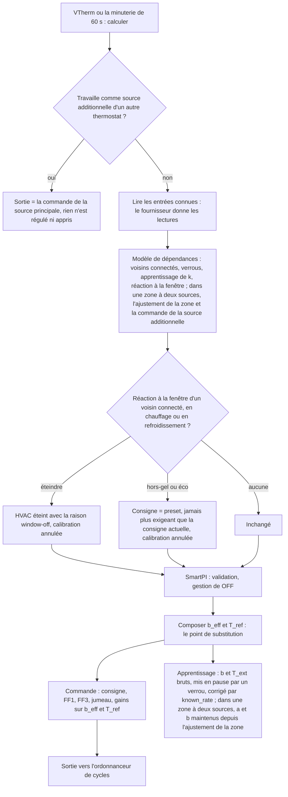

- **Un fournisseur en échec** laisse le modèle appris inchangé, et le calcul continue sans entrées
  connues. Un problème de dépendance n'arrête jamais la régulation.
- **Un front du verrou d'apprentissage** (le moment où il s'active ou se désactive) abandonne la
  fenêtre d'apprentissage ouverte et la mesure de temps mort en cours, car elles mélangeraient deux
  situations différentes. Les repères de temps mort de la loi de commande ne sont pas touchés.
- **Un changement des entrées actives** (leur signature) annule les fenêtres ouvertes de la
  correction du feed-forward, car leurs données supposaient le modèle précédent.

## 8. État sauvegardé

L'état des dépendances est sauvegardé avec l'état de SmartPI sous la clé `dependencies`, mais
seulement quand il y a quelque chose à sauvegarder :

```text
dependencies
├── version                     version du format (1)
├── items
│   └── <id de l'élément>
│       └── k_history           valeurs de k acceptées, chacune tirée d'une seule fenêtre
└── shared
    └── coupling
        ├── ls_rows             tampon des connexions par porte ouvertes ensemble
        ├── joint_rows          tampon de l'ajustement commun des voisins toujours connectés
        ├── joint_k             historique des ajustements séparables, par voisin
        └── joint_b             coefficients de déperdition ajustés avec eux
```

Dans l'état de la source principale, l'élément source de la zone garde :

| Clé | Contenu |
|---|---|
| `zone_fit`, `zone_fit_cool` | l'ajustement commun de la zone par mode HVAC : ses sommes (10 chiffres significatifs), la paire utilisée et le résultat publié (`a`, `b`, `a_f`, `k`, les erreurs types de `a_f` et `k`, le retard de la source principale, le candidat) ; null avant sa première fenêtre |
| `response_start` | la réponse de l'émetteur avec laquelle les ajustements ont été appris. Si la réponse est différente au démarrage, les ajustements, les horloges d'apprentissage et l'échelle de temps utilisée sont supprimés |
| `response` | l'échelle de temps candidate utilisée (`lag_s`, `tau_s`) |
| `allocation`, `x_f` | la commande de la boucle d'allocation et la chaleur de la source |
| `learn_elapsed_s` | l'horloge d'apprentissage de chaque mode HVAC (`heat`, `cool` ; section 5.5) |
| `k_history`, `cool` | l'estimation de la chaleur de la source faite dans les fenêtres propres des voisins ; elle sert seulement à tenir cette chaleur hors de leur `k` |

Après un redémarrage, la zone reprend là où elle en était. Un ajustement publié avant le redémarrage
est tout de suite entièrement dans la loi de commande : le `a_f` de la source pour l'un ou l'autre
mode HVAC, et le `k` des voisins tiré de l'ajustement du mode HVAC utilisé (section 3.3). Les sommes
de l'ajustement sont sauvegardées dès sa première fenêtre, qu'il soit publié ou non. Elles occupent
environ 16 KB de l'état sauvegardé de SmartPI par mode HVAC, 26 KB avec un voisin et 38 KB avec deux.

- L'état sauvegardé de SmartPI garde aussi le dernier jeton de remise à zéro qu'il a appliqué
  (`dependency_reset_token`, section 2.2).
- La zone et les voisins sont enregistrés dans les options des entrées (`smart_pi_dependencies`).
  L'entrée que le formulaire de zone crée pour un membre qui n'en a pas utilise les réglages
  partagés des valeurs par défaut (`smart_pi_use_defaults` activé) et contient le type de chauffage
  du membre et, quand la zone y passe, les éléments de la zone.
- Un ancien état sauvegardé sans cette clé se charge comme avant.
- Au démarrage, l'état des éléments qui ne sont plus configurés est supprimé.
- Un état sauvegardé illisible est ignoré, les lignes inutilisables sont sautées, et les échanges
  sont appris de nouveau.
- `reset_learning` efface l'état des dépendances avec le reste.

## 9. Diagnostics

Les diagnostics publiés reçoivent un bloc `dependencies` seulement quand des dépendances sont
configurées : un voisin, ou la source principale d'une zone à deux sources (ses `items` peuvent alors
être vides). Le bloc manque lors d'un calcul où les lectures n'ont pas pu être obtenues :

| Champ | Signification |
|---|---|
| `b_eff`, `t_ref` | le modèle composé |
| `inputs_active` | si des entrées connues sont actives |
| `learning_gate` | `neighbour_window`, `door_open`, `source_heat`, `door_settling`, `boiler_settling` ou aucun |
| `neighbour_window_action` | la réaction à la fenêtre appliquée |
| `items[]` | par voisin : `id`, `kind` (`neighbour`), `entity`, `mode`, `available`, `active`, `t_neighbour`, `neighbour_window`, `k`, `k_reliable`, `k_from_zone_fit`, `k_samples`, `indistinguishable`, `share_of_losses` ; `available` est faux aussi en mode sécurité ou sans température finie |

Avec une deuxième source, le bloc contient aussi `second_source` :

| Champ | Signification |
|---|---|
| `id`, `entity`, `rule` | l'élément de la source additionnelle et sa règle |
| `active` | la source additionnelle applique les commandes de la source principale |
| `mode` | `learn`, `allocation` ou `off` (section 5.5) |
| `command`, `x_f` | la commande donnée et la chaleur de la source en ce moment (0..1) |
| `power_cap` | la plus grande puissance qu'une commande pleine donne en ce moment (son facteur d'eau, au moins `WATER_NO_HEAT` ; 1 sans données d'eau ou tant que la source n'est pas observée) |
| `recovery_boost` | la zone est en rattrapage : les entrées connues de la source principale laissent de côté la chaleur de la source (section 5.6) |
| `a_f`, `a_f_reliable` | l'effet ajusté pour le mode HVAC actuel |
| `lead_emitter`, `source_emitter`, `lag_min`, `tau_min` | les émetteurs et l'échelle de temps utilisée |
| `lead_demand_avg` | la demande stable moyenne de la source principale, suivie par la boucle |
| `zone_fit` | `published`, `windows` (comptées avec l'effacement progressif), `a`, `b`, `a_f`, `lead_delay_min`, `k`, `timed_out` (section 5.4) |

`share_of_losses` est la part actuelle du voisin dans les déperditions de la zone, calculée avec le `b`
propre de SmartPI : `k·(T − T_j) / (b·(T − T_ext) + k·(T − T_j))`.

Un thermostat qui travaille comme source additionnelle d'un autre thermostat publie à la place ces
champs : `role` (`second_source`), `lead` (l'identifiant unique de la source principale) et `command`
(la commande qu'il applique).

## 10. Tests

[Tests](testing.md) décrit les tests des entrées connues, des zones voisines et de la zone à deux
sources de chaleur. Cela couvre les tests unitaires, d'algorithme, du handler, de
formulaire et de simulation, le simulateur lui-même, et les scénarios N1–N7 et Z1–Z7 avec leurs
critères. Les résultats des sections 4.6 et 5.8 viennent de ces tests.

## 11. Constantes

| Constante | Valeur | Rôle |
|---|---|---|
| `KNOWN_INPUTS_B_EFF_MIN` | 1e-5 /min | plus petites déperditions composées ; en dessous, les entrées ne sont pas composées |
| `KNOWN_HEAT_MAX_SHIFT_C` | 40 degC | limite du décalage de `T_ref` dû à la chaleur |
| `COUPLING_WINDOW_S` | 30 min | fenêtre de mesure |
| `MIN_WINDOW_SAMPLES` (`coupling_estimator.py`) | 10 | calculs nécessaires à une fenêtre, aussi dans l'ajustement de la zone |
| `OUTLIER_MIN_HISTORY`, `OUTLIER_MAD_FACTOR` (`coupling_estimator.py`) | 5, 3 | valeurs aberrantes de l'historique d'une porte : à partir de ce nombre de valeurs, au-delà de ce nombre de MAD mis à l'échelle (`AB_MAD_K`) |
| `COUPLING_K_MIN_DT` | 0.5 degC | plus petits écart et variation de température qui portent une information utile |
| `COUPLING_K_MAX` | 0.02 /min | plus grand `k` réaliste |
| `COUPLING_MIN_SAMPLES` | 8 | valeurs avant publication |
| `COUPLING_MAX_DISPERSION` | 0.35 | accord nécessaire (MAD sur médiane) |
| `COUPLING_HISTORY_SIZE` | 31 | longueur de l'historique |
| `COUPLING_LS_WINDOW` | 31 fenêtres | tampon des connexions par porte ouvertes en même temps |
| `COUPLING_LS_COND_MAX` | 30 | limite pour distinguer les entrées (nombre de conditionnement de la matrice de Gram normalisée) ; dix fois cette valeur pour l'ajustement de la zone |
| `COUPLING_JOINT_WINDOW` | 96 fenêtres | tampon de l'ajustement commun |
| `COUPLING_JOINT_MIN_ROWS` | 24 fenêtres | fenêtres avant un ajustement commun |
| `COUPLING_JOINT_FIT_SPACING` | 4 fenêtres | nouvelles fenêtres entre deux ajustements gardés |
| `COUPLING_JOINT_MAX_REL_SE` | 0.15 | plus grande erreur type relative d'un ajustement gardé |
| `DOOR_SETTLING_S` | 10 min | pause après un changement de porte |
| `SPLIT_DEFAULT_RATIO`, `SPLIT_DEFAULT_ALONE`, `SPLIT_DEFAULT_BAND` | 100 %, 50 %, 20 % | valeurs par défaut des règles |
| `SPLIT_SETTLE_FACTOR` | 4 | temps d'intégration de l'allocation, en temps de stabilisation de la source |
| `SPLIT_MIN_TIME_S` | 60 min | plus court temps d'intégration de l'allocation |
| `SPLIT_AVERAGE_FRACTION`, `SPLIT_AVERAGE_MIN_S` | 0.1, 15 min | moyenne de la demande de la source principale |
| `SPLIT_MIN_FULL_RANGE_S` | 10 min | plus court temps pour que la source parcoure toute sa plage |
| `SPLIT_DEMAND_MIN`, `SPLIT_DEMAND_MAX` | −1, 2 | plage de la demande donnée à la boucle |
| `SPLIT_SLOW_SOURCE_S` | 60 min | une source qui met ce temps à se stabiliser compte comme lente |
| `SPLIT_ROLES_REVERSED_FACTOR` | 1.5 | une source principale qui se stabilise autant de fois plus lentement que sa source additionnelle reçoit un avertissement dans le formulaire (section 5.3) |
| `SPLIT_LIMIT_ERROR_C`, `SPLIT_LEAD_STOPPED`, `SPLIT_LEAD_FULL` | 0.2 degC, 1 %, 99 % | une source principale bloquée à une limite |
| `SPLIT_HOLD_ERROR_C` | 0.05 degC | maintiens de la source en fonction de l'erreur de la zone |
| `SPLIT_ERROR_GAIN` | 2 par degC | la réponse proportionnelle de la source à l'erreur |
| `SOURCE_X_OFF` | 0.05 | en dessous, la chaleur de la source compte comme absente et le verrou `source_heat` laisse l'apprentissage reprendre |
| `SOURCE_X_MIN` | 0.2 | à partir de ce `x_f`, le verrou `source_heat` met l'apprentissage en pause ; une fenêtre de mesure d'un voisin ne compte pour la colonne de la source qu'une fois que son `x_f` pondéré atteint cette valeur |
| `SOURCE_A_F_MAX`, `SOURCE_X_MIN_STD` | 0.5 degC/min, 0.1 | la colonne de la source dans les fenêtres propres des voisins : plus grande valeur réaliste, variation nécessaire |
| `KNOWN_INPUT_FADE_S` | 60 min | durée sur laquelle un coefficient nouvellement connu entre dans le modèle |
| `SOURCE_COMMAND_MAX_AGE_S` | 15 min | une source principale qui ne publie rien pendant ce temps est traitée comme arrêtée ; le message d'une source indiquant qu'elle applique les commandes reste valable pendant ce temps |
| `SOURCE_TRAJECTORY_MIN` | 15, 30, 60, 120 min | points d'horizon de la chaleur prévue de la source, portés par son entrée connue (non utilisés par la loi de commande, section 3.2) |
| `SOURCE_LEARN_HIGH`, `SOURCE_LEARN_LOW` | 100 %, 0 % | les blocs d'apprentissage de la source additionnelle |
| `SOURCE_LEARN_BLOCK_MIN_S` | 2 h | plus court bloc ; un bloc dure `max(SOURCE_LEARN_BLOCK_MIN_S, 2 × L_f + 2 × tau_f)` (section 5.5) |
| `SOURCE_LEARN_COLD_C`, `SOURCE_LEARN_WARM_C` | 0.5 degC, 0.3 degC | une zone froide de cet écart reçoit la source à pleine puissance ; chaude de cet écart, elle n'en reçoit pas |
| `ZONE_FIT_MIN_WINDOWS` | 36 fenêtres, comptées avec l'effacement progressif (au plus tôt 39 fenêtres, 19.5 h) | fenêtres avant que l'ajustement puisse être publié |
| `ZONE_FIT_MEMORY_WINDOWS` | 288 fenêtres (6 jours) | mémoire de l'ajustement, qui s'efface peu à peu |
| `ZONE_FIT_MAX_REL_SE` | 0.2 | plus grande erreur type relative de `a`, `b`, `a_f` |
| `ZONE_FIT_SWITCH_GAIN` | 0.2 | une autre paire ne remplace la paire utilisée que si son résidu est plus bas d'au moins cette part (20 %) |
| `ZONE_FIT_LEAD_DELAYS_MIN` | 0, 3, 6, 10, 15, 20, 30, 45, 60 min | les retards candidats de la source principale |
| `SOURCE_SCALE_MULTIPLIERS` | 0.4 à 2.5 (dix valeurs) | échelles de temps candidates d'une source avec un retard ou une inertie |
| `SOURCE_FAST_TAU_MIN` | 0 à 60 min (dix valeurs) | inerties candidates d'une source sans retard ni inertie |
| `ZONE_FIT_TIMEOUT_S` | 48 h | sans ajustement publié, SmartPI apprend seul |
| `ZONE_FIT_MAX_GAP_S` | 15 min | un écart plus long entre deux calculs coupe une fenêtre de l'ajustement et ne compte pas sur l'horloge d'apprentissage |
| `ZONE_FIT_MODEL_SAMPLES_A` | 10 | le nombre d'échantillons `a` de SmartPI tant qu'il maintient l'ajustement (sa near-band suit le modèle) |
| `SOURCE_PREDICTION_STEP_S`, `SOURCE_PREDICTION_MIN_S` | 60 s, 30 min | la prédiction du freinage : pas, plus court horizon |
| `SOURCE_SENSITIVITY_MIN_C` | 0.01 degC | une source qui déplace la prédiction de moins que cela n'est pas freinée ; la tolérance du freinage |
| `SPLIT_PREDICTED_SHARE` | 1 | part de l'erreur prévue que la source peut corriger |
| `SOURCE_BRAKE_STEPS` | 8 | divisions par deux qui trouvent le plafond du freinage |
| `SOURCE_BOOST_ERROR_C` | 0.2 degC | une zone plus froide que cela fait son rattrapage avec la source principale qui travaille comme si elle était seule |
| `WATER_NO_HEAT` | 0.05 | plus petit plafond de puissance d'une source sur eau ([Entrées eau et chaudière, §10](water_input.md#10-constantes-limites-et-points-ouverts)) |
