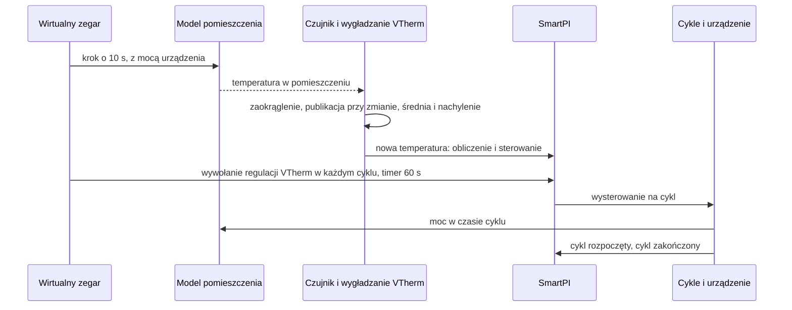

# Testy

Ten dokument zbiera w jednym miejscu wszystkie testy tego forka: jak je uruchomić, symulator,
z którego korzysta większość z nich, każdy scenariusz symulacji i to, co musi pokazać, pozostałe
testy, pogrupowane według funkcji, oraz testy QAS w prawdziwym Home Assistant. Same funkcje
opisują dokumenty [Dokumentacja techniczna](technical_doc.md),
[Zależności stref i drugie źródło ciepła](zone_dependencies.md) oraz
[Wejście wody](water_input.md). Własne testy autora pozostają bez zmian i są uruchamiane razem
z tymi.

## Spis treści

1. [Uruchamianie testów](#1-uruchamianie-testów)
2. [Symulator](#2-symulator)
3. [Scenariusze symulacji](#3-scenariusze-symulacji)
4. [Testy według funkcji](#4-testy-według-funkcji)
5. [Ograniczenia](#5-ograniczenia)
6. [QAS w prawdziwym Home Assistant](#6-qas-w-prawdziwym-home-assistant)

## 1. Uruchamianie testów

Testy uruchamia się z katalogu repozytorium, z kopią Versatile Thermostat (VTherm) na ścieżce
Pythona. To ten sam układ co w ciągłej integracji autora (CI, czyli testy, które GitHub uruchamia
automatycznie):

    PYTHONPATH=<versatile_thermostat copy>:$PWD python -m pytest tests/ -q

Są dwa zestawy testów:

| Zestaw | Co zawiera | Gdzie jest uruchamiany |
|---|---|---|
| Krótki | testy jednostkowe (małe testy jednej części kodu) i symulacje, które trwają tylko kilka sekund | przy każdym pull requeście (PR, prośbie o scalenie zmian; workflow „Tests”) i domyślnie lokalnie |
| Długi | krótki zestaw plus długie symulacje i porównania z własnym kodem VTherm | lokalnie z `SMARTPI_SIM_LOCAL=1`; na GitHubie w workflow „Full tests”, przy każdym pushu na gałąź `qas` i na żądanie |

Długie symulacje zależą od `SMARTPI_SIM_LOCAL`. Bez tej zmiennej są pokazywane jako pominięte
(skipped).

## 2. Symulator

### 2.1 Po co

- **Dom jest powolny i nigdy się nie powtarza.** SmartPI uczy się przez kilka dni. W prawdziwym
  domu każde pytanie o rozszerzenia (drzwi, wolniejsza podłogówka, kocioł, który czeka na większe
  zapotrzebowanie) zajęłoby tygodnie. A następna próba nigdy nie miałaby tej samej pogody.
- **Prawda jest znana.** W symulatorze test ustala moc grzania pomieszczenia `a`, jego straty
  ciepła `b`, opóźnienia i wymiany ciepła. Dzięki temu to, czego nauczył się SmartPI, można
  porównać z tymi prawdziwymi wartościami. W domu można ocenić tylko temperaturę w pomieszczeniu.
- **Działa prawdziwy kod.** Symulator uruchamia prawdziwy moduł obsługi (handler) i algorytm SmartPI. Skopiowana
  jest tylko praca, którą wokół nich wykonują Versatile Thermostat i Home Assistant.
- **Porównania są robione w trakcie testu.** Scenariusz jest uruchamiany dwa razy, na przykład
  z funkcją i bez niej, a oba przebiegi są porównywane. Wyniki zapisane wcześniej nie są używane:
  przestałyby pasować po każdej zmianie algorytmu autora.

### 2.2 Co modeluje

| Część | Plik | Co robi |
|---|---|---|
| Pomieszczenia | `tests/sim/plant.py` | Prosty model cieplny w jednostkach samego SmartPI. To, jak szybko grzejnik ogrzewa pomieszczenie, to `a` SmartPI (°C/min przy pełnej mocy). Połączenie z otoczeniem na zewnątrz to `b` SmartPI (1/min). Grzejnik ma opóźnienie. Wolny emiter ciepła, na przykład ogrzewana podłoga, przekazuje ciepło z bezwładnością: oddawane przez niego ciepło podąża za urządzeniem powoli, a nie od razu. Emiter „dwustopniowy” przekazuje je przez dwie krótsze bezwładności po kolei, jak płyta podłogi, która nagrzewa się przez całą grubość. Dwa pomieszczenia mogą być połączone cały czas albo przez drzwi, które otwierają się według harmonogramu. Model jest liczony w krokach czasu 10 s lub krótszych. |
| Czujniki i wygładzanie VTherm | `tests/sim/sensors.py` | Czujnik jest odczytywany co 10 s i zaokrąglany (domyślnie do 0.1 °C). Jego wartość jest publikowana tylko wtedy, gdy zaokrąglona wartość się zmieni. Średnia krocząca i nachylenie (szybkość zmian) z VTherm są skopiowane: średnia ma czas połowicznego zaniku 300 s, a nachylenie jest w °C/h. |
| Cykle grzania | `tests/sim/scheduler.py` | Kopia harmonogramu cykli VTherm (części, która zamienia wysterowanie na cykle urządzenia) dla jednego urządzenia: cykle włącz/wyłącz, minimalne czasy załączenia i wyłączenia, zawory. Własny harmonogram VTherm nie jest importowany: to wewnętrzna część VTherm, która zmienia się razem z główną gałęzią VTherm. Jest jedna celowa różnica: błąd w cyklu zatrzymuje symulację, zamiast trafić tylko do logu. |
| Czas | `tests/sim/clock.py` | Wirtualny zegar zastępuje zegar SmartPI, więc symulowany tydzień trwa tylko kilka sekund. Zegar uruchamia też timery: wywołanie regulacji VTherm w każdym cyklu, przeliczenie SmartPI co 60 s i cykle. |
| Kocioł i Smart Boiler | `tests/sim/boiler.py` | Woda docierająca do obiegu: o stałej temperaturze albo według krzywej grzewczej (temperatura wody ustalana z temperatury zewnętrznej). Może dodać cykliczną pracę palnika, priorytet ciepłej wody (kocioł najpierw grzeje zasobnik ciepłej wody) i kocioł, który rusza tylko wtedy, gdy strefa woła o ciepło. Zastępnik Smart Boiler podaje SmartPI dane o wodzie. |
| Pogoda | `tests/sim/weather.py` | Temperatura zewnętrzna: stała, z dobowym wahaniem albo z nagłym skokiem. |
| Przygotowanie scenariusza | `tests/sim/runner.py` | Jedna strefa (jej `a`, `b`, opóźnienie, nastawa, cykl, zawór albo urządzenie włącz/wyłącz, czujnik, sąsiedzi, presety, kocioł), drugi termostat w strefie (jego moc, opóźnienie i bezwładność) oraz kilka stref w jednym wspólnym świecie. |
| Pomiary | `tests/sim/metrics.py` | Czego nauczył się SmartPI w porównaniu z prawdziwymi wartościami, kiedy zakończyła się jego faza uczenia i błąd temperatury w pomieszczeniu. |

### 2.3 Jeden krok symulacji

## 3. Scenariusze symulacji

Jeśli w wierszu nie napisano inaczej, pomieszczenie ma `a` 0.03 °C/min, `b` 0.001 /min, opóźnienie
10 min, urządzenie włącz/wyłącz z cyklem 10 min, czujnik 0.1 °C i nastawę 20 °C. Temperatura
zewnętrzna to 3 °C z dobowym wahaniem ±3 °C. „Błąd” to średnia różnica między temperaturą
w pomieszczeniu a jego nastawą. „±x %” oznacza: w granicach x % prawdziwej wartości. Zakres bez
jednostki, na przykład 0.5–1.2, to nauczona wartość podzielona przez prawdziwą wartość.

### 3.1 Strefy sąsiednie — `test_smartpi_sim_neighbours.py` (krótki)

Pomieszczenie z czujnikiem 0.01 °C obok korytarza. Wymiana ciepła z korytarzem, `k`, wynosi 0.002.
Drzwi są otwarte 7:00–9:00, 12:00–13:30 i 18:00–22:00.

| Oznaczenie | Scenariusz | Co musi pokazać |
|---|---|---|
| N1 | korytarz jest na liście, ale wyłączony (tryb `none`) | dokładnie ten sam przebieg co bez niego |
| N2 | korytarz za drzwiami, 3 dni | `k` ±20 %; `a` i `b` ±5 %; żadne opóźnienie nie jest uczone, gdy drzwi są otwarte |
| N3 | korytarz zawsze otwarty, 20 °C; jego temperatura skacze o +4 °C po 30 h i o −4 °C po 66 h | po 42 h nic nie jest opublikowane; po 66 h `k` ±10 % i straty bez korytarza ±10 %; po drugim skoku mniejszy błąd niż bez tej funkcji |
| N3 zgrubny | to samo z czujnikiem 0.1 °C i jednym skokiem | albo nic nie jest opublikowane (korytarz pokazany jako „nie da się rozróżnić”, a używane jest własne `b` SmartPI), albo `k` ±20 % |
| N4 | korytarz niedostępny | dokładnie ten sam przebieg co bez niego |
| N5 | chłodzenie, korytarz o temperaturze 28 °C za drzwiami | `k` ±25 %; błąd poniżej 0.3 °C od 60 h |
| N6 | okno korytarza otwarte przez godzinę, gdy drzwi są otwarte, raz dla każdej reakcji | w tym czasie `k` nie jest uczone; reakcja jest zastosowana (nic, wyłączenie, ochrona przed mrozem 7 °C, eco 17 °C); urządzenie zgodnie z nią pracuje albo staje; potem temperatura w pomieszczeniu nie wychodzi więcej niż 0.6 °C ponad nastawę (przeregulowanie) |
| N7 | pomieszczenie między dwoma zawsze otwartymi sąsiadami, temperatura każdego z nich skacze raz | dla każdego: `k` w granicach ±35 % albo pokazany jako „nie da się rozróżnić” |

### 3.2 Strefa z dwoma źródłami ciepła — `test_smartpi_sim_second_source.py`

Główne źródło to grzejnik w pomieszczeniu. W większości scenariuszy dodatkowym źródłem jest wodna
podłogówka: ta sama moc co grzejnik, opóźnienie 30 min, bezwładność 180 min i reguła podziału (jak
ciepło jest dzielone między dwa źródła) `lead_band` na 20 %.

| Oznaczenie | Scenariusz | Zestaw | Co musi pokazać |
|---|---|---|---|
| Z1, Z3 | podłogówka od początku, 40 h | krótki | podłogówka pracuje blokami, gdy SmartPI się uczy, potem według reguły; model strefy jest opublikowany przed 30 h, z `a`, `b` i mocą podłogówki ±20 %; SmartPI używa tego modelu; od 30 h podłogówka daje ponad 20 % ciepła, a błąd jest poniżej 0.08 °C |
| — | własny SmartPI podłogówki, gdy pracuje ona jako dodatkowe źródło | krótki | niczego się nie uczy i niczego nie zmienia; podąża za wysterowaniem głównego źródła; po usunięciu głównego źródła znów sam reguluje |
| Z6 | główne źródło przestaje odpowiadać | krótki | po 15 min dodatkowe źródło reguluje samo; temperatura w pomieszczeniu zostaje powyżej 19.3 °C; gdy główne źródło wraca, dodatkowe źródło znów za nim podąża |
| — | główne źródło wyłączone, z cyklem 20 min | krótki | dodatkowe źródło zostaje wyłączone i nie przejmuje strefy |
| — | podłogówka na wodzie ze Smart Boiler | krótki | podłogówka zamienia moc głównego źródła na własne wysterowanie, używając własnych danych o wodzie |
| — | zrzut mocy (VTherm wyłącza urządzenia, gdy dom pobiera za dużo mocy) | krótki | główne źródło objęte zrzutem nadal wysyła swoje wysterowanie; dodatkowe źródło objęte zrzutem zostaje wyłączone |
| — | restart Home Assistant po 36 h | krótki | model strefy jest zachowany; potem błąd poniżej 0.15 °C |
| Z7 | chłodzenie z dwoma źródłami | krótki | osobny model chłodzenia, ±25 %; błąd poniżej 0.15 °C |
| — | zawór jako dodatkowe źródło, który VTherm też przelicza | krótki | zawór podąża za głównym źródłem |
| Z1 porównanie | porównanie z dwoma niezależnie pracującymi SmartPI, czujniki 0.01 i 0.1 °C, 96 h | długi | błąd nie większy niż 0.03 °C ponad błąd niezależnej pary; podłogówka daje ponad 35 % ciepła |
| Z1 noce | trzy noce z nastawą obniżoną do 17 °C | długi | przeregulowanie nie większe niż 0.1 °C ponad przeregulowanie niezależnej pary; przeregulowanie po ostatniej nocy nie większe niż 0.15 °C ponad największe z wcześniejszych nocy (nie rośnie z nocy na noc); podłogówka daje mniej niż 90 % ciepła |
| Z2 | reguła `source_first` na 50 % | długi | główne źródło ustala się na krzywej reguły (±0.15) |
| — | reguła `together` na 200 % | długi | to samo |
| Z4 | drugi grzejnik jako dodatkowe źródło | długi | każdy daje połowę ciepła (±0.15); błąd nie większy niż 0.03 °C ponad błąd niezależnej pary |
| Z5 | główne źródło za słabe na zimno (`a` 0.015, na zewnątrz −5 °C) | długi | podłogówka utrzymuje temperaturę w pomieszczeniu powyżej 18.5 °C, gdy SmartPI się uczy; gdy pogoda staje się łagodniejsza, SmartPI kończy uczenie |

### 3.3 Dwanaście pomieszczeń i cztery instalacje — `test_smartpi_sim_zone_set.py` (długi)

Sześć pomieszczeń (od wolnych do szybkich strat ciepła, od wolnych do szybkich grzejników) pracuje
przy łagodnej (3 °C) i mroźnej (−8 °C) pogodzie. Każde ma wodną podłogówkę o tej samej mocy. Każde
pracuje 96 h, potem przez trzy noce z nastawą obniżoną do 17 °C (na 6, 8 i 10 h). Każde jest porównywane z dwoma
niezależnymi SmartPI. Dla każdego pomieszczenia:

- model strefy jest opublikowany do 30 h, z `a`, `b` i mocą podłogówki ±15 %;
- błąd od 48 h do 96 h jest nie większy niż 0.02 °C ponad błąd niezależnej pary;
- najgorsze przeregulowanie po nocy jest nie większe niż 0.1 °C ponad przeregulowanie niezależnej
  pary;
- każdego ranka pomieszczenie osiąga nastawę minus 0.2 °C średnio nie więcej niż 1 h później niż
  przy niezależnej parze.

Te same sprawdzenia są wykonywane dla podłogówki za zaworem, płyty, która nagrzewa się przez całą
grubość, i wody na krzywych grzewczych. Dwie strefy obok siebie (zawsze otwarte albo z drzwiami
otwartymi 6:00–23:00) muszą każda utrzymać błąd nie większy niż 0.02 °C ponad błąd niezależnej
pary. Wyniki są w
[Zależności stref, §5.8](zone_dependencies.md#58-wyniki-i-ograniczenia-symulacja).

### 3.4 Woda — `test_smartpi_sim_water.py` (krótki)

Grzejnik (`a` 0.06 przy wodzie 60 °C) na kotle z krzywą grzewczą.

| Scenariusz | Co musi pokazać |
|---|---|
| z danymi o wodzie ze Smart Boiler i bez nich, 48 h | bez danych SmartPI uczy się mniej niż połowy `a`; z danymi od 0.5 do 1.2 `a` i ponad 1.5 raza tyle, ile bez nich |
| ciepła woda dwa razy dziennie, cykliczna praca palnika | gdy kocioł grzeje ciepłą wodę, całka (część wysterowania, która narasta w czasie) i wysterowanie się nie zmieniają; błąd poniżej 0.3 °C |
| brak danych o wodzie przez 2 h, potem na dobre | krótka przerwa zachowuje współczynnik wody (ciepło, które daje woda, w porównaniu z wodą odniesienia); trwała przerwa ustawia współczynnik na 1 i raz proponuje reset |
| kocioł, który rusza tylko wtedy, gdy strefa woła o ciepło | temperatura w pomieszczeniu zostaje powyżej 19 °C; SmartPI kończy uczenie i uczy się `a` w zakresie 0.5–1.2 |

### 3.5 Kocioł, który nie jest wezwany do grzania — `test_smartpi_sim_boiler_call.py` (krótki)

Grzejnik 2000 W za zaworem, z czujnikiem 0.01 °C. Kocioł rusza dopiero przy zapotrzebowaniu
2500 W lub większym, więc samo to pomieszczenie nigdy go nie uruchomi. Uruchamiają go inne strefy
(3000 W), z wyjątkiem jednego okresu doby.

| Oznaczenie | Scenariusz | Co musi pokazać |
|---|---|---|
| B1 | kocioł centralny VTherm, bez danych o wodzie, kocioł nie pracuje 2:00–8:00 | SmartPI nie wie, że kocioł nie jest wezwany: `a` poniżej połowy; SmartPI wie: `a` w zakresie 0.85–1.2, `b` w zakresie 0.95–1.05, `a` nie jest uczone, gdy kocioł nie jest wezwany, opóźnienie 9–13 min |
| B2 | wezwanie od Smart Boiler z danymi o wodzie, kocioł nie pracuje 10:00–16:00 | `b` w zakresie 0.95–1.05, `a` w zakresie 0.9–1.15, `a` nie jest uczone, gdy kocioł nie jest wezwany |

Wyniki są w [Wejście wody, §4.4](water_input.md#44-wyniki-symulacja).

### 3.6 Sam SmartPI, dwa termostaty i sam symulator

| Plik | Zestaw | Co sprawdza |
|---|---|---|
| `test_smartpi_sim_baseline.py` | krótki i długi | sam SmartPI uczy się znanego pomieszczenia. Z czujnikiem 0.01 °C: `a` i `b` ±5 % i opóźnienie z dokładnością do 4 min, wszystko w ciągu 12 h (siatka 12 pomieszczeń w długim zestawie). Z czujnikiem 0.1 °C nadal kończy uczenie, z `a` i `b` w zakresie 0.4–1.6 |
| `test_smartpi_sim_two_thermostats.py` | krótki i długi | opóźnienie i bezwładność podłogówki w modelu pomieszczenia; dwa termostaty, każdy z własnym SmartPI, które grzeją jedno pomieszczenie (dzisiejsze działanie, punkt odniesienia dla Z1 i Z4) |
| `test_smartpi_regression_no_dependencies.py` | krótki | funkcje skonfigurowane, ale nieaktywne: dokładnie ten sam przebieg i zapisany stan co bez tych funkcji |
| `test_smartpi_sim_harness.py` | krótki | zegar, timery, cykle włącz/wyłącz, minimalne czasy załączenia i wyłączenia, zawory, wywołanie regulacji VTherm w każdym cyklu; ten sam przebieg wykonany dwa razy daje ten sam wynik |
| `test_smartpi_sim_scheduler_parity.py` | długi | skopiowany harmonogram cykli i nachylenie dają te same zdarzenia co własny kod VTherm, dla tysięcy losowych wysterowań i odczytów |

## 4. Testy według funkcji

### 4.1 Zdarzenia AutoCalib

| Plik | Co sprawdza |
|---|---|
| `test_smartpi_autocalib_events.py` | każde zdarzenie AutoCalib niesie prawdziwy `entity_id` termostatu, a jego nazwę w `name` |

### 4.2 Znane wejścia (podstawa rozszerzeń)

| Plik | Co sprawdza |
|---|---|
| `test_smartpi_effective_model.py` | jak znane wejścia (ciepło wymieniane ze strefami sąsiednimi, ciepło z drugiego źródła) są łączone w `b_eff` i `T_ref`, czyli straty i temperaturę odniesienia, których używa sterowanie; bez nich nic się nie zmienia |
| `test_smartpi_learning_window_known_inputs.py` | okna uczenia odejmują ciepło znanych wejść |
| `test_smartpi_dependencies_algo.py` | algorytm używa `b_eff` i `T_ref` wszędzie w sterowaniu, zachowuje surowe wartości do uczenia, zatrzymuje uczenie, gdy ustawiona jest bramka uczenia (warunek taki jak otwarte drzwi do sąsiada), oraz zapisuje i wczytuje swój stan |
| `test_smartpi_dependencies.py`, `test_smartpi_dependency_inputs.py` | skonfigurowane elementy, sposób ich sprawdzania, odczyty używane w jednym obliczeniu |
| `test_config_flow.py`, `test_config_flow_dependencies.py` | menu opcji wpisu termostatu i lista zależności |

### 4.3 Strefy sąsiednie

| Plik | Co sprawdza |
|---|---|
| `test_smartpi_coupling_estimator.py` | uczenie `k` dla sąsiada za drzwiami, dla kilku drzwi naraz i dla zawsze otwartego sąsiada |
| `test_smartpi_dependency_model.py` | bramki uczenia, reakcje na okno sąsiada, presety przy chłodzeniu, zawsze otwarty sąsiad, który wchodzi do modelu bez skoku |
| `test_smartpi_dependencies_handler.py` | odczyty z Home Assistant |
| `test_config_flow_neighbours.py` | formularze sąsiadów: podpowiedzi, błędy, ostrzeżenia, edycja, krok resetu |

### 4.4 Strefa z dwoma źródłami ciepła

| Plik | Co sprawdza |
|---|---|
| `test_smartpi_zone_fit.py` | wspólny model strefy (jeden model dopasowany do obu źródeł razem) znajduje opóźnienie głównego źródła, skalę czasu podłogówki, `a`, `b`, moc podłogówki i `k` sąsiada |
| `test_smartpi_source_model.py`, `test_smartpi_source_candidates.py` | ciepło podłogówki wyliczone z jej cykli; kandydujące skale czasu |
| `test_smartpi_split.py` | reguły podziału i pętla przydziału |
| `test_smartpi_source_link.py` | łącze między dwoma termostatami: wysterowania, cykle, główne źródło, które przestaje odpowiadać, limit mocy |
| `test_smartpi_dependency_model_source.py` | bloki uczenia, zegar uczenia i jego limit czasu, hamowanie, szybszy powrót do nastawy po nocy, restart, chłodzenie |
| `test_smartpi_dependencies_handler.py` | rodzaje ogrzewania odczytane z obu wpisów, reset zamówiony z formularza, zmieniony termostat nadrzędny (jego urządzenia porównane po unikalnym ID, także przy przeładowaniu wpisu, gdy termostat nie ma jeszcze ID encji) |
| `test_config_flow_zone.py` | formularz strefy: termostat nadrzędny i jego sprawdzenia, zalecenie, przeniesienie głównego źródła, wpis drugiego termostatu, własne opóźnienie i bezwładność, usunięcie, krok resetu |

### 4.5 Woda

| Plik | Co sprawdza |
|---|---|
| `test_smartpi_water_input.py` | współczynnik wody, jego średnie, ciepła woda, krótkie i trwałe przerwy, zapis i wczytanie stanu |
| `test_smartpi_water_algo.py` | wysterowanie = moc / współczynnik, uczenie = wysterowanie × współczynnik, limit mocy, wstrzymania w czasie grzania ciepłej wody i przy zimnej wodzie |
| `test_smartpi_water_handler.py` | odczyt ze Smart Boiler, publikacja `water_factor`, reset proponowany, gdy dane się pojawiają albo znikają |
| `test_config_flow_heating_type.py` | rodzaj ogrzewania w ustawieniach; krok zgłoszenia naprawy (powiadomienia w „Naprawach” Home Assistant) |

### 4.6 Kocioł, który nie jest wezwany do grzania

| Plik | Co sprawdza |
|---|---|
| `test_smartpi_boiler_call.py` | tryby: kocioł, który odpowiada w ciągu 15 min, niczego nie zmienia; przy wołaniu o ciepło bez odpowiedzi najpierw emiter stygnie, potem wstrzymanie, potem emiter się nagrzewa po starcie kotła; urządzenia włącz/wyłącz i ich cykl; utracony odczyt; powody podawane przez Smart Boiler |
| `test_smartpi_boiler_algo.py` | uczenie nie widzi ciepła w czasie wstrzymania i czeka przed tym okresem i po nim; opóźnienie nie jest uczone ze startu kotła; korekta części wyprzedzającej jest zamrożona; kalibracja jest anulowana |
| `test_smartpi_boiler_handler.py` | pola Smart Boiler i kocioł centralny VTherm, z każdym rodzajem złej lub brakującej wartości |

## 5. Ograniczenia

- **Symulator jest łagodniejszy niż dom.** Nie ma szumu czujników poza zaokrąglaniem; nie ma
  słońca, ludzi ani gotowania; ma jedną temperaturę na pomieszczenie, chyba że wybrano model płyty.
  Wyniki w pozostałych dokumentach to to, co SmartPI osiąga w tych warunkach.
- **Pogoda** jest stała, z dobowym wahaniem albo z nagłym skokiem; nie ma prognozy.
- **Własne sterowanie kotła** (modulacja, czyli zmiana mocy płomienia, i minimalny czas pracy
  palnika) nie jest modelowane ponad to, czego potrzebują powyższe scenariusze.
- **VTherm jest skopiowany, a nie uruchamiany** w symulatorze. Długi zestaw porównuje kopię
  z własnym kodem VTherm, bo główna gałąź VTherm może się zmieniać. Testy QAS (sekcja 6)
  uruchamiają prawdziwy VTherm.

## 6. QAS w prawdziwym Home Assistant

Powyższe testy uruchamiają SmartPI wewnątrz procesu testów, na kopii harmonogramu cykli Versatile
Thermostat. Sprawdzają fizykę, uczenie i reguły podziału, ale nie to, co pokazuje tylko prawdziwy
Home Assistant. Robią to testy QAS (QAS od ang. quality assurance, czyli zapewnienie jakości; to
też nazwa gałęzi `qas`, którą testują). Działają na ławce testowej z ośmioma instancjami
Home Assistant (osobny projekt `ha-testbed`) i sprawdzają:

- prawdziwy Versatile Thermostat 10.5.1, z jego kotłem centralnym, menedżerem mocy i wykrywaniem
  okna, dwa termostaty połączone przez Home Assistant i termostat nadrzędny over_climate;
- formularze w Home Assistant, rejestr encji i jego obszary;
- zapisany stan w `.storage` po prawdziwych restartach;
- rejestrator (recorder), dziennik (logbook) i zgłoszenia napraw.

Testy QAS uruchamia sesja testowa ławki, nigdy sesja, która pisze kod. Zawsze robi to na jednym
commicie gałęzi `qas`. To repozytorium zawiera pakiet testów: symulator, narzędzia pomocnicze,
konfiguracje, skrypty przygotowania, program uruchamiający (runner) i ten katalog testów.

### 6.1 Pakiet testów

Wszystko jest w `tests/qas/`. Żaden plik nie ma tam nazwy `test_*.py`, więc `pytest tests/` w CI
go nie uruchamia: program uruchamiający potrzebuje `lib/` z ławki.

| Ścieżka | Co to jest |
|---|---|
| `custom_components/smartpi_room_sim/` | symulator pomieszczeń jako integracja Home Assistant: pomieszczenia, grzejniki, zawory, kocioł, drzwi, okna i otoczenie na zewnątrz. Jego fizyka (`physics.py`) to ten sam plik, którego używa symulator w procesie testów: wczytuje go `tests/sim/plant.py` |
| `custom_components/smartpi_qas_helpers/` | narzędzia pomocnicze tylko do testów, które sięgają do działającego SmartPI: wysyłają zdarzenie AutoCalib, uciszają główne źródło strefy, wczytują nauczony stan, podają listę wysłanych zdarzeń |
| `roles.py` | osiem ról w jednym miejscu: pomieszczenia, termostaty, wpisy SmartPI i bazowe opcje |
| `config/<role>.yaml` | `configuration.yaml` każdej roli, zapisany przez `config/build.py` na podstawie `roles.py` |
| `setup/setup_role.py` | przygotowuje instancję przez API, etapami (`setup/stages.py`), a potem ją restartuje |
| `run.py`, `scenarios/` | program uruchamiający i scenariusze, oparte na `lib/harness.py` z ławki |
| `compare.py` | porównuje to, co zmierzyły dwie instancje (QB1, QE5) |
| `README.md` | w skrócie: jak to uruchomić |

**Symulator.** Pomieszczenie ma straty ciepła na zewnątrz `b` i pojemność cieplną. Grzejnik ma
wzmocnienie grzania `a`, opóźnienie i bezwładność emitera (jeden stopień albo dwa dla płyty).
Pomieszczenia są połączone cały czas albo przez drzwi, a okno łączy pomieszczenie z otoczeniem na
zewnątrz. Emiter wodny grzeje tylko wodą z kotła: nagrzewa się w stronę 60 °C, gdy przełącznik
kotła jest włączony, i stygnie do 12 °C (poniżej temperatury pomieszczeń), gdy jest wyłączony.
Czujniki temperatury zaokrąglają do 0.1 albo 0.01 °C i zapisują wartość tylko wtedy, gdy odczyt
się zmieni. Usługi (services) ustawiają temperaturę pomieszczenia albo zmieniają ją stopniowo,
przesuwają średnią temperaturę zewnętrzną, otwierają lub zamykają drzwi albo okno, sprawiają, że
urządzenie przestaje odpowiadać (zachowuje swój stan, a może też stać się niedostępne), i resetują
wejścia. Wszystkie identyfikatory encji zaczynają się od `smartpi_room_sim_`: nic nie pochodzi
z prawdziwego domu.

### 6.2 Role instancji

| Inst. | Rola | Co zawiera |
|---|---|---|
| 1 | `base` | salon: VTherm over_switch ze SmartPI, bez rozszerzeń; nieogrzewany strych (czujnik dla QB3) |
| 2 | `neighbours` | kuchnia (SmartPI), a jako sąsiedzi korytarz za drzwiami (TPI, z czujnikiem okna) i zawsze otwarta jadalnia (TPI) |
| 3 | `zone` | pokój dzienny: grzejnik (główne źródło) i podłogówka (dodatkowe źródło) pod termostatem nadrzędnym `Lounge` (over_climate, samoregulacja wyłączona); zapasowe termostaty dla QE1 |
| 4 | `zone-ref` | ten sam pokój dzienny z dwoma niezależnymi SmartPI (porównanie dla QE5) |
| 5 | `zone-valve` | gabinet: podłogówka jest zaworem (over_valve); menedżer mocy VTherm |
| 6 | `central-boiler` | kocioł centralny VTherm (próg mocy 2500 W): sypialnia (2000 W) nie może go sama uruchomić, biuro (3000 W) może |
| 7 | `ref-0.4.0` | bliźniak instancji 1 na wersji 0.4.0 autora, później przeniesiony na `qas` i z powrotem |
| 8 | `electric` | elektryczne rodzaje ogrzewania (elektryczna mata grzewcza, szybki grzejnik elektryczny); powtórne przebiegi |

Każdy VTherm ma opóźnienie trybu bezpieczeństwa 1440 min. Czujnik, który zapisuje tylko przy
zmianie, utrzymuje jedną wartość dłużej niż domyślne 60 min w VTherm, a VTherm uznałby go za
czujnik, który przestał działać.

### 6.3 Wdrożenie i uruchamianie

Sesja testowa ławki postępuje według własnego `docs/workflow.md`. Dla tego pakietu:

1. **Przygotuj** (stage) to repozytorium na testowanym commicie `qas`, a Versatile Thermostat na
   tagu jego najnowszego wydania (10.5.1 w dniu 2026-10-14).
2. **Wdróż** każdą instancję z jej rolą:

       bin/deploy.sh --instance N --stage stage/vtherm_smartpi \
           --components stage/vtherm_smartpi/tests/qas/custom_components \
           --components stage/versatile_thermostat/custom_components \
           --config stage/vtherm_smartpi/tests/qas/config/<role>.yaml

3. **Skonfiguruj ją** przez API (wpisy VTherm, obszary, progi kotła i maksymalna moc, wpisy
   SmartPI, bazowe opcje), a potem ją zrestartuj:

       HA_INSTANCE=N python stage/vtherm_smartpi/tests/qas/setup/setup_role.py

   Etapy, po kolei: `vtherm` (centralna konfiguracja VTherm, wpis globalny SmartPI z wartościami
   domyślnymi, termostaty, potem termostaty nadrzędne), `areas`, `inputs`, `smartpi` (jeden wpis
   na każdy termostat SmartPI) i `options`. Każdy etap pomija to, co już istnieje; `--stage`
   uruchamia jeden etap.
4. **Uruchom** scenariusze albo `M`, czyli zestaw minimalny roli:

       HA_INSTANCE=N python stage/vtherm_smartpi/tests/qas/run.py M
       HA_INSTANCE=N python stage/vtherm_smartpi/tests/qas/run.py QD5      # detached: 72 h

   `run.py --list` pokazuje scenariusze. Każdy startuje tylko ze stanu bazowego swojej roli (jej
   wpisy SmartPI i ich opcje; sąsiedzi i strefa są porównywani według tego, co oznaczają, a nie
   według identyfikatorów nadanych przez formularze). Między scenariuszami wejścia symulatora
   i termostaty wracają do stanu bazowego.
5. **Porównaj** pary: `python stage/vtherm_smartpi/tests/qas/compare.py qb1` (instancje 1 i 7)
   i `compare.py qe5` (instancje 3 i 4), z katalogu ławki.

**Instancja 7** przechodzi z 0.4.0 na `qas` i z powrotem. Ławka wdraża fork w wersji 0.4.0
(51db763) z `--ref`, a komponenty pakietu testów z pobranej kopii gałęzi `qas` (checkout):

    QB1 / QB1s  →  QB2a (or QB2l after QB1)  →  deploy qas  →  QB2  →  QB3a  →  deploy 0.4.0  →  QB3

### 6.4 Czasy

Scenariusz czeka na to, co SmartPI robi po swoich własnych opóźnieniach, z zapasem dwóch obliczeń.
Program uruchamiający odczytuje te opóźnienia z przygotowanej wtyczki (`smartpi/const.py`
i `smartpi/source_model.py`):

| Co | Czas |
|---|---|
| jedno obliczenie | 60 s |
| cykl VTherm | 10 min |
| po zamknięciu drzwi uczenie czeka | 10 min |
| czas tolerancji kotła | 15 min, plus cykl dla urządzenia włącz/wyłącz |
| ustalanie się emitera (opóźnienie i trzy bezwładności) | grzejnik 65 min, podłogówka na wodzie 570 min |
| główne źródło, które milczy | 15 min |
| wykrywanie okna w VTherm | 30 s |

Symulator robi krok co 7 s, a temperatura zewnętrzna faluje z okresem 2838 s: żaden okres
symulatora nie jest wielokrotnością 60 s SmartPI ani cyklu. Temperatury pomieszczeń zmieniają się
stopniowo (rampami).

### 6.5 Katalog testów

„W tle”: dłuższy niż dwie godziny, więc ławka uruchamia go w tle. „Minimum”: należy do zestawu
minimalnego, który uruchamia się po każdej zmianie. Zestaw „ze Smart Boilerem” jest zaplanowany.
Nie ustalono jeszcze, jak testować ze Smart Boilerem (prawdziwa wtyczka w określonej wersji albo
zastępnik jej interfejsu tylko do testów), i nic z tego nie jest zbudowane.

| ID | Co sprawdza | Instancja i rola | Czas | W tle | Odpowiednik w procesie testów | Minimum | Zestaw |
|---|---|---|---|---|---|---|---|
| QA1 | Po restarcie na końcu przygotowania każdy wpis SmartPI i VTherm jest wczytany, ani SmartPI, ani VTherm nie zapisuje w logu ostrzeżenia ani błędu, każdy termostat SmartPI ma swoją diagnostykę i nie ma niczego ze Smart Boilera. | 1 `base`, 8 `electric` | 15 min | nie | test_factory.py | tak | bez Smart Boilera |
| QA2 | Zapisanie ustawień wpisu termostatu bez zmian przechodzi przez menu opcji bez kroku resetu, zachowuje zapisane opcje i przeładowuje wpis raz, bez pętli. | 1 `base` | 15 min | nie | test_config_flow_dependencies.py | tak | bez Smart Boilera |
| QA3 | Cztery usługi SmartPI działają na VTherm 10.5.1, a pauza w uczeniu trwa także po restarcie. | 1 `base` | 30 min | nie | test_services.py | nie | bez Smart Boilera |
| QA4 | Zdarzenia AutoCalib niosą encję climate termostatu w entity_id, a jego nazwę w name, i ani rejestrator, ani dziennik nie zapisuje w logu błędu o nieprawidłowym identyfikatorze encji. | 1 `base` | 60 min | nie | test_smartpi_autocalib_events.py | tak | bez Smart Boilera |
| QA5 | Dwa restarty zachowują nauczony stan (model, jego liczniki i zastosowany token resetu), a token resetu nie jest stosowany ponownie. | 1 `base` | 20 min | nie | test_algo_persistence.py | tak | bez Smart Boilera |
| QA6 | Wodny rodzaj ogrzewania pokazuje blok water ze źródłem none i współczynnikiem 1, a bez kotła centralnego VTherm nie ma bloku boiler; rodzaj elektryczny nie pokazuje żadnego z nich; przy wywołaniach sterowania nic nie trafia do logu. | 1 `base`, 8 `electric` | 20 min | nie | test_smartpi_water_handler.py, test_smartpi_boiler_handler.py | tak | bez Smart Boilera |
| QB1 | Przez 48 h bliźniacze pomieszczenie uczy się i reguluje; instancja zachowuje a, b i swój średni błąd z okresu od 24 do 48 h, a compare.py qb1 uznaje wynik za dobry, gdy a i b instancji qas są w granicach ±10 % wartości z 0.4.0, a jej średni błąd jest wyższy najwyżej o 0.03 °C. | 1 `base`, 7 `ref-0.4.0` | 48 h | tak | test_smartpi_regression_no_dependencies.py, test_smartpi_sim_baseline.py | nie | bez Smart Boilera |
| QB1s | Przez 45 minut bliźniacze pomieszczenie reguluje, a w logu nie ma żadnego błędu; instancja zachowuje to, co odczytuje compare.py qb1s (obie instancje regulują, fazy mają nazwy). Krótki wariant QB1. | 1 `base`, 7 `ref-0.4.0` | 45 min | nie | test_smartpi_sim_baseline.py | tak | bez Smart Boilera |
| QB2a | Na 0.4.0, przed aktualizacją: stan SmartPI to nauczony stan z pliku testowego (fixture), zapisany przez samą wersję 0.4.0 z pauzą w uczeniu, a jego model jest zachowany dla QB2. | 7 `ref-0.4.0` | 10 min | nie | test_algo_persistence.py | tak | bez Smart Boilera |
| QB2 | Po aktualizacji z 0.4.0 do qas stan zapisany przez 0.4.0 jest wczytany bez zmian, w logu nie ma ostrzeżenia o jego formacie, nic nie jest resetowane, a menu opcji starego wpisu działa. | 7 `ref-0.4.0` | 30 min | nie | test_algo_persistence.py | tak | bez Smart Boilera |
| QB3a | Na qas, przed powrotem do 0.4.0: do wpisu jest dodany sąsiad (czujnik strychu), włączona zostaje pauza w uczeniu, a model jest zachowany dla QB3; zostaje tak celowo. | 7 `ref-0.4.0` | 10 min | nie | — | nie | bez Smart Boilera |
| QB3 | Po powrocie na 0.4.0, ze skonfigurowanym sąsiadem, wpis wczytuje się bez błędów, stan również; zapisanie opcji w 0.4.0 usuwa klucze forka, co jest znanym zachowaniem. | 7 `ref-0.4.0` | 30 min | nie | — | nie | bez Smart Boilera |
| QB2l | Na 0.4.0 po QB1, przed aktualizacją: model, którego wersja 0.4.0 nauczyła się sama, jest zachowany dla QB2 z pauzą w uczeniu, bez wczytywania gotowego stanu. | 7 `ref-0.4.0` | 5 min | nie | test_algo_persistence.py | nie | bez Smart Boilera |
| QC1 | Dla termostatu obsługiwanego przez kocioł centralny VTherm blok boiler pokazuje źródło vtherm_central_boiler, a jego pole called podąża za czujnikiem binarnym kotła centralnego. | 6 `central-boiler` | 30 min | nie | test_smartpi_boiler_handler.py | tak | bez Smart Boilera |
| QC2 | Mała strefa, która sama woła o ciepło poniżej progów, przechodzi w emitter_cooling po czasie tolerancji, w held po czasie ustalania się swojego emitera, bez uczenia a, w emitter_warming, gdy duża strefa uruchomi kocioł, i wraca do zwykłego uczenia jeden czas ustalania się później. | 6 `central-boiler` | 2.5 h | tak | test_smartpi_boiler_call.py, test_smartpi_boiler_algo.py | nie | bez Smart Boilera |
| QC2s | Mała strefa, która sama woła o ciepło poniżej progów, przechodzi w emitter_cooling po czasie tolerancji i w held po czasie ustalania się swojego emitera, bez uczenia a, a potem w emitter_warming, gdy duża strefa uruchomi kocioł. Krótki wariant QC2, QC4. | 6 `central-boiler` | 95 min | nie | test_smartpi_boiler_call.py, test_smartpi_boiler_algo.py | tak | bez Smart Boilera |
| QC3 | Gdy czujnika binarnego kotła centralnego nie ma (jest wyłączony), SmartPI nie odczytuje żadnego wezwania kotła i uczy się jak wcześniej, bez błędów w logu; potem czujnik wraca. | 6 `central-boiler` | 20 min | nie | test_smartpi_boiler_handler.py | tak | bez Smart Boilera |
| QC4 | Codziennie od 2:00 do 8:00 duża strefa jest wyłączona, więc mała strefa woła o ciepło, a kocioł nie pracuje; po 48 h jej nauczone a mieści się w zakresie 0.85–1.2 prawdziwego a jej grzejnika. | 6 `central-boiler` | 48 h | tak | B1 (test_smartpi_sim_boiler_call.py) | nie | bez Smart Boilera |
| QD1 | Formularze sąsiadów pokazują każdy błąd i każde ostrzeżenie, podpowiadają czujnik drzwi z obszarów obu stref, edytują i usuwają z własnym krokiem resetu oraz zatrzymują się z neighbour_missing, dependencies_unchanged i zone_changed. | 2 `neighbours` | 45 min | nie | test_config_flow_neighbours.py | tak | bez Smart Boilera |
| QD2 | Reset wybrany w formularzu sąsiada resetuje model kuchni raz, a następny restart nie resetuje go ponownie. | 2 `neighbours` | 20 min | nie | test_smartpi_dependencies_handler.py | tak | bez Smart Boilera |
| QD3 | Sąsiad, który jest niedostępny albo w trybie none, nie bierze udziału: jego połączenie jest nieaktywne, a model kuchni nie ma od niego znanego wejścia. | 2 `neighbours` | 30 min | nie | N1, N4 | tak | bez Smart Boilera |
| QD4 | Przy otwartych drzwiach otwarte okno korytarza sprawia, że kuchnia reaguje tak, jak mówi jej ustawienie (nic, wyłączenie, ochrona przed mrozem, eco), i w tym czasie nie uczy się żadnego k; kuchnia wraca do normalnej pracy, gdy okno i drzwi się zamkną. | 2 `neighbours` | 60 min | nie | N6 | tak | bez Smart Boilera |
| QD5 | Przy drzwiach otwartych codziennie 7–9, 12–13:30 i 18–22 przez 72 h kuchnia uczy się k korytarza w granicach ±25 % prawdziwej wymiany ciepła i nie uczy się czasu martwego, gdy drzwi są otwarte. | 2 `neighbours` | 72 h | tak | N2, N5 | nie | bez Smart Boilera |
| QD5s | Drzwi otwarte dwa razy na 8 minut wstrzymują uczenie kuchni (door_open, potem door_settling), a gdy są otwarte, czas martwy nie jest uczony. Krótki wariant QD5. | 2 `neighbours` | 40 min | nie | N2 | tak | bez Smart Boilera |
| QD6 | Przy zawsze otwartej jadalni, której temperatura przez 72 h sama zmienia się skokami, kuchnia uczy się jej k w granicach ±20 % prawdziwej wymiany ciepła albo oznacza ją jako indistinguishable (nie do odróżnienia). | 2 `neighbours` | 72 h | tak | N3 | nie | bez Smart Boilera |
| QD6s | Gdy temperatura zawsze otwartej jadalni skacze, kuchnia nadal ma ją podłączoną, nie wstrzymuje uczenia i nie zapisuje błędu w logu. Krótki wariant QD6. | 2 `neighbours` | 30 min | nie | N3 | tak | bez Smart Boilera |
| QE1 | Formularz strefy odrzuca każdy zły termostat nadrzędny, tworzy brakujący wpis urządzenia i restartuje przy tym tylko ten termostat, przenosi strefę skonfigurowaną od strony dodatkowego źródła do głównego, zatrzymuje się z zone_changed i usuwa strefę. | 3 `zone` | 60 min | nie | test_config_flow_zone.py | tak | bez Smart Boilera |
| QE2 | W działającej strefie dodatkowe źródło niczego się nie uczy i stosuje wysterowanie głównego źródła, a zmiana jego rodzaju ogrzewania restartuje główne źródło. | 3 `zone` | 60 min | nie | test_smartpi_sim_second_source.py | tak | bez Smart Boilera |
| QE3 | Gdy główne źródło milknie, po 15 minutach dodatkowe źródło samo reguluje strefę, a temperatura w pomieszczeniu zostaje powyżej 19.3 °C; gdy główne źródło wraca, dodatkowe znów za nim podąża. | 3 `zone` | 60 min | nie | Z6 | tak | bez Smart Boilera |
| QE4 | Gdy urządzenia termostatu nadrzędnego zmienią się w VTherm, SmartPI przy starcie zapisuje ostrzeżenie w logu, a strefa dalej działa. | 3 `zone` | 15 min | nie | test_smartpi_dependencies_handler.py | tak | bez Smart Boilera |
| QE5 | Przez 48 h strefa publikuje swój model przed około 30 h, reguluje najwyżej o 0.05 °C gorzej niż niezależna para, podłogówka daje ponad 20 % ciepła, a restart po 36 h zachowuje model; ocenia to compare.py qe5. | 3 `zone`, 4 `zone-ref` | 48 h | tak | Z1 porównanie | nie | bez Smart Boilera |
| QE5s | Przez 45 minut strefa (albo niezależna para) reguluje, a w logu nie ma żadnego błędu; w strefie podłogówka podąża za grzejnikiem. Krótki wariant QE5. | 3 `zone`, 4 `zone-ref` | 45 min | nie | Z1 porównanie | tak | bez Smart Boilera |
| QE6 | Gdy menedżer mocy VTherm odcina urządzenia strefy (zrzut mocy), główne źródło objęte zrzutem nadal wysyła swoje wysterowanie, a dodatkowe źródło objęte zrzutem zostaje wyłączone. | 5 `zone-valve` | 60 min | nie | zrzut mocy | nie | bez Smart Boilera |
| QE7 | Przez 2 h zawór jako dodatkowe źródło podąża za wysterowaniem głównego źródła. | 5 `zone-valve` | 2 h | nie | zawór jako dodatkowe źródło | nie | bez Smart Boilera |
| QZ1 | SmartPI nie zapisuje w logu żadnego błędu, a każde jego ostrzeżenie jest na liście; rejestrator nie odrzuca żadnego atrybutu diagnostyki; formularze czytane po polsku pokazują tekst, a nie klucze; po trzech przeładowaniach wpisu jego termostat nie liczy podwójnie, a żaden termostat nadrzędny strefy nie jest zgłaszany jako zmieniony. | wszystkie | 25 min | nie | — | tak | bez Smart Boilera |
| QW1 | Dane o wodzie dostępne przez 48 h: źródło live, a w zakresie 0.5–1.2 prawdziwej wartości i ponad 1.5 raza tyle, ile wartość nauczona bez danych (zaplanowany, nie zbudowany) | — | — | — | woda z danymi i bez nich | — | ze Smart Boilerem |
| QW2 | Ciepła woda z priorytetem (dhw_active): φ = 0, wysterowanie i całka wstrzymane (zaplanowany, nie zbudowany) | — | — | — | ciepła woda | — | ze Smart Boilerem |
| QW3 | Brak danych przez 2 h, potem na dobre: długa średnia zachowana, potem φ = 1 i raz zgłoszenie naprawy water_data_gone; jego naprawa resetuje model (zaplanowany, nie zbudowany) | — | — | — | przerwy w danych; test_config_flow_heating_type.py | — | ze Smart Boilerem |
| QW4 | Dane pojawiają się po uczeniu: raz zgłoszenie naprawy water_data_appeared (zaplanowany, nie zbudowany) | — | — | — | test_smartpi_water_handler.py | — | ze Smart Boilerem |
| QW5 | Wezwanie od Smart Boilera (below_threshold, no_demand, activation_delay, boiler_fault): źródło smart_boiler, wstrzymanie jak w QC2, pola zapotrzebowania (zaplanowany, nie zbudowany) | — | — | — | B2; test_smartpi_boiler_handler.py | — | ze Smart Boilerem |
| QW6 | Podłogówka strefy na wodzie ze Smart Boilera: dodatkowe źródło zamienia moc głównego źródła na własne wysterowanie, używając własnych danych o wodzie (zaplanowany, nie zbudowany) | — | — | — | podłogówka na wodzie | — | ze Smart Boilerem |
| QW7 | Termostat nieprzypisany albo Smart Boiler usunięty: lasting, φ = 1 (zaplanowany, nie zbudowany) | — | — | — | test_smartpi_water_input.py | — | ze Smart Boilerem |
| QW8 | Elektryczny rodzaj ogrzewania przy obecnym Smart Boilerze: nigdy nie odczytuje Smart Boilera (zaplanowany, nie zbudowany) | — | — | — | test_smartpi_water_handler.py | — | ze Smart Boilerem |

Zestaw minimalny trwa na każdej instancji od około 1 h (instancje 4, 5 i 8) do około 4.5 h
(instancja 3); wszystkie instancje pracują równolegle. Długie scenariusze (QB1, QC2, QC4, QD5, QD6,
QE5) działają w tle; razem zajmują około trzech dni.

**W każdym przebiegu** QZ1 sprawdza, że: SmartPI nie zgłasza błędu, każde jego ostrzeżenie jest
na liście, rejestrator nie odrzuca żadnego atrybutu diagnostyki, formularze po polsku pokazują
tekst, a nie surowe klucze, żaden termostat nie liczy podwójnie po kilku przeładowaniach swojego
wpisu i nie ma wtedy ostrzeżenia, że termostat nadrzędny strefy nie ma już swoich dwóch urządzeń.

### 6.6 Sprawdzane bez ławki

| Plik | Co sprawdza | Gdzie jest uruchamiany |
|---|---|---|
| `test_qas_room_sim.py` | fizykę symulatora w porównaniu z modelem pierwszego rzędu (prostym modelem z jedną bezwładnością) i z siecią pomieszczeń symulatora w procesie testów, jego drzwi, okna, kocioł, urządzenia i reset; jego encje i usługi w Home Assistant | CI |
| `test_qas_pack.py` | pytest nie zbiera żadnego pliku pakietu; pliki ról są aktualne i poprawne; pakiet kompiluje się i importuje bez ławki; każdy scenariusz z planu jest zarejestrowany z oczekiwanym wynikiem w jednym zdaniu i jest w tym katalogu; stan bazowy programu uruchamiającego; `compare.py`; przygotowany nauczony stan daje się wczytać | CI |
| `test_qas_setup_flows.py` | przygotowanie każdej roli przez prawdziwe formularze Versatile Thermostat 10.5.1 i SmartPI, bez błędu w logu, a powtórzone niczego nie zmienia; role strefy z przeładowaniem każdego wpisu SmartPI, bez ostrzeżenia, że termostat nadrzędny strefy się zmienił; ścieżki formularzy z QD1, QE1, QE2 i QE4 | lokalnie, z `SMARTPI_QAS_LOCAL=1` |

### 6.7 Znane kwestie

- **Podwójny czujnik diagnostyczny podczas tworzenia wpisów.** Utworzenie własnego wpisu SmartPI
  termostatu albo zapisanie jego opcji sprawia, że wpis globalny jeszcze raz dodaje czujnik
  diagnostyczny innego termostatu SmartPI, który nie ma jeszcze własnego wpisu. Home Assistant
  odrzuca duplikat i zapisuje błąd w logu. To kod autora (`sensor.py`, niezmieniony od 0.4.0).
  Gdy każdy termostat ma już swój wpis, to się nie zdarza. Przygotowanie na końcu restartuje
  instancję, więc scenariusze czytają log bez tego błędu.
- **Powrót do 0.4.0.** Zapisanie opcji w 0.4.0 usuwa klucze forka (sąsiedzi, strefa, rodzaj
  ogrzewania). Pokazuje to QB3.
- **Nauczony stan**, który wczytują QB2a i QD2 (`smartpi_qas_helpers/fixtures/learned_room.json`),
  pochodzi z symulatora w procesie testów (a = 0.035, b = 0.0012, po zakończeniu fazy uczenia).
  SmartPI 0.4.0 wczytuje go bez zmian.
