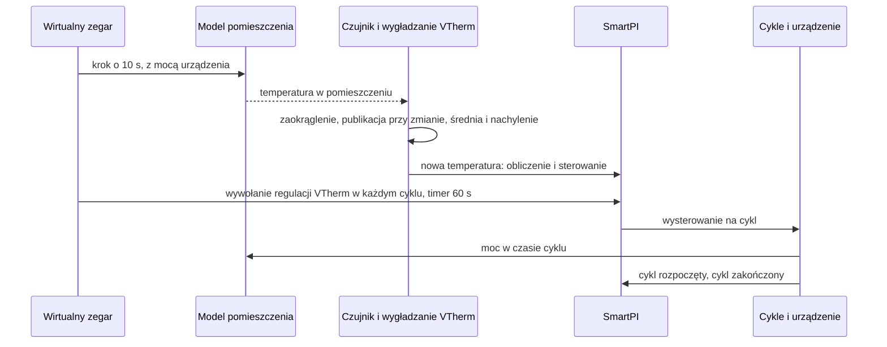

# Testy

Ten dokument zbiera w jednym miejscu wszystkie testy tego forka: jak je uruchomić, symulator,
z którego korzysta większość z nich, każdy scenariusz symulacji i to, co musi pokazać, pozostałe
testy, pogrupowane według funkcji, oraz testy QAS w prawdziwym Home Assistant. Same funkcje
opisują dokumenty [Dokumentacja techniczna](technical_doc.md),
[Zależności stref i drugie źródło ciepła](zone_dependencies.md) oraz
[Wejścia wody i kotła](water_input.md). Własne testy autora są uruchamiane razem z tymi. Dwa z nich
podążają za działaniem, które fork zmienia: `test_config_flow.py` (formularze) i
`test_smartpi_valve_runtime_sync.py`, którego termostat trzyma teraz swoje ustawienia SmartPI we
własnym wpisie SmartPI, tam, skąd SmartPI je czyta, a nie we wpisie Versatile Thermostat
(`smartpi_options` testowego zastępnika `fakes/fake_thermostat_runtime.py`). Sekcja 7 podaje pokrycie
kodu testami.

## Spis treści

1. [Uruchamianie testów](#1-uruchamianie-testów)
2. [Symulator](#2-symulator)
3. [Scenariusze symulacji](#3-scenariusze-symulacji)
4. [Testy według funkcji](#4-testy-według-funkcji)
5. [Ograniczenia](#5-ograniczenia)
6. [QAS w prawdziwym Home Assistant](#6-qas-w-prawdziwym-home-assistant)
7. [Pokrycie kodu](#7-pokrycie-kodu)

## 1. Uruchamianie testów

Testy uruchamia się z katalogu repozytorium, z kopią Versatile Thermostat (VTherm) na ścieżce
Pythona. To ten sam układ co w ciągłej integracji autora (CI, czyli testy, które GitHub uruchamia
automatycznie):

    PYTHONPATH=<versatile_thermostat copy>:$PWD python -m pytest tests/ -q

Są dwa zestawy testów:

| Zestaw | Co zawiera | Gdzie jest uruchamiany |
|---|---|---|
| Krótki | testy jednostkowe (małe testy jednej części kodu) i symulacje, które trwają tylko kilka sekund | przy każdym pull requeście (PR, prośbie o scalenie zmian; workflow „Tests”) i domyślnie lokalnie |
| Długi | krótki zestaw plus długie symulacje i porównania z własnym kodem VTherm | lokalnie z `SMARTPI_SIM_LOCAL=1`; na GitHubie w workflow „Full tests”, przy każdym pushu na gałąź `qas` i na żądanie |

Długie symulacje zależą od `SMARTPI_SIM_LOCAL`. Bez tej zmiennej są pokazywane jako pominięte
(skipped).

## 2. Symulator

### 2.1 Po co

- **Dom jest powolny i nigdy się nie powtarza.** SmartPI uczy się przez kilka dni. W prawdziwym
  domu każde pytanie o rozszerzenia (drzwi, wolniejsza podłogówka, kocioł, który czeka na większe
  zapotrzebowanie) zajęłoby tygodnie. A następna próba nigdy nie miałaby tej samej pogody.
- **Prawda jest znana.** W symulatorze test ustala moc grzania pomieszczenia `a`, jego straty
  ciepła `b`, opóźnienia i wymiany ciepła. Dzięki temu to, czego nauczył się SmartPI, można
  porównać z tymi prawdziwymi wartościami. W domu można ocenić tylko temperaturę w pomieszczeniu.
- **Działa prawdziwy kod.** Symulator uruchamia prawdziwy moduł obsługi (handler) i algorytm SmartPI. Skopiowana
  jest tylko praca, którą wokół nich wykonują Versatile Thermostat i Home Assistant.
- **Porównania są robione w trakcie testu.** Scenariusz jest uruchamiany dwa razy, na przykład
  z funkcją i bez niej, a oba przebiegi są porównywane. Wyniki zapisane wcześniej nie są używane:
  przestałyby pasować po każdej zmianie algorytmu autora.

### 2.2 Co modeluje

| Część | Plik | Co robi |
|---|---|---|
| Pomieszczenia | `tests/sim/plant.py` | Prosty model cieplny w jednostkach samego SmartPI. To, jak szybko grzejnik ogrzewa pomieszczenie, to `a` SmartPI (°C/min przy pełnej mocy). Połączenie z otoczeniem na zewnątrz to `b` SmartPI (1/min). Grzejnik ma opóźnienie. Wolny emiter ciepła, na przykład ogrzewana podłoga, przekazuje ciepło z bezwładnością: oddawane przez niego ciepło podąża za urządzeniem powoli, a nie od razu. Emiter „dwustopniowy” przekazuje je przez dwie krótsze bezwładności po kolei, jak płyta podłogi, która nagrzewa się przez całą grubość. Dwa pomieszczenia mogą być połączone cały czas albo przez drzwi, które otwierają się według harmonogramu. Model jest liczony w krokach czasu 10 s lub krótszych. |
| Czujniki i wygładzanie VTherm | `tests/sim/sensors.py` | Czujnik jest odczytywany co 10 s i zaokrąglany (domyślnie do 0.1 °C). Jego wartość jest publikowana tylko wtedy, gdy zaokrąglona wartość się zmieni. Średnia krocząca i nachylenie (szybkość zmian) z VTherm są skopiowane: średnia ma czas połowicznego zaniku 300 s, a nachylenie jest w °C/h. |
| Cykle grzania | `tests/sim/scheduler.py` | Kopia harmonogramu cykli VTherm (części, która zamienia wysterowanie na cykle urządzenia) dla jednego urządzenia: cykle włącz/wyłącz, minimalne czasy załączenia i wyłączenia, zawory. Własny harmonogram VTherm nie jest importowany: to wewnętrzna część VTherm, która zmienia się razem z główną gałęzią VTherm. Jest jedna celowa różnica: błąd w cyklu zatrzymuje symulację, zamiast trafić tylko do logu. |
| Czas | `tests/sim/clock.py` | Wirtualny zegar zastępuje zegar SmartPI, więc symulowany tydzień trwa tylko kilka sekund. Zegar uruchamia też timery: wywołanie regulacji VTherm w każdym cyklu, przeliczenie SmartPI co 60 s i cykle. |
| Kocioł i źródła danych o wodzie | `tests/sim/boiler.py` | Woda docierająca do obiegu: o stałej temperaturze albo według krzywej grzewczej (temperatura wody ustalana z temperatury zewnętrznej). Może dodać cykliczną pracę palnika, priorytet ciepłej wody (kocioł najpierw grzeje zasobnik ciepłej wody) i kocioł, który rusza tylko wtedy, gdy strefa woła o ciepło. Jego woda dociera do SmartPI z każdego z dwóch źródeł, które może wybrać użytkownik: od testowego dostawcy zgodnego z kontraktem SmartPI (`SimHeatingProvider`, zarejestrowanego tak, jak zrobiłaby to integracja) albo z encji (czujnik zasilania dla każdego obiegu oraz sygnały kotła: ciepła woda i grzanie, w zastępniku stanów Home Assistant). Test może wymusić powód przerwy na wybrany czas: dostawca podaje ten powód, a czujnik zasilania staje się niedostępny. |
| Pogoda | `tests/sim/weather.py` | Temperatura zewnętrzna: stała, z dobowym wahaniem albo z nagłym skokiem. |
| Przygotowanie scenariusza | `tests/sim/runner.py` | Jedna strefa (jej `a`, `b`, opóźnienie, nastawa, cykl, zawór albo urządzenie włącz/wyłącz, czujnik, sąsiedzi, presety, kocioł i źródło jej danych o wodzie: `water_data`, brak, `provider` albo `entities`), drugi termostat w strefie (jego moc, opóźnienie i bezwładność) oraz kilka stref w jednym wspólnym świecie. |
| Pomiary | `tests/sim/metrics.py` | Czego nauczył się SmartPI w porównaniu z prawdziwymi wartościami, kiedy zakończyła się jego faza uczenia i błąd temperatury w pomieszczeniu. |

### 2.3 Jeden krok symulacji

## 3. Scenariusze symulacji

Jeśli w wierszu nie napisano inaczej, pomieszczenie ma `a` 0.03 °C/min, `b` 0.001 /min, opóźnienie
10 min, urządzenie włącz/wyłącz z cyklem 10 min, czujnik 0.1 °C i nastawę 20 °C. Temperatura
zewnętrzna to 3 °C z dobowym wahaniem ±3 °C. „Błąd” to średnia różnica między temperaturą
w pomieszczeniu a jego nastawą. „±x %” oznacza: w granicach x % prawdziwej wartości. Zakres bez
jednostki, na przykład 0.5–1.2, to nauczona wartość podzielona przez prawdziwą wartość.

### 3.1 Strefy sąsiednie — `test_smartpi_sim_neighbours.py` (krótki)

Pomieszczenie z czujnikiem 0.01 °C obok korytarza. Wymiana ciepła z korytarzem, `k`, wynosi 0.002.
Drzwi są otwarte 7:00–9:00, 12:00–13:30 i 18:00–22:00.

| Oznaczenie | Scenariusz | Co musi pokazać |
|---|---|---|
| N1 | korytarz jest na liście, ale wyłączony (tryb `none`) | dokładnie ten sam przebieg co bez niego |
| N2 | korytarz za drzwiami, 3 dni | `k` ±20 %; `a` i `b` ±5 %; żadne opóźnienie nie jest uczone, gdy drzwi są otwarte |
| N3 | korytarz zawsze otwarty, 20 °C; jego temperatura skacze o +4 °C po 30 h i o −4 °C po 66 h | po 42 h nic nie jest opublikowane; po 66 h `k` ±10 % i straty bez korytarza ±10 %; po drugim skoku mniejszy błąd niż bez tej funkcji |
| N3 zgrubny | to samo z czujnikiem 0.1 °C i jednym skokiem | albo nic nie jest opublikowane (korytarz pokazany jako „nie da się rozróżnić”, a używane jest własne `b` SmartPI), albo `k` ±20 % |
| N4 | korytarz niedostępny | dokładnie ten sam przebieg co bez niego |
| N5 | chłodzenie, korytarz o temperaturze 28 °C za drzwiami | `k` ±25 %; błąd poniżej 0.3 °C od 60 h |
| N6 | okno korytarza otwarte przez godzinę, gdy drzwi są otwarte, raz dla każdej reakcji | w tym czasie `k` nie jest uczone; reakcja jest zastosowana (nic, wyłączenie, ochrona przed mrozem 7 °C, eco 17 °C); urządzenie zgodnie z nią pracuje albo staje; potem temperatura w pomieszczeniu nie wychodzi więcej niż 0.6 °C ponad nastawę (przeregulowanie) |
| N7 | pomieszczenie między dwoma zawsze otwartymi sąsiadami, temperatura każdego z nich skacze raz | dla każdego: `k` w granicach ±35 % albo pokazany jako „nie da się rozróżnić” |

### 3.2 Strefa z dwoma źródłami ciepła — `test_smartpi_sim_second_source.py`

Główne źródło to grzejnik w pomieszczeniu. W większości scenariuszy dodatkowym źródłem jest wodna
podłogówka: ta sama moc co grzejnik, opóźnienie 30 min, bezwładność 180 min i reguła podziału (jak
ciepło jest dzielone między dwa źródła) `lead_band` na 20 %.

| Oznaczenie | Scenariusz | Zestaw | Co musi pokazać |
|---|---|---|---|
| Z1, Z3 | podłogówka od początku, 40 h | krótki | podłogówka pracuje blokami, gdy SmartPI się uczy, potem według reguły; model strefy jest opublikowany przed 30 h, z `a`, `b` i mocą podłogówki ±20 %; SmartPI używa tego modelu; od 30 h podłogówka daje ponad 20 % ciepła, a błąd jest poniżej 0.08 °C |
| — | własny SmartPI podłogówki, gdy pracuje ona jako dodatkowe źródło | krótki | niczego się nie uczy i niczego nie zmienia; podąża za wysterowaniem głównego źródła; po usunięciu głównego źródła znów sam reguluje |
| Z6 | główne źródło przestaje odpowiadać | krótki | po 15 min dodatkowe źródło reguluje samo; temperatura w pomieszczeniu zostaje powyżej 19.3 °C; gdy główne źródło wraca, dodatkowe źródło znów za nim podąża |
| — | główne źródło wyłączone, z cyklem 20 min | krótki | dodatkowe źródło zostaje wyłączone i nie przejmuje strefy |
| — | podłogówka na wodzie, jej dane o wodzie od dostawcy | krótki | podłogówka zamienia moc głównego źródła na własne wysterowanie, używając własnych danych o wodzie |
| — | zrzut mocy (VTherm wyłącza urządzenia, gdy dom pobiera za dużo mocy) | krótki | główne źródło objęte zrzutem nadal wysyła swoje wysterowanie; dodatkowe źródło objęte zrzutem zostaje wyłączone |
| — | restart Home Assistant po 36 h | krótki | model strefy jest zachowany; potem błąd poniżej 0.15 °C |
| Z7 | chłodzenie z dwoma źródłami | krótki | osobny model chłodzenia, ±25 %; błąd poniżej 0.15 °C |
| — | zawór jako dodatkowe źródło, który VTherm też przelicza | krótki | zawór podąża za głównym źródłem |
| — | 8-godzinna noc w 17 °C po 30 h, z szybkim i z oszczędnym dojściem po obniżeniu | krótki | oba widzą obniżenie; szybkie dojście osiąga 19.8 °C co najmniej 0.5 h wcześniej, z przeregulowaniem nie większym niż 0.15 °C ponad przeregulowanie oszczędnego (albo ponad 0) |
| Z1 porównanie | porównanie z dwoma niezależnie pracującymi SmartPI, czujniki 0.01 i 0.1 °C, 96 h | długi | błąd nie większy niż 0.03 °C ponad błąd niezależnej pary; podłogówka daje ponad 35 % ciepła |
| Z1 noce | trzy noce z nastawą obniżoną do 17 °C | długi | przeregulowanie nie większe niż 0.1 °C ponad przeregulowanie niezależnej pary; przeregulowanie po ostatniej nocy nie większe niż 0.15 °C ponad największe z wcześniejszych nocy (nie rośnie z nocy na noc); podłogówka daje mniej niż 90 % ciepła |
| Z2 | reguła `source_first` na 50 % | długi | główne źródło ustala się na krzywej reguły (±0.15) |
| — | reguła `together` na 200 % | długi | to samo |
| Z4 | drugi grzejnik jako dodatkowe źródło | długi | każdy daje połowę ciepła (±0.15); błąd nie większy niż 0.03 °C ponad błąd niezależnej pary |
| Z5 | główne źródło za słabe na zimno (`a` 0.015, na zewnątrz −5 °C) | długi | podłogówka utrzymuje temperaturę w pomieszczeniu powyżej 18.5 °C, gdy SmartPI się uczy; gdy pogoda staje się łagodniejsza, SmartPI kończy uczenie |

### 3.3 Dwanaście pomieszczeń i cztery instalacje — `test_smartpi_sim_zone_set.py` (długi)

Sześć pomieszczeń (od wolnych do szybkich strat ciepła, od wolnych do szybkich grzejników) pracuje
przy łagodnej (3 °C) i mroźnej (−8 °C) pogodzie. Każde ma wodną podłogówkę o tej samej mocy. Każde
pracuje 96 h, potem przez trzy noce z nastawą obniżoną do 17 °C (na 6, 8 i 10 h). Każde jest porównywane z dwoma
niezależnymi SmartPI. Dla każdego pomieszczenia:

- model strefy jest opublikowany do 30 h, z `a`, `b` i mocą podłogówki ±15 %;
- błąd od 48 h do 96 h jest nie większy niż 0.02 °C ponad błąd niezależnej pary;
- przy szybkim dojściu po obniżeniu (domyślnym) najgorsze przeregulowanie po nocy jest mniejsze
  niż przy niezależnej parze;
- każdego ranka pomieszczenie osiąga nastawę minus 0.2 °C średnio nie później niż przy
  niezależnej parze, z tolerancją 0.2 h (faza wywołania regulacji w cyklu i krok czujnika
  przesuwają poranek o tyle: zmierzone dla faz 0, 170 i 340 s). Jeden przypadek to opisany wyjątek: pomieszczenie `b` 0.002, `a` 0.04 przy
  zimnej pogodzie może dojść do 0.8 h później (3.6 h wobec 2.9 h; nocne obciążenie jest tam
  większe niż pełna moc podłogówki).

Te same sprawdzenia są wykonywane dla podłogówki za zaworem, płyty, która nagrzewa się przez całą
grubość, i wody na krzywych grzewczych (dane o wodzie z encji). Dwie strefy obok siebie (zawsze otwarte albo z drzwiami
otwartymi 6:00–23:00) muszą każda utrzymać błąd nie większy niż 0.02 °C ponad błąd niezależnej
pary. Wyniki są w
[Zależności stref, §5.8](zone_dependencies.md#58-wyniki-i-ograniczenia-symulacja).

### 3.4 Woda — `test_smartpi_sim_water.py` (krótki)

Grzejnik (`a` 0.06 przy wodzie 60 °C) na kotle z krzywą grzewczą. Dane o wodzie pochodzą od
dostawcy albo z encji; scenariusze oznaczone „oba” są uruchamiane z każdym z tych źródeł.

| Oznaczenie | Scenariusz | Co musi pokazać |
|---|---|---|
| W1 | bez danych o wodzie oraz z nimi od dostawcy i z encji, 48 h | bez danych SmartPI uczy się mniej niż połowy `a`; z danymi z każdego z tych źródeł od 0.5 do 1.2 `a` i ponad 1.5 raza tyle, ile bez nich |
| — | ciepła woda dwa razy dziennie, cykliczna praca palnika (oba) | gdy kocioł grzeje ciepłą wodę, całka (część wysterowania, która narasta w czasie) i wysterowanie się nie zmieniają; błąd poniżej 0.3 °C |
| — | brak danych od dostawcy przez 2 h, potem na dobre (`not_mapped`) | krótka przerwa zachowuje współczynnik wody (ciepło, które daje woda, w porównaniu z wodą odniesienia); trwała przerwa ustawia współczynnik na 1 i raz proponuje reset |
| — | czujnik zasilania niedostępny od 24. godziny (encje) | przez 24 h zachowuje współczynnik (powód `unavailable`) i niczego nie proponuje; potem przerwa liczy się jako trwała: współczynnik 1 i raz zaproponowany reset |
| — | kocioł, który rusza tylko wtedy, gdy strefa woła o ciepło (oba) | temperatura w pomieszczeniu zostaje powyżej 19 °C; SmartPI kończy uczenie i uczy się `a` w zakresie 0.5–1.2 |

### 3.5 Kocioł, który nie jest wezwany do grzania — `test_smartpi_sim_boiler_call.py` (krótki)

Grzejnik 2000 W za zaworem, z czujnikiem 0.01 °C. Kocioł rusza dopiero przy zapotrzebowaniu
2500 W lub większym, więc samo to pomieszczenie nigdy go nie uruchomi. Uruchamiają go inne strefy
(3000 W), z wyjątkiem jednego okresu doby.

| Oznaczenie | Scenariusz | Co musi pokazać |
|---|---|---|
| B1 | wezwanie od kotła centralnego VTherm (z jego bieżących encji), bez danych o wodzie, kocioł nie pracuje 2:00–8:00 | SmartPI nie wie, że kocioł nie jest wezwany: `a` poniżej połowy; SmartPI wie: `a` w zakresie 0.85–1.2, `b` w zakresie 0.95–1.05, `a` nie jest uczone, gdy kocioł nie jest wezwany, opóźnienie 9–13 min; powód z VTherm `below_threshold` (a na chwilę przy przełączeniu `activation_delay`) |
| B1 encja | to samo, wezwanie z czujnika binarnego (encje) | to samo; powód `not_called` (bez encji powodu) |
| B2 | wezwanie od dostawcy, woda od dostawcy albo z encji, kocioł nie pracuje 10:00–16:00 | `b` w zakresie 0.95–1.05, `a` w zakresie 0.9–1.15, `a` nie jest uczone, gdy kocioł nie jest wezwany; powód od dostawcy `below_threshold` |

Wyniki są w [Wejścia wody i kotła, §4.4](water_input.md#44-wyniki-symulacja).

### 3.6 Sam SmartPI, dwa termostaty i sam symulator

| Plik | Zestaw | Co sprawdza |
|---|---|---|
| `test_smartpi_sim_baseline.py` | krótki i długi | sam SmartPI uczy się znanego pomieszczenia. Z czujnikiem 0.01 °C: `a` i `b` ±5 % i opóźnienie z dokładnością do 4 min, wszystko w ciągu 12 h (siatka 12 pomieszczeń w długim zestawie). Z czujnikiem 0.1 °C kończy uczenie (w około 15 h) z `a` i `b` w granicach ±15 %; w długim zestawie cztery noce z obniżeniem zostawiają `a` i `b` w granicach ±10 % (trzy pomieszczenia, trzy fazy wywołań) |
| `test_smartpi_sim_two_thermostats.py` | krótki i długi | opóźnienie i bezwładność podłogówki w modelu pomieszczenia; dwa termostaty, każdy z własnym SmartPI, które grzeją jedno pomieszczenie (dzisiejsze działanie, punkt odniesienia dla Z1 i Z4) |
| `test_smartpi_regression_no_dependencies.py` | krótki | funkcje skonfigurowane, ale nieaktywne: dokładnie ten sam przebieg i zapisany stan co bez tych funkcji |
| `test_smartpi_sim_harness.py` | krótki | zegar, timery, cykle włącz/wyłącz, minimalne czasy załączenia i wyłączenia, zawory, wywołanie regulacji VTherm w każdym cyklu; ten sam przebieg wykonany dwa razy daje ten sam wynik |
| `test_smartpi_sim_scheduler_parity.py` | długi | skopiowany harmonogram cykli i nachylenie dają te same zdarzenia co własny kod VTherm, dla tysięcy losowych wysterowań i odczytów |

## 4. Testy według funkcji

### 4.1 Zdarzenia AutoCalib

| Plik | Co sprawdza |
|---|---|
| `test_smartpi_autocalib_events.py` | każde zdarzenie AutoCalib niesie prawdziwy `entity_id` termostatu, a jego nazwę w `name` |

### 4.2 Znane wejścia (podstawa rozszerzeń)

| Plik | Co sprawdza |
|---|---|
| `test_smartpi_effective_model.py` | jak znane wejścia (ciepło wymieniane ze strefami sąsiednimi, ciepło z drugiego źródła) są łączone w `b_eff` i `T_ref`, czyli straty i temperaturę odniesienia, których używa sterowanie; bez nich nic się nie zmienia |
| `test_smartpi_effective_model_edges.py` | przypadki brzegowe znalezione przez pokrycie kodu (sekcja 7): dopływ ciepła równy zeru albo niebędący liczbą jest pomijany |
| `test_smartpi_learning_window_known_inputs.py` | okna uczenia odejmują ciepło znanych wejść |
| `test_smartpi_dependencies_algo.py` | algorytm używa `b_eff` i `T_ref` wszędzie w sterowaniu, zachowuje surowe wartości do uczenia, zatrzymuje uczenie, gdy ustawiona jest bramka uczenia (warunek taki jak otwarte drzwi do sąsiada), oraz zapisuje i wczytuje swój stan; nastawa okna sąsiada bez temperatury docelowej, polecenie źródła poza rolą źródła, wspólny model opublikowany po fazie nauki (a i b zostają) |
| `test_smartpi_dependencies.py`, `test_smartpi_dependency_inputs.py` | skonfigurowane elementy, sposób ich sprawdzania, odczyty używane w jednym obliczeniu |
| `test_config_flow.py`, `test_config_flow_dependencies.py` | menu opcji wpisu termostatu (z pozycją Woda i kocioł dla wodnego rodzaju ogrzewania, Save and finish na końcu) i wpisu globalnego; tworzenie wpisu przez menu; wpis wartości domyślnych tworzony ponownie po usunięciu (wpisy termostatów zostają), starszy bez unikalnego identyfikatora nie jest powielany; lista zależności (każdy krok wraca do menu, usunięcie bez wyboru wraca do menu z notatką, pozycja powrotu) |

### 4.3 Strefy sąsiednie

| Plik | Co sprawdza |
|---|---|
| `test_smartpi_coupling_estimator.py` | uczenie `k` dla sąsiada za drzwiami, dla kilku drzwi naraz i dla zawsze otwartego sąsiada |
| `test_smartpi_dependency_model.py` | bramki uczenia, reakcje na okno sąsiada, presety przy chłodzeniu, zawsze otwarty sąsiad, który wchodzi do modelu bez skoku |
| `test_smartpi_dependencies_handler.py` | odczyty z Home Assistant |
| `test_config_flow_neighbours.py` | formularze sąsiadów: podpowiedzi, błędy, ostrzeżenia, edycja, sąsiad, którego już nie ma, odrzucony na formularzu, każdy krok wraca do menu (nic nie jest zapisane przed Save and finish), pytanie o reset przy zapisie |
| `test_smartpi_coupling_estimator_edges.py`, `test_smartpi_dependencies_edges.py` | przypadki brzegowe znalezione przez pokrycie kodu (sekcja 7): dopasowania z ujemnym współczynnikiem albo ponad jego granicą, drzwi, których wymiany się znoszą, źródło, które nie pracowało w oknach drzwi, historia o niezgodnych wartościach, zapisane wiersze o innym kształcie, pusty raport cyklu, zapominanie usuniętych pozycji; zapisane pozycje, które nie są słownikami, jeden czujnik drzwi zapisany jako tekst, pasmo wyprzedzenia poza zakresem |

### 4.4 Strefa z dwoma źródłami ciepła

| Plik | Co sprawdza |
|---|---|
| `test_smartpi_zone_fit.py` | wspólny model strefy (jeden model dopasowany do obu źródeł razem) znajduje opóźnienie głównego źródła, skalę czasu podłogówki, `a`, `b`, moc podłogówki i `k` sąsiada |
| `test_smartpi_source_model.py`, `test_smartpi_source_candidates.py` | ciepło podłogówki wyliczone z jej cykli; kandydujące skale czasu |
| `test_smartpi_split.py` | reguły podziału i pętla przydziału |
| `test_smartpi_source_link.py` | łącze między dwoma termostatami: wysterowania, cykle, główne źródło, które przestaje odpowiadać, limit mocy |
| `test_smartpi_dependency_model_source.py` | bloki uczenia, zegar uczenia i jego limit czasu, hamowanie, szybszy powrót do nastawy po nocy (tylko w powrocie, nie przy spadku w ustalonej strefie), restart, chłodzenie |
| `test_smartpi_zone_recovery.py` | dojście po obniżeniu: obniżenie od 0.5 °C poniżej nastawy dnia (powyżej przy chłodzeniu), odniesienie zapominane po 24 h, odnawiane przy zmianie trybu HVAC, zachowane z wiekiem po restarcie i odrzucane, gdy nieczytelne; obciążenie szybkiego dojścia (też przy chłodzeniu), ograniczone hamowaniem, brak bez dopasowania albo temperatury zewnętrznej; oszczędne dojście bez zmian; własny wybór strefy wobec wspólnego ustawienia |
| `test_smartpi_dependencies_handler.py` | rodzaje ogrzewania odczytane z obu wpisów, dojście strefy po obniżeniu (z ustawień regulatora albo własne strefy), reset zamówiony z formularza, zmieniony termostat nadrzędny (jego urządzenia porównane po unikalnym ID, także przy przeładowaniu wpisu, gdy termostat nie ma jeszcze ID encji); wyłączone drugie źródło wyłącza swoje urządzenie, zakres termostatu, który nie jest zakresem, źródło, którego nie da się odnaleźć, strefa, której termostat nadrzędny usunięto |
| `test_config_flow_zone.py` | formularz strefy: termostat nadrzędny i jego sprawdzenia (brak: powrót do menu, które mówi dlaczego), źródło bez rodzaju ogrzewania pytane o niego, zalecenie, przeniesienie głównego źródła (sąsiedzi połączeni; odrzucone w kroku parametru, gdy się nie da), wpis drugiego termostatu tworzony przy zapisie (jego opcje otwierają własne menu), własne opóźnienie i bezwładność, usunięcie, pytanie o reset przy zapisie, strefa ustawiona przy tworzeniu wpisu, dwa okna otwarte naraz, własne dojście strefy po obniżeniu (zapisywane tylko, gdy wybrane, zachowane przy zmianie głównego źródła); strefa przeniesiona na drugi termostat i przywrócona w jednym oknie (trzyma ją tylko ten wpis; odmowa bez żadnej zmiany, gdy jej sąsiedzi by się kłócili) |
| `test_smartpi_zone_fit_edges.py`, `test_smartpi_dependency_model_edges.py`, `test_smartpi_source_candidates_edges.py`, `test_smartpi_split_edges.py` | przypadki brzegowe znalezione przez pokrycie kodu (sekcja 7): źródło, które nigdy nie pracowało, zaszumiony czujnik, próbki niebędące liczbami, zapisane stany nie do odczytania; to samo źródło ustawione ponownie, współczynnik nauczony przy chłodzeniu po restarcie, brak temperatury zewnętrznej, brak zapotrzebowania głównego źródła, brak temperatury docelowej, współczynnik opublikowany w czasie szybszego nagrzewania, zapisane dopasowania i odpowiedzi nie do odczytania; pętla bez zapotrzebowania głównego źródła na razie |

### 4.5 Woda

| Plik | Co sprawdza |
|---|---|
| `test_smartpi_water_input.py` | współczynnik wody, jego średnie, ciepła woda, krótkie i trwałe przerwy, zapis i wczytanie stanu (z wejściami, do których należy), zapominanie danych |
| `test_smartpi_water_algo.py` | wysterowanie = moc / współczynnik, uczenie = wysterowanie × współczynnik, limit mocy, wstrzymania w czasie grzania ciepłej wody i przy zimnej wodzie; próg włączenia zaworu przy danych o wodzie |
| `test_smartpi_heating_inputs.py` | źródła, odczytywane osobno: encje (liczby, °F i K, unavailable, unknown albo tekst, brakująca encja, połączenia sygnałów grzania, ciepłej wody i awarii, encja powodu, encja odnaleziona po identyfikatorze z rejestru mimo zmiany nazwy); rejestr dostawców (rejestracja, wyrejestrowanie, dwóch dostawców, nietypowe nazwy), ostrożny odczyt dostawcy (niezarejestrowany, `None`, zła wersja, wyjątek, odpowiedź, która nie jest słownikiem, słownik, którego odczyt zgłasza błąd, brak metody, złe typy, za duże liczby, powody, których SmartPI nie zna, pola zapotrzebowania) i jednorazowe zgłoszenie, gdy długo go nie ma; kocioł centralny VTherm z jego bieżących encji (wezwany, trzy wyliczane powody, moce w W i kW, brakujące encje, termostat, którego kocioł nie liczy); odczyt opcji: sygnały z wpisu globalnego albo własne, wpisy bez tych kluczy, nieznane źródła |
| `test_smartpi_water_handler.py` | moduł obsługi odczytuje wybrane źródło (testowego dostawcę albo encje z własnymi sygnałami termostatu lub z sygnałami z wpisu globalnego), publikuje `water_factor`, proponuje reset, gdy dane się pojawiają albo znikają, ale nie dla wejść, dla których w opcjach zachowano model; inne wejścia wybrane w opcjach kasują stan wody starych wejść (stan trwałej przerwy, długoterminową średnią) i otwarte zgłoszenie naprawy, te same wejścia zachowują swój stan po restarcie, a wpis sprzed wprowadzenia źródeł zachowuje dzisiejsze zasady przerw, gdy nie ma danych; wybrany dostawca, którego nie ma przez 10 minut, jest zgłaszany raz ostrzeżeniem; rodzaj elektryczny albo brak rodzaju niczego nie odczytuje; zastępnik Home Assistant bez rejestrów czyta zapisane encje takie, jakie są |
| `test_config_flow_heating_inputs.py` | formularze: menu wpisu globalnego i sygnały kotła (zapisane po identyfikatorze z rejestru, puste pole usunięte); Woda i kocioł: listy budowane z zarejestrowanych dostawców, kocioł centralny VTherm do wyboru (i domyślny) tylko tam, gdzie obsługuje termostat, dostawca, który nie jest już zarejestrowany, pokazany jako niedostępny, czujnik zasilania, sygnały z wpisu globalnego albo własne (wstępnie wypełnione z wpisu globalnego; własny sygnał zostawiony pusty zostaje pusty), pytanie o reset przy zapisie tylko przy zmianie źródła wody albo jego czujnika (reset albo zachowany model), wpisy bez tych kluczy; każdy krok wraca do menu; rodzaj elektryczny bez tej pozycji; dodatkowe źródło strefy, które wybiera tylko swoją wodę; nowy wpis tworzony przez formularz strefy, bez kopii sygnałów z wpisu globalnego |
| `test_config_flow_heating_type.py` | rodzaj ogrzewania jako pierwszy w ustawieniach termostatu, „Not set” (nieustawiony, zapisany jako brak klucza), brak go w formularzu wartości domyślnych; krok zgłoszenia naprawy (powiadomienia w „Naprawach” Home Assistant) |

### 4.6 Kocioł, który nie jest wezwany do grzania

| Plik | Co sprawdza |
|---|---|
| `test_smartpi_boiler_call.py` | tryby: kocioł, który odpowiada w ciągu 15 min, niczego nie zmienia; przy wołaniu o ciepło bez odpowiedzi najpierw emiter stygnie, potem wstrzymanie, potem emiter się nagrzewa po starcie kotła; urządzenia włącz/wyłącz i ich cykl; utracony odczyt; powody podawane przez dostawców; diagnostyka z wybranym źródłem i jego wejściami, także bez odczytu |
| `test_smartpi_boiler_algo.py` | uczenie nie widzi ciepła w czasie wstrzymania i czeka przed tym okresem i po nim; opóźnienie nie jest uczone ze startu kotła; korekta części wyprzedzającej jest zamrożona; kalibracja jest anulowana |
| `test_smartpi_boiler_handler.py` | moduł obsługi odczytuje wybrane źródło wezwania: dostawcę (jego powody i zapotrzebowanie; żadnego innego źródła, gdy dostawca nic nie mówi), encje (własne sygnały termostatu albo sygnały z wpisu globalnego), kocioł centralny VTherm (domyślny tam, gdzie obsługuje termostat, jego powód i zapotrzebowanie), brak; blok `boiler` widoczny dla wybranego źródła bez danych; rodzaj elektryczny albo brak rodzaju niczego nie odczytuje |

### 4.7 Czujnik diagnostyczny

| Plik | Co sprawdza |
|---|---|
| `test_sensor_own_entry.py` | wpis globalny pokazuje czujnik diagnostyczny termostatu bez własnego wpisu; gdy termostat dostaje własny wpis, ten wpis przejmuje czujnik: Home Assistant nie odrzuca żadnego zdublowanego unikalnego ID przy utworzeniu wpisu, jego przeładowaniu ani zapisie opcji, a czujnik zostaje aktywny po przeładowaniu wpisu globalnego; własny wpis, który korzysta z wartości domyślnych, zapisuje pełną diagnostykę tak, jak mówią wartości domyślne, a ich zmiana tworzy jego czujnik od nowa; czujnik usunięty po tym, jak inny przejął jego termostat, zostawia tamten aktywny |

### 4.8 Ustawienia, zapis opcji i migracja

| Plik | Co sprawdza |
|---|---|
| `test_smartpi_settings.py` | ustawienia czytane klucz po kluczu: bez własnego wpisu termostat bierze ustawienia wspólne z wartości domyślnych i żadnego ustawienia „tylko ten termostat” (ani z wartości domyślnych, ani czasów TPI z VTherm); wpis korzystający z wartości domyślnych dodaje własne ustawienia „tylko ten termostat”; wpis z własnymi wartościami wygrywa; wpis z wersji 0.4.0 zachowuje pełną kopię, bez rodzaju ogrzewania; brak ustawienia wspólnego we wpisie jest raz zapisany w dzienniku i dostaje wartość z wartości domyślnych albo z formularza; zapisane opcje zastępują w całości pierwsze dane; moduł obsługi: nieustawione znaczy nieużywane (brak danych o wodzie, brak czasów, brak restartu PWM, brak krzywej zaworu), ustawione znaczy używane, włączona krzywa zaworu bez punktów jest zgłaszana i wyłączona, pełna diagnostyka z wartości domyślnych; zapis wartości domyślnych przeładowuje termostaty, które z nich korzystają |
| `test_config_flow_settings.py` | ustawienia termostatu: najpierw rodzaj ogrzewania, potem ustawienia „tylko ten termostat” i „Use the SmartPI defaults”; „Not set” zapisany jako brak klucza; po włączeniu wpis nie ma żadnego ustawienia wspólnego; po wyłączeniu własne wartości zaczynają się od wartości domyślnych (`settings_own`); krzywa zaworu po jej przełączniku i jako pozycja menu; pozycja regulatora we wpisie wartości domyślnych tylko z ustawieniami wspólnymi; nowy wpis tworzony przez menu (nic własnego; pytanie o reset, gdy ma rodzaj ogrzewania); termostat, który już ma wpis, encja bez unikalnego ID |
| `test_config_flow_save.py` | działanie opcji: nic nie jest zapisane przed Save and finish; zamknięcie okna niczego nie zapisuje i nie tworzy innego wpisu; menu wymienia niezapisane sekcje etykietami w języku interfejsu; cofnięta zmiana nie jest zmianą; menu podąża za szkicem (Woda i kocioł, krzywa zaworu); jedno pytanie o reset ze wszystkimi powodami, żadne bez powodu; zależności zmienione w innym oknie zatrzymują zapis; jedno przeładowanie na wpis, gdy strefa przenosi się do wpisu drugiego termostatu, a stary znacznik zapisu nie jest używany |
| `test_config_migration.py` | wersja podrzędna 1 → 2 → 3 (główna zostaje 1, więc 0.4.0 nadal wczytuje wpisy): wpis termostatu zachowuje wartości i nie korzysta z wartości domyślnych; wpis wartości domyślnych dostaje każde ustawienie wspólne i traci pozostałe; czekają na przeniesienie tylko ustawione ustawienia „tylko ten termostat”; po starcie każdy termostat na SmartPI bez wpisu dostaje wpis z nimi, a powiadomienie w „Naprawach” je wymienia; gdy nic nie jest ustawione, nic nie powstaje; usunięcie klucza tymczasowego niczego nie przeładowuje; nowsza wersja główna jest odrzucana; wpis już zmigrowany zostaje bez zmian; encja climate innej integracji i import, który nie tworzy wpisu, nie są wymienione w powiadomieniu; usunięty wpis domyślny niczego nie przenosi; wersja 3 dodaje dojście strefy po obniżeniu do wpisu domyślnego i do termostatu z własnymi wartościami, zachowuje już zapisaną wartość i zostawia bez zmian termostat korzystający z ustawień domyślnych |
| `test_config_flow_paths.py` | formularze w przypadkach, do których dochodzą tylko niektóre instalacje: encja bez unikalnego ID odrzucona, sąsiad, którego wpis wskazuje z powrotem tę strefę, drzwi będące też czujnikiem okna, podział zalecany dla urządzeń o zbliżonej szybkości, wpis, którego termostat usunięto, zmiana zrobiona w innym oknie (albo w opcjach VTherm) przy otwartym oknie (zapis zamyka okno bez zapisu), wpis członka strefy, którego nie da się utworzyć |
| `test_init_lifecycle.py` | z nowszego kodu autora: algorytm i cztery usługi są rejestrowane przy starcie integracji i zostają zarejestrowane; wyładowanie wpisu niczego nie przeładowuje; usunięcie wpisu przeładowuje jego termostat (albo te korzystające z wartości domyślnych), gdy wpis zniknie już z listy wpisów; zmiana opcji przeładowuje swój termostat raz; nic nie jest przeładowywane w czasie startu Home Assistant |
| `test_init_lifecycle_zones.py` | to samo z częściami forka: zapis termostatu przeładowuje go i główne źródło jego strefy; zapis wartości domyślnych przeładowuje korzystające z nich wpisy (każdy termostat raz) i termostaty bez wpisu; nowy wpis przeładowuje tylko swój termostat; usunięty wpis przeładowuje swój termostat i główne źródło jego strefy; usunięty wpis wartości domyślnych przeładowuje ich użytkowników; wyładowanie niczego nie przeładowuje |
| `test_services_routing.py` | cztery usługi docierają do termostatów, które wywołanie wskazuje (w celu albo w danych, jeden albo lista; metoda na termostacie albo na jego obsłudze), do każdego raz, i pomijają inne (inny algorytm, encja, której nie ma, termostat bez tej metody, o czym jest ostrzeżenie); wywołanie, które nie wskazuje żadnego termostatu na SmartPI, kończy się błędem; wywołanie z `entity_id` w danych (tak jak robi to pakiet QAS) nadal działa; są rejestrowane z integracją i nigdy nie są usuwane |

### 4.9 Zmiany przejęte z nowego kodu autora

Nowszy kod autora (gałąź `trajectoryv2`, w forku `SPINew`) przejmujemy etapami. Testy autora
przychodzą z każdą zmianą; testy poniżej sprawdzają, że dodatki forka nadal z nim działają.

| Plik | Co sprawdza |
|---|---|
| `test_smartpi_dependencies_handler.py` (dwa dodane testy) | główne źródło wyłączone w fazie wyłączenia swojego cyklu anuluje cykl i nadal wysyła 0 do dodatkowego źródła; dodatkowe źródło wyłączone w fazie wyłączenia anuluje własny cykl |
| `test_handler_persistence_extensions.py` | części stanu dodane w forku (zależności, token resetu strefy, wejście wody) przechodzą przez zapis i odczyt w state store; wywołania co minutę planują jeden zapis odroczony na pięć minut; reset, o który prosi formularz strefy, jest zapisywany od razu i tylko raz |
| `test_smartpi_regulation_gaps.py` | termostat, który wychodzi z roli dodatkowego źródła, niczego nie całkuje za czas spędzony w tej roli; restart w innym trybie HVAC kasuje PI tylko przy pierwszym obliczeniu |
| `test_smartpi_ab_drift.py` (dwa dodane testy) | stan nauczonego pomieszczenia z pakietu QAS, zapisany z jednym wspólnym `learn_seq`, ustawia oba liczniki dryfu; historie zasiane ze wspólnego dopasowania strefy nadal pozwalają `b` iść za dryfem |
| `test_smartpi_raw_slopes.py` | nachylenia do uczenia pochodzą z surowej zmierzonej temperatury: powolna zmiana odczytywana przez czujnik 0.1 °C daje prawdziwe nachylenie pomniejszone o tempo znanych wejść; strefa wstrzymana przez kocioł, który nie jest wezwany, dalej zapisuje surowe próbki; zmiana wezwania kotła czyści historię surową i historię po filtrze |

## 5. Ograniczenia

- **Symulator jest łagodniejszy niż dom.** Nie ma szumu czujników poza zaokrąglaniem; nie ma
  słońca, ludzi ani gotowania; ma jedną temperaturę na pomieszczenie, chyba że wybrano model płyty.
  Wyniki w pozostałych dokumentach to to, co SmartPI osiąga w tych warunkach.
- **Pogoda** jest stała, z dobowym wahaniem albo z nagłym skokiem; nie ma prognozy.
- **Własne sterowanie kotła** (modulacja, czyli zmiana mocy płomienia, i minimalny czas pracy
  palnika) nie jest modelowane ponad to, czego potrzebują powyższe scenariusze.
- **VTherm jest skopiowany, a nie uruchamiany** w symulatorze. Długi zestaw porównuje kopię
  z własnym kodem VTherm, bo główna gałąź VTherm może się zmieniać. Testy QAS (sekcja 6)
  uruchamiają prawdziwy VTherm.

## 6. QAS w prawdziwym Home Assistant

Powyższe testy uruchamiają SmartPI wewnątrz procesu testów, na kopii harmonogramu cykli Versatile
Thermostat. Sprawdzają fizykę, uczenie i reguły podziału, ale nie to, co pokazuje tylko prawdziwy
Home Assistant. Robią to testy QAS (QAS od ang. quality assurance, czyli zapewnienie jakości; to
też nazwa gałęzi `qas`, którą testują). Działają na ławce testowej z instancjami Home Assistant
(osobny projekt `ha-testbed`; 2026-10-14: osiem instancji dla dziewięciu ról) i sprawdzają:

- prawdziwy Versatile Thermostat 10.5.1, z jego kotłem centralnym, menedżerem mocy i wykrywaniem
  okna, dwa termostaty połączone przez Home Assistant i termostat nadrzędny over_climate;
- formularze w Home Assistant, rejestr encji i jego obszary;
- zapisany stan w `.storage` po prawdziwych restartach;
- rejestrator (recorder), dziennik (logbook) i zgłoszenia napraw.

Testy QAS uruchamia sesja testowa ławki, nigdy sesja, która pisze kod. Zawsze robi to na jednym
commicie gałęzi `qas`. To repozytorium zawiera pakiet testów: symulator, narzędzia pomocnicze,
konfiguracje, skrypty przygotowania, program uruchamiający (runner) i ten katalog testów.

### 6.1 Pakiet testów

Wszystko jest w `tests/qas/`. Żaden plik nie ma tam nazwy `test_*.py`, więc `pytest tests/` w CI
go nie uruchamia: program uruchamiający potrzebuje `lib/` z ławki.

| Ścieżka | Co to jest |
|---|---|
| `custom_components/smartpi_room_sim/` | symulator pomieszczeń jako integracja Home Assistant: pomieszczenia, grzejniki, zawory, kocioł, drzwi, okna i otoczenie na zewnątrz. Jego fizyka (`physics.py`) to ten sam plik, którego używa symulator w procesie testów: wczytuje go `tests/sim/plant.py` |
| `custom_components/smartpi_qas_helpers/` | narzędzia pomocnicze tylko do testów, które sięgają do działającego SmartPI: wysyłają zdarzenie AutoCalib, uciszają główne źródło strefy, wczytują nauczony stan, podają listę wysłanych zdarzeń, liczą, ile razy wpis SmartPI został uruchomiony (`entry_setups`, dla QA7); oraz dostawca danych o ogrzewaniu zgodny z kontraktem SmartPI, zasilany przez symulator, którego scenariusz może wyrejestrować albo kazać mu podać powód (kocioł nie jest wezwany, woda nieprzypisana do obiegu) |
| `roles.py` | dziewięć ról w jednym miejscu: pomieszczenia, termostaty, wpisy SmartPI i bazowe opcje (ze źródłami wody i kotła) |
| `config/<role>.yaml` | `configuration.yaml` każdej roli, zapisany przez `config/build.py` na podstawie `roles.py` |
| `setup/setup_role.py` | przygotowuje instancję jako daną rolę, przez API, etapami (`setup/stages.py`), a potem ją restartuje |
| `run.py`, `scenarios/` | program uruchamiający i scenariusze, oparte na `lib/harness.py` z ławki |
| `compare.py` | porównuje to, co zmierzyły dwie instancje (QB1, QE5), na podstawie dwóch plików wyników, które dostaje |
| `README.md` | w skrócie: jak to uruchomić |

**Symulator.** Pomieszczenie ma straty ciepła na zewnątrz `b` i pojemność cieplną. Grzejnik ma
wzmocnienie grzania `a`, opóźnienie i bezwładność emitera (jeden stopień albo dwa dla płyty).
Pomieszczenia są połączone cały czas albo przez drzwi, a okno łączy pomieszczenie z otoczeniem na
zewnątrz. Emiter wodny grzeje tylko wodą z kotła: nagrzewa się w stronę temperatury wody, którą
daje pracujący kocioł (60 °C, w roli `water` 40 °C), gdy przełącznik kotła jest włączony, i stygnie
do 12 °C (poniżej temperatury pomieszczeń), gdy jest wyłączony. Kocioł można wyłączyć albo
wprowadzić w stan awarii (wtedy nie grzeje), a ciepła woda użytkowa może przez pewien czas mieć
priorytet (obiegi nie dostają wtedy ciepła, a zasilanie kotła pokazuje wodę płynącą do zasobnika).
Każdy emiter wodny ma czujnik na swojej rurze zasilającej
(`sensor.smartpi_room_sim_<heater>_supply`), a kocioł ma trzy sygnały: może grzać, ciepła woda ma
priorytet, awaria (czujniki binarne). Czujniki temperatury zaokrąglają do 0.1 albo 0.01 °C
i zapisują wartość tylko wtedy, gdy odczyt się zmieni. Usługi (services) ustawiają temperaturę
pomieszczenia albo zmieniają ją stopniowo, przesuwają średnią temperaturę zewnętrzną, otwierają lub
zamykają drzwi albo okno, sprawiają, że urządzenie przestaje odpowiadać (zachowuje swój stan, a może
też stać się niedostępne), ustawiają stan kotła, uruchamiają grzanie ciepłej wody i resetują
wejścia. Wszystkie identyfikatory encji zaczynają się od `smartpi_room_sim_`: nic nie pochodzi
z prawdziwego domu.

**Dostawca danych o ogrzewaniu.** W rolach `water` i `electric` narzędzia pomocnicze rejestrują
dostawcę zgodnego z kontraktem SmartPI (v1) o nazwie `qas`. Obsługuje on termostaty SmartPI danej
roli: dla każdego podaje wodę z symulowanego kotła, to, czy kocioł może grzać (a jeśli nie, to
dlaczego: ciepła woda, kocioł wyłączony, awaria, palnik wyłączony), czy kocioł jest wezwany, oraz
zapotrzebowanie. Scenariusz może go wyrejestrować, wymusić powód braku zasilania (`flow_stale`,
`not_mapped`, …) albo powiedzieć, że kocioł nie jest wezwany z danego powodu (symulowany kocioł
przestaje wtedy grzać); `provider_status` mówi, jak często SmartPI pytał dostawcę, osobno dla
każdego termostatu.

### 6.2 Role

Która instancja uruchamia którą rolę i kiedy, wybiera sesja testowa ławki: rola nie wskazuje
żadnej instancji, a przygotowanie i program uruchamiający biorą rolę z `--role`.

| Rola | Co zawiera |
|---|---|
| `base` | salon: VTherm over_switch ze SmartPI, bez rozszerzeń; nieogrzewany strych (czujnik dla QB3) |
| `neighbours` | kuchnia (SmartPI), a jako sąsiedzi korytarz za drzwiami (TPI, z czujnikiem okna) i zawsze otwarta jadalnia (TPI) |
| `zone` | pokój dzienny: grzejnik (główne źródło) i podłogówka (dodatkowe źródło) pod termostatem nadrzędnym `Lounge` (over_climate, samoregulacja wyłączona); zapasowe termostaty dla QE1 |
| `zone-ref` | ten sam pokój dzienny z dwoma niezależnymi SmartPI (porównanie dla QE5) |
| `zone-valve` | gabinet: podłogówka jest zaworem (over_valve); menedżer mocy VTherm |
| `central-boiler` | kocioł centralny VTherm (próg mocy 2500 W): sypialnia (2000 W) nie może go sama uruchomić, biuro (3000 W) może |
| `ref-0.4.0` | bliźniak roli `base` na wersji 0.4.0 autora, później przeniesiony na `qas` i z powrotem |
| `electric` | elektryczne rodzaje ogrzewania (elektryczna mata grzewcza, szybki grzejnik elektryczny), z zarejestrowanym dostawcą danych o ogrzewaniu z narzędzi pomocniczych (QW8); powtórne przebiegi |
| `water` | kocioł od początku grzeje wodą o temperaturze 40 °C; grzejnik w pracowni odczytuje wodę z encji (swój czujnik zasilania, sygnały kotła we wpisie globalnym „SmartPI defaults”), a wezwanie kotła od dostawcy z narzędzi pomocniczych; podłogówka w pokoju dziecięcym (zawór) odczytuje wodę od dostawcy; pokój dzienny to strefa (grzejnik i podłogówka), której oba termostaty odczytują wodę od dostawcy |

Każdy VTherm ma opóźnienie trybu bezpieczeństwa 1440 min. Czujnik, który zapisuje tylko przy
zmianie, utrzymuje jedną wartość dłużej niż domyślne 60 min w VTherm, a VTherm uznałby go za
czujnik, który przestał działać.

### 6.3 Wdrożenie i uruchamianie

Sesja testowa ławki postępuje według własnego `docs/workflow.md`. Dla tego pakietu:

1. **Przygotuj** (stage) to repozytorium na testowanym commicie `qas`, a Versatile Thermostat na
   tagu jego najnowszego wydania (10.5.1 w dniu 2026-10-14).
2. **Wdróż** każdą instancję z jej rolą:

       bin/deploy.sh --instance N --stage stage/vtherm_smartpi \
           --components stage/vtherm_smartpi/tests/qas/custom_components \
           --components stage/versatile_thermostat/custom_components \
           --config stage/vtherm_smartpi/tests/qas/config/<role>.yaml

3. **Skonfiguruj ją** jako jej rolę przez API (wpisy VTherm, obszary, progi kotła i maksymalna
   moc, wpisy SmartPI, bazowe opcje), a potem ją zrestartuj:

       HA_INSTANCE=N python stage/vtherm_smartpi/tests/qas/setup/setup_role.py --role ROLE

   Etapy, po kolei: `vtherm` (centralna konfiguracja VTherm, wpis globalny SmartPI z wartościami
   domyślnymi, termostaty, potem termostaty nadrzędne), `areas`, `inputs`, `smartpi` (jeden wpis
   na każdy termostat SmartPI) i `options` (ustawienia zapisane raz, sąsiedzi, strefa, sygnały
   kotła we wpisie globalnym oraz źródła wody i kotła każdego termostatu, z zachowanym modelem).
   Każdy etap pomija to, co już istnieje; `--stage` uruchamia jeden etap.
4. **Uruchom** scenariusze albo `M`, czyli zestaw minimalny roli:

       HA_INSTANCE=N python stage/vtherm_smartpi/tests/qas/run.py --role ROLE M
       HA_INSTANCE=N python stage/vtherm_smartpi/tests/qas/run.py --role neighbours QD5   # detached: 72 h

   `run.py --list` pokazuje scenariusze. Każdy startuje tylko ze stanu bazowego swojej roli (jej
   wpisy SmartPI i ich opcje; sąsiedzi i strefa są porównywani według tego, co oznaczają, a nie
   według identyfikatorów nadanych przez formularze; źródła wody i kotła oraz encje, które
   odczytują, według ich identyfikatora encji). Między scenariuszami wejścia symulatora (także stan
   kotła i ciepła woda), dostawca z narzędzi pomocniczych i termostaty wracają do stanu bazowego.
5. **Porównaj** pary, z katalogu ławki, podając dwie instancje, które je uruchomiły (albo ich dwa
   pliki wyników): `python stage/vtherm_smartpi/tests/qas/compare.py qb1 NEW REF` (NEW uruchomiła
   rolę `base`, REF rolę `ref-0.4.0`) i `compare.py qe5 NEW REF` (NEW uruchomiła rolę `zone`, REF
   rolę `zone-ref`).

**Instancja, która uruchamia `ref-0.4.0`,** przechodzi z 0.4.0 na `qas` i z powrotem. Ławka wdraża
fork w wersji 0.4.0 (51db763) z `--ref`, a komponenty pakietu testów z pobranej kopii gałęzi `qas`
(checkout):

    QB1 / QB1s  →  QB2a (or QB2l after QB1)  →  deploy qas  →  QB2  →  QB3a  →  deploy 0.4.0  →  QB3

### 6.4 Czasy

Scenariusz czeka na to, co SmartPI robi po swoich własnych opóźnieniach, z zapasem dwóch obliczeń.
Program uruchamiający odczytuje te opóźnienia z przygotowanej wtyczki (`smartpi/const.py`
i `smartpi/source_model.py`):

| Co | Czas |
|---|---|
| jedno obliczenie | 60 s |
| cykl VTherm | 10 min |
| po zamknięciu drzwi uczenie czeka | 10 min |
| czas tolerancji kotła | 15 min, plus cykl dla urządzenia włącz/wyłącz |
| ustalanie się emitera (opóźnienie i trzy bezwładności) | grzejnik 65 min, podłogówka na wodzie 570 min |
| brak wybranego dostawcy, zanim SmartPI ostrzeże | 10 min |
| główne źródło, które milczy | 15 min |
| wykrywanie okna w VTherm | 30 s |

Symulator robi krok co 7 s, a temperatura zewnętrzna faluje z okresem 2838 s: żaden okres
symulatora nie jest wielokrotnością 60 s SmartPI ani cyklu. Temperatury pomieszczeń zmieniają się
stopniowo (rampami).

### 6.5 Katalog testów

„W tle”: dłuższy niż dwie godziny, więc ławka uruchamia go w tle. „Minimum”: należy do zestawu
minimalnego, który uruchamia się po każdej zmianie. „Zestaw”: scenariusze „z danymi o wodzie”
używają roli `water` (albo dostawcy z narzędzi pomocniczych w roli `electric`); pozostałe nie
potrzebują danych o wodzie.

| ID | Co sprawdza | Rola | Czas | W tle | Odpowiednik w procesie testów | Minimum | Zestaw |
|---|---|---|---|---|---|---|---|
| QA1 | Po restarcie na końcu przygotowania każdy wpis SmartPI i VTherm jest wczytany, ani SmartPI, ani VTherm nie zapisuje w logu ostrzeżenia ani błędu, każdy termostat SmartPI ma swoją diagnostykę, nie jest zarejestrowany żaden dostawca danych o ogrzewaniu poza dostawcą z narzędzi pomocniczych tam, gdzie rola go ma, i żaden wpis nie wybiera źródła wody ani źródła wezwania kotła. | `base`, `electric` | 15 min | nie | test_factory.py | tak | bez danych o wodzie |
| QA2 | Zapisanie ustawień wpisu termostatu bez zmian przechodzi przez menu opcji i „Save and finish” bez pytania o reset, zachowuje zapisane opcje i przeładowuje wpis raz, bez pętli. | `base` | 15 min | nie | test_config_flow_dependencies.py | tak | bez danych o wodzie |
| QA3 | Cztery usługi SmartPI działają na VTherm 10.5.1, a pauza w uczeniu trwa także po restarcie. | `base` | 30 min | nie | test_services.py | nie | bez danych o wodzie |
| QA4 | Zdarzenia AutoCalib niosą encję climate termostatu w entity_id, a jego nazwę w name, i ani rejestrator, ani dziennik nie zapisuje w logu błędu o nieprawidłowym identyfikatorze encji. | `base` | 60 min | nie | test_smartpi_autocalib_events.py | tak | bez danych o wodzie |
| QA5 | Dwa restarty zachowują nauczony stan (model, jego liczniki i zastosowany token resetu), a token resetu nie jest stosowany ponownie. | `base` | 20 min | nie | test_algo_persistence.py | tak | bez danych o wodzie |
| QA6 | Wodny rodzaj ogrzewania bez źródła danych o wodzie pokazuje blok water ze źródłem none, współczynnikiem 1 i wejściami bez źródła, a bez źródła wezwania nie ma bloku boiler; rodzaj elektryczny nie pokazuje żadnego z nich; przy wywołaniach sterowania nic nie trafia do logu. | `base`, `electric` | 20 min | nie | test_smartpi_water_handler.py, test_smartpi_boiler_handler.py | tak | bez danych o wodzie |
| QA7 | Zmiana zrobiona w opcjach i zamknięte okno niczego nie zapisują ani nie przeładowują; menu wymienia zmianę w języku instancji (po angielsku tam, gdzie SmartPI nie ma własnego tekstu); ta sama zmiana zapisana trafia do opcji i przeładowuje wpis raz. | `base` | 15 min | nie | test_config_flow_save.py | tak | bez danych o wodzie |
| QB1 | Przez 48 h bliźniacze pomieszczenie uczy się i reguluje; instancja zachowuje a, b i swój średni błąd z okresu od 24 do 48 h, a compare.py qb1 uznaje wynik za dobry, gdy a i b instancji qas są w granicach ±10 % wartości z 0.4.0, a jej średni błąd jest wyższy najwyżej o 0.03 °C. | `base`, `ref-0.4.0` | 48 h | tak | test_smartpi_regression_no_dependencies.py, test_smartpi_sim_baseline.py | nie | bez danych o wodzie |
| QB1s | Przez 45 minut bliźniacze pomieszczenie reguluje, a w logu nie ma żadnego błędu; instancja zachowuje to, co odczytuje compare.py qb1s (obie instancje regulują, fazy mają nazwy). Krótki wariant QB1. | `base`, `ref-0.4.0` | 45 min | nie | test_smartpi_sim_baseline.py | tak | bez danych o wodzie |
| QB2a | Na 0.4.0, przed aktualizacją: stan SmartPI to nauczony stan z pliku testowego (fixture), zapisany przez samą wersję 0.4.0 z pauzą w uczeniu, a jego model jest zachowany dla QB2. | `ref-0.4.0` | 10 min | nie | test_algo_persistence.py | tak | bez danych o wodzie |
| QB2 | Po aktualizacji z 0.4.0 do qas stan zapisany przez 0.4.0 jest wczytany bez zmian, w logu nie ma ostrzeżenia o jego formacie, nic nie jest resetowane, a menu opcji starego wpisu działa. | `ref-0.4.0` | 30 min | nie | test_algo_persistence.py | tak | bez danych o wodzie |
| QB3a | Na qas, przed powrotem do 0.4.0: do wpisu jest dodany sąsiad (czujnik strychu), włączona zostaje pauza w uczeniu, a model jest zachowany dla QB3; zostaje tak celowo. | `ref-0.4.0` | 10 min | nie | — | nie | bez danych o wodzie |
| QB3 | Po powrocie na 0.4.0, ze skonfigurowanym sąsiadem, wpisy zmigrowane do wersji 1.2 wczytują się bez błędów (ich główna wersja to nadal 1), stan również; zapisanie opcji w 0.4.0 usuwa klucze forka, co jest znanym zachowaniem. | `ref-0.4.0` | 30 min | nie | — | nie | bez danych o wodzie |
| QB2l | Na 0.4.0 po QB1, przed aktualizacją: model, którego wersja 0.4.0 nauczyła się sama, jest zachowany dla QB2 z pauzą w uczeniu, bez wczytywania gotowego stanu. | `ref-0.4.0` | 5 min | nie | test_algo_persistence.py | nie | bez danych o wodzie |
| QC1 | Dla termostatu obsługiwanego przez kocioł centralny VTherm blok boiler pokazuje źródło vtherm_central_boiler, jego pole called podąża za czujnikiem binarnym kotła centralnego, a przy wyłączonym kotle powód i zapotrzebowanie pochodzą z bieżących encji VTherm (nic nie woła o ciepło: no_demand, próg mocy 2.5 kW). | `central-boiler` | 30 min | nie | test_smartpi_boiler_handler.py | tak | bez danych o wodzie |
| QC2 | Mała strefa, która sama woła o ciepło poniżej progów, przechodzi w emitter_cooling po czasie tolerancji, w held po czasie ustalania się swojego emitera (powód z VTherm: below_threshold), bez uczenia a, w emitter_warming, gdy duża strefa uruchomi kocioł, i wraca do zwykłego uczenia jeden czas ustalania się później. | `central-boiler` | 2.5 h | tak | test_smartpi_boiler_call.py, test_smartpi_boiler_algo.py | nie | bez danych o wodzie |
| QC2s | Mała strefa, która sama woła o ciepło poniżej progów, przechodzi w emitter_cooling po czasie tolerancji i w held po czasie ustalania się swojego emitera (powód z VTherm: below_threshold), bez uczenia a, a potem w emitter_warming, gdy duża strefa uruchomi kocioł. Krótki wariant QC2, QC4. | `central-boiler` | 95 min | nie | test_smartpi_boiler_call.py, test_smartpi_boiler_algo.py | tak | bez danych o wodzie |
| QC3 | Gdy czujnika binarnego kotła centralnego nie ma (jest wyłączony), SmartPI nie odczytuje żadnego wezwania kotła (jego źródło jest pokazane bez danych) i uczy się jak wcześniej, bez błędów w logu; potem czujnik wraca. | `central-boiler` | 20 min | nie | test_smartpi_boiler_handler.py | tak | bez danych o wodzie |
| QC4 | Codziennie od 2:00 do 8:00 duża strefa jest wyłączona, więc mała strefa woła o ciepło, a kocioł nie pracuje; po 48 h jej nauczone a mieści się w zakresie 0.85–1.2 prawdziwego a jej grzejnika. | `central-boiler` | 48 h | tak | B1 (test_smartpi_sim_boiler_call.py) | nie | bez danych o wodzie |
| QD1 | Formularze sąsiadów pokazują każdy błąd i każde ostrzeżenie, podpowiadają czujnik drzwi z obszarów obu stref, edytują i usuwają z pytaniem o reset przy zapisie, odrzucają na formularzu sąsiada, którego już nie ma, wracają do menu, gdy nic nie wybrano do usunięcia, i zatrzymują zapis z zone_changed. | `neighbours` | 45 min | nie | test_config_flow_neighbours.py | tak | bez danych o wodzie |
| QD2 | Reset wybrany w formularzu sąsiada resetuje model kuchni raz, a następny restart nie resetuje go ponownie. | `neighbours` | 20 min | nie | test_smartpi_dependencies_handler.py | tak | bez danych o wodzie |
| QD3 | Sąsiad, który jest niedostępny albo w trybie none, nie bierze udziału: jego połączenie jest nieaktywne, a model kuchni nie ma od niego znanego wejścia. | `neighbours` | 30 min | nie | N1, N4 | tak | bez danych o wodzie |
| QD4 | Przy otwartych drzwiach otwarte okno korytarza sprawia, że kuchnia reaguje tak, jak mówi jej ustawienie (nic, wyłączenie, ochrona przed mrozem, eco), i w tym czasie nie uczy się żadnego k; kuchnia wraca do normalnej pracy, gdy okno i drzwi się zamkną. | `neighbours` | 60 min | nie | N6 | tak | bez danych o wodzie |
| QD5 | Przy drzwiach otwartych codziennie 7–9, 12–13:30 i 18–22 przez 72 h kuchnia uczy się k korytarza w granicach ±25 % prawdziwej wymiany ciepła i nie uczy się czasu martwego, gdy drzwi są otwarte. | `neighbours` | 72 h | tak | N2, N5 | nie | bez danych o wodzie |
| QD5s | Drzwi otwarte dwa razy na 8 minut wstrzymują uczenie kuchni (door_open, potem door_settling), a gdy są otwarte, czas martwy nie jest uczony. Krótki wariant QD5. | `neighbours` | 40 min | nie | N2 | tak | bez danych o wodzie |
| QD6 | Przy zawsze otwartej jadalni, której temperatura przez 72 h sama zmienia się skokami, kuchnia uczy się jej k w granicach ±20 % prawdziwej wymiany ciepła albo oznacza ją jako indistinguishable (nie do odróżnienia). | `neighbours` | 72 h | tak | N3 | nie | bez danych o wodzie |
| QD6s | Gdy temperatura zawsze otwartej jadalni skacze, kuchnia nadal ma ją podłączoną, nie wstrzymuje uczenia i nie zapisuje błędu w logu. Krótki wariant QD6. | `neighbours` | 30 min | nie | N3 | tak | bez danych o wodzie |
| QE1 | Formularz strefy odrzuca każdy zły termostat nadrzędny, przy zapisie tworzy brakujący wpis urządzenia i restartuje przy tym tylko ten termostat, przenosi strefę skonfigurowaną od strony dodatkowego źródła do głównego, zatrzymuje zapis z zone_changed i usuwa strefę. | `zone` | 60 min | nie | test_config_flow_zone.py | tak | bez danych o wodzie |
| QE2 | W działającej strefie dodatkowe źródło niczego się nie uczy i stosuje wysterowanie głównego źródła, a zmiana jego rodzaju ogrzewania restartuje główne źródło. | `zone` | 60 min | nie | test_smartpi_sim_second_source.py | tak | bez danych o wodzie |
| QE3 | Gdy główne źródło milknie, po 15 minutach dodatkowe źródło samo reguluje strefę, a temperatura w pomieszczeniu zostaje powyżej 19.3 °C; gdy główne źródło wraca, dodatkowe znów za nim podąża. | `zone` | 60 min | nie | Z6 | tak | bez danych o wodzie |
| QE4 | Gdy urządzenia termostatu nadrzędnego zmienią się w VTherm, SmartPI przy starcie zapisuje ostrzeżenie w logu, a strefa dalej działa. | `zone` | 15 min | nie | test_smartpi_dependencies_handler.py | tak | bez danych o wodzie |
| QE5 | Przez 48 h strefa publikuje swój model przed około 30 h, reguluje najwyżej o 0.05 °C gorzej niż niezależna para, podłogówka daje ponad 20 % ciepła, a restart po 36 h zachowuje model; ocenia to compare.py qe5. | `zone`, `zone-ref` | 48 h | tak | Z1 porównanie | nie | bez danych o wodzie |
| QE5s | Przez 45 minut strefa (albo niezależna para) reguluje, a w logu nie ma żadnego błędu; w strefie podłogówka podąża za grzejnikiem. Krótki wariant QE5. | `zone`, `zone-ref` | 45 min | nie | Z1 porównanie | tak | bez danych o wodzie |
| QE6 | Gdy menedżer mocy VTherm odcina urządzenia strefy (zrzut mocy), główne źródło objęte zrzutem nadal wysyła swoje wysterowanie, a dodatkowe źródło objęte zrzutem zostaje wyłączone. | `zone-valve` | 60 min | nie | zrzut mocy | nie | bez danych o wodzie |
| QE7 | Przez 2 h zawór jako dodatkowe źródło podąża za wysterowaniem głównego źródła. | `zone-valve` | 2 h | nie | zawór jako dodatkowe źródło | nie | bez danych o wodzie |
| QW1 | Z danymi o wodzie przez 48 h (pracownia z encji, pokój dziecięcy od dostawcy) oba bloki water pokazują źródło live ze współczynnikiem dla wody 40 °C z kotła, a każde nauczone a mieści się w zakresie 0.5–1.2 prawdziwego a swojego emitera przy wodzie odniesienia. | `water` | 48 h | tak | W1 (test_smartpi_sim_water.py) | nie | z danymi o wodzie |
| QW1s | Przez 45 minut oba bloki water pokazują źródło live, z danymi z ich źródeł, ze współczynnikiem dla wody 40 °C z kotła, water_factor jest publikowany w każdym termostacie, a w logu nie ma żadnego błędu. Krótki wariant QW1. | `water` | 45 min | nie | W1 (test_smartpi_sim_water.py) | tak | z danymi o wodzie |
| QW2 | Ciepła woda użytkowa przez 20 minut: blok water pracowni pokazuje źródło dhw, współczynnik 0 i no_heat, jej wysterowanie zostaje bez zmian (a całka także, gdy SmartPI już reguluje), a jej wejście ciepłej wody to pokazuje; potem źródło znów jest live. | `water` | 30 min | nie | ciepła woda (test_smartpi_sim_water.py) | tak | z danymi o wodzie |
| QW3 | Przy nauczonym modelu brak danych od dostawcy (flow_stale) zachowuje długoterminową średnią pokoju dziecięcego; trwały brak (not_mapped) daje współczynnik 1 i raz zgłoszenie naprawy water_data_gone; jego naprawa resetuje model. | `water` | 50 min | nie | przerwy w danych (test_smartpi_sim_water.py); test_smartpi_water_handler.py | tak | z danymi o wodzie |
| QW4 | Przy nauczonym modelu dane pokoju dziecięcego znikają na dobre i wracają: zgłoszenie naprawy water_data_gone, a potem raz water_data_appeared; gdy przy naprawie model zostaje zachowany, nie zmienia się. | `water` | 40 min | nie | test_smartpi_water_handler.py | tak | z danymi o wodzie |
| QW5 | Dostawca mówi, że kocioł nie jest wezwany (below_threshold), gdy pracownia woła o ciepło: jej blok boiler pokazuje źródło provider:qas, called false, powód i zapotrzebowanie od dostawcy, emitter_cooling po czasie tolerancji i held po czasie ustalania się, bez uczenia a; pozostałe powody też są widoczne; po ponownym wezwaniu kotła emitter_warming. | `water` | 95 min | nie | B2 (test_smartpi_sim_boiler_call.py); test_smartpi_boiler_handler.py | tak | z danymi o wodzie |
| QW6 | W strefie pokoju dziennego podłogówka (dodatkowe źródło, woda od dostawcy) stosuje moc głównego źródła z własnym współczynnikiem wody: jej blok water jest live ze współczynnikiem podłogówki, a jej wysterowanie to moc głównego źródła podzielona przez ten współczynnik (najwyżej 100 %). | `water` | 60 min | nie | test_smartpi_sim_second_source.py | tak | z danymi o wodzie |
| QW7 | Dostawca zgłasza, że obieg pokoju dziecięcego nie jest przypisany: jego woda od razu jest lasting ze współczynnikiem 1 i powodem podanym przez dostawcę; po ponownym przypisaniu jest live. | `water` | 15 min | nie | test_smartpi_water_input.py | tak | z danymi o wodzie |
| QW8 | Gdy dostawca danych o ogrzewaniu z narzędzi pomocniczych jest zarejestrowany, rodzaje elektryczne nigdy go nie odczytują: dla ich termostatów nie dostaje żadnego pytania, a ich diagnostyka nie ma bloku water ani boiler. | `electric` | 15 min | nie | test_smartpi_water_handler.py | tak | z danymi o wodzie |
| QW9 | Źródło wody pracowni zmienione w opcjach: po zmianie na none pojawia się pytanie o reset (model zachowany), współczynnik od razu wynosi 1 i nie ma zgłoszenia naprawy; po powrocie do entities znów pojawia się pytanie (model zachowany), a dane od razu są live, bez zgłoszenia naprawy. | `water` | 25 min | nie | test_config_flow_heating_inputs.py, test_smartpi_water_handler.py | tak | z danymi o wodzie |
| QW10 | Dostawca wyrejestrowany: wejścia pokoju dziecięcego pokazują go jako niedostępnego, jego długoterminowa średnia nadal jest używana, a SmartPI po 10 minutach ostrzega raz dla każdego termostatu; po ponownej rejestracji dane są live. | `water` | 25 min | nie | test_smartpi_water_handler.py, test_smartpi_heating_inputs.py | tak | z danymi o wodzie |
| QZ1 | SmartPI nie zapisuje w logu żadnego błędu, a każde jego ostrzeżenie jest na liście; rejestrator nie odrzuca żadnego atrybutu diagnostyki; formularze czytane po polsku pokazują tekst, a nie klucze; po trzech przeładowaniach wpisu jego termostat nie liczy podwójnie, żaden termostat nadrzędny strefy nie jest zgłaszany jako zmieniony i żaden czujnik diagnostyczny nie jest odrzucany jako duplikat. | wszystkie | 25 min | nie | — | tak | bez danych o wodzie |

Zestaw minimalny trwa dla każdej roli od około 25 min (`zone-valve`) do około 6.5 h (`water`);
instancje pracują równolegle. Długie scenariusze (QB1, QC2, QC4, QD5, QD6, QE5, QW1) działają w tle,
każdy od 2.5 h do 72 h.

**W każdym przebiegu** QZ1 sprawdza, że: SmartPI nie zgłasza błędu, każde jego ostrzeżenie jest
na liście, rejestrator nie odrzuca żadnego atrybutu diagnostyki, formularze po polsku pokazują
tekst, a nie surowe klucze, żaden termostat nie liczy podwójnie po kilku przeładowaniach swojego
wpisu, nie ma wtedy ostrzeżenia, że termostat nadrzędny strefy nie ma już swoich dwóch urządzeń,
i żaden czujnik diagnostyczny nie jest odrzucany jako duplikat.

### 6.6 Sprawdzane bez ławki

| Plik | Co sprawdza | Gdzie jest uruchamiany |
|---|---|---|
| `test_qas_room_sim.py` | fizykę symulatora w porównaniu z modelem pierwszego rzędu (prostym modelem z jedną bezwładnością) i z siecią pomieszczeń symulatora w procesie testów, jego drzwi, okna, kocioł (wyłączony, awaria, ciepła woda), urządzenia i reset; jego encje (także czujniki zasilania i sygnały kotła) i usługi w Home Assistant; dostawcę danych o ogrzewaniu z narzędzi pomocniczych, odczytywanego przez własny czytnik SmartPI tak, jak mówi kontrakt, jego odpowiedzi na stan kotła i jego usługi | CI |
| `test_qas_pack.py` | pytest nie zbiera żadnego pliku pakietu; pliki ról są aktualne i poprawne, a żadna rola nie wskazuje instancji; pakiet kompiluje się i importuje bez ławki; każdy scenariusz z planu jest zarejestrowany z oczekiwanym wynikiem w jednym zdaniu i jest w tym katalogu; stan bazowy programu uruchamiającego (także źródła i encje roli `water`) i rola wymagana do uruchomienia; `compare.py` z dwoma plikami wyników, które dostaje; przygotowany nauczony stan daje się wczytać | CI |
| `test_qas_setup_flows.py` | przygotowanie każdej roli przez prawdziwe formularze Versatile Thermostat 10.5.1 i SmartPI, bez błędu w logu, a powtórzone niczego nie zmienia; role strefy z przeładowaniem każdego wpisu SmartPI, bez ostrzeżenia, że termostat nadrzędny strefy się zmienił; własny wpis termostatu przejmujący jego czujnik diagnostyczny od wpisu globalnego (wpis utworzony, przeładowany, zapisane opcje, formularz strefy, przeładowany wpis globalny) bez zdublowanego unikalnego ID; źródła roli `water` i sygnały kotła we wpisie globalnym zgodne z rolą; każde okno przez jego menu i „Save and finish”; ścieżki formularzy z QD1, QE1, QE2, QE4 i QW9 | lokalnie, z `SMARTPI_QAS_LOCAL=1` |

### 6.7 Znane kwestie

- **Powrót do 0.4.0.** Wpisy zmigrowane do wersji 1.2 zachowują główną wersję 1, więc 0.4.0 je
  wczytuje. 0.4.0 pomija „Use the SmartPI defaults”: wpis termostatu z włączonym przełącznikiem nie
  ma ustawień wspólnych, więc 0.4.0 prowadzi ten termostat z wartościami ze swojego kodu. Zapisanie
  opcji w 0.4.0 usuwa klucze forka (sąsiedzi, strefa, rodzaj ogrzewania). Pokazuje to QB3.
- **Dostawca danych o ogrzewaniu w zestawie QAS „z danymi o wodzie”** to testowy zastępnik
  z narzędzi pomocniczych, zasilany przez symulator: pokazuje, że SmartPI odczytuje każdego
  dostawcę zgodnego ze swoim kontraktem, a nie to, że konkretna integracja podaje właściwe wartości.
- **Nauczony stan**, który wczytują QB2a, QD2, QW3 i QW4 (`smartpi_qas_helpers/fixtures/learned_room.json`),
  pochodzi z symulatora w procesie testów (a = 0.035, b = 0.0012, po zakończeniu fazy uczenia).
  SmartPI 0.4.0 wczytuje go bez zmian.

## 7. Pokrycie kodu

Jaką część kodu pluginu wykonują testy, zmierzone narzędziem coverage.py na pełnym lokalnym
zestawie (długi zestaw z sekcji 1 razem ze sprawdzeniami QAS, które działają bez ławki, sekcja
6.6): linie oraz gałęzie (każda droga, którą może pójść `if` albo pętla).

    COVERAGE_FILE=<scratch>/.coverage SMARTPI_SIM_LOCAL=1 SMARTPI_QAS_LOCAL=1 \
      PYTHONPATH=<versatile_thermostat copy>:$PWD python -m pytest tests/ -q -p no:cacheprovider -n 4 \
      --cov=custom_components/vtherm_smartpi --cov-branch --cov-report=json:<scratch>/cov.json

Punkt odniesienia to `dev` w 112e9e5, zmierzony 2026-10-14, przed wejściami z instalacji
grzewczej. „Łącznie” to wskaźnik samego coverage.py, linie i gałęzie razem. Wszystkie 1397 testów
przechodzi.

### 7.1 Cały plugin

Każdy plik zachowuje albo zwiększa swoje pokrycie.

| Plik | Linie (punkt odniesienia → teraz) | Gałęzie (punkt odniesienia → teraz) | Łącznie (punkt odniesienia → teraz) |
|---|---:|---:|---:|
| `__init__.py` | 77.5 % → 274/282 (97.2 %) | 54.2 % → 118/128 (92.2 %) | 71.0 % → 95.6 % |
| `algo.py` | 92.4 % → 1840/1988 (92.6 %) | 81.8 % → 401/484 (82.9 %) | 90.4 % → 90.7 % |
| `commons.py` | 100.0 % → 4/4 (100.0 %) | — → — | 100.0 % → 100.0 % |
| `config_flow.py` | 95.6 % → 1037/1060 (97.8 %) | 89.8 % → 365/378 (96.6 %) | 94.1 % → 97.5 % |
| `const.py` | 100.0 % → 75/75 (100.0 %) | — → — | 100.0 % → 100.0 % |
| `cycle_utils.py` | 100.0 % → 5/5 (100.0 %) | — → — | 100.0 % → 100.0 % |
| `factory.py` | 100.0 % → 10/10 (100.0 %) | — → — | 100.0 % → 100.0 % |
| `handler.py` | 92.0 % → 629/673 (93.5 %) | 84.6 % → 170/198 (85.9 %) | 90.3 % → 91.7 % |
| `heating_inputs.py` | nowy → 353/353 (100.0 %) | nowy → 106/106 (100.0 %) | nowy → 100.0 % |
| `hvac_mode.py` | 70.8 % → 46/65 (70.8 %) | 21.4 % → 3/14 (21.4 %) | 62.0 % → 62.0 % |
| `repairs.py` | 100.0 % → 22/22 (100.0 %) | 100.0 % → 4/4 (100.0 %) | 100.0 % → 100.0 % |
| `sensor.py` | 96.0 % → 184/190 (96.8 %) | 83.3 % → 57/64 (89.1 %) | 92.7 % → 94.9 % |
| `settings.py` | nowy → 49/49 (100.0 %) | nowy → 10/10 (100.0 %) | nowy → 100.0 % |
| `smartpi/__init__.py` | 100.0 % → 7/7 (100.0 %) | — → — | 100.0 % → 100.0 % |
| `smartpi/ab_aggregator.py` | 96.3 % → 26/27 (96.3 %) | 90.0 % → 9/10 (90.0 %) | 94.6 % → 94.6 % |
| `smartpi/ab_drift.py` | 87.5 % → 119/136 (87.5 %) | 69.4 % → 25/36 (69.4 %) | 83.7 % → 83.7 % |
| `smartpi/ab_estimator.py` | 90.9 % → 378/416 (90.9 %) | 82.4 % → 89/108 (82.4 %) | 89.1 % → 89.1 % |
| `smartpi/autocalib.py` | 88.8 % → 253/285 (88.8 %) | 71.8 % → 56/78 (71.8 %) | 85.1 % → 85.1 % |
| `smartpi/boiler_call.py` | 100.0 % → 69/69 (100.0 %) | 100.0 % → 18/18 (100.0 %) | 100.0 % → 100.0 % |
| `smartpi/calibration.py` | 88.6 % → 147/166 (88.6 %) | 76.3 % → 29/38 (76.3 %) | 86.3 % → 86.3 % |
| `smartpi/command_ownership.py` | 98.8 % → 164/166 (98.8 %) | 93.8 % → 30/32 (93.8 %) | 98.0 % → 98.0 % |
| `smartpi/const.py` | 100.0 % → 320/320 (100.0 %) | 100.0 % → 4/4 (100.0 %) | 100.0 % → 100.0 % |
| `smartpi/controller.py` | 94.7 % → 232/245 (94.7 %) | 80.3 % → 61/76 (80.3 %) | 91.3 % → 91.3 % |
| `smartpi/coupling_estimator.py` | 95.9 % → 407/415 (98.1 %) | 87.6 % → 161/170 (94.7 %) | 93.5 % → 97.1 % |
| `smartpi/deadband.py` | 95.1 % → 154/162 (95.1 %) | 88.9 % → 32/36 (88.9 %) | 93.9 % → 93.9 % |
| `smartpi/deadband_output.py` | 100.0 % → 16/16 (100.0 %) | 100.0 % → 4/4 (100.0 %) | 100.0 % → 100.0 % |
| `smartpi/deadtime_estimator.py` | 91.9 % → 203/221 (91.9 %) | 81.1 % → 60/74 (81.1 %) | 89.2 % → 89.2 % |
| `smartpi/dependencies.py` | 98.4 % → 193/193 (100.0 %) | 95.7 % → 70/70 (100.0 %) | 97.7 % → 100.0 % |
| `smartpi/dependency_inputs.py` | 100.0 % → 78/78 (100.0 %) | 100.0 % → 12/12 (100.0 %) | 100.0 % → 100.0 % |
| `smartpi/dependency_model.py` | 98.1 % → 576/576 (100.0 %) | 95.6 % → 228/228 (100.0 %) | 97.4 % → 100.0 % |
| `smartpi/device_link.py` | 98.3 % → 59/60 (98.3 %) | 96.4 % → 27/28 (96.4 %) | 97.7 % → 97.7 % |
| `smartpi/diagnostic_history.py` | 100.0 % → 11/11 (100.0 %) | — → — | 100.0 % → 100.0 % |
| `smartpi/diagnostics.py` | 92.1 % → 105/114 (92.1 %) | 78.6 % → 33/42 (78.6 %) | 88.5 % → 88.5 % |
| `smartpi/effective_model.py` | 97.9 % → 94/96 (97.9 %) | 90.0 % → 28/30 (93.3 %) | 96.0 % → 96.8 % |
| `smartpi/feedforward.py` | 100.0 % → 38/38 (100.0 %) | 100.0 % → 4/4 (100.0 %) | 100.0 % → 100.0 % |
| `smartpi/ff3.py` | 90.2 % → 110/122 (90.2 %) | 80.0 % → 48/60 (80.0 %) | 86.8 % → 86.8 % |
| `smartpi/ff3_eligibility.py` | 96.8 % → 92/95 (96.8 %) | 97.5 % → 39/40 (97.5 %) | 97.0 % → 97.0 % |
| `smartpi/ff3_predictor.py` | 93.9 % → 62/66 (93.9 %) | 75.0 % → 12/16 (75.0 %) | 90.2 % → 90.2 % |
| `smartpi/ff_ab_confidence.py` | 100.0 % → 32/32 (100.0 %) | 100.0 % → 12/12 (100.0 %) | 100.0 % → 100.0 % |
| `smartpi/ff_trim.py` | 93.2 % → 836/897 (93.2 %) | 81.2 % → 242/298 (81.2 %) | 90.2 % → 90.2 % |
| `smartpi/ff_trim_periodic.py` | 93.2 % → 177/190 (93.2 %) | 87.5 % → 56/64 (87.5 %) | 91.7 % → 91.7 % |
| `smartpi/gains.py` | 96.9 % → 126/130 (96.9 %) | 91.7 % → 22/24 (91.7 %) | 96.1 % → 96.1 % |
| `smartpi/governance.py` | 97.3 % → 71/73 (97.3 %) | 92.3 % → 24/26 (92.3 %) | 96.0 % → 96.0 % |
| `smartpi/guards.py` | 97.4 % → 76/78 (97.4 %) | 94.4 % → 17/18 (94.4 %) | 96.9 % → 96.9 % |
| `smartpi/integral_guard.py` | 94.3 % → 99/105 (94.3 %) | 94.1 % → 32/34 (94.1 %) | 94.2 % → 94.2 % |
| `smartpi/learning_window.py` | 92.4 % → 304/329 (92.4 %) | 91.8 % → 101/110 (91.8 %) | 92.3 % → 92.3 % |
| `smartpi/setpoint.py` | 94.3 % → 526/558 (94.3 %) | 85.6 % → 137/160 (85.6 %) | 92.3 % → 92.3 % |
| `smartpi/source_candidates.py` | 95.7 % → 47/47 (100.0 %) | 100.0 % → 18/18 (100.0 %) | 96.9 % → 100.0 % |
| `smartpi/source_link.py` | 100.0 % → 94/94 (100.0 %) | 100.0 % → 30/30 (100.0 %) | 100.0 % → 100.0 % |
| `smartpi/source_model.py` | 99.1 % → 109/109 (100.0 %) | 100.0 % → 32/32 (100.0 %) | 99.3 % → 100.0 % |
| `smartpi/source_settings.py` | 100.0 % → 35/35 (100.0 %) | 100.0 % → 4/4 (100.0 %) | 100.0 % → 100.0 % |
| `smartpi/split.py` | 98.9 % → 95/95 (100.0 %) | 95.5 % → 22/22 (100.0 %) | 98.3 % → 100.0 % |
| `smartpi/thermal_twin_1r1c.py` | 82.4 % → 324/393 (82.4 %) | 66.4 % → 85/128 (66.4 %) | 78.5 % → 78.5 % |
| `smartpi/timestamp_utils.py` | 78.1 % → 25/32 (78.1 %) | 71.4 % → 10/14 (71.4 %) | 76.1 % → 76.1 % |
| `smartpi/tint_filter.py` | 95.7 % → 90/94 (95.7 %) | 87.5 % → 21/24 (87.5 %) | 94.1 % → 94.1 % |
| `smartpi/trajectory.py` | 93.9 % → 93/99 (93.9 %) | 82.4 % → 28/34 (82.4 %) | 91.0 % → 91.0 % |
| `smartpi/valve_curve.py` | 95.7 % → 66/69 (95.7 %) | 90.0 % → 18/20 (90.0 %) | 94.4 % → 94.4 % |
| `smartpi/water_input.py` | 100.0 % → 166/166 (100.0 %) | 97.6 % → 44/44 (100.0 %) | 99.5 % → 100.0 % |
| `smartpi/zone_fit.py` | 92.3 % → 202/208 (97.1 %) | 82.1 % → 72/78 (92.3 %) | 89.5 % → 95.8 % |
| **Razem** | 93.5 % → 12034/12709 (94.7 %) | 84.6 % → 3340/3794 (88.0 %) | 91.5 % → 93.2 % |

### 7.2 Własne linie forka

Linie, które fork dodał albo zmienił (`git diff -U0 6a131df HEAD -- custom_components/vtherm_smartpi`,
linie `+`; 6a131df to kod autora, od którego fork wyszedł). Gałąź liczy się do forka, gdy jej
linia się liczy. Cele: 95 % linii i 90 % gałęzi. Teraz 99.2 % linii i 98.0 % gałęzi (97.7 % i
93.1 % w punkcie odniesienia).

| Plik | Linie | Gałęzie | Niepokryte |
|---|---:|---:|---|
| `algo.py` | 315/315 (100.0 %) | 99/100 (99.0 %) | 1052→1063 |
| `config_flow.py` | 951/964 (98.7 %) | 343/352 (97.4 %) | 469, 470, 594, 630, 1190, 1837, 1843, 1853, 1854, 1855, 1856, 1857, 1928, 1099→1098 |
| `handler.py` | 350/356 (98.3 %) | 104/108 (96.3 %) | 365, 366, 396, 397, 1187, 1188, 297→wyjście, 457→459, 465→468, 485→491 |
| `smartpi/coupling_estimator.py` | 407/415 (98.1 %) | 161/170 (94.7 %) | 105, 167, 227, 231, 238, 253, 528, 670, 180→198 |
| `smartpi/effective_model.py` | 94/96 (97.9 %) | 28/30 (93.3 %) | 34, 169 |
| `smartpi/zone_fit.py` | 202/208 (97.1 %) | 72/78 (92.3 %) | 94, 104, 108, 167, 202, 255 |
| **Razem** | 4469/4504 (99.2 %) | 1487/1518 (98.0 %) | |

Pozostałe pliki forka mają 100 %: `__init__.py`, `const.py`, `heating_inputs.py`, `repairs.py`, `sensor.py`, `settings.py`, `smartpi/boiler_call.py`, `smartpi/calibration.py`, `smartpi/const.py`, `smartpi/dependencies.py`, `smartpi/dependency_inputs.py`, `smartpi/dependency_model.py`, `smartpi/diagnostics.py`, `smartpi/learning_window.py`, `smartpi/source_candidates.py`, `smartpi/source_link.py`, `smartpi/source_model.py`, `smartpi/source_settings.py`, `smartpi/split.py`, `smartpi/water_input.py`.

**Co zostaje niepokryte.** Nic z tego nie wymaga prawdziwego Home Assistant: każde to
zabezpieczenie, do którego nie dochodzą żadne prawdziwe dane.

- `algo.py` 1052→1063: cykl, który kończy się bez swojego nominalnego czasu, nie zapisuje mocy do
  uczenia sąsiadów; harmonogram VTherm zawsze podaje ten czas.
- `config_flow.py` 469–470: pozycja strefy, której odpowiedzi emitera nie da się odczytać;
  formularz strefy zapisuje tylko czytelne (ma ją tylko wpis zmieniony ręcznie).
- `config_flow.py` 594: termostat bez unikalnego ID; każde wywołanie podaje unikalne ID encji z
  rejestru.
- `config_flow.py` 630: nazwa głównego źródła bez wpisu SmartPI; okno dowiaduje się o głównym
  źródle tylko z zapisanego wpisu, którego tytuł znajduje najpierw.
- `config_flow.py` 1099→1098: problem z inną pozycją listy niż nowa; każdy formularz utrzymuje
  zapisaną listę poprawną, więc zawieść może tylko nowa pozycja.
- `config_flow.py` 1190: encja climate, której wpis konfiguracji zniknął; Home Assistant usuwa
  encje razem z ich wpisem.
- `config_flow.py` 1837–1857: listy sprawdzane ponownie przy zapisie; każda sekcja sprawdza to, co
  zmienia, a zmiana zrobiona w innym oknie zatrzymuje zapis wcześniej (`zone_changed`), więc dociera
  tu tylko lista zmieniona ręcznie.
- `config_flow.py` 1928: podstawa obu przepływów, którą każdy z nich zastępuje.
- `handler.py` 365–366, 396–397, 1187–1188: wyjątek z rejestru encji albo problemów Home
  Assistant, przechwycony, żeby regulacja trwała dalej; Home Assistant ich tam nie zgłasza.
- `handler.py` 297→wyjście: zapisany stan wczytany, gdy termostat nie ma algorytmu; VTherm buduje
  algorytm, zanim przywróci stan.
- `handler.py` 457→459, 465→468, 485→491: termostat pracujący jako drugie źródło z innym
  algorytmem niż SmartPI; moduł obsługi służy tylko termostatom na SmartPI.
- `smartpi/coupling_estimator.py` 105: próbki bez rozrzutu w czasie; ich czasy tylko rosną.
- `smartpi/coupling_estimator.py` 167, 238, 253, 670, 180→198: numeryczne zabezpieczenia
  rozwiązywania układu równań; wywołujący najpierw sprawdzają, że macierz jest dobrze
  uwarunkowana, odwrotność macierzy właśnie rozwiązanej nie może zawieść, a obliczenie zbiega się
  długo przed swoim limitem.
- `smartpi/coupling_estimator.py` 227, 231: wspólny model liczy się tylko przy co najmniej 24
  wierszach i gdy jego kolumny da się rozróżnić.
- `smartpi/coupling_estimator.py` 528: zero czasu między dwiema próbkami; kolejne czasy tylko
  rosną.
- `smartpi/effective_model.py` 34: czas przed pierwszym punktem trajektorii; trajektoria zaczyna
  się od 0, a wcześniejsze czasy wracają przedtem.
- `smartpi/effective_model.py` 169: strata poniżej swojej dolnej granicy; nauczone `b` jest
  trzymane na tej granicy.
- `smartpi/zone_fit.py` 94, 104, 108, 255: numeryczne zabezpieczenia macierzy, które obliczenie
  już rozwiązało.
- `smartpi/zone_fit.py` 167: próbka z wartościami dla innych kandydatów niż te modelu; jedyny
  wywołujący podaje jedną wartość na kandydata.
- `smartpi/zone_fit.py` 202: moc, która nie jest skończoną liczbą; dane wejściowe są sprawdzane na
  wejściu.

Pokrycie pokazało też kod, którego nic nie używało; został usunięty: właściwość `response`
drugiego źródła i dwie metody formularzy.

### 7.3 Funkcje, warianty i przypadki użycia

Jeden wiersz na wariant albo przypadek użycia: gdzie jest testowany w procesie (`plik::test`), w
symulacji (sekcja 3) i na ławce (sekcja 6), oraz jego stan. „Pokryty”: przetestowany tam, gdzie to
ważne; ostatnia kolumna mówi, co zostaje nieprzetestowane i dlaczego.

**Znane wejścia** (podstawa rozszerzeń)

| Wariant / przypadek użycia | Test w procesie | Symulacja | QAS | Stan | Działanie |
|---|---|---|---|---|---|
| Złożenie: `b_eff`, `T_ref`, ograniczenie przesunięcia | `test_smartpi_effective_model.py::test_one_exchange_shifts_the_reference_towards_the_other_temperature`, `::test_reference_lies_between_outdoor_and_neighbour`, `::test_known_heat_is_bounded_when_losses_are_small` | N2, N3 | QD5 | pokryty | — |
| Punkt podstawienia (każdy składnik regulacji używa `b_eff`, `T_ref`) | `test_smartpi_dependencies_algo.py::test_substitution_reaches_every_control_component` | N3, N7 | QD6 | pokryty | — |
| Korekta uczenia (surowe wartości do uczenia, znane ciepło odjęte) | `test_smartpi_dependencies_algo.py::test_known_exchange_corrects_the_learning`, `test_smartpi_learning_window_known_inputs.py` | N2 | QD5 | pokryty | — |
| Blokady (`door_open`, `door_settling`, `neighbour_window`; czasy martwe wstrzymane) | `test_smartpi_dependency_model.py::test_open_door_gates_learning_then_the_door_settles`, `test_smartpi_dependencies_algo.py::test_learning_gate_pauses_learning_and_dead_times` | N6 | QD4, QD5s | pokryty | — |
| Grzanie i chłodzenie | `test_smartpi_dependency_model.py::test_preset_outside_the_thermostat_range_falls_back_to_turning_off`, `test_smartpi_dependency_model_source.py::test_in_cooling_the_source_has_its_own_coefficient_and_a_negative_effect` | N5, Z7 | — | pokryty | chłodzenia nie ma na ławce (w domu testów tylko grzanie) |
| Stopniowe wejście nowo poznanego współczynnika | `test_smartpi_dependency_model_source.py::test_a_newly_known_coefficient_enters_gradually`, `test_smartpi_dependencies_algo.py::test_the_fitted_loss_in_the_gains_fades_in_with_its_exchange` | N3 | — | pokryty | — |
| Bez zależności nic się nie zmienia | `test_smartpi_regression_no_dependencies.py::test_inactive_dependencies_change_nothing`, `test_smartpi_effective_model.py::test_without_inputs_the_raw_values_pass_through_unchanged` | §3.6 punkt odniesienia | QB1 | pokryty | — |

**Strefy sąsiednie**

| Wariant / przypadek użycia | Test w procesie | Symulacja | QAS | Stan | Działanie |
|---|---|---|---|---|---|
| Tryb `door` | `test_smartpi_coupling_estimator.py::test_door_neighbour_k_is_learned` | N2 | QD5 | pokryty | — |
| Tryb `always` | `test_smartpi_coupling_estimator.py::test_always_neighbour_is_fitted_with_b_when_separable` | N3, N7 | QD6 | pokryty | — |
| Tryb `none` | `test_smartpi_dependency_model.py::test_without_readings_there_are_no_inputs` | N1 | QD3 | pokryty | — |
| Czujniki drzwi: jeden, kilka, wspólny, nieznany albo niedostępny (zamknięte) | `test_smartpi_coupling_estimator.py::test_two_door_neighbours_open_together_are_separated`, `test_smartpi_dependencies.py`, `test_smartpi_dependency_inputs.py` | N2 | QD5s | pokryty | — |
| Reakcje na okno `nothing`, `turn_off`, `frost`, `eco`, bez presetu | `test_smartpi_dependency_model.py::test_window_reaction_follows_the_chosen_action`, `::test_missing_preset_falls_back_to_turning_off`, `::test_most_protective_reaction_wins` | N6 | QD4 | pokryty | — |
| Uczenie `k`: drzwi, zawsze, nie do odróżnienia | `test_smartpi_coupling_estimator.py::test_door_neighbours_that_cannot_be_told_apart_share_one_coefficient`, `::test_always_neighbour_that_cannot_be_separated_is_not_published` | N3 zgrubny | QD6 | pokryty | — |
| Sąsiad niedostępny, w trybie bezpieczeństwa, bez temperatury | `test_smartpi_dependencies_handler.py::test_unknown_registry_id_has_no_influence`, `::test_neighbour_appearing_later_becomes_available`, `test_smartpi_dependency_inputs.py` | N4 | QD3 | pokryty | — |
| Sąsiad VTherm albo czujnik | `test_config_flow_neighbours.py::test_sensor_neighbour_has_no_window_reaction`, `test_smartpi_dependency_model.py::test_sensor_neighbour_has_no_window` | N2, N3 | QD1 | pokryty | — |
| Formularze: każdy błąd, ostrzeżenie, podpowiedź, sąsiad, którego nie ma, pytanie o reset | `test_config_flow_neighbours.py` (wszystkie) | — | QD1 | pokryty | — |
| Restart: nauczone wymiany zachowane, nieczytelny stan odrzucony | `test_smartpi_dependency_model.py::test_state_survives_a_restart`, `::test_unreadable_saved_state_is_dropped` | — | QD2 | pokryty | — |

**Strefa z dwoma źródłami ciepła**

| Wariant / przypadek użycia | Test w procesie | Symulacja | QAS | Stan | Działanie |
|---|---|---|---|---|---|
| Reguły `lead_band`, `source_first`, `together` i ich parametry | `test_smartpi_split.py::test_rule_curves`, `::test_invalid_rules_are_rejected` | Z1, Z2 | QE5 | pokryty | — |
| Rodzaje emiterów i zalecenie | `test_smartpi_split.py::test_recommendation_by_emitter`, `test_smartpi_source_model.py::test_emitter_types_give_starting_values` | Z4 | — | pokryty | — |
| Własna odpowiedź | `test_config_flow_zone.py::test_a_custom_response_is_set_for_the_additional_source_only`, `test_smartpi_dependencies_handler.py::test_the_zone_reads_both_heating_types_from_the_entries` | — | — | pokryty | — |
| Wspólne dopasowanie: opublikowane, po czasie, oba tryby HVAC | `test_smartpi_zone_fit.py` (wszystkie), `test_smartpi_dependency_model_source.py::test_a_fit_late_beyond_its_timeout_lets_smartpi_learn_on_its_own` | Z1, Z7 | QE5 | pokryty | — |
| Bloki uczenia i zegar uczenia | `test_smartpi_dependency_model_source.py::test_while_smartpi_learns_the_source_works_in_blocks`, `::test_the_learning_clock_counts_the_source_at_work_per_hvac_mode` | Z1 | QE5 | pokryty | — |
| Pętla podziału | `test_smartpi_split.py::test_the_loop_settles_on_the_rule_without_pulling`, `test_smartpi_dependency_model_source.py::test_after_learning_the_allocation_loop_drives_the_source` | Z1 | QE5 | pokryty | — |
| Hamulec przewidujący | `test_smartpi_dependency_model_source.py::test_the_brake_eases_the_source_off_before_the_setpoint` i testy hamulca | Z1 noce | — | pokryty | — |
| Wzmocnienie przy powrocie do nastawy | `test_smartpi_dependency_model_source.py::test_the_boost_ends_before_the_lead_s_heat_on_the_way_overshoots` | Z1 noce | — | pokryty | — |
| Dojście po obniżeniu: szybkie i oszczędne | `test_smartpi_zone_recovery.py` (wszystkie), `test_smartpi_sim_second_source.py::test_a_fast_recovery_brings_the_zone_back_sooner_than_an_economical_one` | §3.3 noce | — | pokryty | jeszcze nie na stanowisku |
| Ścieżka wykonawcza: przełącznik, zawór, woda | `test_smartpi_sim_second_source.py::test_a_valve_source_follows_its_lead_even_when_vtherm_recalculates_it`, `::test_an_executive_source_applies_the_lead_s_power_with_its_own_water` | §3.2 zawór jako źródło, podłoga na wodzie | QE2, QE7, QW6 | pokryty | — |
| Główne źródło, które zamilkło | `test_smartpi_source_link.py::test_a_lead_that_publishes_nothing_for_a_while_is_silent` | Z6 | QE3 | pokryty | — |
| Usunięte główne źródło, usunięta strefa | `test_config_flow_zone.py::test_removing_the_zone_lets_both_regulate_alone` | — | QE1 | pokryty | — |
| Odciążanie (zrzut mocy) każdego źródła | `test_smartpi_source_link.py::test_the_source_s_power_cap_is_kept_while_it_is_attached` | §3.2 zrzut mocy | QE6 | pokryty | — |
| Zmienione urządzenia termostatu nadrzędnego | `test_smartpi_dependencies_handler.py::test_a_master_with_another_device_is_reported_at_a_reload` i testy termostatu nadrzędnego | — | QE4 | pokryty | — |
| Formularze: każdy błąd, wpis tworzony przy zapisie, przeniesiona strefa, `zone_changed`, usunięcie, członek bez rodzaju ogrzewania, strefa ustawiona przy tworzeniu wpisu, strefa przeniesiona i przywrócona w jednym oknie | `test_config_flow_zone.py` (wszystkie) | — | QE1 | pokryty | — |
| Restart | `test_smartpi_dependency_model_source.py::test_the_fit_its_response_and_the_learning_clock_survive_a_restart` | §3.2 restart | QE5 | pokryty | — |

**Wejścia z instalacji grzewczej**

| Wariant / przypadek użycia | Test w procesie | Symulacja | QAS | Stan | Działanie |
|---|---|---|---|---|---|
| Woda z encji: dane, niedostępna, zły typ, brak encji | `test_smartpi_heating_inputs.py::test_the_supply_sensor`, `::test_a_missing_supply_entity_gives_no_data` | W1 | QW1, QW9 | pokryty | — |
| Woda od dostawcy: dane, `None`, zła wersja, wyjątek, złe typy, brak dostawcy | `test_smartpi_heating_inputs.py::test_a_provider_is_read_defensively`, `::test_badly_typed_water_fields_are_no_data`, `test_smartpi_water_handler.py::test_any_failure_means_no_data` | W1, §3.4 brak danych | QW1, QW7, QW10 | pokryty | — |
| Wezwanie kotła: encje, dostawca, kocioł centralny VTherm, brak | `test_smartpi_boiler_handler.py` (wszystkie), `test_smartpi_heating_inputs.py::test_vt_s_central_boiler_called` | B1, B2 | QC1, QW5 | pokryty | — |
| Sygnały kotła `defaults` / `own` | `test_smartpi_heating_inputs.py::test_the_boiler_signals_come_from_the_defaults_unless_the_thermostat_sets_its_own`, `test_config_flow_heating_inputs.py::test_the_thermostat_s_own_signals_are_prefilled_from_the_defaults` | — | QW1 | pokryty | — |
| Wyprowadzone powody i zapotrzebowanie VTherm | `test_smartpi_heating_inputs.py::test_vt_s_reasons_follow_its_own_rule`, `::test_vt_s_powers_are_compared_in_one_unit` | — | QC2 | pokryty | — |
| Stany współczynnika wody `live`, `none`, `average`, `lasting`, `dhw`, `unused` | `test_smartpi_water_input.py` (wszystkie) | W1, §3.4 | QW1–QW4 | pokryty | — |
| Wstrzymania `no_heat`, `low_heat` | `test_smartpi_water_algo.py::test_hot_water_holds_the_command_and_the_integral`, `::test_cold_water_from_an_idle_boiler_still_calls_for_heat` | §3.4 ciepła woda | QW2 | pokryty | — |
| Naprawa: pojawienie się, zniknięcie, rozwiązana, rozstrzygnięta w opcjach | `test_smartpi_water_handler.py::test_water_appearing_offers_the_model_reset_once_learned`, `::test_water_going_for_good_offers_the_model_reset`, `test_config_flow_heating_type.py::test_the_repair_resets_the_model_only_when_checked` | §3.4 brak danych, czujnik niedostępny | QW3, QW4, QW9 | pokryty | — |
| Brak rodzaju ogrzewania, rodzaje elektryczne | `test_smartpi_water_handler.py::test_an_electric_or_no_type_neither_reads_nor_publishes`, `test_smartpi_boiler_handler.py::test_an_electric_or_no_heating_type_does_not_read_the_boiler` | — | QA6, QW8 | pokryty | — |

**Wezwanie kotła**

| Wariant / przypadek użycia | Test w procesie | Symulacja | QAS | Stan | Działanie |
|---|---|---|---|---|---|
| Tryby: czas karencji, `emitter_cooling`, `held`, `emitter_warming` | `test_smartpi_boiler_call.py::test_a_call_left_unanswered_holds_the_zone_until_the_boiler_starts_and_the_emitter_warms` | B1 | QC2, QC4 | pokryty | — |
| Przełącznik i zawór | `test_smartpi_boiler_call.py::test_a_switched_device_off_within_its_cycle_is_no_hold`, `test_smartpi_boiler_algo.py::test_a_switched_device_gets_its_cycle_added_to_the_grace` | B1 | QC2 | pokryty | — |
| Zatrzymanie w czasie nagrzewania | `test_smartpi_boiler_call.py::test_stopping_again_while_the_emitter_warms_cools_it_at_once` | — | — | pokryty | — |
| Przełączenie uczenia w czasie wstrzymania | `test_smartpi_boiler_algo.py::test_pausing_learning_while_held_restarts_the_dead_time_estimator_from_its_input` | — | — | pokryty | — |
| Kalibracja w czasie wstrzymania | `test_smartpi_boiler_algo.py::test_a_calibration_is_cancelled_while_the_boiler_is_not_called` | — | — | pokryty | — |
| Dodatkowe źródło | `test_smartpi_boiler_algo.py::test_working_as_another_thermostat_s_source_clears_the_boiler_s_mode` | B2 | QW6 | pokryty | — |
| Każde źródło i powód | `test_smartpi_boiler_handler.py::test_a_provider_says_why_it_does_not_call_the_boiler`, `test_smartpi_heating_inputs.py::test_a_provider_says_why_it_does_not_call_the_boiler` | B2 | QC2, QW5 | pokryty | — |

**Wtyczka wokół nich**

| Wariant / przypadek użycia | Test w procesie | Symulacja | QAS | Stan | Działanie |
|---|---|---|---|---|---|
| Opcje: menu, sekcje, jeden zapis, zamknięcie odrzuca, pytanie o reset raz, zmiana zrobiona w międzyczasie w innym oknie | `test_config_flow_save.py` (wszystkie), `test_config_flow_paths.py` (wszystkie), `test_config_flow.py`, `test_config_flow_dependencies.py` | — | QA2, QA7 | pokryty | — |
| Ustawienia: wspólne i „tylko ten termostat”, „Use the SmartPI defaults”, czytane klucz po kluczu | `test_config_flow_settings.py` (wszystkie), `test_smartpi_settings.py` (wszystkie) | — | QA6, QB2 | pokryty | — |
| Migracja do wersji 1.2 i 1.3 oraz powrót do 0.4.0 | `test_config_migration.py` (wszystkie) | — | QB2, QB3 | pokryty | — |
| Usługi: wszystkie cztery, jak wywołanie wskazuje termostaty | `test_services_routing.py` (wszystkie), `test_services.py`, `test_handler_attributes.py::test_set_learning_service_publishes_and_persists` | — | QA3 | pokryty | — |
| Zapisany stan: klucze forka, dane z 0.4.0, token resetu | `test_smartpi_dependencies_algo.py::test_dependency_state_persists_only_when_present`, `test_smartpi_dependencies_handler.py::test_the_reset_token_survives_a_restart`, `test_algo_persistence.py` | — | QA5, QB2 | pokryty | — |
| Bloki diagnostyki i ich brak | `test_smartpi_dependencies_algo.py::test_diagnostics_show_dependencies_only_when_configured`, `test_smartpi_boiler_call.py::test_the_diagnostics_show_the_chosen_source_and_its_inputs_without_a_reading`, `test_smartpi_water_algo.py::test_diagnostics_and_persistence_of_a_water_type` | — | QA6, QC1 | pokryty | — |
| Czujnik diagnostyczny: własny wpis, wartości domyślne, pełna diagnostyka | `test_sensor_own_entry.py` (wszystkie), `test_sensor.py` | — | QZ1 | pokryty | — |
| Zdarzenia AutoCalib | `test_smartpi_autocalib_events.py` (wszystkie) | — | QA4 | pokryty | — |
| Rodzaje ogrzewania, wodne i elektryczne | `test_config_flow_heating_type.py`, `test_smartpi_water_input.py::test_electric_and_unset_types_ignore_the_water` | — | QA6 | pokryty | — |
