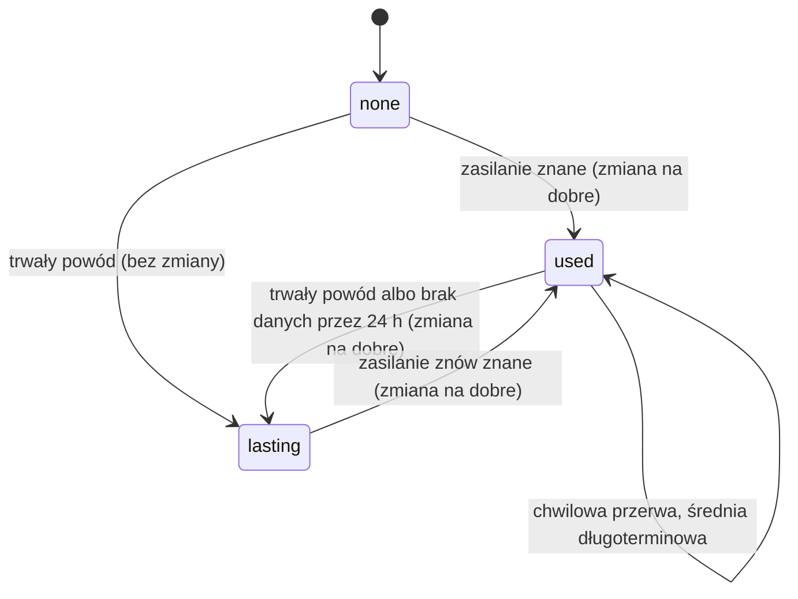
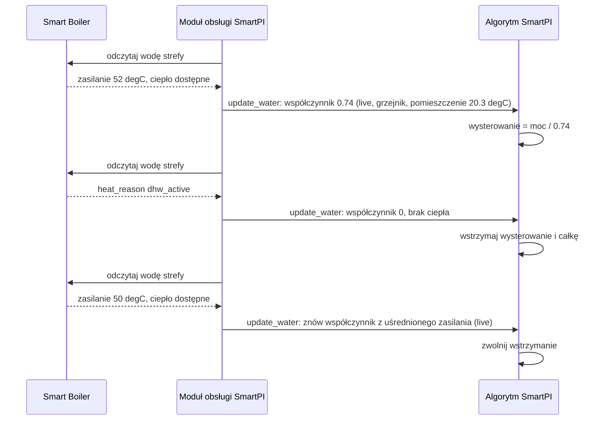
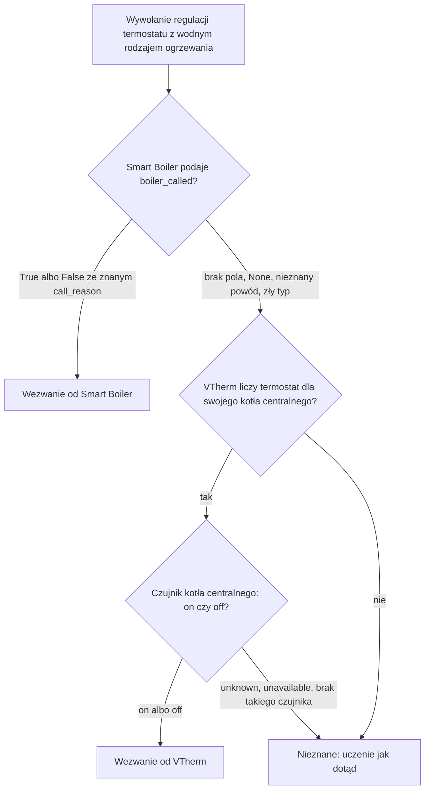
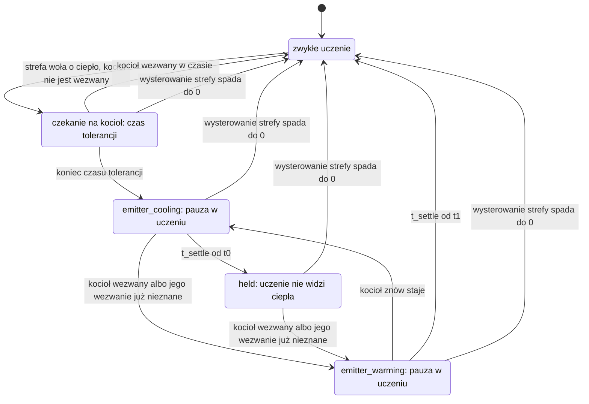
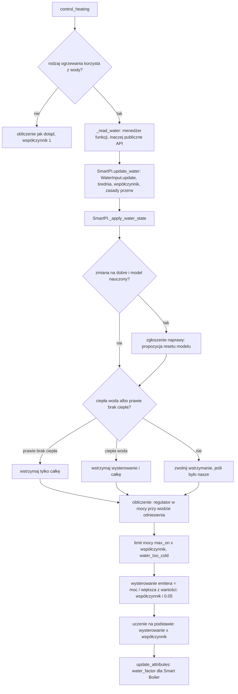

# Wejście wody — temperatura wody zasilającej ze Smart Boiler

Ten dokument opisuje dwie rzeczy. Sekcja 3 wyjaśnia, jak SmartPI korzysta z temperatury wody,
która dociera do emiterów termostatu (grzejników, pętli podłogówki albo innych urządzeń, które
oddają ciepło do pomieszczenia). Sekcja 4 wyjaśnia, co robi SmartPI, gdy strefa woła o ciepło,
którego kocioł nie daje. Dla obu tematów dokument opisuje powody, konfigurację, logikę i jej
decyzje, komponenty i interfejsy, zapisywany stan (który przetrwa restart), diagnostykę, stałe
i ograniczenia. [Dokumentacja techniczna](technical_doc.md) opisuje regulator PI, jego część
wyprzedzającą (feed-forward, FF — część wysterowania liczona z modelu pomieszczenia, nastawy
i temperatury zewnętrznej) i jego własne uczenie, a także zmiany, które ta funkcja w nich
wprowadza. [Testy](testing.md) opisują testy.

Dane pochodzą z wtyczki Smart Boiler. Nazwy, typy i wartości, które SmartPI tu odczytuje, muszą
zgadzać się ze
[specyfikacją interfejsu wody](https://github.com/Shadow-230/vtherm-smart-boiler/blob/dev/documentation/en/water-interface.md)
Smart Boiler. Bez Smart Boiler albo bez danych o wodzie dla danego termostatu wysterowanie SmartPI
i sposób, w jaki uczy się mocy emitera, pozostają takie jak dotąd (jak bez tej funkcji). Wodny
rodzaj ogrzewania korzysta też z jeszcze jednej informacji: czy kocioł jest wezwany do grzania.
Pochodzi ona ze Smart Boiler albo z VTherm, gdy kotłem steruje własny kocioł centralny
Versatile Thermostat (sekcja 4).

Skróty: Home Assistant (HA), Versatile Thermostat (VTherm), ciepła woda użytkowa (CWU).

## Spis treści

1. [Przegląd](#1-przegląd)
2. [Konfiguracja](#2-konfiguracja)
3. [Dane o wodzie](#3-dane-o-wodzie)
4. [Kocioł, który nie jest wezwany do grzania](#4-kocioł-który-nie-jest-wezwany-do-grzania)
5. [Komponenty i interfejsy](#5-komponenty-i-interfejsy)
6. [Jedno obliczenie](#6-jedno-obliczenie)
7. [Zapisywany stan](#7-zapisywany-stan)
8. [Diagnostyka](#8-diagnostyka)
9. [Testy](#9-testy)
10. [Stałe, ograniczenia i otwarte kwestie](#10-stałe-ograniczenia-i-otwarte-kwestie)

## 1. Przegląd

SmartPI używa modelu pomieszczenia: `dT/dt = a·u − b·(T − T_ext)`. Tutaj `T` to temperatura
w pomieszczeniu, `T_ext` temperatura na zewnątrz, `u` wysterowanie (moc w %), `a` to, o ile emiter
ogrzewa pomieszczenie na jednostkę wysterowania, a `b` to, jak szybko pomieszczenie traci ciepło na
zewnątrz. Model zakłada, że jednostka wysterowania `u` zawsze daje tyle samo ciepła. Przy
ogrzewaniu wodnym to nieprawda:

- kocioł z krzywą grzewczą (sterowaniem pogodowym) albo zawór mieszający obniża temperaturę wody,
  gdy na zewnątrz nie jest zimno. To samo otwarcie zaworu albo to samo wypełnienie (udział czasu,
  w którym urządzenie włączane i wyłączane jest włączone) daje wtedy mniej ciepła;
- palnik włącza się i wyłącza, więc temperatura wody waha się o kilka stopni w ciągu kilku minut;
- gdy ciepła woda użytkowa ma priorytet, zabiera obiegowi grzewczemu ciepło kotła na kilkadziesiąt
  minut.

SmartPI uczy się wtedy wartości `a`, w której miesza się pomieszczenie z wodą. Jego część
wyprzedzająca od temperatury zewnętrznej liczy też pogodę dwa razy: raz przez krzywą kotła i raz
przez własny model.

**Współczynnik mocy emitera** `φ` to naprawia. Mówi, ile mocy daje jednostka wysterowania przy
wodzie, która dociera do emitera, w porównaniu z temperaturą wody odniesienia („woda
odniesienia”). SmartPI pracuje w mocy przy wodzie odniesienia. Jego regulator, model i uczenie
widzą właśnie tę moc. Emiter dostaje `power / φ` (moc podzieloną przez `φ`). Nauczone
współczynniki zachowują wtedy swoje fizyczne znaczenie, a zmiana wody nie wygląda już jak zmiana
pomieszczenia.

Zasady (uzgodnione z właścicielem 2026-10-12):

- **Opcjonalnie.** Bez danych o wodzie `φ = 1`: SmartPI działa tak samo jak bez tej funkcji.
- **Jedno źródło.** Wszystkie dane o kotle pochodzą ze Smart Boiler. Smart Boiler ma wszystkie
  czujniki wody, palnika i ciepłej wody. SmartPI nie ma własnych ustawień czujników wody.
  (Właściciel rozszerzył to 2026-10-14: tam, gdzie Smart Boiler nie steruje kotłem, informacja, czy
  kocioł jest wezwany do grzania, pochodzi też z kotła centralnego VTherm, sekcja 4.)
- **Jedno źródło ciepła na termostat VTherm.** Każdy termostat ma swój obieg i swoją wodę.
  Grzejniki dostają wodę z zasilania kotła; pętla podłogówki dostaje wodę mierzoną przez czujnik za
  jej zaworem mieszającym.
- **SmartPI liczy współczynnik.** Smart Boiler zna wodę, ale nie zna emiterów. SmartPI zna swój
  rodzaj ogrzewania i pomieszczenie.
- **SmartPI tylko odczytuje wodę.** Nigdy nie prosi o temperaturę wody. Wymagałoby to dużej
  przebudowy Smart Boiler, a temperatury wody zwykle nie da się ustawić osobno dla każdej strefy
  (interfejs Smart Boiler, sekcja 9).

## 2. Konfiguracja

**Rodzaj ogrzewania** (`smart_pi_heating_type`) — ustawiany w ustawieniach regulatora we wpisie
globalnym (jako domyślny) i w każdym wpisie termostatu. Domyślnie: grzejnik wodny.

| Wartość | Rodzaj ogrzewania | Wykładnik `n` | Woda odniesienia `T_wref` | Korzysta z danych o wodzie |
|---|---|---|---|---|
| `radiator` | Grzejnik wodny | 1.3 | 60 °C | tak |
| `floor_water` | Wodne ogrzewanie podłogowe | 1.1 | 45 °C | tak |
| `floor_electric` | Elektryczna mata grzewcza | — | — | nie |
| `electric_fast` | Szybki grzejnik elektryczny | — | — | nie |

Wykładniki i temperatury wody odniesienia są tymczasowe. Trzeba je jeszcze sprawdzić na danych
z prawdziwych instalacji. Elektryczny rodzaj ogrzewania nigdy nie odczytuje Smart Boiler.

**Aby korzystać z danych o wodzie:**

- Smart Boiler wiąże termostat z jego obiegiem i z czujnikiem temperatury zasilania tego obiegu
  (zobacz dokumentację Smart Boiler). SmartPI nie potrzebuje żadnego innego ustawienia poza
  rodzajem ogrzewania.
- Blok `water` w diagnostyce pokazuje, czy SmartPI korzysta z danych: wtedy `source` ma wartość
  `live`.
- Wpis bez własnego rodzaju ogrzewania bierze domyślny rodzaj z wpisu globalnego, czyli grzejnik
  wodny. Dla emitera elektrycznego ustaw rodzaj elektryczny, żeby SmartPI nie odczytywał ani Smart
  Boiler, ani wezwania kotła.

## 3. Dane o wodzie

### 3.1 Odczyt danych

Przy każdym wywołaniu regulacji moduł obsługi (handler, część SmartPI, która łączy algorytm
z VTherm) odczytuje dane o wodzie dla `entity_id` swojego termostatu VTherm (encji climate).
Dzieje się to w `SmartPIHandler._update_water`, wywoływanej z `control_heating`, a dla dodatkowego źródła strefy
z `_control_as_source`. Moduł obsługi używa pierwszej dostępnej z tych dróg:

1. `thermostat.get_feature_manager("vtherm_smart_boiler")` i jego właściwości — w VTherm
   10.5.0.beta1 i nowszych, gdy termostat ma już ten menedżer;
2. `hass.data["vtherm_smart_boiler_api"].zone_water(entity_id)` — w każdej wersji VTherm, także
   zanim VTherm zostanie przeładowany.

| Zasada | |
|---|---|
| Nic nie jest importowane | SmartPI nie importuje kodu Smart Boiler. Sprawdza, czy metoda, klucz i funkcja istnieją. |
| Błędy | Każdy wyjątek, brak klucza lub funkcji albo `None` zamiast słownika danych oznacza „teraz brak danych”. |
| Typy | Wartość złego typu liczy się jako brak: na przykład temperatura podana jako tekst, `heat_available`, które nie jest ani prawdą, ani fałszem, albo pusty powód. |
| Świeżość | SmartPI ufa wartości `None` i jej powodowi. Nie ustala własnego limitu wieku dla `supply_measured_at`. |
| Nieznane powody | Nieznana wartość `supply_reason` oznacza „brak danych w tej chwili” (specyfikacja interfejsu, sekcja 8). |

Odczytywane pola: `supply_temperature`, `supply_reason`, `heat_available`, `heat_reason`.
`heat_available` zmienia się przy każdym cyklu palnika. Dlatego nie służy jako bramka uczenia
(warunek, który zatrzymuje uczenie, sekcja 3.4). Decyduje tylko o tym, kiedy nowe wartości
trafiają do długoterminowej średniej `φ` (sekcja 3.3).

### 3.2 Współczynnik

    φ = min( (max(T_s − T_room, 0) / (T_wref − 20)) ** n , 1 )

- **`T_s`** to `supply_temperature` uśredniona w czasie `WATER_AVERAGE_S` (15 min, średnia
  wykładnicza w czasie). Średnia jest potrzebna, bo włączanie i wyłączanie palnika powoduje skoki
  surowej wartości. Po długiej przerwie średnia przyjmuje pierwszą nową wartość.
- **`T_room`** to temperatura w pomieszczeniu termostatu (`current_temperature` z VTherm).
- **Odniesienie.** Przy wodzie odniesienia i pomieszczeniu o temperaturze 20 °C `φ = 1`. Połowa
  „siły napędowej” (różnicy między temperaturą wody a temperaturą pomieszczenia) daje `0.5 ** n`.
- **Woda cieplejsza niż woda odniesienia** liczy się jak woda odniesienia (`φ ≤ 1`). Zakres mocy
  regulatora to 0..1, więc wyższy współczynnik tylko ograniczałby wysterowanie. Dzięki temu emiter
  daje co najmniej tyle ciepła, ile daje bez tej funkcji. W takie dni emiter daje więcej, niż mówi
  współczynnik, a nauczona moc dryfuje w górę, tak jak bez danych o wodzie.
- **Nieznana temperatura pomieszczenia** przy znanym zasilaniu: SmartPI dalej używa
  współczynnika (to nie jest przerwa w danych).
- **Ciepła woda z priorytetem.** Gdy `heat_reason` ma wartość `dhw_active`, `φ = 0`. Zasilanie
  kotła pokazuje wtedy wodę, która grzeje zasobnik ciepłej wody, a nie wodę tego obiegu. Te odczyty
  nie trafiają do żadnej średniej.

### 3.3 Brakujące dane

| Sytuacja | Rodzaj przerwy | Używane `φ` | Pokazywane źródło |
|---|---|---|---|
| `supply_temperature` znana | — | z uśrednionego zasilania | `live` |
| `heat_reason == dhw_active`, przy znanym zasilaniu albo po tym, jak dane już się pojawiły | — | 0 | `dhw` |
| `flow_unknown`, `flow_stale`, po tym, jak dane już się pojawiły | chwilowa | długoterminowa średnia `φ` (`WATER_LONG_AVERAGE_S`, 3 dni), żeby nauczony model zachował swoje jednostki; 1, jeśli średniej jeszcze nie ma | `average` |
| nieznany powód albo zupełny brak danych, po tym, jak dane już się pojawiły | chwilowa przez `WATER_NO_DATA_LASTING_S` (24 h), potem trwała | jak przy chwilowej, potem jak przy trwałej | `average`, potem `lasting` |
| `not_mapped`, `circuit_not_measured`, `several_circuits` | trwała | 1, jak bez interfejsu | `lasting` |
| brak danych od startu (z dowolnego powodu poza trwałym) | — | 1 | `none` |
| po trwałym powodzie, dopóki zasilanie znów nie będzie znane | — | 1 | `lasting` |
| elektryczny rodzaj ogrzewania | — | 1 | — (brak bloku `water`) |

Długoterminowa średnia podąża za `φ` tylko wtedy, gdy kocioł grzeje: gdy `heat_available` jest
prawdą, a bez tego sygnału — gdy `φ ≥ WATER_NO_HEAT`. Dzięki temu dni, w których kocioł stoi, nie
zaniżają średniej. Pełna doba zupełnie bez danych, po tym, jak dane już się pojawiły, liczy się
jako przerwa trwała. Dzieje się tak na przykład, gdy Smart Boiler zostanie usunięty albo gdy
termostat przestanie być jedną z jego stref.

### 3.4 Użycie w SmartPI

1. **Wysterowanie.** Wyjście regulatora to moc przy wodzie odniesienia. Wysterowanie wysyłane do
   emitera to `power / max(φ, WATER_NO_HEAT)`, najwyżej 1. Jest liczone przed zastosowaniem krzywej
   zaworu (`SmartPI._to_actuator_power`). Dolna granica `WATER_NO_HEAT` (0.05) ma znaczenie, gdy
   woda ma mniej więcej temperaturę pomieszczenia. To typowe dla stojącego kotła, który rusza tylko
   na żądanie. Strefa musi nadal móc zawołać o ciepło, więc jej wysterowanie może dojść do 1
   i uruchomić kocioł.
2. **Uczenie.** Moc, z której SmartPI się uczy, to zastosowane wysterowanie × `φ`
   (`SmartPI._to_linear_power`). Dotyczy to zatwierdzonego wysterowania (także w regulacji
   włącz/wyłącz w fazie uczenia), mocy faktycznie zrealizowanej w cyklu, śledzenia anti-windup
   (zapobiega nadmiernemu narastaniu części całkującej regulatora, gdy wyjście jest ograniczone)
   i zapisu mocy dla korekty części wyprzedzającej (FF trim, czyli uczonej poprawki części
   wyprzedzającej). Nowy współczynnik od razu aktualizuje zatwierdzoną moc. Wejście wody nie dodaje
   własnej bramki uczenia. Moc wejściowa równa zero (palnik wyłączony, ciepła woda, zamknięty zawór)
   uczy SmartPI strat ciepła. Pauzy w uczeniu nadal przychodzą ze Smart Boiler przez
   `vtherm_smartpi.set_smartpi_learning`, jak dotąd. Wynikają też z wezwania kotła: gdy emiter
   stygnie albo znów się nagrzewa wokół wstrzymania (sekcja 4). Estymator czasu martwego mierzy
   opóźnienie, z jakim pomieszczenie reaguje na włączenie lub wyłączenie emitera. Przyjmuje tylko wyraźne skoki. Dostaje samo
   wysterowanie (0 w czasie grzania ciepłej wody).
3. **Limit mocy i czasy.** Przy `φ < 1` wyjście jest ograniczone do `max(φ, WATER_NO_HEAT)` ×
   `max_on_percent` (`_apply_soft_constraints`). Tyle daje pełne wysterowanie. Dolna granica
   `WATER_NO_HEAT` pozwala wysterowaniu nadal dojść do `max_on_percent`, gdy woda nie daje prawie
   żadnego ciepła. Śledzenie anti-windup porównuje model z mocą zrealizowaną i widzi ten limit.
   Zapotrzebowanie powyżej limitu jest pokazywane jako `water_too_cold`. Minimalny czas załączenia
   i próg załączenia zaworu są sprawdzane na wysterowaniu, a nie na mocy.
4. **Ciepła woda i zimna woda.** Gdy ciepła woda ma priorytet (`dhw_active`), wysterowanie emitera
   jest wstrzymane na ostatniej wartości (zapotrzebowanie równe zero nadal daje zero). Całka też
   jest wstrzymana (`integral_hold_mode = "no_heat"`). Dzięki temu SmartPI nie otwiera zaworu coraz
   bardziej, aż do końca, gdy ciepło i tak nie może przyjść. Gdy woda nie daje prawie żadnego
   ciepła, a powodem nie jest ciepła woda (`φ < WATER_NO_HEAT`, na przykład stojący kocioł),
   wstrzymana jest tylko całka, a wysterowanie podąża za regulatorem. Oba wstrzymania są stosowane
   na nowo przy każdym obliczeniu. Jeśli trwa już inne wstrzymanie, SmartPI zostawia je bez zmian.
5. **Klucz dla Smart Boiler.** Gdy współczynnik pochodzi z danych o wodzie (`live`, `average`,
   `dhw`), SmartPI zapisuje `water_factor` w `specific_states` termostatu. Jego wartość to
   zastosowany współczynnik, zaokrąglony do 0.001. W innych przypadkach (`none`, `lasting`, rodzaj
   elektryczny) klucza nie ma. Gdy klucz jest obecny, Smart Boiler wie, że ten termostat korzysta
   z danych o wodzie. Smart Boiler pomija wtedy swoją pauzę w uczeniu przy dużych wahaniach wody.
6. **Dane pojawiają się albo znikają na dobre.** Dane o wodzie mogą zacząć być używane (pierwsze
   dane albo znane zasilanie po trwałej przerwie). Mogą też przestać być używane na dobre (trwały
   powód albo brak danych przez 24 h). W obu przypadkach nauczona moc zmienia jednostki. Jeśli
   SmartPI ma nauczony model (jest po fazie uczenia), tworzy zgłoszenie naprawy w Home Assistant
   („Naprawy”): „Water temperature data are now available” (dane o temperaturze wody są teraz
   dostępne) albo „… are no longer available” (… nie są już dostępne). Zgłoszenie ma jeden krok
   z opcją **Reset the learned model** (zresetuj nauczony model), domyślnie zaznaczoną.
   Potwierdzenie wywołuje `vtherm_smartpi.reset_smartpi_learning` dla termostatu. SmartPI nie
   przelicza nauczonego modelu na nowe jednostki (decyzja właściciela z 2026-10-12); zamiast tego
   proponuje reset. Chwilowa przerwa nigdy nie tworzy zgłoszenia. Zgłoszenie ma identyfikator
   `water_data_changed_<thermostat unique id>`. Jest tworzone jako trwałe: zostaje, dopóki
   użytkownik na nie nie odpowie, a SmartPI go nie usuwa. Jego jedyne pole to `reset_model`. Zmiana
   rodzaju ogrzewania kasuje to, co wiedziało wejście wody (sekcja 7). Dlatego po zmianie na
   rodzaj wodny SmartPI proponuje reset przy pierwszych danych, jeśli ma nauczony model. Zmiana na
   rodzaj elektryczny niczego nie proponuje.
7. **Moc w diagnostyce.** Przy danych o wodzie wartości bloku `power` (`pi_percent`, `ff_percent`,
   `command_percent`, `limited_percent`, `applied_percent`, wartości `linear_*`) oraz serie
   historii `power.command_percent` i `power.applied_percent` to moc przy wodzie odniesienia.
   `current_cycle_percent` i `next_cycle_percent` to wysterowanie wysyłane do emitera.

### 3.5 Cykl życia danych

Dostępność danych o wodzie decyduje o tym, skąd pochodzi współczynnik i kiedy SmartPI proponuje
reset.

W czasie jednej sekwencji grzania palnikiem i grzania ciepłej wody:

### 3.6 Wyniki (symulacja)

Układ: grzejnik na kotle z krzywą grzewczą, na zewnątrz 3 °C ± 3 °C, 48 h
([Testy, §3.4](testing.md#34-woda--test_smartpi_sim_waterpy-krótki)). Bez danych o wodzie SmartPI
uczy się mniej niż połowy mocy grzejnika przy wodzie odniesienia: chłodniejsza woda z krzywej
wygląda jak słabszy grzejnik. Z danymi o wodzie uczy się od 0.5 do 1.2 tej mocy i ponad 1.5 raza
tyle, ile bez nich.

## 4. Kocioł, który nie jest wezwany do grzania

Kocioł może się uruchamiać tylko wtedy, gdy zapotrzebowanie stref spełnia jego kryteria startu,
i dopiero po opóźnieniu załączenia. Te kryteria dotyczą liczby urządzeń lub stref, które wołają
o ciepło, ich łącznej mocy i największego otwarcia zaworu. Strefa poniżej tych kryteriów woła
o ciepło, które nie przychodzi. SmartPI traktuje wysterowanie strefy tak, jakby ciepło przyszło.
Uczy się wtedy zbyt słabego emitera (`a`), złego czasu martwego (opóźnienia, z jakim pomieszczenie
reaguje) i systematycznego błędu w korekcie części wyprzedzającej. W symulacji strefy, która
wołała o ciepło całą noc bez pracy kotła, jej nauczone `a` spadło do 1 % prawdziwej wartości
(sekcja 4.4). `heat_available` ze Smart Boiler nie odróżnia tego przypadku: `flame_off` pojawia
się też przy każdej zwykłej przerwie palnika, gdy kocioł jest wezwany do grzania.

### 4.1 Skąd pochodzi wezwanie kotła

| Źródło | Kiedy | Wartości |
|---|---|---|
| Smart Boiler: `boiler_called`, `call_reason` z jego interfejsu wody (menedżer funkcji albo `zone_water`) | Smart Boiler steruje kotłem | `True`; `False` z `below_threshold` (strefy wołają o ciepło, ale poniżej kryteriów liczby, mocy i otwarcia), `no_demand` (żadna strefa nie woła o ciepło), `activation_delay` albo `boiler_fault` |
| Kocioł centralny Versatile Thermostat: jego czujnik binarny (unikalny identyfikator `central_boiler_state`) | Smart Boiler nic nie mówi (`None` z `not_controlling` albo `waiting_data`, starsza wersja bez tych pól, nieznany powód, zły typ), a VTherm liczy termostat dla swojego kotła centralnego (`is_used_by_central_boiler`) | on albo off (`not_called`) |
| brak | w pozostałych przypadkach oraz dla elektrycznego rodzaju ogrzewania | SmartPI uczy się jak dotąd (po wstrzymaniu — dopiero gdy emiter się nagrzeje) |

- Smart Boiler i kocioł centralny VTherm nigdy nie sterują kotłem jednocześnie. Smart Boiler
  wyłącza własne sterowanie, gdy kocioł centralny VTherm jest skonfigurowany. Gdy steruje Smart
  Boiler, nie ma kotła centralnego VTherm, z którego można by skorzystać zamiast niego. SmartPI uczy
  się wtedy jak dotąd, dopóki Smart Boiler nie opublikuje swoich pól.
- `True` oznacza, że kocioł dostał polecenie grzania. Przerwa palnika albo ciepła woda
  z priorytetem jest widoczna tylko w `heat_available` i `heat_reason` (sekcja 3).
- Czujnik VTherm podąża za decyzją VTherm, po opóźnieniu załączenia w VTherm. Ta decyzja
  uwzględnia progi liczby urządzeń i mocy oraz każdą inną strefę, która woła o ciepło.
- Pola Smart Boiler zostały uzgodnione z projektem Smart Boiler 2026-10-14. Dopóki Smart Boiler
  ich nie opublikuje, SmartPI odczytuje je ostrożnie, sprawdzając brakujące lub złe wartości. Smart
  Boiler nie dodaje własnej pauzy w uczeniu dla tego przypadku, bo druga pauza kończyłaby się
  w złym momencie.
- Pola zapotrzebowania ze Smart Boiler są używane tylko w diagnostyce: `demand_count`
  i `count_threshold` (liczone według `count_by`: `devices`, czyli głowice VTherm, albo `zones`),
  `demand_power_kw` i `power_threshold_kw` (kW), `demand_opening` i `opening_threshold` (od 0 do
  1). SmartPI zachowuje tylko wartości właściwego typu; dla liczby urządzeń lub stref liczba
  całkowita zapisana jako liczba zmiennoprzecinkowa (float) też ma właściwy typ. Liczby zachowuje
  jako całkowite, a wartości w kW i wartości otwarcia zaokrągla do 3 miejsc po przecinku.

### 4.2 Uczenie wokół wstrzymania

W zasadach poniżej `u` to wysterowanie urządzenia strefy, `called` to wezwanie kotła, `t0` to
początek wołania strefy o ciepło, które nie dostało odpowiedzi, a `t1` to start kotła po
wstrzymaniu. `L` to opóźnienie emitera, a `tau` jego bezwładność (stała czasowa). Czas tolerancji
(grace) to czas, jaki kocioł ma na odpowiedź na wołanie strefy.

    calling     = grzanie  and  u > 0
    grace       = BOILER_CALL_GRACE_S (15 min), plus cykl urządzenia włącz/wyłącz
    t_settle    = L + 3·tau emitera danego rodzaju ogrzewania (grzejnik 65 min, podłogówka wodna 570 min)

    emitter_cooling   calling, nie called od t0, t0 + grace <= t < t0 + t_settle
                      (albo od razu, gdy kocioł znów staje, a emiter się nagrzewa)
    held              calling, nie called od t0, t >= t0 + t_settle
    emitter_warming   calling, znów called (albo wezwanie już nieznane) w chwili t1 po
                      emitter_cooling lub held, t < t1 + t_settle

- **Kocioł, który odpowiada na wołanie strefy w czasie tolerancji,** niczego nie zmienia.
  Przykłady to kocioł grzejący na żądanie albo opóźnienie załączenia VTherm wynoszące najwyżej
  10 min. SmartPI uczy się jak dotąd z własnego skoku strefy (zmiany jej wysterowania), a reakcja
  kotła mieści się w tym skoku. To samo dotyczy kotła, który już pracuje, albo kotła pracującego
  cyklicznie z przerwami krótszymi niż czas tolerancji: jego woda pozostaje ciepła. Urządzenie
  włączane i wyłączane (on/off) liczy się dla kotła tylko wtedy, gdy jest włączone. Dlatego część
  cyklu, w której jest wyłączone, nie jest przerwą w odpowiedzi kotła, a jego cykl dodaje się do
  czasu tolerancji.
- **Stygnięcie emitera.** Kocioł przestał grzać, choć strefa woła o ciepło (albo w ogóle nie
  odpowiedział). Pompa obiegu staje kilka minut później. Emiter oddaje wtedy już tylko ciepło,
  które jeszcze w sobie ma, a to ciepło zanika zgodnie z bezwładnością emitera. Uczenie czeka. Po
  trzech stałych czasowych zostaje mniej niż 5 %.
- **Wstrzymanie.** Ciepło nie przychodzi. Uczenie widzi moc 0. (Przy danych o wodzie moc to już
  wysterowanie razy współczynnik bliski 0 i zostaje bez zmian.) Okna uczenia, w których strefa
  stygnie, uczą `b`, a próbka `a` nie jest pobierana.
- **Nagrzewanie emitera.** Kocioł ruszył po wstrzymaniu. Jego woda musi dotrzeć do emitera i go
  nagrzać. Ale zawór był cały czas otwarty, więc nie ma skoku wysterowania strefy, na który
  czekałoby uczenie SmartPI. Uczenie znów czeka. SmartPI nie mierzy też startu kotła jako czasu
  martwego. To opóźnienie pochodzi od wody, a nie od zaworu, a czas martwy SmartPI to czas martwy
  zaworu. (W symulacji reakcja na start kotła przyszła po 2 do 5 min, a reakcja na zawór po
  11 min.)

| | Czas tolerancji, zwykłe uczenie | `emitter_cooling` | `held` | `emitter_warming` |
|---|---|---|---|---|
| `a`, `b` | uczone | pauza (bramka `boiler_settling`) | uczone z mocą 0: tylko to, jak strefa stygnie | pauza (bramka `boiler_settling`) |
| Estymator czasu martwego | jak zwykle | pauza (bramka) | wejście 0, bez skoku | pauza (bramka); potem znów wysterowanie, bez skoku |
| Korekta części wyprzedzającej | działa | zamrożona (`boiler_not_heating`) | zamrożona | zamrożona |
| Wymiana ciepła ze strefami sąsiednimi, dopasowanie strefy | uczone | pauza | pauza | pauza |
| Zapisywana dla nich moc zrealizowana w cyklu | ta z cyklu | 0 | 0 | ta z cyklu |

- Każda zmiana trybu odrzuca otwarte okno uczenia i trwający skok estymatora czasu martwego
  (wołanie o ciepło, na które ciepło nie przyszło, albo start kotła). To samo dzieje się przy pauzie lub
  wznowieniu uczenia w czasie wstrzymania strefy, a estymator zaczyna od nowa od wejścia, które
  dostaje.
- Trwająca kalibracja jest anulowana, gdy strefa stygnie albo jest wstrzymana. Inaczej mierzyłaby
  reakcję na ciepło, które nie przychodzi.
- Termostat, który pracuje jako dodatkowe źródło innego termostatu, podąża za wysterowaniem tamtego
  termostatu, a nie za własnym. Dlatego jego tryb jest czyszczony.
- **Kocioł pracujący cyklicznie poniżej progu samej strefy**, z przerwami krótszymi niż czas
  tolerancji (krótkie serie pracy z sekcji 10), nie powoduje wstrzymania. Tam uczenie traktuje
  wysterowanie jak ciepło, tak jak dotąd.
- **„Woła o ciepło” znaczy, że własne wysterowanie SmartPI jest większe od 0.** VTherm i Smart
  Boiler decydują, czy strefa woła o ciepło, na podstawie `is_device_active` z VTherm. Dla zaworu
  w VTherm 10.5 oznacza to wysterowanie powyżej progu załączenia zaworu. Strefa z wysterowaniem
  poniżej tego progu woła więc o ciepło dla SmartPI, ale nie dla kotła, i może zostać wstrzymana.
- **W strefie z dwoma źródłami ciepła** decyduje to, czy samo główne źródło woła o ciepło. Główne
  źródło może mieć 0 %, gdy dodatkowe źródło grzeje, a kocioł nie jest wezwany. Cykle dodatkowego źródła nadal
  liczą się wtedy jako ciepło w dopasowaniu strefy (na poziomie 1 bez danych o wodzie).
- **Regulacja się nie zmienia.** Regulator nie zmienia swojego wysterowania dlatego, że kocioł
  nie jest wezwany. Część proporcjonalna i całka rosną, aż zapotrzebowanie strefy spełni kryteria
  kotła albo aż inne strefy spowodują wezwanie kotła. Strefa, która potrzebuje mniej niż próg, nadal powoduje cykliczną pracę kotła
  i może zostać poniżej swojej nastawy (sekcja 10). Nawet gdy SmartPI zna wezwanie kotła,
  w symulacji strefa potrzebująca 20 % przy progu 70 % wciąż była o 0.2 do 0.7 degC poniżej
  nastawy przez 30 h. To otwarta kwestia regulacji, a nie uczenia.
- Po zmianie rodzaju ogrzewania czas ustalania się (`t_settle`) wynika z nowego emitera.

### 4.3 Diagnostyka i stan

Blok `boiler` z sekcji 8 pokazuje źródło, wezwanie, jego powód i tryb uczenia. Przy Smart
Boiler pokazuje też zapotrzebowanie na tle progów. Nic nie jest zapisywane. Po restarcie tryby
zaczynają się od nowa od pierwszego odczytu.

### 4.4 Wyniki (symulacja)

`tests/test_smartpi_sim_boiler_call.py` symuluje grzejnik 2000 W za zaworem. Próg startu kotła to
2500 W. Jest osiągany tylko razem z innymi strefami (3000 W), a one w jednym okresie doby nie wołają
o ciepło. Gdy kocioł pracuje, jego woda nagrzewa się z bezwładnością 4 min; w przeciwnym razie woda
stygnie poniżej temperatury pomieszczenia. Czujnik ma dokładność 0.01 °C, przebieg trwa 96 h,
a temperatura zewnętrzna to 3 °C ± 2 °C. „Poinformowany” znaczy, że SmartPI zna wezwanie kotła;
„niepoinformowany” — że go nie zna.

| Przypadek | Niepoinformowany | Poinformowany |
|---|---|---|
| Kocioł centralny VTherm, bez danych o wodzie, kocioł nie pracuje 2:00–8:00 | `a` 0.01 prawdziwej wartości, `b` 0.98 | `a` 1.06, `b` 0.98 |
| Smart Boiler z danymi o wodzie, kocioł nie pracuje 10:00–16:00 | `a` 1.05, `b` 0.99 (przebieg próbny; dane o wodzie już pokazują brak ciepła) | `a` 1.04, `b` 0.98 |

Testy sprawdzają wyniki przebiegów, w których SmartPI jest poinformowany. Sprawdzają też, że żadna
próbka `a` nie jest uczona, gdy kocioł nie jest wezwany. W przypadku VTherm sprawdzają także, że
czas martwy pozostaje czasem martwym zaworu: 11.3 min wobec 11.2 min (przy `a` 0.99 i `b` 0.98),
gdy kocioł jest zawsze wezwany. Strefa, która sama uruchamia kocioł (w fazie uczenia SmartPI,
z wysterowaniem 100 %), nadal uczy się swojego czasu martwego i kończy fazę uczenia, bo jej wołanie
o ciepło dostaje odpowiedź w czasie tolerancji. Przy czujniku 0.1 °C własny estymator SmartPI myli się
o około 20 % nawet wtedy, gdy kocioł jest zawsze wezwany. To ukrywa różnice.

## 5. Komponenty i interfejsy

| Komponent | Plik | Zadanie |
|---|---|---|
| `WaterInput` | `smartpi/water_input.py` | Sama logika, bez kodu HA: współczynnik, średnia zasilania z 15 min, długoterminowa średnia `φ`, zasady przerw, dostępność (`none`, `used`, `lasting`) i jej zmiany na dobre; zapis stanu. |
| `WaterReading`, `WaterState` | `smartpi/water_input.py` | To, co podał Smart Boiler; używany współczynnik, jego źródło, uśrednione zasilanie, powody, `no_heat`, `changed_for_good`. |
| `SmartPIHandler._read_water` | `handler.py` | Odczytuje menedżer funkcji albo publiczne API i sprawdza typy. Każdy błąd daje `None`. |
| `SmartPIHandler._update_water` | `handler.py` | Przed każdym obliczeniem dla rodzaju wodnego (z `control_heating`, a dla dodatkowego źródła strefy z `_control_as_source`): `algo.update_water(...)`; przy zmianie na dobre `_offer_model_reset`. |
| `SmartPIHandler.update_attributes` | `handler.py` | Zapisuje lub usuwa `water_factor` w `specific_states`. |
| `SmartPI.update_water`, `_apply_water_state` | `algo.py` | Stosuje współczynnik; zaczyna i kończy wstrzymanie przy braku ciepła; odświeża zatwierdzoną moc. |
| `SmartPI._to_actuator_power`, `_water_command`, `_to_linear_power` | `algo.py` | Wysterowanie = moc / `max(φ, WATER_NO_HEAT)` (albo wstrzymane wysterowanie); moc = wysterowanie × `φ`. Przy danych o wodzie zatwierdzone wysterowanie jest punktem odniesienia, a jego moc podąża za współczynnikiem. |
| `SmartPI._deadtime_power` | `algo.py` | Skok wysterowania dla estymatora czasu martwego (0 w czasie grzania ciepłej wody). |
| `SmartPI._apply_soft_constraints` | `algo.py` | Limit mocy `max_on_percent × max(φ, WATER_NO_HEAT)`; `water_too_cold`. |
| `WaterModelResetFlow` | `repairs.py` | Krok zgłoszenia naprawy: reset nauczonego modelu (domyślnie zaznaczony). |
| Rodzaj ogrzewania | `config_flow.py`, `const.py` | Pole wyboru `smart_pi_heating_type` w ustawieniach regulatora. |
| `BoilerCall`, `BoilerReading` | `smartpi/boiler_call.py` | Sama logika: wezwanie kotła, tryb uczenia (`emitter_cooling`, `held`, `emitter_warming`), czas tolerancji i czas ustalania się wynikające z rodzaju ogrzewania, diagnostyka `boiler` (sekcja 4). |
| `SmartPIHandler._read_boiler`, `vtherm_central_boiler_on` | `handler.py` | `boiler_called`, `call_reason` i pola zapotrzebowania ze Smart Boiler, a w przeciwnym razie kocioł centralny VTherm dla termostatu, który on obsługuje; tylko dla wodnego rodzaju ogrzewania. |
| `SmartPI.update_boiler`, `_read_known_inputs`, `_learning_power`, `_deadtime_input` | `algo.py` | Tryb uczenia przy każdym obliczeniu: uczenie z mocą 0 w czasie wstrzymania, bramka `boiler_settling`, gdy emiter stygnie lub się nagrzewa, wejście i skoki estymatora czasu martwego, zamrożona korekta części wyprzedzającej, informacja dla warstwy zależności (`heat_withheld`), moc zrealizowana w cyklu zapisana jako 0. |

## 6. Jedno obliczenie

## 7. Zapisywany stan

`SmartPI.save_state()` dodaje klucz `water`, gdy wejście wody zobaczyło już dane albo trwały powód.
Termostat bez danych o wodzie zachowuje więc dotychczasowy format. Klucz zawiera te pola:

| Pole | Znaczenie |
|---|---|
| `heating_type` | Rodzaj ogrzewania, do którego należy stan. Stan innego rodzaju jest pomijany. |
| `availability` | `none`, `used` albo `lasting`. Dzięki temu pierwszy odczyt po restarcie nie jest brany za zmianę na dobre. |
| `long_average` | Długoterminowa średnia `φ`. Jest zachowywana po restarcie i używana przy chwilowych przerwach. |
| `no_data_s` | Jak długo trwa przerwa bez żadnych danych. Licznik biegnie dalej po restarcie, więc zasada 24 h działa nawet przy częstych restartach. |

Średnia zasilania z 15 min nie jest zapisywana. Zaczyna od nowa od pierwszego odczytu. Zmiana
rodzaju ogrzewania kasuje średnie. Reset uczenia (`reset_learning`) je zachowuje, bo opisują wodę,
a nie pomieszczenie.

## 8. Diagnostyka

Dla wodnego rodzaju ogrzewania opublikowana diagnostyka (`live`) dostaje blok `water`:

| Pole | Znaczenie |
|---|---|
| `heating_type` | Rodzaj ogrzewania termostatu. |
| `factor` | `φ` stosowane teraz. |
| `source` | `live`, `average`, `dhw`, `lasting` albo `none` (sekcja 3.3). |
| `supply_avg_c` | Uśrednione zasilanie, °C. |
| `supply_reason`, `heat_reason` | Ostatnie powody podane przez Smart Boiler. |
| `no_heat` | Ciepła woda: wysterowanie i całka są wstrzymane. |
| `low_heat` | Woda nie daje prawie żadnego ciepła: całka jest wstrzymana. |
| `water_too_cold` | Zapotrzebowanie przekroczyło to, co woda daje przy pełnym wysterowaniu. |

Gdy wezwanie kotła jest znane (sekcja 4), `live` dostaje też blok `boiler`:

| Pole | Znaczenie |
|---|---|
| `source` | `smart_boiler` albo `vtherm_central_boiler`. |
| `called` | Czy kocioł jest teraz wezwany do grzania. |
| `reason` | Dlaczego nie jest: `call_reason` ze Smart Boiler albo `not_called` dla kotła centralnego VTherm. |
| `learning` | `emitter_cooling`, `held`, `emitter_warming` albo `null` (sekcja 4.2). |
| `demand` | Zapotrzebowanie na tle progów, tak jak podaje je Smart Boiler: `demand_count`, `count_threshold`, `count_by`, `demand_power_kw`, `power_threshold_kw`, `demand_opening`, `opening_threshold`. |

## 9. Testy

[Testy](testing.md) opisują testy wejścia wody i wezwania kotła: testy jednostkowe, testy
algorytmu, modułu obsługi (handler), formularzy i symulacji, ze scenariuszami i ich kryteriami. Wyniki z sekcji
4.4 pochodzą z tych testów.

## 10. Stałe, ograniczenia i otwarte kwestie

| Stała (`smartpi/const.py`) | Wartość |
|---|---|
| `WATER_EMITTERS` | radiator (1.3, 60 °C), floor_water (1.1, 45 °C) |
| `WATER_AVERAGE_S` | 15 min |
| `WATER_LONG_AVERAGE_S` | 3 dni |
| `WATER_NO_HEAT` | 0.05 |
| `WATER_FACTOR_MAX` | 1.0 |
| `WATER_NO_DATA_LASTING_S` | 24 h |
| `WATER_ROOM_REFERENCE_C` | 20 °C (temperatura pomieszczenia dla wody odniesienia we współczynniku) |
| `BOILER_CALL_GRACE_S` | 15 min (sekcja 4) |

- **Tymczasowe wykładniki i temperatury wody odniesienia**: trzeba je jeszcze sprawdzić na danych
  z prawdziwych instalacji.
- **Strefa z dwoma źródłami ciepła** (grzejnik i pętla podłogówki w jednym pomieszczeniu) używa
  własnego współczynnika każdego źródła. Wysterowanie głównego źródła to moc przy wodzie
  odniesienia. Dodatkowe źródło zamienia ją na własne wysterowanie, używając własnego
  współczynnika. Zgłasza głównemu źródłu swoje cykle (cykle włącz/wyłącz z ich współczynnikiem)
  i swój limit mocy. Zobacz
  [Zależności stref i drugie źródło ciepła, §5.2 i §5.7](zone_dependencies.md#5-drugie-źródło-ciepła).
- **Próg startu kotła**: kocioł centralny Versatile Thermostat albo Smart Boiler można ustawić tak,
  żeby kocioł ruszał tylko powyżej łącznej mocy albo otwarcia zaworu, z wyłączonym liczeniem stref.
  Strefa, której zapotrzebowanie zostaje poniżej progu, woła o ciepło, które nie przychodzi. Jej
  wysterowanie jest przeliczane na moc według mocy urządzenia ustawionej w Versatile Thermostat
  (2000 W przy 20 % to 400 W, poniżej progu 600 W). Gdy SmartPI wie, że kocioł nie jest wezwany,
  przestaje uczyć się z tego wysterowania, gdy wołanie o ciepło pozostaje bez odpowiedzi dłużej niż czas
  tolerancji (sekcja 4). Jego regulacja się nie zmienia:
  - Gdy SmartPI nie jest poinformowany i nie ma danych o wodzie, traktuje swoje wysterowanie jak
    ciepło. Poinformowany czy nie, całka rośnie, aż wysterowanie przekroczy próg. Kocioł rusza
    wtedy na krótkie serie pracy. Próbna symulacja poza zestawem testów dotyczyła jednej strefy,
    która potrzebowała otwarcia 20 %. Tam próg 35 % dał około 5 startów na godzinę i dwa razy
    większą całkę. Przy 70 % strefa była o 0.2 do 0.7 degC poniżej nastawy przez 30 h.
  - Przy danych o wodzie stygnąca woda obniża `φ` w ramach średniej z 15 min, więc uczenie
    przestaje liczyć brakujące ciepło. Ale wysterowanie `power / φ` rośnie wtedy powyżej progu
    i spada z powrotem, gdy woda jest ciepła. Przy progu 35 % dało to około 10 startów na godzinę
    z okresami pracy palnika po 2 min.
  - `heat_available` równe false (`flame_off`) nie odróżnia tego przypadku od zwykłej przerwy
    palnika. Wezwanie kotła (sekcja 4) to potrafi. W tej samej symulacji histereza startu po
    stronie kotła (kocioł startuje przy wyższym zapotrzebowaniu niż to, przy którym się zatrzymuje)
    usunęła cykliczną pracę: 0.7 startu na godzinę, okresy pracy palnika po 68 min. Nadal otwarte
    i do ustalenia razem ze Smart Boiler: praca przy niskim obciążeniu po stronie Smart Boiler,
    przy czym SmartPI wstrzymuje całkę i zachowuje wysterowanie, gdy kocioł nie jest wezwany.
  - Nic z tego się nie dzieje, gdy jedna aktywna strefa wystarcza do uruchomienia kotła (domyślny
    próg liczby równy 1).
- **Czas martwy przy kotle grzejącym na żądanie**: gdy skok „włącz” zaczyna się przy zimnej wodzie,
  czas martwy mierzony przez SmartPI obejmuje nagrzewanie się kotła.
- **Reset modelu jest proponowany jako zgłoszenie naprawy w Home Assistant**: dane o wodzie
  zmieniają się w czasie pracy SmartPI, poza jakimkolwiek formularzem opcji. W takiej chwili
  zgłoszenie naprawy to sposób, w jaki integracja może zaproponować użytkownikowi jakiś krok.
- **Strona Smart Boiler** (właściwości menedżera funkcji, publiczne API, odczyt `water_factor`)
  jest zaimplementowana we wtyczce Smart Boiler. Bez Smart Boiler albo z wersją Smart Boiler, która
  tego nie ma, SmartPI po prostu nie znajduje danych.
