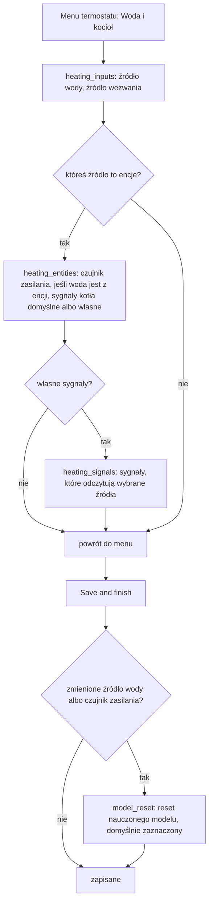
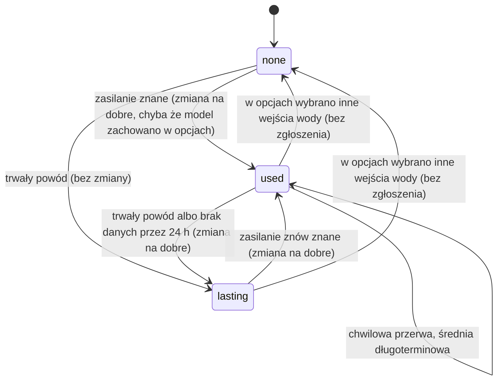
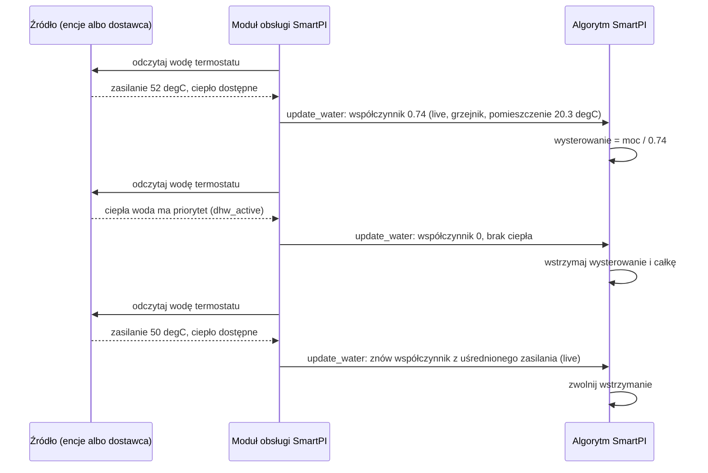
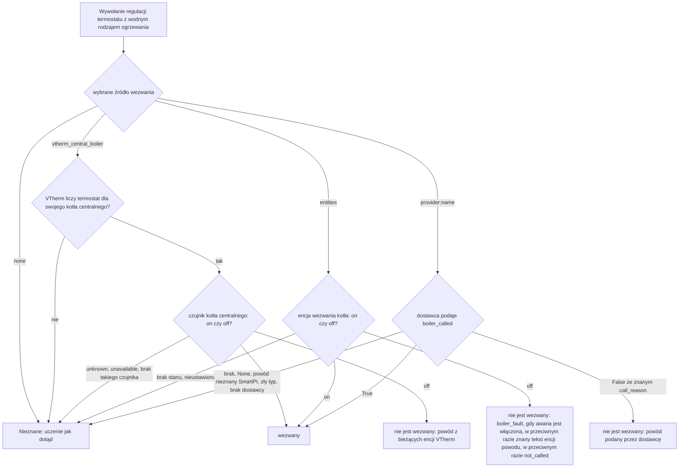
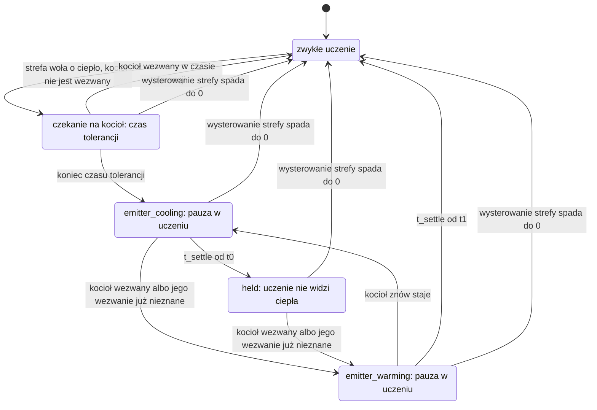
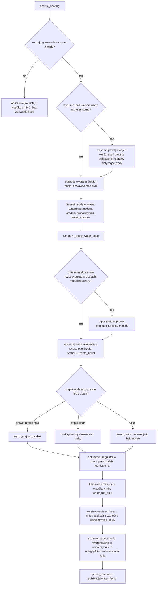

# Wejścia wody i kotła

SmartPI może odczytywać dwa wejścia z instalacji grzewczej. Każde pochodzi ze źródła, które
wybierasz w opcjach termostatu:

- **Dane o wodzie**: temperatura wody, która dociera do emiterów termostatu (grzejników, pętli
  podłogówki albo innych urządzeń, które oddają ciepło do pomieszczenia), oraz to, czy kocioł może
  teraz grzać. Sekcja 3 wyjaśnia, jak SmartPI z nich korzysta.
- **Wezwanie kotła**: czy kocioł dostał polecenie grzania. Sekcja 4 wyjaśnia, co robi SmartPI, gdy
  strefa woła o ciepło, którego kocioł nie daje.

Źródła to `none` (brak), `entities` (encje Home Assistant z dowolnej integracji albo zwykły
czujnik na rurze) i **dostawca** (provider: integracja, która implementuje kontrakt SmartPI,
sekcja 5.2). Dla wezwania kotła źródłem może być też kocioł centralny Versatile Thermostat. Dla
obu wejść dokument opisuje powody, konfigurację, logikę i jej decyzje, komponenty i interfejsy,
zapisywany stan (który przetrwa restart), diagnostykę, stałe i ograniczenia.
[Dokumentacja techniczna](technical_doc.md) opisuje regulator PI, jego część wyprzedzającą
(feed-forward, FF — część wysterowania liczona z modelu pomieszczenia, nastawy i temperatury
zewnętrznej) i jego własne uczenie, a także zmiany, które te wejścia w nich wprowadzają.
[Testy](testing.md) opisują testy.

Bez źródła albo bez danych z niego wysterowanie SmartPI i sposób, w jaki uczy się mocy emitera,
pozostają takie jak dotąd (jak bez tych wejść).

Skróty: Home Assistant (HA), Versatile Thermostat (VTherm), ciepła woda użytkowa (CWU).

## Spis treści

1. [Przegląd](#1-przegląd)
2. [Konfiguracja](#2-konfiguracja)
3. [Dane o wodzie](#3-dane-o-wodzie)
4. [Kocioł, który nie jest wezwany do grzania](#4-kocioł-który-nie-jest-wezwany-do-grzania)
5. [Komponenty i interfejsy](#5-komponenty-i-interfejsy)
6. [Jedno obliczenie](#6-jedno-obliczenie)
7. [Zapisywany stan](#7-zapisywany-stan)
8. [Diagnostyka](#8-diagnostyka)
9. [Testy](#9-testy)
10. [Stałe, ograniczenia i otwarte kwestie](#10-stałe-ograniczenia-i-otwarte-kwestie)

## 1. Przegląd

SmartPI używa modelu pomieszczenia: `dT/dt = a·u − b·(T − T_ext)`. Tutaj `T` to temperatura
w pomieszczeniu, `T_ext` temperatura na zewnątrz, `u` wysterowanie (moc w %), `a` to, o ile emiter
ogrzewa pomieszczenie na jednostkę wysterowania, a `b` to, jak szybko pomieszczenie traci ciepło na
zewnątrz. Model zakłada, że jednostka wysterowania `u` zawsze daje tyle samo ciepła. Przy
ogrzewaniu wodnym to nieprawda:

- kocioł z krzywą grzewczą (sterowaniem pogodowym) albo zawór mieszający obniża temperaturę wody,
  gdy na zewnątrz nie jest zimno. To samo otwarcie zaworu albo to samo wypełnienie (udział czasu,
  w którym urządzenie włączane i wyłączane jest włączone) daje wtedy mniej ciepła;
- palnik włącza się i wyłącza, więc temperatura wody waha się o kilka stopni w ciągu kilku minut;
- gdy ciepła woda użytkowa ma priorytet, zabiera obiegowi grzewczemu ciepło kotła na kilkadziesiąt
  minut;
- kocioł może w ogóle nie ruszyć, choć strefa woła o ciepło: jego kryteria startu nie są jeszcze
  spełnione (sekcja 4).

SmartPI uczy się wtedy wartości `a`, w której miesza się pomieszczenie z wodą. Jego część
wyprzedzająca od temperatury zewnętrznej liczy też pogodę dwa razy: raz przez krzywą kotła i raz
przez własny model.

**Współczynnik mocy emitera** `φ` to naprawia. Mówi, ile mocy daje jednostka wysterowania przy
wodzie, która dociera do emitera, w porównaniu z temperaturą wody odniesienia („woda
odniesienia”). SmartPI pracuje w mocy przy wodzie odniesienia. Jego regulator, model i uczenie
widzą właśnie tę moc. Emiter dostaje `power / φ` (moc podzieloną przez `φ`). Nauczone
współczynniki zachowują wtedy swoje fizyczne znaczenie, a zmiana wody nie wygląda już jak zmiana
pomieszczenia. Wezwanie kotła mówi SmartPI, kiedy ciepło w ogóle nie przychodzi, żeby SmartPI się
z tego nie uczył.

| Wejście | Sygnały | Źródła |
|---|---|---|
| Dane o wodzie | temperatura wody zasilającej obieg termostatu; kocioł może grzać; ciepła woda użytkowa ma priorytet; awaria kotła | `none` (domyślnie), `entities`, `provider:<name>` |
| Wezwanie kotła | kocioł jest wezwany; dlaczego nie jest; zapotrzebowanie na tle kryteriów startu kotła (tylko w diagnostyce) | `none`, `vtherm_central_boiler` (do wyboru i domyślne, gdy kocioł centralny VTherm obsługuje termostat), `entities`, `provider:<name>` |

Decyzje i powody:

- **Opcjonalnie.** Bez danych o wodzie `φ = 1`: SmartPI działa tak samo jak bez tych wejść. Bez
  wezwania kotła SmartPI traktuje każde wysterowanie jak ciepło, tak jak dotąd.
- **Jawny wybór.** Źródło każdego wejścia wybierasz w opcjach, tak jak wybierasz algorytm VTherm
  (TPI, SmartPI, …). Lista powstaje, gdy formularz się otwiera: stałe źródła i dostawcy, którzy są
  wtedy zarejestrowani. SmartPI nigdy sam nie wybiera źródła: nie ma wyboru „automatycznego”, więc
  źródło, które się pojawi albo zniknie, nigdy nie zmienia tego, co SmartPI odczytuje.
- **Encje dla każdej instalacji.** Dane do SmartPI może podawać każda integracja, która pokazuje
  temperaturę wody, albo zwykły czujnik temperatury na rurze zasilającej. Sygnały całego kotła
  (może grzać, ciepła woda, awaria, jego wezwanie) ustawia się raz, we wpisie globalnym „SmartPI
  defaults”. Termostat bierze je stamtąd albo ustawia własne. Czujnik zasilania jest zawsze
  własnym czujnikiem termostatu, bo każdy termostat ma swój obieg: grzejniki dostają wodę
  z zasilania kotła, a pętla podłogówki dostaje wodę za swoim zaworem mieszającym.
- **Kontrakt dla integracji, które wiedzą więcej.** Integracja, która zna obiegi, powody i kryteria
  startu kotła, może zarejestrować się jako dostawca (sekcja 5.2). Podaje wszystko w jednym
  wywołaniu, a SmartPI niczego z niej nie importuje.
- **SmartPI liczy współczynnik.** Źródło zna wodę, ale nie zna emiterów. SmartPI zna swój rodzaj
  ogrzewania i pomieszczenie.
- **SmartPI tylko odczytuje.** Nigdy nie prosi o temperaturę wody: temperatury wody zwykle nie da
  się ustawić osobno dla każdej strefy. Jedyne, co SmartPI podaje innym integracjom, to
  współczynnik, który stosuje (`water_factor`, sekcja 3.4).

## 2. Konfiguracja

**Rodzaj ogrzewania** (`smart_pi_heating_type`) — pierwsze z ustawień termostatu, ustawiane tylko
w jego własnym wpisie (nie we wpisie „SmartPI defaults”). Domyślnie: nieustawiony. Tylko rodzaj
wodny odczytuje dane o wodzie i wezwanie kotła.

| Wartość | Rodzaj ogrzewania | Wykładnik `n` | Woda odniesienia `T_wref` | Korzysta z wejść |
|---|---|---|---|---|
| `radiator` | Grzejnik wodny | 1.3 | 60 °C | tak |
| `floor_water` | Wodne ogrzewanie podłogowe | 1.1 | 45 °C | tak |
| `floor_electric` | Elektryczna mata grzewcza | — | — | nie |
| `electric_fast` | Szybki grzejnik elektryczny | — | — | nie |

Wykładniki i temperatury wody odniesienia są tymczasowe. Trzeba je jeszcze sprawdzić na danych
z prawdziwych instalacji.

**Wpis globalny „SmartPI defaults”.** Jego opcje otwierają menu: **Ustawienia regulatora**
(Regulator settings, ustawienia wspólne), **Sygnały kotła** (Boiler signals) i **Save and finish**
(zapisz i zakończ). Sygnały
kotła to encje, wszystkie opcjonalne: zostaw pole puste, jeśli nie masz takiej encji. Używa ich
każdy termostat, który odczytuje encje, chyba że ustawi własne.

**Wpis termostatu.** Dla wodnego rodzaju ogrzewania (wybranego w oknie, nawet przed zapisem) jego
menu ma pozycję **Woda i kocioł** (Water and boiler), obok rodzaju ogrzewania i regulacji, strefy i
sąsiadów. Termostat, który pracuje jako dodatkowe źródło strefy, otwiera własne menu: swoje
ustawienia oraz **Woda i kocioł** tylko z danymi o wodzie (jego uczenie jest wstrzymane, gdy podąża
za głównym źródłem, więc jego wezwanie kotła nie jest odczytywane). Jak każda sekcja, Woda i kocioł
wraca do menu; wybory są zapisywane przy **Save and finish**, a zamknięcie okna je odrzuca
([Zależności stref, §2.1](zone_dependencies.md#21-opcje-i-formularze)).



| Pole (klucz) | Typ, domena encji | Domyślnie | Widoczne |
|---|---|---|---|
| Dane o wodzie (Water data, `smart_pi_water_source`) | wybór: `none`, `entities`, `provider:<name>` | `none` | Woda i kocioł |
| Wezwanie kotła (Boiler's call, `smart_pi_boiler_call_source`) | wybór: `none`, `vtherm_central_boiler`, `entities`, `provider:<name>` | `vtherm_central_boiler`, gdy kocioł centralny VTherm obsługuje termostat, w przeciwnym razie `none` | Woda i kocioł; nie dla dodatkowego źródła strefy |
| Temperatura wody zasilającej (Supply water temperature, `smart_pi_supply_entity`) | `sensor`, klasa urządzenia temperature | — (wymagane) | woda z encji |
| Sygnały kotła (Boiler signals, `smart_pi_boiler_signals`) | wybór: `defaults` (jak w „SmartPI defaults”), `own` (własne) | `defaults` | któreś źródło to encje |
| Kocioł może grzać (Boiler can heat, `smart_pi_heat_available_entity`) | `binary_sensor`: on, gdy kocioł może grzać obiegi | — | Sygnały kotła; własne sygnały dla wody |
| Ciepła woda ma priorytet (Hot water has priority, `smart_pi_dhw_entity`) | `binary_sensor`: on, gdy kocioł grzeje ciepłą wodę użytkową | — | Sygnały kotła; własne sygnały dla wody |
| Awaria kotła (Boiler fault, `smart_pi_fault_entity`) | `binary_sensor`: on, gdy kocioł zgłasza awarię | — | Sygnały kotła; własne sygnały dla każdego z wejść |
| Kocioł jest wezwany do grzania (Boiler is called for heat, `smart_pi_boiler_called_entity`) | `binary_sensor`: on, gdy kocioł dostał polecenie grzania | — | Sygnały kotła; własne sygnały dla wezwania |
| Dlaczego kocioł nie jest wezwany (Why the boiler is not called, `smart_pi_boiler_reason_entity`) | `sensor` z tekstem: `below_threshold`, `no_demand`, `activation_delay` albo `boiler_fault` | — | Sygnały kotła; własne sygnały dla wezwania |

- Dostawca jest na liście pod swoją nazwą. Dostawca, który jest wybrany, ale nie jest już
  zarejestrowany, zostaje wybrany i jest pokazywany jako „`<name>` (not available)” (niedostępny).
  W tym czasie SmartPI nie odczytuje z niego żadnych danych.
- Encja, która ma wpis w rejestrze encji, jest zapisywana pod identyfikatorem z tego rejestru, więc
  działa także po zmianie nazwy. Encja bez takiego wpisu (na przykład czujnik z YAML bez
  unikalnego ID) jest zapisywana pod swoim identyfikatorem encji (entity id).
- **Pytanie o reset.** Gdy zmienia się źródło wody albo czujnik zasilania, nauczona moc zmienia
  jednostki: przy danych o wodzie jest mierzona przy wodzie odniesienia. Dlatego **Save and finish**
  pyta, czy zresetować nauczony model SmartPI dla tego termostatu (domyślnie zaznaczone; jedno
  pytanie dla wszystkich powodów zapisu). Jeśli zachowasz
  model, SmartPI to zapamiętuje (`smart_pi_model_kept_for_water`) i nie pyta ponownie, gdy dane
  z tych wejść zaczną przychodzić (sekcja 3.4). Zmiana wezwania kotła albo sygnałów nie zmienia
  jednostek i o nic nie pyta.
- Wpis bez tych kluczy (wpis sprzed nich) działa jak dotąd: bez danych o wodzie, a wezwanie kotła
  pochodzi z kotła centralnego VTherm tam, gdzie obsługuje on termostat. Zapisany wcześniej stan
  wody jest zachowany jako przerwa bez danych: przez 24 h działa długoterminowa średnia, potem
  przerwa jest trwała (sekcja 3.3).

**Aby korzystać z danych o wodzie z encji:**

- Ustaw sygnały kotła (te, które masz) we wpisie „SmartPI defaults” → Sygnały kotła (Boiler
  signals).
- W pozycji Woda i kocioł termostatu: dane o wodzie `entities`, potem jego czujnik zasilania,
  a sygnały kotła „As in SmartPI defaults” (jak w „SmartPI defaults”).
- Blok `water` w diagnostyce pokazuje używane dane: `source` ma wartość `live`, a `inputs`
  pokazuje każdą encję.

**Aby korzystać z danych o wodzie od dostawcy:**

- Zainstaluj integrację, która implementuje kontrakt SmartPI, i powiąż w niej termostat z jego
  obiegiem (zobacz dokumentację tej integracji).
- W pozycji Woda i kocioł termostatu: dane o wodzie `provider:<name>` (i wezwanie kotła, jeśli
  dostawca je podaje).
- W diagnostyce `water.source` ma wartość `live`, a `inputs.*.source` ma wartość `provider:<name>`.

Termostat bez rodzaju ogrzewania (bez własnego wpisu albo z „Not set”) nie odczytuje ani wody, ani
wezwania kotła, tak jak w wersji 0.4.0: żeby z nich korzystać, ustaw rodzaj wodny. Dla emitera
elektrycznego ustaw rodzaj elektryczny: on też ich nie odczytuje.

## 3. Dane o wodzie

### 3.1 Skąd pochodzą dane

Przy każdym wywołaniu regulacji moduł obsługi (handler, część SmartPI, która łączy algorytm
z VTherm) odczytuje dane o wodzie ze źródła wybranego dla termostatu. Dzieje się to
w `SmartPIHandler._update_water`, wywoływanej z `control_heating`, a dla dodatkowego źródła strefy
z `_control_as_source`. Źródło podaje `WaterReading`:

| `WaterReading` | Z encji | Od dostawcy |
|---|---|---|
| `supply_c` | stan czujnika zasilania jako liczba; °F i K przeliczone na °C (bez jednostki: °C) | `supply_temperature`, skończona liczba |
| `supply_reason` | `unavailable`, gdy czujnik nie ma liczby (unavailable, unknown, tekst) | `supply_reason` (tekst); gdy dostawca nic nie podaje: `provider_missing`, `not_served` albo `provider_error` |
| `heat_available`, `heat_reason` | ciepła woda włączona: false, `dhw_active`; w przeciwnym razie awaria włączona: false, `fault`; w przeciwnym razie „może grzać” wyłączone: false, `no_heat`; włączone: true; brak stanu: nieznane | `heat_available` (true albo false), `heat_reason` (tekst) |

| Zasada | |
|---|---|
| Nic nie jest importowane | SmartPI nie importuje kodu dostawcy. Odczytuje rejestr w `hass.data` i sprawdza, czy metoda istnieje. |
| Błędy dostawcy | Niezarejestrowany: `provider_missing`. Zwraca `None` (nie obsługuje tego termostatu): `not_served`. Nieznana wersja, wyjątek, odpowiedź, która nie jest słownikiem (mapping), brak metody: `provider_error`. Te przypadki trafiają do logu tylko na poziomie debug, więc wywołanie regulacji nigdy nie zapełnia logu. Wybrany dostawca, którego nie ma przez 10 minut, jest zgłaszany raz ostrzeżeniem (przy starcie może zarejestrować się później niż SmartPI). |
| Typy | Wartość złego typu liczy się jako brak: na przykład temperatura podana jako tekst, `heat_available`, które nie jest ani prawdą, ani fałszem, albo pusty powód. |
| Świeżość | Bez limitu wieku: czujnik, który zapisuje tylko przy zmianie, może przez wiele godzin trzymać jedną poprawną wartość. Trwałą utratę danych obejmuje zasada 24 h (sekcja 3.3). |
| Powody, których SmartPI nie zna | Oznaczają „brak danych w tej chwili”: chwilowa przerwa, a po 24 h trwała (sekcja 3.3). |

`heat_available` może zmieniać się przy każdym cyklu palnika. Dlatego nie służy jako bramka
uczenia (warunek, który zatrzymuje uczenie, sekcja 3.4). Decyduje tylko o tym, kiedy nowe wartości
trafiają do długoterminowej średniej `φ` (sekcja 3.3).

### 3.2 Współczynnik

    φ = min( (max(T_s − T_room, 0) / (T_wref − 20)) ** n , 1 )

- **`T_s`** to `supply_temperature` uśredniona w czasie `WATER_AVERAGE_S` (15 min, średnia
  wykładnicza w czasie). Średnia jest potrzebna, bo włączanie i wyłączanie palnika powoduje skoki
  surowej wartości. Po długiej przerwie średnia przyjmuje pierwszą nową wartość.
- **`T_room`** to temperatura w pomieszczeniu termostatu (`current_temperature` z VTherm).
- **Odniesienie.** Przy wodzie odniesienia i pomieszczeniu o temperaturze 20 °C `φ = 1`. Połowa
  „siły napędowej” (różnicy między temperaturą wody a temperaturą pomieszczenia) daje `0.5 ** n`.
- **Woda cieplejsza niż woda odniesienia** liczy się jak woda odniesienia (`φ ≤ 1`). Zakres mocy
  regulatora to 0..1, więc wyższy współczynnik tylko ograniczałby wysterowanie. Dzięki temu emiter
  daje co najmniej tyle ciepła, ile daje bez danych o wodzie. W takie dni emiter daje więcej, niż
  mówi współczynnik, a nauczona moc dryfuje w górę, tak jak bez danych o wodzie.
- **Nieznana temperatura pomieszczenia** przy znanym zasilaniu: SmartPI dalej używa
  współczynnika (to nie jest przerwa w danych).
- **Ciepła woda z priorytetem.** Gdy `heat_reason` ma wartość `dhw_active`, `φ = 0`. Zasilanie
  kotła pokazuje wtedy wodę, która grzeje zasobnik ciepłej wody, a nie wodę tego obiegu. Te odczyty
  nie trafiają do żadnej średniej.

### 3.3 Brakujące dane

| Sytuacja | Rodzaj przerwy | Używane `φ` | Pokazywane źródło |
|---|---|---|---|
| `supply_temperature` znana | — | z uśrednionego zasilania | `live` |
| `heat_reason == dhw_active`, przy znanym zasilaniu albo po tym, jak dane już się pojawiły | — | 0 | `dhw` |
| `flow_unknown`, `flow_stale`, po tym, jak dane już się pojawiły | chwilowa | długoterminowa średnia `φ` (`WATER_LONG_AVERAGE_S`, 3 dni), żeby nauczony model zachował swoje jednostki; 1, jeśli średniej jeszcze nie ma | `average` |
| powód, którego SmartPI nie zna (wśród nich `unavailable`, `provider_missing`, `not_served`, `provider_error`), albo zupełny brak danych, po tym, jak dane już się pojawiły | chwilowa przez `WATER_NO_DATA_LASTING_S` (24 h), potem trwała | jak przy chwilowej, potem jak przy trwałej | `average`, potem `lasting` |
| `not_mapped`, `circuit_not_measured`, `several_circuits` | trwała | 1, jak bez danych o wodzie | `lasting` |
| brak danych od startu (z dowolnego powodu poza trwałym) | — | 1 | `none` |
| po trwałym powodzie, dopóki zasilanie znów nie będzie znane | — | 1 | `lasting` |
| w opcjach wybrano inne wejścia wody (inne źródło, inny czujnik zasilania albo brak źródła) | — | 1, dopóki nowe wejścia nie podadzą danych; to, co SmartPI wiedział o wodzie ze starych wejść, jest od razu kasowane | `none` |
| elektryczny rodzaj ogrzewania | — | 1 | — (brak bloku `water`) |

Długoterminowa średnia podąża za `φ` tylko wtedy, gdy kocioł grzeje: gdy `heat_available` jest
prawdą, a bez tego sygnału — gdy `φ ≥ WATER_NO_HEAT`. Dzięki temu dni, w których kocioł stoi, nie
zaniżają średniej. Pełna doba zupełnie bez danych, po tym, jak dane już się pojawiły, liczy się
jako przerwa trwała. Dzieje się tak na przykład, gdy dostawca zostanie usunięty, gdy przestanie
obsługiwać termostat albo gdy czujnika zasilania już nie ma.

### 3.4 Użycie w SmartPI

1. **Wysterowanie.** Wyjście regulatora to moc przy wodzie odniesienia. Wysterowanie wysyłane do
   emitera to `power / max(φ, WATER_NO_HEAT)`, najwyżej 1. Jest liczone przed zastosowaniem krzywej
   zaworu (`SmartPI._to_actuator_power`). Dolna granica `WATER_NO_HEAT` (0.05) ma znaczenie, gdy
   woda ma mniej więcej temperaturę pomieszczenia. To typowe dla stojącego kotła, który rusza tylko
   na żądanie. Strefa musi nadal móc zawołać o ciepło, więc jej wysterowanie może dojść do 1
   i uruchomić kocioł.
2. **Uczenie.** Moc, z której SmartPI się uczy, to zastosowane wysterowanie × `φ`
   (`SmartPI._to_linear_power`). Dotyczy to zatwierdzonego wysterowania (także w regulacji
   włącz/wyłącz w fazie uczenia), mocy faktycznie zrealizowanej w cyklu, śledzenia anti-windup
   (zapobiega nadmiernemu narastaniu części całkującej regulatora, gdy wyjście jest ograniczone)
   i zapisu mocy dla korekty części wyprzedzającej (FF trim, czyli uczonej poprawki części
   wyprzedzającej). Nowy współczynnik od razu aktualizuje zatwierdzoną moc. Dane o wodzie nie
   dodają własnej bramki uczenia. Moc wejściowa równa zero (palnik wyłączony, ciepła woda, zamknięty
   zawór) uczy SmartPI strat ciepła. Każda integracja może włączyć pauzę w uczeniu SmartPI przez
   `vtherm_smartpi.set_smartpi_learning`, jak dotąd. Pauzę włącza też wezwanie kotła: gdy emiter
   stygnie albo znów się nagrzewa wokół wstrzymania (sekcja 4). Estymator czasu martwego mierzy
   opóźnienie, z jakim pomieszczenie reaguje na włączenie lub wyłączenie emitera. Przyjmuje tylko
   wyraźne skoki. Dostaje samo wysterowanie (0 w czasie grzania ciepłej wody).
3. **Limit mocy i czasy.** Przy `φ < 1` wyjście jest ograniczone do `max(φ, WATER_NO_HEAT)` ×
   `max_on_percent` (`_apply_soft_constraints`). Tyle daje pełne wysterowanie. Dolna granica
   `WATER_NO_HEAT` pozwala wysterowaniu nadal dojść do `max_on_percent`, gdy woda nie daje prawie
   żadnego ciepła. Śledzenie anti-windup porównuje model z mocą zrealizowaną i widzi ten limit.
   Zapotrzebowanie powyżej limitu jest pokazywane jako `water_too_cold`. Minimalny czas załączenia
   i próg załączenia zaworu są sprawdzane na wysterowaniu, a nie na mocy.
4. **Ciepła woda i zimna woda.** Gdy ciepła woda ma priorytet (`dhw_active`), wysterowanie emitera
   jest wstrzymane na ostatniej wartości (zapotrzebowanie równe zero nadal daje zero). Całka też
   jest wstrzymana (`integral_hold_mode = "no_heat"`). Dzięki temu SmartPI nie otwiera zaworu coraz
   bardziej, aż do końca, gdy ciepło i tak nie może przyjść. Gdy woda nie daje prawie żadnego
   ciepła, a powodem nie jest ciepła woda (`φ < WATER_NO_HEAT`, na przykład stojący kocioł),
   wstrzymana jest tylko całka, a wysterowanie podąża za regulatorem. Oba wstrzymania są stosowane
   na nowo przy każdym obliczeniu. Jeśli trwa już inne wstrzymanie, SmartPI zostawia je bez zmian.
5. **`water_factor`, wyjście SmartPI.** Gdy współczynnik pochodzi z danych o wodzie (`live`,
   `average`, `dhw`), SmartPI zapisuje `water_factor` w `specific_states` termostatu. Jego wartość
   to zastosowany współczynnik, zaokrąglony do 0.001. W innych przypadkach (`none`, `lasting`,
   rodzaj elektryczny) klucza nie ma. Każda integracja może go odczytać. Gdy klucz jest obecny,
   integracja wie, że algorytm tego termostatu korzysta z danych o wodzie: dostawca może wtedy
   pominąć własną pauzę w uczeniu przy dużych wahaniach wody.
6. **Dane pojawiają się albo znikają na dobre.** Dane o wodzie mogą zacząć być używane (pierwsze
   dane albo znane zasilanie po trwałej przerwie). Mogą też przestać być używane na dobre (trwały
   powód albo brak danych przez 24 h). W obu przypadkach nauczona moc zmienia jednostki. Jeśli
   SmartPI ma nauczony model (jest po fazie uczenia), tworzy zgłoszenie naprawy w Home Assistant
   („Naprawy”): „Water temperature data are now available” (dane o temperaturze wody są teraz
   dostępne) albo „… are no longer available” (… nie są już dostępne). Zgłoszenie ma jeden krok
   z opcją **Reset the learned model** (zresetuj nauczony model), domyślnie zaznaczoną.
   Potwierdzenie wywołuje `vtherm_smartpi.reset_smartpi_learning` dla termostatu. SmartPI nie
   przelicza nauczonego modelu na nowe jednostki (decyzja właściciela z 2026-10-12); zamiast tego
   proponuje reset. Zasady:
   - chwilowa przerwa nigdy nie tworzy zgłoszenia;
   - **zmiana zrobiona w opcjach jest rozstrzygana w opcjach.** Pytanie o reset przy zapisie opcji
     już o to zapytało (sekcja 2). Inne wejścia wody od razu kasują to, co SmartPI wiedział o wodzie ze
     starych wejść (ich dostępność i średnie, więc nowe wejścia zaczynają tak, jakby były nowe),
     a otwarte jeszcze zgłoszenie naprawy dotyczące wody jest usuwane. Gdy model zachowano,
     pierwsze dane z nowych wejść nie tworzą zgłoszenia. Gdy model zresetowano, SmartPI uczy się od
     nowa i o nic nie pyta, dopóki się uczy;
   - zgłoszenie dotyczy zmian, których opcje nie widziały: dane utracone na 24 h albo zgłoszone
     jako trwale niedostępne, dane, które potem wracają, albo dane, które zaczynają przychodzić
     dopiero wtedy, gdy SmartPI skończył uczyć się od nowa;
   - zgłoszenie ma identyfikator `water_data_changed_<thermostat unique id>`. Jest tworzone jako
     trwałe: zostaje, dopóki użytkownik na nie nie odpowie, a SmartPI go nie usuwa. Jego jedyne pole
     to `reset_model`;
   - zmiana rodzaju ogrzewania kasuje to, co wiedziało wejście wody (sekcja 7). Dlatego po zmianie
     na rodzaj wodny SmartPI proponuje reset przy pierwszych danych, jeśli ma nauczony model.
     Zmiana na rodzaj elektryczny niczego nie proponuje.
7. **Moc w diagnostyce.** Przy danych o wodzie wartości bloku `power` (`pi_percent`, `ff_percent`,
   `command_percent`, `limited_percent`, `applied_percent`, wartości `linear_*`) oraz serie
   historii `power.command_percent` i `power.applied_percent` to moc przy wodzie odniesienia.
   `current_cycle_percent` i `next_cycle_percent` to wysterowanie wysyłane do emitera.

### 3.5 Cykl życia danych

Dostępność danych o wodzie decyduje o tym, skąd pochodzi współczynnik i kiedy SmartPI proponuje
reset.



W czasie jednej sekwencji grzania palnikiem i grzania ciepłej wody:



### 3.6 Wyniki (symulacja)

Układ: grzejnik na kotle z krzywą grzewczą, na zewnątrz 3 °C ± 3 °C, 48 h
([Testy, §3.4](testing.md#34-woda--test_smartpi_sim_waterpy-krótki)). Bez danych o wodzie SmartPI
uczy się mniej niż połowy mocy grzejnika przy wodzie odniesienia: chłodniejsza woda z krzywej
wygląda jak słabszy grzejnik. Z danymi o wodzie, z encji albo od dostawcy, uczy się od 0.5 do 1.2
tej mocy i ponad 1.5 raza tyle, ile bez nich.

## 4. Kocioł, który nie jest wezwany do grzania

Kocioł może się uruchamiać tylko wtedy, gdy zapotrzebowanie stref spełnia jego kryteria startu,
i dopiero po opóźnieniu załączenia. Te kryteria dotyczą liczby urządzeń lub stref, które wołają
o ciepło, ich łącznej mocy i największego otwarcia zaworu. Strefa poniżej tych kryteriów woła
o ciepło, które nie przychodzi. SmartPI traktuje wysterowanie strefy tak, jakby ciepło przyszło.
Uczy się wtedy zbyt słabego emitera (`a`), złego czasu martwego (opóźnienia, z jakim pomieszczenie
reaguje) i systematycznego błędu w korekcie części wyprzedzającej. W symulacji strefy, która
wołała o ciepło całą noc bez pracy kotła, jej nauczone `a` spadło do 1 % prawdziwej wartości
(sekcja 4.4). Sygnał „kocioł może grzać” nie odróżnia tego przypadku: palnik robi przerwy także
wtedy, gdy kocioł jest wezwany do grzania.

### 4.1 Skąd pochodzi wezwanie kotła

Źródło wybiera się w opcjach termostatu (sekcja 2). SmartPI odczytuje tylko to źródło: gdy nic
nie podaje, wezwanie jest nieznane, a SmartPI uczy się jak dotąd.



| Źródło | Co jest odczytywane | Do wyboru | Powody, gdy kocioł nie jest wezwany |
|---|---|---|---|
| `none` | nic | zawsze | — |
| `vtherm_central_boiler` | czujnik binarny z unikalnym identyfikatorem `central_boiler_state` oraz bieżące encje VTherm (niżej) | gdy VTherm liczy termostat dla swojego kotła centralnego (`used_by_controls_central_boiler`); jest wtedy domyślne | `activation_delay`, `no_demand`, `below_threshold`; `not_called`, gdy brakuje encji zapotrzebowania |
| `entities` | sygnały kotła: wezwany (on/off), dlaczego nie (tekst), awaria (on/off); z wpisu globalnego albo własne termostatu | zawsze | `boiler_fault` (awaria włączona); tekst encji powodu, gdy SmartPI go zna; w przeciwnym razie `not_called` |
| `provider:<name>` | `boiler_called`, `call_reason` i `demand` (sekcja 5.2) | gdy jest zarejestrowany | `below_threshold` (strefy wołają o ciepło, ale poniżej kryteriów), `no_demand` (żadna strefa nie woła o ciepło), `activation_delay`, `boiler_fault` |

**Powody i zapotrzebowanie z VTherm.** Kocioł centralny VTherm decyduje na podstawie liczby
aktywnych urządzeń i ich łącznej mocy, w porównaniu z dwoma progami (próg równy 0 wyłącza swoje
kryterium). SmartPI odczytuje cztery bieżące encje, po ich unikalnym ID: czujniki
`nb_device_active_boiler` i `total_power_active_boiler` oraz encje liczbowe (number)
`boiler_activation_threshold` i `boiler_power_activation_threshold`. Stosuje własną zasadę VTherm
(`feature_central_boiler_manager.py`): kryterium jest spełnione, gdy jego próg jest większy od 0,
a wartość go osiąga. Gdy kocioł jest wyłączony:

- kryterium spełnione → `activation_delay` (VTherm czeka na swoje opóźnienie załączenia, zanim
  włączy kocioł);
- nic nie jest aktywne (żadne urządzenie i zerowa moc) → `no_demand`;
- w pozostałych przypadkach → `below_threshold`.

SmartPI nie odczytuje atrybutu `central_boiler_manager` czujnika binarnego VTherm: w VTherm 10.5.1
jest on zapisywany tylko wtedy, gdy kocioł się włącza albo wyłącza, więc liczby w nim byłyby
nieaktualne (decyzja właściciela z 2026-10-14). VTherm liczy moc w kW jako kW, a każdą inną jako W;
SmartPI robi to samo, zanim porówna obie moce.

Inne zasady:

- `True` albo „on” oznacza, że kocioł dostał polecenie grzania. Przerwa palnika albo ciepła woda
  z priorytetem jest widoczna tylko w danych o wodzie (sekcja 3).
- Czujnik VTherm podąża za decyzją VTherm, po opóźnieniu załączenia w VTherm. Ta decyzja
  uwzględnia progi liczby urządzeń i mocy oraz każdą inną strefę, która woła o ciepło.
- **Zapotrzebowanie** jest używane tylko w diagnostyce. Z VTherm: `demand_count`
  i `count_threshold` (`count_by` `devices`), `demand_power_kw` i `power_threshold_kw` (kW). Od
  dostawcy: pola jego słownika `demand`, spośród `demand_count`, `count_threshold`, `count_by`
  (`devices` albo `zones`), `demand_power_kw`, `power_threshold_kw` (kW), `demand_opening`
  i `opening_threshold` (od 0 do 1). SmartPI zachowuje tylko wartości właściwego typu; dla liczby
  urządzeń lub stref liczba całkowita zapisana jako liczba zmiennoprzecinkowa (float) też ma
  właściwy typ. Liczby zachowuje jako całkowite, a wartości w kW i wartości otwarcia zaokrągla do
  3 miejsc po przecinku.
- Dostawca nie powinien dodawać własnej pauzy w uczeniu dla tego przypadku: SmartPI sam go
  obsługuje, a druga pauza kończyłaby się w złym momencie.

### 4.2 Uczenie wokół wstrzymania

W zasadach poniżej `u` to wysterowanie urządzenia strefy, `called` to wezwanie kotła, `t0` to
początek wołania strefy o ciepło, które nie dostało odpowiedzi, a `t1` to start kotła po
wstrzymaniu. `L` to opóźnienie emitera, a `tau` jego bezwładność (stała czasowa). Czas tolerancji
(grace) to czas, jaki kocioł ma na odpowiedź na wołanie strefy.

    calling     = grzanie  and  u > 0
    grace       = BOILER_CALL_GRACE_S (15 min), plus cykl urządzenia włącz/wyłącz
    t_settle    = L + 3·tau emitera danego rodzaju ogrzewania (grzejnik 65 min, podłogówka wodna 570 min)

    emitter_cooling   calling, nie called od t0, t0 + grace <= t < t0 + t_settle
                      (albo od razu, gdy kocioł znów staje, a emiter się nagrzewa)
    held              calling, nie called od t0, t >= t0 + t_settle
    emitter_warming   calling, znów called (albo wezwanie już nieznane) w chwili t1 po
                      emitter_cooling lub held, t < t1 + t_settle

- **Kocioł, który odpowiada na wołanie strefy w czasie tolerancji,** niczego nie zmienia.
  Przykłady to kocioł grzejący na żądanie albo opóźnienie załączenia VTherm wynoszące najwyżej
  10 min. SmartPI uczy się jak dotąd z własnego skoku strefy (zmiany jej wysterowania), a reakcja
  kotła mieści się w tym skoku. To samo dotyczy kotła, który już pracuje, albo kotła pracującego
  cyklicznie z przerwami krótszymi niż czas tolerancji: jego woda pozostaje ciepła. Urządzenie
  włączane i wyłączane (on/off) liczy się dla kotła tylko wtedy, gdy jest włączone. Dlatego część
  cyklu, w której jest wyłączone, nie jest przerwą w odpowiedzi kotła, a jego cykl dodaje się do
  czasu tolerancji.
- **Stygnięcie emitera.** Kocioł przestał grzać, choć strefa woła o ciepło (albo w ogóle nie
  odpowiedział). Pompa obiegu staje kilka minut później. Emiter oddaje wtedy już tylko ciepło,
  które jeszcze w sobie ma, a to ciepło zanika zgodnie z bezwładnością emitera. Uczenie czeka. Po
  trzech stałych czasowych zostaje mniej niż 5 %.
- **Wstrzymanie.** Ciepło nie przychodzi. Uczenie widzi moc 0. (Przy danych o wodzie moc to już
  wysterowanie razy współczynnik bliski 0 i zostaje bez zmian.) Okna uczenia, w których strefa
  stygnie, uczą `b`, a próbka `a` nie jest pobierana.
- **Nagrzewanie emitera.** Kocioł ruszył po wstrzymaniu. Jego woda musi dotrzeć do emitera i go
  nagrzać. Ale zawór był cały czas otwarty, więc nie ma skoku wysterowania strefy, na który
  czekałoby uczenie SmartPI. Uczenie znów czeka. SmartPI nie mierzy też startu kotła jako czasu
  martwego. To opóźnienie pochodzi od wody, a nie od zaworu, a czas martwy SmartPI to czas martwy
  zaworu. (W symulacji reakcja na start kotła przyszła po 2 do 5 min, a reakcja na zawór po
  11 min.)



| | Czas tolerancji, zwykłe uczenie | `emitter_cooling` | `held` | `emitter_warming` |
|---|---|---|---|---|
| `a`, `b` | uczone | pauza (bramka `boiler_settling`) | uczone z mocą 0: tylko to, jak strefa stygnie | pauza (bramka `boiler_settling`) |
| Estymator czasu martwego | jak zwykle | pauza (bramka) | wejście 0, bez skoku | pauza (bramka); potem znów wysterowanie, bez skoku |
| Korekta części wyprzedzającej | działa | zamrożona (`boiler_not_heating`) | zamrożona | zamrożona |
| Wymiana ciepła ze strefami sąsiednimi, dopasowanie strefy | uczone | pauza | pauza | pauza |
| Zapisywana dla nich moc zrealizowana w cyklu | ta z cyklu | 0 | 0 | ta z cyklu |

- Każda zmiana trybu odrzuca otwarte okno uczenia i trwający skok estymatora czasu martwego
  (wołanie o ciepło, na które ciepło nie przyszło, albo start kotła). To samo dzieje się przy pauzie
  lub wznowieniu uczenia w czasie wstrzymania strefy, a estymator zaczyna od nowa od wejścia, które
  dostaje.
- Trwająca kalibracja jest anulowana, gdy strefa stygnie albo jest wstrzymana. Inaczej mierzyłaby
  reakcję na ciepło, które nie przychodzi.
- Termostat, który pracuje jako dodatkowe źródło innego termostatu, podąża za wysterowaniem tamtego
  termostatu, a nie za własnym. Dlatego jego tryb jest czyszczony.
- **Kocioł pracujący cyklicznie poniżej progu samej strefy**, z przerwami krótszymi niż czas
  tolerancji (krótkie serie pracy z sekcji 10), nie powoduje wstrzymania. Tam uczenie traktuje
  wysterowanie jak ciepło, tak jak dotąd.
- **„Woła o ciepło” znaczy, że własne wysterowanie SmartPI jest większe od 0.** VTherm i dostawcy
  decydują, czy strefa woła o ciepło, na podstawie `is_device_active` z VTherm. Dla zaworu
  w VTherm 10.5 oznacza to wysterowanie powyżej progu załączenia zaworu. Strefa z wysterowaniem
  poniżej tego progu woła więc o ciepło dla SmartPI, ale nie dla kotła, i może zostać wstrzymana.
- **W strefie z dwoma źródłami ciepła** decyduje to, czy samo główne źródło woła o ciepło. Główne
  źródło może mieć 0 %, gdy dodatkowe źródło grzeje, a kocioł nie jest wezwany. Cykle dodatkowego
  źródła nadal liczą się wtedy jako ciepło w dopasowaniu strefy (na poziomie 1 bez danych o wodzie).
- **Regulacja się nie zmienia.** Regulator nie zmienia swojego wysterowania dlatego, że kocioł
  nie jest wezwany. Część proporcjonalna i całka rosną, aż zapotrzebowanie strefy spełni kryteria
  kotła albo aż inne strefy spowodują wezwanie kotła. Strefa, która potrzebuje mniej niż próg,
  nadal powoduje cykliczną pracę kotła i może zostać poniżej swojej nastawy (sekcja 10). Nawet gdy
  SmartPI zna wezwanie kotła, w symulacji strefa potrzebująca 20 % przy progu 70 % wciąż była
  o 0.2 do 0.7 degC poniżej nastawy przez 30 h. To otwarta kwestia regulacji, a nie uczenia.
- Po zmianie rodzaju ogrzewania czas ustalania się (`t_settle`) wynika z nowego emitera.

### 4.3 Diagnostyka i stan

Blok `boiler` z sekcji 8 pokazuje źródło, wezwanie, jego powód, tryb uczenia i to, skąd pochodzi
każdy sygnał. Pokazuje też zapotrzebowanie na tle progów, gdy źródło je podaje: bieżące encje VTherm
albo `demand` od dostawcy. Nic nie jest zapisywane. Po restarcie tryby zaczynają się od nowa od
pierwszego odczytu.

### 4.4 Wyniki (symulacja)

`tests/test_smartpi_sim_boiler_call.py` symuluje grzejnik 2000 W za zaworem. Próg startu kotła to
2500 W. Jest osiągany tylko razem z innymi strefami (3000 W), a one w jednym okresie doby nie wołają
o ciepło. Gdy kocioł pracuje, jego woda nagrzewa się z bezwładnością 4 min; w przeciwnym razie woda
stygnie poniżej temperatury pomieszczenia. Czujnik ma dokładność 0.01 °C, przebieg trwa 96 h,
a temperatura zewnętrzna to 3 °C ± 2 °C. „Poinformowany” znaczy, że SmartPI zna wezwanie kotła;
„niepoinformowany” — że go nie zna.

| Przypadek | Niepoinformowany | Poinformowany |
|---|---|---|
| B1: wezwanie od kotła centralnego VTherm, bez danych o wodzie, kocioł nie pracuje 2:00–8:00 | `a` 0.01 prawdziwej wartości, `b` 0.98 | `a` 1.06, `b` 0.98 |
| B1: to samo, wezwanie z czujnika binarnego (encje) | — | `a` 1.06, `b` 0.98 |
| B2: wezwanie od dostawcy, woda od dostawcy, kocioł nie pracuje 10:00–16:00 | — | `a` 1.04, `b` 0.98 |
| B2: wezwanie od dostawcy, woda z encji | `a` 1.05, `b` 0.98 (przebieg próbny; dane o wodzie już pokazują brak ciepła) | `a` 1.04, `b` 0.98 |

Testy sprawdzają wyniki przebiegów, w których SmartPI jest poinformowany. Sprawdzają też, że żadna
próbka `a` nie jest uczona, gdy kocioł nie jest wezwany, oraz podawane powody: `below_threshold`
z VTherm (a na chwilę przy każdym przełączeniu także `activation_delay`: symulowany kocioł
przełącza się w swoim następnym kroku), `not_called` z czujnika binarnego (bez encji powodu)
i `below_threshold` od dostawcy. W przypadkach B1 sprawdzają także, że czas martwy pozostaje czasem
martwym zaworu: 11.3 min wobec 11.2 min (przy `a` 0.99 i `b` 0.98), gdy kocioł jest zawsze
wezwany. Strefa, która sama uruchamia kocioł (w fazie uczenia SmartPI, z wysterowaniem 100 %),
nadal uczy się swojego czasu martwego i kończy fazę uczenia, bo jej wołanie o ciepło dostaje
odpowiedź w czasie tolerancji. Przy czujniku 0.1 °C własny estymator SmartPI myli się o około 20 %
nawet wtedy, gdy kocioł jest zawsze wezwany. To ukrywa różnice.

## 5. Komponenty i interfejsy

### 5.1 Komponenty

| Komponent | Plik | Zadanie |
|---|---|---|
| `HeatingInputsConfig`, `BoilerSignals`, `config_from_options` | `heating_inputs.py` | Źródła wybrane w opcjach i encje, które odczytują; sygnały kotła z wpisu globalnego, chyba że termostat ustawia własne; wartości domyślne dla wpisu bez tych kluczy. |
| `water_from_entities`, `boiler_from_entities` | `heating_inputs.py` | Dane o wodzie i wezwanie kotła z encji (sekcja 3.1, sekcja 4.1), z informacją dla diagnostyki, skąd pochodzi każdy sygnał. Encje zapisane pod identyfikatorem z rejestru są zamieniane na ich identyfikator encji. |
| `ask_provider`, `water_from_provider`, `boiler_from_provider`, `ProviderWatch` | `heating_inputs.py` | Ostrożny odczyt odpowiedzi dostawcy (sekcja 5.2); wybrany dostawca, którego długo nie ma, jest zgłaszany raz. |
| `boiler_from_vtherm`, `vtherm_demand`, `vtherm_reason` | `heating_inputs.py` | Kocioł centralny VTherm: jego wezwanie, jego zapotrzebowanie z bieżących encji i powód według zasady VTherm. |
| `WaterInput` | `smartpi/water_input.py` | Sama logika, bez kodu HA: współczynnik, średnia zasilania z 15 min, długoterminowa średnia `φ`, zasady przerw, dostępność (`none`, `used`, `lasting`) i jej zmiany na dobre; `inputs`, czyli wejścia wody, do których należy stan, oraz `forget_data`, gdy wybrano inne wejścia; zapis stanu. |
| `WaterReading`, `WaterState` | `smartpi/water_input.py` | To, co podało źródło; używany współczynnik, jego źródło, uśrednione zasilanie, powody, `no_heat`, `changed_for_good`. |
| `SmartPIHandler._heating_inputs`, `_read_water`, `_update_water`, `_water_change_settled`, `_withdraw_model_reset` | `handler.py` | Przed każdym obliczeniem dla rodzaju wodnego (z `control_heating`, a dla dodatkowego źródła strefy z `_control_as_source`): przy innych wejściach wody niż te, do których należy stan, `algo.forget_water_data()` i usunięcie otwartego zgłoszenia naprawy dotyczącego wody; odczyt wybranego źródła, `algo.update_water(...)` z wejściami; przy zmianie na dobre, której nie rozstrzygnęły opcje, `_offer_model_reset`. |
| `SmartPIHandler._read_boiler`, `_update_boiler`, `_ask_provider` | `handler.py` | Wezwanie kotła z wybranego źródła, tylko dla wodnego rodzaju ogrzewania; ostrzeżenie o dostawcy, którego długo nie ma. |
| `SmartPIHandler.update_attributes` | `handler.py` | Zapisuje lub usuwa `water_factor` w `specific_states`. |
| `SmartPI.update_water`, `forget_water_data`, `_apply_water_state` | `algo.py` | Stosuje współczynnik; zaczyna i kończy wstrzymanie przy braku ciepła; odświeża zatwierdzoną moc; zachowuje wejścia dla diagnostyki. |
| `SmartPI._to_actuator_power`, `_water_command`, `_to_linear_power` | `algo.py` | Wysterowanie = moc / `max(φ, WATER_NO_HEAT)` (albo wstrzymane wysterowanie); moc = wysterowanie × `φ`. Przy danych o wodzie zatwierdzone wysterowanie jest punktem odniesienia, a jego moc podąża za współczynnikiem. |
| `SmartPI._deadtime_power` | `algo.py` | Skok wysterowania dla estymatora czasu martwego (0 w czasie grzania ciepłej wody). |
| `SmartPI._apply_soft_constraints` | `algo.py` | Limit mocy `max_on_percent × max(φ, WATER_NO_HEAT)`; `water_too_cold`. |
| `BoilerCall`, `BoilerReading` | `smartpi/boiler_call.py` | Sama logika: wezwanie kotła, tryb uczenia (`emitter_cooling`, `held`, `emitter_warming`), czas tolerancji i czas ustalania się wynikające z rodzaju ogrzewania, diagnostyka `boiler` z wybranym źródłem i jego wejściami (sekcja 4). |
| `SmartPI.update_boiler`, `_read_known_inputs`, `_learning_power`, `_deadtime_input` | `algo.py` | Tryb uczenia przy każdym obliczeniu: uczenie z mocą 0 w czasie wstrzymania, bramka `boiler_settling`, gdy emiter stygnie lub się nagrzewa, wejście i skoki estymatora czasu martwego, zamrożona korekta części wyprzedzającej, informacja dla warstwy zależności (`heat_withheld`), moc zrealizowana w cyklu zapisana jako 0. |
| Opcje: `async_step_boiler_signals`, `async_step_heating_inputs`, `heating_entities`, `heating_signals`, `source_menu` oraz pytanie o reset w `async_step_save` (`model_reset`) | `config_flow.py` | Formularze z sekcji 2; listy źródeł budowane z zarejestrowanych dostawców. |
| `WaterModelResetFlow` | `repairs.py` | Krok zgłoszenia naprawy: reset nauczonego modelu (domyślnie zaznaczony). |
| Rodzaj ogrzewania | `config_flow.py`, `const.py` | Pole wyboru `smart_pi_heating_type` w ustawieniach regulatora. |

### 5.2 Kontrakt dostawcy (v1)

Dostawca to integracja, która podaje SmartPI dane o wodzie i wezwanie kotła dla termostatów, które
obsługuje. SmartPI niczego z niej nie importuje, a ona niczego nie importuje z SmartPI. SmartPI
może zostać wczytany przed nią albo po niej.

- **Rejestr.** `hass.data["vtherm_smartpi_heating_providers"]` to słownik (dict): nazwa →
  dostawca. Dostawca dodaje się do niego, gdy startuje, i usuwa się z niego, gdy jest wyładowywany
  (unload). Nazwa to to, co pokazują opcje (`provider:<name>`); nie zmieniaj jej, bo wpisy ją
  zapisują.
- **Obiekt dostawcy** ma:
  - `name` (str);
  - `version` (int): `1` dla tego kontraktu;
  - `heating_inputs(entity_id: str) -> Mapping | None`: dane dla tej encji climate VTherm albo
    `None`, gdy dostawca jej nie obsługuje.
- **Kiedy jest wywoływany.** Z pętli zdarzeń Home Assistant (event loop), przy każdym obliczeniu
  każdego termostatu, który wybrał tego dostawcę (mniej więcej raz na minutę na termostat), raz dla
  wody i raz dla wezwania. Musi działać szybko i nie wykonywać operacji wejścia-wyjścia (I/O, na
  przykład odczytu z sieci albo z dysku): ma zwracać wartości, które dostawca już ma.
- **Pola** (każdego może brakować albo może mieć wartość `None`):

  | Pole | Typ | Znaczenie |
  |---|---|---|
  | `supply_temperature` | float, °C | woda docierająca do obiegu termostatu |
  | `supply_reason` | str | dlaczego nie ma temperatury zasilania: `flow_unknown`, `flow_stale` (chwilowe); `not_mapped`, `circuit_not_measured`, `several_circuits` (trwałe); każdy inny tekst jest chwilowy, a po 24 h trwały |
  | `heat_available` | bool | kocioł może teraz grzać obieg |
  | `heat_reason` | str | dlaczego nie: `dhw_active` (ciepła woda ma priorytet: `φ = 0`) albo tekst pokazywany w diagnostyce (`flame_off`, `boiler_off`, `fault`, …) |
  | `boiler_called` | bool | kocioł dostał polecenie grzania (`None`: dostawca teraz o tym nie decyduje) |
  | `call_reason` | str | dlaczego nie, gdy `boiler_called` ma wartość false: `below_threshold`, `no_demand`, `activation_delay`, `boiler_fault` |
  | `demand` | słownik (mapping) | do diagnostyki: `demand_count` i `count_threshold` (int), `count_by` (str), `demand_power_kw` i `power_threshold_kw` (float, kW), `demand_opening` i `opening_threshold` (float, od 0 do 1) |

- **Wersje.** Dostawca z inną wartością `version` nie jest odczytywany (żadnych danych od niego).
  Późniejsza wersja kontraktu może dodać pola; SmartPI pomija pola, których nie zna.
- **Błędy.** Wyjątek, odpowiedź, która nie jest słownikiem, zły typ albo `call_reason`, którego
  SmartPI nie zna, oznaczają „teraz brak danych z tego źródła” (sekcje 3.1 i 4.1). Nic nie trafia
  do logu powyżej poziomu debug, z wyjątkiem wybranego dostawcy, którego nie ma przez 10 minut
  (jedno ostrzeżenie).
- **Co SmartPI oddaje:** `water_factor` w `specific_states` termostatu (sekcja 3.4).

Minimalny dostawca:

```python
PROVIDERS_KEY = "vtherm_smartpi_heating_providers"


class BoilerProvider:
    """Gives SmartPI the water of each circuit and whether the boiler is called."""

    name = "my_boiler"
    version = 1

    def __init__(self, circuits):
        self.circuits = circuits  # climate entity id -> your circuit object
        self.called = False

    def heating_inputs(self, entity_id):
        circuit = self.circuits.get(entity_id)
        if circuit is None:
            return None  # this thermostat is not served
        return {
            "supply_temperature": circuit.supply_c,
            "heat_available": not circuit.hot_water,
            "heat_reason": "dhw_active" if circuit.hot_water else None,
            "boiler_called": self.called,
            "call_reason": None if self.called else "no_demand",
        }


async def async_setup_entry(hass, entry):
    provider = BoilerProvider(circuits={})
    hass.data.setdefault(PROVIDERS_KEY, {})[provider.name] = provider
    entry.async_on_unload(lambda: hass.data[PROVIDERS_KEY].pop(provider.name, None))
    return True
```

## 6. Jedno obliczenie



## 7. Zapisywany stan

**Opcje.** Źródła i ich encje są zapisywane w opcjach wpisów:

| Klucz | Wpis | Znaczenie |
|---|---|---|
| `smart_pi_water_source`, `smart_pi_boiler_call_source` | termostat | wybrane źródła |
| `smart_pi_supply_entity` | termostat | czujnik zasilania (identyfikator z rejestru encji albo identyfikator encji) |
| `smart_pi_boiler_signals` | termostat | `defaults` albo `own` |
| `smart_pi_heat_available_entity`, `smart_pi_dhw_entity`, `smart_pi_fault_entity`, `smart_pi_boiler_called_entity`, `smart_pi_boiler_reason_entity` | „SmartPI defaults”; termostat z `own` | sygnały kotła |
| `smart_pi_model_kept_for_water` | termostat | wejścia wody (źródło i czujnik zasilania), dla których użytkownik zachował nauczony model przy pytaniu o reset |
| `smart_pi_reset_token` | termostat | ustawiany przez zapis, gdy użytkownik wybrał reset, żeby jeden raz zresetować nauczony model (tak jak dla sąsiadów i strefy) |

Wpis bez tych kluczy działa jak dotąd (sekcja 2). Wpis, który SmartPI tworzy sam (dla członka
strefy albo przy migracji wpisu „SmartPI defaults”), ma tylko ustawienia tego jednego termostatu:
ustawienia wspólne i sygnały kotła bierze z wartości domyślnych. Skąd jest odczytywane każde inne
ustawienie, opisuje [SmartPI, „Konfiguracja”](vtherm_smartpi.md#konfiguracja).

**Stan algorytmu.** `SmartPI.save_state()` dodaje klucz `water`, gdy wejście wody zobaczyło już
dane albo trwały powód. Termostat bez danych o wodzie zachowuje więc dotychczasowy format. Klucz
zawiera te pola:

| Pole | Znaczenie |
|---|---|
| `heating_type` | Rodzaj ogrzewania, do którego należy stan. Stan innego rodzaju jest pomijany. |
| `availability` | `none`, `used` albo `lasting`. Dzięki temu pierwszy odczyt po restarcie nie jest brany za zmianę na dobre. |
| `long_average` | Długoterminowa średnia `φ`. Jest zachowywana po restarcie i używana przy chwilowych przerwach. |
| `no_data_s` | Jak długo trwa przerwa bez żadnych danych. Licznik biegnie dalej po restarcie, więc zasada 24 h działa nawet przy częstych restartach. |
| `inputs` | Wejścia wody (źródło i czujnik zasilania, zapisane tak jak w `smart_pi_model_kept_for_water`), do których należy stan. Inne wejścia wybrane w opcjach kasują ten stan. Stan zapisany przed dodaniem tego pola jest zachowany, dopóki w opcjach nie zostanie wybrane źródło. |

Klucz jest zapisywany także wtedy, gdy wybrano źródło wody, które jeszcze nie podało danych, żeby
restart zachował wejścia. Średnia zasilania z 15 min nie jest zapisywana. Zaczyna od nowa od
pierwszego odczytu. Zmiana rodzaju ogrzewania kasuje średnie, tak samo jak inne wejścia wody. Reset
uczenia (`reset_learning`) je zachowuje, bo opisują wodę, a nie pomieszczenie.

## 8. Diagnostyka

Dla wodnego rodzaju ogrzewania opublikowana diagnostyka (`live`) dostaje blok `water`:

| Pole | Znaczenie |
|---|---|
| `heating_type` | Rodzaj ogrzewania termostatu. |
| `factor` | `φ` stosowane teraz. |
| `source` | `live`, `average`, `dhw`, `lasting` albo `none` (sekcja 3.3). |
| `supply_avg_c` | Uśrednione zasilanie, °C. |
| `supply_reason`, `heat_reason` | Ostatnie powody podane przez źródło (sekcja 3.1). |
| `no_heat` | Ciepła woda: wysterowanie i całka są wstrzymane. |
| `low_heat` | Woda nie daje prawie żadnego ciepła: całka jest wstrzymana. |
| `water_too_cold` | Zapotrzebowanie przekroczyło to, co woda daje przy pełnym wysterowaniu. |
| `inputs` | Dla każdego sygnału (`supply`, `heat`, `dhw`, `fault`): jego `source` (`entity`, `provider:<name>`, `none`), `entity`, gdy sygnał pochodzi z encji, `available` dla dostawcy (false: niezarejestrowany) i `data` (czy teraz podaje dane). |

Gdy wybrano źródło wezwania kotła (sekcja 4), `live` dostaje też blok `boiler`, nawet wtedy, gdy
źródło nie podaje danych:

| Pole | Znaczenie |
|---|---|
| `source` | `entities`, `provider:<name>` albo `vtherm_central_boiler`. |
| `called` | Czy kocioł jest teraz wezwany do grzania (`null`: nieznane). |
| `reason` | Dlaczego nie jest (sekcja 4.1). |
| `learning` | `emitter_cooling`, `held`, `emitter_warming` albo `null` (sekcja 4.2). |
| `demand` | Zapotrzebowanie na tle kryteriów startu, gdy źródło je podaje (sekcja 4.1). |
| `inputs` | Dla każdego sygnału (`called`, `reason`, a przy encjach także `fault`): jego `source`, `entity`, gdy sygnał pochodzi z encji, `available` dla dostawcy i `data`. |

## 9. Testy

[Testy](testing.md) opisują testy danych o wodzie, wezwania kotła i ich źródeł: testy
jednostkowe, testy algorytmu, modułu obsługi (handler), formularzy i symulacji oraz scenariusze QAS
w prawdziwym Home Assistant, z ich kryteriami. Wyniki z sekcji 4.4 pochodzą z tych testów.

## 10. Stałe, ograniczenia i otwarte kwestie

| Stała | Wartość |
|---|---|
| `WATER_EMITTERS` (`smartpi/const.py`) | radiator (1.3, 60 °C), floor_water (1.1, 45 °C) |
| `WATER_AVERAGE_S` | 15 min |
| `WATER_LONG_AVERAGE_S` | 3 dni |
| `WATER_NO_HEAT` | 0.05 |
| `WATER_FACTOR_MAX` | 1.0 |
| `WATER_NO_DATA_LASTING_S` | 24 h |
| `WATER_ROOM_REFERENCE_C` | 20 °C (temperatura pomieszczenia dla wody odniesienia we współczynniku) |
| `BOILER_CALL_GRACE_S` | 15 min (sekcja 4) |
| `CONTRACT_VERSION` (`heating_inputs.py`) | 1 (sekcja 5.2) |
| `PROVIDER_MISSING_WARNING_S` (`heating_inputs.py`) | 10 min: wybrany dostawca, którego nie ma tak długo, jest zgłaszany raz |

- **Tymczasowe wykładniki i temperatury wody odniesienia**: trzeba je jeszcze sprawdzić na danych
  z prawdziwych instalacji.
- **Bez encji ciepłej wody** priorytet ciepłej wody widać tylko jako chłodniejszą wodę (przy danych
  z encji): współczynnik spada razem z uśrednionym zasilaniem, zamiast spaść do 0, a wysterowanie
  nie jest wstrzymywane.
- **Powody kotła innego niż kocioł VTherm** pochodzą tylko z encji powodu albo od dostawcy. Gdy jest
  tylko encja „kocioł jest wezwany”, kocioł, który nie jest wezwany, daje `not_called`.
- **Strefa z dwoma źródłami ciepła** (grzejnik i pętla podłogówki w jednym pomieszczeniu) używa
  własnego współczynnika każdego źródła. Wysterowanie głównego źródła to moc przy wodzie
  odniesienia. Dodatkowe źródło zamienia ją na własne wysterowanie, używając własnego
  współczynnika (ze swojego źródła wody). Zgłasza głównemu źródłu swoje cykle (cykle włącz/wyłącz
  z ich współczynnikiem) i swój limit mocy. Zobacz
  [Zależności stref i drugie źródło ciepła, §5.2 i §5.7](zone_dependencies.md#5-drugie-źródło-ciepła).
- **Próg startu kotła**: kocioł centralny Versatile Thermostat albo inny sterownik można ustawić
  tak, żeby kocioł ruszał tylko powyżej łącznej mocy albo otwarcia zaworu, z wyłączonym liczeniem
  stref. Strefa, której zapotrzebowanie zostaje poniżej progu, woła o ciepło, które nie przychodzi.
  Jej wysterowanie jest przeliczane na moc według mocy urządzenia ustawionej w Versatile Thermostat
  (2000 W przy 20 % to 400 W, poniżej progu 600 W). Gdy SmartPI wie, że kocioł nie jest wezwany,
  przestaje uczyć się z tego wysterowania, gdy wołanie o ciepło pozostaje bez odpowiedzi dłużej niż
  czas tolerancji (sekcja 4). Jego regulacja się nie zmienia:
  - Gdy SmartPI nie jest poinformowany i nie ma danych o wodzie, traktuje swoje wysterowanie jak
    ciepło. Poinformowany czy nie, całka rośnie, aż wysterowanie przekroczy próg. Kocioł rusza
    wtedy na krótkie serie pracy. Próbna symulacja poza zestawem testów dotyczyła jednej strefy,
    która potrzebowała otwarcia 20 %. Tam próg 35 % dał około 5 startów na godzinę i dwa razy
    większą całkę. Przy 70 % strefa była o 0.2 do 0.7 degC poniżej nastawy przez 30 h.
  - Przy danych o wodzie stygnąca woda obniża `φ` w ramach średniej z 15 min, więc uczenie
    przestaje liczyć brakujące ciepło. Ale wysterowanie `power / φ` rośnie wtedy powyżej progu
    i spada z powrotem, gdy woda jest ciepła. Przy progu 35 % dało to około 10 startów na godzinę
    z okresami pracy palnika po 2 min.
  - Sygnał „kocioł może grzać” równy false nie odróżnia tego przypadku od zwykłej przerwy palnika.
    Wezwanie kotła (sekcja 4) to potrafi. W tej samej symulacji histereza startu po stronie kotła
    (kocioł startuje przy wyższym zapotrzebowaniu niż to, przy którym się zatrzymuje) usunęła
    cykliczną pracę: 0.7 startu na godzinę, okresy pracy palnika po 68 min. Nadal otwarte: praca
    przy niskim obciążeniu po stronie kotła, przy czym SmartPI wstrzymuje całkę i zachowuje
    wysterowanie, gdy kocioł nie jest wezwany.
  - Nic z tego się nie dzieje, gdy jedna aktywna strefa wystarcza do uruchomienia kotła (domyślny
    próg liczby równy 1).
- **Czas martwy przy kotle grzejącym na żądanie**: gdy skok „włącz” zaczyna się przy zimnej wodzie,
  czas martwy mierzony przez SmartPI obejmuje nagrzewanie się kotła.
- **Reset modelu jest proponowany jako zgłoszenie naprawy w Home Assistant** dla zmian, których
  opcje nie widziały: dane o wodzie zmieniają się w czasie pracy SmartPI, poza jakimkolwiek
  formularzem opcji. W takiej chwili zgłoszenie naprawy to sposób, w jaki integracja może
  zaproponować użytkownikowi jakiś krok.
