# Zależności stref i drugie źródło ciepła — dokumentacja techniczna

> **W użyciu** w gałęzi `dev` forka: strefy sąsiednie i strefa z dwoma źródłami ciepła,
> każda z własnym formularzem opcji. [Testy](testing.md) opisują testy i symulator,
> z którego pochodzą wyniki.

Ten dokument opisuje, jak SmartPI bierze pod uwagę to, co dzieje się wokół strefy: ciepło,
którym strefa wymienia się ze strefami sąsiednimi, oraz drugie urządzenie, które ogrzewa tę samą
strefę. Opisuje model, uczenie, decyzje i ich powody, stan zapisywany między restartami,
diagnostykę i testy. [Dokumentacja techniczna](technical_doc.md) opisuje regulator PI, jego
część wyprzedzającą (feed-forward) i jego własne uczenie.

Skróty: Home Assistant (HA), Versatile Thermostat (VTherm), feed-forward (FF: część
wysterowania, która wynika z modelu strefy), najmniejsze kwadraty (LS, od ang. least squares:
zwykły sposób dopasowania modelu do zmierzonych danych).

## Spis treści

1. [Przegląd](#1-przegląd)
2. [Konfiguracja](#2-konfiguracja)
3. [Model ze znanymi wejściami](#3-model-ze-znanymi-wejściami)
4. [Strefy sąsiednie](#4-strefy-sąsiednie)
5. [Drugie źródło ciepła](#5-drugie-źródło-ciepła)
6. [Komponenty i interfejsy](#6-komponenty-i-interfejsy)
7. [Jedno obliczenie](#7-jedno-obliczenie)
8. [Zapisywany stan](#8-zapisywany-stan)
9. [Diagnostyka](#9-diagnostyka)
10. [Testy](#10-testy)
11. [Stałe](#11-stałe)

## 1. Przegląd

SmartPI traktuje strefę jak jedną masę cieplną (jeden blok, który magazynuje ciepło). Ogrzewa
ją jej własny element wykonawczy (np. zawór lub przekaźnik), a ciepło ucieka z niej na zewnątrz
(`dT/dt = a·u − b·(T − T_ext)`). Dwie częste sytuacje nie pasują do tego obrazu:

- **Strefa sąsiednia** o innej temperaturze wymienia ciepło ze strefą. Dzieje się to przez
  otwarte drzwi albo przez cały czas (otwarta przestrzeń). Dziś ta wymiana trafia do `b` w
  SmartPI, więc `b` zmienia się wtedy razem z temperaturą sąsiada i ze stanem drzwi.
- **Drugie urządzenie** ogrzewa tę samą strefę, np. ogrzewanie podłogowe obok grzejnika. Dziś
  każde urządzenie ma własny SmartPI i każde widzi ciepło drugiego jako zakłócenie (wpływ z
  zewnątrz, którego nie umie wyjaśnić).

Rozszerzenie zostawia bez zmian prawo sterowania SmartPI (regułę, która wylicza wysterowanie)
i jego uczenie. Dodaje do modelu **znane wejścia**: ciepło wymieniane z miejscami o innej
temperaturze oraz ciepło dodawane wprost. Te wejścia są łączone w dwie wartości, których prawo
sterowania już używa. Dzieje się to w jednym miejscu kodu, w punkcie podstawienia. Bez żadnej
skonfigurowanej zależności nic się nie zmienia. Test sprawdza, bit po bicie, że nieaktywne
zależności dają taki sam przebieg jak przy wyłączonym podstawieniu.

**Dlaczego ogólna lista znanych wejść.** Dwa pierwsze zastosowania (wymiana z sąsiadem, ciepło
drugiego źródła) nie są ostatnimi. Na tę samą listę planowane są prognoza pogody i czynniki
pogodowe. Dlatego lista przyjmuje dwa rodzaje wejść: wymianę z miejscem o innej temperaturze i
ciepło dodawane wprost. Każde wejście ma wartość bieżącą i trajektorię, czyli wartości oczekiwane
na pewien czas naprzód, zwany horyzontem (`SOURCE_TRAJECTORY_MIN`). Prawo sterowania odczytuje
wejścia w jednym miejscu w `algo.py`. Nowe wejście nie zmienia ani tego miejsca, ani komponentów
sterowania SmartPI.
**Dlaczego porównanie odbywa się w trakcie testu.** Test porównawczy uruchamia ten sam scenariusz
dwa razy: raz z włączonym podstawieniem, raz z wyłączonym. Nie porównuje wyników z przebiegami
wzorcowymi zapisanymi wcześniej, bo te psułyby się przy każdej zmianie algorytmu autora.

| Etap | Zawartość | Stan |
|---|---|---|
| Podstawa | znane wejścia, łączenie wejść, punkt podstawienia, korekta uczenia i bramki uczenia, zapisany stan, diagnostyka, menu opcji | w użyciu |
| Strefy sąsiednie | trzy tryby połączenia, uczona wymiana ciepła, reakcja na otwarte okno u sąsiada, formularze opcji | w użyciu |
| Drugie źródło ciepła | typy emiterów, ciepło dodatkowego źródła i jego skala czasu, wspólne dopasowanie strefy, bloki uczenia, reguły podziału, pętla przydziału i hamowanie z wyprzedzeniem, rola wykonawcza z danymi o wodzie i trybem zapasowym, formularz strefy z termostatu nadrzędnego | w użyciu |

## 2. Konfiguracja

Ta sekcja opisuje, co użytkownik ustawia dla strefy i jej sąsiadów w opcjach wpisu termostatu
(jego wpisu konfiguracji w Home Assistant).

### 2.1 Opcje i formularze

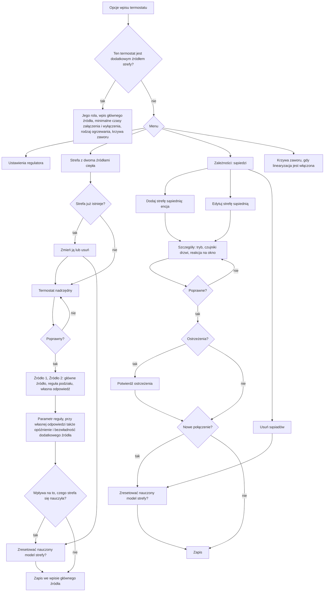

**Strefa z dwoma źródłami ciepła.**

- **Termostat nadrzędny.** Formularz pokazuje listę termostatów Versatile Thermostat typu over
  climate, które mają ten termostat wśród swoich urządzeń. (VTherm typu over climate steruje
  innymi termostatami, czyli swoimi urządzeniami.) Jeśli takiego nie ma, formularz wyjaśnia, co
  utworzyć. Termostat nadrzędny musi mieć wyłączoną samoregulację, bo SmartPI reguluje w jego
  urządzeniach. Musi mieć dokładnie dwa urządzenia. Oba muszą być termostatami Versatile
  Thermostat, które używają SmartPI i mierzą strefę tym samym czujnikiem temperatury. Żadne z
  nich nie może już należeć do innej strefy.
- **Źródła.** Źródło 1 i Źródło 2 to urządzenia termostatu nadrzędnego. Formularz pokazuje każde
  z nich z rodzajem ogrzewania z jego własnego wpisu i o ten rodzaj nie pyta. W tym samym kroku
  użytkownik wybiera **główne źródło**: to, którego SmartPI reguluje i szybko koryguje. Domyślnie
  jest to szybsze urządzenie. Użytkownik wybiera też regułę podziału (sposób dzielenia pracy
  między źródła), a formularz proponuje regułę zalecaną dla tych dwóch rodzajów ogrzewania
  (sekcja 5.3). Na koniec użytkownik decyduje, czy ustawić opóźnienie i bezwładność dodatkowego
  źródła, zamiast zaczynać od jego rodzaju ogrzewania. Formularz nie pyta o opóźnienie głównego
  źródła, bo uczy się go dopasowanie strefy (sekcja 5.4). Strefa zapisana przez wcześniejszą
  wersję może zawierać własne opóźnienie i bezwładność głównego źródła. Zachowuje je, ale nie są
  używane.
- **Parametr.** Ten krok pokazuje parametr reguły i to, co on oznacza dla tych dwóch termostatów
  (`together` 10 do 1000 %, `source_first` i `lead_band` 0 do 100 %). Ostrzega, gdy rodzaj
  ogrzewania głównego źródła reaguje wolniej niż rodzaj ogrzewania drugiego. Jeśli użytkownik o
  to poprosił, pyta też o opóźnienie i bezwładność dodatkowego źródła (0 do 600 min).
- **Gdzie jest zapisana.** Strefa jest zapisana we wpisie głównego źródła jako jego pozycja
  `source`, który wskazuje też termostat nadrzędny (`zone_master`). Sąsiedzi i drzwi strefy są w
  tym samym wpisie. Wpis drugiego termostatu nie przechowuje nic o strefie. Ten termostat
  odczytuje swoją rolę z wpisu głównego źródła. Termostat bez wpisu SmartPI dostaje nowy wpis,
  utworzony z domyślnych ustawień globalnych. Jego utworzenie restartuje tylko ten termostat.
- **Główne źródło inne niż termostat, którego opcje są otwarte.** Zdarza się to, gdy strefę
  ustawia się z termostatu, który zostaje dodatkowym źródłem, albo gdy zmienia się główne
  źródło. Formularz przenosi wtedy strefę, razem z sąsiadami z tego wpisu, do wpisu głównego
  źródła i opróżnia listę w tym wpisie. Dawne główne źródło działa wtedy jako dodatkowe. Sąsiad,
  który jest teraz częścią strefy, zostaje usunięty z listy. Jeśli przeniesiony sąsiad koliduje z
  jednym z własnych sąsiadów nowego głównego źródła (ten sam sąsiad albo ten sam czujnik drzwi),
  wygrywa przeniesiony. Jeśli lista nadal nie przechodzi sprawdzenia, przeniesienie zostaje
  przerwane. Przeniesieni sąsiedzi uczą się swojej wymiany od nowa w nowym głównym źródle.
- **Jeden formularz naraz.** Przy zapisie formularz jeszcze raz sprawdza, czy termostat
  nadrzędny i wpisy obu termostatów są nadal takie, jak w chwili, gdy je odczytał. Jeśli nie,
  przerywa i prosi użytkownika o ponowne otwarcie. Dzięki temu dwa formularze otwarte w tym
  samym czasie nie mogą sprawić, że oba termostaty wskażą siebie nawzajem.
- **Sąsiedzi strefy.** Dodatkowego źródła strefy i jej termostatu nadrzędnego nie można dodać
  jako sąsiadów strefy, bo ogrzewają lub mierzą tę samą strefę.
- **Przerwania.** Formularz zatrzymuje się z komunikatem w tych przypadkach: strefa zmieniła się,
  gdy formularz był otwarty (`zone_changed`); nie da się połączyć sąsiadów z dwóch wpisów
  (`zone_move_conflict`); nie da się utworzyć wpisu głównego źródła (`main_entry_missing`).
- **Opcje dodatkowego źródła** pokazują, który wpis przechowuje strefę. Pokazują też ustawienia,
  które nadal działają, gdy podąża ono za głównym źródłem: jego minimalne czasy załączenia
  i wyłączenia, rodzaj ogrzewania i, dla zaworu, jego krzywą. Pozostałe ustawienia regulatora
  zachowują swoje wartości. Działają tylko wtedy, gdy reguluje ono samodzielnie, bo główne źródło
  zamilkło, czyli nie wysyła wysterowań (sekcja 5.7).
- **Rodzaje ogrzewania przy starcie.** Za każdym razem, gdy główne źródło startuje, moduł obsługi
  (handler) odczytuje rodzaje ogrzewania obu termostatów z ich wpisów. Zapis wpisu dodatkowego źródła
  restartuje też główne źródło. Dzięki temu zmieniony rodzaj ogrzewania działa od razu. Własna
  odpowiedź ustawiona w formularzu strefy zostaje zachowana. Rodzaj ogrzewania zmieniony w ten
  sposób nie liczy się jako zmiana strefy: jeśli użytkownik potem zmieni tylko regułę, formularz
  nie zaproponuje resetu.
- **Zmieniony termostat nadrzędny.** Przy starcie i przy przeładowaniu swojego wpisu główne źródło
  sprawdza, czy termostat nadrzędny nadal ma jako urządzenia dokładnie te dwa termostaty. Porównuje
  je po unikalnym ID (identyfikatorze, który się nie zmienia; przy przeładowaniu termostat nie ma
  jeszcze ID encji). Jeśli się różnią, zapisuje ostrzeżenie w logu. Strefa działa dalej tak, jak ją
  skonfigurowano, aż do ponownego otwarcia formularza.
- **Usunięcie strefy** przywraca każdemu termostatowi jego własną regulację. Dawne dodatkowe
  źródło reguluje z modelem, który miało, zanim przejęło tę rolę. Wpis, który formularz dla
  niego utworzył, zostaje.
- **Zalecane dla termostatu nadrzędnego** (na podstawie kodu Versatile Thermostat): długie
  opóźnienie bezpieczeństwa, bo jego tryb bezpieczeństwa wyłącza oba urządzenia; oraz mały krok
  progu regulacji, bo nastawę, którą przekazuje dalej, zaokrągla do tego kroku.

**Sąsiedzi.**

- **Błędy** nie pozwalają zamknąć formularza: encja bez unikalnego identyfikatora (unique ID),
  sama strefa, powtórzony sąsiad, tryb drzwi bez czujnika, czujnik okna, czujnik drzwi innego
  sąsiada.
- **Ostrzeżenia** wymagają potwierdzenia: własny wpis sąsiada nie wymienia tej strefy; czujnik
  drzwi jest też czujnikiem okna tego termostatu; skonfigurowane jest automatyczne wykrywanie
  otwartego okna, które może zareagować na otwarte drzwi.
- **Podpowiedzi.** Formularz pokazuje czujniki drzwi, które są w obszarach obu stref i nie są
  używane przez innego sąsiada. Nie zaznacza ich z góry, bo jeden z nich może należeć do drzwi
  zewnętrznych.
- **Sąsiad oznaczony jako `indistinguishable`** (nie do odróżnienia) nie dał się odróżnić od
  wpływu temperatury zewnętrznej ani od innego sąsiada. Nic nie jest dla niego publikowane, a
  strefa działa tak, jakby go nie było.
- **Przerwania.** Formularz zatrzymuje się, gdy użytkownik edytuje sąsiada, którego encja już
  nie istnieje (`neighbour_missing`), usuwa, nie zaznaczywszy niczego
  (`dependencies_unchanged`), albo zapisuje po tym, jak lista zmieniła się w innym formularzu
  (`zone_changed`).

**Zapisana konfiguracja.** Pozycje są zapisane w opcjach wpisu pod kluczem
`smart_pi_dependencies`. Pozycja sąsiada zawiera `id`, `kind` (`neighbour`), `entity`
(identyfikator z rejestru), `mode`, `door_sensors` i `neighbour_window_action`. Pozycja źródła
strefy zawiera `id`, `kind` (`source`), `entity`, `zone_master` oraz `split_rule` z jej
parametrem (`split_ratio`, `source_alone_percent` lub `lead_band_percent`). Zawiera też
`lead_emitter` (rodzaj ogrzewania z wpisu głównego źródła) i `source_emitter` (rodzaj ogrzewania
z wpisu dodatkowego źródła, odczytywany ponownie przy starcie, albo `custom`). Przy własnej
odpowiedzi zawiera `source_lag_min` i `source_tau_min`. Strefa zapisana przez wcześniejszą
wersję może też zawierać `lead_lag_min` i `lead_tau_min`, których nic nie używa.

### 2.2 Reset nauczonego modelu

Gdy zmiana konfiguracji wpływa na to, czego strefa się nauczyła, formularz pokazuje krok z opcją
„Reset the zone's learned model” (zresetuj nauczony model strefy). Opcja jest domyślnie
zaznaczona (`zone_reset` w formularzu strefy, `model_reset` w formularzach sąsiadów):

| Zmiana | Pokazuje krok resetu |
|---|---|
| strefa ustawiona lub usunięta, jej dodatkowe źródło zamienione na inne, zmienione główne źródło, zmieniona własna odpowiedź dodatkowego źródła | tak |
| sąsiad dodany lub usunięty, zmieniony jego tryb lub czujniki drzwi | tak |
| reguła podziału lub jej parametr, reakcja na okno, minimalne czasy załączenia i wyłączenia oraz inne ustawienia regulatora | nie |

- **Jak jest stosowany.** Jeśli użytkownik wybierze reset, formularz zapisuje nowy losowy token
  (znacznik) we wpisie, który przechowuje strefę (`smart_pi_reset_token`). Gdy termostat startuje
  z tym wpisem, SmartPI jeden raz resetuje cały nauczony model: `a`, `b`, czasy martwe
  (opóźnienia, zanim strefa zareaguje na wysterowanie), dopasowanie strefy i wymiany, tak jak
  robi to usługa `reset_smartpi_learning`. Token zachowuje w swoim zapisanym stanie
  (`dependency_reset_token`), więc późniejszy restart nie resetuje modelu drugi raz.
- Gdy zmieniają się tryb lub czujniki drzwi sąsiada, sąsiad jest zapisywany pod nowym
  identyfikatorem. Dlatego jego nauczone `k` zaczyna się od nowa, niezależnie od wyboru
  użytkownika.
- Gdy zmienia się rodzaj ogrzewania dodatkowego źródła, zmienia się też odpowiedź, na której
  opierają się brane pod uwagę skale czasu tego źródła. Dopasowanie strefy jest wtedy odrzucane
  przy następnym starcie (sekcja 8) i uczone od nowa.

## 3. Model ze znanymi wejściami

### 3.1 Model strefy

    dT/dt = a·u − b·(T − T_ext) + Σ_i g_i·(T_i − T) + Σ_j q_j

- `u` to wysterowanie (0..1) podawane przez termostat prowadzący (lead), czyli ten, którego SmartPI
  reguluje strefę. `a` to jego wpływ (wzmocnienie grzania), a `b` to straty ciepła na zewnątrz,
  tak jak uczy się ich SmartPI.
- **Wejście wymiany** `i` łączy strefę z temperaturą `T_i` przez przewodność `g_i` (1/min),
  czyli przez to, jak łatwo ciepło między nimi przepływa. Sąsiad połączony ze strefą jest
  wejściem wymiany z `g = k`, gdzie `k` to nauczony współczynnik wymiany.
- **Wejście ciepła** `j` dodaje `q_j` (degC/min, dodatnie lub ujemne) wprost. Ciepło
  dodatkowego źródła `a_f·x_f` jest wejściem ciepła (sekcja 5).

### 3.2 Łączenie wejść

Znane wejścia są łączone w dwie wartości, których prawo sterowania już używa: jego współczynnik
strat i jego temperaturę zewnętrzną:

    b_eff = b + Σ_i g_i
    T_ref = (b·T_ext + Σ_i g_i·T_i) / b_eff + Σ_j q_j / b_eff

- Składnik ciepła przesuwa `T_ref`. Przesunięcie jest ograniczone do `KNOWN_HEAT_MAX_SHIFT_C`,
  żeby za niskie oszacowanie strat nie mogło sprawić, że będzie za duże. Ten limit musi być
  większy niż największa różnica między nastawą a temperaturą zewnętrzną. Powód: w części
  wyprzedzającej `b` się skraca (`b/a · q/b = q/a`). Limit niższy niż przesunięcie, którego podłogówka potrzebuje w
  zimne dni, sprawiał, że SmartPI liczył mniej ciepła z podłogówki, niż go było (sekcja 5.8).
- Przy sąsiadach połączonych na stałe `b` w SmartPI zawiera już ich wymiany. Wtedy składnik
  strat przechodzi na współczynnik `b_fit`, dopasowany bez nich (sekcja 4.4). Przechodzi w tym
  samym tempie, w jakim ich wymiany wchodzą do modelu:

        loss = b + w·(b_fit − b),   w = Σ_i w_i·k_i / Σ_i k_i

  Tu `w_i` to część każdej wymiany na stałe, która jest już w modelu (sekcja 3.3). Przy
  `b = b_fit + Σ k_i` wartość `b_eff = loss + Σ w_i·k_i` pozostaje równa `b`, gdy wymiany
  stopniowo wchodzą do modelu.
- Każde wejście ma wartość bieżącą i może mieć trajektorię na horyzoncie. Prawo sterowania używa
  tylko wartości bieżącej. W strefie z dwoma źródłami hamowanie z wyprzedzeniem samo przewiduje
  ciepło dodatkowego źródła (sekcja 5.6).
- Łączenie zwraca `b` i `T_ext` bez zmian w tych przypadkach: nie ma wejść, nie ma temperatury
  zewnętrznej, `b` nie jest skończoną liczbą albo połączone straty są niższe niż
  `KNOWN_INPUTS_B_EFF_MIN`.

### 3.3 Gdzie model jest używany

| Część SmartPI | Używa |
|---|---|
| FF1 (`k_ff = b/a`), FF3, trajektoria nastawy, bliźniak cieplny, pasmo przy nastawie (near band), okna korekty FF (FF trim) | `b_eff`, `T_ref` |
| Czas całkowania we wzmocnieniach regulatora | `Ti = 1 / (loss + Σ g)`, z `loss` jak w sekcji 3.2 (`1/tau` bez sąsiadów połączonych na stałe) |
| Uczenie `a`, `b` i czasów martwych, nadzór (governance), bezpieczeństwo | surowe `b` i `T_ext`; każde okno uczenia jest korygowane o tempo, które dodają znane wejścia (`known_rate`) |

Korekta to tempo zmiany temperatury, które aktywne wejścia dodają przy temperaturze strefy:

    known_rate = Σ_i g_i·(T_i − T) + Σ_j q_j

Jest sumowana (całkowana) w oknie uczenia i odejmowana od zmierzonej zmiany. Dotyczy to też
sytuacji, gdy początek okna się przesuwa. Ponieważ uczenie korzysta z surowych danych, własne
parametry SmartPI zachowują znaczenie, jakie miały wcześniej. Jest jeden wyjątek. Gdy `k`
sąsiadów połączonych na stałe są już w modelu, korekta usuwa ich wymianę z okien SmartPI.
Dlatego własne `b` SmartPI (`model.b` w diagnostyce) przesuwa się w kolejnych oknach od
`b_fit + Σk` w stronę `b_fit`. Nie wpływa to na prawo sterowania, bo jego składnik strat to
wtedy `b_fit` (sekcja 3.2).

**Współczynnik, który staje się znany, wchodzi stopniowo.** Zanim `k` sąsiada albo `a_f` źródła
zostanie opublikowane, jego wpływ działa na strefę jak nieznane zakłócenie. Całka regulatora
(część wysterowania, która narasta z dawnych błędów) już ten wpływ wchłonęła. Dodanie go do
modelu od razu w całości spowodowałoby skok części wyprzedzającej. Temperatura strefy spadłaby
wtedy albo przekroczyła nastawę, dopóki całka się z powrotem nie dostosuje. Dlatego współczynnik
wchodzi w ciągu `KNOWN_INPUT_FADE_S`. Z sąsiadami połączonymi na stałe jest inaczej, bo `b` w
SmartPI zawiera już ich wymiany. Wchodzą razem, gdy każdy z nich jest znany. Dopasowane straty
zastępują `b` SmartPI w tym samym tempie (sekcja 3.2), więc `b_eff` nie spada, by potem znów
rosnąć. W strefie z dwoma źródłami `b` z dopasowania zastępuje `b` SmartPI od razu i nie
zawiera tych wymian. Dlatego ich `k` z dopasowania wchodzi do modelu od razu. Współczynnik,
który był znany już przed restartem, jest od razu w pełni w modelu. Dotyczy to własnego `k`
sąsiada, `k` z dopasowania strefy dla używanego trybu HVAC (grzanie lub chłodzenie) i `a_f`
źródła dla każdego z trybów HVAC.

## 4. Strefy sąsiednie

### 4.1 Konfiguracja

Sąsiad to encja termostatu VTherm (climate) albo czujnik temperatury. Jest zapisany pod
identyfikatorem z rejestru, więc zmiana nazwy encji nie zrywa powiązania.

| Tryb | Połączenie jest aktywne | Typowe użycie |
|---|---|---|
| `none` | nigdy: sąsiad zostaje na liście, ale jest pomijany. Przełączenie istniejącego sąsiada na `none` albo z powrotem sprawia, że jego `k` zaczyna się od nowa (sekcja 2.2) | próba bez sąsiada |
| `door` | gdy którykolwiek z czujników drzwi jest otwarty (stan nieznany lub niedostępny liczy się jako zamknięty) | pokój za drzwiami |
| `always` | zawsze | otwarta przestrzeń |

- Czujniki drzwi to czujniki binarne klasy `door`, `opening` lub `garage_door`. Czujniki okien są
  odrzucane, bo okno na zewnątrz obsługuje wykrywanie okien w VTherm.
- Jeden czujnik drzwi może służyć kilku wpisom, ale nie dwóm sąsiadom tej samej strefy.
- **`k` jest tylko uczone.** W tej wersji nie da się go wpisać ręcznie. Taką możliwość można
  dodać, jeśli gdzieś w praktyce uczenie zawiedzie.
- **Drzwi bez czujnika nie są obsługiwane** (decyzja właściciela z 2026-10-12). Nie ma trybu dla
  drzwi „zwykle zamkniętych”, a otwarcia nie są wykrywane z danych.
- **Sąsiada ustaw we wpisach obu stref**, tak by każda wymieniała drugą. Wymiana działa w obie
  strony, a formularz ostrzega, gdy własny wpis sąsiada nie wymienia tej strefy.
- Dla sąsiada VTherm **reakcja na okno** mówi, co robić, gdy połączenie jest aktywne, a sąsiad
  zgłasza otwarte okno: `nothing`, `turn_off`, `frost`, `eco`.
- Połączenie jest pomijane, gdy sąsiad jest niedostępny, jest w trybie bezpieczeństwa albo nie
  ma poprawnej (skończonej) temperatury.

### 4.2 Bramki uczenia

Bramka uczenia decyduje, czy własne uczenie SmartPI (`a`, `b`, czasy martwe) może działać.

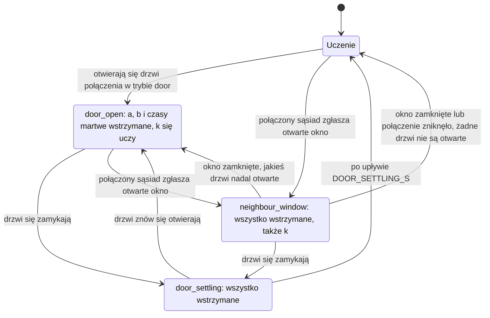

- Gdy działa kilka bramek naraz, kolejność jest taka: najpierw `neighbour_window`, potem
  `door_open`, potem `source_heat`, potem `door_settling`. Bramka `source_heat` należy do
  drugiego źródła (sekcja 5.5). Poniżej nich wszystkich jest `boiler_settling`: wstrzymuje
  uczenie, gdy emiter stygnie, bo kocioł nie jest wezwany do grzania, oraz gdy emiter znów się
  nagrzewa, kiedy kocioł zaczyna grzać
  ([Wejścia wody i kotła, §4](water_input.md#4-kocioł-który-nie-jest-wezwany-do-grzania)).
- Sąsiad połączony na stałe nie wstrzymuje uczenia. `b` w SmartPI zawiera jego wymianę, a
  wspólne dopasowanie (sekcja 4.4) ją wydziela. Pierwszy plan miał bramkę opartą na różnicy
  temperatur względem sąsiada (`coupling_gradient`). Zrezygnowano z niej: przy sąsiedzie, który
  jest cały czas chłodniejszy, wstrzymywała uczenie SmartPI przez większość czasu, a i tak nie
  dawała poprawnego `k`.
- `k` jest uczone tylko wtedy, gdy sam SmartPI mógłby się uczyć. Wymaga to: uczenia włączonego i
  niewstrzymanego; strefy, która grzeje lub chłodzi; braku zrzutu mocy, odcięcia
  zabezpieczającego (guard cut) i kalibracji; SmartPI po fazie uczenia; wiarygodnego czasu
  martwego; braku otwartego okna u sąsiada; braku zmiany stanu drzwi w ciągu ostatnich
  `DOOR_SETTLING_S`.

### 4.3 Okna pomiarowe

`k` jest uczone z okien pomiarowych o stałej długości `COUPLING_WINDOW_S` (30 min). Są dłuższe
niż własne okna SmartPI, bo czujnik 0.1 degC (taki, który podaje wynik w krokach co 0.1 degC)
potrzebuje czasu, żeby pokazać nachylenie (tempo zmiany temperatury).

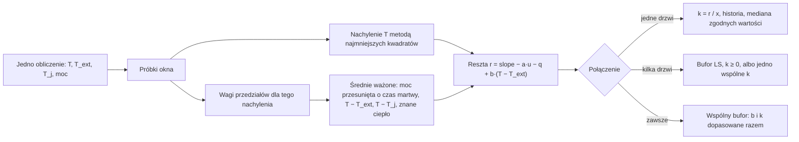

- **Nachylenie.** To zwykłe nachylenie metodą najmniejszych kwadratów (najlepiej pasująca prosta
  przez próbki). Stała temperatura też niesie informację, bo moc równoważy wtedy straty.
- **Spójne wagi.** Nachylenie z najmniejszych kwadratów to średnia ważona tempa zmiany
  temperatury, z większą wagą w środku okna. Moc, różnice temperatur i znane ciepło są
  uśredniane z tymi samymi wagami. Dzięki temu model okna nadal się zgadza, gdy krzywa
  temperatury się wygina, np. przy falowaniu od cykli włącz/wyłącz. Przy zwykłych średnich (z
  równymi wagami) stałe falowanie dawało w testach systematyczny błąd `k` rzędu 6 %.
- **Moc zrealizowana.** Moc działająca na strefę to moc podana na element wykonawczy,
  przesunięta o czas martwy. To moc, którą każdy zakończony cykl faktycznie dostarczył, tak jak
  podaje ją VTherm. Dla elementu wykonawczego typu włącz/wyłącz ta moc liczy się od początku
  cyklu, a przy danych o wodzie z uwzględnieniem współczynnika wody tego elementu (sekcja 5.2).
  Moc zadana jest używana tylko dla cyklu, który jeszcze trwa. VTherm często
  skraca cykl, a cykl zaczyna się od czasu włączenia. Dlatego średnia mocy zadanej była niższa
  niż to, co strefa naprawdę dostała.
- Okno się liczy tylko wtedy, gdy `|T − T_j| ≥ COUPLING_K_MIN_DT` dla co najmniej jednego
  sąsiada, a okno zawiera co najmniej `MIN_WINDOW_SAMPLES` obliczeń. Okno zaczyna się od nowa,
  gdy zmienia się zbiór połączonych sąsiadów albo zbiór kolumn ciepła źródła, a także gdy
  uczenie nie jest dozwolone.

### 4.4 Uczenie wymiany

**Jedne drzwi.** `k = r / x`, gdzie `x = −(T − T_j)` uśrednione w oknie. Odrzucane są dwa
rodzaje wartości: wartości poza `(0, COUPLING_K_MAX]` oraz wartości odstające od historii. Gdy
historia zawiera `OUTLIER_MIN_HISTORY` wartości, wartość odstająca to taka, która leży dalej niż
`OUTLIER_MAD_FACTOR` przeskalowanych MAD. (MAD, mediana odchyleń bezwzględnych, mierzy, jak
bardzo wartości są rozrzucone.) `k` jest publikowane jako mediana historii, gdy historia zawiera
`COUPLING_MIN_SAMPLES` zgodnych wartości, czyli takich, dla których MAD podzielone przez medianę
wynosi najwyżej `COUPLING_MAX_DISPERSION`. `b` w SmartPI jest tu czyste, bo SmartPI uczy się go
tylko przy zamkniętych drzwiach.

**Kilka drzwi otwartych naraz.** Okna trafiają do bufora na `COUPLING_LS_WINDOW` wierszy. Gdy
bufor zawiera `COUPLING_MIN_SAMPLES` wierszy, jest rozwiązywany metodą najmniejszych kwadratów z
warunkiem `k ≥ 0`. Rozwiązanie jest publikowane wprost, bez historii. Czasem regresorów (kolumn
wejściowych dopasowania) nie da się od siebie odróżnić: wskaźnik uwarunkowania znormalizowanej
macierzy Grama przekracza `COUPLING_LS_COND_MAX`. (Wysoki wskaźnik uwarunkowania oznacza, że
kolumny zmieniają się razem zbyt mocno, by dało się je rozdzielić.) Połączenia dostają wtedy
jeden wspólny współczynnik, który zachowuje ich łączną wymianę, i są oznaczane jako
`indistinguishable`.

**Połączenie na stałe.** `b` w SmartPI zawiera już wymianę, więc `b` jest dopasowywane razem
z `k`:

    slope − a·u − q = b·x_ext + Σ_j k_j·x_j,   x_ext = −(T − T_ext)

Zapis w postaci `r = (b + Σ k_j)·x_ext + Σ k_j·(T_j − T_ext)` pokazuje, że każde `k` da się
wydzielić tylko wtedy, gdy temperatura sąsiada zmienia się niezależnie od temperatury
zewnętrznej i od strefy. Dopasowanie bufora (`COUPLING_JOINT_WINDOW` okien) liczy się tylko
wtedy, gdy:

- bufor zawiera co najmniej `COUPLING_JOINT_MIN_ROWS` okien. Wiersze z zaledwie kilku godzin
  mają te same błędy `a` i czasu martwego w SmartPI, więc zgodziłyby się co do błędnego `k`;
- wyśrodkowane kolumny `x_ext` i `T_j − T_ext` (każda minus jej średnia) zmieniają się każda o
  co najmniej `COUPLING_K_MIN_DT` i nie są współliniowe, czyli jedna nie jest po prostu
  proporcjonalna do drugiej (wskaźnik uwarunkowania najwyżej `COUPLING_LS_COND_MAX`). Gdyby różniły się tylko stałym przesunięciem,
  o podziale decydowałby stały błąd, np. zyski ciepła, których brakuje w modelu;
- każdy współczynnik jest dodatni, a jego błąd standardowy (niepewność dopasowanej wartości)
  wynosi najwyżej `COUPLING_JOINT_MAX_REL_SE` jego wartości. W odróżnieniu od wskaźnika
  uwarunkowania błąd standardowy maleje, gdy przybywa okien.

Dopasowanie, które rozdziela współczynniki, dodaje `k` i swoje `b` do historii, najwyżej raz na
`COUPLING_JOINT_FIT_SPACING` nowych okien. Dzięki temu zgodne dopasowania nie są tylko
powtórzeniem tych samych danych. Historia jest publikowana tak samo jak historia drzwi. Gdy
każdy połączony sąsiad w trybie na stałe ma swoje `k`, prawo sterowania przenosi swój składnik
strat na dopasowane `b`, w miarę jak wymiany stopniowo wchodzą do modelu (sekcja 3.2). Dotyczy
to też czasu całkowania. Do tego czasu żaden z nich nie wchodzi do modelu, a strefa działa tak,
jakby ich nie było.

### 4.5 Okno u połączonego sąsiada

| Reakcja | Skutek, gdy połączenie jest aktywne, a okno otwarte |
|---|---|
| `nothing` | uczenie się wstrzymuje, sterowanie bez zmian |
| `turn_off` | strefa wyłącza się tą samą drogą, której SmartPI używa przy otwartym oknie (window-off), razem z jej zabezpieczonym wznowieniem pracy |
| `frost`, `eco` | strefa używa swojego presetu (temperatury zapisanej dla tego trybu) dla bieżącego trybu HVAC, ale nigdy bardziej wymagającego niż bieżąca nastawa (grzanie: niższa z dwóch, chłodzenie: wyższa). W chłodzeniu preset ma tylko `eco` (`eco_cool_temp`), więc `frost` wyłącza strefę |

- Jeśli preset nie jest skonfigurowany (VTherm podaje 0) albo wychodzi poza zakres termostatu,
  strefa się wyłącza.
- Jeśli kilku sąsiadów ma otwarte okna, wygrywa reakcja, która najbardziej chroni
  (`turn_off` > `frost` > `eco`).
- Trwająca kalibracja jest anulowana. Kończy się stanem „anulowana”, zamiast utknąć.
- Reakcja działa tylko wtedy, gdy strefa grzeje lub chłodzi.
- Reakcja dotyczy też dodatkowego źródła (sekcja 5.6). `turn_off` daje mu 0 %. `frost` i `eco`
  sprawiają, że jego pętla przydziału podąża za tą samą, mniej wymagającą nastawą.
- **Reakcję stosuje SmartPI, nie VTherm.** Interfejs wtyczki nie pozwala SmartPI zmienić stanu
  okna, trybu HVAC ani presetu w VTherm. Dlatego VTherm strefy nadal pokazuje swój własny stan.
  Diagnostyka pokazuje obowiązującą reakcję (`dependencies.neighbour_window_action`).

### 4.6 Wyniki i ograniczenia (symulacja)

- Przy znanych prawdziwych `a` i czasie martwym estymator (część, która szacuje `k`) znajduje
  `k` z dokładnością do 2 %.
- Pozostały błąd pochodzi z nauczonego modelu SmartPI, bo `k` jest małą resztą dużego bilansu:
  - drzwi, czujnik 0.01 degC: `k` z dokładnością do 1 %, `a` i `b` pozostają czyste;
  - drzwi, czujnik 0.1 degC: `k` może się mylić o kilkadziesiąt procent, gdy `a` w SmartPI
    myli się o kilka procent;
  - połączenie na stałe, czujnik 0.01 degC, skoki temperatury sąsiada: `k` +5.5 %,
    dopasowane `b` −1 %, publikowane mniej więcej dobę po pierwszym skoku i nigdy wcześniej;
  - połączenie na stałe, czujnik 0.1 degC: nic nie jest publikowane, sąsiad jest oznaczony
    jako `indistinguishable`, a strefa działa jak dziś.
- Oddzielenie `b` od sąsiada połączonego na stałe wymaga, by temperatura sąsiada zmieniała się
  niezależnie.
- Strefa, w której SmartPI nigdy nie osiąga wiarygodnej stałej czasowej, nic nie zyskuje na
  części wyprzedzającej, bo SmartPI trzyma wtedy część wyprzedzającą wyłączoną.

## 5. Drugie źródło ciepła

### 5.1 Role i główna decyzja

Strefa może mieć dwa źródła ciepła. Każde z nich to VTherm z SmartPI, na przykład grzejnik
i ogrzewanie podłogowe. **Główne źródło** to termostat strefy, którego SmartPI reguluje strefę.
W kodzie i w łączu między dwoma źródłami (sekcja 5.7) nazywa się je **lead** (termostat
prowadzący). Wskazuje ono drugi termostat jako swoje **dodatkowe źródło** (w kodzie **source**).
Dodatkowe źródło pracuje wtedy dla niego. Strefa ma jedno dodatkowe źródło i nie ma łańcuchów.

Strefę ustawia się z jej **termostatu nadrzędnego** (sekcja 2.1). To Versatile Thermostat typu
„over climate”, którego dwoma urządzeniami są oba termostaty SmartPI. Versatile Thermostat daje
wszystkim swoim urządzeniom tę samą moc i ma tylko jeden typ urządzenia. Dlatego dwa źródła
o różnej mocy to zawsze dwa termostaty. Termostat nadrzędny trzyma nastawę strefy, presety,
harmonogram, tryb i okna. Obu urządzeniom przekazuje tę samą nastawę. Nie ma własnego algorytmu
mocy: SmartPI strefy działa w jego urządzeniach.

**Decyzja: wysterowanie głównego źródła zostaje dokładnie takie, jakie liczy SmartPI.** Powolna
pętla przydziału przesuwa dodatkowe źródło w stronę podziału, który wybiera reguła. Ciepło
dodatkowego źródła wchodzi do modelu głównego źródła jako znane wejście. Alternatywą była stała
mapa: stałe krzywe, które zamieniają jedno zapotrzebowanie na dwa wysterowania. Odrzucono ją:

- główne źródło dostawałoby inne wysterowanie niż to, które policzył jego regulator. SmartPI
  widziałby w tym element wykonawczy, który doszedł do granicy. Jego anti-windup (zabezpieczenie,
  które nie pozwala całce rosnąć, gdy wyjście jest ograniczone) opróżniałby całkę w każdym cyklu.
  Mechanizmy command ownership i korekta części wyprzedzającej (FF trim) odrzucałyby swoje okna.
  Faza uczenia widziałaby złą moc;
- ciepło dodatkowego źródła byłoby liczone dwa razy: raz w mapie i raz jako znane wejście;
- przy wolnym źródle połowa wysterowania głównego źródła dawałaby efekt z opóźnieniem liczonym
  w godzinach. Strefa przeregulowywałaby się wtedy i wahała.

| | Stałe mapy (odrzucone) | Pętla przydziału (wybrana) |
|---|---|---|
| Regulator SmartPI, uczenie i zabezpieczenia | trzeba je przerobić | bez zmian |
| Wolne źródło (ogrzewanie podłogowe) | wahania | stabilne z samej konstrukcji |
| Reakcja dodatkowego źródła | natychmiastowa | idzie za regułą w ciągu minut (szybkie źródło) do godzin (podłogówka), plus odpowiedź proporcjonalna na błąd strefy |
| Podział | dokładny w każdej chwili | dokładny w stanie ustalonym |

**Decyzja: jeden model strefy dla obu źródeł.** Model strefy jest uczony raz, przy pracy obu
źródeł, przez wspólne dopasowanie strefy (jedno dopasowanie wszystkich wartości naraz,
sekcja 5.4). Dopasowanie daje straty `b`, `a` i opóźnienie głównego źródła, `a_f` i skalę czasu
dodatkowego źródła oraz `k` sąsiadów. SmartPI startuje z tego modelu i go trzyma. Pierwszy projekt
uczył każde źródło osobno, jedno po drugim. Porzucono go (sekcja 5.8). Przy czujnikach 0.1 degC
własne okna SmartPI mierzą powolne stygnięcie jako mniej więcej dwa razy wolniejsze, niż jest
naprawdę. Każda wartość uczona na bazie modelu SmartPI przejmowała jego błędy.

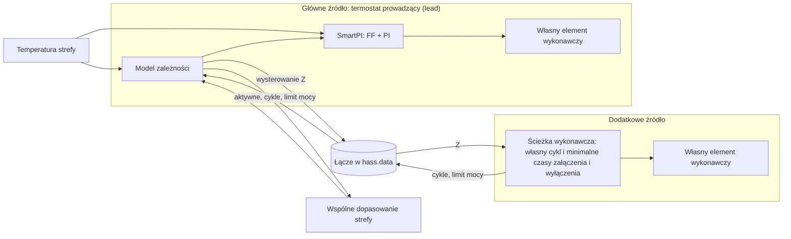

### 5.2 Typy emiterów i ciepło dodatkowego źródła

Wysterowanie `u_f`, które stosuje dodatkowe źródło, dociera do strefy po opóźnieniu `L_f`
(opóźnienie transportowe). Jest też wygładzane przez bezwładność pierwszego rzędu `tau_f`.
Odpowiada ona masie cieplnej jego emitera (grzejnika, pętli podłogówki):

    x_f(t + dt) = u_d + (x_f(t) − u_d)·exp(−dt / tau_f),   u_d = u_f(t − L_f)

`x_f` to udział (0..1) pełnej mocy źródła, a jego ciepło to `a_f·x_f`. Wysterowania już wysłane
sprawiają, że `x_f` jest znane teraz i można je przewidzieć na horyzont. Te wysterowania docierają
jeszcze przez czas `L_f`. Potem przyjmuje się, że ostatnie z nich trwa dalej.

- **Cykle.** Źródło zgłasza każdy cykl, który zaczyna. Element wykonawczy przełączany (wł./wył.)
  grzeje na początku cyklu, na swoim **poziomie**, przez swój czas włączenia. Zawór trzyma swoją
  moc przez cały cykl. Bez danych o wodzie poziom wynosi 1. Z danymi o wodzie jest to współczynnik
  wody źródła (jego moc w porównaniu z mocą przy wodzie odniesienia, zobacz
  [wejścia wody i kotła](water_input.md)). Powód: podłogówka, w której woda ma 30 degC, daje
  w czasie włączenia około 37 % mocy, jaką daje przy 45 degC (pokój ma 20 degC). Własne cykle
  głównego źródła zapisuje się tak samo.
- **Typ każdego urządzenia to rodzaj ogrzewania z jego własnego wpisu SmartPI.** Formularz strefy
  może zamiast tego ustawić własne opóźnienie i bezwładność dodatkowego źródła. Ten rodzaj daje wartości
  startowe z tabeli niżej. W czasie pracy używa się tylko odpowiedzi dodatkowego źródła (jego
  opóźnienia i bezwładności), jako punktu wyjścia dla jego kandydatów. Opóźnienie głównego źródła
  pochodzi z dopasowania strefy (sekcja 5.4). Jego rodzaj ogrzewania służy do zalecenia w formularzu
  i do diagnostyki (`lead_emitter`).

| Typ emitera | `L_f` (min) | `tau_f` (min) |
|---|---|---|
| `electric_fast` (konwektor, klimakonwektor, klimatyzator) | 2 | 3 |
| `radiator` (wodny) | 5 | 20 |
| `floor_electric` (mata grzewcza) | 10 | 90 |
| `floor_water` | 30 | 180 |
| `custom` | użytkownik | użytkownik |

- **Prawdziwa skala czasu jest uczona.** Opóźnienie i bezwładność podłogówki zależą od wylewki,
  rur i wody. W 30-minutowych oknach pomiarowych dopasowania strefy nie da się odróżnić opóźnienia
  od bezwładności. Da się jednak ustalić ich wspólną skalę czasu. Kandydaci rozciągają odpowiedź
  wynikającą z rodzaju ogrzewania o `SOURCE_SCALE_MULTIPLIERS` (od 0.4 do 2.5 razy). Źródło bez opóźnienia i bezwładności
  dostaje zamiast tego bezwładności `SOURCE_FAST_TAU_MIN`. Każdy kandydat odtwarza `x_f` z tych
  samych cykli. Dopasowanie strefy wybiera kandydata, który najlepiej wyjaśnia zachowanie strefy
  (sekcja 5.4), osobno dla grzania i chłodzenia. Kandydat w użyciu daje `x_f`, jego prognozę,
  szybkość pętli przydziału i horyzont hamowania.

### 5.3 Reguły podziału

`W` to wysterowanie głównego źródła, a `Z` to wysterowanie dodatkowego źródła. Każda reguła daje
docelową średnią głównego źródła `f(Z)`. `together` i `source_first` to krzywe stanów ustalonych
(takich, w których temperatura i moce już się nie zmieniają) od `(0, 0)` do `(100 %, 100 %)`.
`lead_band` trzyma `W` na poziomie pasma:

| Reguła | Krzywa | Parametr (domyślnie) | Przykłady |
|---|---|---|---|
| `together` | `Z = p·W`; gdy jedno dojdzie do 100 %, drugie rośnie samo | `p` (100 %), od 10 do 1000 % | `p` = 200 %: W 20 %, Z 40 % |
| `source_first` | do θ pracuje samo dodatkowe źródło; powyżej rosną oba i razem dochodzą do 100 %: `W = 100 %·(Z − θ)/(100 % − θ)` | θ (50 %), od 0 do 100 % | θ = 50 %: Z 30/W 0, Z 70/W 40, oba 100; θ = 100 % ściśle jedno po drugim; θ = 0 jak `together` przy 100 % |
| `lead_band` | dodatkowe źródło ustawia się tak, żeby średnia głównego źródła została w paśmie | pasmo (20 %), od 0 do 100 % | główne źródło zawsze ma zapas na szybkie korekty |

Wartości domyślne zachodzą na siebie: w części zakresu oba urządzenia pracują razem.

**Zalecenie według typu emitera** (wartość domyślna formularza, z powodem):

| Główne + dodatkowe źródło | Domyślnie | Powód |
|---|---|---|
| grzejnik + ogrzewanie podłogowe | `lead_band`, 20 % | podłogówka niesie obciążenie podstawowe; grzejnik dokłada ciepła i szybko koryguje (słońce, gotowanie, otwarte drzwi) |
| urządzenia o podobnej szybkości | `together`, 100 % | wspólny procent |
| dodatkowe źródło, którego trzeba używać najpierw (np. tańsza energia) | `source_first`, wybiera użytkownik | pierwszeństwo dodatkowego źródła |
| główne źródło wyraźnie wolniejsze od dodatkowego | ostrzeżenie | szybkie korekty należą do szybszego urządzenia: zamień role |

`source_first` nie jest wartością domyślną przy podłogówce. Przy małym zapotrzebowaniu grzejnik
stoi na 0 %, a podłogówka reguluje sama. Hamowanie z wyprzedzeniem (sekcja 5.6) nie pozwala
podłogówce przegrzać strefy. Sama podłogówka reaguje jednak na zysk ciepła (słońce, gotowanie)
z opóźnieniem wielu godzin.

### 5.4 Wspólne dopasowanie strefy

Strefa działa według tego modelu:

    dT/dt = a·u(t − L) − b·(T − T_ext) + a_f·x_f + Σ_j k_j·(T_j − T)

Tu `u` to moc zrealizowana przez główne źródło, `L` to jego opóźnienie, `x_f` to ciepło
dodatkowego źródła, a `T_j` to temperatury połączonych sąsiadów (ich składnik jest zerem, gdy
drzwi są zamknięte). Z danymi o wodzie obie moce to moce przy wodzie odniesienia.

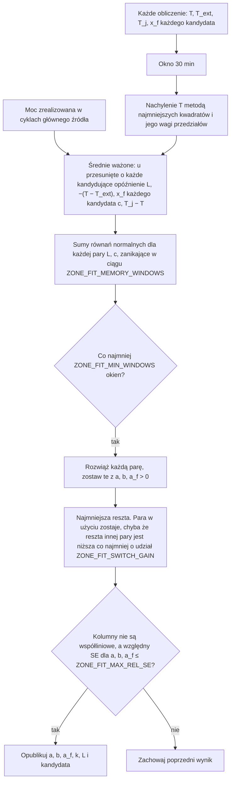

- **Okna.** Każde okno pomiarowe o długości `COUPLING_WINDOW_S` (30 min) daje jeden wiersz. Wiersz
  powstaje tak jak w oknach sąsiadów (sekcja 4.3): zwykłe nachylenie `T` metodą najmniejszych
  kwadratów oraz, z tymi samymi wagami, średnie regresorów (kolumn wejściowych dopasowania). Okno
  zaczyna się od nowa w tych przypadkach: po kalibracji czasów martwych głównego źródła, po zmianie
  stanu drzwi i po otwartym oknie u sąsiada; dopóki dodatkowe źródło nie wykonuje wysterowań
  głównego źródła; gdy strefa jest wyłączona; bez temperatury strefy lub temperatury zewnętrznej;
  po przerwie między obliczeniami dłuższej niż `ZONE_FIT_MAX_GAP_S`. Dzięki temu żadne okno nie
  obejmuje przerwy. Okna nie zatrzymują się przy własnej pauzie w uczeniu SmartPI
  (`set_smartpi_learning`, której mogą też używać inne integracje), przy zrzucie mocy ani
  przy odcięciu zabezpieczającym (guard cut). Moc zrealizowana w cyklach nadal
  opisuje, co dostała strefa. SmartPI dalej trzyma `a` i `b` z dopasowania (sekcja 5.5), gdy jego
  uczenie jest wstrzymane, bo to tylko stosuje model i niczego się nie uczy.
- **Opóźnienie głównego źródła z siatki** (stałej listy wartości). Kolumnę mocy buduje się dla
  każdego opóźnienia z `ZONE_FIT_LEAD_DELAYS_MIN` (od 0 do 60 min). Własny czas martwy SmartPI nie
  jest używany. Przy powolnych wzrostach temperatury i czujniku 0.1 degC wychodzi on od dwóch do
  sześciu razy za długi. To przesuwało moc w oknach i nie pozwalało opublikować dopasowania (od 21
  do 62 min zamiast 10 w próbach; sekcja 5.8).
- **Skala czasu dodatkowego źródła z jego kandydatów** (sekcja 5.2). Każdą parę opóźnienia
  i kandydata rozwiązuje się metodą najmniejszych kwadratów. Wygrywa para z najmniejszą resztą
  (błędem, który zostaje).
- **Nic nie jest brane z modelu SmartPI.** Dlatego dopasowanie działa, gdy SmartPI jeszcze się
  uczy, a błędy SmartPI do niego nie trafiają.
- **Publikacja.** Dopasowanie publikuje się, gdy spełnione są trzy warunki. Jest co najmniej
  `ZONE_FIT_MIN_WINDOWS` okien (liczonych z zanikaniem, więc najwcześniej 39 okien, 19.5 h).
  Macierz jest dobrze uwarunkowana (wskaźnik uwarunkowania znormalizowanej macierzy wynosi co
  najwyżej `10·COUPLING_LS_COND_MAX`). Względny błąd standardowy `a`, `b` i `a_f` wynosi co najwyżej
  `ZONE_FIT_MAX_REL_SE`. Sumy zanikają w ciągu `ZONE_FIT_MEMORY_WINDOWS` (6 dni): starsze okna
  liczą się coraz mniej, więc dopasowanie nadąża za powolnymi zmianami.
- **Grzanie i chłodzenie osobno.** Każdy tryb HVAC ma własne dopasowanie. Przy chłodzeniu kolumny
  obu źródeł zmieniają znak, więc dopasowane wpływy obu źródeł zostają dodatnie. Dopasowania
  z chłodzenia nigdy nie używa się przy grzaniu, a dopasowania z grzania nigdy nie używa się przy
  chłodzeniu.
- **Sąsiedzi.** Sąsiad połączony ze strefą dostaje kolumnę. Sąsiad, który nigdy nie był połączony,
  jest pomijany. Po publikacji dopasowania jego `k` zastępuje wartość uczoną we własnych oknach sąsiada
  (sekcja 4.4): w prawie sterowania, we wzmocnieniach regulatora i w hamowaniu. Dzieje się tak tylko
  wtedy, gdy `k` z dopasowania leży w `(0, COUPLING_K_MAX]`, a jego względny błąd standardowy wynosi
  co najwyżej `ZONE_FIT_MAX_REL_SE`. Powód: drzwi rzadko otwierane są dopasowane z niewielu okien.
  Własne okna sąsiada nadal traktują ciepło dodatkowego źródła jako nieznaną kolumnę, żeby to ciepło
  nie trafiło do ich `k`. Zmiana skonfigurowanych sąsiadów zeruje sumy dopasowania. Opublikowany
  wynik zostaje, dopóki nie przyjdzie nowy.

### 5.5 Uczenie

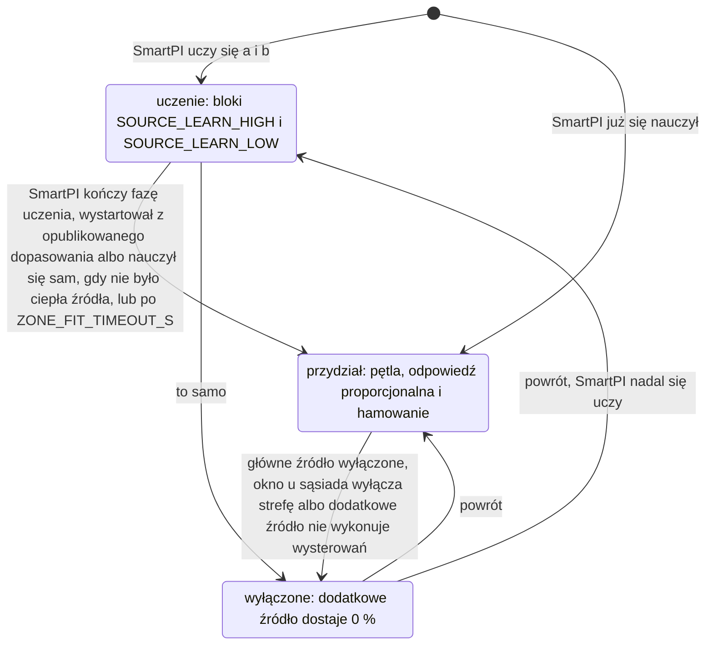

- **Oba źródła pracują od pierwszego dnia.** Gdy SmartPI się uczy, dodatkowe źródło pracuje
  blokami, które przełączają się między `SOURCE_LEARN_HIGH` a `SOURCE_LEARN_LOW`. Każdy blok trwa
  `max(SOURCE_LEARN_BLOCK_MIN_S, 2 × L_f + 2 × tau_f)`. Dzięki temu dopasowanie widzi, jak zmienia
  się ciepło źródła, a główne źródło w tym czasie reguluje. Strefa zimniejsza od nastawy
  o `SOURCE_LEARN_COLD_C` dostaje dodatkowe źródło na pełnej mocy. Strefa cieplejsza od nastawy
  o `SOURCE_LEARN_WARM_C` nie dostaje go wcale.
- **Zegar uczenia.** Każdy tryb HVAC ma własny zegar. Mierzy on, jak długo czeka się na
  dopasowanie tego trybu przy pracującym dodatkowym źródle. Liczy tylko wtedy, gdy źródło wykonuje
  wysterowania głównego źródła, a dopasowanie trybu nie jest opublikowane. Nie liczy przez przerwy
  między obliczeniami dłuższe niż `ZONE_FIT_MAX_GAP_S`. Według tego zegara idą bloki, a także limit
  czasu opisany niżej.
- **Główne źródło, które już samo się nauczyło** (dodatkowe źródło dodano później), nie dostaje
  bloków. Pętla przydziału rusza od razu, ale bez hamowania, dopóki dopasowanie nie zostanie
  opublikowane. Bramka `source_heat` wstrzymuje uczenie SmartPI, aż przyjdzie dopasowanie albo
  zegar trybu dojdzie do limitu czasu. W symulacjach przydział i dobowe wahania temperatury
  zewnętrznej wystarczyły, żeby dopasowanie opublikowało się po 19.5 h. Po zmianie trybu HVAC
  SmartPI uczy się od nowa. Jeśli dopasowanie tego trybu jest opublikowane, SmartPI bierze z niego
  wartości startowe (startuje z dopasowania). W przeciwnym razie bloki idą według zegara tego trybu.
- **SmartPI czeka na dopasowanie.** Gdy ciepło dodatkowego źródła jest obecne, a dopasowanie nie
  jest opublikowane, bramka `source_heat` wstrzymuje własne uczenie SmartPI: `a`, `b` i czasów
  martwych. Inaczej SmartPI uznałby ciepło podłogówki za własne. Bramka ma histerezę (różne progi
  włączenia i wyłączenia). Włącza się, gdy `x_f` dojdzie do `SOURCE_X_MIN`. Wyłącza się, gdy `x_f`
  spadnie poniżej `SOURCE_X_OFF` albo gdy dopasowanie zostanie opublikowane. Gdy bramka jest
  wyłączona, SmartPI się uczy, także w niskich blokach. Dlatego przy szybkim dodatkowym źródle
  (grzejniku) SmartPI może zakończyć fazę uczenia, zanim przyjdzie dopasowanie. Za każdym razem,
  gdy któraś bramka się włącza lub wyłącza, otwarte okno uczenia SmartPI jest odrzucane. Przy jednym
  progu źródło pracujące blisko niego odrzucałoby te okna raz za razem.
- **SmartPI startuje z dopasowania.** SmartPI może się uczyć wtedy, gdy dopasowanie bieżącego
  trybu jest już opublikowane: dopasowanie właśnie przyszło albo po zmianie trybu HVAC SmartPI uczy
  się od nowa. Wtedy `a` i `b` SmartPI oraz historie, które kończą jego fazę uczenia, ustawia się
  z dopasowania. Od tej chwili SmartPI przy każdym obliczeniu trzyma `a` i `b` z dopasowania, ze
  znakiem zależnym od trybu HVAC. Ustawia je ponownie zaraz po własnym kroku uczenia. Dzięki temu
  jego własne okno, które zamknie się w trakcie obliczenia, nie przesuwa ich nawet na jeden cykl.
- **Okna dopasowania zastępują własne okna SmartPI.** SmartPI ocenia swój model po własnych
  licznikach nauczonych próbek i po rozrzucie własnego `b`. Jego część wyprzedzająca dochodzi do
  pełnej wartości stopniowo, wraz z `learn_ok_count`. Jego stała czasowa wymaga zgodnych wartości
  `b`. Jego pasmo przy nastawie (near band) idzie za modelem po dziesięciu próbkach `a`. Gdy
  dopasowanie jest w użyciu, te sprawdzenia widzą dopasowanie zamiast tego. `b` z dopasowania daje
  stałą czasową, a liczniki wynoszą co najmniej tyle, ile wymagają sprawdzenia
  (`AB_CONFIDENCE_MIN_SAMPLES_A`, `AB_CONFIDENCE_MIN_SAMPLES_B`, `ZONE_FIT_MODEL_SAMPLES_A`, licznik
  rozruchu części wyprzedzającej). Bez tego SmartPI trzymał część wyprzedzającą na około jednej
  szóstej jej wartości, bo przy stałej nastawie rzadko się uczy. Obciążenie niosła całka, a strefa
  ustalała się z dala od nastawy (sekcja 5.8).
- **Dopasowanie, które nie przychodzi.** Jeśli zegar trybu dojdzie do `ZONE_FIT_TIMEOUT_S` (48 h)
  bez opublikowanego dopasowania, bramka `source_heat` otwiera się w tym trybie na stałe: już nie
  wstrzymuje uczenia. SmartPI uczy się wtedy sam, tak jak dziś, a diagnostyka pokazuje `timed_out`.
  Zegary są zachowywane po restarcie. Dopasowanie dalej zbiera okna. Jeśli zostanie opublikowane
  później, i tak przejmuje rolę, a SmartPI trzyma wtedy `a` i `b` z dopasowania (oraz jego
  liczniki), jak opisano wyżej. To samo dotyczy głównego źródła, które nauczyło się, zanim dodano
  dodatkowe źródło.
- **Potem znane wejście.** Po publikacji dopasowania ciepło dodatkowego źródła `a_f·x_f`, obecne
  i przewidywane na horyzont, staje się znanym wejściem głównego źródła. Wchodzi stopniowo, jak
  opisano w sekcji 3.3.

### 5.6 Pętla przydziału i hamowanie z wyprzedzeniem

```mermaid
flowchart LR
    S["Temperatura strefy i nastawa"] --> L["SmartPI głównego źródła"]
    L --> W["Element wykonawczy głównego źródła: jego własne wysterowanie W"]
    L --> D["Ustalone zapotrzebowanie: część wyprzedzająca plus całka"]
    D --> LIM{"Główne źródło stoi na granicy?"}
    LIM -- "0 %, strefa za ciepła" --> MIN["zapotrzebowanie = minimum"]
    LIM -- "100 %, strefa za zimna dłużej, niż źródło potrzebuje na ustalenie się" --> MAX["zapotrzebowanie = maksimum"]
    LIM -- nie --> AV["Średnia zapotrzebowania"]
    MIN --> AV
    MAX --> AV
    AV --> E["błąd = średnia − f od zastosowanego Z"]
    E --> I["Integrator, limit szybkości, wstrzymania"]
    I --> P["+ odpowiedź proporcjonalna na błąd strefy"]
    P --> BR["Hamowanie z wyprzedzeniem: najwyżej największe Z, przy którym przewidywana temperatura strefy zostaje na nastawie"]
    BR --> Z["Wysterowanie Z dodatkowego źródła"]
    Z --> SRC["Dodatkowe źródło: własny cykl i minimalne czasy załączenia i wyłączenia"]
    SRC --> X["x_f przez L_f i tau_f"]
    X --> K["Znane ciepło a_f·x_f w modelu głównego źródła"]
    K --> L
```

- **Za czym idzie pętla.** Pętla idzie za **ustalonym** (trwałym) zapotrzebowaniem głównego
  źródła: jego częścią wyprzedzającą plus całką, przed ograniczeniem do 0..100 %. Część
  proporcjonalna jest pominięta. Odpowiada ona na bieżący błąd, na przykład po zmianie nastawy,
  i kazałaby dodatkowemu źródłu gonić krótkotrwałe zmiany.
- **Według zastosowanego wysterowania.** Błąd pętli porównuje średnią głównego źródła z krzywą
  reguły przy wysterowaniu, które dodatkowe źródło naprawdę dostało, już po hamowaniu. Nie używa
  własnej wartości pętli. Gdy hamowanie trzyma źródło poniżej wartości pętli, pętla nie narasta
  dalej.
- **Przerwy.** Pętla nie działa, gdy strefa lub dodatkowe źródło są wyłączone, w czasie
  kalibracji, gdy SmartPI się uczy i gdy nie ma ustalonego zapotrzebowania. Zachowuje wtedy swoje
  wysterowanie i swoją średnią. Gdy rusza ponownie, nie całkuje (nie sumuje błędu) za czas przerwy.
  Zmiana między grzaniem a chłodzeniem uruchamia ją od 0, bo każdy tryb ma własny podział. Gdy
  rusza po blokach uczenia, startuje od ciepła, które źródło daje w tej chwili (`x_f`), więc ciepło
  nie skacze.
- **Główne źródło zablokowane na granicy.** Jeśli główne źródło ma 0 %, a strefa jest cieplejsza
  od nastawy o `SPLIT_LIMIT_ERROR_C`, pętla dostaje najniższe zapotrzebowanie. Główne źródło może
  też dawać najwięcej, ile może: 100 % maksymalnego procentu włączenia w VTherm, górnego końca
  krzywej zaworu i tego, na co pozwala jego woda. Jeśli strefa jest wtedy o tyle samo zimniejsza
  dłużej, niż dodatkowe źródło potrzebuje na ustalenie się, pętla dostaje najwyższe zapotrzebowanie,
  a źródło rośnie jako rezerwa. Przy wolnym źródle (podłogówce) strefa po porannym podniesieniu
  nastawy jest zimna krócej niż ten czas, więc to podniesienie nie rusza pętli.
- **Wstrzymania.** Pętla nie podnosi źródła, gdy strefa jest cieplejsza od nastawy o więcej niż
  `SPLIT_HOLD_ERROR_C`. Nie obniża go, gdy strefa jest o tyle zimniejsza.
- **Odpowiedź proporcjonalna.** Ponad przydział dodatkowe źródło reaguje na błąd strefy:
  `SPLIT_ERROR_GAIN` wysterowania na stopień. Tę wartość dzieli się przez dopasowane `a_f/a`, gdy
  dodatkowe źródło jest silniejsze (w innym przypadku i przed dopasowaniem przez 1). Odpowiedź
  spada do zera razem z błędem, więc podział nadal ustala reguła.
- **Pętla.** `D` to ustalone zapotrzebowanie głównego źródła, ograniczone do
  `[SPLIT_DEMAND_MIN, SPLIT_DEMAND_MAX]`. `Z` to wysterowanie dodatkowego źródła, a `f` to reguła:

        avg(D) ← avg(D) + (1 − exp(−dt / T_avg))·(D − avg(D))
        dZ/dt = clamp((avg(D) − f(Z_applied)) / T_I, ±1 / max(SPLIT_MIN_FULL_RANGE_S, L_f + tau_f))
        T_I = max(SPLIT_MIN_TIME_S, SPLIT_SETTLE_FACTOR·(L_f + tau_f))·r
        T_avg = max(SPLIT_AVERAGE_MIN_S, SPLIT_AVERAGE_FRACTION·T_I)
        Z = clamp(min(Z_loop + SPLIT_ERROR_GAIN·e / r, Z_brake), 0, 1)

  Tu `e` to błąd strefy, `Z_brake` to limit z hamowania (opis niżej), a `r = max(1, a_f/a)` pochodzi
  z dopasowania (1 przed dopasowaniem; `r` idzie za dopasowaniem z histerezą 20 %). Pętla nie
  rośnie, gdy strefa jest ciepła albo gdy trzyma hamowanie (`hold_up`). Nie maleje, gdy strefa jest
  zimna (`hold_down`).
- **Szybkość.** Błąd utrzymany przez `SPLIT_SETTLE_FACTOR` czasów ustalania się (`L_f + tau_f`),
  ale nigdy krócej niż `SPLIT_MIN_TIME_S`, przesuwa źródło o 100 %. Dla źródła silniejszego od
  głównego ten czas rośnie proporcjonalnie. Ten czas i jego wzrost zależą od skali czasu kandydata
  w użyciu i od dopasowanego `a_f/a`. Zapotrzebowanie uśrednia się przez `SPLIT_AVERAGE_FRACTION`
  tego czasu, ale nigdy przez mniej niż `SPLIT_AVERAGE_MIN_S`. Pętla nigdy nie przechodzi całego zakresu szybciej,
  niż źródło się ustala, ani szybciej niż w `SPLIT_MIN_FULL_RANGE_S`. Odpowiedź proporcjonalna
  i hamowanie działają od razu.
- **Okno otwarte u sąsiada.** Reakcja strefy (sekcja 4.5) dotyczy też dodatkowego źródła. Przy
  `turn_off` dostaje ono 0 %. Przy `frost` lub `eco` pętla, bloki uczenia, odpowiedź proporcjonalna
  i hamowanie używają nastawy z presetu zamiast bieżącej nastawy strefy, ale nigdy nastawy bardziej
  wymagającej.
- **Kalibracja.** Gdy SmartPI kalibruje czasy martwe głównego źródła, celowo ustawia główne źródło
  na 100 % i na 0 %. Dodatkowe źródło zachowuje wtedy swoje wysterowanie, a pętla się zatrzymuje.

**Powrót do nastawy.** Po obniżeniu nocnym (niższej nastawie w nocy) strefa potrzebuje więcej niż
swoje ustalone obciążenie. Część wyprzedzająca głównego źródła liczy znane ciepło dodatkowego
źródła. Przez to, gdy podłogówka na pełnej mocy się nagrzewa, główne źródło oddaje swoją część,
choć strefa jest jeszcze o stopień lub dwa za zimna. Resztę powrotu napędza wtedy tylko jego część
proporcjonalna, a SmartPI trzyma ją łagodną (po zmianie nastawy jego całka jest wstrzymana). Dwa
niezależne SmartPI wracają szybciej, bo każdy liczy całe obciążenie. Dlatego, gdy strefa jest
zimniejsza od nastawy o więcej niż `SOURCE_BOOST_ERROR_C`, znane wejścia głównego źródła pomijają
ciepło dodatkowego źródła. Dotyczy to tak samo części wyprzedzającej, `T_ref` i korekty uczenia.
Główne źródło pracuje wtedy tak, jakby było samo (`recovery_boost` w diagnostyce). To
przyspieszenie powrotu wymaga opublikowanego dopasowania i trybu przydziału; bez nich jest
wyłączone. Przyspieszenie kończy się wcześniej, gdy dopasowany model mówi, że przy obecnych mocach
strefa dojdzie do tego pasma w czasie dopasowanego opóźnienia głównego źródła plus jednego jego
cyklu. Ciepło, które główne źródło już wysłało, wprowadza wtedy strefę w pasmo, zamiast ją
przeregulować. Bez wcześniejszego końca szybkie pokoje przeregulowywały się nawet o 0.66 degC
(sekcja 5.8).

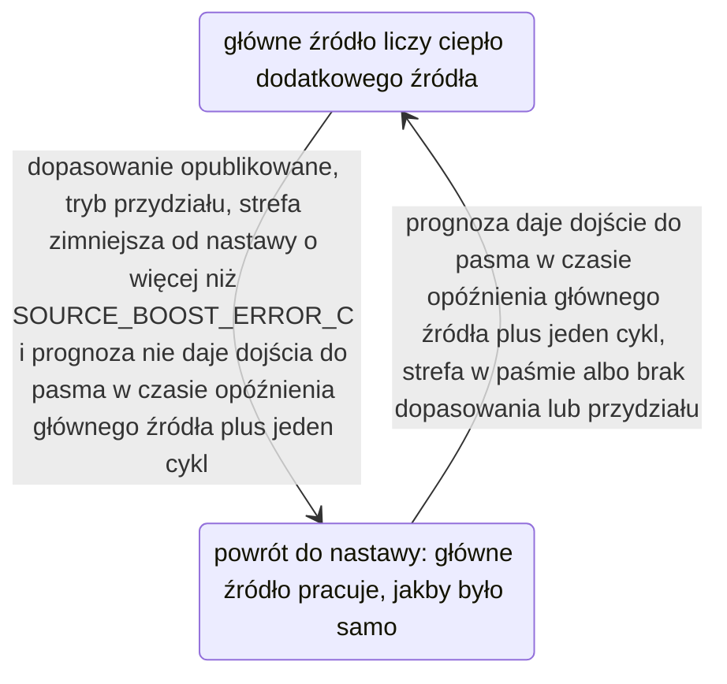

**Hamowanie z wyprzedzeniem.** Podłogówka reaguje z opóźnieniem wielu godzin: ciepło, które jest
już w drodze, płynie dalej, gdy strefa osiągnęła nastawę. Hamowanie ogranicza wysterowanie do tego,
co według dopasowanego modelu strefa może przyjąć:

    e(c) = setpoint − T(now + H),   H = max(L_f + tau_f, SOURCE_PREDICTION_MIN_S)

`T` liczy się krok po kroku (całkuje), w krokach `SOURCE_PREDICTION_STEP_S`. Prognoza używa
dopasowanych `a`, `b`, `a_f` i `k`. Temperatury zewnętrzną i sąsiadów zostawia takie, jakie są.
Po wysterowaniach, które są już w drodze, ustawia dodatkowe źródło na wysterowanie `c` (najwyżej
na jego limit mocy, sekcja 5.7). Główne źródło zaczyna od swojego ustalonego zapotrzebowania
i **oddaje swoje obciążenie**. Jego część wyprzedzająca odejmuje `a_f/a` za każdą jednostkę `x_f`,
którą dokłada znane ciepło dodatkowego źródła (o ile to ciepło jest już w jego prawie sterowania),
aż do 0 %. W drugą stronę przejmuje obciążenie z powrotem, aż do tego, ile najwięcej może dać (jego
współczynnik wody i maksymalny procent włączenia). W czasie powrotu do nastawy zapotrzebowanie
głównego źródła nie zawiera nic z ciepła źródła. Prognoza pozwala głównemu źródłu od teraz znowu
liczyć całe to ciepło, bo powrót kończy się, zanim ciepło źródła dotrze. Dzięki temu hamowanie nie
traktuje przyspieszenia jako stałego.

- Limit to największe `c`, przy którym `e(c) ≥ (1 − SPLIT_PREDICTED_SHARE)·e(allocation)`. Przy
  udziale równym 1 oznacza to, że przewidywana temperatura strefy jest równa nastawie. `e` maleje,
  gdy `c` rośnie. Jest płaskie, dopóki główne źródło jeszcze oddaje obciążenie, i bardziej strome,
  gdy główne źródło zejdzie już do 0. Dlatego limit wyznacza się przez `SOURCE_BRAKE_STEPS`
  połowień (za każdym razem zakres szukania dzieli się na pół).
- Strefa może być za ciepła bez względu na to, co robi dodatkowe źródło, z powodu własnego ciepła
  głównego źródła. Od dodatkowego źródła wymaga się wtedy tylko, żeby nie dokładało do tego: limit
  to największe `c`, przy którym `e(c) ≥ e(0)`.
- Oba warunki mają tolerancję `SOURCE_SENSITIVITY_MIN_C`. Źródło, które zmienia przewidywaną
  temperaturę strefy o mniej niż ta wartość, nie jest hamowane. Bez opublikowanego dopasowania nie
  ma hamowania.

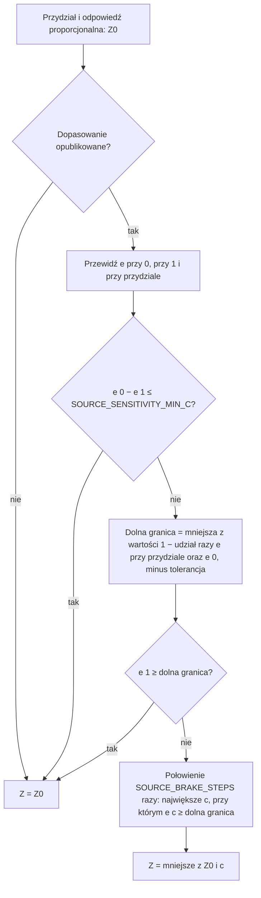

### 5.7 Ścieżka wykonawcza

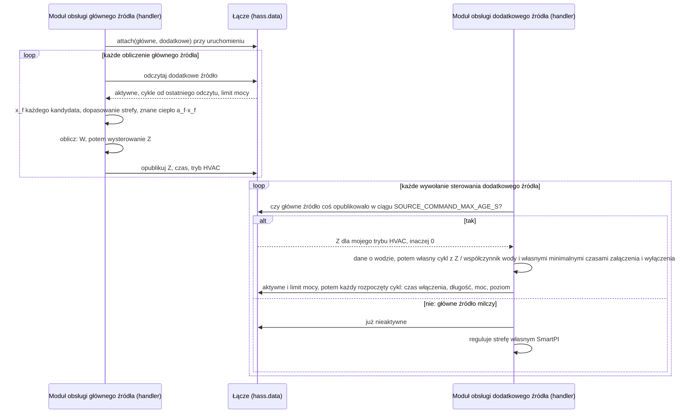

- **Łącze** jest w `hass.data["vtherm_smartpi"]["source_link"]`. Jest trzymane tylko w pamięci
  i budowane od nowa przy każdym uruchomieniu. Jego klucze to unikalne identyfikatory termostatów
  (unique id). Służy tylko wewnątrz SmartPI. Nie jest interfejsem dla innych integracji. Dodatkowe
  źródło słucha tylko jednego głównego źródła. Jeśli wskaże je drugie główne źródło, to drugie
  główne źródło dostaje ostrzeżenie i zostaje bez dodatkowego źródła. Zgłoszony cykl zawiera
  `start_s`, `on_s`, `duration_s`, `power`, `switched` i `level`.
- **Wysterowanie** dodatkowe źródło wykonuje własnym cyklem i z własnymi minimalnymi czasami
  załączenia i wyłączenia. Wysterowanie wynosi 0 w takich przypadkach: zostało wydane dla innego
  trybu HVAC (na przykład główne źródło jest wyłączone); własny termostat dodatkowego źródła jest wyłączony; albo menedżer mocy odcina
  obciążenie samego dodatkowego źródła (zrzut mocy). Jego własne wykrywanie otwartego okna i tryb
  bezpieczeństwa działają jak zwykle. Zrzut mocy działa na każdy termostat osobno, więc główne
  źródło objęte zrzutem nadal wydaje wysterowanie.
- **Milczące główne źródło.** Może się zdarzyć, że główne źródło przez `SOURCE_COMMAND_MAX_AGE_S`
  nie opublikuje nic, dla żadnego trybu HVAC, bo jego integracja się zatrzymała albo nie jest
  gotowa. Dodatkowe źródło reguluje wtedy strefę własnym SmartPI i własnym modelem i zapisuje
  ostrzeżenie w logu, aż wysterowania wrócą. W tym czasie nadal zgłasza swoje cykle. Dzięki temu
  główne źródło po powrocie zna ciepło, które jest już w drodze. Główne źródło wyłączone (przez
  użytkownika albo przez własne wykrywanie okna) nie milczy. Publikuje swoje 0 co
  `SMARTPI_RECALC_INTERVAL_SEC`, bo VTherm może je wywoływać tylko co `cycle_min`. Czas liczy się od
  podłączenia do pierwszego wysterowania, więc główne źródło, które dopiero wystartowało, też nie
  milczy. Bez tego trybu zapasowego strefa spadła z 20 do 16.2 degC w 12 h po awarii głównego
  źródła. Z nim strefa trzymała się w przedziale od 19.4 do 20.6 degC. Główne źródło usunięte
  z Home Assistant (albo przeładowane) od razu odłącza łącze. Dodatkowe źródło od razu reguluje
  wtedy samo, z informacją w logu, aż zostanie znowu podłączone.
- **Woda.** Wysterowanie głównego źródła to moc przy wodzie odniesienia. Dodatkowe źródło przy
  każdym wywołaniu sterowania czyta własne dane o wodzie i daje swojemu emiterowi `power / factor`
  (najwyżej 1), tak jak zrobiłby to jego własny SmartPI. Publikuje swój **limit mocy**: największą
  moc, jaką daje teraz pełne wysterowanie. Jest to jego współczynnik wody, co najmniej
  `WATER_NO_HEAT`, albo 1, gdy nie ma danych o wodzie. Hamowanie z wyprzedzeniem w głównym źródle używa
  tego limitu w swojej prognozie.
- **Główne źródło nic nie daje, gdy nie może zdecydować.** Jeśli przy obliczeniu nie może odczytać
  danych wejściowych zależności, publikuje 0 zamiast ostatniego wysterowania.
- **Czy dodatkowe źródło jest obecne?** Przy każdym wywołaniu sterowania dodatkowe źródło zgłasza
  łączu, że wykonuje wysterowania. Główne źródło uznaje je za aktywne, a jego ciepło za obecne,
  tylko dopóki ta wiadomość jest młodsza niż `SOURCE_COMMAND_MAX_AGE_S`. Źródło, które przestaje
  działać bez uprzedzenia, przestaje się liczyć po tym czasie. Usunięte źródło przestaje się liczyć
  od razu. Gdy źródło przestaje się liczyć, jego ciepło od razu znika z modelu, a jego wysterowania
  liczą się od tej chwili jako 0.
- **Cykle.** Dodatkowe źródło zgłasza każdy cykl, który zaczyna (sekcja 5.2). Gdy nowy cykl
  zaczyna się przed końcem poprzedniego, zastępuje on resztę poprzedniego cyklu. Zawór zgłasza
  każde nowe otwarcie w chwili, gdy ono następuje.
- **Własny SmartPI dodatkowego źródła stoi w miejscu.** Versatile Thermostat nadal wywołuje jego
  algorytm przy każdym pomiarze. Między wywołaniami sterowania przelicza też zawór prosto z wyjścia
  algorytmu. Dopóki trwa ta rola, każde z tych obliczeń od razu zwraca wysterowanie głównego źródła.
  Nic nie jest regulowane ani uczone, a nauczony model zostaje taki, jaki był na początku roli. Jego
  stan zapisuje się jak zwykle, a usługi SmartPI działają na tym prawdziwym stanie. Wymuszona
  kalibracja, o którą ktoś poprosi w czasie roli, czeka do końca roli, bo nic nie jest liczone. Gdy
  rola się kończy, jego SmartPI zaczyna nowy cykl od własnego modelu.
- **Diagnostyka dodatkowego źródła.** Jego blok `dependencies` pokazuje tylko jego rolę, główne
  źródło i wysterowanie, które wykonuje (sekcja 9).

### 5.8 Wyniki i ograniczenia (symulacja)

Zestaw testów `tests/test_smartpi_sim_zone_set.py` (uruchamiany z `SMARTPI_SIM_LOCAL=1`) porównuje
strefę z dwoma źródłami z dzisiejszym układem, czyli z dwoma SmartPI, które regulują strefę
niezależnie od siebie. W tych testach grzejnik jest głównym źródłem, a wodne ogrzewanie podłogowe
(opóźnienie 30 min, bezwładność 180 min, `a_f = a`) dodatkowym. Reguła to `lead_band` z 20 %,
czujniki mają krok 0.1 degC, a temperatura zewnętrzna to 3 degC (łagodnie) albo −8 degC (zimno),
z dobowym wahaniem ±3 degC. Dzień 1 zaczyna się 1 degC poniżej nastawy. Błąd ustalony (odchyłka od
nastawy, gdy wszystko się uspokoi) to średnia z dni 3–4. Potem przychodzą trzy noce z nastawą obniżoną
do 17 degC (na 6, 8 i 10 h).

**Dwanaście pomieszczeń** (`b` od 0.0005 do 0.002 /min, `a` od 0.015 do 0.06 degC/min):

| Miara | Strefa z dwoma źródłami | Dwa niezależne SmartPI |
|---|---|---|
| Błąd ustalony, średnia z 12 pomieszczeń | 0.030 degC | 0.065 degC |
| Błąd ustalony, zakres | 0.018–0.052 degC | 0.032–0.113 degC |
| Przeregulowanie po nocy, najgorsze pomieszczenie / średnia | 0.30 / 0.13 degC | 0.53 / 0.40 degC |
| Czas dojścia do 0.2 degC poniżej nastawy po nocy, średnio | 2.94 h | 2.86 h |
| To samo, najwolniejsze pomieszczenie (`b` 0.0005, `a` 0.015, zimno) | 4.8 h | 4.1 h |
| Błąd w dniu 1, średnio | 0.43 degC | 0.33 degC |
| Publikacja dopasowania | po 19.5 h w każdym pomieszczeniu | — |
| Dopasowane `a`, `b`, `a_f` względem prawdziwych wartości | 0.99–1.03, jedno `a_f` 1.10 | własne wartości SmartPI, jeden termostat: `a` 0.55–1.34, `b` 0.53–1.16 |
| Opóźnienie głównego źródła | 10 min, prawdziwe, w każdym pomieszczeniu | — |

**Instalacje** (pomieszczenie `b` 0.001, `a` 0.03, łagodnie):

| Przypadek | Strefa | Niezależne | Dopasowanie |
|---|---|---|---|
| podłogówka za zaworem | 0.020 degC | 0.050 degC | 1.03/1.02/1.03 |
| płyta nagrzewająca się w głąb (dwie bezwładności jedna po drugiej) | 0.035 degC | 0.056 degC | `a` 0.95, `b` 1.06, `a_f` 1.18 |
| woda na krzywych grzewczych, dane o wodzie z encji (powrót do nastawy 6.7 h wobec 5.9 h) | 0.053 degC | 0.094 degC | 0.99/0.97/0.94 |
| dwie strefy, drzwi otwarte 6–23 h | 0.034 / 0.029 degC | 0.072 / 0.055 degC | `k` 0.89 / 0.94 |
| dwie strefy, zawsze otwarte | 0.021 / 0.018 degC | 0.055 / 0.042 degC | `k` 1.04 / 0.96 |

Scenariusze z `tests/test_smartpi_sim_second_source.py`: z drugim grzejnikiem jako dodatkowym
źródłem (Z4) 0.037 degC wobec 0.053; chłodzenie z dwoma źródłami: 0.024 degC; krzywe `source_first`
i `together` są osiągane.

**Decyzje podjęte na podstawie tych wyników:**

- **Bloki uczenia 100 % / 0 %.** Bloki 70 % / 30 % łagodzą dzień 1 (średnio 0.39 wobec 0.43 degC)
  przy prawie tym samym błędzie ustalonym (0.030 wobec 0.029 degC w tym porównaniu, które zrobiono
  przed wprowadzeniem przyspieszenia powrotu). Ale mniejszy kontrast zostawia dopasowanie dalej od
  prawdy, nawet po tygodniu: w jednym pomieszczeniu błąd 8 % (`a_f` 0.92) i jedno `a_f` na 1.12.
  Przy blokach 100 % / 0 % każda wartość mieści się w granicach 3 %, oprócz jednego `a_f` na 1.10.
  Dopasowanie daje SmartPI model na stałe, a dzień 1 zdarza się tylko raz.
- **Powrót do nastawy, w którym główne źródło pracuje tak, jakby było samo** (sekcja 5.6). Bez
  tego poranny powrót trwał średnio 3.55 h wobec 2.86 h, 8.9 h wobec 4.1 h w najwolniejszym
  pomieszczeniu i 12.4 h wobec 5.9 h z wodą. Inne możliwości sprawdzone po drodze:
  - pominięcie tylko tej części ciepła źródła, która przekracza jego przydział: średnio 3.21 h,
    6.1 h w najwolniejszym pomieszczeniu i prawie żaden zysk z wodą, bo tam ciepło podłogówki zostaje
    poniżej przydziału;
  - pominięcie całego ciepła, przy czym hamowanie traktowało przyspieszenie jako stałe: hamowanie
    odcięło podłogówkę, 3.35 h;
  - pominięcie całego ciepła aż do 0.2 degC poniżej nastawy: 2.92 h, ale do 0.66 degC
    przeregulowania w szybkich pomieszczeniach, z ciepła, które grzejnik już wysłał. Dlatego
    przyspieszenie kończy się wcześniej;
  - płynne wygaszanie między 0.5 a 0.1 degC zamiast progu: nie szybciej, a strefa na wodzie
    ustaliła się 0.15 degC za nisko.
- **Co nie zadziałało i dlaczego projekt jest taki, jaki jest:**
  - *Uczenie dodatkowego źródła na podstawie modelu SmartPI* (pierwszy projekt): `a_f` wychodziło
    od 0.61 do 1.64 prawdziwej wartości przy czujnikach 0.1 degC albo wcale nie było publikowane.
  - *Czas martwy SmartPI w dopasowaniu*: przy powolnych wzrostach temperatury dwa do sześciu razy za
    długi. Przez to 2 z 12 pomieszczeń nigdy nie opublikowały dopasowania, a w innym pomieszczeniu
    SmartPI czekał na dopasowanie 57 h (tę próbę zrobiono, zanim powstał limit czasu 48 h). Siatka
    opóźnień znajduje prawdziwe opóźnienie.
  - *Hamowanie z głównym źródłem trzymanym na stałe na jego zapotrzebowaniu*: główne źródło nigdy nie
    oddawało swojego obciążenia. Przez to podział zostawał taki, jaki był na starcie pętli (reguła
    `source_first`: główne źródło na 21 %, gdzie krzywa wymaga 0 %).
  - *Przekazywanie obciążenia z limitem wyznaczanym po linii prostej*: ponieważ `e` w czasie
    przekazywania jest płaskie, limit spadał do 0, a podłogówka przełączała się między 0 a 100 %.
  - *Odcinanie źródła zawsze, gdy prognoza mówi, że strefa będzie za ciepła*: strefa ciepła od
    własnego ciepła głównego źródła traciła dodatkowe źródło (dwa grzejniki: 0.072 wobec
    0.053 degC). Teraz hamowanie tylko pilnuje, żeby źródło do tego nie dokładało.
  - *Pętla przydziału całkująca przez przerwy*: po godzinach wyłączenia albo po kalibracji jej
    pierwszy krok obejmował całą przerwę i skakał do 0 albo 100 %. Teraz pętla w przerwie stoi.
  - *Własne liczniki wiarygodności SmartPI po dopasowaniu*: część wyprzedzająca zostawała na jednej
    szóstej swojej wartości (5 z 30 nauczonych próbek). Obciążenie niosła całka, zamrożona w strefie
    nieczułości (małym zakresie błędu, w którym regulator nie reaguje). Ta poprawka razem z opisanymi
    wyżej poprawkami hamowania zmniejszyła błąd ustalony pomieszczenia bazowego z 0.058 do
    0.022 degC.
  - *Limit przesunięcia znanego ciepła na 15 degC*: przy zimnej pogodzie podłogówka, która niesie
    większość obciążenia, przesuwa `T_ref` o więcej. Część wyprzedzająca liczyła mniej ciepła
    podłogówki, niż go było, i strefa ustalała się 0.07 degC za ciepło. Teraz limitem jest
    `KNOWN_HEAT_MAX_SHIFT_C` (sekcja 3.2).
  - *Cykle włącz/wyłącz liczone z pełną mocą przy danych o wodzie*: włączona podłogówka daje swój
    współczynnik wody, a nie 1. Dopasowanie znajdowało `a_f` na poziomie 0.30 prawdziwej wartości.
  - *Własne `k` sąsiadów w strefie z dwoma źródłami*: za drzwiami nigdy nie zostało opublikowane.
    Strefa pomijała wymianę ciepła i przy otwartych drzwiach ustalała się 0.14 degC za nisko (0.125
    wobec 0.055 degC). Naprawiło to `k` z dopasowania.

**Ograniczenia:**

- **Poranny powrót po nocnym obniżeniu** jest średnio tak samo szybki jak przy dwóch niezależnych
  SmartPI. W 4 z 12 pomieszczeń jest szybszy, a w pozostałych wolniejszy o najwyżej 0.9 h: 4.8 h
  wobec 4.1 h w najwolniejszym pomieszczeniu, 6.0 h wobec 5.1 h w innym wolnym pomieszczeniu przy
  zimnej pogodzie i 6.7 h wobec 5.9 h z wodą. Pozostała różnica bierze się z nocy: podłogówka strefy
  prawie nie pracuje, dopóki nastawa nie wzrośnie (jej ciepło rano to 0.11, wobec 0.36 przy dwóch
  niezależnych SmartPI). Tę różnicę zamknąłby tylko wcześniejszy start przed znanym harmonogramem.
- **Dzień 1** jest gorszy niż przy dwóch niezależnych SmartPI (0.43 wobec 0.33 degC): bloki uczenia
  powodują wahania temperatury w strefie, dopóki dopasowanie nie zostanie opublikowane.
- **Płyta nagrzewająca się w głąb** nie pasuje kształtem do żadnego kandydata. Jej dopasowanie ma
  błędy do 18 % (`a_f`), ale regulacja i tak jest lepsza niż przy dwóch niezależnych SmartPI.
- Każdy termostat nadal ma własne cykle włącz/wyłącz; podział nie zmniejsza liczby przełączeń.

## 6. Komponenty i interfejsy

Wszystkie moduły poniżej to zwykły kod w Pythonie. Można je testować bez działającego HA.

| Moduł | Zadanie |
|---|---|
| `smartpi/dependencies.py` | Pozycje konfiguracji (`kind`, `mode`, czujniki drzwi, reakcja na okno), odczyt i sprawdzanie konfiguracji, nauczony stan każdej pozycji (`DependencyState`) |
| `smartpi/dependency_inputs.py` | Odczyty do jednego obliczenia: temperatura sąsiada, dostępność, tryb bezpieczeństwa, stan okna; czujniki drzwi; presety strefy i jej zakres temperatur |
| `smartpi/effective_model.py` | Znane wejścia (`ExchangeInput`, `HeatInput`, `KnownInputs`) i ich składanie (`compose`) |
| `smartpi/coupling_estimator.py` | Uczenie współczynników wymiany `k` z okien pomiarowych |
| `smartpi/dependency_model.py` | Wewnątrz algorytmu: zamiana odczytów na znane wejścia, bramki uczenia, reakcja na okno sąsiada, diagnostyka; w strefie z dwoma źródłami także dopasowanie strefy, wartości startowe modelu SmartPI, bloki i zegar uczenia, pętla przydziału, hamowanie z wyprzedzeniem i przyspieszenie powrotu |
| `smartpi/source_model.py` | Drugie źródło: typy emiterów, opóźnienie i bezwładność, ciepło `x_f` teraz i w przyszłości |
| `smartpi/source_candidates.py` | Drugie źródło: kandydujące skale czasu i ciepło dla każdej z nich |
| `smartpi/zone_fit.py` | Drugie źródło: wspólne dopasowanie strefy (straty, oba źródła, opóźnienie głównego źródła, skala czasu, sąsiedzi) |
| `smartpi/split.py` | Drugie źródło: reguły podziału, pętla przydziału, zalecenie według typu emitera |
| `smartpi/source_settings.py` | Drugie źródło: jego reguła i emitery, odczytane ze skonfigurowanej pozycji |
| `smartpi/source_link.py` | Drugie źródło: łącze między głównym a dodatkowym źródłem w jednym Home Assistant (wysterowania w jedną stronę, cykle i limit mocy w drugą) |
| `smartpi/water_input.py`, `repairs.py` | Współczynnik wody każdego źródła i reset proponowany, gdy dane o wodzie się pojawią albo znikną; patrz [Wejścia wody i kotła](water_input.md) |

W istniejących plikach:

- **`algo.py`** przy każdym obliczeniu czyta znane wejścia (`_read_known_inputs`). Stosuje reakcję
  na okno sąsiada, składa model efektywny w jedynym punkcie podstawienia
  (`_compose_effective_model`) i przekazuje bramkę uczenia oraz poprawkę do okna uczenia. Zapisuje
  też moc, którą każdy zakończony cykl naprawdę dostarczył. W strefie z dwoma źródłami startuje
  z dopasowania strefy i trzyma ten model (`_apply_zone_fit`, sekcja 5.5).
- **`handler.py`** rejestruje dostawcę odczytów, gdy skonfigurowano zależności
  (`_read_dependencies`). Encje znajduje po ich identyfikatorze w rejestrze. Przy starcie usuwa
  nauczony stan pozycji, które usunięto z konfiguracji. Główne źródło podłącza swoje dodatkowe
  źródło do łącza i publikuje wysterowanie po każdym obliczeniu. Termostat wskazany jako dodatkowe
  źródło wykonuje ścieżkę wykonawczą zamiast własnego regulatora. Gdy główne źródło milczy, działa
  własnym regulatorem (sekcja 5.7).
- **`config_flow.py`** daje wpisowi termostatu menu opcji z formularzem strefy, listą zależności
  i formularzami sąsiadów. Termostat, który pracuje jako dodatkowe źródło, dostaje zamiast tego
  formularz swojej roli. Krok importu tworzy wpis członka strefy, który go nie ma (sekcja 2.1).
- **`__init__.py`** przeładowuje główne źródło strefy, gdy zapisuje się wpis jej dodatkowego
  źródła. Gdy formularz strefy tworzy wpis, przeładowuje tylko termostat, którego ten wpis dotyczy.

**Dane czytane z Versatile Thermostat.** Odczyty pochodzą z atrybutów stanu, które publikuje
VTherm. Te atrybuty mogą się zmienić razem z gałęzią `master` VTherm:

| Czyje | Atrybuty |
|---|---|
| Sąsiad (VTherm) | `current_temperature`; `safety_manager.safety_state`; `window_manager.window_state` i `window_auto_state` |
| Sąsiad (czujnik) | jego stan, jako temperatura |
| Sama strefa | `preset_temperatures` (`frost_temp`, `eco_temp`, `eco_cool_temp`), `min_temp`, `max_temp`; do ostrzeżeń formularza `window_manager.window_sensor_entity_id` i `is_window_auto_configured` |
| Termostat nadrzędny strefy (formularz) | jego typ (over climate), jego urządzenia, jego samoregulacja i czujnik temperatury, z jego wpisu konfiguracji |

## 7. Jedno obliczenie

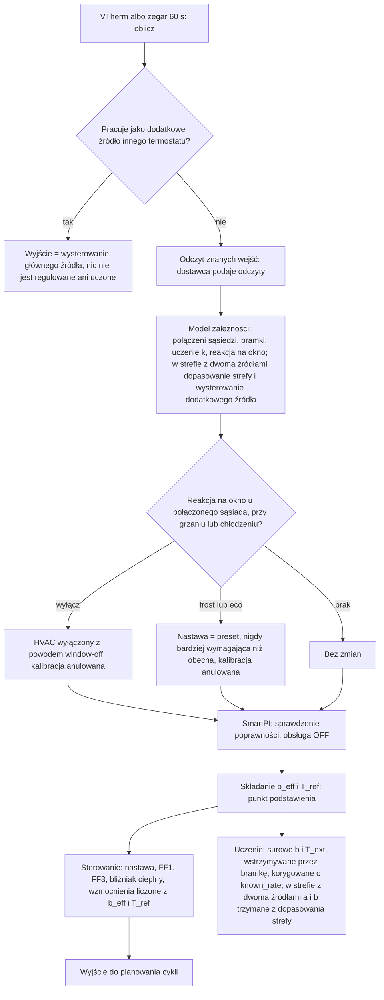

- **Gdy dostawca odczytów zawiedzie,** nauczony model zostaje bez zmian, a obliczenie idzie dalej
  bez znanych wejść. Problem z zależnościami nigdy nie zatrzymuje regulacji.
- **Zbocze bramki uczenia** (chwila, gdy bramka się włącza albo wyłącza) odrzuca otwarte okno
  uczenia i trwający pomiar czasu martwego, bo mieszałyby one dwie różne sytuacje. Znaczniki czasu
  martwego używane przez prawo sterowania zostają nietknięte.
- **Zmiana aktywnych wejść** (ich sygnatury) anuluje otwarte okna korekty FF, bo dane w nich
  zakładały poprzedni model.

## 8. Zapisywany stan

Stan zależności zapisuje się razem ze stanem SmartPI pod kluczem `dependencies`, ale tylko wtedy,
gdy jest co zapisać:

```text
dependencies
├── version                     wersja formatu (1)
├── items
│   └── <id pozycji>
│       └── k_history           przyjęte wartości k z pojedynczych okien
└── shared
    └── coupling
        ├── ls_rows             bufor połączeń przez drzwi otwarte jednocześnie
        ├── joint_rows          bufor wspólnego dopasowania sąsiadów połączonych na stałe
        ├── joint_k             historia dopasowań, które rozdzieliły współczynniki, dla każdego sąsiada
        └── joint_b             współczynniki strat dopasowane razem z nimi
```

W stanie głównego źródła pozycja źródła strefy przechowuje:

| Klucz | Zawartość |
|---|---|
| `zone_fit`, `zone_fit_cool` | wspólne dopasowanie strefy dla każdego trybu HVAC: jego sumy (10 cyfr znaczących), używana para i opublikowany wynik (`a`, `b`, `a_f`, `k`, błędy standardowe `a_f` i `k`, opóźnienie głównego źródła, kandydat); null przed pierwszym oknem |
| `response_start` | odpowiedź emitera, z którą nauczono się dopasowań. Jeśli przy starcie odpowiedź jest inna, dopasowania, zegary uczenia i używana skala czasu są usuwane |
| `response` | używana kandydująca skala czasu (`lag_s`, `tau_s`) |
| `allocation`, `x_f` | wysterowanie pętli przydziału i ciepło źródła |
| `learn_elapsed_s` | zegar uczenia każdego trybu HVAC (`heat`, `cool`; sekcja 5.5) |
| `k_history`, `cool` | oszacowanie ciepła źródła zrobione we własnych oknach sąsiadów; służy tylko do tego, żeby to ciepło nie trafiło do ich `k` |

Po restarcie strefa działa dalej od miejsca, w którym była. Dopasowanie opublikowane przed
restartem od razu w pełni wchodzi do prawa sterowania: `a_f` źródła dla każdego z trybów HVAC
i `k` sąsiadów z dopasowania używanego trybu HVAC (sekcja 3.3). Sumy dopasowania zapisują się od
jego pierwszego okna, bez względu na to, czy dopasowanie jest już opublikowane. Zajmują około 16 KB
zapisanego stanu SmartPI na każdy tryb HVAC, 26 KB z jednym sąsiadem i 38 KB z dwoma.

- Zapisany stan SmartPI przechowuje też ostatni zastosowany token resetu
  (`dependency_reset_token`, sekcja 2.2).
- Stary zapisany stan bez tego klucza wczytuje się tak jak wcześniej.
- Przy starcie stan pozycji, których nie ma już w konfiguracji, jest usuwany.
- Zapisany stan, którego nie da się odczytać, jest pomijany. Wiersze, których nie da się użyć, są
  pomijane, a wymiana ciepła jest uczona od nowa.
- `reset_learning` czyści stan zależności razem z resztą.

## 9. Diagnostyka

Publikowana diagnostyka dostaje blok `dependencies` tylko wtedy, gdy skonfigurowano zależności:
sąsiada albo główne źródło strefy z dwoma źródłami (jego `items` może być wtedy puste). Bloku nie
ma przy obliczeniu, w którym nie udało się pobrać odczytów:

| Pole | Znaczenie |
|---|---|
| `b_eff`, `t_ref` | złożony model |
| `inputs_active` | czy znane wejścia są aktywne |
| `learning_gate` | `neighbour_window`, `door_open`, `source_heat`, `door_settling`, `boiler_settling` albo brak |
| `neighbour_window_action` | zastosowana reakcja na okno |
| `items[]` | dla każdego sąsiada: `id`, `kind` (`neighbour`), `entity`, `mode`, `available`, `active`, `t_neighbour`, `neighbour_window`, `k`, `k_reliable`, `k_from_zone_fit`, `k_samples`, `indistinguishable`, `share_of_losses`; `available` ma wartość false także w trybie bezpieczeństwa albo gdy nie ma poprawnej (skończonej) temperatury |

Przy drugim źródle blok ma też `second_source`:

| Pole | Znaczenie |
|---|---|
| `id`, `entity`, `rule` | pozycja dodatkowego źródła i jego reguła |
| `active` | dodatkowe źródło wykonuje wysterowania głównego źródła |
| `mode` | `learn`, `allocation` albo `off` (sekcja 5.5) |
| `command`, `x_f` | wydane wysterowanie i obecne ciepło źródła (0..1) |
| `power_cap` | największa moc, jaką daje teraz pełne wysterowanie (jego współczynnik wody, co najmniej `WATER_NO_HEAT`; 1 bez danych o wodzie albo gdy źródło nie jest obserwowane) |
| `recovery_boost` | strefa wraca do nastawy: znane wejścia głównego źródła pomijają ciepło źródła (sekcja 5.6) |
| `a_f`, `a_f_reliable` | dopasowany wpływ dla bieżącego trybu HVAC |
| `lead_emitter`, `source_emitter`, `lag_min`, `tau_min` | emitery i używana skala czasu |
| `lead_demand_avg` | średnie ustalone zapotrzebowanie głównego źródła, za którym idzie pętla |
| `zone_fit` | `published`, `windows` (liczone z zanikaniem), `a`, `b`, `a_f`, `lead_delay_min`, `k`, `timed_out` (sekcja 5.4) |

`share_of_losses` to obecny udział sąsiada w stratach strefy, liczony z własnym `b` SmartPI:
`k·(T − T_j) / (b·(T − T_ext) + k·(T − T_j))`.

Termostat, który pracuje jako dodatkowe źródło innego termostatu, publikuje zamiast tego takie
pola: `role` (`second_source`), `lead` (unikalny identyfikator głównego źródła) i `command`
(wysterowanie, które wykonuje).

## 10. Testy

Dokument [Testy](testing.md) opisuje testy znanych wejść, stref sąsiednich i strefy z dwoma
źródłami ciepła. Obejmuje to testy jednostkowe, testy algorytmu, modułu obsługi (handler), formularzy
i symulacji, sam symulator oraz scenariusze N1–N7 i Z1–Z7 z ich kryteriami. Wyniki w sekcjach
4.6 i 5.8 pochodzą z tych testów.

## 11. Stałe

| Stała | Wartość | Rola |
|---|---|---|
| `KNOWN_INPUTS_B_EFF_MIN` | 1e-5 /min | najmniejsza złożona strata; poniżej niej wejścia nie są składane |
| `KNOWN_HEAT_MAX_SHIFT_C` | 40 degC | limit przesunięcia `T_ref` przez ciepło |
| `COUPLING_WINDOW_S` | 30 min | okno pomiarowe |
| `MIN_WINDOW_SAMPLES` (`coupling_estimator.py`) | 10 | liczba obliczeń potrzebna w oknie, także w dopasowaniu strefy |
| `OUTLIER_MIN_HISTORY`, `OUTLIER_MAD_FACTOR` (`coupling_estimator.py`) | 5, 3 | wartości odstające w historii drzwi: sprawdzane od tylu wartości, odstająca jest wartość dalej niż tyle skalowanych MAD (`AB_MAD_K`) |
| `COUPLING_K_MIN_DT` | 0.5 degC | najmniejsza różnica i zmienność temperatury, które niosą przydatną informację |
| `COUPLING_K_MAX` | 0.02 /min | największe realistyczne `k` |
| `COUPLING_MIN_SAMPLES` | 8 | liczba wartości przed publikacją |
| `COUPLING_MAX_DISPERSION` | 0.35 | wymagana zgodność (MAD podzielone przez medianę) |
| `COUPLING_HISTORY_SIZE` | 31 | długość historii |
| `COUPLING_LS_WINDOW` | 31 okien | bufor połączeń przez drzwi otwarte jednocześnie |
| `COUPLING_LS_COND_MAX` | 30 | granica rozróżnienia wejść (wskaźnik uwarunkowania znormalizowanej macierzy Grama); dziesięć razy więcej dla dopasowania strefy |
| `COUPLING_JOINT_WINDOW` | 96 okien | bufor wspólnego dopasowania |
| `COUPLING_JOINT_MIN_ROWS` | 24 okna | liczba okien przed wspólnym dopasowaniem |
| `COUPLING_JOINT_FIT_SPACING` | 4 okna | liczba nowych okien między dwoma zachowanymi dopasowaniami |
| `COUPLING_JOINT_MAX_REL_SE` | 0.15 | największy względny błąd standardowy zachowanego dopasowania |
| `DOOR_SETTLING_S` | 10 min | przerwa po zmianie stanu drzwi |
| `SPLIT_DEFAULT_RATIO`, `SPLIT_DEFAULT_ALONE`, `SPLIT_DEFAULT_BAND` | 100 %, 50 %, 20 % | domyślne wartości reguł |
| `SPLIT_SETTLE_FACTOR` | 4 | czas całkowania pętli przydziału, liczony w czasach ustalania się źródła |
| `SPLIT_MIN_TIME_S` | 60 min | najkrótszy czas całkowania pętli przydziału |
| `SPLIT_AVERAGE_FRACTION`, `SPLIT_AVERAGE_MIN_S` | 0.1, 15 min | średnia zapotrzebowania głównego źródła |
| `SPLIT_MIN_FULL_RANGE_S` | 10 min | najkrótszy czas, w którym źródło przechodzi cały swój zakres |
| `SPLIT_DEMAND_MIN`, `SPLIT_DEMAND_MAX` | −1, 2 | zakres zapotrzebowania podawanego do pętli |
| `SPLIT_SLOW_SOURCE_S` | 60 min | źródło, które ustala się tak długo, liczy się jako wolne |
| `SPLIT_ROLES_REVERSED_FACTOR` | 1.5 | główne źródło, które ustala się tyle razy wolniej niż jego dodatkowe źródło, dostaje ostrzeżenie w formularzu (sekcja 5.3) |
| `SPLIT_LIMIT_ERROR_C`, `SPLIT_LEAD_STOPPED`, `SPLIT_LEAD_FULL` | 0.2 degC, 1 %, 99 % | główne źródło, które utknęło na granicy zakresu |
| `SPLIT_HOLD_ERROR_C` | 0.05 degC | wstrzymania źródła zależne od błędu strefy |
| `SPLIT_ERROR_GAIN` | 2 na degC | proporcjonalna odpowiedź źródła na błąd |
| `SOURCE_X_OFF` | 0.05 | poniżej tej wartości ciepło źródła liczy się jako nieobecne, a bramka `source_heat` pozwala wrócić do uczenia |
| `SOURCE_X_MIN` | 0.2 | od tej wartości `x_f` bramka `source_heat` wstrzymuje uczenie; okno pomiarowe sąsiada liczy się do kolumny źródła dopiero wtedy, gdy jego ważone `x_f` dojdzie do tej wartości |
| `SOURCE_A_F_MAX`, `SOURCE_X_MIN_STD` | 0.5 degC/min, 0.1 | kolumna źródła we własnych oknach sąsiadów: największa realistyczna wartość, potrzebna zmienność |
| `KNOWN_INPUT_FADE_S` | 60 min | czas, w którym nowo poznany współczynnik wchodzi do modelu |
| `SOURCE_COMMAND_MAX_AGE_S` | 15 min | główne źródło, które przez tyle czasu nic nie publikuje, uznaje się za zatrzymane; wiadomość źródła, że wykonuje wysterowania, jest ważna tak długo |
| `SOURCE_TRAJECTORY_MIN` | 15, 30, 60, 120 min | punkty horyzontu prognozowanego ciepła źródła w jego znanym wejściu (prawo sterowania ich nie używa, sekcja 3.2) |
| `SOURCE_LEARN_HIGH`, `SOURCE_LEARN_LOW` | 100 %, 0 % | bloki uczenia dodatkowego źródła |
| `SOURCE_LEARN_BLOCK_MIN_S` | 2 h | najkrótszy blok; blok trwa `max(SOURCE_LEARN_BLOCK_MIN_S, 2 × L_f + 2 × tau_f)` (sekcja 5.5) |
| `SOURCE_LEARN_COLD_C`, `SOURCE_LEARN_WARM_C` | 0.5 degC, 0.3 degC | strefa o tyle za zimna dostaje źródło na pełną moc, a o tyle za ciepła wcale |
| `ZONE_FIT_MIN_WINDOWS` | 36 okien, liczonych z zanikaniem (najwcześniej 39 okien, 19.5 h) | liczba okien, zanim dopasowanie może zostać opublikowane |
| `ZONE_FIT_MEMORY_WINDOWS` | 288 okien (6 dni) | zanikająca pamięć dopasowania |
| `ZONE_FIT_MAX_REL_SE` | 0.2 | największy względny błąd standardowy `a`, `b`, `a_f` |
| `ZONE_FIT_SWITCH_GAIN` | 0.2 | inna para zastępuje używaną parę tylko wtedy, gdy jej reszta jest niższa co najmniej o ten udział (20 %) |
| `ZONE_FIT_LEAD_DELAYS_MIN` | 0, 3, 6, 10, 15, 20, 30, 45, 60 min | kandydujące opóźnienia głównego źródła |
| `SOURCE_SCALE_MULTIPLIERS` | od 0.4 do 2.5 (dziesięć wartości) | kandydujące skale czasu źródła z opóźnieniem albo bezwładnością |
| `SOURCE_FAST_TAU_MIN` | od 0 do 60 min (dziesięć wartości) | kandydujące bezwładności źródła bez opóźnienia i bezwładności |
| `ZONE_FIT_TIMEOUT_S` | 48 h | bez opublikowanego dopasowania SmartPI uczy się sam |
| `ZONE_FIT_MAX_GAP_S` | 15 min | dłuższa przerwa między obliczeniami przerywa okno dopasowania i nie liczy się do zegara uczenia |
| `ZONE_FIT_MODEL_SAMPLES_A` | 10 | liczba próbek `a` w SmartPI, gdy trzyma on dopasowanie (jego pasmo przy nastawie idzie wtedy za modelem) |
| `SOURCE_PREDICTION_STEP_S`, `SOURCE_PREDICTION_MIN_S` | 60 s, 30 min | prognoza hamowania: krok, najkrótszy horyzont |
| `SOURCE_SENSITIVITY_MIN_C` | 0.01 degC | źródło, które zmienia prognozę o mniej, nie jest hamowane; tolerancja hamowania |
| `SPLIT_PREDICTED_SHARE` | 1 | część prognozowanego błędu, którą źródło może poprawić |
| `SOURCE_BRAKE_STEPS` | 8 | liczba połowień, które wyznaczają limit hamowania |
| `SOURCE_BOOST_ERROR_C` | 0.2 degC | strefa zimniejsza o więcej wraca do nastawy z głównym źródłem pracującym tak, jakby było samo |
| `WATER_NO_HEAT` | 0.05 | najniższy limit mocy źródła na wodzie ([Wejścia wody i kotła, §10](water_input.md#10-stałe-ograniczenia-i-otwarte-kwestie)) |
